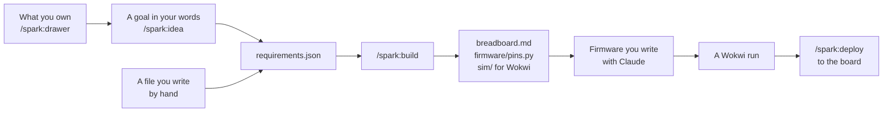

# spark

**spark is a Claude Code plugin for gadgets built from an ESP32 dev board and off-the-shelf modules. It turns your idea
into a breadboard you can wire and firmware you can test.**

From a list of parts, spark builds and checks the design. It writes a *breadboard sheet*: the parts and the wires, one
step each. It writes a *pin map*: a file that tells your firmware which board pin each part uses. It also makes a
*simulation* for [Wokwi](https://wokwi.com), an online ESP32 simulator that runs your firmware before you flash it.

## spark in 60 seconds

Name the dev board and the parts in `requirements.json`:

```json
{"board": "firebeetle2-esp32s3", "parts": ["tactile-button", "led-red-5mm"]}
```

In Claude Code, type `/spark:build`. In a terminal, clone spark and run the same chain from the clone:

```sh
git clone https://github.com/xmejkal/spark
python3 spark/scripts/check_spine.py requirements.json --keep build
```

spark builds the board, checks it, and keeps what it made in `build/`. This run took 7 seconds:

<!-- output: run 2026-11-01, spark 0.9.0 -->
```text
  wrote build/board.tsx
  wrote build/breadboard.md — the parts and how to wire them on a breadboard
  wrote build/firmware/pins.py — the pins the firmware imports
  wrote build/sim — the simulation project: diagram.json, wokwi.toml and the chips
  ...
  [ok  ] build            7 trace(s), 0 errors, tsci 0.0.2600
  ...
  the chain runs end to end
```

`build/breadboard.md` gives one connection per step, by the labels printed on the board. Step 6 of this run:

> 6\. Run a jumper from board D3 to the row of TactileButton A.

Two roads lead to that requirements file:



## What it is

spark is for a hobbyist who builds a gadget from an ESP32 *dev board* and off-the-shelf modules. A dev board is a
module such as the DFRobot FireBeetle 2 ESP32-S3. spark is not for chip-down boards made in volume
([the vision](scrum/VISION.md)).

- You describe the gadget. spark turns it into needs and matches them against the parts you own and the parts it
  knows.
- It researches a missing part from the vendor's own documents. It writes the part as a
  [record](GLOSSARY.md#record--and-the-four-places-one-lives): each fact with a source and whether anyone checked it.
- [The chain](GLOSSARY.md#the-spine-or-the-chain--scriptscheck_spinepy) starts from a
  [requirements file](GLOSSARY.md#the-requirements-file). Every pin gets a reason, and the connections come from the
  parts' records.
- The same build is also a printed circuit board that your dev board and modules plug into. Its placement is a first
  draft, which you lay out before you order it.

Where a fact is missing, spark refuses, or it goes on with a [stand-in](GLOSSARY.md#stand-in-placeholder) that it names
in `board.tsx`. A check that was [**unable to look**](docs/guide/agents.md#the-outcomes-and-their-exit-codes) never reads
as a pass. [What never to assume](docs/guide/agents.md#what-never-to-assume) lists where that does not hold yet.

## Install

You need Claude Code, Python 3.9 or newer and Node 20 or newer. The runs for these docs were on macOS. In Claude Code:

```
/plugin marketplace add xmejkal/spark
/plugin install spark
```

Then, in a project folder, type `/spark:init` to write the project's files. Type `/spark:setup` to install the tools spark needs. It
installs them after you see the commands and say yes. [Build](docs/guide/journey/build.md) in the journey guide gives the details for
Linux and says what an update replaces.

## Two roads to a board

**From what you own.** Type `/spark:drawer` and say what you own (*a FireBeetle 2 ESP32-S3 and a pack of ten red
LEDs*). Then type `/spark:idea` and say what you want to make (*a button that lights an LED*). Claude turns your words
into needs and matches them against your drawer and spark's records. You pick a part for each need, and spark reserves
what you own. The picks become a requirements file. `/spark:build` builds the board, and the tally ends the run with one
cost line. [A recorded run](docs/guide/journey/recorded-run.md) shows each script and its output.

**From a requirements file you write.** Name the dev board and the parts as in the example above. `boards.py --list`
and `parts.py --list` print their ids. Then type `/spark:build`.
[`/spark:build`'s page](commands/build.md#the-requirements-file) says what else the file takes.

After either road, type `/spark:init` again. It names the rails from the built board, and its last step runs
`check_all.py --project .`. An AI agent adds `--json` and follows [the contract](docs/guide/agents.md#the-contract-first).

## What works today

[](docs/guide/journey.md)

The same journey is on Miro, beside the plans:

- [the journey frame](https://miro.com/app/board/uXjVEavQ4JQ=/?moveToWidget=3458764687016851094)
- [the story map by release](https://miro.com/app/board/uXjVEavQ4JQ=/?moveToWidget=3458764687094797318)
- [the roadmap](https://miro.com/app/board/uXjVEavQ4JQ=/?moveToWidget=3458764688467218869)
- [the code architecture](https://miro.com/app/board/uXjVEavQ4JQ=/?moveToWidget=3458764687681319899)

Each status comes from runs made for these docs, up to 2026-11-01. [The journey guide](docs/guide/journey.md) shows the
output of each step and gives each status in full. **works**: it ran end to end for these docs. **partly**: it stops
before its goal, or part of it was not run here. **not yet**: nothing does it yet.

| step | today | with |
| --- | --- | --- |
| [Drawer](docs/guide/journey/drawer.md) | **partly**: the scripts that list and write what you own ran, but the conversation and the DFRobot import did not | `/spark:drawer` |
| [Idea](docs/guide/journey/idea.md) | **partly**: the scripts ran from a goal's needs to a requirements file, but the conversation did not | `/spark:idea` |
| [Research](docs/guide/journey/research.md) | **partly**: the library search runs, but the research agents did not run here | `/spark:research`, `/spark:identify` |
| [Build](docs/guide/journey/build.md) | **works**: a requirements file becomes a board that builds, with a breadboard sheet, a pin map and a Wokwi diagram, or the stage that stopped it | `/spark:build` |
| [Checks](docs/guide/journey/checks.md) | **works**: `check_all.py` runs spark's five deterministic checks in one command | `check_all.py`, after `/spark:init` again |
| [Firmware](docs/guide/journey/firmware.md) | **partly**: an import check proves the firmware's names, not that it drives every signal | `/spark:build`, `assign_pins.py --emit-pins`, `import_firmware.py` |
| [Simulate](docs/guide/journey/simulate.md) | **works**: `run_scenario.py` runs your firmware in Wokwi on the built diagram and keeps a dated log | `/spark:build --keep .`, then `run_scenario.py` |
| [Bench](docs/guide/journey/bench.md) | **partly**: `deploy.py` flashes the firmware onto the board after your yes, but no breadboard wired from a sheet has run yet | `/spark:deploy`: `look.py`, `deploy.py`, `grant.py`, `live.py` |

## Commands, skills and agents

**Commands**, typed in Claude Code:

- `/spark:init` sets up a project, `/spark:setup` the tools, and `/spark:drawer` keeps what you own.
- `/spark:idea` turns a goal into needs, a part for each need and a requirements file.
- `/spark:research` finds a missing part, and `/spark:identify` a module from a photo.
- `/spark:build` makes a board from a requirements file, and `/spark:deploy` puts the firmware onto the board.

**Skills**, which Claude picks up from your words: `spark-design` designs a board, `spark-review` reviews it and gates it
before you order it, and `spark-reverse-engineer` reads a board from its photo.

**Agents**, which the commands and skills launch: `part-finder` and `datasheet-reader` for a commodity part (an LED, a
button, a connector), `parts-researcher` for a module, and `design-reviewer`, one for each review dimension.
[The commands guide](docs/guide/commands.md) gives each one: its use, what it writes and what it refuses.

**Without Claude Code**, spark's scripts run in any terminal, for you or another AI. They exit 0 `ok`, 1 `problems`
and 2 `could-not-run`, and most answer in JSON with `--json`. A crash also exits 1. `check_all.py` exits 0 also for a
run that skipped most checks. So read [the guide for AI agents](docs/guide/agents.md) before you trust an exit code.
[`AGENTS.md`](AGENTS.md) points to the same guide.

**Underneath**, [tscircuit](https://tscircuit.com) builds the board and Wokwi simulates it on
[MicroPython](https://micropython.org). Your store, `~/.local/share/spark`, keeps what you own outside every repository.
[How spark works underneath](docs/guide/how-it-works.md#the-tools-spark-calls) lists each tool.

## Honest limits

- **The generated board is a draft.** No check here is a design-rule check, and tscircuit's autorouter can make
  shorts. [From draft to order](docs/guide/journey/from-draft-to-order.md) gives the steps before you order a board.
- **The reviewer agents in `spark-review` are less proven than the checks.** The only measurements were a few eval
  runs, one to three per arm, against a baseline with no plugin
  ([tabled in the 2026-09-24 audit](docs/archive/audit-2026-09-24/autonomous-agent-readiness.md#on-the-eval-and-the-reprioritisation-it-drove)).
  Each run was graded on what the agent found, not by a script. Commit 066c4af removed the cases. "The reviewers
  help" is plausible, not measured.
- **The bench proved little so far.** The author ran `deploy.py` on two boards: a XIAO ESP32-C6 on 2026-10-14 and
  2026-10-15, and a FireBeetle 2 ESP32-S3 on 2026-10-31 and 2026-11-01. No breadboard wired from a sheet has run yet.
- **Not run for these docs.** The runs here used the scripts, so these parts were not run:
  - the conversations of `/spark:drawer`, `/spark:idea`, `/spark:research` and `/spark:identify`
  - the DFRobot order import
  - the agents of `spark-review`, and the `spark-design` and `spark-reverse-engineer` skills
  - the plugin install above, and a tscircuit install that `/spark:setup` made
  - any run on Linux or Windows
  - `check_all.py` on a board written by hand in tscircuit

## More

- [The glossary](GLOSSARY.md): the words this repository uses its own way, each with the failure that produced it.
- [The journey guide](docs/guide/journey.md): each step on real runs, with a page for each step.
- [Developing spark](docs/guide/developing.md): the tests, the commit gate, and where the work is planned.
- **Found a problem?** [Open an issue](https://github.com/xmejkal/spark/issues/new) with the command you ran, its
  output and spark's version (in `.claude-plugin/plugin.json`).

---

v0.9.0 · [MIT](LICENSE) · built with the tscircuit engine.
