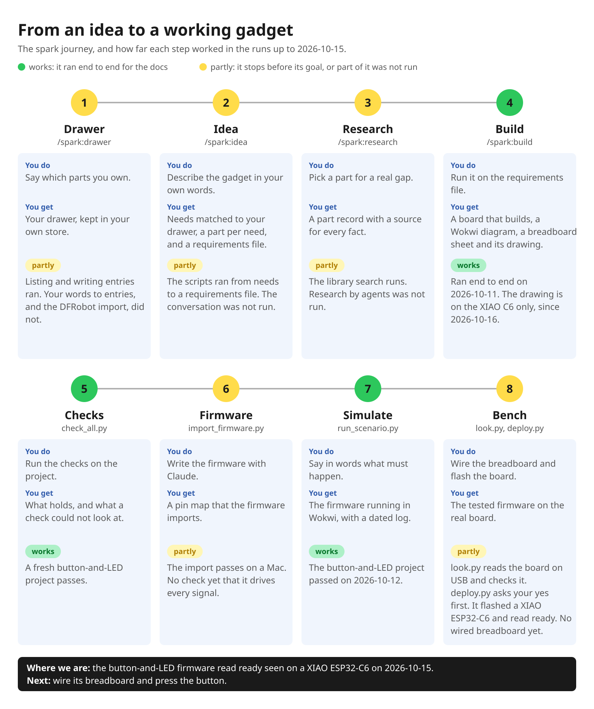

# spark

**From an idea to a breadboard sheet and firmware checked in simulation — and a board, if you want one — for gadgets built from an ESP32 dev board.**

[](docs/guide/journey.md)

The same journey is [on a Miro board](https://miro.com/app/board/uXjVEavQ4JQ=/), and [the journey guide](docs/guide/journey.md)
shows the runs behind each step.

spark is a Claude Code plugin, meant for a hobbyist building a gadget from an ESP32 *dev board* (a module such as the
DFRobot FireBeetle 2 ESP32-S3) and off-the-shelf modules, not for chip-down boards made in volume
([the vision](scrum/VISION.md)). You describe the gadget, and spark helps turn it into needs, which it matches against
the parts you own and the ones it knows. It researches a missing part from the vendor's own documents and writes it as
a [record](GLOSSARY.md#record--and-the-four-places-one-lives): its facts, each with a source and whether anyone
checked it.

From a [requirements file](GLOSSARY.md#the-requirements-file), the dev board and a list of parts, spark builds and checks
the design and gives you a breadboard sheet (the parts and how to wire them), the pin map your firmware imports, and a
simulation to run it in. The same build is a *board*, a printed circuit board your dev board and modules plug into;
its fab package and 3D model (`npx --no tsci export board.tsx -f glb`) are there when you want one.

- Every pin gets a reason, and the connections come from the parts' records.
- The board builds, with a Wokwi diagram generated from it, kept in `sim/`, and the pin map the firmware
  imports ([P116](https://github.com/xmejkal/spark/issues/50), [P196](https://github.com/xmejkal/spark/issues/155)).
- spark's checks read it.

The board's placement is a first draft, which you lay out before ordering.
[The chain](GLOSSARY.md#the-spine-or-the-chain--scriptscheck_spinepy) starts from that requirements file, which you
write, or which `parts.py --requirements` writes from the parts you picked for your needs
([P97](https://github.com/xmejkal/spark/issues/18)). `--board`, and a requirements file's `board`, name the dev board.

On 2026-10-08 the library defined two dev boards and held 8 parts (`boards.py --list`, `parts.py --list`). Only the
FireBeetle 2 ESP32-S3 built then. The Seeed XIAO ESP32-C6 was defined for the pin map only: its file recorded no header
geometry and no `power.io_volts`, so `/spark:build` stopped at the schematic stage
([P121](https://github.com/xmejkal/spark/issues/55)). Since 2026-10-18 its file holds the facts of the record that was
checked at the bench, with their cites, and button + LED on `"board": "xiao-esp32-c6"` builds with `--keep`
([P278](https://github.com/xmejkal/spark/issues/314)). A board file with no header geometry still stops at the footprint stage.

Where a fact is missing, spark refuses, or it goes on with a [stand-in](GLOSSARY.md#stand-in-placeholder) that it
names in `board.tsx`: a placeholder outline in its header, the router's default trace width under the power traces it
could not size. Its checks are built so that one that
[**could not look**](docs/guide/agents.md#the-outcomes-and-their-exit-codes) never reads as one that passed. Where that
does not hold yet, [what never to assume](docs/guide/agents.md#what-never-to-assume) says so.

## What it shows on the example

On the documented example (a FireBeetle 2 ESP32-S3, an L9110S motor driver, a power inlet and two buttons), from the
runs in [the journey guide](docs/guide/journey.md):

- **A breadboard sheet.** After a build, `breadboard.md` lists the parts and gives numbered steps, one connection each,
  by the board's printed labels: `Run a jumper from board D3 to the row of TactileButton A.` A mermaid diagram shows
  the same steps as numbered lines, and a check list of the points follows ([P202](https://github.com/xmejkal/spark/issues/161)).
  For a XIAO ESP32-C6, `breadboard.json` draws the same steps on a Wokwi breadboard, each jumper in its step's color
  ([P267](https://github.com/xmejkal/spark/issues/300)), when no point needs a rail, and the sheet shows the same layout
  as a picture ([P268](https://github.com/xmejkal/spark/issues/302)). A part you move in `breadboard.json` stays where
  you put it at the next build, or the build names it ([P273](https://github.com/xmejkal/spark/issues/309)); a
  resistor or a jumper you move stays too, if the circuit still fits ([P287](https://github.com/xmejkal/spark/issues/340)).
  The build names each end the drawing joins differently from the circuit ([P279](https://github.com/xmejkal/spark/issues/317)).
  `page.html` shows the breadboard, schematic and PCB in three tabs ([P271](https://github.com/xmejkal/spark/issues/307)),
  and follows the Artifact page rules, so you can publish it as an Artifact if you say yes ([P272](https://github.com/xmejkal/spark/issues/308)).
- **A conflict between two parts.** The board's 10 kΩ pull-downs, against the L9110S module's own 10 kΩ pull-ups, hold
  both motor inputs HIGH at idle on a supply above 5 V. `parts.py --show` reports it; `check_all` does not yet
  ([P109](https://github.com/xmejkal/spark/issues/43)).
- **An [advisory](GLOSSARY.md#needs-measurement-and-advisory--findings-that-do-not-change-the-outcome):** the power
  inlet's 0.225 mm annular ring is over the 0.18 mm the default process can make, but under the 0.25 mm it recommends.
- **A figure nobody verified:** the 3.3 V rail draws 355 mA of the dev board's 1.50 A, a rating nobody has checked.
- **What a check could not look at:** physics, because the motor driver's and the inlet's records state no current
  ([P120](https://github.com/xmejkal/spark/issues/54)) and MOTOR6V states no voltage, so its two pull-down resistors have no bound.
- **A reason for every pin:** `MOTOR_IA` goes on pad D3, GPIO38, because it *"needs nothing special; the cheapest pin
  left could still pwm, which is spent here"*.

## What works today

The table says in words what the picture at the top shows. Each status comes from runs made for these docs, this README and the guides in
`docs/guide/`, on 2026-10-05, 2026-10-06, 2026-10-08, 2026-10-11, 2026-10-12, 2026-10-14, 2026-10-17 and 2026-10-18; [the journey guide](docs/guide/journey.md) shows the output
of each step it describes, and what was not run. **works**: it ran end to end for these docs. **partly**: it stops
before its goal, or part of it was not run here (agents, a conversation, or a paid simulation run). **not yet**:
nothing does it yet; the linked issue plans it.

| step | today | with |
| --- | --- | --- |
| [Drawer](docs/guide/journey.md#drawer) | **partly**: what you own, kept in your own store; the scripts that list and write entries ran. Turning your words into entries, and the DFRobot import, were not run here | `/spark:drawer` |
| [Idea](docs/guide/journey.md#idea) | **partly**: a goal becomes needs, matched against what you own and what spark knows; a part is picked per need, what you own is reserved, and the picks become a requirements file ([P97](https://github.com/xmejkal/spark/issues/18)), which says `board_only` when the board serves every need ([P387](https://github.com/xmejkal/spark/issues/497)). A board now offers its own LED, buttons, display, charger, regulator, battery input and battery-level pin for a need ([P389](https://github.com/xmejkal/spark/issues/504)). Its scripts ran here, from the needs to the requirements file, in [a recorded run](docs/guide/journey.md#a-recorded-run-a-button-and-an-led) that went on to a board that builds and the tally; the conversation was not run, and with no Claude Code transcript there the tally could not count the cost | `/spark:idea` |
| [Research](docs/guide/journey.md#research) | **partly**: the library search runs. Research of a new part is done by agents, not run here | `/spark:research`, `/spark:identify` |
| [Build](docs/guide/journey.md#build) | **works**: a requirements file to a board that builds, with a Wokwi diagram generated from it and, with `--keep`, a breadboard sheet (the parts and how to wire them) and, for a XIAO ESP32-C6, the same wiring drawn on a Wokwi breadboard ([P267](https://github.com/xmejkal/spark/issues/300)) and as a picture the sheet shows ([P268](https://github.com/xmejkal/spark/issues/302)), and a page with the breadboard, schematic and PCB in three tabs ([P271](https://github.com/xmejkal/spark/issues/307)), and a rebuild keeps the parts, jumpers and resistors you moved in `breadboard.json` or names those it cannot ([P273](https://github.com/xmejkal/spark/issues/309), [P287](https://github.com/xmejkal/spark/issues/340)), and a rebuild lists what to change on the bench, by each jumper's ends and color ([P300](https://github.com/xmejkal/spark/issues/366)), and the build names an end the drawing joins differently from the circuit ([P279](https://github.com/xmejkal/spark/issues/317)), and the library's XIAO ESP32-C6 record builds button + LED with no stop since 2026-10-18 ([P278](https://github.com/xmejkal/spark/issues/314)), or the stage that stopped it. With `"board_only": true`, the board alone, for firmware that uses only the board's own LED ([P236](https://github.com/xmejkal/spark/issues/233)) | `/spark:build` |
| [Checks](docs/guide/journey.md#checks) | **works**: `check_all.py` runs spark's deterministic checks in one command, five in the journey's run: three found nothing, physics could not look, and the-order was [skipped](GLOSSARY.md#skipped--the-fourth-word-and-only-check_all-has-it), with no fab package yet. A fresh button-and-LED project exits 0, with its `?` lines counted ([P197](https://github.com/xmejkal/spark/issues/156)). It does not run the generator's CONFLICT test ([P109](https://github.com/xmejkal/spark/issues/43)) or the gate's two commands. The `spark-review` skill runs it and then reviewer agents, not run here. A project with two built designs is told that spark handles one board per project today, with a `--circuit` path to use ([P223](https://github.com/xmejkal/spark/issues/205)) | `check_all.py`, after `/spark:init` again |
| [Firmware](docs/guide/journey.md#firmware) | **partly**: the pin map is exported for the firmware to import. `import_firmware.py` imports the firmware on a Mac, without running `main.py`, with a stand-in for MicroPython's `machine` module ([P59](https://github.com/xmejkal/spark/issues/7)). The journey's button-and-LED firmware passes: its LED reads 0 with the button released and 1 with it pressed. Not built yet: a check that the firmware drives and reads every signal the design names ([P74](https://github.com/xmejkal/spark/issues/8)) | `/spark:build`, `assign_pins.py --emit-pins`, `import_firmware.py` |
| [Simulate](docs/guide/journey.md#simulate) | **works**: the build generates the Wokwi diagram and stages the chips, kept in `sim/` ([P116](https://github.com/xmejkal/spark/issues/50)). `run_scenario.py` runs one scenario that Claude writes from your words: it makes the flash image, waits for the firmware's `ready` text and keeps a dated log ([P130](https://github.com/xmejkal/spark/issues/64)). A run needs a Wokwi account's CI token and spends Wokwi CI minutes. The journey's button-and-LED project passed on 2026-10-12. When spark keeps the board's Wokwi definition, the build names each on-board LED or button that it has no pin for. Then spark knows no way for a scenario to reach it, so you test it on the board, such as `ONBOARD_BUTTON (GPIO9)` on the XIAO ESP32-C6 ([P396](https://github.com/xmejkal/spark/issues/512)). Without the definition, the build says `onboard GPIOs: not checked` | `/spark:build --keep .`, then `run_scenario.py` |
| [Bench](docs/guide/journey.md#bench) | **partly**: `look.py` reads the board on USB and compares it with its board record, without changing the flash, and `deploy.py --token` erases only after that look and a yes (the person's, typed in their own terminal, or their deploy grant) ([P219](https://github.com/xmejkal/spark/issues/201)). `deploy.py` puts the flash image that passed the simulation onto the board and checks that the firmware printed `ready`. With `--no-simulation` (on `look.py` too) it puts an image of `firmware/` that no simulation tested onto the board, after a typed yes that says so. No board has been flashed with it yet ([P337](https://github.com/xmejkal/spark/issues/431)). On 2026-10-14 it ran on a XIAO ESP32-C6 with a blink project for the board alone, whose LED you change by typing in the board's console ([P236](https://github.com/xmejkal/spark/issues/233)). If the board waits in its download mode after the flash, `deploy.py` sees it, asks you to press the board's reset button, and then checks the board again ([P243](https://github.com/xmejkal/spark/issues/252)). On 2026-10-15 `deploy.py` flashed the button-and-LED firmware on the same board and printed `ready seen`: the firmware printed `ready`, the board's files match the run that passed, and the facts file and the store record are written ([P215](https://github.com/xmejkal/spark/issues/196)). Inside a grant that the person types in their own terminal, `live.py` runs Claude's short piece of code on the running board, refuses the board's USB and flash pins, and resets the board at the end ([P247](https://github.com/xmejkal/spark/issues/267)). With a deploy grant that the person gives once in their own terminal (`grant.py --scope deploy --minutes N`), Claude runs `deploy.py` with no yes typed for each deploy, for a look that matched the board record ([P242](https://github.com/xmejkal/spark/issues/249)). On 2026-10-18 it ran on the XIAO ESP32-C6 with the blink project: the first run could not connect for the erase right after its own look, the second went through, and the store record names the grant as the yes. Since [P290](https://github.com/xmejkal/spark/issues/347), `deploy.py` makes one retry of an erase that stops with exit 2, after 5 s, and prints `retry in 5 s: ...`. Later on 2026-10-18, 3 deploys of 3 with a grant went through on the first call, each with `ready seen`, and none needed the retry. On 2026-10-19 two more deploys with a standing yes passed the scenario, and a hint that tells you to press BOOT or RESET now says where the button is on the XIAO ESP32-C6 ([P213](https://github.com/xmejkal/spark/issues/192)). If the board does not answer, `look.py`, `grant.py`, `reach.py` and `live.py` say why: the tool's own error, whether the port is listed, what the console said, and one step for your hands ([P282](https://github.com/xmejkal/spark/issues/326)). `look.py --json` and `deploy.py --json` print one envelope for Claude: the token, the stops, the stage, the yes and the step that waits for you ([P213](https://github.com/xmejkal/spark/issues/192)). On 2026-10-17 the live try passed one bench run on the XIAO ESP32-C6 ([the log](docs/observations/2026-10-17-p282-p247-bench.md)). The button-and-LED project's breadboard is not wired yet. spark's hardware step is [P79](https://github.com/xmejkal/spark/issues/16). The first bench is the button-and-LED project, flashed and wired from its sheet ([the plan for v0.10](scrum/VISION.md#versions)); the sensor trash can's bring-up follows it ([P73](https://github.com/xmejkal/sisuo-brain-transplant/issues/2)) | `/spark:deploy` ([P213](https://github.com/xmejkal/spark/issues/192)): `look.py`, `deploy.py`, and `grant.py`, `live.py` |

A board you wrote by hand in tscircuit is read the same way: `npx --no tsci build board.tsx`, then `/spark:init` so it
names the rails, then `check_all.py --project .` (not run here; a project's own
[`make check`](GLOSSARY.md#make-check--a-projects-own-gate) can run the checks one by one).

## Before you start

Claude Code for the commands, Python 3.9 or newer, and Node 20 or newer: on macOS, spark's install lines get Node and
pdftotext from Homebrew (`data/tools.json`). `/spark:setup` then installs the rest in one go, once you have seen the
commands and said yes: bun, tscircuit (into the project), `wokwi-cli`, MicroPython and `littlefs-python`. The runs here
were on macOS. On Linux, `data/tools.json` has apt lines only for pdftotext and `sigrok-cli`, so Node is yours to
install. bun then comes from `/spark:setup` itself, with `npm install -g bun`, when Node's global folder is yours, as
with nvm. With a Node from apt, whose global folder belongs to root, that line fails, `tools.py` says so and exits 2,
and bun is yours to install too. None of this was run on Linux here. `data/tools.json` has no lines for Windows.

## Install

In Claude Code:

```
/plugin marketplace add xmejkal/spark
/plugin install spark
```

The marketplace is named `petr-local`, so Claude Code may show the plugin as `spark@petr-local`. This install path was
not run for these docs. Then, in a project folder, `/spark:init` writes the project's files without guessing,
including the `package.json` that tscircuit, the engine that builds the board, installs into; `/spark:setup` shows the
tools spark needs, and installs what is missing in one go once you have seen the commands and said yes.

An update replaces the plugin, not your files. Your store and a project's own `boards/`, `parts/` and `.spark/` are
outside it ([how it works](docs/guide/how-it-works.md#your-store)). Three things write inside the plugin,
and an update replaces what they wrote: `parts.py --promote` copies a record into spark's library (copy it out first
if you want to keep it), `check_vendor_pins.py` run without `--offline` on a board spark ships refreshes the vendor's
pin header spark keeps for that board, and `/spark:build` may compile a library part's simulation chip beside its
record.

## Two roads to a board

**From what you own.** Type `/spark:drawer` and say what you own (*a FireBeetle 2 ESP32-S3 and a pack of ten red
LEDs*), then `/spark:idea` and say what you want to make (*a button that lights an LED*). Claude turns it into needs,
matched against your drawer and spark's records, and asks whether the LED pack is spark's `led-red-5mm`, linking it on
your yes; you pick a part per need, and what you own is reserved. The picks become a requirements file, `/spark:build`
builds the board, and the tally ends the run with one cost line. The conversation was not run for these docs; the
scripts were, each with its output in
[a recorded run](docs/guide/journey.md#a-recorded-run-a-button-and-an-led). `/spark:idea` writes the needs to a file
outside any repository, here `../button-needs.json` with the recorded run's three (a button, a light, a board), and
sets them with the first line below. It also marks each step as it begins, with `parts.py --step <project> S` (then
`M`, `C`, `L`): S once the folder is chosen, the others before `--match`, `--pick` and `--requirements`. Those marks
are what let the tally count the cost. The block leaves them out, so its last line exits 2: no step is in the history.

```sh
python3 "$CLAUDE_PLUGIN_ROOT/scripts/parts.py" --needs-set . ../button-needs.json
python3 "$CLAUDE_PLUGIN_ROOT/scripts/parts.py" --match .
python3 "$CLAUDE_PLUGIN_ROOT/scripts/parts.py" --pick . press=tactile-button light=led-red-5mm board=firebeetle2-esp32s3
python3 "$CLAUDE_PLUGIN_ROOT/scripts/parts.py" --requirements .
python3 "$CLAUDE_PLUGIN_ROOT/scripts/check_spine.py" requirements.json --keep .
python3 "$CLAUDE_PLUGIN_ROOT/scripts/parts.py" --tally .
```

`$CLAUDE_PLUGIN_ROOT` is where spark is installed. A shell does not set it, so to type these lines yourself, clone spark
and `export CLAUDE_PLUGIN_ROOT=<the clone's folder>` first, as [Set up](docs/guide/agents.md#set-up) shows.

An AI agent adds `--json`, and runs each `parts.py` write with `--dry-run` first:
`parts.py --pick . press=tactile-button light=led-red-5mm board=firebeetle2-esp32s3 --dry-run --json` answers in one
envelope, with `data.written` false and the FireBeetle's hold in `data.reserved`.

**From a requirements file you write.** Name the dev board and the parts by the ids `boards.py --list` and
`parts.py --list` print. The recorded run's picks wrote this one:

```json
{"board": "firebeetle2-esp32s3", "parts": ["tactile-button", "led-red-5mm"]}
```

Save it as `requirements.json` in the project and type `/spark:build`. It runs the chain,
`check_spine.py requirements.json --keep .`; an AI agent adds `--json` and reads `status`, and `stages`, which names
any stage that stopped it. [`/spark:build`'s page](commands/build.md#the-requirements-file) says what else the file
takes, and the `spark-design` skill writes one with you (not run here). On the journey's larger example the build is
all green, yet the conflict above shows only in `parts.py --show` and in `board.tsx`'s closing comment
([Build](docs/guide/journey.md#build)).

After either road, run `/spark:init` again: its page runs init with `--force`, which names the rails from the built
board and keeps your answers, and its last step runs `check_all.py --project .`. Every build for these docs used an
existing tscircuit install, not one `/spark:setup` made. To look at a board, [see it](commands/build.md#see-it) in
tscircuit's viewer.

## Commands, skills and agents

**Commands**, typed in Claude Code:

- `/spark:init`: a project;
- `/spark:setup`: the tools;
- `/spark:drawer`: what you own;
- `/spark:idea`: a goal to needs, a part picked per need, and a requirements file;
- `/spark:research`: a missing part;
- `/spark:identify`: a module from a photo;
- `/spark:build`: a requirements file to a board;
- `/spark:deploy`: the image that passed onto the board.

**Skills**, which Claude picks up from your words: `spark-design` designs a board; `spark-review` reviews it and gates
it before ordering; `spark-reverse-engineer` reads a board from its photo (not run here; its bench-protocol template
was written for the smart bin's original board).

**Agents**, launched by the commands and skills: `part-finder` and `datasheet-reader` for a commodity part (an LED, a
button, a connector: one datasheet describes it), `parts-researcher` for a module, and `design-reviewer`, one per
review dimension (power, signals, thermal-mechanical, manufacturability, firmware-hardware).

Each one, with when to use it and what it writes and refuses: [the commands guide](docs/guide/commands.md).

## Without Claude Code

spark's scripts run in any terminal, for you or another AI: plain Python. They exit 0 ok, 1 problems, 2 could-not-run,
and most answer in JSON with `--json`. Read [the guide for AI agents](docs/guide/agents.md) before trusting an exit
code: `check_all.py` exits 0 even when most checks were never asked, and a crash exits 1. The conversations need
Claude Code: the idea, research, identify, the review's agents and the drawer import. [`AGENTS.md`](AGENTS.md) points
to the same guide.

## What it uses underneath

[tscircuit](https://tscircuit.com) builds the board and [Wokwi](https://wokwi.com) simulates it: a run boots a flash
image of [MicroPython](https://micropython.org) and the project's files, needs a Wokwi account's token and spends its
CI minutes. Node and bun run the tools. For the research agents spark declares two MCP servers, both started unpinned
with `npx -y` ([P112](https://github.com/xmejkal/spark/issues/46)): `@jlcpcb/mcp`, an unofficial community package
([l3wi/jlc-cli](https://github.com/l3wi/jlc-cli)), and `mcp-remote` to Espressif's hosted documentation. The DFRobot
order import uses Claude in Chrome. Your store, `~/.local/share/spark`, sits outside every repository. It keeps a
history, `history.jsonl`, whose line for each step of a project names the Claude Code session the step ran in;
`parts.py --tally` reads Claude Code's transcripts of those sessions, under `~/.claude/projects`, for tool names and
counts only. [KiCad](https://www.kicad.org)'s `kicad-cli` is optional, for the skills' electrical-rule and design-rule
checks. Each, with what it needs: [how spark works underneath](docs/guide/how-it-works.md#the-tools-spark-calls).

## Before ordering

The generated board is a draft, and the header of `board.tsx` says so: its modules sit in a column that does not
overlap, it has no mounting holes or connector keying, and its traces are not sized for current until each rail's
current is stated. No check here is a design-rule check, and tscircuit's autorouter can emit shorts
([the layout notes](skills/spark-design/references/pcb-layout.md)). [From draft to order](docs/guide/journey.md#from-draft-to-order)
gives the steps, each sourced and the exports run on the example: state the currents and generate the board again, lay
it out, run the `spark-review` skill and its fabrication gate, a KiCad design-rule check, and a person's look.

## Honest limits

- **The reviewer agents in `spark-review` are less proven than the checks.** The only measurements were a few eval
  runs, one to three per arm, against a no-plugin baseline
  ([tabled in the 2026-09-24 audit](docs/archive/audit-2026-09-24/autonomous-agent-readiness.md#on-the-eval-and-the-reprioritisation-it-drove)),
  each graded on what the agent found, not by a script; the cases were removed in commit 066c4af. Treat "the reviewers
  help" as plausible, not measured.
- **Nothing here has been validated on hardware by its author.** Ground truth is the bench.

## More

- [The glossary](GLOSSARY.md): the words this repository uses its own way, each with the failure that produced it.
- [Developing spark](docs/guide/developing.md): the tests, the commit gate, and where the work is planned.
- **Found a problem?** [Open an issue](https://github.com/xmejkal/spark/issues/new) with the command you ran, its
  output and spark's version (in `.claude-plugin/plugin.json`). A form for this is
  [P128](https://github.com/xmejkal/spark/issues/62).

---

v0.9.0 · [MIT](LICENSE) · built with the tscircuit engine.
