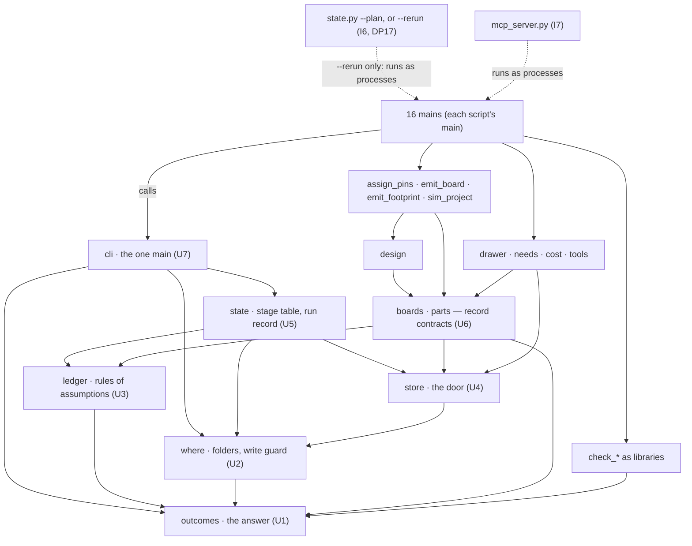
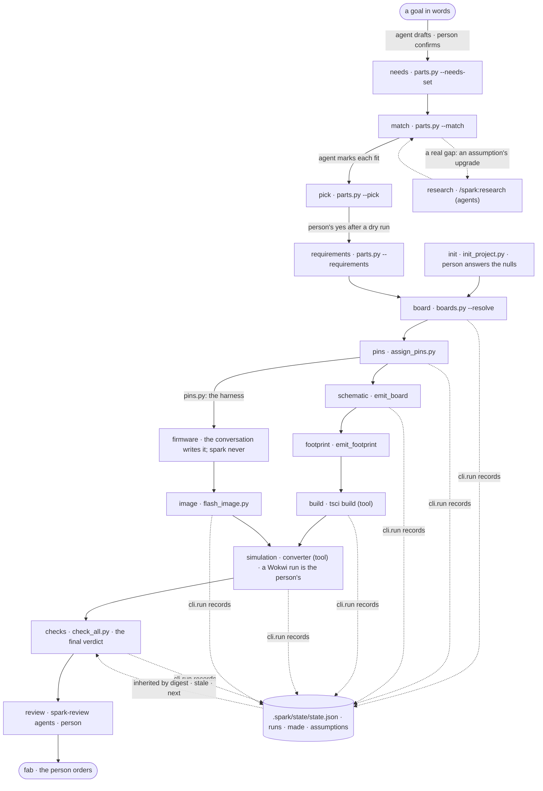

# P158 part 2 — the architecture: one answer, one ledger, one stage table, and the order to build them

**Status.** The technical design for P158 part 2 (#94), for the PO's review, **after adversarial round 1**. Nothing here
is filed, decided or built. What follows it, in the PO's own order (D 2026-10-10, quoted in §0): the council reads this
file for gaps and bugs, the PO answers §16, and the plan — its cards — is written again from both.

Written by the design author on the night of 2026-10-10 to 11 and revised on 2026-10-11 (the brief's date is 2026-10-10;
the machine's clock read 2026-10-11), against spark 0.8.1 at main `5acbe42` (E `git log -1` → `5acbe42 2026-10-10
22:26:37 +0200 Merge pull request #129 from xmejkal/p180-council-rules`; `.claude-plugin/plugin.json` → `"version":
"0.8.1"`). Every pass line in §12 was set on 2026-10-11, before any run; the lines round 1 changed were set the same day,
also before any run.

**Round 1.** Two adversarial readers read round 0 of this file whole: `design/refuter-round-1.md` ("the refuter";
findings R1–R14 and §2–§7) and `design/plan-critic.md` ("the critic"; rows by card, moves M1–M15, defects G1–G3). Every
verdict that concerns this design is folded below: a refuted claim is gone or corrected, a partly one carries its caveat,
and what this design does not take is refused with its reason in §17.10. The list of changes is the last section, *Changes
since round 1*. Two of round 0's claims fell to a run, not a read: the refuter and the critic each ran plant-alarm's chain
on scratch copies and got the same output (W9: reproduced), so §7.3, §7.6 and §12 now start from it.

**What this rests on.** Read whole: `docs/discovery/2026-10-10-p158-gaps-and-refactoring/design/00-system-as-is.md`
("00"), `approach-A1-smallest-layer.md` ("A1"), `judge-1.md`, `judge-2.md`, `judge-3.md` ("J1"–"J3"),
`refuter-round-1.md`, `plan-critic.md`. Read in the parts the judges cite and the parts this design takes from them:
`approach-A2-build-graph.md` ("A2") §2–§6, and `approach-A3-data-first.md` ("A3") §2.4, §3.8, §5, §6, §7, §8, §10.3,
§10.4 and §11.1. From part 1's `proposal.md` ("part 1"): the header and §2 whole, §3's priority rule (`:511-591`), every
CH heading and every CH's *depends on* line (extracted by a script on 2026-10-11, listed in §12.4), CH-1, CH-22, CH-36,
CH-38, CH-49, CH-64 and CH-66 whole, *How the list becomes cards*, §4, §5 (the Q table, `:2609-2653`) and §6. From
`catalogue.md`, all 74 statements, and the nine `other` rows whole. From `council/store-scenarios.md`, STORE-8 to STORE-18
and the survey; from `council/completeness-critic.md`, `:118-175` through the refuter.

The code, all E, my reads at `5acbe42`:
- `scripts/outcomes.py`, whole;
- `boards.py:38`, `:60-70`, `:130-215`, `:385-402`, `:530-545`;
- `check_spine.py:352-380`, `:520-606`, `:637-691`;
- `emit_board.py:500-510`, `:584-604`, `:645-664`, `:1000-1012`, `:1058-1070`, `:1118-1150`;
- `check_physics.py:300-315`, `:540`; `compare_design.py:281`;
- `check_footprints.py:456-496`;
- `check_all.py:140-152`, `:232-242`;
- `store.py:20-100`, `:175-220`;
- `tools.py:40-50`; `fab.py:27`;
- `parts.py:45`, `:225-240`, `:834-836`, `:1445-1465`, `:1472-1530` (the 28 operation names);
- `check_vendor_pins.py:108`;
- an AST pass over every import in `scripts/` (§4.3);
- in `data/tools.json`: `roles`, `wokwi-mcp`, `jlcpcb`, `espressif-docs`, `circuit-to-wokwi`; `.mcp.json`;
- the `verified` flags and the `physical` keys of `boards/firebeetle2-esp32s3.json`, by a `python3` pass;
- `data/importers/dfrobot.js:1-30`; the tool lists and script calls of `agents/*.md`, `commands/identify.md` and
  `skills/spark-reverse-engineer/SKILL.md`; a grep of `commands/`, `skills/`, `agents/`, `docs/guide/` for the fields
  §4.4 removes.

The documents:
- `docs/2026-09-30-refactoring-architecture.md:1-20`, `:55-140`;
- `docs/2026-10-04-store-design.md` §1, §3, §6, §9, §10, §11;
- `docs/2026-10-06-process-design.md` §5 and its skeptic pass;
- `docs/guide/agents.md:258-270`, `:297-334`;
- `scrum/README.md:1-60`, `:105-115`, `:169-180`, `:205-250`;
- `scrum/WORKING_AGREEMENTS.md:10-40` and its headings;
- `scrum/STORY_MAP.md`;
- P100's `brief.md` and `diary-round-0-board.md:1-25`.

The sibling repositories, read only:
- the bin's `Makefile` (`:26-33`, `:46-54`, `:94-97`, `:180-188`, `:218-234`) and its `git ls-files .spark`;
- plant-alarm's `requirements.json` and its folder list;
- irrigation's `irrigation.requirements.json`, its `parts/` list and `sim/scenarios/wet-and-dry.scenario.yaml:1-40`.

The cards, read-only with `gh`: the titles and states of #5–#8, #11, #13, #16, #17, #19, #21–#23, #28, #41, #44, #52,
#53, #55, #58, #59, #61, #65, #69, #70, #84, #85, #89, #93, #94 (with its last three comments), #96, #97, #99,
#101–#103, #114, #118, #119, #123 (with its body), #124, #126–#128; the bodies of #41, #43, #45, #46, #48, #50, #58, #69,
#71, #75, #81 and #83 (2026-10-11); and both boards' item lists (through the refuter, 2026-10-11).

**What I ran.** No spark command, nothing against any store, and nothing written except this file and `<scratch>`. The
reads were greps and `sed -n`, and these commands:
- `wc -l scripts/*.py` → `11578 total` (round 0);
- `ls tests/test_*.py | wc -l` → 36;
- read-only `python3` passes: the `verified` flags and `physical` keys of the S3 board file; an AST pass over the imports
  of `scripts/*.py` → 17 edges that exist only inside functions (§4.3); the *depends on* lines of part 1's CH blocks;
- `grep -c silkscreentext` on the bin's `node_modules/@tscircuit/core/dist/index.js` (version 0.0.1958) → 6 (round 0);
- read-only `gh issue view` and `gh project item-list`.

Plant-alarm's stop is not my run: it is the refuter's and the critic's, each on scratch copies with `SPARK_HOME`, `HOME`
and `TMPDIR` in `<scratch>` (refuter, *What I ran*; critic, *Ran*). No web or MCP search (§18).

**Tags.**
- **E** a pointer: a file and line at `5acbe42` unless another repository is named; a command and what it printed; a card.
- **H** a claim, with its source.
- **D** a decision, with who made it and when.
- **—** unknown.

**Sizes.** S is under an hour, M a day, L more: estimates, labelled as such (part 1's scale).

**Ids.**
- CH-, K- and Q- are part 1's ids. J1-G*n* and J2/J3-g*n* are the judges' grafts. R*n* and *refuter §n* are the
  refuter's; *critic* rows and M*n* are the plan critic's.
- I0–I7 are this design's iterations (§12), each split into steps (I1a, I1b, …). I0 to I2 match A1's. Here I3 is the
  board contract (A1's I4), and I4 the state and inheritance across commands (A1's I3).
- DP*n* is a decision for the PO in §16. D8, alone, is part 1's id for the PO's decision of 2026-10-09 in P100's
  brief: *"we want to start by the boards"*, with a board record made from his orders as the first fix.
- CH-13a and CH-13b are CH-13's two halves (the board's silicon; the image's chip), split in round 1 (critic, C2).
- Paths under a home are written `~/…`, and a scratch folder `<scratch>`.

## 0. The understanding

What the PO said, verbatim with his typos, and what this design assumes from it. **He corrects this section first**:
everything after it follows from these readings.

| # | his words (D the PO) | what this design assumes | where |
| --- | --- | --- | --- |
| 0.1 | 2026-10-10: *"Like we will probably alwawys rather have the system put together a not so fully detailed model and sxhema and software but in itearations so that it might be siplified but always simulates or tells you and tolerates problems but informs about it"* | The run reaches the simulation whenever the only missing facts are ones a safe default can stand in for (§7.2). When it cannot, it says which fact stopped it, where, and the one command that supplies it. Such a run may answer `ok`, with every placeholder named in the verdict. It is never silent, and it never guesses what connects to what. | §5.3, §7 |
| 0.2 | *"but uses only some general not well specified board or firmware, etc and upgrade it iteratively with better and better detai"* | **The general board** is a library board chosen for its chip and *marked* as standing in for the person's choice. **The general firmware** is *none*, or the pin harness: spark writes no firmware (D the PO 2026-10-01). **Upgrading** goes one fact at a time, and spark says what each upgrade makes stale. | §7.3–§7.6 |
| 0.3 | *"What about sparks inner codd structure? Shouldn't we consider some standardized systems like langgraph or DSPY etc? Just theoretically, how can we shape the flow of the whole system ? What are the options ?"* — then *"Yes, ok, lets take that and add it to the points 1-4"* | His yes takes options 1 to 4: the flow as data, with a project state and a ledger; the chain as a build graph with content hashing and incremental reruns; an MCP face; evals. It leaves out option 5, a standalone agent on LangGraph or the Agent SDK. Whether the incremental reruns are run by spark or by the conversation from spark's list is DP17. | §1, §6, §9, §10 |
| 0.4 | *"still don't build anything, just please make a thorough plan on how to make it work, well designed, refactored, testable, modular, etc, and we can go iteratively. Then, once you have the plan, shoew me. We will further ask for gaps and bugs from the council and replan again. So make ure the final issues are well defined, separated and ordered in the best way"* — and *"including technical design and validated learning"* | This file is the design. The cards follow the council. Each iteration ends in a whole that runs. Each carries a hypothesis, a measurement, a pass line written now that can fail, and what a refutation changes — including, after I1, whether the layer goes on at all (§12.8). | §12, §14 |
| 0.5 | *"Lets really order it by priority, so were fixing what matters."* · *"lets make sure its really good, with a few adversarial rounds, really well thought through. We also want thwe system to be well designed so its well testable and understandable where a mistake is happeening and why"* | Part 1's ranks are the order of its own changes, by its rule: a change is pulled when its **hard** prerequisites have landed, and *"enabling work is not a key"* (`proposal.md:563-566`). That rule and 2026-09-30's *"the safety net, first"* disagree; this design names the conflict and the PO settles it (DP2). "Where and why" is one item shape, on every answer. | §5.2, §11, §12 |
| 0.6 | The store, 2026-10-10: *"Mostlu e need to be able to have the basic globsal vs local store, to be able to create search for and update and copy or share the store things, the boards for sure, maybe we should also add how exactly to replace a board or a module in the simulation, so wokwi uses the closest board  or maybe we can create one"* · *"maybe some new file formats or synch libraries or techinques could be used from an existing library that does somwthing that would make the whole store synch and global and loval and project store sync and rules and editor?"* | Three places, each stated. Five verbs, boards first. Sync chosen per relation, with no new format and no sync library. The closest Wokwi board is a lookup. "Create one" is a generator whose output the chain cannot run yet. What a shared store *is* stays P178's concept (#123): this design reserves its seams and builds none of it. | §8 |
| 0.7 | His standing rules. 2026-10-06: only free things; one best tool per job, a local CLI first; nothing heavy to install; alternatives and MCP versions as settings. 2026-10-01: spark exports facts and a harness, the conversation writes the firmware, and the bench is a protocol. 2026-10-09: *"lets make sure we start finishing more and not starting new epics or bigger things in general"*. 2026-10-03: spark is public, and the hobbyist is the primary persona. | Standard library only, and no new runtime dependency. The MCP face is a setting, off by default. Nothing emits behaviour. The plan reuses cards already on the board before it files any. A cut line sits under the epic, and a stop branch after I1 (§12.7, §12.8). | throughout |

**Two readings he may not share.** He can strike either.
- **"always simulates" is a target, not a promise.** A board whose chip Wokwi does not simulate cannot be simulated by
  any default. spark says so, with the kind `limit` (§5.2).
- **"tolerates problems" means placeholders and stated limits, not findings.** A fault found in the design still answers
  `problems`, exit 1. If findings could ride along an `ok`, exit 0 would mean nothing (criterion c).

## 1. What it is for, and what it is not

**For.**
1. **One answer shape for every spark command.** A person at the terminal and an agent reading JSON are told the same
   things in one place: the status, where, why, and what to do next (§0.5; options 1 and 3).
2. **One ledger.** Every placeholder, stand-in and unstated fact an answer rests on is carried from the stage that made
   it to the final verdict. This is the principle the PO took on 2026-10-10 (D): *"a placeholder may flow through the
   chain, but it can never disappear from the final verdict. Tolerance without a ledger is just silence."* It lands in
   two steps: each answer's own placeholders in I1 (the thin ledger), and what a later, separate command inherits in I4.
3. **One stage table and a project state.** They say what ran, on which inputs, what is stale and why, and what to run
   next: the flow as data (option 1). Reruns by content (option 2) are then one function on top.
4. **One statement per contract.** The board file becomes a table that refuses what tscircuit misreads; the folders
   spark may read and write are stated once; and so is the closest Wokwi board.
5. **A measured suite.** The cold tests and the recorded documents become evals (option 4).
6. **A place for each of part 1's 72 changes**, in an order that keeps their ranks and their own edges (§12.4, §13).

**Not.**
- **Not a standalone agent** (option 5, which the PO's yes to 1–4 left out, D 2026-10-10). The conversation stays the
  orchestrator, and spark's pages route it. A LangGraph or Agent SDK program would be a second orchestrator beside Claude
  Code, and a runtime dependency against §0.7 (H: the assistant's answer of 2026-10-10, as recorded on #94). Whether
  `state.py` itself runs the stale stages, or lists them for the conversation, is the one place this line is in question:
  DP17.
- **Not prompt optimisation** of the DSPy kind. That needs a metric, and the evals of §10 are the metric, so they come
  first (H, the same answer).
- **Never behaviour.** spark writes and generates no firmware (D the PO 2026-10-01). The generic harness is the pin map,
  plus the stated fact that no firmware exists.
- **Not a rewrite of the chain as a runner now.** That was A2's frame, and all three judges refused it (§4.6).
- **Not P178's store** (#123): no shared layer, no sync code, no store editor, no new record kind. Their seams are
  reserved, and their inputs recorded (§8).
- **Not a split of `parts.py`** (Q12, K64), nor a merge of the board and part loaders, nor a break of the nine-module
  import cycle (00, "one component of nine"). The cycle is frozen as a known list of edges instead (§4.3).
- **Not a change to how matching, holds, identity or sync work.** Those are part 1's own cards (CH-17, CH-18, CH-25,
  CH-9, CH-26 and others). The layer gives each of them a place to say where it looked.
- **Not a new simulation capability.** The stand-in's pin names (CH-31) are a card of their own. A generated Wokwi board
  (CH-33) and the closest module (CH-69) are P178's.
- **Not a guarantee of truth.** The ledger lists what spark knows it does not know. A wrong fact marked `verified: true`
  is outside it (§17).
- **Not a coverage report.** What a check did not examine (#75: buses no rule reads) is a note of that check, not a
  ledger entry: the ledger lists facts an answer rests on, not rules that did not run (§17.10).

**The criteria, and the mechanism that meets each** (criteria (a)–(h) of the brief):

| criterion | mechanism | the test that holds it |
| --- | --- | --- |
| (a) testable | each unit has a pure seam (§4.2), and the outcome invariant runs as a subprocess | named per unit in §4.2, and the suite in §10.1 |
| (b) diagnosable | one item shape: `kind`, `where`, `sentence`, `fix`, with a `where` on every item, unchecked ones included. A crash is mapped to the innermost spark frame. `state.py` gives the reason for each stage. A mixed answer names its problems and what could not run, both (§5.1) | `test_outcome_invariant.py`; `test_cli.py::test_every_answer_field_is_rendered_in_text`; `::test_a_mixed_answer_names_both_in_its_verdict` |
| (c) simple | remove before add (§4.4); one meaning per exit code and per kind (§5.4); one renderer of item lists; one word per meaning (§2: no `kept`, no `source` for an artefact state) | `test_json_contracts.py` collapses to one shape; `test_vocabulary.py::test_each_kind_maps_to_one_status` |
| (d) iterative | each iteration ends in a whole that runs for the bin, irrigation and plant-alarm. Before I1h, today's ten channels keep every line they print (measured against I0a's baseline); from I1h every answer names its own placeholders; from I4 every later command names what it inherited | §12's pass lines |
| (e) modular | seven units, each with a stated interface; imports go one way only, with today's 17 function-local edges frozen by name | `test_layers.py::test_no_module_imports_a_higher_layer` |
| (f) free and local | standard library only; schemas are generated for editors; MCP is off by default; no YAML reader added (DP21) | none today (`docs/guide/agents.md:70` states it, with `flash_image.py`'s `littlefs-python` as the one exception — J2). Proposed: `test_layers.py` also refuses any import that is neither a sibling nor the standard library, outside `flash_image.py` |
| (g) humans and agents | the same scripts and the same envelope; text and JSON both rendered from it | the per-field rendering test; the MCP round-trip test (I7) |
| (h) facts, never behaviour | no unit writes firmware; firmware has levels, and the person or the conversation fills them | §7.4; nothing to test for: there is no writer to test |

## 2. Words this design uses

The words spark's `GLOSSARY.md` already defines (the three outcomes, the chain, record, catalog, shelf, `verified`,
stand-in, owed and broken, the drawer, pick, hold, history) keep their meaning. Each word below that a change adds to an
output gets its glossary entry in that change's commit (part 1 §3, "Done, for every change"). Round 1 found four words
this design had given two meanings (refuter §2.1); each now has one.

- **artefact** — a file a stage writes and a later stage reads: `board.tsx`, the footprint module,
  `dist/*/circuit.json`, `sim/diagram.json`, the flash image, `.spark/board.json`.
- **artefact states** — four, each one word: *made* (a recorded run wrote these bytes); *edited* (spark made it and its
  bytes have changed since: the person's now); *merged* (spark regenerates it, and its own tool keeps the person's edits,
  as `sim/diagram.json`'s positions are kept by the converter's `merge.ts`, E 00); *unrecorded* (a file a stage of this
  project's design would write, which no recorded run made). Round 0 also had *kept* and *source*; *kept* already means
  `check_spine --keep`, `parts.py --keep`/`--kept` and `--requirements`' `kept` (`parts.py:2106`), and *source* is every
  record's citation field (`parts.py:661`), so both went (refuter §2.1, items 3–4).
- **assumption** — one entry of the ledger: `{fact, where, level, basis, since, sentence, upgrade}` (§5.3).
- **basis** — the channel that made an assumption, such as `unverified`, `stand-in` or `default` (§5.3). It is not a
  `kind`: a kind is the cause of a failure, and a basis is the source of a placeholder.
- **envelope** — the one JSON answer every spark command prints under `--json`. Version 2 is §5.1; version 1 is what
  `parts.py` prints today (`outcomes.py:65-74`).
- **eval** — a measured run. *Deterministic*: fixtures in, an envelope and a ledger out, compared in the suite on every
  push. *Model*: a cold agent follows a page toward a goal and is scored from the artefacts it leaves, deliberately,
  dated, with its cost counted (§10).
- **fidelity level** — how well a fact is known: `placeholder` · `unstated` · `stated` · `checked` · `proven` (§5.3).
- **floor** — the lowest level a target accepts for a fact (§6.5).
- **generic board** — a library board selected for its chip, with the selection marked as a stand-in for the person's
  own choice (§7.3).
- **generic harness** — the pin map (`pins.py`) plus a firmware level of `none` or `harness`. spark never writes
  firmware (§7.4).
- **global / local / project store** — three places, each stated once (§8.1). *Global* is spark's library, and later a
  shared repository of records (P178). *Local* is the person's store, `~/.local/share/spark` by default. *Project* is a
  project folder's own `parts/` and `boards/`. A **layer** is one row of the read order across them.
- **item** — a problem or an unchecked line: `{kind, subject, where, sentence, fix}` (§5.2). A **note** is a line that is
  said and does not fail, such as an advisory.
- **kind** — the closed word that says why an item exists, one status per kind: `design`, `unknown`, `input`,
  `decision`, `tool`, `limit`, `store`, `busy` or `crash` (§5.2; `unknown` is DP9's to keep).
- **lane** — one of the two queues of §12.1: the *layer* lane (this design's iterations) and the *fix* lane (part 1's own
  changes, taken by rank).
- **ledger** — the list of assumptions an answer rests on: its own (from I1h), plus those it inherited (from I4).
- **locator** — the `where` of an item or assumption: `<root>:<path>[#<JSON pointer> | :<line>]` (§5.2).
- **placeholder** — a value that stands in so the chain can run, and is said to be one. It may flow through the chain. It
  may never leave the final verdict.
- **producer** — a module that already marks a placeholder today, in a format of its own. Under this design it returns
  an assumption instead (§4.2). A fact's producer is the module that **reads** it (§4.2, the producers).
- **safe default** — a value spark may supply for a target: one that cannot change what connects to what, nor a value a
  check judges (§7.2).
- **stage** — one row of the stage table, `data/stages.json` (§5.7, §6.1). The **run record** is a project's last run of
  each stage, kept in `.spark/state/state.json` (§5.6).
- **stale** — a stage that ran is stale when a file it recorded as read now has another digest or is gone, or when a
  tool's version or spark's version differs from the one recorded (§6.4; DP8). The basis `stale` marks an answer that read
  an artefact whose making stage is stale.
- **stand-in** — a part Wokwi simulates in place of the real one: a Wokwi board for a board, a built-in part or a custom
  chip for a module. A stand-in is always an assumption.
- **target** — what a run is for: `simulate`, `breadboard` or `pcb` (§6.5).
- **value operation** — an operation whose stdout a program captures: `boards.py --path --id --paths --get --resolve`,
  and `emit_board` writing the board (§5.8).
- **verdict** — the one sentence an answer ends with, the same in text and in JSON. It names the problems, what could
  not run, and the assumption count, each whenever it is above zero.

## 3. The system as it is, in one page

**Size**, all E 00 unless marked:
- 25 scripts. 11,578 raw lines: my `wc -l` at `5acbe42`. The brief's 11,487 is `a8aa34d`'s, before P179 added 91 lines.
- 6,546 code lines, by the measure W15 uses.
- 36 test files (E my `ls`); 1,713 tests (the refuter's count).
- 1,281 mutation rows, 989 of them on `scripts/`.
- 16 scripts with a `main` (E `grep -l '^def main' scripts/*.py`): `assign_pins`, `boards`, `check_all`, `check_bom`,
  `check_footprints`, `check_physics`, `check_spine`, `check_vendor_pins`, `compare_design`, `cost`, `emit_board`,
  `emit_footprint`, `flash_image`, `init_project`, `parts`, `tools`.

**Right, and kept.** 00 lists five things the code gets right, each held by tests, and nothing here moves them:
1. The three outcomes are defined once, and `ok` cannot be reached while anything went unchecked (`outcomes.py:32-43`).
2. Bad input is refused by name, from one loader per concept: `design.read`, the 7 refusals of `emit_board`, and the
   closed role list of `boards.validate`.
3. A pass is measured, not inferred: the copper is counted (`check_spine.py:433-446`).
4. The store has one door. Its writes are atomic and idempotent, private places are refused inside git, and it has one
   network door (`store.py:138-160`, `:202-219`, `:330-362`).
5. The safety net runs on what is committed, and it is itself tested: `tools/check_commit.py`, `test_json_contracts`,
   `test_orphans`, `test_self_confirmation`.

**Wrong, by pointer** (E 00 unless marked):

*Answers and exits*
- **Shapes.** Nine scripts have `--json`, and they print nine top-level shapes. Seven commands have no `--json` at all.
  Only `parts.py` prints `outcomes.envelope`.
- **Unreadable input.** There are 37 raw `json.loads(…read_text…)` reads in 16 scripts. 10 of 30 runs on malformed input
  end in a traceback, exit 1 (A1 M2).
- **One exit code, two meanings.** In `boards.py`, "no selection" and "the contract is broken" both exit 1
  (`boards.py:537-539`, E my read). `check_vendor_pins` adds a fourth status word, `mismatch`.
- **A mixed answer names one half.** `status_of` returns `problems` whenever any item is a problem
  (`outcomes.py:43`), so a stage that could not look is hidden behind a finding in the same answer: plant-alarm's
  footprint could not run, and its answer reads `problems`, exit 1 (E the critic's run, *Found on the way*). W1 holds —
  it never reads as a pass — but nothing says the other half.

*Folders and writes*
- **The plugin folder** is derived six times and aliased once: `store.py:33`, `boards.py:38`, `:153`, `parts.py:45`,
  `tools.py:43`, `fab.py:27`, and `check_vendor_pins.py:108` (`PLUGIN_ROOT = boards.PLUGIN_ROOT`) (E my grep; refuter R6).
- **"Which project owns this file"** is answered four ways: `boards.project_root`; three folders up from a circuit
  (`check_physics.py:540`, `compare_design.py:281`); and `SCRIPTS.parent` (`check_spine.py:330`).
- **Writes into the plugin** happen on three paths: P179's header refresh (by design), `promote`, and `stage_chips`.
- **The home is read at import** (`tools.py:47-48`, E my read).

*The chain*
- **Stages.** They exist only as string literals in one 187-line function (`check_spine.py:319-505`). No record says that
  a stage ran, and the journey's order lives only in prose.
- **Severity by channel.** Any stderr line from the generator becomes PROBLEMS (`check_spine.py:374-375`, E my read). The
  generator writes five classes of note there (`emit_board.py:1126-1146`, E my read): a pin no part claims; an output
  nothing receives; a driven pair with no driver; a net nothing sources; a rail driven by two supplies. A stand-in's limit
  is told from a design fault by a substring (`:216-221`).

*Placeholders and the board contract*
- **Placeholders.** They travel in ten channels, in ten formats (A1 §2, "The producers"), and the board's own stand-in in
  none of them: `wokwi_is_stand_in` is read by no code.
- **The board contract** is documented only by its refusals. `--for-fab` checks only that two keys are set
  (`boards.py:67`, `:391-399`, E my read). So an invented header passes it, and the whole chain, with exit 0 and no word
  (A3 §5.1, run 2; J1 and J2 confirmed it by reading the code).
- **Wrong silicon.** A stand-in of another chip validates `ok` (STORE-9, which the controller reproduced: #94, comment of
  2026-10-10).

*Documents*
- **Recorded outputs.** Of 42 blocks, 15 are marked 0.6.0, 27 are marked 0.7.0, and none is marked 0.8.x.

**What round 1 measured that round 0 had wrong** (each corrected where it was used):
- **Plant-alarm** builds its schematic today (11 traces). It stops at the footprint (`no footprint could be generated
  for xiao-esp32-c6`) and exits 1, because two of the generator's notes (`SPK_N`, `SPK_P`: an output nothing receives)
  become PROBLEMS through `check_spine.py:374-375` (E the refuter's and the critic's runs, 2026-10-11). `power.io_volts`
  stops only a part that sizes a resistor from it (`emit_board.py:659-664`; `docs/guide/agents.md:316-318`), and
  plant-alarm has none (refuter R1).
- **The S3's `power.regulator_3v3_a`** (`verified: false`) already reaches `check_all`'s `unmeasured[]` through physics'
  rail-supply rule (`boards/firebeetle2-esp32s3.json:133`; `emit_board.py:507`; `check_physics.py:304-312`); only
  `power.deep_sleep_ua` is read by no script (refuter R2; E my grep). `power.io_volts` is `verified: true` in the library
  S3 (E my `python3` pass): A3's run 2 marked it false in its own fixture.
- **`footprint_module` is read**, by `--for-fab` (`boards.py:67`), until CH-36 replaces that rule (refuter R3).

**The 2026-09-30 verdict, re-checked.** "this is not a refactoring project" (`docs/2026-09-30-refactoring-architecture.md:8`,
E) rested on four premises. Today:

| premise | 2026-10-10 |
| --- | --- |
| A small code base under a ceiling: 3,552 code lines against 4,000 | 6,546 code lines, and W15 retired the ceiling (D the PO 2026-10-04). **Does not hold** (00 V1). |
| A small net: 132 anchors | 1,281 anchors, 9.7× larger (00 V3) |
| "no design is blocked by the shape of this code" | — for the designs now in front of it: P178, P160 and P154 (00 V4) |
| "no framework is coming" | **Overtaken.** `parts.py` is a framework of 28 operations, and the PO decided on "one envelope printer for every command" (D 2026-10-04, store design §6.1; 00 V14). |

- **Of its four targets, one was built whole:** the one netlist walk (00 V10). `outcomes.verdict` and `report` were
  not (V9: the rest of target 1 is), nor `outcomes.read_json` (V11), nor `check_bom`'s `--json` and `run()` (V12). The
  faults they would have caught grew.
- **Its "do not refactor" list still holds** for `parts.py`, `emit_board.py` and `assign_pins.py` (2,307 code lines, 348
  anchors, 00 V13), and for the simulation stage of `check_spine.run`, which no test reaches without `tsci` (00 V16).

**What this design concludes** (a proposal: DP1 asks the PO). It is still not a rewrite. It is the targets that were never
built, the PO's printer of 2026-10-04, and three small units (`where`, `ledger` and `state`). The 2026-09-30
stopping rule is restated for them, with a cap on new concepts (§4.5, §17).

## 4. The target architecture

### 4.1 In one paragraph

The 25 scripts stay, and so do each script's argparse and the prose it prints for its own `data`. The conversation stays
the orchestrator (DP17 asks whether `state.py` may run stages itself). What changes is that each class of mistake gets
one home:
- **`outcomes`** is the answer: envelope v2, the closed vocabularies, the one JSON reader, and the one renderer of item
  lists.
- **`cli`** is the one `main`. It parses, resolves the folders, runs the body, maps every exception, prints, records the
  run, and exits by one contract.
- **`where`** is the folders (spark's, the store's, the project's, and later P178's shared clone) and the one write
  guard. It is the resolver P179's fix asked for (#124).
- **`ledger`** holds the pure rules of assumptions: identity, inheritance, levels, and the owed-facts table.
- **`state`** holds the stage table and each project's run record: what ran, from what, making what, and resting on
  what; what is stale and why; and what comes next.
- **The record contracts** each become one table, and JSON Schemas for editors are generated from them.

Reruns by content (I6) and the MCP face (I7) are later functions over the same state and the same envelope.

### 4.2 The units

Each unit below states its purpose, its interface, what it depends on, the errors it raises, its test seam, and what
today's code becomes.

#### U1 · `outcomes` — the answer (exists; grows) · layer 0

- **Purpose.** What an answer is.
- **Interface.**
  - The status words, `EXIT_FOR` and `status_of`, unchanged (`outcomes.py:19-43`).
  - The closed tuples `KINDS` (9, or 8 if DP9 drops `unknown`), `LEVELS` (5), `BASES` (14) and `ROOTS` (9) (§5.2,
    §5.3), and `LEVEL_OF_BASIS`, one level per basis (§5.3).
  - The constructors `item(kind, sentence, where, subject=None, fix=None)`, `note(sentence, where=None, subject=None)` and
    `assumption(fact, where, level, basis, since, sentence, upgrade=())`. Each refuses an unknown word, a kind
    under the wrong status, and an item with no `where`, with a `ValueError` when it is built, so a typo fails the
    script's own test and never reaches an agent. `upgrade` is a list of `step`s (`outcomes.py:77-79`), never prose
    (refuter §2.4, item 5).
  - `Answer`, moved from `parts.py:233`, with the fields `data lines notes problems unchecked assumptions read wrote
    stages next truncated`. All are defaulted, and every `Answer(` call in `scripts/` passes only `data` and `lines` by
    position (E the refuter's grep), so the 28 `_op_*` handlers keep returning what they return today. `stages` is a list
    of `(stage, read, wrote, assumptions, status)` for a body that runs one or more stages (`check_spine` runs four);
    `read` and `wrote` are the union (refuter §2.4, item 1). Round 0's `conflicts` field is gone: a CONFLICT line is a
    problem or an assumption, by the PO's rule of #43 (below).
  - `envelope(tool, op, answer, context, inherited) -> dict` (v2, §5.1) and `verdict_sentence(…)`.
  - `render_items(envelope) -> [line]`: the **one** renderer of `problems`, `unchecked`, `notes`, `assumptions` and
    `next` (J1-G17).
  - `read_json(path, what, expect=dict)`, raising `Unreadable(path, why)`. It opens the file with `utf-8-sig`, names the
    byte of a decode error and the line of a JSON error, and names the type it found when that differs from `expect`
    (CH-5).
  - `digest_file(path) -> "sha256:…"`.
- **Depends on.** Nothing outside the standard library.
- **Errors.** `Unreadable`, and `ValueError` for an unknown word, a kind under the wrong status, or a missing `where`.
- **Seam.** Pure functions. `tests/test_outcomes.py` has 7 tests today (00); it grows one test per field and one per
  vocabulary, and `test_vocabulary.py::test_each_kind_maps_to_one_status`.
- **Today's code becomes.**
  - `outcomes.py:65-74` becomes v2.
  - The `Answer` at `parts.py:233` moves here.
  - `_say` (`parts.py:2171-2186`) becomes `render_items` plus the script's own `render(data)`.
  - `boards._read_json` (`boards.py:170-176`), `tools._read`, `parts._parse` (`parts.py:1270-1274`) and the 37 raw reads
    become `read_json`. Each caller keeps its own sentence for a file that is well formed but wrong.
  - `answer()`'s `unmeasured` is split in two. Physics' needs-measurement findings become assumptions, basis
    `unmeasured`. Buildability's advisories become notes, because `check_all.py:236-240` passes them in under the same key
    (E, my read), against `outcomes.py:54-56`'s own definition. That fixes J3's finding; J3-g15.
  - **CONFLICT lines** (`parts.py:1460`; `emit_board.py:1009`, into `board.tsx`): by the PO's rule of 2026-10-05 on #43
    (D), *"a CONFLICT built on verified facts is a problem, one built on unverified facts is a `?` line"*. Under v2 the
    first is a problem, kind `design`; the second is an assumption, basis `unmeasured`, the channel `?` lines are today.
    So no `conflicts` field is needed (refuter §2.3, item 4).

#### U2 · `where` — the folders and the write guard (new, 1 module) · layer 1

This is the one resolver the P179 fix suggested (#124): who owns a file, and where a script may write.

- **Purpose.** To say which folder is spark's, which is the store, which is the project, and later which is the shared
  clone — and whether a path may be written. It reads the environment and stats folders. It writes nothing.
- **Interface.**
  - `resolve(env, cwd, project=None, plugin=PLUGIN) -> Where`. It is pure except for `stat`.
  - `here(project=None)` is `resolve(os.environ, Path.cwd(), project)`, called at call time and never at import (CH-1).
  - `Where` is frozen. It has:
    - `.plugin`, `.project`, and `.shared`, which is None until P178;
    - `.store` and `.store_made`, resolved **on first use**: a `SPARK_HOME` that is wrong is refused by the first
      operation that reads or writes the store, and never by a check that reads none (DP18 (a); refuter §2.4, item 6);
    - `.layers(kind, drafts=False) -> [Layer(name, kind, folder, written_by, private)]` (§8.1). `drafts` stays: today's
      `store.layers(kind, library, project=None, drafts=False)` takes it, and `--need`'s catalog row depends on it
      (`store.py:71`, `:84`; refuter §2.4, item 4);
    - `.owner(path) -> (root, relative)`, with root one of `project`, `store`, `plugin`, `shared`, `temp`, `elsewhere`.
      It compares resolved folders, never spellings (CH-10);
    - `.project_of(path)`: the nearest folder up holding `boards/active.json` or `.spark/` — **never the plugin**;
    - `.check_write(path, operation, artefact=None)`, `.locator(path, pointer=None, line=None)` and `.context()`.
- **The rule, stated once.** A read may fall back to spark's folder; a write never does. This is the rule
  `boards.py:150-152` already states for `--resolve`, made general.

  Only two artefacts of spark's own may be refreshed inside its folder:
  - the vendor header of a board whose **resolved** file is one of spark's `boards/*.json` (#125's rule, merged by the PO
    on 2026-10-10, D);
  - the compiled binary of a library chip.
- **Depends on.** `outcomes`.
- **Errors.** One class, `Refused(path, why, fix)`, for each of these:
  - a `SPARK_HOME` that is set but empty, or that names no folder (CH-1). The refusal names the folder spark would
    otherwise use;
  - a `--project` that names no folder (CH-20's folder half);
  - a configured shared clone that is missing;
  - a store inside spark's folder;
  - a write into spark's folder that names no artefact of spark's (CH-4; N25, N26);
  - and, once the PO picks its rule, the real-store guard (Q2, CH-11).

  Under DP16 (a), CH-1's and CH-11's refusals land first in `store.home()`, in the fix lane, and move here in I2 with
  their tests unchanged (W16: their old code goes in the same commit).
- **Seam.** `resolve` takes a dict and folders, so a test builds `Where(plugin=tmp/a, store=tmp/b, project=tmp/c)` with
  no patching. The 15 `patch.object` sites on path constants, in 7 test files (00), become fixtures. The tests:
  - `test_where.py::test_no_module_reads_a_folder_at_import`
  - `::test_the_plugin_folder_is_derived_once`, a grep over `scripts/` for `parent.parent` and the old names
  - `::test_an_unmarked_folder_inside_spark_is_refused_a_write` (N25)
  - `::test_a_symlinked_board_file_does_not_write_into_spark` (N26)
  - `::test_one_folder_under_two_spellings_is_one_project` (CH-10)
  - `::test_a_check_that_reads_no_store_is_not_refused_for_a_wrong_spark_home` (DP18 (a))
- **Today's code becomes.**
  - `store.py:33` `PLUGIN`, which no script reads, is removed. One mutation row's replacement names it
    (`tests/mutations/sprint-10-p95-1.json:9`), and that row is rewritten in the same commit, or its mutant would fail for
    a missing attribute instead of the behaviour it tests (refuter R5).
  - `store.home` becomes `Where.store`, and `store.layers` becomes `Where.layers`.
  - These move into `where`: `boards.py:38` `LIBRARY`, `:135-147` `project_root`, `:153` `PLUGIN_ROOT`, `:156-167`
    `project_or_library`; `parts.py:45`; `tools.py:43-48`, including the read of the home at import; `fab.py:27`;
    the alias at `check_vendor_pins.py:108`, with its `project_header` and `whose`; `check_physics.py:540`;
    `compare_design.py:281`; `check_spine.py:330`.
  - `design.is_library` and `LIBRARY_NOTE` become `Where.project is None` plus one assumption, basis `no-project`. That
    ends the 174 bytes of prose that `assign_pins.py:438` prints on stdout before the JSON (J2's run R1).
  - The three writers into spark's folder call `check_write` first: `parts.py:1296-1305`, `check_vendor_pins.py:178-198`
    and `sim_project.py:162`.

#### U3 · `ledger` — the rules of assumptions (new, 1 module, pure) · layer 1

- **Purpose.** To say what an assumption is, when two are the same one, what a stage inherits, what level a fact is at,
  and what a target owes.
- **Interface.**
  - `identity(a) -> (fact, basis)`. `where` is not part of it: a copy of a record from the library into the project
    changes `where` and keeps the entry.
  - `merge(own, inherited) -> [assumption]`: the union by identity, in stable order. A stage may add an entry, never
    remove one.
  - `level_of(record, pointer) -> level`, read from `verified`, the `placeholder` map, `null`, the not-applicable value
    of #45 once it exists, and later `origin` (§5.3).
  - `owed_table(stages, floors) -> {target: {fact: [stage]}}`. It is derived from the record keys each stage row
    declares (A2's U2; J1-G4).
  - `below_floor(assumptions, target, floors) -> [item]`. An entry whose basis is a person's decision (`generic-board`,
    `no-project`) becomes an unchecked item, kind `decision`; every other entry below the floor becomes a problem, kind
    `design` (§5.3; refuter §2.1, item 2).
  - `count_sentence(assumptions)`.
- **Depends on.** `outcomes`.
- **Errors.** None is raised. A fact with no readable marker is `stated`, and the answer says so. It is never guessed
  upward.
- **Seam.** Pure functions, with property tests over seeded random graphs built with the standard library's `random`
  (A2's U2):
  - `test_ledger.py::test_an_assumption_never_leaves_the_closure`
  - `::test_only_an_upgraded_input_discharges_an_assumption`
  - `::test_a_target_turns_an_assumption_below_its_floor_into_a_problem`
  - `::test_a_person_decided_basis_below_a_floor_is_a_decision`
  - `::test_every_basis_has_a_level` (refuter §2.4, item 3)
  - `::test_the_owed_table_is_derived_from_the_stage_table`, which first equals today's `CHAIN_FACTS` consequences on the
    fixtures, then replaces them
- **Today's code becomes.**
  - `parts.CHAIN_FACTS`, `owes` and `_about` (`parts.py:98-117`) become `owed_table`, in I5.
  - The ten producers' formats become `assumption(…)` calls, each in the module that makes it (below), in I1h.

#### U4 · `store` — the person's store (exists; small change) · layer 2

- **Change.**
  - It asks `where.here()` for the home and the layers.
  - `locked(path)` takes the lock file's place as an argument. So the store's lock lives beside its data
    (`<store>/.lock`), a project's lock lives beside its state (`<project>/.spark/state/lock`), and both use the one
    `flock` code (CH-3's first half; A2's U4).
  - A writer that waits says who holds the lock — process, operation, and since when — and gives up after a stated time
    as could-not-run (CH-3's own text, E `proposal.md:1120-1121`). This design gives that answer the kind `busy`
    (§5.2).
  - **Where there is no `fcntl`**, a write takes no lock today, silently (`store.py:27-30`). There, `busy` and the project
    lock do not exist; the answer says so in a note (CH-57's no-locking line), and which systems spark serves is Q33
    (completeness critic, Q-d, through the refuter §4.3).
- **Seam.** Unchanged: `test_store.py` (71 tests), and the unittest guard at `store.py:40-43`.

#### U5 · `state` — the stage table and the run record (new: 1 module and the `state.py` command) · layer 3

- **Purpose.** What has run in this project, from what, making what, and resting on what; what is stale and why; and
  what comes next.
- **Interface.**
  - `stages()` reads `data/stages.json` (§5.7).
  - `State(where, design, clock)` has these methods. `design` is the requirements file's project-relative path, or `-`
    for a project with none, such as the bin (refuter §2.4, item 2):
    - `.inherited(paths) -> [assumption]`, by the cases of §6.3;
    - `.record(stages, argv, envelope, tools)`, one record per entry of `answer.stages`;
    - `.stale() -> {stage: [reason]}`;
    - `.next_after(stage) -> [step]`;
    - `.artefact(path)`, which returns `made`, `edited`, `merged` or `unrecorded`.
  - The command, from I4: `state.py [--project P] [--design F] [--ledger] [--stages] [--json]`. From I6, by DP17:
    `--plan` (recommended), or `--rerun [--dry-run]`.
- **Depends on.** `outcomes`, `where`, `ledger`, and `store` (its atomic `write_file`, `store.py:138-160`, and
  `locked`).
- **Errors.**
  - An unreadable state file is could-not-run, kind `input`. The answer names the file and says: "delete it to start the
    record again — nothing but spark's record of runs is in it".
  - A record that fails to write leaves the answer's status unchanged. `context.recorded` then says "not recorded:
    <why>", and every output of that run is `unrecorded` to the next stage.
- **What it sees, and what it is told.** The read-audit (§7.1) wraps the loaders in process. `build` (`tsci`) and
  `simulation` (the converter) run as processes, so their reads are **declared, not audited**, and `state.py` says so on
  their lines (refuter §2.2, item 4). A chip binary reused by file time (`sim_project.py:147`) is a read no digest sees
  until #83 (P149) lands; said the same way.
- **The design file's own digest.** `check_spine` hands its stages a re-serialised copy of the requirements
  (`check_spine.py:601`, `(workdir / "requirements.json").write_text(json.dumps(requirements))`), whose bytes differ
  from the person's file. The record holds the **project's** file and its digest, never the temporary copy's; a test pins
  it (refuter §2.2, item 4; refuter's *Found on the way*).
- **Seam.** A temporary project, a fake clock, and files the test writes. No script runs. The tests:
  - `test_state.py::test_a_checkout_that_changes_only_mtimes_reruns_nothing`
  - `::test_status_writes_nothing`
  - `::test_a_file_edited_after_spark_wrote_it_is_edited_and_named`
  - `::test_an_unrecorded_output_is_never_overwritten_by_a_rerun` (the overwrite rule, §6.3, binds reruns only)
  - `::test_a_design_less_project_records_under_its_reserved_key`, on the bin's command lines
  - `test_check_spine.py::test_the_record_names_the_project_s_requirements_not_its_temp_copy`
  - The first three come from A2's U4; the fourth is the case J3-g2 says A2 left open.
  - The six ledger invariants (§7.1), and the read-audit (§7.1; J1-G1).
- **Today's code becomes.**
  - The seven stage names written as literals, and the header at `check_spine.py:546`, become `data/stages.json`.
  - The store's `history.jsonl` does not move. It stays the store's record of use and cost (`built`, `step`, `reused`,
    `passed_over`), which is a different relation from a project's provenance.
  - `state` produces three bases only — `edited`, `stale`, `unrecorded`. It produces no `unserved`: that is
    `emit_board`'s (below; critic, C39 (b)).

#### U6 · the record contracts — one table each (grow in place; `boards.py` first)

- **Purpose.** What a board file must hold, stated once, where it is enforced. Then a part record, the requirements, the
  rules and the needs file, in the same way.
- **Interface.**
  - In `boards.py`, beside `REQUIRED_KEYS`, `PIN_ROLES` and `FORBIDDEN_KEYS` (E `boards.py:62-107`), new tables join:
    - `PHYSICAL_KEYS`: each key with its type and range, its unit, the function that reads it, the targets that need
      it, and the hover sentence for the editor;
    - `PAD_LABEL_REFUSED` (§5.5);
    - the `placeholder` map key.
  - `data/wokwi-boards.json` (§5.5) maps each Wokwi board type to its `mcu`, spark's spelling of that chip, the board's
    GPIOs, the image's chip id and the MicroPython port (J3-g9). CH-13a and CH-13b read it from the fix lane on; I3 makes
    the board half a row of the contract.
  - `validate(board, path) -> [item]` stays the one enforcer.
  - `tools/schemas.py [--check]`, a developer tool, **lands in I1a** with `schemas/envelope.schema.json` (critic, C30
    (b)); I3 adds `board.schema.json` from the tables above, and I4 `state.schema.json`.
- **Depends on.** `outcomes`.
- **Seam.**
  - `validate` is pure: a dict in, items out.
  - `tools/schemas.py --check` exits 1 when a committed schema differs from the generated one. That is the pattern
    `tests/test_check_spine.py:845-851` already uses for the converter bundle.
  - `test_boards.py::test_every_table_key_has_a_reader` (J3-g10).
  - `test_vocabulary.py::test_no_closed_vocabulary_is_restated_as_a_literal` (J1-G11). It fails on any tuple, list or
    set literal in `scripts/` that holds two or more members of `PIN_ROLES`, `KINDS`, `LEVELS` or `BASES`, outside the
    one module that defines it. The narrowing is so that a word like `ok` in prose does not trip it — J2's objection to
    A3's version.
  - `::test_every_board_key_the_converter_reads_is_a_schema_key`, one direction only (`lib/board.ts:27-68`).
- **Today's code becomes.**
  - The inline physical checks of `boards.validate` and `emit_footprint._missing` read `PHYSICAL_KEYS` instead.
  - `REQUIRED_FOR_FAB`'s key-presence check (`boards.py:67`) is retired by CH-36 in the fix lane, which judges the
    selected board's geometry instead; only then does CH-22 remove `footprint_module` from the files, in I3 (part 1's own
    order: *"CH-36 has already taken it out of the fab rule"*, CH-22's block). Round 0 put the removal before the rule's
    change, which would have turned `boards.py --validate --for-fab` red on both library boards and the bin's Gerber
    recipe (`Makefile:182`) with it (refuter R3; critic, C30, C37).
  - The four keys of the S3 file no script reads (`flush_edge`, `corner_radius_mm`, `thickness_mm`, `header.pad_mm`;
    part 1 CH-22) gain a reader, or go, in the same commit (Q16).

#### U7 · `cli` — the one `main` (new, 1 module) · the top layer: only a `main` calls it

- **Purpose.** To run one script's body under one contract.
- **Interface.** `run(tool, argv, parser, body, render, *, value=False) -> int`.
  - `parser` is built through `cli.Parser`, which raises instead of exiting. `parts.py:1553-1558` already does this.
  - `body(args, where) -> Answer`.
  - `render(data) -> [line]` is the script's own prose for its `data`.
  - `value=True` marks a value operation (§5.8).
  - The steps: parse; `where.here` (the store resolved lazily, U2); the body; `state.inherited(answer.read)`;
    `envelope`; `state.record(answer.stages)`, but only when the answer carries stages and there is a project; print;
    `return EXIT_FOR[status]`.
  - `cli` also generates `--describe` for every `main` from its parser. The test that `parts.py`'s description lists
    exactly what its parser accepts (`tests/test_parts.py:1688`) is made general to every `main`.
- **Errors.** All of these are mapped here, and nowhere else:
  - a bad argument is unchecked, kind `input`, `where` = `arg:--<flag>`;
  - `where.Refused` is kind `store`, or kind `input` for `--project`;
  - `Unreadable` is kind `input`;
  - any other exception is kind `crash`. Its `where` is the innermost frame under `scripts/`
    (`spark:scripts/check_bom.py:57`). The traceback goes to `<TMPDIR>/spark-crash-<tool>-<time>.txt`, and to stderr
    when `SPARK_DEBUG=1` (J2-g15);
  - `KeyboardInterrupt` passes through as 130.
- **Seam.** `run` with a fake body that returns each shape or raises each class of error, in process;
  `test_cli.py::test_a_body_with_four_stages_records_four`. The outcome invariant runs as a subprocess (§10.1), because
  that is the one path a `main(argv)` call cannot show (00: 30 `subprocess.run` calls in 10 of the 36 test files).
- **Today's code becomes.**
  - Each of the 16 `main`s keeps its parser and its data prose, and hands them to `run`.
  - In `parts.py:2188-2212`, the `try`/`except` and the `globals()` dispatch become the body. The dispatch itself stays
    (§1).
  - `check_all.py:444-476`.
  - `check_spine.py:668-688`. Its `--keep` lines become `answer.wrote`, printed in both channels.

#### The producers (not a unit)

Every module that marks a placeholder today returns an `assumption` in its `Answer` instead of using its own format, in
I1h. There is no central adapter, so no module learns another module's internals (A1 §2). **A fact's producer is the
module that reads it**: a fact no script reads is in no answer's ledger, because no answer rests on it. That rule
settles round 1's two findings on board facts (refuter R2; critic, C39 (b)).

| basis | made by (from I1h, unless marked) | printed today as |
| --- | --- | --- |
| `unverified` (part facts) | `parts.unverified` (`parts.py:834`); `assign_pins`' selection of it | `assign_pins --json` `unverified[]`; `parts --unverified`'s `data.questions` |
| `unverified` (board facts) | the module that reads the fact: `emit_board` for `power.io_volts` when a part sizes a resistor from it (`emit_board.py:659-664`). `power.regulator_3v3_a` is read by physics' rail-supply rule and is listed there, once, basis `unmeasured` (next row). `power.deep_sleep_ua` is read by no script, so it is in no answer's ledger; it is in `pins.py`'s header, which firmware rests on (§7.4) | `regulator_3v3_a`: `check_all`'s `unmeasured[]` (E `check_physics.py:304-312`, `check_all.py:149`); `deep_sleep_ua`: nowhere |
| `default` | `emit_board --assume-missing-sizes`, which the chain always passes (`check_spine.py:358-361`); later the generic header (§7.3) | a comment in `board.tsx`'s header only (`emit_board.py:591-601`) |
| `placeholder-footprint` | `parts.has_placeholder_footprint`, `emit_board.placeholders`; and `check_all.placeholder_components_in`, **kept**: it reads the requirements files, which are inputs, so it covers a circuit no recorded run made (refuter §2.2, item 1) | `board.tsx` comments; `check_footprints`' could-not-run findings for those parts (`check_footprints.py:483-494`) |
| `stand-in` | `sim_project.limits_of`; the board's `wokwi_is_stand_in`, read for the first time (CH-32) | `sim/WHAT-THIS-CANNOT-SHOW.md`, parts only |
| `unserved` | `emit_board`, once `check_spine` calls it in process (CH-38): two fact families — a need the requirements file's `unserved` note leaves off the board (`need.<id>`), and a signal assigned a pin that no part claims (`signal.<NAME>`, `emit_board.py:1126-1130`) | `check_spine.left_off` → "— but not every need is on the board"; the stderr note → PROBLEMS |
| `null-rule` | `check_physics` (and the checks that read `.spark/rules.json`), for a null that stops no rule. A null that stops a rule stays an unchecked item beside its entry (§7.1, invariant 6; #41) | `check_physics` findings: "no maximum current stated…" |
| `unmeasured` | `check_physics` `NEEDS_MEASUREMENT`; a CONFLICT built on unverified facts (#43, D 2026-10-05) | `check_all`'s `unmeasured[]`, mixed with advisories (U1) |
| `owed` | `parts.owes`, `CHAIN_FACTS`; from I5 the derived table | `--audit`'s "owes" lines; the chain's stop |
| `no-project` | `design.is_library`; from I2 `Where.project is None` | `LIBRARY_NOTE`, on stdout or on stderr |
| `no-firmware` | the simulation stage, when `wokwi.toml` names no image (`sim_project.py:173-176`) | a commented line in `wokwi.toml` |
| `generic-board` | new in I5b: the selection's `placeholder` key (§7.3) | — |
| `edited`, `stale`, `unrecorded` | new in I4: `state` (§6.3) | — |

The board-stand-in row closes the half of A3's run 2 that no producer covers (A3 §5.1); the `power.io_volts` half of
run 2 was its fixture's own `verified: false`, and `emit_board` now lists it whenever it sizes a resistor from it.

### 4.3 Layers and the dependency graph

Each layer imports only from a lower one.
- **Layer 0:** `outcomes`, beside `fab`, `netlist` and `copper`, which import no sibling today (00).
- **Layer 1:** `where` and `ledger`.
- **Layer 2:** `store`.
- **Layer 3:** `state`.
- **Above them:** the existing modules, in the order 00's graph shows — the record contracts (`boards`, `parts`), then
  `design`, `assign_pins` and `tools`, the checks as libraries, the generators, then `sim_project`, `drawer`, `needs` and
  `cost`, and then the `main`s.
- **`cli`** is imported by `main`s only.



**The import rule as a test.** `test_layers.py::test_no_module_imports_a_higher_layer` runs over the layer list above.
Its known exceptions are the 17 edges that exist today only inside functions (E my AST pass over `scripts/*.py`,
2026-10-11; the refuter's count), frozen by name, each with the line it is on:
- `boards` → `emit_footprint` (`:239`), `parts` (`:240`, `:405`);
- `check_all` → `boards` (`:348`), `check_bom` (`:262`), `check_footprints` (`:219-220`), `check_physics` (`:134-135`),
  `check_vendor_pins` (`:245`), `compare_design` (`:122`), `emit_board` (`:174`, `:198`);
- `init_project` → `emit_board` (`:95`, `:122`);
- `parts` → `boards` (`:141`, `:1146`, `:2071`), `compare_design` (`:430`), `cost` (`:2113`, `:2130`), `drawer` (`:142` and
  seven more), `emit_footprint` (`:143`), `needs` (`:1941` and five more), `tools` (`:1109`).

Round 0 named six of these and said the list was "`parts` importing `drawer`, `needs`, `cost` and `tools`" — it missed
`emit_footprint` and `compare_design` (refuter R9). A new function-local edge, or any upward top-level edge, fails the
test. The nine-module cycle is frozen, not broken (§1).

### 4.4 What is removed

Each item goes in the commit that replaces it (W16), and **each page that reads the removed field is edited in the same
commit** (W16; critic, C14, C21). Pointers are at `5acbe42`.

| removed | where | replaced by | its readers, edited in the same commit | step |
| --- | --- | --- | --- | --- |
| eight of the nine `--json` top-level shapes | `check_all`, `check_physics`, `check_footprints`, `compare_design`, `check_vendor_pins` (a bare list), `check_spine` and `emit_footprint` (with `check:` as the first key), `assign_pins` (no `status`) — E 00 | envelope v2 | `docs/guide/agents.md` (the shapes), `skills/spark-review/SKILL.md` | I1c–I1e |
| the status word `mismatch` | `check_vendor_pins.py:230` | `problems`; the per-board word moves into `data` | `agents.md` | I1d |
| `skipped` under the key `status` | `check_all.py:59`, and W1's words (DP9) | `data.checks[].asked: false` (§5.1) | `agents.md`; W1, in **its own commit** with the PO's DP9 answer quoted (critic, C21) | I1c |
| "no selection" → exit 1 | `boards.py:537-539` | exit 2, kind `decision` | `agents.md` | I1f |
| prose on stdout for could-not-run under `--json` | `check_footprints.py:547-555`; `assign_pins.py:434`; `LIBRARY_NOTE` at `assign_pins.py:438` | an envelope; the note becomes the `no-project` assumption | `agents.md` | I1d, I1e |
| `_say`, and each `main`'s own `try`/`except` exit mapping and `print(json.dumps(…))` | `parts.py:2171-2212`, and the other 15 `main`s | `cli.run` | — | I1a–I1f |
| `check_all` reaching into `check_bom`'s internals (`read_bom`, `check_duplicate_parts`, `check_missing_parts`, `check_design_warnings`) | `check_all.py:263-273` (00 V12) | `check_bom.run()`, and its `--json` through `cli` — 2026-09-30's target 4 | — | I1c |
| the 37 raw `json.loads(…read_text…)` reads, and `_parse`'s silent `None` | 16 scripts; `parts.py:1270-1274` | `outcomes.read_json` | — | I1a–I1f |
| `docs/guide/agents.md:297-333`, the "not yet true everywhere" list | the agent guide | the exit contract (§5.4), **except** the two cases no script can answer: `CLAUDE_PLUGIN_ROOT` unset, where Python never starts the script (`agents.md:323-325`), and an unknown id's exit 1, if Q14 keeps it (now a kind) (refuter's *Found on the way*) | — | I1g |
| the `unverified` key of `assign_pins --json`; `check_all`'s `unmeasured[]`; `parts --unverified`'s `data.questions` | `assign_pins.py:457-467`; `check_all.py:149`, `:240`; `parts.py:1610-1617` | `assumptions`, and `notes` for the advisories | `data.questions`: `agents.md:263`. `--unverified`'s callers: `commands/identify.md:52`, `commands/research.md:85`, `:97`, `agents/datasheet-reader.md:53`, `skills/spark-review/SKILL.md:72`, `skills/spark-design/SKILL.md:96`, `agents.md:464`. `unmeasured` and the `?` lines: `agents.md:176`, `:195`, `:224`, `:232`, `:237`, `:367`, `:384`; `skills/spark-review/SKILL.md:43` (E my grep, 2026-10-11) | I1b (`parts`), I1c (`check_all`), I1e (`assign_pins`) |
| the twelve per-shape tests of `test_json_contracts.py` | `tests/test_json_contracts.py:82-188`, twelve tests at `:101-181` (refuter R8) | one parametrised test of the v2 key set | — | I1g |
| six derivations of the plugin folder and one alias, and three ways of guessing the project | `store.py:33` (no script reads it; its mutation row is rewritten), `boards.py:38`, `:153`, `parts.py:45`, `tools.py:43`, `fab.py:27`; the alias `check_vendor_pins.py:108`; `check_physics.py:540`, `compare_design.py:281`, `check_spine.py:330` | `where` | — | I2a |
| reading the home at import | `tools.py:47-48` | `where.here()`, at call time | — | I2a |
| `boards.project_or_library`, `design.is_library` | `boards.py:156-167`, `design.py:151-158` | `Where.project`; when it is None, an assumption says so | — | I2b |
| the lock file in the temp folder | `store.py:186-187` | `<store>/.lock`; `<project>/.spark/state/lock` | `agents.md` | I2c |
| the 15 `patch.object` sites on path constants | 7 test files | `Where` fixtures | — | I2a |
| `REQUIRED_FOR_FAB`'s key-presence check | `boards.py:67`, `:391-399` | the selected board's geometry (CH-36, fix lane, F→A); a row of `PHYSICAL_KEYS`' targets in I3 | `boards/README.md:71`, `agents.md:461` | fix lane; I3 |
| the physical checks written inline in two modules | `boards.validate`, `emit_footprint._missing` | `PHYSICAL_KEYS` | `boards/README.md` | I3 |
| keys carried and read by nothing — four keys of the S3 file; then `footprint_module`, **after** CH-36 has taken it out of the fab rule | `boards/*.json`; `board.ts:48`; four test fixtures (part 1 CH-22) | a reader, or gone (Q16) | `boards/README.md:71`, `agents.md:461` | I3 |
| the seven stage names written as literals, and the header string | `check_spine.run`; `check_spine.py:546` | `data/stages.json` | `how-it-works.md` | I4a |
| `check_spine.left_off`'s own channel | `check_spine.py:533-556` | the basis `unserved`, produced by `emit_board` (the note inside `requirements.json` stays: it belongs to the design) | `commands/build.md:41-43`, `how-it-works.md:37` | I1h |
| "any stderr line of the generator is PROBLEMS" | `check_spine.py:374-375` | the generator called in process, its notes returned as values with a kind: the declared signal an `unserved` entry, **the four circuit-gap notes problems, kind `design`**, any other stderr line could-not-run (CH-38, part 1's clause; refuter §2.2, item 2) | `commands/build.md:41-43`, `how-it-works.md:37` | I1h |
| the substring classifier | `check_spine.py:216-221` `CONVERTER_HAS_NO_PART` | the converter's own `--json`, kind `limit` (CH-46) | `agents.md` (the `Traceback` prefix it teaches) | I4c |
| `CHAIN_FACTS`, `_about`, and every copy of "builds with it" | `parts.py:97-117`, `:1631`, `:2088`, `commands/idea.md:141`, `journey.md:468`, `:497` (part 1 §2.2) | `ledger.owed_table` (CH-37) | the same pages | I5a |

Round 0 also removed `check_all.placeholder_components_in` in I4. It stays: inheritance can never name the placeholder
footprints of a circuit no recorded run made — a fresh clone (DP7 (a) leaves the state untracked), irrigation's existing
`dist/`, every hand-built circuit — and today it is the guard against measuring placeholder geometry as real
(`check_footprints.py:464-471`). It becomes the `placeholder-footprint` producer of `check_all` instead (refuter §2.2,
item 1). The same entry inherited from a recorded build has the same identity, so it is listed once.

### 4.5 What stays, against the temptation

- **Each script's argparse, and the prose of its `data`.** "The prose is the product"
  (`2026-09-30-refactoring-architecture.md:112-113`). J3 refused designs that replace that prose. J1-G17 replaces only
  the item lists, which are already uniform.
- **`parts.py`'s `OPERATIONS` and its `globals()` dispatch** (Q12).
- **The local exit aliases**, which `outcomes.py:9-13` sanctions.
- **The store's `history.jsonl` events.**
- **`--keep` and `--sim-dir`, with today's behaviour.** `keep_into` still replaces `dist/` and leaves an existing `.tsx`
  alone (`check_spine.py:647`, pinned by `tests/test_check_spine.py:326-331`), and says what it replaced in `wrote`. A run
  without `--keep` writes nothing into the project **until I4**; from I4 a recorded run also writes
  `<project>/.spark/state/`, which ignores itself (DP7). That sentence is amended in I4a's commit (refuter R14, §2.3
  item 7).
- **`check_all.py` as the one command for the checks.**
- **`check_all.placeholder_components_in`**, as a producer (§4.4).
- **`wokwi_is_stand_in` and the key name `wokwi_power_pins`** (part 1 §2.2: the bin's converter copy reads the second).

**The stopping rule** comes from 2026-09-30's (`:126-130`), restated for this layer. Stop when:
- every `main` exits through `cli.run`;
- no folder is spelled outside `where`;
- every producer feeds the ledger;
- and the board contract is one table.

**The cap** (refuter §2.5). This design adds eight concepts (§17.9). A ninth — a new unit, vocabulary, record field or
command — needs a DP the PO answers, and the iteration's council checks the count.

The warning signs of going further, in 2026-09-30's own words (`:128-130`, E): *"a base class for `Finding`, a
`checks/` package (the route tests key on filenames in five places), or any diff touching the three big files without an
item behind it"*. This design adds two more, said as its own because J3 found that A1 had widened the source's words: a
base class for stages, and a scheduler (DP17 (a) builds none).

### 4.6 Where it comes from: the winner, the grafts, the refusals

**The judges** (E, the three files):
- J1: A1 38, A2 36, A3 33.
- J2: A1 39, A2 36, A3 34.
- J3: A1 39, A3 37, A2 34.

All three named A1 the winner, each with grafts. J3 says the margin rests on weighting the maintainer first: without the
migration-risk column, A3 leads by one point.

**Grafts taken:**

| graft | from | named by | lands | why |
| --- | --- | --- | --- | --- |
| the read-audit: file level now, record keys for the owed table | A2 U5 | J1-G1, J2-g1, J3-g1 | U5 seam, I4b | Staleness and inheritance are only as true as what each body reports it read. This is the one test that catches a read nobody declared. Its reach is the in-process loaders; `build` and `simulation` are declared (U5). |
| record keys declared per stage | A2 U4 (`keys`), A3 §4.3 | J2-g2 | §5.7, I4a | One declaration feeds three things: the owed table, the audit, and later stale-by-key (I6, only if measured worth it) |
| kind `decision` | A2 §3.1 | J2-g3 | §5.2, I1 | An agent's cleanest signal to stop and ask the person |
| kind `busy` | A2 §3.1, U4 | J1-G5, J3-g3; J2 against | §5.2, U4 | Settled for it: CH-3 gives up after a stated time, and the agent's right move, to retry later, differs from every other kind's. J2 assumed the wait has no end. |
| A3's runs 1 and 2 as journeys | A3 §5.1 | J1-G8, J2-g4, J3-g7 | I0a (as the baseline), I1h | The silent pass the ledger exists to end, measured. The chain half of run 2 needs `tsci`, so it lives in the baseline, not the suite (critic, C7). |
| the artefacts carry the ledger: header comments; `PLACEHOLDER — NOT THIS BOARD` on the silkscreen; the board's line in `WHAT-THIS-CANNOT-SHOW.md`; `pins.py`'s header | A3 §5.2, rule 6 | J1-G10, J2-g5, J3-g11 | §7.5; I4c; the silkscreen mark in the fix lane once HE is checked | A Gerber leaves spark; the envelope does not go with it |
| the safe-default rule | A2 §4.2 | J1-G9, J2-g6, J3-g6 | §7.2, DP5 | The boundary of what may flow |
| a generic header for a board whose header geometry is owed, at target `simulate` | A3 §3.8 | J1-G9, J2-g7, J3-g8 | §7.3, I5b, DP5 | A board without geometry reaches the simulation, and says so |
| the artefact states (now made, edited, merged, unrecorded) | A2 §4.4 | J1-G2, J2-g8, J3-g2 | §6.3, I4a | An edited output is the person's. The diagram merges. An output no run recorded is never overwritten by a rerun. |
| the tests that an mtime-only checkout reruns nothing and that asking for status writes nothing | A2 U4 | J2-g9, J3-g2 | U5 seam | |
| the owed table, derived | A2 §4.3 | J1-G4, J2-g10 | U3, I5a | CH-37's "one table", computed |
| a state folder that ignores itself | A2 §3.3 | J1-G3, J2-g11, J3-g4 | §5.6, DP7 | The bin tracks `.spark/` (E: `git ls-files .spark` in the bin lists five files) |
| tool versions as stale reasons; spark's version too | A2 §3.3 | J2-g12, J3-g5 | §6.4, DP8 | |
| `graphlib` for the order of reruns | A2 U4 | J2-g13 | I6 | It is in the standard library |
| every `next[].argv` parses | A3 §3.1 | J2-g14 | §10.1 | Extended to every `upgrade[].argv` (round 1) |
| `SPARK_DEBUG=1` | A3 L6 | J2-g15 | U7 | The crash file may sit in an agent's temp folder that is already gone |
| no closed vocabulary restated as a literal; every key has a reader | A3 §2.4, seams 6–7 | J1-G11, J3-g10 | U6 | |
| the closest-board rule per GPIO, and the replacement table | A3 §6.4 | J1-G12, J3-g12 | §8.4; CH-30, CH-31 | |
| the image and port columns in the chip table | A3 §2.1 | J3-g9 | §5.5 | CH-13b's half |
| the "eval owed" report line | A3 §8 | J1-G13, J3-g13 | §10.2 | |
| a placement for every card the brief lists | A3 §10.3 | J1-G14, J3-g14 | §12.6 | Widened in round 1 to the cards the refuter found unplaced |
| "what reruns" tables, written before the run | A2 §5.4, A3 §5.5 | J1-G16 | §7.6 | Plant-alarm's rewritten from its measured stop |
| one renderer for the item lists | A2 U1, A3 §3.1 | J1-G17 | U1, U7 | Text cannot then carry an item the JSON lacks |
| each page's documented sequence, run on the fixtures | A2 §8 | J1-G7 | §10.1 | A dropped step fails, not only a reordered one. Its own card, after I4a (critic, C41). |
| advisories moved out of `unmeasured` | J3's finding | J3-g15 | U1 `notes` | |
| the sync table and the five verbs, as input to P178 | A3 §6.2–§6.3 | J1-G15, J2-g16 | §8 | Its council decides them |

**Refused, with the reason:**

| refused | from | refused by | why |
| --- | --- | --- | --- |
| the runner as the frame now: `check_spine.run` rewritten into nodes | A2 U4, U7, I2 | J1, J2, J3 | It moves 154 anchor rows and the simulation stage that no test reaches without `tsci` (00 V16). The same reruns come in I6, on the I4 digests. |
| outputs written in place by default; `--keep` and `--sim-dir` removed | A2 §4.4, §9 | J1, J2, J3 | A look would write into the person's tree, and parallel agents would share one folder (A2 §12, risks 1–2). No CH needs it. |
| deleting `check_all.py` in favour of a target | A2 I6 | J1, J2, J3 | The review skill, the pages and README name it, and the bin calls the checks directly anyway |
| `generic-esp32s3` used when a requirements file names no board | A2 §5.1 | J1, J2 | A default nobody chose, against `/spark:init`'s "nothing guessed". The explicit `--as-placeholder` (§7.3) gives the same chain with the choice stated. |
| `parts.py` retired for `spark.py` | A3 I4 | J1, J2, J3 | 266 + 196 anchors, and every page in one commit (Q12) |
| spark's own JSON Schema validator as the enforcer at run time | A3 §3.7 | J1, J2, J3 | A second implementation of a standard. spark's validators stay the enforcer (Q15 (a)). |
| RFC 7386 merge-patch files as the person's update verb | A3 §6.2 | J1 | A step back from `--fact-set` for a hobbyist |
| a `soc` record kind, a provenance sidecar, `.spark/lock.json` | A3 §2.1, §3.5, §3.6 | J1, J2, J3 | Each is a store-concept decision: P178 (#123), and P151 (#85) for `origin`. The chip facts go into a `data/` table (§5.5). |
| a fab floor that requires provenance on every board | A3 §12, risk 2 | J1 | It turns every hand-written board red. It waits on P151. |
| A1's footer, which de-duplicates by text | A1 §3.5 | J1 | Replaced by the one renderer (J1-G17) |
| a hash of all of spark's code as a stale reason | A2 QA2-7 (a) | J2 | Every developer commit would rerun everything. Spark's version is recorded instead (DP8). |
| "below a target's floor" as could-not-run, with one kind under two exit codes | A3 §3.2–§3.3 | J2 | It looked and found the fact too weak: that is `problems` (DP4). Round 1 applied the same test to this design and moved `input`'s unknown-id case to its own kind (§5.2). |
| the global store through git, and copies as nodes, inside P158 | A3 I6, A2 I7 | J2 | P178's concept |
| a generic firmware harness inside P158 | A3 §5.4, I8 | J2 | Slice 3's (#7, #8). This design gives it only its inputs. |
| one generic text renderer for all prose; argparse generated from a table | A2 U1, A3 §2.1 | J3 | "the prose is the product". J1-G17 keeps the prose of `data`. |
| `check_all`'s `unmeasured[]` folded whole into one basis | A1 §2 | J3 | It also carries advisories, which are not assumptions (U1) |

**Settled without a judge's verdict, with the reason:**
- **Whole-file digests now, digests by key later, only if measured.** J2 wanted keys; J1 and J3 said nothing. A digest of
  the whole file over-reports staleness. That never hides anything; it only reruns more. I5's walk measures the excess
  (§12, H5 (a)).
- **The ledger lists stated facts only where a producer already surfaces them.** A1 would list everything below
  `checked`; A2 nothing at `stated`. The ledger then adds no fact spark does not already print (A1 §1's claim, tested at
  I1h's close and again in I4 (e)), and its size stays measurable (§5.3).

## 5. Data contracts

### 5.1 The envelope, version 2

One shape for all 16 `main`s under `--json`. Only `outcomes.envelope` builds it, and only `cli.run` prints it. Version 2
keeps every key of version 1 with its meaning (`outcomes.py:65-74`), so `parts.py`'s readers change one number. The
values below are illustrative, not a run:

```json
{
  "envelope": 2,
  "tool": "check_all",
  "op": null,
  "status": "ok",
  "verdict": "nothing found by the 4 checks that ran, of 5 asked; 1 not asked — on 7 assumptions",
  "context": {"spark": "0.9.0", "plugin": "~/…/spark", "store": "~/.local/share/spark", "store_made": true,
              "project": "~/projects/plant-thirst", "design": "requirements.json", "recorded": "checks, run 17"},
  "data": {"checks": [{"check": "physics", "asked": true, "status": "ok",
                       "what": "the board obeys physics, not just itself"},
                      {"check": "the-order", "asked": false, "status": null,
                       "what": "no fab package (looked for *-gerbers.zip, fab/*.zip)"}]},
  "problems": [],
  "unchecked": [],
  "notes": [{"subject": "J2", "where": "project:dist/board/circuit.json",
             "sentence": "annular ring made as drawn, under the board house's recommended minimum"}],
  "assumptions": [
    {"fact": "board.choice", "where": "project:boards/active.json#/placeholder", "level": "placeholder",
     "basis": "generic-board", "since": "board",
     "sentence": "chosen for its chip (ESP32-S3), not by you",
     "upgrade": [{"op": "init", "argv": ["init_project.py", "--project", ".", "--board", "<id>"],
                  "why": "pick your own board", "effects": ["writes"], "needs_yes": true}]},
    {"fact": "l9110s-module.pin_order", "where": "plugin:parts/l9110s-module.json#/pin_order",
     "level": "stated", "basis": "unverified", "since": "pins",
     "sentence": "a pin order read wrong reverses a supply or swaps a signal",
     "upgrade": [{"op": "keep", "argv": ["parts.py", "--keep", "<url>", "--project", "."],
                  "why": "keep the maker's drawing", "effects": ["writes", "network"], "needs_yes": true},
                 {"op": "fact-set", "argv": ["parts.py", "--fact-set", "l9110s-module", "pin_order", "<value>",
                  "--project", "."], "why": "write the order the drawing shows", "effects": ["writes"],
                  "needs_yes": true}]}
  ],
  "wrote": [],
  "next": [{"op": "build", "argv": ["check_spine.py", "requirements.json", "--keep", "."],
            "why": "the schematic is stale: requirements.json changed after run 15",
            "effects": ["writes"], "needs_yes": false}],
  "truncated": null
}
```

| key | rule | replaces |
| --- | --- | --- |
| `status` | `status_of(problems, unchecked)`. It is never declared, and it takes three words only. | `mismatch` (CH-45); the per-check `skipped` becomes `data.checks[].asked: false`, with `status: null` — so the three statuses stay three and no fourth word returns under another key (refuter §2.1, item 6) |
| `verdict` | One sentence, the same as the text's last line. It names the problems count, the could-not-run count (stage or check names when they are few), and the assumption count — each whenever it is above zero. So a mixed answer says both halves: *"the chain is broken: 2 problems; 1 stage could not run (footprint) — on 3 assumptions"* (critic's *Found on the way*; test `test_cli.py::test_a_mixed_answer_names_both_in_its_verdict`). The text never prints a bare "the chain runs end to end" over an assumption. | the verdict lines of `check_spine.render` (`check_spine.py:550-555`) and `check_all.render` |
| `context` | Which spark, plugin, store and project answered; which design; and whether the run was recorded. `store` is the resolved folder when the operation read the store, and `null` with the word `not read` when it did not (DP18 (a)). | nothing: no answer names its store today (CH-1; part 1's R1 `store` field is this key's `store`) |
| `problems`, `unchecked` | items (§5.2) | v1's two shapes; `check_all`'s `"subject: detail"` strings, which drop the `fix` (#52) |
| `notes` | Lines that are said and do not fail. | advisories inside `unmeasured[]`; notes appended to `lines` only (CH-16); what a check examined no rule for (#75) |
| `assumptions` | The ledger in force for this answer (§5.3). **Never cut.** It is the one list exempt from the 4 KB default (store design §6.4.4), because cutting it would be the very silence the PO named. Entries carry no source prose; the source sits one `where` away. | `assign_pins`' `unverified[]`, `check_all`'s `unmeasured[]`, `check_spine`'s `unserved`, `parts --unverified`'s `data.questions` |
| `wrote` | The locators of the files this run wrote, and of those it replaced. | `check_spine`'s `--keep` lines on stderr |
| `next` | Steps (`outcomes.step`, `outcomes.py:77-79`), whose `argv` holds ids only (store design §6.4.2). A stage fills them from `state.next_after`; an operation from what it knows (CH-46). Every `argv` parses (§10.1). | `next: []` in every v1 answer |
| `data` | The tool's own payload, as its `--describe` declares it. | eight top-level shapes |

**Size.** On the documented example, `assign_pins --json` prints 6,446 bytes today, a 174-byte note included (E J2's run
R1). Its 5 `unverified` entries take 1,910 characters of compact JSON. As v2 assumptions, without the source prose, they
would take 1.0 to 1.5 KB (an estimate: 5 entries × 200 to 300 characters, A1 §3.1's 250 as the mean); an `upgrade` held as
steps adds to that, by an amount measured in I1 (e). The ledger's real size on irrigation is measured in I4 (f).

### 5.2 Items, notes, the locator and the kinds

- **An item** is `{kind, subject, where, sentence, fix}`. `sentence` says why; `fix` says what to do, and is a command
  when one exists, which then also stands in `next` with the item's subject in its `why`; `subject` is the thing (an id, a
  component, a check); `where` is the locator. **Every item carries a `where`**, unchecked ones included, and the
  constructor refuses one without it; a problem must also carry a `fix` (refuter §2.3, item 5: round 0 allowed `where=None`
  while I1's pass line counted every item).
- **A note** is `{subject, where, sentence}`. It carries no kind, because it is not a failure.
- **The locator** has the form `<root>:<path>[#<JSON pointer> | :<line>]`. The root is one of a closed set of nine:
  `project`, `store`, `plugin`, `shared`, `temp`, `stage`, `arg`, `tool`, `spark`. A person reads a locator as it is. An
  agent splits it on the first `:`, which is safe because no root contains a `:`; a line suffix is `:<digits>` at the end
  only. `tool` is new in round 1, so that a missing program has a place: `tool:tsci`.

  Examples:
  - `plugin:boards/firebeetle2-esp32s3.json#/physical/header_order/row_18/13` — `header_order` is an object keyed by
    row, with a `//` comment key (E my `python3` read: `['//', 'row_18', 'row_14']`; refuter R7)
  - `project:requirements.json:12`
  - `store:drawer/dfrobot-sen0193.json`
  - `temp:board.tsx` — a work folder deleted a second later is never printed as a path (CH-71)
  - `arg:--rules`
  - `tool:tsci`
  - `stage:schematic`
  - `spark:scripts/check_bom.py:57`

**The kinds** form a closed set of nine: CH-46's six, plus `decision` (J2-g3), `busy` (§4.6) and `unknown` (round 1).
**Each kind belongs to one status**, so an agent that branches on `kind` also knows whether to retry or to stop (refuter
§2.1, items 1–2; test `test_vocabulary.py::test_each_kind_maps_to_one_status`):

| kind | status | means | an example | what an agent does |
| --- | --- | --- | --- | --- |
| `design` | problems | the thing asked about is wrong | a pad label tscircuit reads as a pin number; a fact below a named target's floor; an output nothing receives | fix the design, or tell the person |
| `unknown` | problems | an id names nothing spark knows | `--show nonesuch` (exit 1, by D the PO 2026-10-04) | check the spelling, or search (`--need`) |
| `input` | could-not-run | an input that is missing, unreadable or ambiguous; a bad argument; a fact a record owes | `.spark/rules.json:7 is not JSON` | fix or supply the input, then run again |
| `decision` | could-not-run | a choice only a person or the conversation makes is absent — including a target's floor that a person-decided placeholder does not meet | no board selected; no goal in `needs.json`; `--for pcb` on a generic board | stop and ask the person; `next` names the command that asks |
| `tool` | could-not-run | a program spark needs is missing or failing | no `tsci`; `--tally` outside a Claude Code session (K21, by design: D the PO 2026-10-08) | install it (`/spark:setup`) or say so |
| `limit` | could-not-run | a tool cannot represent this | the stand-in has no pin for GPIO14 | change the stand-in, or accept and say so |
| `store` | could-not-run | the store or the write guard refused | `SPARK_HOME names <path>, which is not a folder` | fix the setting |
| `busy` | could-not-run | another run holds the store's or the project's lock, past the stated wait | `gave up after 60 s: the project's lock is held by check_spine.py (pid 4711) since 14:02:11` | retry later |
| `crash` | could-not-run | a fault in spark | `spark:scripts/check_bom.py:57 — BadZipFile` | report it, with the crash file |

`unknown` is DP9's to keep. If Q14 moves an unknown id to could-not-run, it is `input` and the set is eight.

**The rule:** an agent branches on `kind`, never on a sentence. The substring classifiers go: `CONVERTER_HAS_NO_PART`
(`check_spine.py:216-221`), and the `Traceback` prefix that `agents.md` teaches (00).

`decision` against `input`: an absent artefact that a person-decided stage would have written is a `decision` (`boards/active.json`; a goal; the
answers in `.spark/rules.json`), and so is a target's floor unmet by a placeholder only a person can replace
(`generic-board`, `no-project`; §5.3). Anything else absent or unusable is an `input`. The stage table's `decided_by`
column (§5.7) decides it, and a test holds it: every person-decided input, when absent, yields `decision`, with the
deciding stage's `run_by` in `next` (§10.1). "No board selected" and "a generic board run for `pcb`" are then one kind,
because they are one situation: nobody has chosen the board (refuter §2.1, item 2).

### 5.3 The assumption, the levels and the bases

**An assumption** is `{fact, where, level, basis, since, sentence, upgrade}`. `fact` is a dotted name
(`board.choice`, `<part>.<key>`, `rules.<rail>.max_current_a`, `firmware`, `artefact:<path>`); `since` is the stage that
introduced it; and `upgrade` is a list of steps that raise it a level, each an `outcomes.step` whose `argv` parses, with
the hand work said in `why` (refuter §2.4, item 5). An entry with no command to raise it has `upgrade: []`, and its
`sentence` says why (*"none: Wokwi has no FireBeetle"*). It generalises the row `parts.unverified` already returns,
`{part, fact, assumed, why_it_matters, source}` (`assign_pins.py:457-467`), by adding `level` and `basis`. Its identity is
`(fact, basis)`.

**The levels** are closed and ordered. Each maps to a marker that exists today, and to the PO's four `origin` words of
2026-10-06 — the maker's words, measured, computed, proven by use (D, on #17; the field itself is P151's, #85):

| level | a fact that is | marked today by | from the PO's `origin` words, once P151 lands |
| --- | --- | --- | --- |
| `placeholder` | put there so the chain can run, by spark or by the person, and said to be | a record's or a selection's `placeholder` map (§5.5); `footprint_placeholder: true`; a flag spark passed (`--assume-missing-sizes`); a stand-in; no firmware | — (not an origin: a placeholder has none) |
| `unstated` | absent: nobody said | a `null` in `rules.json`; a key the contract owes that the record lacks | — |
| `stated` | written, and not checked against evidence | `verified: false`, or no `verified` at all | — |
| `checked` | checked against its evidence | `verified: true` | the maker's words; computed. A computed fact takes the lowest level of the facts it was computed from (A2 §3.4). |
| `proven` | measured, or proven by use | — (none in spark today) | measured; proven by use (a bench log, P79 #16; a `built` line whose digests match, CH-26) |

**A field that does not apply** is none of these. #45 (P111; D the PO 2026-10-05: *"an explicit not-applicable value
that the checks accept, flagged if the design later gains the thing"*) gives it a value; once it lands, a field set to it
is no assumption at all, and a `null-rule` entry for it leaves the ledger. Until then, a null that never applies stays an
entry, said.

**What the ledger holds.**
- Every `placeholder` and `unstated` fact an answer rests on.
- `stated` facts only where a producer already surfaces them: `parts.unverified`'s selection, the board facts a module
  reads (§4.2, the producers), and the state's three bases.
- Nothing at `checked` or `proven`.

So the ledger adds no fact that spark does not already print somewhere today, except the entries listed on purpose (the
board's stand-in, `no-firmware`, and from I4 the state's three bases); I1h and I4 (e) test exactly that (§12).

Whether `checked` should also require the cited document to be kept (A2's `datasheet` level) is CH-65's question, under
P151. Until then `verified: true` reads as `checked`, and the false comfort that implies is said (§15, §17).

**The bases** form a closed set of fourteen, **each with one level** (`outcomes.LEVEL_OF_BASIS`; test
`test_ledger.py::test_every_basis_has_a_level`; refuter §2.4, item 3: round 0 left two bases with none, so `--for pcb`
could have turned the bin's hand-built circuit into problems):

| basis | level | decided by a person? | made by |
| --- | --- | --- | --- |
| `unverified` | stated | no | `parts.unverified`; the module that reads a board fact |
| `default` | placeholder | no | `emit_board --assume-missing-sizes`; the generic header |
| `placeholder-footprint` | placeholder | no | `parts`, `emit_board`, `check_all.placeholder_components_in` |
| `stand-in` | placeholder | no | `sim_project.limits_of`; the board's flag (CH-32) |
| `unserved` | stated (the person declared it left off) | no | `emit_board` (CH-38) |
| `null-rule` | unstated | no | the checks that read `.spark/rules.json` |
| `unmeasured` | stated | no | `check_physics`; a CONFLICT on unverified facts (#43) |
| `owed` | unstated | no | `parts.owes`; from I5 the derived table |
| `no-project` | placeholder | **yes** (which project) | `design.is_library`; from I2 `where` |
| `no-firmware` | placeholder | no | the simulation stage |
| `generic-board` | placeholder | **yes** (which board) | the selection's `placeholder` key (I5b) |
| `edited` | stated (the person's own file now) | no | `state` (I4) |
| `stale` | stated | no | `state` (I4) |
| `unrecorded` | stated | no | `state` (I4) |

**The rule.** Assumptions never change the status or the exit code — with one exception, made explicit. A run for a
named target (`--for simulate | breadboard | pcb`, §6.5) turns each entry below that target's floor for its fact into an
item, and the entry stays listed beside it:
- an entry whose basis a person decides (`generic-board`, `no-project`) becomes an **unchecked** item, kind `decision`,
  exit 2: *"for pcb, nobody has chosen the board — init_project.py --board <id>"*;
- every other entry below the floor becomes a **problem**, kind `design`, exit 1: *"owed for pcb: <fact> is <level>"*,
  with its `upgrade` in `next`.

`boards.py --validate --for-fab` is today's one case of this rule (`boards.py:67`, `REQUIRED_FOR_FAB`). From I5 it is
the `pcb` target, and `--for-fab` stays as its alias: it prints a note naming `--for pcb` and the release that retires
the alias, so the bin's `Makefile:182` keeps working until then (refuter §2.1, item 5). DP4 asks the PO.

### 5.4 The exit-code contract

| code | status | means | never means |
| --- | --- | --- | --- |
| 0 | `ok` | It looked at everything it was asked to, and found nothing wrong. The assumptions in force are listed. | that nothing could be looked at: a `check_all` with every check `asked: false` stays 2 (`check_all.py:437-440`) |
| 1 | `problems` | It looked, and found something wrong in what it was asked about (kind `design`), or an id names nothing (kind `unknown`, by D the PO 2026-10-04). Under a named target, it includes an entry below the floor that a person does not decide. If something also could not run, the verdict says so (§5.1). | a crash, an unreadable file, a missing selection, a refused store |
| 2 | `could-not-run` | It could not look, wholly or in part. The kind says why. | a finding |
| 130 | — | interrupted (Ctrl-C) | anything else |

Nothing else leaves a spark script.
- **A traceback's exit 1 is gone:** the outcome invariant catches it (§10.1). So a crash path the bin meets — a missing
  Gerber zip into `check_bom` (`Makefile:186`) — goes from 1 to 2. The bin's `make` stops on any non-zero exit, so its
  behaviour does not change; the code does, and it is announced (refuter §5).
- **A local alias of 1 may stay as a name** (`EXIT_IMPOSSIBLE`, `EXIT_INVALID`, `EXIT_MISMATCH`, `EXIT_NOTHING_TO_DO`),
  because `outcomes.py:9-13` sanctions it.
- **The one mapping that adds a meaning goes:** `boards.py`'s "no selection" becomes 2, kind `decision`.
- **What `init` run twice answers** is the PO's (Q25).
- **Under `--json`, stdout carries nothing but the envelope.**
- **A wrong `SPARK_HOME` is refused by the operations that read or write the store** (DP18 (a)); a check that reads no
  store answers as before, and its `context.store` says `not read`.
- **Two cases no script can answer** stay in the agent guide: with `CLAUDE_PLUGIN_ROOT` unset, Python never starts the
  script (`docs/guide/agents.md:323-325`), so no `cli.run` exists to answer; and an unknown id's exit 1, which is now a
  kind, not an exception (refuter's *Found on the way*).
- **Could-not-run is never read as a pass, anywhere** (W1). An all-`asked: false` check run is 2. A stage's could-not-run
  stops a rerun and stands in the verdict. The MCP face marks it an error (§9).

### 5.5 The record contracts

**The board file**, enforced by `boards.validate` from one table each (U6):

| table | a row | example |
| --- | --- | --- |
| `REQUIRED_KEYS` | as today (`boards.py:62`) | — |
| `REQUIRED_FOR_FAB` | as today until CH-36 (fix lane) replaces its key check with the selected board's geometry; then one row of `PHYSICAL_KEYS`' targets in I3, and the tuple goes (§4.4) | — |
| `PHYSICAL_KEYS` | key → type and range, unit, the reader, the targets that need it, the hover sentence | `width_mm`: a number > 0 (CH-20), mm, read by `emit_footprint.place_pads`, needed by `pcb`, "the board's outline, from the maker's dimension drawing". The reader named here is illustrative; the real one is found by `test_every_table_key_has_a_reader`. |
| `PIN_ROLES`, `FORBIDDEN_KEYS` | as today (`boards.py:76-107`) | — |
| `PAD_LABEL_REFUSED` | `^\d+$` and `^pin\d+$`, case-insensitive, applied to every key of `pins` and `power_pads`, every cell of every row of `header_order` (the `//` key skipped) and every name in `pad_aliases` | the grammar tscircuit reads as a pin position (E part 1 CH-12, citing `@tscircuit/core` 0.0.1958 `index.js:11651-11654`) |
| `wokwi_pin_naming` | one of `gpio`, `silkscreen` (unchecked today; 00) | — |
| `wokwi_is_stand_in` with `wokwi_stand_in` | required, with a sentence saying what the stand-in loses (CH-32; Q44 decides between required and "absent is false") | the library XIAO gains `false` in the same commit (part 1 §4) |
| `placeholder` | optional: `{"<JSON pointer>": "<why this value is invented>"}`, in a board file, a part record and `boards/active.json` | `{"/physical/header": "generic two-row header — no drawing of this board yet"}` |

The refusal the round-0 fault needs (sentence from part 1 CH-12; pointer corrected to the file's real shape):

```text
problems · design · plugin:boards/x.json#/physical/header_order/row_18/13 is "17": a bare number, which tscircuit
reads as pin position 17 — print the silkscreen word (SCK, IO17), never the GPIO number
```

**The chip-name table, `data/wokwi-boards.json`.** It is generated from wokwi-boards' `board.json` files at a cited
commit (STORE-10). Only the `mcu` facts are copied, never the files, because wokwi-boards declares no licence (STORE-11).
Each GPIO list comes from the registry copy that CH-31 adds under `data/`, tested equal to the converter's. CH-13a (the
board's silicon) and CH-13b (the image's chip) both read it, CH-24's skeleton and the generic board's role column too.
Shape, with illustrative values:

```json
{"source": {"repository": "wokwi/wokwi-boards", "commit": "<sha, read at the build>", "read": "<date>"},
 "chips": {"esp32s3": {"mcu": "esp32-s3", "image_chip_id": 9, "micropython_port": "ESP32_GENERIC_S3",
                       "boards": ["board-esp32-s3-devkitc-1"]},
           "esp32c6": {"mcu": "esp32-c6", "image_chip_id": 13, "micropython_port": "ESP32_GENERIC_C6",
                       "boards": ["board-esp32-c6-devkitc-1", "board-xiao-esp32-c6"]}},
 "boards": {"board-esp32-s3-devkitc-1": {"mcu": "esp32-s3", "gpio": ["…"]}}}
```

The chip ids are part 1's and A3's: S3 = 9 (E EXISTING-FIRST-18), C6 = 13 (H FB-M5). They are re-read when the table is
built.

**Generated schemas**, from `tools/schemas.py`:
- `envelope.schema.json` from `outcomes` (I1a, where the generator lands);
- `schemas/board.schema.json` from the tables above (I3);
- `state.schema.json` from `state` (I4);
- the part, requirements, rules and needs schemas from the same generator later. Those are CH-28's, and CH-28 beyond
  boards is a P178/P160 concept (part 1 §3).

Editors map them with VS Code's `json.schemas` setting or a `$schema` key, with nothing installed (EXISTING-FIRST-23,
through A1). spark's validators stay the enforcer, and their sentences stay the message (Q15 (a)).

### 5.6 The project state — `.spark/state/`

- **A folder that ignores itself.** It holds `.gitignore` with the single line `*`, the file `state.json` and the file
  `lock` (J1-G3, from A2 §3.3). No person's ignore file is touched; spark writes none today (E `grep -i gitignore
  scripts/*.py` → nothing, J1). The bin tracks `.spark/` (E `git ls-files .spark` in the bin: `board.json`, two
  `cache/*.h`, `project.json`, `rules.json`), and the bin's `make` runs `boards.py --resolve` (E the bin's
  `Makefile:96`), which is a stage. Without this folder, every `make` would leave an untracked file in the bin (J2, J3).
- **Keyed by design.** One project may hold two requirements files (irrigation's `irrigation.requirements.json`;
  rc-car's two: Q7), so runs are keyed by the requirements file's project-relative path (A2 §3.3). That is also where
  K49's one-MCU limit would later open. **A project with no requirements file** — the bin — records under the reserved
  key `-` (refuter §2.4, item 2); its stages are the ones it runs (`board`, from `make`).

Illustrative, not a run:

```json
{
  "state": 1,
  "next_run": 18,
  "designs": {
    "requirements.json": {
      "runs": {
        "schematic": {"run": 15, "at": "2026-10-11T09:12:03Z", "spark": "0.9.0", "tools": {},
                      "status": "ok", "argv": ["check_spine.py", "requirements.json", "--keep", "."],
                      "read": {"project:requirements.json": "sha256:…",
                               "plugin:boards/firebeetle2-esp32s3.json": "sha256:…",
                               "plugin:parts/l9110s-module.json": "sha256:…"},
                      "wrote": {"project:board.tsx": "sha256:…"},
                      "assumptions": [{"fact": "…", "basis": "…", "level": "…", "where": "…", "since": "…"}]},
        "build": {"run": 16, "tools": {"tsci": "0.0.2600"}, "…": "…"}
      },
      "made": {"project:board.tsx": {"digest": "sha256:…", "run": 15, "stage": "schematic", "as": "made"},
               "project:sim/diagram.json": {"digest": "sha256:…", "run": 16, "stage": "simulation", "as": "merged"}}
    },
    "-": {"runs": {"board": {"run": 3, "argv": ["boards.py", "--resolve"], "…": "…"}}, "made": {}}
  }
}
```

- **What is kept.** The last run of each stage, per design, not a history. `read` holds every file the run loaded,
  records included, each with its layer's root, so no machine-specific path is stored. The design file is the
  project's own, with its digest, never `check_spine`'s re-serialised temporary copy (U5). A run's `assumptions` record
  what its outputs rested on when they were made. That is the one thing a `circuit.json` cannot carry, and not a second
  statement of today's facts (W21): while the run is current, its digests say the records are the ones it read.
- **How it is written.** By `cli.run` after the body, through `store.write_file` (atomic and idempotent,
  `store.py:138-160`), under `lock`, one record per entry of `answer.stages`. Two agents in one project are serialised by
  it. Two machines on one synced project folder are not (§15). Where there is no `fcntl`, there is no lock, and the
  answer says so (U4).
- **When it is not written.** For a requirements file that lies in no project: the answer then carries the `no-project`
  assumption, and the ledger lives in that answer only. Nor by an operation that runs no stage: a value operation other
  than `--resolve` (such as `boards.py --id`), or a check run directly, as the bin runs `check_physics`. Such operations
  still *inherit* the ledger of what they read.

### 5.7 A stage row — `data/stages.json`

The stage table is data. It sits beside `data/tools.json` and `data/fabrication.json`, and only `state` reads it. One row,
with illustrative values:

```json
{"name": "schematic",
 "run_by": ["check_spine.py", "{design}", "--keep", "."],
 "also_by": [["emit_board.py", "{design}"]],
 "reads": {"files": ["{design}", "boards/active.json"],
           "records": {"board": ["pins", "power_pads", "power", "physical/header_order", "pad_aliases"],
                       "part": ["pin_order", "pins", "power", "body_mm", "footprint", "footprint_placeholder", "needs"]}},
 "writes": ["board.tsx"],
 "after": ["pins"],
 "decided_by": "script",
 "audited": true,
 "effects": ["writes"]}
```

The fields:
- `decided_by` is one of `person`, `agent`, `script`, `tool`.
- `effects` is a subset of `writes`, `network`, `paid`. A `network` or `paid` row is never in a default plan (§6.4).
- `audited` is false for `build` and `simulation`, whose reads are declared, not audited (U5); `state.py` prints it.
- `reads.records` lists the record keys the stage reads. The key lists above are a guess. The real lists are the ones
  the read-audit finds in I4b (§7.1), and its test holds them.

### 5.8 Text, stdout and stderr

- **stdout** carries, in order: the script's own `render(data)`; then `render_items` — the problems and unchecked items,
  each with its `fix`; the notes; the ledger, grouped by level, with this answer's own new entries marked; `next`; one
  line naming the store and the project; and the verdict, last.
- **A value operation** prints the value alone on stdout. On stderr it prints **nothing when it has nothing to say** —
  no context line, no verdict, no inherited entries — and otherwise only its problems, its unchecked items and its own new
  entries. These are `boards.py --path --id --paths --get --resolve`, and `emit_board` writing the board. The bin
  captures five of these values with `$(shell …)` (E the bin's `Makefile:49-53`), and `:96` runs `--resolve > /dev/null`.
  GNU Make's `$(shell)` captures stdout only, so anything on stderr reaches the bin's terminal at every `make` (H J3, from
  Make's documentation); round 0's rule would have printed the context and the verdict there five or six times a `make`
  (refuter §5). `TheCommandLineTheSmartBinDependsOnTest` (`tests/test_boards.py:314`) pins these values, and a new test,
  on a synthetic fixture, pins their stdout byte for byte and their stderr empty; the comparison with the bin's real
  output is I1's measurement against I0a's snapshot, not a suite test (critic, C28).
- **stderr** otherwise carries only what a tool spark ran printed, and the lock's wait line. Never a Python traceback.
- **How much of the ledger a text answer prints** (DP10, restated after round 1):
  - **every check** (`check_*.py`, `boards.py --validate`), `check_spine`'s verdict, and `state.py --ledger` print every
    entry, grouped by level — for a project that runs its checks directly, as the bin does, each check is a final
    verdict (refuter §2.2, item 5);
  - a **generator run alone** (`assign_pins`, `emit_board`, `emit_footprint`) and each **stage line** inside
    `check_spine` print their own new entries in full and a count of the inherited ones, and the count line names the
    command that lists them: *"+ 7 inherited — state.py --ledger lists them"*. A count is never a dead end.
  I4 (f) measures the line counts, and DP10 may move to counts only.

## 6. The flow

### 6.1 The stage table

The stage table enforces no order: a stage may run at any time. What it read is recorded, so running out of order shows
up instead of being forbidden. Only rows that a script runs are recorded. The rows (`run_by` shortened):

| stage | run by | reads | writes | decided by | recorded |
| --- | --- | --- | --- | --- | --- |
| `init` | `init_project.py --project . [--board ID [--as-placeholder]]` | — | `.spark/rules.json`, `.spark/project.json`, `boards/active.json`, `package.json` | the person answers the nulls | yes |
| `needs` | `parts.py --needs-set` | the goal (a file) | `.spark/needs.json` | the agent drafts, the person confirms | yes |
| `match` | `parts.py --match` | `needs.json`, the store | — (an answer) | the agent marks each fit | no |
| `research` | `/spark:research` (agents) | a gap: an assumption's `upgrade` | records (the catalog through the door, §8.5; the project) | the agent, with the person | no (its records are inputs) |
| `pick` | `parts.py --pick` | `needs.json`, the drawer | `needs.json`, the holds, the history | the person's yes after a dry run | yes |
| `requirements` | `parts.py --requirements` | `needs.json`, records | `requirements.json` | script | yes |
| `board` | `boards.py --resolve` | `boards/active.json`, board records | `.spark/board.json` | script | yes (key `-` in a project with no design) |
| `pins` | `assign_pins.py {design} [--emit-pins F]` | the design, records | the pin map file | script | yes |
| `schematic` | `check_spine` (or `emit_board.py`) | the design, records | `board.tsx` | script | yes |
| `footprint` | `check_spine` (or `emit_footprint.py`) | the board record | `<Export>.tsx` | script | yes |
| `build` | `check_spine` (`tsci build`) | `board.tsx`, `<Export>.tsx` | `dist/*/circuit.json` | tool | yes; reads declared, not audited |
| `simulation` | `check_spine` (the converter) | the circuit, records, the image | `sim/diagram.json`, `sim/wokwi.toml`, `sim/WHAT-THIS-CANNOT-SHOW.md` | tool. A Wokwi *run* is the person's, because minutes are paid (W10) | yes; reads declared, not audited |
| `firmware` | the conversation | `pins.py` | `main.py` and other files | the agent writes it; spark never does | no (the person's file) |
| `image` | `flash_image.py` | the firmware files | the image | script | yes |
| `checks` | `check_all.py --project . [--for T]` | the circuit, `.spark/rules.json`, the fab package, board records | — (the final verdict) | script | yes |
| `review` | `spark-review` (agents) | everything | findings | the agents, and the person | no |
| `fab` | `boards.py --validate --for pcb` (`--for-fab` its alias), then `check_all --for pcb` | the board, the package | — | the person orders | no |

Inside `check_spine`, one run returns four entries in `answer.stages` — `schematic`, `footprint`, `build` and
`simulation` — and `cli.run` records each (U5; refuter §2.4, item 1). The pin map is made inside `schematic`
(`how-it-works.md`, 00). `pins` is recorded on its own only when `assign_pins` runs. Artefacts that `--keep` copies into
the project enter `made`. Artefacts the temporary folder deletes are recorded as `temp:` and enter nothing. `sim/`
reaches the project only through `--sim-dir` until #50 (P116) makes `--keep .` keep it too.

### 6.2 The graph, and who decides where



**Who decides.**
- **The person:** the board, the nulls in the rules, every write after a dry run, a paid Wokwi run, the bench, the
  order.
- **An agent:** the draft of the needs, the marks in the match, research, the firmware, the review — and, under DP17 (a),
  running the stale stages `state.py --plan` lists.
- **Neither:** every row run by a script or a tool. spark decides nothing there; it computes.

A missing person's decision is kind `decision`, with the command in `next`. A missing fact is kind `input`, with its
`upgrade`.

### 6.3 How a stage knows what ran before

It reads the state, through `state.inherited(paths)`, for every input the body reports in `answer.read`. Each input falls
into one of these cases (A1 §4.3, with A2's artefact states, renamed in round 1):

1. **Its digest equals the recorded one for `made[path]`.** The stage inherits the assumptions of the run that made it.
   If that run is itself stale, one more entry is added, basis `stale`, naming the input of that run that has changed
   since: *"dist/board/circuit.json was built (run 16) from a board.tsx that has changed since — check_spine.py
   requirements.json --keep . builds it again"*.
2. **It exists, it matches a stage's `writes`, and its digest differs from `made[path]`.** The artefact is now *edited*:
   one entry, basis `edited`, saying what is true today (refuter §2.3, item 2): *"board.tsx was changed after the
   schematic stage made it (run 15). spark built the regeneration, not this file — npx --no tsci build board.tsx builds
   yours"* (`commands/build.md:73-74`). CH-35 changes that sentence when it lands: spark then builds the edited file.
3. **It matches a stage's `writes` for this project's design, and no run made it.** It is *unrecorded*: one entry,
   basis `unrecorded`, *"dist/board/circuit.json was made by no recorded run — what it rests on is not known;
   check_spine.py requirements.json --keep . makes it again"*. This case applies **only in a project that has a
   design**: in a project with none, such as the bin, no stage of spark's could have written the file, so it is case 5,
   and the bin's own circuit carries no entry that nothing could ever clear (refuter §5, the I4 rows).
4. **It is `merged`** (`sim/diagram.json`). The converter keeps the positions the person tuned (00, `merge.ts`), so an
   edit there is never `edited`. Without this case, every drag in the Wokwi editor would raise a false entry (J2-g8).
5. **It matches no stage's `writes`** — the person's own `requirements.json`, a record, or any file of a project with no
   design. The state gives no assumption. The input's own facts bring theirs, through the producers (§4.2).

**The overwrite rule binds reruns only** (refuter §2.3, item 1). Round 0 said *"spark never overwrites a source without
the person's `--force`"*, which contradicted `keep_into` (`check_spine.py:647`: *"dist/ is pure build output and is
replaced"*, pinned by `tests/test_check_spine.py:326-331`), I4 (c)'s own `--keep .` on irrigation's copy, and the bin's
`make`, which re-resolves its tracked `.spark/board.json` (`Makefile:96`); and `--force` stood on no card. So:
- a command the person or the conversation runs by name — `check_spine --keep .`, `boards.py --resolve` — does what it
  does today, and lists in `wrote` every file it replaced;
- the rerun path (I6) never overwrites an `edited` or `unrecorded` artefact; it stops at that stage and says so.

No `--force` is added.

Case 2 is K20 (CH-35) made visible, not fixed. With `--keep .`, `keep_into` leaves an existing `.tsx` alone and copies
`dist/` over it (00, `check_spine.py:637-665`). So the build is recorded against the regenerated `board.tsx`, and
`check_all`, reading the kept `dist/`, says that the circuit it judged was built from another `board.tsx`. CH-35's own
change then builds the edited file.

### 6.4 Stale, and reruns

**A stage that ran is stale when:**
- a file in its recorded `read` now has another digest, or is gone;
- or a tool it recorded (`tsci`'s version; the converter bundle's digest) differs;
- or spark's version differs.

The last two are DP8's recommended answer. Spark's version as a stale reason means something only if the version
changes with each release: #81 (P147) found it unchanged through 379 commits and asks the PO for a version policy, so
DP8 (b) has #81's answer as its precondition (refuter §3.6, item 4).

**A stage is never stale for these reasons:** a changed modification time, since a `git checkout` or a folder sync
touches every file (tested, §4.2 U5); or an upstream rerun that wrote the same bytes. Staleness goes by content, which is
what makes I6's early cutoff work. A chip binary reused by its file time (`sim_project.py:147`) is outside the digests
until #83 (P149) gives a chip an identity by its sources' sha256; `state.py` says so on the `simulation` line.

`state.py` prints one line per stage, in this format (J1-G6):

```text
  schematic   stale @ run 15 — requirements.json changed (sha256 3f2a91c0 → 8c11e4d2)
  build       stale if schematic's output changes · reads declared, not audited
  simulation  never ran
  checks      ok @ run 17
```

**Reruns.**
- **Until I6:** `next` lists the stale and never-run stages downstream of the one that just ran, in table order, each
  with its argv. The person or the agent runs them.
- **From I6**, by DP17:
  - **(a), recommended:** `state.py --plan` prints the stale stages in the order `graphlib.TopologicalSorter` gives over
    `after` (standard library, Python 3.9 or newer: `docs/guide/agents.md:70`, through A2), each with its `run_by` argv
    and its reason, and writes nothing. The conversation runs them, one by one, and each run is recorded as any run is.
    The reruns are incremental — only what is stale — and spark orchestrates nothing.
  - (b) `state.py --rerun [--dry-run]` runs them itself, as processes, each recorded, stopping at the first
    could-not-run and at any `edited` or `unrecorded` artefact.

  Either way, no row with a `network` or `paid` effect is in a plan unless that row is named.

### 6.5 Targets — what "done" means, as data (I5)

A target is a set of stages plus a floor for each class of fact the stages read. **The mechanism is this design's; the
content of the floors is P165's (#102) and the PO's** (D the PO 2026-10-08 on #102: *"a breadboard needs no outline"*,
and the person goes *"on with the gap marked in the output and the build's record"*). Proposed floors, for the PO to
correct:

| target | stages | floor (proposed) | today's nearest |
| --- | --- | --- | --- |
| *(none)* | as run | nothing becomes an item; everything is listed | every run today |
| `simulate` | board → simulation | everything accepted and listed; a default only under the safe-default rule (§7.2) | `check_spine.py` |
| `breadboard` | board, pins, the wiring table, the bench | geometry is not read: `body_mm` and the header geometry fall outside the stages' reads by construction; pin order at `stated` or better | — (P79, #16, designs it) |
| `pcb` | board, pins, schematic, footprint, build, checks, fab — **not** simulation or image | geometry and pin order at `stated` or better; no `generic-board` and no `no-project` (each a `decision`, §5.3); no `placeholder-footprint`; no `default` geometry | `boards.py --validate --for-fab` |

The simulation's own placeholders (a stand-in, `no-firmware`) are read by no `pcb` stage, so they never block an order;
they stay listed. The owed-facts table is then derived, not written by hand: a fact is owed by a target when some stage
of that target declares it in `reads.records`, and its level is below the target's floor (`ledger.owed_table`). That
retires the flat `CHAIN_FACTS` and the regex in `_about` (CH-37), and gives every stop one sentence from one rule
(CH-66).

## 7. Iterative fidelity

This section is the PO's §0.1 and §0.2. Its principle is the one he took on 2026-10-10 (D): *a placeholder may flow through
the chain, but it can never disappear from the final verdict.*

### 7.1 The rule, as six mechanisms and their tests

| invariant | mechanism | test (proposed; in `tests/test_state.py` unless named) |
| --- | --- | --- |
| **carry**: a stage's assumptions include those of everything it read | from I1h, `check_spine` and `check_all` merge the entries of what they ran; from I4, `cli.run` merges `state.inherited(answer.read)` into every envelope | `test_an_assumption_made_at_the_schematic_reaches_check_all` |
| **no laundering**: an entry leaves only when its fact changes | Entries are recomputed from the records and the state, never filtered by a stage. The identity is `(fact, basis)`, without `where`. | `test_a_rerun_with_nothing_changed_keeps_every_assumption`; `test_an_entry_leaves_only_when_its_fact_changes`; `test_copying_a_record_keeps_its_entry_with_the_new_where` (refuter §2.3, item 6); and in `test_ledger.py`, the seeded property tests (§4.2, U3) |
| **origin**: an artefact no run made, one edited since it was made, or one whose maker is stale, is itself an entry | the cases of §6.3 | `test_an_edited_artefact_is_an_assumption_naming_the_edit`; `test_an_unrecorded_artefact_is_an_assumption`; `test_a_design_less_project_s_circuit_carries_no_unrecorded_entry` |
| **said**: every verdict prints every entry, in text and in JSON, and its sentence counts them | `assumptions` is never cut; `verdict` states the count; a count line names the command that lists the rest (§5.8) | `test_check_all_prints_every_assumption_in_both_channels`; `tests/test_ledger_channels.py::test_each_channel_feeds_the_ledger`, one subTest per basis (14), those not yet produced listed as expected with the step that adds them |
| **complete**: a body reports every file it read | the read-audit (J1-G1): in the journeys, `read_json`, `store.records` and the record loaders are wrapped to log every file actually opened. The log must be a subset of `answer.read`. Its reach is the in-process loaders; `build` and `simulation` are declared, said in `state.py`'s output (U5). In I5a the audit also covers record *keys*, for the owed table. | `test_every_body_reports_every_file_it_read`; then `test_every_stage_reads_only_the_record_keys_it_declares` (A2 U5) |
| **no swap**: an entry never replaces an unchecked item — a null that stops a rule stays an unchecked item beside its entry (round 1: refuter §2.2, item 3; #41's value line, *"A null `nominal_volts` on a rail with capacitors gives a could-not-run finding naming the rail"*, and `check_physics.run`'s own docstring, `check_physics.py:452-454`) | a producer emits the entry and leaves the item; no code converts one into the other | `test_ledger.py::test_a_null_that_stops_a_rule_stays_unchecked_beside_its_entry` |

The fifth invariant is the graft all three judges asked for: a body that forgets to report a read inherits nothing, and
says nothing. The sixth is the one way a could-not-run could have hidden inside the ledger.

### 7.2 The safe-default rule

A default is safe for a target only when **it cannot change what connects to what, and cannot change a value a check
judges**. The first half is A2's rule (§4.2 there; J1-G9, J2-g6, J3-g6). The second half is this design's addition: a
voltage changes the resistor values that `check_physics` judges, so it is not safe. A safe default is still an entry,
basis `default`, at level `placeholder`.

| may be defaulted for `simulate`, and listed | may never be defaulted |
| --- | --- |
| a part's body size (`--assume-missing-sizes`, which the chain already passes on every run, E `check_spine.py:358-361`) | a pin order; a pin's role |
| a board's header geometry (a generic header, §7.3), drawn with its pad labels passing the pad grammar | a part's needs; the goal |
| a Wokwi stand-in for a board or a module, with its sentence | a power fact (`power.io_volts`, a current, a rail): it changes values a check judges |
| the absence of firmware | which board the project uses (a person's decision: kind `decision`) |

This narrows *"refusing rather than guessing"* (E `scrum/VISION.md:30`, through A2) to *"refusing to hide a guess, and
refusing any guess about connectivity or a judged value"*. DP5 asks the PO.

### 7.3 The generic board — a role, not a new record

A project that has not chosen its board selects one that builds, and marks the selection as a stand-in for the choice.
`init_project.py --board <id> --as-placeholder` writes `boards/active.json` like this:

```json
{"board": "firebeetle2-esp32s3",
 "placeholder": {"/board": "chosen for its chip (ESP32-S3), not by you — pick your own board with init_project.py --board <id>"}}
```

The key is additive. `boards.active_id` reads only `board` (E `boards.py:198-210`), so nothing that reads the selection
today changes. From then on, every stage carries one entry — fact `board.choice`, level `placeholder`, basis
`generic-board` — followed by the board record's own placeholders and stand-in. Under `--for pcb` it is an unchecked
item, kind `decision` (§5.3).

**Which board plays the role** is data: one column of the chip table (§5.5), whose first board of a chip is the one
spark has as a library record.
- **ESP32-S3:** the library FireBeetle 2 S3, on which the documented example runs end to end (`commands/build.md:80-90`,
  a recorded run pasted by hand, so only as current as CH-40 makes it).
- **ESP32-C6:** the library XIAO builds a schematic and **stops at the footprint**, because its board file has no
  header geometry: plant-alarm, on it, writes 11 traces and then `no footprint could be generated for xiao-esp32-c6`
  (E the refuter's and the critic's runs, 2026-10-11). It stops at the schematic only for a part that sizes a resistor
  from `power.io_volts` (`emit_board.py:659-664`; `docs/guide/agents.md:316-318`, the LED case), which the XIAO does not
  state. Round 0 said its schematic stops on `power.io_volts` for every design; that was wrong (refuter R1).
  - The generic header (below) carries it past the footprint, if the PO says yes (DP5).
  - CH-66's `io_volts` datum (S, by part 1's estimate) matters only for a design with such a part.
  - Until then this is said, not hidden.

**The generic header** is one function, `boards.generic_header(pins)`. It draws a two-row 2.54 mm header, with one pad
per pin label and the labels in `header_order` (A3 §3.8, §5.3). For target `simulate` only, the footprint stage calls it
for a board whose `physical.header` is owed. It never writes the record. It adds one entry: fact
`<board>.physical.header`, level `placeholder`, basis `default`. Its pad labels must pass `PAD_LABEL_REFUSED`, because a
generic board labelled `17` would be exactly round 0's merged pad (K22). `--for pcb` refuses it by name.

**Never a silent default.** A requirements file that names no board gets no board. That was A2's `generic-esp32s3`
default, refused by J1 and J2: `/spark:init` promises "nothing guessed".

### 7.4 The generic harness — firmware has levels, and spark writes none of them

D the PO 2026-10-01: spark exports facts and a harness, the conversation writes the firmware, and the bench is a protocol.

| firmware level | what exists | ledger entry | how it is known |
| --- | --- | --- | --- |
| none | no image named | `firmware`, `placeholder`, basis `no-firmware`: "the simulation has wiring and no firmware — a run shows nothing moving" | `wokwi.toml` names no image (`sim_project.py:173-176`) |
| harness | `pins.py` from `assign_pins --emit-pins`, packed with MicroPython, and no `main.py` | `firmware`, `placeholder`: "pins only — the board boots to the REPL" | the `image` run's list of packed files |
| written | the conversation's `main.py` is in the image | `firmware`, `stated`: "behaviour run in simulation only" | the same list |
| bench | flashed and run on the board | `firmware`, `proven` | a bench log: P79 (#16) designs it, not this design |

`pins.py`'s header lists the board's facts at `stated` or below — those the firmware may rest on even when no spark
script reads them, such as the S3's `power.deep_sleep_ua` (A3 §5.2, rule 6; §4.2's producers). Importing the firmware
against the pin map without running it is slice 3's work (#7 P59, #8 P74). This design gives it its inputs and nothing
more (J2's refusal 10).

### 7.5 The artefacts carry the ledger

An envelope does not travel with a Gerber. So each artefact spark writes carries its own part of the ledger (A3 §5.2,
rule 6; J1-G10, J2-g5, J3-g11):
- **`board.tsx` and the footprint module** get a header comment naming every assumption they rest on (I4c). Today's
  comment for assumed sizes (`emit_board.py:591-601`) becomes one case of it. The same commit can carry #69's words
  half — the generated header's text and the power inlet's record, which speak of a lid and a bin in any project — or
  that half stays a card of its own (§12.6).
- **A footprint drawn from a default, or marked `footprint_placeholder`,** carries the silkscreen text
  `PLACEHOLDER — NOT THIS BOARD`. The element exists in the bin's tscircuit core: E `grep -c silkscreentext` on
  `@tscircuit/core` 0.0.1958 → 6. Whether it reaches the Gerber's silkscreen layer from inside a generated `<footprint>`
  is — (HE). The mark needs neither targets nor the ledger: `footprint_placeholder: true` exists today. So it is a card
  of its own in the fix lane, opened by a one-hour check of HE, placeable as soon as HE holds (critic, C52).
- **`sim/WHAT-THIS-CANNOT-SHOW.md`** gains one line per board stand-in, as it already has for parts (CH-32, I1h), written
  from the same list as the ledger. Record text is written inert, so a line break in a sentence cannot forge Markdown
  (K51; CH-60; #19).
- **`pins.py`'s header** lists the board's facts (§7.4).

### 7.6 One fact upgraded — what reruns, written before the run

The rule in force from I4 is the one in §6.4: a whole file, by content. The tables below are **predictions**, written on
2026-10-11 before any of this exists (plant-alarm's rewritten the same day from its measured stop, before any run of
this design). They are I5's pass lines (J1-G16): the stale list must match exactly, with 0 stages extra and 0 missing.
A mismatch is either a bug in a stage's declared reads, which blocks I5, or a wrong prediction, which is corrected with
its reason before the next walk. Both are named on the card.

**Irrigation** (a scratch copy, with a scratch copy of the store). Upgrade: the flow meter's lead housing is measured,
with `parts.py --fact-set sen0217-flow-meter body_mm … --project .` and an origin of `measured` (until P151 gives
`origin` a home, `verified: true` with the measurement as its source). It changes `project:parts/sen0217-flow-meter.json`.

| stage | after the edit, by whole file (I4's rule) | by key, if I6 adopts it (H: A2 §5.4, from its grep of `sim_project.py`) |
| --- | --- | --- |
| `board`, `footprint`, `image` | fresh (they do not read part records) | fresh |
| `pins` (if it ran), `schematic`, `simulation`, `checks` | stale: `parts/sen0217-flow-meter.json` changed | `schematic` and `checks` stale; `pins` and `simulation` fresh, because they read no `body_mm` |
| `build` | "stale if schematic's output changes" | the same |
| the ledger | one entry leaves, `sen0217-flow-meter.body_mm` (stated → proven), and no other | the same |

**The bin** (a scratch copy). Upgrade: a spark update changes the library S3 record, for example
`power.regulator_3v3_a` measured. Today the library S3 file holds this fact at `verified: false` (E, my read, 2026-10-11).

| stage | prediction |
| --- | --- |
| `board` (`boards.py --resolve`, from `make`) | stale under the key `-`: `plugin:boards/firebeetle2-esp32s3.json` changed. This is K12/K13's silent loss, made visible. |
| everything else | not recorded. The bin writes its own `board.tsx`, builds it with its own `tsci`, and runs its checks directly (E the bin's `Makefile:182-232`), so no other stage row ran. It has no design file, so its circuit is case 5 of §6.3 and carries no `unrecorded` entry. |
| the bin's `git status` | `.spark/board.json`, which is tracked and re-resolved on every `make` as today, and nothing new (the state folder ignores itself) |
| the ledger | the regulator's entry — basis `unmeasured`, made by physics' rail-supply rule — leaves, **if** the bin's `check_physics` reaches that rule for its 3V3 rail (whether it does is —; I0a's snapshot records it). Nothing else changes. |

**Plant-alarm** (a scratch copy, with a scratch copy of the store, dated: its soil probe `sen0193-soil-moisture`
resolves only from the store, E the refuter's *Found on the way*). The board is `xiao-esp32-c6`; the parts are
`sen0193-soil-moisture` and `max98357a-dfr0954` (E its `requirements.json`). Rewritten in round 1 from its measured stop
(refuter R1; critic, I5).

| step | prediction |
| --- | --- |
| before (E, the refuter's and the critic's runs, 2026-10-11) | `[ok  ] schematic  11 trace(s) written` · `[!!  ] schematic-notes` for `SPK_N` and `SPK_P`: the amplifier drives nets nothing on the board receives · `[????] footprint  no footprint could be generated for xiao-esp32-c6` · `the chain is broken`, exit 1 |
| after I1h (CH-38 in process) | the same exit 1: the two notes are an output nothing receives, one of the four circuit-gap classes, which stay problems, kind `design`; the footprint's stop is an unchecked item, kind `input`, naming `physical.header`; the verdict names both: *"the chain is broken: 2 problems; 1 stage could not run (footprint)"* |
| after DP5 (a)'s generic header, target `simulate` (I5b) | `footprint` ok, with one entry (`xiao-esp32-c6.physical.header`, placeholder, basis `default`); `build` and `simulation` then run (whether a net with one member lets the build route: —); exit 1 stays while its amplifier drives no speaker — a gap in plant-alarm's own design, not in spark (Found on the way) |
| after CH-66's `io_volts` datum | no change: no part of plant-alarm sizes a resistor from `power.io_volts` |
| the ledger | the parts' entries are counted in I0a's snapshot (—, today); `default: physical.header` joins under DP5 (a) |

### 7.7 What the final verdict prints

Illustrative, not a run:

```text
  checks on requirements.json · store ~/.local/share/spark · project ~/projects/plant-thirst

  [ok  ] physics           the board obeys physics, not just itself
  [ok  ] buildability      every hole and ring examined
  [ -- ] the-order         not asked: no fab package (looked for *-gerbers.zip, fab/*.zip)
  [ok  ] rules-vs-netlist  every rule holds
  [ok  ] vendor-truth      the board file agrees with the vendor's pins_arduino.h

  notes (1)
    J2  annular ring made as drawn, under the board house's recommended minimum

  assumptions (7) — what this verdict rests on, and what replaces each
    placeholder  board.choice              chosen for its chip, not by you        -> init_project.py --board <id>
    placeholder  board stand-in            Wokwi's S3 devkit: silkscreen names lost -> none: Wokwi has no FireBeetle
    placeholder  firmware                  wiring only, no firmware                -> the conversation writes main.py; flash_image.py
    stated       l9110s-module.pin_order   nobody checked it                       -> parts.py --keep <url>; parts.py --fact-set
    …
  for pcb: 1 decision and 1 problem among them — check_all.py --project . --for pcb shows each

  next: check_spine.py requirements.json --keep .   (the schematic is stale: requirements.json changed after run 15)

  nothing found by the 4 checks that ran, of 5 asked; 1 not asked — on 7 assumptions
```

### 7.8 The traps this closes

- **Round 0's silent pad merge** (K22; G0.3; E P100 `diary-round-0-board.md:22`). A board file named its pads by bare
  GPIO numbers. `--validate`, `--for-fab` and the footprint all passed. tscircuit then joined 3V3 to the pad printed "17"
  and GND1 to "15", and the chain reported only an unrelated open terminal.
  → `PAD_LABEL_REFUSED` refuses the file where it is written, naming the cell (§5.5): CH-12 in the fix lane, then a row
  of the table in I3. The generic header's labels pass the same rule (§7.3).
- **The invented header that passes** (A3 §5.1, run 2). A record with an invented two-row header passed `--validate
  --for-fab` and the whole chain, exit 0, and nothing said "placeholder".
  → **If spark drew the geometry**, it is a `default` entry, and `--for pcb` refuses it.
  → **If the person typed it unmarked**, it is `stated`, like any fact a person writes. spark cannot tell typed geometry
  from measured geometry without provenance, which is P151's (#85). This is said, not hidden.
  → **The rest of run 2's silence goes too:** its fixture's `power.io_volts` marked `verified: false` becomes an entry
  whenever `emit_board` sizes a resistor from it, and the board's stand-in becomes an entry (§4.2, the producers; CH-32).
- **The empty store** (K1; part 1 CH-1). A pick dry run with `SPARK_HOME` set to a folder that does not exist answered
  `known, not owned` and `would write to your history: 1 reused`, exit 0 (P100 `council/refuter.md:54-55`, through part 1).
  → Refused as could-not-run, kind `store`, naming the folder and its fallback: in `store.home()` from the fix lane under
  DP16 (a), then in `where` (I2).
  → Every answer names its store in `context`.
  → A search says which layers it looked in, and how many records each held (`data.searched`, §8.2), so an empty store
  can never read as "not owned".
- **A mixed answer that names one half.** Plant-alarm's footprint could not run, and its answer reads only `problems`.
  → The verdict names both counts (§5.1).

## 8. The store

The PO's words are in §0.6. This design builds no store mechanism. It states the store's places once, makes every
answer say which place answered, and gives each verb its guard. What a shared store is, and how it syncs, stays P178's
concept (#123). This section is input to that concept's council, not a decision of it.

### 8.1 Three places, stated once — `Where.layers(kind, drafts=False)`

Today `store.layers()` is a literal list with `if kind == "parts"` branches and no column saying who may write
(`store.py:71-81`, E my read). The store design asked for that column (store design §6.1). The new statement is one
table, read nearest first:

| layer | the PO's place | kinds | folder | written by | private (§5.8) |
| --- | --- | --- | --- | --- | --- |
| `project` | project | parts, boards | `<project>/parts`, `<project>/boards` | the person; `parts.py` (skeleton, catalog → project) | the project's choice |
| `shelf` | local | parts; boards if the PO says so (CH-27, Q8) | `<store>/shelf` | `parts.py`, through the store's door only | yes |
| `library` | global (spark's) | parts, boards | `<plugin>/parts`, `<plugin>/boards` | spark's maintainer, by pull request; never a script (CH-4) | no |
| `catalog` | local, drafts (read only when `drafts=True`, as `--need`'s catalog row does today, `store.py:84`) | parts | `<store>/catalog` | research, through the door (§8.5) | the PO's (Q29) |
| `shared` | global (everyone's) | parts, boards; chips with a licence (Q17) | a git clone at a pinned commit | nobody locally; a contribution is a pull request (CH-29) | no |

- **The `shared` row is reserved and empty until P178.** `Where.shared` is None, and `layers` leaves the row out.
- **The person's other places are not layers.** The drawer, the history, the projects list, the tools list, the
  downloads and the kept documents keep their `store.PLACES` names (`store.py:61-63`). A file at the store's root that no
  place names exists in the PO's store (`b12-kept-from-the-bin.jsonl`, E the refuter's *Found on the way*): that is
  CH-57's Q45.
- **A folder that is missing is an error at every level:** a `SPARK_HOME` that is set but names nothing, a `--project`
  that names nothing, a configured clone that is gone. Each is refused, could-not-run, kind `store` (CH-1).
- **The one exception is said in `context`:** the default store not made yet, `store_made: false`. That is a new person's
  first run, not a wrong setting.

### 8.2 The five verbs, boards first

| verb | today | the change that does it (part 1) | what this design adds | when |
| --- | --- | --- | --- | --- |
| **create** | `parts.py --skeleton` writes a part file even for `--kind board` (STORE-2) | CH-14 refuses it. CH-24 makes a board record from a drawer entry: the PO's first fix (D8, 2026-10-09). Its input is the drawer the DFRobot importer fills (`data/importers/dfrobot.js`, through `parts.py --drawer-import`) | A half-made record's unfilled facts are `unstated` entries, so it flows and says what it owes. `--as-placeholder` covers the gap until CH-24 lands. | CH-14 in the fix lane. CH-24 enters Design **after Q8** decides where its command lives (a `parts.py` row or a `boards.py` verb), not before (critic, C42); its Build after its hard edges (CH-13, CH-14, CH-21, CH-22, CH-23). Part 1 sizes it L (`proposal.md`, CH-24); its per-chip facts table, which CH-13a/b and the generic board's role read too, may be its own card. Its pass line rests on one network fetch of a maker's drawing and an agent's parse of it (round 0 parsed a vector PDF, P100 `diary-round-0-board.md:24`, `:28`): n = 1, said on the card |
| **search** | `--need`, parts only, an AND of substrings that depends on quoting (CH-18, reproduced: #94 comment of 2026-10-10) | CH-18 (split the words; name the word that missed), CH-21 (boards in `--need` and `--show`), CH-19 (what is unreachable), CH-53 | `context` names the store and the project. `data.searched` names the layers and their sizes, so an empty store cannot read as "not owned". | the changes in the fix lane, by rank, with no hard wait on the layer (§12.4); `data.searched` with I1b, `context.store` with I2b |
| **update** | `--fact-set`, `--function-set` for parts; a board is edited by hand | CH-22: editing the file is the update, and `boards.py --validate` is the check | The board schema gives the editor its hover and its errors (I3). The record's digest change makes every stage that read it stale (§6.4). | I3, I4 |
| **copy** | `--promote`: catalog → project, or project → **spark's library** (`parts.py:1296`) | CH-4 (a project's record goes to the shelf), CH-63 (boards), CH-26 (`based_on` on every copy, and `--audit` reads it) | `check_write` refuses a copy into spark's folder, naming the path and the operation | I2a; CH-26 in the fix lane; CH-63 scoped **library → project** only, because boards have no store place until CH-27, which is P178's (critic, C45) |
| **share** | nothing (STORE-7) | CH-29: a read-only git layer, and a contribute verb that prints the `git` commands for the person's yes | the reserved `shared` row; a missing clone is refused, not read as empty | P178 (#123) |

**The editor.** The PO's 2026-10-10 words ask for "rules and editor".
- **Rules and editor** are the generated schemas, mapped in VS Code with nothing installed, plus spark's validators as
  the enforcer (§5.5).
- **A store editor** with its own interface is P160 (#96), which this design serves and does not build.

### 8.3 Sync — one mechanism per relation, and the alternatives refused

There are three relations, each with its own privacy rule, so one sync tool for all three would break one of them
(STORE-8).

| relation | mechanism | what this design adds | refused, and why (STORE-14 and the survey, E the lens's `gh api` and fetches of 2026-10-10) |
| --- | --- | --- | --- |
| shared ↔ local: records only, never the drawer, the history, the projects list or document bytes (store design §5.8) | plain JSON records in a git repository: a clone is the local copy, a pinned commit the version, a pull request the contribution (D the PO 2026-10-04: "a public repo of records … cloned read-only … at a pinned commit") | the reserved layer row; a record read from it is a `read` input like any other, so a pull that changes a fact makes exactly the stages that read it stale | **SQLite**: its own page warns against network file systems, and cr-sqlite cannot load in the PO's Python. **Dolt**: a database, against D 2026-10-04's "no database". **CouchDB/PouchDB**: a server, or a JavaScript runtime. **Automerge, pycrdt**: they merge concurrent edits, and a one-writer store reviewed by pull request has none. **git-annex, DVC, git-lfs**: they move the large files, and document bytes are never shared. **ElectricSQL, Litestream, LiteFS**: servers or buckets. |
| the person's own machines | the person's choice: a private git remote, or a folder sync. spark's job is to survive it. | Under a folder sync, `state.json` travels with its project folder (git does not carry it: it ignores itself, DP7), and its digests make the copy on the other machine self-checking. `context` names the store, so a synced store and a local one are told apart in the output. | **Syncthing, rclone, iCloud, Dropbox**: survived, not shipped. Every client's conflict copy fails `PLAIN` (`store.py:99`; STORE-16), so CH-9 refuses it by name. Two machines writing one synced store at once are held apart by nothing but that refusal: `flock` serialises one machine's processes. |
| local ↔ project | a copy pinned by a digest: `based_on {layer, id, digest}`, which `--audit` reads (CH-26, CH-63; STORE-15 — the pattern of npm's and Cargo's lockfiles, H) | none beyond CH-26's own change | **git submodule or subtree**: they pin a whole repository, and a project need not be a git work tree. A lockfile pins one record. |

- **No new file format:** one JSON file per record, and an append-only JSONL for the history.
- **No sync library.** Writing nothing new for sync is the best fit here, and saying so plainly is part of the answer
  (STORE-14).
- **Three digests, each with one meaning, kept apart on purpose:**
  - an artefact's bytes (`state`): did this file change?
  - a copy's content, the whole record less `SHELF_DROPS` (CH-26): did the source or the copy change?
  - `BUILD_FACTS` (`parts.py:903-915`): did what the build vouches for change?

  Merging them would give one word three meanings (criterion c; part 1 §4 keeps `BUILD_FACTS` as it is).

### 8.4 Replacing a board or a module in the simulation

**What Wokwi allows.** E, the store lens's reads of 2026-10-10: `gh api` on `wokwi/wokwi-boards`, and
`docs.wokwi.com/vscode/project-config` and `/chips-api/getting-started`, both built 2026-10-09 and fetched 2026-10-10.
- A board's stand-in must be a Wokwi board of the **same silicon**. Each wokwi-boards `board.json` names its `mcu`
  (`esp32-s3-devkitc-1` → `esp32-s3`, `xiao-esp32-c6` → `esp32-c6`), and none of its 55 board folders is a DFRobot board
  (STORE-10).
- A module may be replaced by a built-in part with a `stand_in` sentence; by a custom chip, which offers GPIO, analog,
  timers, UART, I2C, SPI and a framebuffer — a peripheral, never a CPU; or it may be skipped, with a reason (STORE-12,
  STORE-13).
- A custom **board** is `board.json` plus `board.svg`, and loads locally only in the wokwi.com editor. Whether
  `wokwi-cli` loads a local board is —: neither page says, and it was not tried (STORE-11).
- wokwi-boards declares no licence, so spark copies its `mcu` facts, with a citation, and never its files (STORE-11).

**The rule** — A3 §6.4's table, taken as CH-30's content (J3-g12):

| you replace | Wokwi has it | Wokwi has a board of the same silicon | Wokwi has nothing that fits |
| --- | --- | --- | --- |
| **a board** | `wokwi_part_type` is the board's own; `wokwi_is_stand_in: false` | **the closest board**: the first board of that chip in `data/wokwi-boards.json` whose pins cover **every GPIO the design uses** — per GPIO, some label of each GPIO must be a pin of the stand-in. That is CH-31's rule, so the XIAO's nine silkscreen labels pass (part 1 §4, "check per GPIO"). It sets `wokwi_is_stand_in: true` with a `wokwi_stand_in` sentence (CH-32). A GPIO no candidate has is an item, kind `limit`. | **create one**: CH-33 generates `board.json` and a plain `board.svg` from the record, for the web editor and for a pull request upstream (P178; Q10). Meanwhile the chain's simulation stage is could-not-run, kind `limit`, naming both routes. A stand-in of other silicon is never offered (CH-13a). |
| **a module** | `simulation.wokwi.part`, its own | the closest built-in part: same `does`, most words of the record's function in common, pins covering the wired pads (CH-69, P178); the `stand_in` sentence the contract requires (`parts.py:502-504`) | a custom chip beside the record; an outside chip pinned by sha256 with its licence (D the PO 2026-10-06), whose identity by its sources' digest is #83's (P149); or `skip` with a reason |

**What this design adds** that no change of part 1 owns from end to end: **every replacement is a ledger entry**, basis
`stand-in`, the board's own included (I1h). Today `wokwi_is_stand_in` reaches no output (00). So the final verdict of
every run says what the simulation could not show, and upgrading from a stand-in to the real part removes exactly that
entry.

### 8.5 The real-store guard

- **The incident:** an agent's command whose `SPARK_HOME` did not persist listed twelve scratch projects in the PO's
  `projects.json` (#101, P164).
- **Three parts close it:**
  1. A `SPARK_HOME` that is set but empty or names no folder is refused (CH-1). Under DP16 (a) this lands in the fix
     lane at rank 8, in `store.home()`, each store-reading `main` mapping the refusal to exit 2 itself until `cli` does
     (part 1 CH-1: *"it carries the store's refusal to every `main` itself"*); I2a moves it into `where`. That covers a
     variable that is set wrong. It does not cover the incident itself, where the export did not persist, the variable
     was unset, and the default — the real store — answered.
  2. That case is the guard's: one predicate holds its rule once the PO picks it (CH-11; Q2: (a) refuse writes from a
     project under the temp root, (b) `SPARK_STORE=real` once in his shell, (c) both). Under DP16 (a) it lands at rank 13,
     after Q2, beside CH-1's refusal, and moves into `where` with it.
  3. **The catalog gets a writer through the door.** Today the `parts-researcher` agent writes
     `~/.local/share/spark/catalog/<id>.json` with the Write tool, at a literal path (`agents/parts-researcher.md:57-58`,
     `commands/research.md:104-105`, E 00 and my read). That ignores `SPARK_HOME` and the door, so a scratch run that
     researches a part writes the person's real catalog. No guard in the code can hold while a page sends an agent to a
     literal path. So CH-48's removal of the six literal store paths from the pages comes with one operation row in
     `parts.py` that writes a catalog record through `store.write_json`. Its name is proposed now, because agents call it
     (critic, C35): **`parts.py --catalog-set FILE [--dry-run]`**, beside `--drawer-set`, `--function-set`, `--fact-set`
     and `--needs-set` (E `parts.py:1472-1530`, the 28 operation names). Whether `agents/datasheet-reader.md` then loses
     `Write` and `Edit` (its tool list, `:5`) depends on whether `--fact-set` sets every field it fills: — until read, so
     that tool-list change is its own card after the read (critic, C35).

## 9. The MCP face (I7) — a setting over the same envelope

**What it is.** One adapter, `scripts/mcp_server.py`, standard library only, over MCP's stdio transport: JSON-RPC 2.0, one
message per line, never a newline inside a message, and nothing on stdout that is not a protocol message (H, A1's fetch of
`modelcontextprotocol.io/specification/2025-06-18/basic/transports`, 2026-10-10; not re-read). It holds no logic:
- **`tools/list`** is generated from each script's `--describe`, which `cli` generates for every `main` from its parser
  (I1g).
- **`tools/call`** runs the script as a subprocess with `--json`, and returns its envelope unchanged — the same content the
  CLI prints, re-serialised compactly, because the transport forbids a newline inside a message.

**What it exposes.**
- Every operation with no effect, as it is.
- An operation that `writes` runs as a dry run unless the call carries `"yes": true`. The MCP client's own approval is the
  person's yes, the rule `allowed-tools` keeps for Claude Code (store design §6.4.5).
- An operation that reaches the network (`parts.py --fetch`, `--sources`; `tools.py --install`) is not exposed unless the
  person turns it on.
- `state.py --json` is exposed, so a client can ask what ran and what is stale.

**`isError` is true exactly when the status is `could-not-run`.** A client that reads only `isError` must not read "could
not look" as success (W1). `problems` is a real answer, so it is not an error. If structured output is part of the
specification, `schemas/envelope.schema.json` is the tool's output schema (H, from A1's memory, not read). The text
content stays the path every client gets.

**How it stays a setting** (D the PO 2026-10-06: alternatives and MCP versions as settings, easy to switch; P154, #89):
- `data/tools.json` gains one row, `spark-mcp`: `kind: mcp`, `on: false`, `mcp: {command: python3, args:
  [<plugin>/scripts/mcp_server.py]}`. It follows the existing `wokwi-mcp` row (E `data/tools.json:164-167`: `"kind":
  "mcp", "on": false`), and #46's (P112) rule for the MCP rows: labelled "declared, not checked" in `tools.py --status`
  until the round-trip test has run on that machine (D the PO 2026-10-05, on #46).
- `/spark:setup` turns it on through the path `tools.install` already has (`claude mcp add`, `tools.py:360`, E 00).
- Nothing is installed: it is Python, which spark already needs.
- The CLI stays the default, because a CLI costs nothing until it is called, while an MCP server's tools load into every
  session (`docs/mcp.md:3-5`, through A1).

**When.** When P178's shared store makes spark something other people call, or when the PO names a client that is not
Claude Code — his option 3, "when the store is shared" (D 2026-10-10). Never before I1: an MCP face over nine output
shapes would publish all nine.

**Tests.**
- `tests/test_mcp_server.py::test_a_call_returns_the_cli_s_envelope`. A fake client sends `initialize`, `tools/list`, and
  `tools/call` for every operation with no effect, on a fixture project, and compares each result with the CLI's `--json`.
- `::test_a_write_without_yes_is_a_dry_run`.
- `::test_could_not_run_is_an_error`.
- `::test_stdout_carries_only_protocol_lines`.

What the face does not fix: anything a script gets wrong. It repeats it faithfully, which is the point.

## 10. Evals — the cold tests and the recorded documents as a measured suite

The store design's rule holds throughout: *"A seam an agent implements is tested by the artefact it leaves — the
payload, the record, the history line — never by the agent"* (store design §6.2).

### 10.1 Deterministic, on every push (the suite)

- **The baseline is not in the suite.** `tools/snapshot.py` (I0a) runs the three sibling projects on scratch copies and
  writes into `<scratch>`; its output is quoted on cards, never a suite fixture, because a clean clone of spark lacks the
  siblings (00 found this already for `test_orphans`). Steps that need `tsci` or the converter — the chain half of A3's
  run 2 among them — have their baseline there, not in the suite (critic, C7).
- **Journeys** live in `tests/test_journeys.py`, as a table in `tests/data/journeys/*.json`. Each journey is a fixture
  project, a fixture store and a list of steps. After each step it asserts: the expected `status`; the `kind`s of the
  items; the count of assumptions per basis; and, from I4, the stage table, from `state.py --json`. The journeys:
  - A3's run 1, and the parts of run 2 that need no `tsci` (J1-G8);
  - the documented build (`commands/build.md`), its `tsci` steps skipped and said so;
  - the idea flow S → M → C → L on a fixture store;
  - the own-board route (CH-47);
  - init → checks;
  - the bin's command lines (CH-68).

  A step that needs `tsci` or the converter is skipped, and says so. That is the case of two of the suite's three skips
  today (00). Their value line is not "green with today's statuses", which passes by construction: it is a seeded change
  to one journey's script — a mutation row — that turns the journey red naming the step (critic, C7).
- **The outcome invariant**, `tests/test_outcome_invariant.py`. Every script with a `main` runs in a subprocess, with one
  argument template per `main` (16), fed four inputs: a non-UTF-8 file, a list where an object belongs, a missing path,
  and an empty or missing `SPARK_HOME`. **From I0c** each must give exit 2 and no `Traceback` in either channel; today's
  failures are listed as expected, so the test turns red only for a new crash, and its list shrinks with each step.
  **From I1a**, the item shape is asserted too (one item with a `where` and a `sentence`), because DP9 settles the
  vocabulary before then (critic, C5). The fourth input expects exit 2 only from a `main` that reads the store, and an
  unchanged answer from the rest (DP18 (a)).
- **The layer test**, `tests/test_layers.py`, a separate test of structure: the import rule with the 17 frozen edges
  (§4.3), and no import outside the standard library except `flash_image.py`'s.
- **One envelope**, in `tests/test_json_contracts.py`: one parametrised test over every `main`'s documented example. It
  asserts the v2 key set, three status words, and every `kind`, `level`, `basis` and root inside its closed set, each
  kind under its one status.
- **Every answer field is rendered.** One test per field of `Answer` asserts that the text renders it, so nothing the text
  says is missing from the JSON, and the reverse (CH-16; part 1 §4: test each field by name, never "every line").
- **Every `next[].argv` and every `upgrade[].argv` parses** with the named script's own parser (J2-g14).
- **No page names a field the envelope lacks.** `test_docs.py::test_no_page_names_a_json_field_that_no_longer_exists`:
  the field names in backticks on the pages agents follow, against the generated `envelope.schema.json` and a list of
  retired fields (`data.questions`, `unmeasured`, `results[]`, `skipped`, `mismatch`) (critic, C14, C21).
- **Each page's documented sequence runs on the fixtures** (J1-G7), from I4a, as a card of its own (critic, C41). Each
  command page and skill names its scripts in an order. The order must be a path through the stage table in which every
  stage's reads were written by an earlier step, or are inputs the person brings. The sequence is then run on the
  fixtures, and the final envelope's status and assumption ids are asserted. A page that sends an agent to `check_all`
  before anything has built a circuit, or to `--requirements` before a pick, fails here, naming the page, its line and
  the missing input. So does a page that drops a step.
- **Recorded documents** (CH-40, three cards by part 1's own pieces: the recorder tracked, the binding with JSON twins,
  the version check in `check_commit.py`; critic, C67). Each recorded block is bound to a journey step. The recorder runs
  the journey and keeps the text and its `--json` twin. The docs gate compares the twin's `status`, kinds and basis
  counts, and reports a prose difference as a line, never as a failure (part 1 §2.6). Which recorder that is, is Q18.

**Exit codes are asserted as the integers the callers read.** Today's tests compare `main()`'s return with the module's
own constant (`tests/test_check_bom.py:138-145`; `tests/test_check_vendor_pins.py:158-161` asserts only that three
constants differ), so a mutant that changes a constant is invisible to them (critic, C3). CH-68's tests and every new
exit-code test assert the literal 0, 1 or 2; `tests/test_boards.py:378-382`, which accepts 0 or 1 for the bin's fab gate,
is made to assert 0 for the bin's selection (refuter's *Found on the way*).

**What a run proves:** that spark's scripts keep their contract, on these fixtures, on this machine. It does not prove that
a person or an agent can follow the pages.

### 10.2 Model evals — deliberate, dated, with their cost counted

- **Where they live:** `evals/<name>/`. `scenario.json` holds the fixture, the page, the goal and the rubric.
  `predictions.md` is written and dated before the first run, in the P100 discipline (predictions first; documented use
  only; a diary). `runs.jsonl` gets one row per run: the date, spark's version, the digests of the pages and scripts it
  covered, the model, the requests and tokens (from `cost.py`), and the scores. Rows hold scores and digests only, never a
  transcript, so nothing personal enters the repository.
- **How a run is scored:** from artefacts, by a script, `tools/eval_score.py <project> <transcript>`:
  - the stages reached, from `state.json` (before I4, from the commands' own outputs in the transcript);
  - each decision the agent took after a spark call, marked as resting on a JSON field or on text — a proxy, and labelled
    as one;
  - each final ledger entry, searched for in the transcript's final messages — a proxy, and labelled as one;
  - writes outside the project and the scratch store (`git status`, a listing diff of the store);
  - requests and tokens.
- **Whether the score can be trusted** is itself measured, not judged: on the first scored run, a second reader (the PO,
  or a fresh agent if he prefers) marks the same decisions and entries from the same transcript; the scorer passes when
  it agrees with that reader on every mark (n = the marks in that one run). Round 0's line, *"the PO reads the first
  run's transcript beside its score"*, had no pass line (refuter §3.4; critic, C53).
- **The first evals** are the cold tests on record: P100's round 0, irrigation's I1–I12, and the P104 councils' walks.
  Their pass lines are written before the first rerun. P100's rounds A–C (#6) run as model evals in their own discipline
  (DP3). **The first model run is I0d**, on today's spark, before any code: the cheapest test of the riskiest belief
  (H1's premise), because `parts.py` already prints envelope 1 (`outcomes.py:65-74`) (refuter §3.6, item 2). The second is
  at I1's close.
- **"Eval owed"** (J1-G13). The pre-push gate prints `eval owed: commands/idea.md changed since its eval's last run
  (2026-10-…)` whenever a page's digest differs from the digest in its eval's last row. It is a report line, like the size
  line, and never a failure, because the token cost is the PO's (DP11).

### 10.3 How a change to a skill or a page fails

- **At once, in §10.1:**
  - a page naming a flag a script lacks (the docs gate widened to the pages agents follow: CH-41);
  - a page naming a JSON field the envelope no longer has;
  - a page whose order is no path through the stage table;
  - a `next` or `upgrade` argv that does not parse;
  - an `allowed-tools` pattern that reaches the network (`tests/test_routes.py`, which holds this today).
- **On its next model run:** fewer stages reached than the run before, a decision taken from text, or a ledger entry
  left unsaid.

### 10.4 What a model run proves

One model, one day, one page, one goal: a sample of n = 1. A difference between two runs is a hypothesis until a third run
reproduces it (W9, W20).

## 11. Testability and diagnosability, end to end

Each class of failure in part 1's catalogue, grouped by its K ids. For each: where it will be caught, what it will print
(where, why, and what to do, in one place, for the terminal and for the JSON alike), and the test that pins it. The
printed lines are examples of their shape, not runs.

| K ids (area) | the class of failure | caught where | what it prints | the test that pins it |
| --- | --- | --- | --- | --- |
| K11, K61 (store; chain); the crashes of 00 and A1 M2 | an unreadable or malformed input ends in a traceback, exit 1, which reads as "problems" | `outcomes.read_json` and `cli` (U1, U7 · I1a–I1f) | `could-not-run · input · project:.spark/rules.json:7 — is not JSON: Expecting ',' delimiter — fix the file, or delete it and run /spark:init again` | `test_outcome_invariant.py::test_every_main_answers_could_not_run_for_unreadable_input` (16 `main`s × 3 inputs, one argument template each) |
| K1, K2 (store) | a wrong or empty store answers exactly like the right one; an agent's unscoped command reaches the real store | `store.home()` in the fix lane (CH-1, CH-11 under DP16 (a)), then `where.Refused`; `context.store`; the guard's predicate (Q2) | `could-not-run · store · SPARK_HOME names <path>, which is not a folder — mkdir it for a new store, or unset it to use ~/.local/share/spark` | `test_store.py::test_a_spark_home_that_is_empty_or_names_no_folder_is_refused_on_read_and_write`; the invariant's fourth input |
| K12, K14; N25, N26 (store) | a person's data is written into spark's folder, which the next update replaces; a cache write lands in spark from an unmarked folder or through a symlink | `Where.check_write` (U2 · I2a) | `could-not-run · store · refused: plugin:parts/x.json is inside spark's own folder, and --promote names no artefact of spark's — a person's data goes into the store or the project` | `test_where.py`: N25, N26, promote, a chip compile, a shipped header's refresh |
| K4, K9, K10 (store) | identity by spelling: one folder under two names is two projects; a sync client's conflict copy doubles what is owned | `Where.owner` by resolved folder (I2a); CH-9's plain key on read (fix lane) | `two entries, one part number: drawer/dfrobot-sen0193.json and drawer/dfrobot-sen0193-1.json` | `test_where.py::test_one_folder_under_two_spellings_is_one_project`; CH-9's tests |
| K5, K6, K7, K8 (store) | the lock follows `TMPDIR`; writers outside it; a half-written multi-entry write | `store.locked(path)` beside the data (I2c); CH-3's remaining half and CH-8 (fix lane) | `waiting for the store's lock: held by parts.py --pick (pid 4711) since 14:02:11` → `could-not-run · busy · gave up after 60 s …`; where there is no `fcntl`, a note that no lock was taken | CH-3's `test_a_writer_waiting_on_the_lock_names_the_holder_and_gives_up` |
| K22, K23–K27, K30 (boards); STORE-9 | a board contract fault passes every check: bare-number labels merge pads, a stand-in of another chip validates, dimensions ≤ 0 "owe nothing", `--for-fab` passes a board with no geometry | CH-12, CH-13a, CH-20 and CH-36 in the fix lane, first; then the board tables (U6 · I3) | `problems · design · plugin:boards/x.json#/physical/header_order/row_18/13 is "17": a bare number, which tscircuit reads as pin position 17 — print the silkscreen word` · `… wokwi_part_type board-esp32-s3-devkitc-1 is an esp32-s3; this board's chip is esp32c6 — Wokwi boards with that chip: board-esp32-c6-devkitc-1, board-xiao-esp32-c6` · `xiao-esp32-c6: not ready to fabricate — physical.header is absent` | `test_boards.py::test_a_bare_number_pad_label_is_refused_with_its_pointer`; `::test_a_stand_in_of_another_chip_is_refused_naming_the_candidates`; `::test_for_fab_judges_the_selected_board_and_says_so`; I0a's fixtures for round 0 and STORE-9 |
| K47, K48; A3's run 2 (chain) | a placeholder passes in silence; "owes" is one list for every stage and target | the thin ledger (I1h), inheritance (I4), the owed table and the targets (I5) | the verdict `… — on 7 assumptions`; and under `--for pcb`: `problems · design · owed for pcb: xiao-esp32-c6.physical.header is placeholder — measure it from the maker's drawing, or pick a board that has one`; for a generic board, `could-not-run · decision · for pcb, nobody has chosen the board` | the six invariants (§7.1); the run-1 and run-2 journeys; `test_ledger.py::test_a_target_turns_an_assumption_below_its_floor_into_a_problem`; `::test_a_person_decided_basis_below_a_floor_is_a_decision` |
| K20 (chain) | the verdict describes a board the person does not have | `state`: the `edited` basis (I4a); CH-35 then builds the edited file | `assumption · edited · board.tsx was changed after the schematic stage made it (run 15). spark built the regeneration, not this file — npx --no tsci build board.tsx builds yours` | `test_state.py::test_an_edited_artefact_is_an_assumption_naming_the_edit` |
| K45 (chain) | severity by channel: irrigation's chain says "broken" for life over a signal its author declared | `emit_board` in process, its notes returned as values (I1h, CH-38): the declared signal an `unserved` entry; the four circuit-gap notes problems, kind `design` | `assumption · unserved · STATUS_LED assigned a pin and left for you to wire` · the verdict `the chain runs end to end — on 12 assumptions`; and for plant-alarm, `problems · design · DFRobot DFR0954 MAX98357A I2S amplifier.SPK_N drives net.SPEAKER_N and nothing on this board receives it` | `test_check_spine.py::test_a_declared_signal_is_a_ledger_entry_not_a_broken_chain`; `::test_each_generator_note_class_has_its_kind` (five subTests); `::test_a_stderr_line_that_is_no_note_is_could_not_run` |
| (round 1) a mixed answer | a stage that could not look is hidden behind a finding in the same answer (`outcomes.py:43`; plant-alarm) | the verdict sentence (U1, §5.1 · I1a) | `the chain is broken: 2 problems; 1 stage could not run (footprint)` | `test_cli.py::test_a_mixed_answer_names_both_in_its_verdict` |
| K32, K66, K67 (firmware) | the stand-in's pins cannot be known from the documents; nothing reaches a real board; a simulator pass is read as a bench pass | CH-31's coverage per GPIO, CH-34's page, CH-49's coverage note (fix lane); the firmware levels (I1h, I5b) | `could-not-run · limit · the stand-in board-esp32-c6-devkitc-1 has no pin for GPIO14 (D3) — move the signal, or accept the stand-in and say so` · `note · wet-and-dry.scenario.yaml asserts 1 of 12 pin-map constants …` · `assumption · no-firmware · …` | CH-31's test; CH-49's `test_a_scenario_s_coverage_of_the_pin_map_is_said`; `test_ledger_channels.py`'s `no-firmware` subTest |
| K33–K42, K44 (matching) | a search says nothing of where it looked; quoting changes the answer; a fit is never recorded | `data.searched` (I1b) and `context` (I2b); the semantics are CH-18, CH-19, CH-17, CH-53 (fix lane). K42 stays with P162 (#99), K44 with P157 (#93) | `nothing matched "12 V inlet": the word "12" matched no record · searched project 7, shelf 5, library 8; catalog not searched (add --drafts)` | CH-18's tests; a journey step over an empty fixture store |
| K55, K56, K57 (other) | the JSON drops what the text says; the text drops the fix; `--describe` is wrong | the one item renderer (J1-G17, I1a), CH-16 in I1b (CONFLICT lines graded by #43's rule); `--describe` generated for every `main` and tested (I1g); every `next` and `upgrade` argv parses | (the item lines above, in both channels) | `test_cli.py::test_every_answer_field_is_rendered_in_text`; the generalised `test_describe_lists_exactly_what_the_parser_accepts`; `::test_every_next_argv_parses` |
| K46, K52, K54, K59–K61, K63 (chain) | friction around init and steps; numbers that make no sense; silent rewrites of requirements | K52: `boards.py` with no selection becomes kind `decision` (I1f). K54: dimensions > 0 (CH-20, fix lane; a row in I3). K59–K61: CH-6 (fix lane). K46: CH-39. K63: CH-20 | `could-not-run · decision · no board selected (boards/active.json is absent) — init_project.py --project . --board <id>` | `test_boards.py::test_no_selection_is_could_not_run_kind_decision`; CH-6's and CH-20's tests |
| K49 (chain) | one board per project, refused before it is considered | not here: P76 (#5) and P178 (#123). The state keys runs by design (§5.6), so the limit can later open | — | — |
| K68–K74 (docs) | recorded outputs drift from the plugin; the gate does not read the pages agents follow | the recorder and the journeys (CH-40's three cards, CH-41, fix lane; the page-sequence card after I4a) | `docs: journey.md:212, recorded on 0.7.0, differs from the run on 0.9.0 in status (ok → could-not-run)` | `test_docs.py`, widened; `::test_no_page_names_a_json_field_that_no_longer_exists` |
| K13, K19, K53, K62 (store; other) | proofs that overstate: a copy behind its source, a `built` line that sees a subset, a mutant "caught" because it does not import, the cost undercounted, an exit code tested against its own constant | CH-2 and CH-68 (I0c), CH-26 and CH-58 (fix lane) | `mutate.py: refused — the mutant does not import (SyntaxError at scripts/x.py:12); the row tests nothing` | `test_mutate.py::test_a_mutant_that_does_not_import_is_refused`; CH-68's literal-exit tests |
| K15–K18, K58 (store) | store hygiene; records written around the contract | CH-57 (split by its questions), CH-15, CH-59, and CH-48 with the catalog's writer through the door (§8.5) (fix lane) | `could-not-run · input · sources/…/x.pdf.part is an interrupted keep — not listed as kept` | their own tests |
| K3, K29, K31, K36 (journey blocks) | the PO's round A blocked: boards held, an owned board with no record, a board's free functions read as a gap, the drawer unreachable | CH-24 (D8's first fix), CH-54, CH-19 and Q6's data pass (I0b), Q5 | (their own sentences) | their own tests |
| K21, K43, K64, K65 (other) | placed in §13.2 | | | |

## 12. Build order

### 12.1 Two lanes, what comes before any code, and the limits

**Before any code** (no change of behaviour, no rank):
- **The baseline, first** (I0a). Nothing that changes an output merges before the three projects' outputs, A3's runs,
  STORE-9's and round 0's fixtures are recorded as they answer today. Round 0 promised *"no change in behaviour …
  byte-equal before and after"* for I0 while its first slice already put output-changing fixes in Build, so its baseline
  would have measured the change, not the start (refuter §3.1, item 2; critic, M1).
- **The asks that gate the first cards, and the data pass** (I0b). Part 1: *"Before rank 1 — decisions and data, no
  code"* (`proposal.md:578-585`), with the data pass ranked above all code by the risks lens (RISKS-2: one `--drawer-set`
  took `--match` for a board from 2 candidates to 6 on a copy, no code changed). §16 batches the asks by the first card
  each gates (critic, *Proposed order*, A).

**Then two lanes:**
- **The layer lane** is this design's iterations: I0c (the net) → I0d (the first cold run) → I1 → {I2 ∥ I3} → I4 → I5,
  with I6 and I7 on their triggers.
- **The fix lane** is part 1's own changes, in part 1's rank order. Each is pulled when its **hard** prerequisites, as
  part 1's *depends on* lines state them, have landed — whichever lane those sit in. A soft edge never holds a card; until
  it lands the card prints what its block says it prints. Round 0's §12.4 added hard waits part 1 did not have, for
  CH-17's lane, CH-19, CH-21, CH-15, CH-9, CH-25, CH-8, CH-35, CH-36, CH-54, CH-44, CH-67 and CH-64; they are gone
  (refuter §3.1, item 5; critic, C32, C37, C65, C66). §12.4 lists the true edges.
- **F→A.** A tier-1 change with no hard edge on the layer lands in the fix lane as part 1 sized it, and the layer later
  makes it a row of its table and removes the change's own code in the same commit (W16): CH-12, CH-13a, CH-20, CH-36,
  and CH-1 and CH-11 under DP16 (a).

**The conflict between two of the PO's documents, named, not settled** (refuter §3.2, item 1). Part 1's rule says
*"Enabling work is not a key: a change is not pulled up because others prove themselves with it"* (`proposal.md:563-566`);
2026-09-30 says *"the safety net, first"*. This design's proposal, for the PO (DP2): the net does not jump the fix lane's
ranks. It is the **layer lane's** first card after the baseline, because the risk it guards — a re-anchored mutation
row that hides a dead mutant (§15) — starts when the first `main` moves, in I1a, and not before. So CH-2 and CH-68 are in
place before I1a, and no tier-1 fix waits for them.

**The limits** (E `scrum/README.md:7`): 2 cards per working stage, 5 in Ready, at most 4 in flight across both boards. So
at most one card of each lane is in Build at a time, and finishing comes before starting (W6): a lane does not start its
next card while its current one is open.

**The binding constraint is the councils, not the build.** Every pull request gets a council (`scrum/README.md:171-173`),
full by default (`:218`), at most one full council a day (`:232`), about 90 M input tokens each (`:217`). Round 0's plan
had 53 cards above its cut, so at least 53 council-days if each council is full, and about 4.8 billion input tokens (an
estimate: 53 × 90 M; refuter §3.7) — against a forecast of 17.1 build-days that counted none of it. DP19 asks the PO how
councils are sized for this epic.

**Where the two lanes meet:**
- after I0a, the fix lane may merge output-changing cards;
- after I0c, the first `main` may move;
- after I1b (CH-16), the fix lane's cards that hard-need CH-16 can be pulled: CH-17, CH-25, CH-35 (and CH-46 and CH-48's
  halves, which are the layer's);
- after I2, the store's remaining halves (the rest of CH-3, CH-48's pages, CH-57);
- after I3 (CH-22), CH-24, CH-31 and CH-66's data.

**The kinds and the Design stage** (critic, G1). `scrum/README.md:110` sends a story with no approved spec through
Design before Ready. This design proposes that, once the PO says yes to it, it **is** the approved spec for the layer
lane's steps (I0–I5), and part 1's CH blocks are the specs for the fix lane's cards; CH-24 alone enters Design, and CH-65
waits for P151's own design (#85). The layer's core (`where`, the state, the board table) is then filed as stories, not
as bugs or chores. DP20 asks.

### 12.2 The iterations at a glance

Sizes are estimates. The anchors moved are floors, from A1's M3 as J2 and J3 reproduced it: 51 rows inside `main`s plus
12 inside the helpers moved, and 20 or more inside functions that I4 rewrites (J3: `check_spine.run` 9,
`sim_project.limits_of` 4, `check_all.placeholder_components_in` 2 — which now stays — and five others with 1 each).
Round 1 split every step that held two concerns (refuter §3.3; critic, M13), so a step is one card and one pull request.

| I | step: what lands | size (estimated) | anchors moved (floor) | hard needs | cards on the board it reuses |
| --- | --- | --- | --- | --- | --- |
| I0 | **I0a** the baseline: `tools/snapshot.py`, the three projects on scratch copies (the store copy's date and digest recorded; plant-alarm is not a git repository, so the copy is its pin), A3's runs 1 and 2, STORE-9's and round 0's fixtures, today's ten channels counted per project, a dated full mutation sweep (CH-2's "before") | S–M | 0 | — | #103 (P166) is fed by it; #97 (P161) |
| | **I0b** the asks of §16's first two batches, and the data pass with the PO on a copy of his store, then on it after his yes (part 1 Q6 (a); CH-19's data half) | the PO's time | 0 | — | #6 (P100: Q5) |
| | **I0c-1** CH-68: the bin's three spark calls pinned, asserting the literal 0, 1, 2; three mutants written on the card before the run | S | 0 | I0a | — |
| | **I0c-2** CH-2: a mutant that does not compile, import or parse is refused | S, plus machine time | 0 | — | — |
| | **I0c-3** the outcome invariant: exit 2 and no `Traceback`, with today's failures listed as expected | S–M | 0 | — | #65 (P131) |
| | **I0c-4** the layer test, with the 17 edges frozen (§4.3) | S | 0 | — | — |
| | **I0c-5** the journeys (§10.1): A3's run 1, the documented build without its `tsci` steps, the idea flow, the own-board route, init → checks; their value line a seeded change to one journey's script that turns it red naming the step | S–M | 0 | I0a | — |
| | **I0d** the first cold run (a model eval, no code): P100's round A on today's spark under DP3 (a), or one journey on `parts.py --json` | the PO's tokens | 0 | I0a | #6 (P100) |
| I1 | **I1a** `outcomes` v2, `cli`, `read_json`, `render_items`, the nine kinds and fourteen bases, `tools/schemas.py` with `envelope.schema.json` — proven on one small `main`, `cost.py` (its outside-a-session exit is kind `tool`, K21) | M | ≥ 3 | I0c | #23 (P92), #11 (P43, DP12) |
| | **I1b** `parts.py` onto `cli`, with CH-16 (rank 1): `notes`; CONFLICT lines graded by #43's rule; `--unverified`'s facts as `assumptions`; `data.searched`; and every page that reads the moved fields (§4.4) | M | ≥ 15 | I1a | #58 (P124), #43 (P109)'s `parts` half |
| | **I1c** `check_all` and `check_bom.run()` with `--json`; `data.checks[].asked`; `unmeasured[]` split into assumptions and notes; W1's amendment as its own commit, with the PO's DP9 answer quoted | M | ≥ 10 | I1a | #52 (P118), #43 (P109)'s `check_all` half |
| | **I1d** the four checks: `check_physics` (with #41's crash half), `check_footprints`, `compare_design`, `check_vendor_pins` (`mismatch` goes) | M | ≥ 10 | I1a | #53 (P119), #41 (P107)'s crash half |
| | **I1e** the generators and the chain's envelope: `assign_pins` (its `unverified` into `assumptions`, `LIBRARY_NOTE` off stdout), `emit_footprint` (CH-56), `emit_board`, `check_spine` | M | ≥ 10 | I1a | — |
| | **I1f** the `main`s without `--json`: `boards.py` (no selection → exit 2, kind `decision`; value operations silent on stderr), `init_project`, `flash_image`, `tools.py` | M | ≥ 5 | I1a | — |
| | **I1g** `--describe` generated for every `main`; every argv parses; `test_json_contracts.py` collapsed to one test; the agent guide's exception list cut to its two cases | S–M | ≥ 2 | I1b–I1f | — |
| | **I1h** the thin ledger: CH-38 (`emit_board` in process; the declared signal `unserved`, the four gap notes problems), CH-32 (the board's stand-in read), `sim_project`'s `stand-in` and `no-firmware`, `check_spine` and `check_all` gathering what they ran, the verdict naming the count | M–L | ≥ 9 | I1e | #69 (P135)'s stand-in half, #59 (P125) |
| I2 | **I2a** the resolver: `Where`, `owner`, `project_of`, `check_write` (CH-4, CH-10, CH-20's folder half), the six derivations and the alias gone; CH-1's and CH-11's code moved in from `store.home()` | M | ≥ 8 | I1a | #124's resolver, #84 (P150), #101 (P164) |
| | **I2b** `context` on every answer, `--store`, the layers table with *written by* and *private* (CH-57's column), the `no-project` assumption from `where` | S–M | ≥ 2 | I2a | #22 (P91) |
| | **I2c** the locks beside the data, kind `busy` (CH-3's half) | S–M | ≥ 2 | I2a | #114 (P174) |
| I3 | **I3** the board contract as one table: CH-12, CH-13a, CH-20 and CH-36 made rows (their own code removed), `PHYSICAL_KEYS`, CH-22's removals (`footprint_module` last), `board.schema.json`, `boards/README.md`'s key-by-key section | M–L | ≥ 9 | I1a; CH-36 landed | #61 (P127), #55 (P121) |
| I4 | **I4a** the stage table, `state`, `state.py`, the artefact states, the project lock | M | ≥ 5 | I1, I2 | #44 (P110)'s visibility half |
| | **I4b** inheritance across commands, `check_all` as the final verdict, the read-audit by file, the after-sweep (CH-2's "after") at its close | M | ≥ 10 | I4a | #102 (P165)'s entries |
| | **I4c** the converter's `--json` (CH-46), the header comments of `board.tsx` and the footprint, inert record text | M | ≥ 5 | I4a | #19 (P87) |
| | **I4d** each page's documented sequence run on the fixtures (CH-41's layer half) | S–M | 0 | I4a | — |
| I5 | **I5a** `--for` targets and the owed table derived (CH-37) | M | — | I3, I4 | #102 (P165) |
| | **I5b** `--as-placeholder`, the safe defaults and the generic header (DP5), the firmware levels | M | — | I5a | #16 (P79)'s slot |
| | **I5c** the model eval of H5, scored, with the scorer's agreement checked | S–M, plus its tokens | — | I5b | #6 (P100: rounds B, C) |
| I6 | `state.py --plan` (DP17 (a)) or `--rerun` (b); digests by key only if H5 (a) shows extra stages | M (a) · M–L (b) | — | I5, its trigger | — |
| I7 | the MCP face | M | — | I1; its trigger (§9) | #89 (P154), #46 (P112) |

**I2 and I3 are independent of each other once I1a has landed**, and may run side by side. If only one Build slot is
free, I2 goes first by part 1's ranks (CH-4 12, CH-10 16, CH-3 17 are tier 1). D8's *"we want to start by the boards"*
is served before either: CH-13a, CH-12, CH-20 and CH-36, the boards' silent faults, land in the fix lane from the first
slice (§12.5). If the PO weighs D8 above the ranks (part 1 Q35), I3 goes first instead.

**I1 is large, said plainly:** eight steps, about eight working days by part 1's scale (an estimate), against round 0's
three. It is large because round 1 asked for each concern in its own card, and because the thin ledger moved from I4 to
I1h so that the principle lands early. The stop branch after I1 (§12.8) is the guard against it growing further.

### 12.3 Each iteration: what it believes, how that is measured, and what a refutation changes

The pass lines below were set on 2026-10-11, before any run; round 1's changes to them were set the same day, also before
any run. Each iteration ends with:
- the suite green;
- the three sibling projects run on **scratch copies**, never in their own folders (the bin's `make check` writes inside
  the bin: part 1 §1), with the store copy dated;
- its hypothesis measured against the pass line;
- the result written on the card, with the commands and their output (W13).

Every measurement below names what happens when it fails. Round 0 had measurements with no consequence (refuter §3.6,
item 3); each now has one, or is labelled a record with no pass line and the decision it feeds.

**I0 · the baseline, the asks and the net**
- **H0a.** The baseline is whole: at I1's close, every line that differs between the three projects' outputs and I0a's
  baseline is named by a card that changed it on purpose.
  - *Measurement.* `tools/snapshot.py` at I0a, again at I1's close, and a diff.
  - *Pass.* 0 unexplained lines. The differences the fix lane's first cards make are listed now, before any run (critic,
    I0): CH-18 — none in the three (none runs `--need`); CH-26 — none in the three (it changes `--audit` and the PO's
    shelf, whose five files are rewritten on their next write, announced on the card); the import-time constants card
    (§13.3) — words on the bin's `check_physics` trace line, and no number moves, because none of the three states a
    fabrication override (the bin's rules carry none, irrigation's `fabrication` is `{}`, plant-alarm has no rules
    file; E the refuter R12 and the critic's reads); CH-49 — one note line in irrigation's simulation stage; CH-13a,
    CH-12, CH-20, CH-36 — none in the three (their boards pass; the library XIAO fails `--for-fab`, which none of them
    runs on it). I1's own differences are listed in I1's pass lines.
  - *If refuted.* An unexplained line: a card changed output without saying so (it is reopened), or the snapshot missed a
    channel (it is added, and the baseline retaken before I2).
- **H0b.** The net turns red when a change breaks a spark call the bin makes, and a mutant that tests nothing is refused.
  - *Measurement.* (a) Three mutants, written on CH-68's card before the run (critic, C3): `check_bom.EXIT_PROBLEMS = 0`;
    `check_physics` returning `EXIT_OK` for a `problems` status; `check_vendor_pins.EXIT_MISMATCH = 0`. Each is run
    against today's suite (the control) and against CH-68's tests, which assert the literal integers the bin's `make`
    reads (`Makefile:182`, `:186`, `:212`, `:220`, `:228`, `:232`). (b) One mutation row whose mutant does not import, run through
    `tools/mutate.py`.
  - *Pass.* (a) Each mutant red under CH-68's tests, naming its test; under the control, the `check_bom` mutant green
    (today's test compares with the module's own constant, `tests/test_check_bom.py:138-145`) — the gap shown. A control
    mutant that today's suite already catches is replaced, before the run, by one it misses, so the run measures CH-68 and
    not the choice of mutant. (b) `refused`, not `caught`.
  - *If refuted.* (a) A mutant green after CH-68: the new test still compares with a constant; rewritten before I1a. (b)
    Caught: CH-2 misses a class of failure (compile against import); no I1 anchor moves until it is fixed.
- **H0c — the riskiest belief, before any code** (refuter §3.6, item 2). An agent following spark's pages decides from
  the envelope (`status`, items, `next`), not from the text.
  - *Measurement.* I0d's cold run (n = 1), scored by `tools/eval_score.py`'s decision marks (§10.2). `parts.py` already
    prints envelope 1, so this costs one run and no code.
  - *Pass.* Every decision the agent took after a `parts.py` call rests on a JSON field; none parses the text.
  - *If refuted.* The agent reads text: either the page does not send it to `--json`, or the envelope lacks what it
    needed. The page is fixed in I1b; the missing field, if any, joins I1a's envelope; H1 (i) is measured again at I1's
    close. Twice refuted is the stop branch (§12.8).
- **The whole.** No behaviour of the three projects changes in I0: I0c touches tests and `tools/mutate.py` only.

**I1 · one answer, and the thin ledger**
- **H1 (i)** — of the output: every `main` answers in one envelope under one exit contract, and every item names where
  and why. **H1 (ii)** — of an agent: it acts on the envelope alone, measured by one cold run at I1's close (n = 1).
  Round 0 stated (ii) and measured only (i) (critic, I1). **H1h** — the thin ledger: each answer lists its own
  placeholders, and the ledger adds no fact spark does not print today, except the entries added on purpose (HA, moved
  here from I4).
- **Measurement.**
  - (a) The invariant over 16 `main`s × the three file inputs, one argument template per `main`.
  - (b) The v2 key set on each `main`'s documented example.
  - (c) The share of items in the journeys' answers whose `where` parses, and of problems that carry a `fix`.
  - (d) Every `next[].argv` and `upgrade[].argv` parses with the named script's parser.
  - (e) #11's three value lines: `check_all --json` carries a `fix` for every problem; every payload has one shape;
    `assign_pins --json` on the documented example, in bytes.
  - (f) The bin's five value calls and `--resolve`: stdout against I0a's snapshot, and stderr; the bin's exit codes.
  - (g) The agent guide's exception list (`docs/guide/agents.md:297-333`).
  - (h) The per-basis subTests; the ledger's count per project against I0a's channel counts.
  - (i) The cold run at I1's close: decisions resting on JSON against text; each final entry said.
- **Pass.**
  - (a) 0 tracebacks; 48 of 48 exit 2.
  - (b) 16 of 16.
  - (c) 100 % of items (every item carries a `where`, §5.2), 100 % of problems with a `fix`.
  - (d) All of them.
  - (e) The first two met; the third at most 6,446 bytes, today's size (E J2's run R1), since the entries drop the source
    prose and `LIBRARY_NOTE` leaves stdout. Round 0's *"reported, not promised"* had no line (critic, I1).
  - (f) stdout byte-identical; stderr empty; exit codes identical except two, each pinned or announced: `boards.py` with
    no selection 1 → 2, and a crash path such as a missing Gerber zip into `check_bom` (`Makefile:186`) 1 → 2.
  - (g) Cut to its two cases (§5.4).
  - (h) 10 of 14 subTests green; `generic-board` (I5b), `edited`, `stale` and `unrecorded` (I4a) listed as expected, each
    naming its step (critic, C39 (a)). The ledger's count per project equals I0a's channel lines plus exactly the
    additions on purpose: the board's stand-in (CH-32) and `no-firmware`.
  - (i) Every decision after a spark call rests on a field, and every final entry is said; n = 1, said as such.
- **If refuted.**
  - (a) Above 0: a path bypasses `cli`; the crash list names each frame; I1 does not close.
  - (b) Below 16: that `main`'s envelope is fixed before I1 closes.
  - (c) Below 100 %: a constructor let an item through; it is made to refuse it, and the producer is fixed.
  - (d) An argv that does not parse: the step is wrong, and the test names it.
  - (e) Above 6,446 bytes: entries carry prose they should point to; trimmed before close.
  - (f) Not identical, or stderr not empty: that script's value routing goes back before the card closes.
  - (g) A third case remains: it is named in §5.4 with its reason, or fixed.
  - (h) Unequal beyond the additions: a channel was missed (a bug), or the ledger invents an entry (removed); I1 does not
    close.
  - (i) The agent reads text: the field it needed is added (never a text parser), or the page is fixed; a second failure
    is the stop branch.
- **The whole.**
  - The bin: as (f).
  - Irrigation: `check_spine` exits 0 for the first time, over its declared signal (CH-38's intended change: part 1 §1,
    "irrigation's chain exits 1 for life"), announced on I1h's card; the rest the same statuses in the new shape.
  - Plant-alarm: exit 1, unchanged — its two gap notes stay problems — and its verdict now also names the footprint
    stage that could not run (§7.6).

**I2 · `where`**
- **H2.** Every answer says which store and which project it used; a missing folder is refused where the store is read;
  spark's folder receives only spark's own artefacts.
- **Measurement and pass**, each with its consequence:
  - (a) The P100 refuter's reproduction (a pick dry run, `SPARK_HOME` at a missing folder): exit 2, naming the folder and
    its fallback. Under DP16 (a) this already passes from the fix lane; I2a re-measures it after the move. *If refuted:*
    the refusal is off pick's path; the path is named, and I2 does not close.
  - (b) The suite, and the N25 and N26 reproductions, run in a scratch clone of spark, then `git status --short` there:
    prints nothing. *If refuted:* a writer bypasses `check_write`, and the grep test names its line.
  - (c) `test_where.py::test_the_plugin_folder_is_derived_once`: green. *If refuted:* the derivation it names is removed
    before close.
  - (d) The test that no module reads a folder at import: green. *If refuted:* the module it names is changed before
    close.
  - (e) The invariant's fourth input over 16 `main`s: exit 2, with no traceback, for every `main` that reads the store,
    and an unchanged answer for each that does not (DP18 (a)); the two lists written on the card before the run. *If
    refuted:* a traceback means a module still reads a folder at import; a pure check refused means the store is not
    resolved lazily.
  - (f) The bin's `make refresh-vendor-pins`, on scratch copies of the bin and of spark — a network call, since
    `Makefile:223` passes no `--offline` (critic, C3): it refreshes spark's shipped header, an allowed artefact, and
    writes nothing else. *If refuted:* `check_write`'s allowed list is wrong, and it is corrected.
- **The whole.** None of the three projects sets `SPARK_HOME` (E part 1 CH-1: their grep prints nothing), so their
  outputs change by `context` only. Agents' scratch stores must exist before a run, and `agents.md:85-86` gains "make its
  folder first" (part 1 CH-1).

**I3 · the board contract as one table**
- **H3.** A board file's mistake is refused where it is written, naming the key, in the same way in the terminal, in the
  agent's JSON and in the editor. CH-12, CH-13a, CH-20 and CH-36 have already landed in the fix lane; I3 makes each a row
  and removes its own code.
- **Measurement, pass, and consequence.**
  - (a) Round 0's file as a fixture, `header_order.row_18` cells reading "17" and "15": problems, `where` = the cell's
    pointer (`#/physical/header_order/row_18/<i>`), exit 1. *If refuted:* a cell the grammar misses; added.
  - (b) STORE-9's fixture (the S3 file with `chip: esp32c6`): problems naming `board-esp32-c6-devkitc-1` and
    `board-xiao-esp32-c6`. *If refuted:* the chip table's spellings are wrong (`esp32s3` against `esp32-s3`; part 1 §4).
  - (c) `tools/schemas.py --check`: green. *If refuted:* the committed schema is regenerated and the difference read.
  - (d) One bad board file opened in VS Code with the schema mapped, a screenshot on the card: the error at the key. *If
    refuted:* the mapping the page documents is wrong; the page is fixed.
  - (e) The bin's `--validate` and `--for-fab`: exit 0, unchanged — `footprint_module` is removed only now, after CH-36
    took it out of the fab rule (refuter R3). Irrigation's board validates as before. Plant-alarm's XIAO validates as
    before and fails `--for-fab` naming `physical.header`, which none of the three runs on it. *If refuted:* a row or a
    reader is wrong — never the bin's file — and the table is fixed.
  - (f) A board with `width_mm: -3`, `height_mm: 0`: refused, naming both keys. *If refuted:* the range row is wrong.
- **The whole.** The bin's `make check`, on a scratch copy, stays green. Irrigation's and plant-alarm's boards validate as
  before.

**I4 · the stage table, the project state, inheritance across commands**
- **H4.** A placeholder introduced at any stage reaches the final verdict of a later, separate command, and one command
  says what ran, what is stale and why.
- **Measurement.**
  - (a) The six invariants of §7.1; 13 of 14 per-basis subTests (`generic-board` expected in I5b); the read-audit at file
    level, with `build` and `simulation` declared.
  - (b) Irrigation's copy, with `sim/` first regenerated by `check_spine … --sim-dir sim` (`--keep .` does not keep
    `sim/`, #50; the file is not tracked in irrigation, E the refuter R4). The sentences of the regenerated
    `WHAT-THIS-CANNOT-SHOW.md` are written on the card before I4b's code runs; then `check_all`'s `assumptions` is read.
  - (c) Irrigation's copy after `check_spine … --keep .` (its regeneration differs: P100 `brief.md`, ★C5).
  - (d) A3's run 2 as a fixture.
  - (e) The ledger's count per project against I1h's.
  - (f) The number of text lines `check_all` prints on irrigation, and the ledger's size in JSON bytes.
  - (g) An mtime-only touch of every file, then `state.py`; and whether `state.py` writes anything.
  - (h) The bin's `git status` after `make check`, on a scratch copy.
  - (i) The after-sweep: a dated full mutation sweep against I0a's (critic, M12).
- **Pass.**
  - (a) Green.
  - (b) Every sentence listed on the card is present, and so are the `STATUS_LED` entry and the FireBeetle's stand-in.
  - (c) `check_all` says, with basis `edited`, that the circuit was built from a `board.tsx` other than the one in the
    folder.
  - (d) The verdict names the board's stand-in and the fixture's `power.io_volts`.
  - (e) I1h's count plus only the state's entries (`edited`, `stale`, `unrecorded`), each listed.
  - (f) Recorded, with no pass line; it feeds DP10.
  - (g) Nothing stale, and nothing written.
  - (h) No new untracked path.
  - (i) No row caught at I0a is uncaught now, except rows whose code I1–I4 removed, each listed.
- **If refuted.**
  - (a), (b) A missing entry: a producer or an inheritance case is not wired, and its subTest names it.
  - (c), (d) Unsaid: the case of §6.3 that should hold is fixed.
  - (e) Unequal beyond the state's entries: a missed channel (a bug) or an invented entry, which stops the card until it
    is removed.
  - (f) More lines than a person will read: the PO's call, and DP10 moves to counts only.
  - (g) Stale after an mtime touch: modification times leak into staleness; fixed before close.
  - (h) An untracked path: the self-ignoring folder fails; DP7 is reopened.
  - (i) A caught row now uncaught: a re-anchor hid a dead mutant; the row is fixed before I5.
- **The whole.**
  - The bin: ledger lines on its checks' text and `assumptions` in their JSON, for the board facts its checks read;
    `.spark/state/` (self-ignoring) records the `board` stage under the key `-`; no `unrecorded` entry for its circuit
    (§6.3, case 3); exit codes unchanged.
  - Irrigation: `unrecorded` entries until its first recorded run; `edited` where its `board.tsx` differs from the
    regeneration.
  - Plant-alarm: exit 1, unchanged.

**I5 · fidelity as a working loop**
- **H5**, the PO's own of 2026-10-10. From a goal and a chip, spark reaches a design that builds and simulates in one
  sitting with every placeholder named, and then upgrades it one fact at a time, with nothing leaving unsaid.
- **Measurement.**
  - (a) The three tables of §7.6, run on scratch copies.
  - (b) One cold model run (§10.2), from a goal — not plant-alarm, whose own design leaves its amplifier without a
    speaker — on a scratch project and store.
  - (c) `--for pcb` on a placeholder board, and on run 2's fixture with spark's generic header.
  - (d) The derived owed table against today's `CHAIN_FACTS` consequences, on the fixtures.
- **Pass.**
  - (a) Each stale list equals its table, with 0 extra and 0 missing; each ledger diff is exactly as written.
  - (b) The chain's status `ok` in the first sitting, read from the state; every final entry said; the scorer agrees with
    the second reader on every mark (§10.2). n = 1, and said as such.
  - (c) The placeholder board: could-not-run, kind `decision`, exit 2. Run 2 with the generic header: problems naming the
    placeholder's pointer, kind `design`, exit 1.
  - (d) Equal; then `CHAIN_FACTS` is deleted.
- **If refuted.**
  - (a) Extra stages: whole-file digests over-report, and digests by key earn I6. Missing stages: the read-audit missed a
    read — a bug, and I5 does not close.
  - (b) An entry left unsaid: the page changes (`/spark:build`, the review skill), and the run is measured again. Not
    `ok`: the stop names what the default rule refused, and the PO decides through DP5 whether to widen it. The scorer
    disagrees with the reader: the rubric changes before a second run.
  - (c) Another kind or code: `below_floor`'s mapping is wrong; fixed.
  - (d) Unequal: the declared reads or the floors are wrong; `CHAIN_FACTS` stays until they agree.
- **The whole.** The three projects are unchanged by default: no `--as-placeholder` is written into them. The silkscreen
  mark is the fix lane's card (§7.5), with its own announcement for irrigation's three placeholder footprints if DP5 covers
  part placeholders.

**I6 · reruns by content**
- **H6.** Content digests make a rerun after one upgrade cheaper, and hide nothing.
- **Measurement.** On irrigation's copy, after one record edit: under DP17 (a), `state.py --plan`'s list against `next`'s
  and against a full rerun; under (b), the stages `--rerun` ran, the wall time, and the final `made` digests and ledger
  against those of a full rerun.
- **Pass.** (a) The plan equals the stale set, and running it gives the same digests and ledger as a full rerun. (b) The
  stages run equal the stale set; the digests and the ledger are equal.
- **If refuted.** If `tsci build` is not byte-deterministic (HD, —), every stage after `build` is stale after any rebuild.
  That costs time and hides nothing. It is recorded, and the PO decides whether `build`'s output digest should become the
  netlist's digest instead.
- **When.** Only when I5 (a) shows extra stages, or an agent's reruns show a cost the PO wants removed. Otherwise I6 waits
  (§12.7).
- **The whole.** Nothing changes in the three projects unless the plan is run in them; measured on scratch copies only.

**I7 · the MCP face**
- **H7.** A client other than Claude Code drives spark through the same envelope, with no second logic.
- **Measurement.** The round-trip test of §9, over every operation with no effect; and one real client (HL).
- **Pass.** Every result equals the CLI's; the real client does not loop on `isError`.
- **If refuted.** A difference: the adapter adds logic, which is removed. A loop: `isError` stays false, and the
  envelope's status is the only signal, as the PO decides.
- **When.** The trigger in §9.
- **The whole.** The three projects are unchanged: the face is off by default, and when it is on it runs the same scripts.

### 12.4 The fix lane: part 1's own changes, by rank, with part 1's own edges

"Hard" is part 1's *depends on* line as written (E extracted by a script from `proposal.md`, 2026-10-11); a soft edge
never holds a card. A step name (I1b, I3 …) appears only where the hard edge is a change the layer carries. A Q is the
PO's question that gates the card's Build. The story is part 1's grouping (part 1 §3, *How the list becomes cards*).

| rank · CH | hard edges (part 1) | gated by | note | story |
| --- | --- | --- | --- | --- |
| 2 · CH-13a: a board's stand-in of other silicon refused | — | — | the chip table lands here; a row in I3 | boards |
| 2 · CH-13b: an interpreter image of another chip refused | CH-13a (it reads the same table) | — | `check_spine`'s simulation stage, `flash_image` (critic, C2) | simulation |
| 3 · CH-18 | — (soft CH-1) | — | | matching |
| 4 · CH-26 (its `--refresh` is P178's) | — (soft CH-5) | Q9 | its pass line names the three fields rc-car's copy differs in — `host_parts`, `host_requirements`, `simulation` — and predicts spark-quickstart's `led-red-5mm` equal (critic, C6) | trust in the proofs |
| 5 · CH-17 | CH-16 (I1b) | Q41 | | matching |
| 6 · CH-21: boards in `--need` and `--show`; `--validate` with no selection | — (soft CH-18, CH-5) | Q8 for its second half | its envelope half (no selection → exit 2) is I1f's; this half waits for nothing (critic, C32) | boards |
| 7 · CH-19 | — (soft CH-1) | Q6, and the data pass first (I0b) | the code counts what is unreachable; the data pass is the PO's, before it (critic, C24) | matching |
| 8 · CH-1 | — | — | under DP16 (a): `store.home()` refuses; each store-reading `main` maps it to exit 2 until `cli` does; I2a moves it | the store |
| 9 · CH-6 (with #118 and #119, one card) | — | — | | the chain judges the person's board |
| 10 · CH-14 | — | — | | boards |
| 11 · CH-12 | — (soft CH-24) | — | a row in I3 | boards |
| 12 · CH-4 | — (soft CH-1, CH-26) | — | `check_write`, in I2a (DP16) | the store |
| 13 · CH-11 | — (soft CH-1) | Q2 | under DP16 (a): beside CH-1's refusal; I2a moves it | the store |
| 14 · CH-49 | — | DP21 (its reader) | the scenario's coverage is a **note** of the simulation stage, as part 1 has it — not a ledger basis (critic, C39 (c)): the ledger lists facts an answer rests on, and spark's verdict does not rest on a Wokwi run, which is the person's. spark has no YAML reader (E `grep -rli yaml scripts/` → nothing, the critic): DP21 | simulation |
| 15 · CH-36 | — | — | F→A: `--for-fab` judges the selected board's geometry and retires `REQUIRED_FOR_FAB`'s key check; a row in I3 (critic, M7) | boards |
| 16 · CH-10 | — | — | `Where.owner`, in I2a (DP16) | the store |
| 17 · CH-3: every writer holds the lock; never across the network; it gives up with a name | — (soft CH-1) | — | its place beside the data is I2c's | the store |
| 18 · CH-15 | — (soft CH-5) | — | | the store |
| 19 · CH-20 | — | — | F→A: dimensions > 0 refused; a row in I3; the missing folder's half in I2a | boards |
| 20 · CH-9 | — (soft CH-5) | — | | the store |
| 21 · CH-54 | — (soft CH-22) | Q24 | | boards |
| 22 · CH-72 | — | — | | matching |
| 23 · CH-55 | — (soft CH-7) | — | | the chain |
| 24 · CH-64 | — | — | round 0 gated it on Q19; part 1 does not, and Q19 gates CH-43, CH-42, CH-16's text half and CH-52, not CH-64 (`proposal.md:2627`; critic, C20) | trust in the proofs |
| 27 · CH-23 | — | — | | boards, before CH-24 |
| 28 · CH-24 (D8's first fix) | CH-13, CH-14, CH-21, CH-22 (I3), CH-23 | Q8 before its Design; Q11 | L (part 1); Design opens after Q8 (critic, M4) | boards |
| 29 · CH-25 | CH-16 (I1b) | Q1, Q34, Q38 | | matching |
| 30 · CH-63 | CH-21, CH-26 | — | library → project only; its project → store half is P178's with CH-27 (critic, C45) | boards |
| 34 · CH-31 | CH-13, CH-22 (I3) | — | | simulation |
| 35 · CH-30 (its content is §8.4) | CH-13 | — | | simulation |
| 39 · CH-7 | — | Q7 | | the chain |
| 41 · CH-66: the XIAO's data | CH-22 (I3) | Q21 | at its rank; round 0's reason to pull it up (plant-alarm's schematic stop) does not hold (refuter R1; critic, M11). Its one-rule sentence is I5a's | boards |
| 42 · CH-8: say what landed | — | — | its crash half is I1's | the store |
| 43 · CH-35: build the edited file | CH-16 (I1b), CH-26 | — | it changes §6.3 case 2's sentence when it lands; it does not wait for the state (round 0's I4a edge removed) | the chain |
| 44 · CH-34 | CH-13 | Q13 | | simulation and the bench |
| 46 · CH-41: the gate widened | — | Q39 | its page-sequence half is the layer's I4d (critic, C41) | documents |
| 51 · CH-39 | CH-6, CH-7 | Q4 | #41 (P107) stays its own card: a null that stops a rule is could-not-run (§7.1, invariant 6) | the chain |
| 53 · CH-48: the pages' store paths, and `--catalog-set` (§8.5) | CH-16 (I1b) | — | `agents/datasheet-reader.md`'s tool list is its own card after a read (critic, C35) | answers |
| 54 · CH-43 | CH-41 | Q19 | | documents |
| 55 · CH-47 | CH-24 | — | | documents |
| 56 · CH-57, split by its questions | — | Q29 · Q33 · Q45, one card each; the download size cap needs none and ships alone (critic, C63) | its *private* column is I2b's | the store |
| 57 · CH-65 | — | — | waits for P151's own design (#85): it enters Design, not Ready (critic, C64) | documents and records |
| 58 · CH-67 | — for the facts into `pins.py`; CH-2 only for the held check | Q22 | (critic, C65) | the chain |
| 59 · CH-44 | — (soft CH-68) | — | its entry half is I1h's; the printed figure's source is this card's (critic, C66) | the chain |
| 61 · CH-40, three cards: the recorder tracked; the binding with JSON twins; the version check | — | Q18 | part 1's "S + M + M" (critic, C67) | documents |
| 62 · CH-42 | CH-1, CH-17, CH-18, CH-25 | Q19, Q26 | | documents |
| 63 · CH-50 | CH-17 | Q20 | | matching |
| 65 · CH-53 | CH-18, CH-19 | Q40 | | matching |
| 66 · CH-58 | — | — | | trust in the proofs |
| 67 · CH-52 | CH-18 | Q19 | | matching |
| 68 · CH-51 | CH-19 | — | | matching |
| 70 · CH-59 | — | — | | answers |
| 71 · CH-60 | — | — | | answers |
| 72 · CH-61: one sentence per store | — | — | `state.py`'s half is I4a's | documents |
| — · the silkscreen mark on placeholder footprints | HE checked (one hour) | DP5 for part placeholders | (critic, C52) | simulation and fab |
| — · the import-time fabrication constants (§13.3) | — | DP15 (found work) | | the chain judges the person's board |

The ranks missing from this table are carried by the layer lane, or go to P178 (§13).

### 12.5 The first slice (proposed: the PO orders Ready)

**In flight today** (E the refuter's `gh project item-list`, 2026-10-11): on spark's board P100 (#6) and P158 (#94) in
Discovery, and P181 (#127) in Review although its issue is CLOSED; on the bin's board 3 cards in Ready and none in a
working stage.

**When this design has the PO's yes and its cards are filed:**
- **Build (2):** I0a, the baseline, in the layer lane; and CH-13a (rank 2) in the fix lane, which merges only after I0a's
  snapshot is posted.
- **Design:** none until Q8 and DP20 are answered; then CH-24, D8's first fix.
- **Ready (5), proposed in rank order, each with its gate:**
  1. CH-18 (3);
  2. CH-26 (4), after Q9;
  3. CH-1 (8), under DP16 (a);
  4. CH-6 (9), with #118 and #119;
  5. I0c-1, CH-68 — the net's first card, in the layer lane.

  CH-14 (10), CH-12 (11), CH-11 (13, after Q2), CH-49 (14, after DP21), CH-36 (15) and the rest of I0c come next.
- **No stage limit:** I0b (the asks of §16's batches 1 and 2, and the data pass with the PO) and I0d (round A, the PO's
  tokens).
- **In flight:** I0a and CH-13a in Build, with P100 and P158 in Discovery, is four — which fits only once P181's card has
  moved to Done and P158's own card has left its working stage.

### 12.6 The cards on the board this plan reuses

None of them is duplicated (J1-G14, J3-g14). State and title are E, read with `gh issue view` on 2026-10-11. Round 1 added
the rows marked †, which round 0 left unplaced (refuter §4.2).

| card | where it lands |
| --- | --- |
| #11 P43, What an agent reads back — CLOSED, its three value lines unmet (00) | I1's story and proof: reopened, or cited (DP12) |
| #52 P118 · #53 P119 · #65 P131 | I1c · I1d (no `gh` → kind `tool`, could-not-run) · I0c-3 and I1 (the outcome invariant) |
| #58 P124 · #23 P92 | I1b (CONFLICT lines and open facts in the JSON) · I1 (the envelope) and the catalog's writer (§8.5) |
| † #43 P109, check_all reports the generator's CONFLICT lines | I1b (`parts`) and I1c (`check_all`), graded by the PO's rule on it (D 2026-10-05): a problem on verified facts, an `unmeasured` entry otherwise |
| † #41 P107, check_physics names a null it cannot use | its crash half in I1d; the rest **its own card** in the fix lane, ordered before CH-39 — its value line (a null that stops a rule is could-not-run) is invariant 6 (§7.1), not an entry |
| † #45 P111, an explicit not-applicable value | its own card in the fix lane; once it lands, a field set to it is no `null-rule` entry (§5.3) |
| † #50 P116, `--keep .` keeps the simulation project too | its own card in the fix lane, before I4b; until then I4 (b) regenerates `sim/` with `--sim-dir` |
| † #71 P137, init says only what it did · † #48 P114, init --force lists only what is unanswered | their own cards in the fix lane, before CH-45's `init` half (Q25), which changes the same output; #48 is not superseded by a card that removes the `--force` advice, because its help-text half stays true either way |
| † #75 P141, physics says nothing of the buses no rule examined | its own card; its output is a **note**, as its value line says, not a ledger entry (§1, *Not*) |
| † #81 P147, spark's version never changes | DP8 (b)'s precondition: spark's version is a stale reason only once the PO's version policy makes it change |
| † #83 P149, a Wokwi chip has no identity | its own card; until it lands, a chip binary reused by file time is a read the state's digests cannot see, said on the `simulation` line (§6.4) |
| † #46 P112, spark's MCP servers pinned, declared not checked | its own card in the fix lane; I7's `spark-mcp` row follows its label (§9) |
| † #97 P161 · † #28 P102d · † #13 P77 | the ground of I0a's baseline, CH-68's literal-exit tests and CH-40's recorder; none is duplicated, and #97's measures read I0a's sweep |
| #101 P164 · #114 P174 · #84 P150 · #22 P91 | CH-1/CH-11 (fix lane, DP16) and I2a (the guard's predicate) · I2c (the lock's place) · I2a (`check_write`) · I2b (the shelf's layer row) |
| #61 P127 · #55 P121 | I3 (the steps for adding a board) · CH-36 (fix lane) and CH-66 |
| #69 P135 | **its stand-in half** is CH-32, in I1h. **Its words half** — `board.tsx`'s generated header and the power inlet's record speak of a lid and a bin in any project — is in no CH of part 1 (critic, C26): it stays on #69, re-scoped, in the fix lane (or rides I4c's header-comment card, if the PO prefers) |
| #44 P110 · #59 P125 · #19 P87 | I4a, with CH-35 · I1h and I5a (what each missing fact does) · I4c (record text is written inert) |
| #102 P165 | I1h and I4b (the entries) and I5a (the targets: the mechanism here, the floors his) |
| #16 P79 | the `breadboard` target's slot and the firmware level `proven`. Its design stays P79's. |
| #6 P100 | round A as I0d, on today's spark, before any output-changing card merges (DP3); rounds B and C as I5c's model evals |
| #5 P76 | not here (K43). The state gives "extend" and "swap" their inputs: the free pins from `pins`, and what a swap makes stale. |
| #93 P157 · #99 P162 | not here. Search says what it searched (I1b/I2b). The ledger is the list of gaps that P162's "research only the gap" works through. |
| #96 P160 | the generated schemas (I1a, I3, I4) serve it; the editor itself is not built here |
| #89 P154 | I7: the MCP face as a setting. Its engine adapter stays P154's; the `roles` in `data/tools.json` already name engines by role. |
| #70 P136 (parked) | not here. A new check would join as a stage row with a tool role. |
| #17 P94 | this design amends the store design: §5.5 and §6.1 (the layers as data, with *written by* and *private* columns), and §6.4.1 (envelope 2). The amendment is marked there in I1a and I2b (W16). Its three words — more parts known, proven by use, fewer requests — are the epic's done line (§12.7) |
| #118 P175 · #119 P176 | the fix lane, with CH-6, as one card |
| #85 P151 | CH-65; the levels read its `origin` once it exists |
| #7 P59 · #8 P74 | slice 3; this design gives them their inputs only (§7.4) |
| #103 P166 (QA we can trust) | fed by I0's net and by the evals of §10 |
| #123 P178 | the P178 concepts (§13), the sync table and the five verbs (§8), as input to its council |
| #94 P158 | this design |
| #128 P182 | CH-42, after it |

### 12.7 The cut line, the done line, and the systems served

**The cut line**, proposed (DP15):
- **The epic** is I0 to I5, plus the fix lane through part 1's tier 2, blocks A and B. CH-27, CH-70, CH-29, CH-33 and
  CH-69 are P178's.
- **I6 waits** for H5 (a) to show that whole-file staleness costs reruns the PO wants removed.
- **I7 waits** for its trigger.
- **The PO gives the epic an appetite in working days.** The Appetite field already exists on the board (process design
  §5, decision 5, noted 2026-10-09).

**The done line** (part 1 Q30; the completeness critic's Q-a, which round 0 left gating nothing — refuter §4.3). The PO's
own measure of "better" on #17 (D 2026-10-04): more parts known, proven by use, fewer requests. Proposed, each measured on
a dated copy of his store at I0a and again at the epic's close:
- **more parts known:** records per layer, and drawer entries reachable by some need (CH-19's count);
- **proven by use:** `built` lines whose digests match the records they name (CH-26);
- **fewer requests:** requests and tokens per model eval (I0d's run against I5c's), from `cost.py`.

None of the three has a target number yet: the PO sets them, or says the epic closes on the cut line alone.

**The systems served** (part 1 Q33; the completeness critic's Q-d). README names macOS and Linux. Where `fcntl` is absent
(`store.py:27-30`), there is no lock, so neither `busy` nor the project lock exists, and the answer says so (U4). This
design builds nothing for another system.

**The size** is an estimate, and only an estimate: the layer lane through I5 holds 27 steps (§12.2), from S to M–L; the
fix lane holds 56 rows (§12.4, my count of its table), some of them the remaining half of a change the layer starts. "Finish more" (D 2026-10-09)
holds only if the cut line and the stop branch hold.

### 12.8 Re-plan points, and the stop branch

The PO re-plans at each point, with the measurements in front of him (round 0 had no branch that stops anything —
refuter §3.6, item 1):
1. **After I0** (the baseline posted, round A run): H0c's result. If the agent decided from text, I1a's envelope gains
   the field it lacked before I1a is built.
2. **After I1 — the stop branch.** If the anchors moved in I1 exceed the estimate by half (≥ 55 is the floor, HI; so 83 or
   more), or H1 (ii) fails twice, **the layer stops after I1**: the envelope and the thin ledger stay, I2–I5 go back to
   Idea, and the fix lane continues alone. The PO decides, on those two numbers.
3. **After I2 and I3:** whether I4 is still worth its size, given what I1h's thin ledger already says. If I1h's ledger
   already reaches every verdict the three projects need (each `check_*` lists its whole ledger, §5.8), I4's value is
   inheritance across separate commands only, and the PO may park it.
4. **After I4:** H4 and the after-sweep; DP10 from I4 (f); whether I5 goes ahead as one iteration or by its steps.

## 13. How this design covers part 1

**The categories:**
- **A**: the layer does it, in the step named.
- **A+F**: the layer does one half, and the rest is the change's own card in the fix lane.
- **F→A**: the change's own card lands first, in the fix lane, as part 1 sized it, and the layer then makes it a row of a
  table or moves it into a unit, removing the card's own code (W16).
- **F**: the change's own card, in the fix lane (§12.4). The layer gives it a place to say where it looked, or what it
  rests on.
- **P178**: input to #123's concept, as part 1 placed it (part 1 §3).

**None of the 72 is refused.** Three are kept in purpose and met by another mechanism, each said in its row: CH-37 (a
derived table instead of one written by hand), CH-46 (nine kinds instead of six), and CH-1 (`context.store` as the
`store` field).

### 13.1 The 72 changes

| rank · CH | how | § | when |
| --- | --- | --- | --- |
| 1 · CH-16 | A: the `notes` field; CONFLICT lines graded by #43's rule (no `conflicts` field); `--unverified`'s facts as `assumptions`; one renderer prints every `fix` and every `next`. K56's other halves inside `parts.py` ride in the same card: a note said once, a `skip` that reads as skipped, ids in lower case. Its pages are edited in the same commit (§4.4) | §5.1, §5.8, U1 | I1b |
| 2 · CH-13 | F→A in two cards: CH-13a, the board's silicon, first; CH-13b, the image's chip, reading the same table (critic, C2) | §5.5, §8.4 | the fix lane, first slice; the board half a row in I3 |
| 3 · CH-18 | F; `data.searched` and `context.store` say where it looked | §8.2 | the fix lane |
| 4 · CH-26 | F; its `--refresh` is P178's. Its digest is one of three, each with its own meaning (§8.3). Its pass line names rc-car's three differing fields | §8.3 | the fix lane, after Q9 |
| 5 · CH-17 | F | §8.2 | after I1b |
| 6 · CH-21 | A+F: through `cli`, `boards.py` speaks the envelope, and no selection is exit 2, kind `decision` (I1f). Boards in `--need` and `--show`, and `--validate` with no selection: the fix lane, with no hard edge | §5.4 | I1f; the fix lane |
| 7 · CH-19 | F; the data pass first, with the PO (I0b); `data.searched` carries the count of what is unreachable | §8.2 | the fix lane |
| 8 · CH-1 | F→A under DP16 (a): `store.home()` refuses, as part 1 sized it; I2a moves it into `where`, and `context.store` is on every answer (part 1's `store` field). `parts.py --store`'s summary line rides in the same card. A under DP16 (b) | U2, §8.1, §8.5 | the fix lane; I2a |
| 9 · CH-6 | F (with #118 and #119, one card); `read_json` ends the silent replacement of a requirements file that is not an object | — | the fix lane |
| 10 · CH-14 | F | §8.2 | the fix lane |
| 11 · CH-12 | F→A: `PAD_LABEL_REFUSED` | §5.5, §7.8 | the fix lane; a row in I3 |
| 12 · CH-4 | A: `check_write`; `--promote` from a project goes to the shelf | U2, §8.2 | I2a |
| 13 · CH-11 | F→A under DP16 (a): the guard's rule after Q2, beside CH-1's refusal; I2a moves the predicate into `where` | §8.5 | the fix lane; I2a |
| 14 · CH-49 | F: the coverage line is a note, as part 1 has it; its reader is DP21 | §12.4 | the fix lane |
| 15 · CH-36 | F→A: `--for-fab` judges the selected board's geometry and retires `REQUIRED_FOR_FAB`'s key check (fix lane); `PHYSICAL_KEYS`' targets make it a row (I3) | §5.5 | the fix lane; I3 |
| 16 · CH-10 | A: `Where.owner` compares resolved folders | U2 | I2a |
| 17 · CH-3 | A+F: the lock beside the data, for the store and for the project, with kind `busy` (I2c). Every writer holding it, and never across the network: the fix lane | U4 | I2c; the fix lane |
| 18 · CH-15 | F | — | the fix lane |
| 19 · CH-20 | F→A: dimensions > 0 (fix lane; a row in I3); a project folder that is missing is refused (I2a) | §5.5, U2 | the fix lane; I3, I2a |
| 20 · CH-9 | F | §8.3 | the fix lane |
| 21 · CH-54 | F | — | the fix lane, after Q24 |
| 22 · CH-72 | F | — | the fix lane |
| 23 · CH-55 | F; I4 adds an entry when `requirements.json` and `boards/active.json` name two boards | §6.3 | the fix lane |
| 24 · CH-64 | F; under I1, `--tally` outside a session is unchecked, kind `tool`, and its `fix` names `--step`. No Q gates it | §5.2 | the fix lane |
| 25 · CH-2 | A | §12.3 | I0c-2, before the first `main` moves |
| 26 · CH-22 | A: `PHYSICAL_KEYS`, the refusal of a key that is carried and read by nothing, the generated schema (Q16); `footprint_module` removed only after CH-36 | U6, §5.5 | I3 |
| 27 · CH-23 | F; the build's errors become items with a `where` in I4c | — | the fix lane, before CH-24 |
| 28 · CH-24 | F: D8's first fix; its Design after Q8; L | §8.2 | after CH-13, CH-14, CH-21, I3, CH-23 |
| 29 · CH-25 | F | — | after I1b |
| 30 · CH-63 | F, library → project; its project → store half is P178's | §8.2 | after CH-21, CH-26 |
| 31 · CH-27 | P178; the boards row is reserved in `Where.layers` (Q8) | §8.1 | #123 |
| 32 · CH-70 | P178: the no-code sync experiment, as input to #123's council | §8.3 | #123 |
| 33 · CH-29 | P178; the `shared` row is reserved, and a missing clone is refused (I2a) | §8.1 | #123 |
| 34 · CH-31 | F; its per-GPIO rule is the closest-board rule | §8.4 | after CH-13, I3 |
| 35 · CH-30 | F; its content is §8.4's table | §8.4 | after CH-13 |
| 36 · CH-32 | A: the board's stand-in is an entry, and reaches the final verdict and `WHAT-THIS-CANNOT-SHOW.md` (Q44) | §7.5, §8.4 | I1h |
| 37 · CH-33 | P178 (Q10) | §8.4 | #123 |
| 38 · CH-69 | P178 | §8.4 | #123 |
| 39 · CH-7 | F (Q7) | §5.6 | the fix lane |
| 40 · CH-5 | A: `read_json`, `Unreadable`, `cli`'s mapping. Its half about a history line cut by a crash rides in the same card | U1, U7 | I1a |
| 41 · CH-66 | A+F: one `owed` entry and one sentence, from the derived table (I5a); the XIAO's data (Q21) is the fix lane's, at its rank. Its plant-alarm line no longer rests on a schematic stop (refuter R1) | §6.5, §7.3 | I5a; after I3 |
| 42 · CH-8 | A+F: a crash halfway is could-not-run naming where (I1); saying what landed is the fix lane's | U7 | I1; the fix lane |
| 43 · CH-35 | A+F: `edited` names the board the verdict judged (I4a); building the edited file is the fix lane's, after CH-16 and CH-26 | §6.3 | I4a; the fix lane |
| 44 · CH-34 | A+F: the firmware levels in the ledger (I1h's `no-firmware`, I5b's others); the page and the tools-list rows are the fix lane's | §7.4 | I1h, I5b; after CH-13 |
| 45 · CH-45 | A: three status words; `mismatch` gone (I1d); `skipped` becomes `asked` (I1c); W1's words amended in their own commit (DP9). `init` run twice is Q25, after #71 and #48 | §5.4 | I1c, I1d |
| 46 · CH-41 | A+F: each page's sequence run on the fixtures (I4d); the widening of the gate is the fix lane's | §10.1 | I4d; the fix lane |
| 47 · CH-68 | A, asserting the literal exit codes | §12.3 | I0c-1 |
| 48 · CH-37 | A: the owed table, derived from the stage rows' declared reads (Q3) | U3, §6.5 | I5a |
| 49 · CH-28 | A for the envelope, board and state schemas (I1a, I3, I4); P178 and P160 for every other kind | §5.5 | I1a, I3, I4; #123, #96 |
| 50 · CH-38 | A, with part 1's clause: the four circuit-gap notes stay problems; the declared signal an `unserved` entry; any other stderr line could-not-run | U7, §4.4, §11 | I1h |
| 51 · CH-39 | A+F: the rules' nulls are `null-rule` entries the checks list (I1d), a null that stops a rule stays could-not-run (#41, invariant 6); seeding at `--requirements` is the fix lane's (Q4) | §4.2 | I1d; after CH-6, CH-7 |
| 52 · CH-46 | A: the closed kinds and a filled `next` (I1a); the converter's `--json` (I4c) | §5.2 | I1a, I4c |
| 53 · CH-48 | A+F: `tools.py --json` and `--describe` for every `main` (I1f, I1g); the pages' six literal store paths and `--catalog-set`, the fix lane's | §8.5 | I1f, I1g; after I1b |
| 54 · CH-43 | F | — | after CH-41 |
| 55 · CH-47 | A+F: the own-board route as a journey (I0c-5); recording it on 0.8.1 and the two refusals are the fix lane's | §10.1 | I0c-5; after CH-24 |
| 56 · CH-57 | A+F: the *private* column of the layers (I2b); the rest is the fix lane's, one card per question | §8.1 | I2b; the fix lane |
| 57 · CH-65 | F (P151, #85); the levels read its `origin` | §5.3 | with #85 |
| 58 · CH-67 | F (Q22); no hard edge for its facts half | §7.4 | the fix lane |
| 59 · CH-44 | A+F: an unverified figure's entry names its key and its `where` (I1h); each printed figure's source on the check's own line is the fix lane's, with no hard edge | §5.3 | I1h; the fix lane |
| 60 · CH-73 | A: one shape (I1d); the answering folder as a locator (I2a) | §5.2 | I1d, I2a |
| 61 · CH-40 | F, three cards: the recorder tracked; each recorded block bound to a journey step with a JSON twin (after I0c-5 and I1a); the version check (Q18) | §10.1 | the fix lane |
| 62 · CH-42 | F | — | after CH-1, CH-17, CH-18, CH-25 |
| 63 · CH-50 | F | — | after CH-17 |
| 64 · CH-56 | A | U7 | I1e |
| 65 · CH-53 | F | §8.2 | after CH-18, CH-19 |
| 66 · CH-58 | F | — | the fix lane |
| 67 · CH-52 | F | — | after CH-18 |
| 68 · CH-51 | F | — | after CH-19 |
| 69 · CH-71 | A: the `temp:` locator | §5.2 | I1a |
| 70 · CH-59 | F | — | the fix lane |
| 71 · CH-60 | F; its half about Markdown forged by record text is met by the inert writing of I4c | §7.5 | the fix lane |
| 72 · CH-61 | A+F: `state.py` says what a project has built (I4a); one sentence per store is the fix lane's | §6.4 | I4a; the fix lane |

**Counted from the table:** A 15 · A+F 13 · F→A 6 · F 32 · P178 5 · A for three schemas and P178 for the rest 1 (CH-28) —
72 in all. Round 0's count was A 17 · A+F 16 · F→A 2 · F 31: CH-1, CH-11, CH-20 and CH-36 moved to F→A, CH-40 to F,
CH-49 stayed F with its basis removed.

### 13.2 The nine `other` rows of the catalogue, read and placed

No diagnostician analysed these nine (E `catalogue.md:155`). I read each row whole (`catalogue.md` lines 57, 79, 89, 91–93,
98, 100 and 101).

| row | what it is | placed |
| --- | --- | --- |
| K21 | the cost line cannot be reached outside a Claude Code session, and the tally's window never closes | CH-64, in the fix lane, with no Q gating it (§12.4). The exit 2 outside a session is by design (D the PO 2026-10-08). Under I1 it is an unchecked item, kind `tool`, whose `fix` names `--step`; I1a proves the frame on `cost.py` with exactly this case. Whether a person typing scripts without Claude Code is served is Q19, which gates other cards, not this one. |
| K43 | no verb for the ways in beyond goal first (extend, swap, module first, revive) | **Refused for this epic**: a verb needs P76's discovery (#5). What I4 gives it: `state.py` on an existing project says which stages ran, on what, and with which free pins, so "improve an existing project" can enter at any stage whose inputs exist, and a swap's plan lists what it would make stale. |
| K53 | `mutate.py` scores a mutant that no longer imports as caught | CH-2, in **I0c-2**: before the first `main` moves (I1a), which is where re-anchoring could hide a dead mutant — not "first", because part 1's rule does not pull enabling work up the fix lane (§12.1) |
| K55 | `parts.py --json` carries less than its text | CH-16, in **I1b**: `notes`, the CONFLICT lines as problems or `unmeasured` entries by #43's rule, and `--unverified`'s facts as `assumptions` |
| K56 | text-mode refusals lose the `fix` | CH-16's text half, in **I1b**: the one renderer (I1a). Its other four halves are CH-16's own, inside `parts.py`. |
| K57 | `--describe` under-declares; `tools.py` has no `--json` | CH-48, in **I1f and I1g**: `tools.py --json` through `cli`; `--describe` generated for every `main` and tested against its parser |
| K62 | the transcript reader cuts at U+2028 | CH-58, in the fix lane |
| K64 | `parts.py` is 2,214 lines behind a string dispatch; imports inside functions; the lock held across `--fetch` | **Refused for this epic (Q12; DP13).** This design moves 55 + 9 + 8 + 20 anchors or more, against 462 for the split (part 1 §2.5). No K row needs the split, and the 2026-09-30 "do not refactor" stands until the PO trades it. The function-local imports are frozen by name (§4.3). The lock's half is CH-3's. |
| K65 | `verified` means four things | CH-65, under P151 (#85). The levels in §5.3 map onto the PO's `origin` words (D 2026-10-06). |

### 13.3 Faults that part 2's readers found, which part 1 does not carry

| found by | what | placed |
| --- | --- | --- |
| 00 | Constants fixed at import ignore a project's `fabrication` override: `copper.py:40`, `:53`; `emit_board.py:114-116`; `emit_footprint.py:59`. Yet `init_project.py:192-198` promises that the override "moves both the check and the generator" (E 00's run: `fab.process(…, rules)` → 0.07, while `copper.COPPER_THICKNESS_MM` → 0.035). None of the three projects states an override (E the refuter R12; the critic, C12), so fixing it moves no number they print. | **A new card for the fix lane**, proposed as found work: process decision 3 lets at most 3 such findings become cards, and this one breaks a stated promise. It is the PO's (DP15). |
| 00, J2 | `assign_pins.py:438` prints `LIBRARY_NOTE` on stdout, before the JSON (174 bytes; the stdout does not parse) | I1e routes it off stdout; I2b makes it the `no-project` assumption from `where` |
| J3 | `check_all`'s `unmeasured[]` carries advisories as well as unmeasured figures (`check_all.py:236-240`), against `outcomes.py:54-56`'s own definition; `docs/guide/agents.md:224` already documents both meanings | U1's split into `assumptions` and `notes` (I1c) |
| 00 | the catalog is written by an agent at a literal path, outside `SPARK_HOME` and the door | §8.5: `parts.py --catalog-set`, with CH-48 |
| A1 | `compare_design.py` crashes on a JSON list (`AttributeError`, exit 1) | the class of CH-5 (I1a); the invariant's second input |
| J1 | W1's text names four outcomes (`WORKING_AGREEMENTS.md:17`), and `outcomes.py:2-7` says three — while its own comment at `:21-22` names the fourth (refuter R10) | DP9; W1 amended in its own commit (I1c), and `outcomes.py:21-22` in the same one (W16) |
| 00 | the docstrings of `tests/test_json_contracts.py:4` and `:13` are stale ("Ten scripts", "five different envelopes") | the file is rewritten in I1g |
| this design, corrected in round 1 | round 0 said the library S3's board facts marked `verified: false` reach no listing. `power.regulator_3v3_a` reaches `check_all`'s `unmeasured[]` through physics; only `power.deep_sleep_ua` reaches nothing, and no script reads it (refuter R2) | §4.2's producers: a fact's producer is the module that reads it; `deep_sleep_ua` goes into `pins.py`'s header (§7.4) |
| J2, J3 | the bin tracks `.spark/`, and a run record written there would dirty its `git status` | §5.6; DP7 |
| A3, J2 | an invented header passes `--for-fab` and the chain with exit 0 (run 2) | CH-36 (fix lane), I1h and I5a (§7.8); DP14 |
| the critic | a mixed answer names only its problems: `status_of` hides a could-not-run behind a finding (`outcomes.py:43`; plant-alarm's footprint) | the verdict names both counts (§5.1, I1a) |
| the critic | exit codes are tested against the module's own constants (`tests/test_check_bom.py:138-145`; `tests/test_check_vendor_pins.py:158-161`), so a mutated constant is invisible | §10.1: literal integers, from CH-68 on; a QA pattern for #103 and #97 |
| the refuter | `tests/test_boards.py:378-382` accepts exit 0 or 1 for `--validate --for-fab`, so it cannot catch the bin's fab gate going from 0 to 1 | CH-68 (I0c-1) and CH-36 assert 0 for the bin's selection |
| the refuter | plant-alarm's own design drives a speaker it does not have (`SPK_N`, `SPK_P`) | not spark's; noted for the PO in *Found on the way* and in I5 (b)'s choice of goal |

### 13.4 What round 1 found unexamined, placed

The completeness critic's missing items (`council/completeness-critic.md:118-175`), which round 0 left out (refuter §4.3):
- **Q-a, "What is better?"** — part 1 Q30; the done line, §12.7.
- **Q-d, platforms** — part 1 Q33; §12.7 and U4: no lock where there is no `fcntl`, said.
- **Areas nobody examined**, each read on 2026-10-11 (E their tool lists and script calls):
  - `skills/spark-reverse-engineer/SKILL.md` calls no spark script (it hands off to `spark-design`): nothing in this
    design changes for it.
  - `commands/identify.md` calls `parts.py --need`, `--validate`, `--unverified`, `--keep`, `--drawer-set`, `--sources`
    (`:3`, `:52`): it is edited in I1b's commit, where `--unverified`'s facts move to `assumptions`.
  - `agents/part-finder.md` writes nothing and calls no script (`:3`, `:5`): unchanged.
  - `agents/design-reviewer.md` reads and greps (`:4`): unchanged; from I4c it finds the ledger in `board.tsx`'s header.
  - `data/importers/dfrobot.js` returns `{sku, name, count}` to `parts.py --drawer-import` (`:1-15`): unchanged here; it is
    CH-24's input, since D8's board record is made from the drawer it fills (§8.2).
- **Consumers of the fields I1 moves** — `commands/identify.md:52`, `agents/datasheet-reader.md:53`,
  `skills/spark-review/SKILL.md:72` and the rest listed in §4.4 — are edited in the commit that moves the field.

## 14. Hypotheses, said as such

Each is a belief this design rests on, and has not shown.

| # | the hypothesis | source | how it is measured, and where | if it is false |
| --- | --- | --- | --- | --- |
| H0–H7 | the iterations' own (§12.3) | this design | their pass lines | their "if refuted" lines |
| HA | the ledger adds no new facts: it is today's ten channels in one shape, plus the entries listed on purpose (the board's stand-in, `no-firmware`; from I4 the state's three bases) | A1 §1; this design | I1 (h), then I4 (e) | stop, and remove whatever invents |
| HB | the read-audit can be built: at file level by wrapping `read_json`, `store.records` and the record loaders; at key level by a dict that records every read (A2 U5) | A2 U5; H, mine, that records deep inside `emit_board` stay plain dicts | I4b (files), I5a (keys) | keys are declared and reviewed by hand, and the audit stays at file level. I5a's card then closes on "every stage's declared keys reviewed, and the owed table equal to `CHAIN_FACTS`' consequences" instead of the key-level test (critic, C48) |
| HC | whole-file digests over-report staleness only a little, and never under-report | this design | §7.6's irrigation table, in I5 (a) | digests by key (I6), from the same declared reads |
| HD | `tsci build` writes the same bytes for the same input | — | I6's measurement | every stage after `build` is stale after any rebuild; costs time, hides nothing |
| HE | `<silkscreentext>` inside a generated footprint reaches the Gerber's silkscreen layer | E: the element is in `@tscircuit/core` 0.0.1958 (6 hits); — that it renders there | the one-hour check that opens the silkscreen card (§7.5) | the comment in the file is the only mark, said on every placeholder footprint, and the PO decides whether that is enough before a placeholder may reach a Gerber |
| HF | one renderer for item lists does not make a person's terminal worse | J1-G17; J3's objection | I4 (f) line counts; and only a stranger's run would show it (Q26) | DP10 moves to counts only; the data prose stays |
| HG | the ledger, never cut, stays inside an agent's budget | A1 §12 (an estimate of 200 to 300 characters an entry) | I1 (e) on the documented example; I4 (f) on irrigation | `state.py --ledger` pages it, and the envelope keeps the count, the entries above `stated`, and a `truncated.next`. That is a decision for the PO, because it would be a cut. |
| HH | `wokwi-cli` loads a local custom board | — (STORE-11: not tried) | read `wokwi-cli`'s source, or try it (Q10 (c), the critic) | "create one" stays a file for the web editor and a pull request upstream (§8.4) |
| HI | the anchors moved are about the floors given (55 + 9 + 8 + 20) | A1 M3, and J2 and J3 reproduced it | `tools/mutate.py --rows-in` for each card (CH-2) | each card's size is re-estimated; in I1, half again over the floor is the stop branch (§12.8) |
| HJ | scoring a cold run from artefacts and a transcript proxy tracks what matters to the PO | H, mine | on the first scored run, the scorer's marks against a second reader's, every mark (§10.2) | the rubric changes before a second run |
| HK | giving up after 60 s is the right wait for the lock | H, part 1's CH-3 | CH-3's test, and use | a setting |
| HL | an MCP client reads `isError` for could-not-run as "could not look", and does not loop | H, mine | I7's round trip with one real client | `isError` stays false, and the envelope's status is the only signal, as the PO decides |
| HM | the chip ids S3 = 9 and C6 = 13 | E EXISTING-FIRST-18 (S3); H FB-M5 (C6) | re-read when `data/wokwi-boards.json` is built | the table is corrected with its source |
| HN | nobody orders a board drawn on a generic header | H, mine | `--for pcb` refuses it (I5 (c)); the silkscreen says so, if HE holds | — |
| HO | an agent following spark's pages decides from the envelope, not the text — H1's premise, and the riskiest belief here | H, the assistant's options of 2026-10-10 | I0d on today's `parts.py` (envelope 1), then I1's close (n = 1 each) | the field it needed joins the envelope, or the page changes; twice refuted is the stop branch |
| HP | the thin ledger (I1h) — each answer's own entries, gathered by `check_spine` and `check_all` — already reaches every verdict the three projects read, so that I4's inheritance adds only what crosses separate commands | H, mine, from §5.8's rule that every check prints its whole ledger | I1 (h); re-plan point 3 (§12.8) | I4 is worth its size, and goes ahead as planned |
| HQ | a lighter council finds, on an S fix, what a full one finds (only if DP19 (a) is chosen) | H, mine | the refuter's findings on the first five light-council PRs against a full council's on one of them | the PO returns to full councils for S fixes |
| HR | a narrow line reader of `expect-pin` steps reads every scenario spark's own projects use (only if DP21 (a) is chosen) | E irrigation's `wet-and-dry.scenario.yaml:1-40` uses one step form; H for the rest | CH-49's test on every `.scenario.yaml` in the three projects | the scenarios it cannot read get a note naming the line, never a stage flip; DP21 is reopened |

## 15. Risks, and what breaks for current users, iteration by iteration

| I | risk: who meets it | how this design handles it | the test or measure |
| --- | --- | --- | --- |
| I0 | the suite grows by 64 subprocess runs (16 `main`s × 4 inputs), and its time grows (by how much: —, measured in I0) | the time is said at every push, beside the size line | the gate's own timing |
| I0 | snapshots of sibling projects in spark's tests make the suite depend on folders a clean clone lacks (00 found this already for `test_orphans`) | the siblings' runs are a measurement script whose output goes into `<scratch>` and is quoted on the card. They are never suite fixtures. CH-68's fixtures are synthetic, built from the bin's command lines | — |
| I0 | plant-alarm is not a git repository (E the refuter's `git ls-files` → exit 128), and its soil probe resolves only from the PO's store | the snapshot copies it and records the store copy's date and digest; that copy is its pin | I0a's record |
| I0 | output-changing fixes merge before the baseline exists (round 0's order) | I0a first; CH-13a, in Build beside it, merges only after the snapshot is posted | H0a |
| I1 | every `--json` reader breaks at once: agents, `agents.md`, the review skill, the command pages | the version field goes from 1 to 2; each page that reads a moved field is edited in the same commit (§4.4, W16); `test_docs.py` fails on a page that names a retired field | `test_json_contracts`; `test_docs.py::test_no_page_names_a_json_field_that_no_longer_exists` |
| I1 | the text layout of `check_all` and `check_physics` changes (the one renderer), and the bin's checks gain a context line | the data prose stays; the verdict prints last; the bin parses no text (E: its `Makefile` reads exit codes and five values) | I4 (f) |
| I1 | the bin's five `$(shell …)` calls and `--resolve` print to its terminal on every `make` | value operations print nothing on stderr when they have nothing to say (§5.8) | the value-call test (stdout byte for byte, stderr empty); I1 (f) |
| I1 | `boards.py` with no selection goes from 1 to 2; a crash path the bin meets (`check_bom` on a missing zip, `Makefile:186`) goes from 1 to 2 | the bin's `make` treats any non-zero exit as a failure, so nothing changes there; one is pinned, the other announced | `TheCommandLineTheSmartBinDependsOnTest`; I1 (f) |
| I1 | irrigation's `check_spine` goes from exit 1 to 0 | intended (CH-38), announced on I1h's card, and named by the snapshot diff | H0a; I1's whole |
| I1 | `cli.run` grows into a framework | the stopping rule and the cap (§4.5), reviewed at each step's council; the stop branch (§12.8) | the review |
| I1 | re-anchoring 55 rows hides a dead mutant | CH-2 lands in I0c, so a row that no longer imports is `refused` | the sweeps at I0a and at I4's close (I4 (i)) |
| I1 | I1 is eight steps, and the epic grows with it | each step is one card; the stop branch after I1 | §12.8 |
| I2 | a `SPARK_HOME` that names a missing folder is now refused, so agents' scratch briefs and tests that expect the first write to make the folder fail | `agents.md:85-86` gains "make its folder first"; tests gain a `mkdir` (how many: —, part 1); a check that reads no store is not refused (DP18 (a)) | the invariant's fourth input |
| I2 | `--promote` from a project now goes to the shelf, not the library: a maintainer's habit changes | promoting a record into the library becomes a pull request, said in `developing.md` | `test_where.py`, the promote case |
| I3 | board files that pass today are refused: bare-number labels, dimensions ≤ 0, unread keys, a wrong `wokwi_pin_naming`, wrong silicon | the library files are made to pass in the same commit (the XIAO gains `wokwi_is_stand_in: false`); a person's own file is refused with a sentence and a release note | the bin's `--validate`; I3 (e) |
| I3 | `footprint_module` removed while `--for-fab` still requires it turns the bin's Gerber recipe red (round 0's order) | CH-36 retires the key check in the fix lane first; CH-22 removes the key in I3 | I3 (e); CH-36's `test_for_fab_judges_the_selected_board_and_says_so` |
| I4 | a new `.spark/state/` folder appears in every project after a recorded run, the bin's included (its `make` runs `--resolve`) | it ignores itself (DP7) | I4 (h) |
| I4 | `--keep .` and `--resolve` refused over an artefact no run made | the overwrite rule binds reruns only (§6.3); explicit commands keep today's behaviour and list what they replaced | `test_dist_is_replaced_because_it_is_pure_output` stays green |
| I4 | the bin carries an `unrecorded` entry for its own circuit that nothing could clear | case 3 applies only to a project with a design; the bin's circuit is case 5 | `test_a_design_less_project_s_circuit_carries_no_unrecorded_entry` |
| I4 | the ledger lengthens text and JSON; it is never cut | measured, and DP10 decides how much text | I4 (f) |
| I4 | false comfort: a wrong fact marked `verified: true` is not in the ledger | every `state.py` view says "the ledger lists what spark knows it does not know"; CH-65 narrows it | none can catch it |
| I4 | two machines writing one synced project folder | one `flock` serialises one machine; a lost record makes outputs `unrecorded`, said, not silent | `test_an_unrecorded_artefact_is_an_assumption` |
| I4 | a fresh clone, or a circuit no run made, measures placeholder geometry as real | `check_all.placeholder_components_in` stays, as the producer for those circuits | `test_a_circuit_no_run_made_still_names_its_placeholder_footprints` |
| I5 | a placeholder board taken for a real one | `board.choice` is the ledger's first entry; `--for pcb` answers kind `decision`; the silkscreen says so, if HE holds | I5 (c) |
| I5 | `--for pcb` (or its alias `--for-fab`) turns the bin's fab gate red over an entry whose level was undefined | every basis has one level (§5.3); the state's bases are `stated`, at the `pcb` floor | `test_every_basis_has_a_level`; the bin's `--for-fab` in I5 |
| I5 | the safe-default rule read wider than meant | the "never" column of §7.2 is a test: none of those facts can carry the basis `default` | `test_ledger.py::test_no_default_on_connectivity_or_a_judged_value` |
| I5 | the first model runs cost tokens | a ceiling per run, set by the PO (DP11) | the run's own row in `runs.jsonl` |
| I6 | a rerun writes into the project where it was run | DP17 (a) runs nothing: the conversation runs the plan; under (b), `--rerun` runs only what the plan lists, `--dry-run` first, never over an `edited` or `unrecorded` artefact | `test_state.py::test_an_unrecorded_output_is_never_overwritten_by_a_rerun` |
| I7 | the tools load into every session once the face is on | off by default, and the CLI stays the default | `data/tools.json` |
| all | the crash file sits in a `TMPDIR` an agent deletes | the item names where in spark, by itself; `SPARK_DEBUG=1` prints the traceback | — |
| all | the councils, not the build, bound the epic: at most one full council a day, about 90 M input tokens each | DP19 | the day-close's token line |
| all | a system with no `fcntl` takes no lock | said in a note (U4); Q33 decides whether spark serves such a system | — |

## 16. Decisions for the PO

**One yes to this page also accepts the following.** Strike any line you do not want.
- the units U1–U7 and their boundaries (§4.2), with `where` as a module of its own rather than inside `store.py` (A1's
  D-A7; J2's D13: `store` is the person's store and its door, `where` is four folders and a pure function);
- the grafts and the refusals of §4.6, and round 1's refusals of §17.10;
- the removals of §4.4, each in the commit that replaces it and with the pages that read it;
- the stopping rule and the cap of §4.5;
- the evals' layout (§10.2), with the scorer checked against a second reader;
- the placement of every card in §12.6, #69 re-scoped to its words half among them;
- the overwrite rule bound to reruns only, with no `--force` (§6.3);
- `--for-fab` kept as an alias of `--for pcb` until a release you name (§5.3);
- `parts.py --catalog-set` as the catalog's writer through the door (§8.5);
- that none of the 72 changes is refused (§13).

**Twenty-one decisions.** Each gives the options and my recommendation, with the reason.

1. **DP1 · The base, and the 2026-09-30 verdict.**
   - **(a) Recommended:** A1 with the grafts of §4.6 as the frame. The verdict is restated: *"not a rewrite — the
     targets 2026-09-30 set and never built, the PO's one printer of 2026-10-04, and three small units, under a stopping
     rule and a cap"*.
   - (b) A2's runner as the frame now.
   - (c) A3's data-first frame.
   - (d) Keep the 2026-09-30 text as it is.

   *Why (a):* all three judges named A1 (§4.6). It moves the fewest anchors. It closes cards already on the board before
   any new concept starts. And options 2 to 4 arrive as functions on top of it, not as rewrites.

2. **DP2 · The order — and which of two of your documents governs it.** Part 1's rule says *"enabling work is not a
   key"*; 2026-09-30 says *"the safety net, first"* (§12.1). They disagree on where the net goes.
   - **(a) Recommended: measure first, then build.** The baseline and the first asks before any code (I0a, I0b). Then two
     lanes: the fix lane by part 1's ranks with part 1's own hard edges, tier-1 fixes from the first slice; the layer lane
     I0c (the net) → I0d (a cold run on today's spark) → I1 (one answer and the thin ledger) → {I2 ∥ I3} → I4 → I5. The
     net is the layer's first card, not the fix lane's, so neither rule is broken: no fix waits for it, and no `main`
     moves before it. A stop branch after I1 (§12.8).
   - (b) The refuter's iteration 0, as written (refuter §7): five cards — the baseline, the decisions and data pass, CH-1
     with CH-11, CH-13 with CH-12, and the principle "thin" as one line on today's outputs that counts and names the
     channels that exist, with a cold run on it — then re-plan before any framework.
   - (c) Round 0's order: I0 the net first (CH-2 "first, because every iteration's anchors lean on it"), then I1 …,
     with the ledger's producers in I4.

   *Why (a):* it lands rank 1 (CH-16) in I1b and the principle in I1h, not after about 43 cards as round 0 did (refuter
   §7); it tests the riskiest belief (HO) at no code cost in I0d; it keeps part 1's ranks and edges for every fix; and its
   stop branch answers your *"start finishing more"*. Against (b): (b)'s thin line is code in two `main`s that I1
   rewrites weeks later, while (a) measures the same belief with no code at I0d (§17.10). Ask with it: part 1's Q42 and
   Q43 (the ordering keys) and Q35 (D8 above the ranks).

3. **DP3 · P100's round A as the baseline.**
   - **(a) Recommended:** round A (#6) as I0d, on today's spark, **before any output-changing card merges** — not only
     before I1 (critic, M2); rounds B and C after I5, as model evals.
   - (b) All three rounds after I5.
   - (c) Before I1, all three.

   *Why (a):* your #123 order puts "first, test what works now" first. A baseline taken after a fix would measure the
   change, not the start. It costs your time, and its tokens are yours to set. Ask with it: Q5 (which board the rounds
   use).

4. **DP4 · Placeholders and the exit code.**
   - **(a) Recommended:** a run on placeholders may answer `ok`, exit 0, with the count in the verdict. A named target
     (`--for`) turns each entry below its floor into an item: a problem, kind `design`, exit 1 — except an entry whose
     basis is your decision (`generic-board`, `no-project`), which becomes could-not-run, kind `decision`, exit 2, the
     same as "no board selected" (§5.3). The state's bases (`edited`, `stale`, `unrecorded`) sit at `stated`, so they are
     listed and never block a target by themselves.
   - (b) Below the floor is could-not-run, exit 2, for every basis (A3).
   - (c) A placeholder is always could-not-run unless a flag allows it.

   *Why (a):* it looked, and found the fact too weak for the target: that is a finding — unless the missing thing is a
   choice only you make, which is what `decision` means. Each kind keeps one exit code (W1). It is also your *"tolerates
   problems but informs about it"* (§0.1). Left open in §17: whether a stale build should block `pcb`.

5. **DP5 · Safe defaults.**
   - **(a) Recommended:** the rule of §7.2 — never what connects to what, never a value a check judges. For target
     `simulate`, a generic header for a board whose header geometry is owed, listed, and marked `PLACEHOLDER` on the
     silkscreen if HE holds. Part placeholder footprints are marked too.
   - (b) Only today's defaults (`--assume-missing-sizes`, the placeholder footprints), now listed.
   - (c) No defaults beyond today's, and today's left as they are.

   *Why (a):* it is the only option under which a board without geometry — the library XIAO, plant-alarm's — reaches the
   simulation (§0.1's "always simulates"). It changes `emit_footprint`'s rule "never a guessed footprint" into "never a
   guessed footprint without a ledger line and a mark". Under (a), irrigation's regenerated board gains three silkscreen
   marks.

6. **DP6 · The generic board.**
   - **(a) Recommended:** a role on the selection, played by a library board per chip, written by `init_project.py
     --board <id> --as-placeholder`, and never chosen silently.
   - (b) One generic record per ESP32 family (A2).
   - (c) Records generated from a chip record (A3).

   *Why (a):* it needs no new data. (b) or (c) is new research under the board contract, and can come when a C6 project
   needs it.

7. **DP7 · Where a project's run record lives.**
   - **(a) Recommended:** `.spark/state/`, with its own `.gitignore` holding `*`; a project with no requirements file
     records under the key `-`.
   - (b) `.spark/state.json`, ignored through the person's own ignore file.
   - (c) Committed.

   *Why (a):* the bin tracks `.spark/`, and no person's ignore file is touched. A fresh clone shows `unrecorded` until its
   first run, which the ledger says.

8. **DP8 · What makes a stage stale.**
   - (a) The content of its inputs only (A1).
   - **(b) Recommended:** content, plus the versions of the tools it used (`tsci`, the converter's digest), plus spark's
     version — **once #81's version policy makes spark's version change** with each release.
   - (c) As (b), plus a hash of all of spark's code (A2).

   *Why (b):* a spark update that changes the generator's output should not leave every output "current" (J3). A hash of
   spark's code would rerun everything on every developer commit (J2). The chain builds in seconds (H,
   `commands/build.md:2`), so a rerun per release costs little. But #81 found spark's version unchanged through 379
   commits, and its policy is yours, still open: until it is answered, (b) behaves as (a) for spark's own changes, and
   that is said (refuter §3.6, item 4).

9. **DP9 · The vocabulary that envelope v2 publishes** — one decision for all of it, before I1a.
   - **(a) Recommended:**
     - three statuses; `skipped` becomes `check_all`'s per-check `asked: false`, with `status: null`, so no fourth word
       returns under another key; W1's text amended in its own commit, quoting this answer (W1 today names four
       outcomes, E `WORKING_AGREEMENTS.md:17`);
     - nine kinds, each under one status: CH-46's six, plus `decision`, `busy` and `unknown` (an id that names nothing,
       exit 1 by your decision of 2026-10-04) — or eight, with an unknown id as `input`, if Q14 moves it to
       could-not-run;
     - five levels: `placeholder · unstated · stated · checked · proven`, mapped onto your four `origin` words (§5.3);
     - fourteen bases, each with one level;
     - item fields `subject`, `sentence` and `fix` kept, with `kind` and `where` added, a `where` on every item;
     - the locator as a string, with nine roots (`tool` added);
     - an entry's `upgrade` as steps whose argv parses, never prose.
   - (b) A2's: four levels with `datasheet` and `measured`; `where` as an object; `why` for `sentence`.
   - (c) A3's: the kinds `fact` and `placeholder`; the levels `owed` and `assumed`; `fix` as `{say, argv}`.

   *Why (a):* one script and twelve contract tests already use these field names. Each word has one meaning, and each kind
   one exit code (§2, §5.2). `next` already carries the argv. Strike any single word you want changed. Ask with it: Q14.

10. **DP10 · How much of the ledger a text answer prints.**
    - **(a) Recommended:** every check, `check_spine`'s verdict and `state.py --ledger` print every entry; a generator run
      alone and each stage line print their own entries and a count, and the count line names the command that lists
      the rest (§5.8). Revisit with I4 (f)'s line counts.
    - (b) Every entry, everywhere.
    - (c) Counts everywhere but `check_all` and `state.py --ledger` (round 0's (a)).

    *Why (a):* a project that runs its checks directly, as the bin does, never runs `check_all`, so under (c) its final
    verdict would print only numbers (refuter §2.2, item 5).

11. **DP11 · The model evals.**
    - **(a) Recommended:** a cold run at I0d on today's spark, one at I1's close, then one per iteration from I5, each with
      a token ceiling you name. Scored by `tools/eval_score.py`, the scorer checked against a second reader on its first
      run, and read by the council. "Eval owed" is a report line, never a block.
    - (b) An owed eval blocks Review.
    - (c) A run only on your word.

    *Why (a):* the riskiest belief is tested first and cheaply (HO), and the two runs before I2 decide the stop branch.

12. **DP12 · #11 (P43): closed, with its three value lines unmet (00).**
    - **(a) Recommended:** reopen it as I1's story, since I1's pass lines are its value lines.
    - (b) Leave it closed, and cite it on a new I1 story.

13. **DP13 · Out of this epic.**
    - **(a) Recommended:** Q12 (the `parts.py` split), K43 (P76's ways in) and the engine adapter (P154) stay out.
    - (b) Q12 after this epic, with a sweep before it and after it.
    - (c) Q12 now.

14. **DP14 · A3's run 2 — the invented header that passes.**
    - **(a) Recommended:** folded into this design: CH-36 in the fix lane, I1h's board-stand-in entry and `emit_board`'s
      board-fact entries, and I5's `--for pcb`, with the run in the baseline (I0a) and as a journey.
    - (b) A new CH, ranked by part 1's keys: tier 1, by its own definition of "silent".

    *Why (a):* the mechanism already exists in CH-36, I1h and I5. A new CH would duplicate it.

15. **DP15 · Scope, appetite, found work and the done line.**
    - **(a) Recommended:** the cut line of §12.7 — I0 to I5 plus the fix lane through tier 2's blocks A and B, with I6
      and I7 waiting on their triggers. An appetite in working days that you set. The one new found card of §13.3, the
      import-time fabrication constants, filed in the fix lane. The done line as your #17 words, measured on a dated copy
      of your store at I0a and at the close (§12.7), with target numbers you set — or none.
    - (b) Everything, I0 to I7 and all 72 changes, in one epic.
    - (c) I0 to I3 only, then re-plan.

    Ask with it: DP13 and Q30.

16. **DP16 · The store's tier-1 fixes: early as part 1 sized them, or inside `where`** (refuter §3.1, item 5; critic,
    M15).
    - **(a) Recommended:** CH-1 (rank 8) and CH-11 (rank 13, after Q2) land in the fix lane as part 1 sized them — the
      refusal in `store.home()`, each store-reading `main` mapping it to exit 2 itself until `cli` does — and I2a moves
      them into `where` with their tests unchanged, their old code going in that commit. CH-4, CH-10 and CH-3's place stay
      in I2, because a write guard, an owner by resolved folder and a lock beside the data are the resolver's own job.
    - (b) All five store fixes in the fix lane, early.
    - (c) All five inside I2, as round 0 had them.

    *Why (a):* CH-1 is a wrong answer given with exit 0 (K1), and CH-11 is the incident class of #101; part 1 removed
    CH-1's wait on purpose (its R2). The cost is a few lines in each store-reading `main` that I2a deletes. Under (c), the
    refusal waits behind I1's eight steps.

17. **DP17 · Who runs the stale stages.** *"The conversation stays the orchestrator"* (§1) and a `state.py --rerun`
    that orders and runs stages itself (round 0's I6) cannot both hold (refuter §2.3, item 3).
    - **(a) Recommended:** no `--rerun`. `state.py --plan` lists the stale stages in graph order, each with its argv and
      its reason, and writes nothing; the conversation runs them, and each run is recorded. The reruns are still
      incremental — only what is stale — which is the content of your option 2.
    - (b) `state.py --rerun [--dry-run]`, as round 0 designed it, inside "never behaviour" because it runs only spark's
      own stages.

    *Why (a):* it removes the contradiction and the scheduler 2026-09-30's warning signs name, keeps one orchestrator,
    and costs one command the conversation already runs.

18. **DP18 · Which operations a wrong `SPARK_HOME` stops** (refuter §2.4, item 6).
    - **(a) Recommended:** only those that read or write the store; the store is resolved on first use, and a pure check
      (`check_physics`, `compare_design`, `check_bom`, `emit_footprint` …) answers as before, its `context.store` saying
      `not read`.
    - (b) Every `main`, at start (round 0, which did not say it was a choice).

    *Why (a):* a refusal in a check that never touches the store is a new failure with no cause in what it checks.

19. **DP19 · How councils are sized for this epic.** Every PR gets a council, full by default, at most one full council
    a day, about 90 M input tokens each (`scrum/README.md:171-173`, `:217-218`, `:232`); round 0's plan had 53 cards
    above its cut (§12.1).
    - **(a) Recommended:** full councils for the layer lane's PRs and for any PR that changes an output format; a light
      council — the refuter and one documentation expert, as your 2026-10-08 words require a documentation expert on
      every council — for a fix-lane S card whose output change is one sentence; and a check of HQ after five.
    - (b) Full councils for every PR, and the schedule takes the council-days.
    - (c) S fix-lane cards of one story grouped into one PR with one full council.

    *Why (a):* it keeps a documentation expert and the refuter on every PR, and puts the full councils where formats and
    contracts change. (c) cuts councils most, but rides several fixes on one PR against your *"a NEW PR for every bigger
    feature"* — for S fixes that may be acceptable to you; it is your call.

20. **DP20 · Which spec each card rests on** (critic, G1; `scrum/README.md:110`).
    - **(a) Recommended:** once you say yes to this design, it is the approved spec for the layer lane's steps, filed as
      stories; part 1's CH blocks are the specs for the fix lane's cards; CH-24 alone enters Design (after Q8), and CH-65
      waits for P151's design.
    - (b) Every story enters Design on its own, with its own council.

    *Why (a):* (b) adds about twenty Design councils for specs that already exist and have had two adversarial rounds.

21. **DP21 · How CH-49 reads a scenario** (critic, C13). spark has no YAML reader, and Wokwi scenarios are YAML.
    - **(a) Recommended:** a narrow line reader of `expect-pin` steps, standard library only; a scenario it cannot read
      gets a note naming the line where it stopped — never a stage that flips, since coverage is a note in part 1's own
      design.
    - (b) A YAML library as a dependency (against §0.7: standard library only).

    *Why (a):* it keeps spark free of a dependency for one note, and HR says when to reopen it.

**When each is asked.** One batch is open at a time, at most six questions (`scrum/README.md:238-241`). The batches are
keyed to the first card each question gates, not to an iteration's close (critic, *Proposed order*, A); a bundled item
counts as one ask:

| batch | asks | gates |
| --- | --- | --- |
| 1 — before filing | DP1 · DP2 (with Q42, Q43, Q35) · DP15 (with DP13, Q30) · DP16 · DP19 · DP20 | the order, the scope, the councils, the specs |
| 2 — before the first card enters Build | DP3 (with Q5) · Q36 (CH-68) · Q9 (CH-26) · Q6 (the data pass) · Q2 (CH-11) · Q8 (CH-24's Design, CH-21's half) | I0a–I0d and the first slice |
| 3 — before I0c-3 and I1a | DP9 (with Q14) · DP18 · DP10 · DP12 · Q19 (CH-16's text half) · DP21 (CH-49) | the envelope's words, I1b, CH-49 |
| 4 — before the fix lane's next gated cards and I1h | Q41 (CH-17) · Q1 with Q34, Q38 (CH-25) · Q44 (CH-32) · Q7 (CH-7, the state's key) · Q24 (CH-54) · Q11 (CH-24) | tier 1–2 fixes; I1h |
| 5 — before I3 and I4 | Q16 (I3) · Q21 (CH-66) · DP7 · DP8 (with #81's policy) · DP17 · DP14 | the board table, the state |
| 6 — before I5 | DP4 · DP5 · DP6 · DP11 (its later runs) · Q3 · Q4 | the targets, the defaults |
| later, with their cards | Q18 (CH-40) · Q22 (CH-67) · Q25 (CH-45's `init` half) · Q29, Q33, Q45 (CH-57's cards) · Q10 (P178) · Q26 · Q40 | — |

**Part 1's questions this design leans on, and what each gates:**

| Q | gates |
| --- | --- |
| Q1 (holds) | CH-25 |
| Q2 (the guard's rule) | CH-11, in the fix lane under DP16 (a) |
| Q3 (`pin_order` owed or broken) | I5a's owed table |
| Q4 (an empty rule list) | CH-39 |
| Q5 (the board for P100's rounds) | DP3 |
| Q6 (the drawer's data pass) | I0b; CH-19 |
| Q7 (irrigation's file name) | CH-7, and the state's design key |
| Q8 (boards in the store; the board verbs' home) | CH-24's Design; CH-21's second half; the boards row of `Where.layers` |
| Q9 (a copy pinned or read through) | CH-26 |
| Q10 (create a Wokwi board) | P178, §8.4 |
| Q14 (an unknown id) | DP9: the kind `unknown`, or `input` |
| Q15 (schemas) | (a), assumed by §5.5 |
| Q16 (mounting holes) | I3 |
| Q18 (the recorder) | CH-40 |
| Q19 (a person without Claude Code) | CH-16's text half, CH-42, CH-43, CH-52 — not CH-64 |
| Q21 (the XIAO's footprint) | CH-66 |
| Q22 (a firmware check) | CH-67's held half |
| Q24 (a need the board serves) | CH-54 |
| Q25 (`init` run twice) | CH-45's `init` half |
| Q30 (what is better) | the done line, DP15 |
| Q33 (systems served) | CH-57's no-locking card; U4's note |
| Q35, Q42 (the order) | DP2 |
| Q36 (the siblings' `make check` a contract) | CH-68 |
| Q43 (silent) | part 1's tiers |
| Q44 (the stand-in flag) | CH-32, I1h |

## 17. Skeptic pass

My strongest objections to this design, each answered or left open; then, in §17.10, what round 1 proposed that this
design does not take, with the reason.

1. **"It is a framework after all."** `cli.run`, `state`, `ledger` and a stage table are four new mechanisms, against
   2026-09-30's "no framework is coming".
   - *Answer:* `cli.run` is 2026-09-30's own target 1 (`outcomes.report`) and the PO's one printer of 2026-10-04 (D).
     `state`, `ledger` and the stage table are new; they are the PO's option 1 itself (D 2026-10-10), and each is a
     module of pure functions or data with its own tests. The stopping rule and the cap (§4.5) are written down, checked
     at each step's council, and the stop branch after I1 (§12.8) can end the layer there.
   - *Left open:* nothing enforces the cap but the council.
2. **Two lanes against "finish more".** 27 layer steps and 56 fix-lane rows (§12.2, §12.4; my counts) is a large epic;
   how many cards close in a week is —, so no duration is claimed.
   - *Answer:* the cut line (DP15), the appetite, the stop branch, and one card per lane in Build.
   - *Left open:* whether the PO wants the epic smaller still, and how councils are sized (DP19).
3. **The read-audit at key level may not be buildable.** Records pass deep into `emit_board`, and a recording dict can
   break `json.dumps` or an `isinstance` check (HB).
   - *Answer:* the audit at file level is buildable (wrap three loaders), and it is what staleness needs. Keys matter only
     for the owed table and for I6. If key-level fails, the declared keys are reviewed by hand, and I5a closes on that
     (HB's row).
4. **The ledger may be noise for a hobbyist.**
   - *Answer:* it holds only placeholders, unstated facts, and stated facts that spark prints already (§5.3). Generator
     stages print counts that name the command for the rest (DP10). Verdicts group by level.
   - *Left open:* the hobbyist at a terminal is Q19, and only a stranger's run (Q26) would show it.
5. **The one renderer changes text a person is used to** ("the prose is the product").
   - *Answer:* the data prose stays; only the item lists change, and they are uniform already. The line counts are
     measured.
   - *Left open:* taste.
6. **A self-ignoring state folder means a fresh clone says `unrecorded` everywhere a stage reads an artefact.**
   - *Answer:* the entries are true and each names the command that clears it; a committed state would churn on every
     run. How many entries a fresh clone of irrigation shows is —, measured in I4.
7. **"Always simulates" is not met for the C6 today**, even with DP5 (a), unless the generic header carries the XIAO past
   its footprint; and plant-alarm still answers `problems` because its own design drives nothing with its amplifier.
   - *Answer:* said in §7.3 and §7.6. A part that sizes a resistor from `power.io_volts` would also stop it, and CH-66's
     datum (S) answers that. Defaulting a voltage would break the rule that protects every check.
8. **The safe-default rule is a new judgement of what is safe.**
   - *Answer:* its "never" side is a test (§15, I5). The rule is the PO's to accept (DP5).
   - *Left open:* whether a generic header can change routing in a way a check judges, such as a copper clearance on a
     placeholder footprint. That is H. `check_footprints` already turns a placeholder's findings into could-not-run (E
     `check_footprints.py:458-493`), which bounds the risk for buildability. For physics: —.
9. **The grafts make A1 look like A2 and A3.**
   - *Answer:* the concepts added, counted — eight, the cap's base: the kinds `decision` and `unknown` (one new each), the
     kind `busy` made concrete, a `notes` list, four artefact states, targets with floors, the safe-default rule, and the
     declared reads of a stage row. Each has a test and a pass line. A graft whose pass line fails is removed (§12.3).
10. **The fix lane's first cards land before the envelope** (CH-13a, CH-18, CH-12, CH-1), so I1 touches them again.
    - *Answer:* their refusals are `BoardError`, `PartError` and store sentences, which I1 wraps without change; CH-1's
      per-`main` mapping is deleted by I2a. The rework is in their tests' assertions, which is small.
11. **The bin gains little, and risks the most.**
    - *Answer:* CH-68 pins every spark call it makes with the literal codes. Its value stdout stays byte-identical and its
      stderr empty. Its circuit carries no entry it could never clear (§6.3, case 3). Its stale belief that spark is
      private is found and reported (Found on the way).
12. **`isError` for could-not-run may make some MCP clients retry in a loop** (HL).
    - *Left open* until I7. It is a setting either way.
13. **The transcript proxy can be gamed** by a page that tells the agent to paste the ledger verbatim.
    - *Answer:* that is arguably the behaviour wanted — every entry said; and the second reader (§10.2) checks the marks.
    - *Left open:* whether "said" should require "explained".
14. **Whole-file digests of library records make every spark update stale everything** that reads the library.
    - *Answer:* that is the point (K12, K13 made visible), and it costs a rerun of the chain, which builds in seconds (H,
      `commands/build.md:2`).
15. **This design leans on part 1's ranks**, and the PO has not yet answered the ordering keys (Q42, Q43).
    - *Answer:* the lanes take whatever order he sets. Only the layer's own order is this design's (DP2).
16. **A stale build can reach the fab gate listed but not blocked**, because the state's bases sit at `stated` (DP4).
    - *Answer:* making `stale` a `placeholder` would block a person who builds an edited `board.tsx` by hand
      (`commands/build.md:73-74`) until CH-35 lands, since that build is `unrecorded`.
    - *Left open:* the PO may want `stale` alone at `placeholder` for `pcb`.
17. **I1 is eight steps**, about eight working days by part 1's scale (an estimate), where round 0 had three.
    - *Answer:* round 1 asked for one concern per card, and the thin ledger moved here so the principle lands early.
      The stop branch measures exactly this.
    - *Left open:* whether the PO prefers the principle later and I1 smaller (DP2 (c)).

### 17.10 Round 1: what this design does not take, and why

Every verdict of round 1 that concerns this design is folded; the list is the last section. These are the proposals not
taken as proposed, each with its reason.

| proposed | by | taken how, or refused why |
| --- | --- | --- |
| an alternative iteration 0 with the principle "thin" as one line on today's outputs, before any framework | refuter §7 | **Not recommended; kept as DP2 (b).** The line would be code in `check_spine` and `check_all` that I1h rewrites weeks later (remove before add), while the belief it tests is measured at no code cost by I0d's cold run on `parts.py`'s envelope 1, and the principle itself now lands in I1h. Its other four cards are taken: the baseline first (I0a), the asks and data pass first (I0b), CH-1 with CH-11 early (DP16 (a)), CH-13a with CH-12 in the first slice. |
| CH-4, CH-10 and CH-3 early in the fix lane, like CH-1 | refuter §3.1, item 5 (its table lists them) | **Partly refused (DP16 (a)).** CH-1 and CH-11 are taken early, because they are a silent wrong answer and a recorded incident. A write guard, an owner by resolved folder and a lock beside the data are the resolver's own functions; written twice, they would be the scattered code `where` exists to end. DP16 (b) offers all five early. |
| a ninth word for the unknown-id case, or Q14 decides | refuter §2.1, item 1 | **Taken as the ninth kind `unknown`**, with Q14 still able to remove it (DP9). |
| a below-floor entry whose basis is person-decided takes `decision` | refuter §2.1, item 2 | **Taken**, with its consequence stated: `decision` is could-not-run, so such an entry under a target exits 2, not 1 (§5.3, DP4). |
| `--for-fab` an alias with a retirement date, or one spelling | refuter §2.1, item 5 | **The alias**, because the bin's `Makefile:182` calls `--for-fab`; the release that retires it is the PO's. |
| the overwrite rule binds `--rerun` only, or the state card names every writer it binds | refuter §2.3, item 1 | **The first.** One rule; no `--force` to add; `keep_into`'s tested behaviour stays. |
| `conflicts` added to the envelope, or CONFLICT lines into `notes` | refuter §2.3, item 4 | **Neither.** The PO decided on #43 (2026-10-05): a CONFLICT on verified facts is a problem, on unverified facts a `?` line — so a problem, or an `unmeasured` entry. `conflicts` leaves `Answer`. |
| every item carries a locator, or the pass line counts problems only | refuter §2.3, item 5 | **Every item carries a `where`**, with the root `tool` added: diagnosability (b) holds for unchecked items too. |
| DP10 names the bin's final verdict, or the count line names the command | refuter §2.2, item 5 | **Both, differently:** every check prints its whole ledger (so the bin's checks are its verdicts), and every count line names the command that lists the rest. |
| C30 / CH-22 and C37 / CH-36 reordered; C49 / CH-66 back to its rank; C38 after C34; C26 after C27 | refuter §3.1; critic, M7–M11 | **Taken at this design's level**: CH-36 F→A before CH-22's removal; CH-66 at rank 41; the fix lane in rank order with part 1's edges (§12.4). The plan's own numbering is the plan's (critic, G3, M14). |
| R10 commits I0–I2 plus C30, C37 and C42's Design by name, or holds them | critic, I2 | **The plan's to write**, after DP2, DP19 and DP20 are answered; this design gives the re-plan points (§12.8). |
| C20: CH-64 merged with CH-58 (the plan's R5) | critic, C20 | **Not this design's to merge**: it keeps part 1's two changes apart and removes round 0's Q19 gate on CH-64 (§12.4). Whether to merge them for one file is the PO's, on the plan. |
| #75's silent buses as a ledger basis | (round 1 asked only that #75 be placed) | **Refused as a basis:** the ledger lists facts an answer rests on; a rule that did not run is a check's coverage, a note by #75's own value line. #75 stays its own card. |
| #45's not-applicable value as a sixth level | (round 1 asked only that #45 be placed) | **Refused as a level:** "does not apply" is not a degree of knowing a fact; it removes the `null-rule` entry instead (§5.3). |
| a YAML dependency for CH-49 | critic, C13 (one of two options) | **Not recommended** (DP21 (b)): against the standard-library rule, for one note. |
| a capacity number for the epic in council-days | refuter §3.7 | **Not given:** it depends on DP19 and on the plan's card count; the binding constraint is stated (§12.1). |
| "53 cards", "17.1 build-days" and the plan's other counts | refuter §3.7, §6 | **Not restated** as this design's: they are the round-0 plan's, cited as such. |

## 18. Sources

All in `~/Development/spark` at `5acbe42` unless named. Read on 2026-10-10/11.

**The discovery** — `docs/discovery/2026-10-10-p158-gaps-and-refactoring/`:
- `design/00-system-as-is.md`: whole.
- `design/approach-A1-smallest-layer.md`: whole.
- `design/approach-A2-build-graph.md`: §2–§6.
- `design/approach-A3-data-first.md`: §2.4, §3.8, §5–§8, §10.3, §10.4, §11.1.
- `design/judge-1.md`, `judge-2.md`, `judge-3.md`: whole.
- `design/refuter-round-1.md`, `design/plan-critic.md`: whole (round 1).
- `proposal.md`: lines 1–107 (the header); §2, at `:326-510`; §3's rule, at `:511-591` (enabling work, `:563-566`;
  before rank 1, `:578-585`); every CH block's *depends on* line, by a script; CH-1 at `:837-892`; CH-3 at `:1106-1145`
  (the give-up, `:1120-1121`); CH-22 at `:1356-1393`; CH-36 at `:1058-1085`; CH-38 at `:2026-2049`; CH-49 at
  `:1038-1057`; CH-64 at `:1278-1298`; CH-66 at `:1794-1815`; *How the list becomes cards*, §4, §5 (the Q table,
  `:2609-2653`) and §6, at `:2509-2690`.
- `catalogue.md`: every row; lines 57, 79, 89, 91–93, 98, 100, 101 (the `other` rows); `:150-158` (the count).
- `council/store-scenarios.md`: STORE-8 to STORE-18, and the survey, at `:96-255`.
- `council/completeness-critic.md:118-175`, through the refuter.

**The code:**

| file | lines |
| --- | --- |
| `scripts/outcomes.py` | 1–99 |
| `scripts/boards.py` | 38, 60–70, 130–215, 385–402, 530–545 |
| `scripts/check_spine.py` | 352–380, 520–606, 637–691 |
| `scripts/emit_board.py` | 500–510, 584–604, 645–664, 1000–1012, 1058–1070, 1118–1150 |
| `scripts/check_physics.py` | 300–315, 540 |
| `scripts/compare_design.py` | 281 |
| `scripts/check_footprints.py` | 456–496 |
| `scripts/check_all.py` | 140–152, 232–242 |
| `scripts/store.py` | 20–100, 175–220 |
| `scripts/tools.py` | 40–50 |
| `scripts/fab.py` | 27 |
| `scripts/parts.py` | 45, 225–240, 834–836, 1445–1465, 1472–1530 |
| `scripts/check_vendor_pins.py` | 108 |
| `scripts/*.py` | an AST pass over every import (§4.3) |
| `tests/mutations/sprint-10-p95-1.json` | 9 (through the refuter, and my grep) |
| `data/tools.json` | `roles`, `wokwi-mcp` (`:164-167`), `jlcpcb`, `espressif-docs`, `circuit-to-wokwi` |
| `data/importers/dfrobot.js` | 1–30 |
| `.mcp.json` | whole |
| `boards/firebeetle2-esp32s3.json`, `boards/xiao-esp32-c6.json` | the `verified` flags and `physical` keys, by a `python3` pass |
| `agents/*.md`, `commands/identify.md`, `skills/spark-reverse-engineer/SKILL.md` | tool lists and script calls |
| `.claude-plugin/plugin.json` | the version |

**The documents:**
- `docs/2026-09-30-refactoring-architecture.md`: `:1-20`, `:55-140`.
- `docs/2026-10-04-store-design.md`: §1, §3, §6 (`:269-345`), §9–§11 (`:513-560`).
- `docs/2026-10-06-process-design.md`: §5, and its skeptic pass.
- `docs/guide/agents.md`: `:258-270`, `:297-334`, and a grep for the fields §4.4 removes.
- `scrum/README.md`: `:1-60`, `:105-115`, `:169-180`, `:205-250`.
- `scrum/WORKING_AGREEMENTS.md`: `:10-40`, and its headings.
- `scrum/STORY_MAP.md`: whole.
- `docs/discovery/2026-10-09-p100-real-use/brief.md`: the grep for its rounds and D8, `:10-113`.
- `docs/discovery/2026-10-09-p100-real-use/diary-round-0-board.md`: `:1-25`.

**The sibling repositories, read only:**
- `~/Development/smartbin-local/Makefile`: `:26-33`, `:46-54`, `:94-97`, `:180-188`, `:218-234`, and a `grep -n` of its
  spark calls (`:96`, `:182`, `:186`, `:212`, `:220`, `:223`, `:228`, `:232`); and `git ls-files .spark`.
- `~/Development/smartbin-local/node_modules/@tscircuit/core/dist/index.js` (0.0.1958): `grep -c silkscreentext` → 6.
- `~/Development/plant-alarm/requirements.json`, and the folder lists of `.` and `.spark/`.
- `~/Development/irrigation/irrigation.requirements.json` (its keys and parts), the folder lists of `parts/` and
  `.spark/`, and `sim/scenarios/wet-and-dry.scenario.yaml:1-40`.

**The runs this design rests on and did not make:** plant-alarm's chain on scratch copies — the refuter's (*What I ran*)
and the critic's (*Ran*), 2026-10-11, the same output.

**The cards and boards**, with read-only `gh`, on 2026-10-11:
- `issue view`, for state and title: #5, #6, #7, #8, #11, #13, #16, #17, #19, #21, #22, #23, #28, #41, #44, #52, #53, #55,
  #58, #59, #61, #65, #69, #70, #84, #85, #89, #93, #94, #96, #97, #99, #101, #102, #103, #114, #118, #119, #123, #124,
  #126, #127, #128.
- The bodies of #11, #41, #43, #45, #46, #48, #50, #58, #69, #71, #75, #81, #83 and #123. The last three comments on #94.
- `project item-list 2` and `1` (through the refuter).

**The URLs**, all through the lenses and approaches, as each cites them, and none fetched by me:
- `github.com/wokwi/wokwi-boards`, through `gh api` (STORE-10, STORE-11, 2026-10-10);
- `docs.wokwi.com/vscode/project-config` and `docs.wokwi.com/chips-api/getting-started`, built 2026-10-09, fetched
  2026-10-10 (STORE-11, STORE-13);
- `docs.syncthing.net/users/syncing.html`, fetched 2026-10-10 (STORE-16);
- `git-scm.com/docs/gitattributes` 2.56.0, fetched 2026-10-10 (STORE-17);
- `modelcontextprotocol.io/specification/2025-06-18/basic/transports`, fetched 2026-10-10 (A1 §14).

**Searches.** None: no web or MCP search was made for this file.

## Found on the way

- E · The bin's `Makefile:28-32` still says *"spark is a private repository … so CI runs without it"* and skips spark's four checks for that reason, while spark is public since 2026-10-03 (`scrum/STORY_MAP.md`, journey row 1) — slice 6's scenario 6.1 ("the bin's public CI … no line says SKIPPED") rests on a stale premise; the bin's board.
- E · `.mcp.json` and `data/tools.json` both declare the shipped MCP servers `jlcpcb` and `espressif-docs`, and no script or test reads `.mcp.json` (my grep of `scripts/`, `tests/`, `tools/` for `mcpServers`, `espressif-docs`, `.mcp` printed nothing) — two statements of one fact (W21) that nothing holds equal; #46 (P112) is the nearest card.
- E · `outcomes.answer`'s docstring defines `unmeasured` as "a property of the BOARD: a real finding that needs a number nobody has taken" (`scripts/outcomes.py:54-56`), while `check_all.py:236-240` passes buildability advisories into it and `docs/guide/agents.md:224` documents both meanings under one key (placed in U1's split).
- E · `boards.project_root`'s docstring says "the nearest directory up the tree holding `boards/` or `.spark/`", while the code tests `boards/active.json` or `.spark/` (`scripts/boards.py:135-147`) — the behaviour is STORE-5's; the docstring is not in part 1.
- E · P181 (#127) stands in Review on spark's board (`gh project item-list 2`, 2026-10-11, through the refuter) while its issue is CLOSED (`gh issue view 127`) — the board lags the issue and holds a slot in the first slice's in-flight count (§12.5).
- E · plant-alarm holds `board.tsx`, `requirements.json` and `.spark/needs.json`, and no `.spark/rules.json` or `boards/active.json` (`ls`, 2026-10-11) — a `check_all --project` there would leave physics and rules-vs-netlist not asked; whether its `board.tsx` was generated or hand-written: —.
- E · plant-alarm's own design drives a speaker it does not have: its amplifier's `SPK_N` and `SPK_P` drive nets nothing on the board receives (the refuter's and the critic's runs, 2026-10-11; its `requirements.json` lists `sen0193-soil-moisture` and `max98357a-dfr0954` only) — a gap in the PO's project, not in spark.
- E · `power.io_volts` is `verified: true` in the library S3 file (my `python3` pass, 2026-10-11): A3's run 2, which found an `io_volts` at `verified: false` reaching no output, used a fixture of its own, so I4 (d)'s fixture must carry that flag itself.
- H · `data/importers/dfrobot.js:11-13` tells the agent it *"may adapt `parseOrder`, the page buttons or the waits"* when DFRobot changes its pages — read literally, an agent edits a file inside spark's own folder, the write CH-4 guards against for scripts; whether the page means an edit in place or a copy: —.
- E · `agents/datasheet-reader.md:5` gives the agent `Write` and `Edit`, beside `parts.py --fact-set` as the writer of facts (`:17`, `:52-53`) — two ways to change a record, one of them around the contract; CH-48's question, left to its own card (§8.5).
- E · Two functions named `_words` mean different things: `needs._words` returns a set of words (`scripts/needs.py:122`), `drawer._words` is a truthiness validator (`scripts/drawer.py:54`, used by `scripts/needs.py:30-31`) — the critic's, confirmed by its pointers; a rename for CH-18's card.
- E · The PO's `projects.json` (the critic's read of a scratch copy) lists five projects — irrigation, smartbin-local, rc-car, spark-quickstart, plant-alarm — while this design measures three; rc-car's copy is CH-26's own pass line, and spark-quickstart's `led-red-5mm` copy is read by `--audit`.

## Changes since round 1

One line per change; the finding it answers in brackets.

- §0.3, §1, §4.1, §6.4, §12, §16: whether `state.py` runs stale stages itself is now DP17, with `--plan` recommended over `--rerun` (refuter §2.3, item 3).
- §0.5, §12.1, DP2: the conflict between part 1's "enabling work is not a key" and 2026-09-30's "the safety net, first" is named and left to the PO; the net is the layer lane's first card, not the fix lane's (refuter §3.2, item 1).
- §1 *For*: the ledger lands in two steps, each answer's own entries in I1h and inheritance across commands in I4 (refuter §2.2, item 6; §7).
- §1 *Not*: what a check did not examine (#75) is a note, not a ledger entry (refuter §4.2).
- §2: the artefact states are made, edited, merged, unrecorded; `kept` and `source` removed as states (refuter §2.1, items 3–4).
- §2, §5.3: the bases `edited-after` and `unknown-origin` became `edited` and `unrecorded`, and `stale` was added: fourteen bases (refuter §2.1, items 3–4).
- §2, §5.2, DP9: a ninth kind, `unknown`, so that `input` lives under one exit code (refuter §2.1, item 1).
- §3: six derivations of the plugin folder and one alias, not seven (refuter R6).
- §3: plant-alarm builds its schematic and stops at the footprint, exit 1 through two generator notes; round 0's `power.io_volts` stop was wrong (refuter R1; critic, reproduced).
- §3, §4.2, §13.3: `power.regulator_3v3_a` reaches `unmeasured[]` through physics; only `deep_sleep_ua` reaches nothing (refuter R2, R11).
- §3, §4.4, U6: `footprint_module` is read by `--for-fab` and is removed only after CH-36 (refuter R3; critic, C30, C37).
- §3, §5.1, §11: a mixed answer's verdict names its problems and what could not run, both (critic's *Found on the way*).
- U1: `conflicts` removed from `Answer`; CONFLICT lines graded by the PO's rule on #43 (refuter §2.3, item 4).
- U1, §5.2: every item carries a `where`; the root `tool` added (refuter §2.3, item 5).
- U1, §5.3: an entry's `upgrade` is a list of steps whose argv parses, not prose (refuter §2.4, item 5).
- U1: `Answer.stages` for a body that runs several stages; `cli.run` takes no `stage` argument (refuter §2.4, item 1).
- U2: the store is resolved on first use; a wrong `SPARK_HOME` stops only operations that read the store, as DP18 (refuter §2.4, item 6).
- U2, §8.1: `Where.layers` keeps `drafts` (refuter §2.4, item 4).
- U2, §4.4: `store.PLUGIN`'s removal rewrites its mutation row in the same commit (refuter R5).
- U3, §5.3: one level per basis, with `test_every_basis_has_a_level` (refuter §2.4, item 3).
- U3, §5.3, DP4: a below-floor entry whose basis is a person's decision becomes kind `decision`, exit 2 (refuter §2.1, item 2).
- U3, §7.1: the identity test renamed to `…_when_its_fact_changes`, and a copy test added (refuter §2.3, item 6).
- U4: no lock where there is no `fcntl`, said; Q33 placed (refuter §4.3, Q-d).
- U5, §5.6: a project with no design records under the key `-` (refuter §2.4, item 2).
- U5, §5.7, §7.1: `build` and `simulation` reads are declared, not audited, and `state.py` says so (refuter §2.2, item 4).
- U5, §5.6: the record holds the project's requirements file and digest, never `check_spine`'s temporary copy (refuter §2.2, item 4; its *Found on the way*).
- U5, §4.2: `state` produces only `edited`, `stale`, `unrecorded`; `unserved` is `emit_board`'s alone (critic, C39 (b)).
- U6, §5.5: `tools/schemas.py` lands in I1a with the envelope schema (critic, C30 (b)).
- §4.2 producers: a fact's producer is the module that reads it; `deep_sleep_ua` goes into `pins.py`'s header (refuter R2; critic, C39).
- §4.2, §4.4, §4.5: `check_all.placeholder_components_in` stays, as a producer for circuits no recorded run made (refuter §2.2, item 1).
- §4.3: the 17 function-local import edges listed by name; round 0 named six and missed two (refuter R9).
- §4.4: each removal names the pages that read the removed field, edited in the same commit (critic, C14, C21; refuter §4.3).
- §4.4: the twelve per-shape tests are at `tests/test_json_contracts.py:82-188`, tests at `:101-181` (refuter R8).
- §4.4, §5.4: the agent guide's exception list is cut to its two cases no script can answer, not deleted (refuter's *Found on the way*).
- §4.4, CH-38: the four circuit-gap notes stay problems, kind `design`; one test per note class (refuter §2.2, item 2; critic, C36).
- §4.5: a run without `--keep` writes nothing into the project until I4; from I4 it writes the self-ignoring state (refuter R14, §2.3 item 7).
- §4.5: a cap on new concepts, a ninth needing a DP (refuter §2.5).
- §5.1: `data.checks[].asked` and `status`, so W1's fourth word does not return under `outcome` (refuter §2.1, item 6).
- §5.1: the ledger's size estimate is a range, 1.0 to 1.5 KB (refuter §6).
- §5.2, §5.5, §11: the locator example corrected to `#/physical/header_order/row_18/13` (refuter R7).
- §5.3, DP4: `--for-fab` stays as an alias of `--for pcb` until a named release (refuter §2.1, item 5).
- §5.3, §12.6: #45's not-applicable value removes a `null-rule` entry (refuter §4.2).
- §5.4: a crash path the bin meets goes from exit 1 to 2, announced (refuter §5).
- §5.8: value operations print nothing on stderr when they have nothing to say, so the bin's `make` stays quiet (refuter §5).
- §5.8, DP10: every check prints its whole ledger; every count line names the command that lists the rest (refuter §2.2, item 5).
- §6.1, §6.5: the `pcb` target's stages exclude simulation and image, so a stand-in never blocks an order (consequence of the level table).
- §6.3: case 2's sentence says what is true today, spark built the regeneration (refuter §2.3, item 2).
- §6.3: case 3 applies only to a project with a design, so the bin's circuit carries no entry nothing could clear (refuter §5, I4 rows).
- §6.3: the overwrite rule binds reruns only; no `--force` (refuter §2.3, item 1).
- §6.4, DP8: #81's version policy is DP8 (b)'s precondition (refuter §3.6, item 4).
- §6.4, §12.6: #83's chip identity placed; reuse by file time said on the `simulation` line (refuter §4.2).
- §7.1: a sixth invariant — an entry never replaces an unchecked item — with #41 kept as its own card (refuter §2.2, item 3).
- §7.3: the library XIAO stops at the footprint; `io_volts` stops only a part that sizes a resistor from it (refuter R1).
- §7.5, §12.4: the silkscreen mark is a fix-lane card opened by a one-hour check of HE (critic, C52).
- §7.6: plant-alarm's table rewritten from its measured stop; its exit stays 1 through CH-38 (refuter R1; critic, C36, I5).
- §7.6: the bin's regulator entry is predicted only if its `check_physics` reaches the rail-supply rule (—, measured in I0a) (refuter R2).
- §8.2: CH-24's Design opens after Q8; L; its n = 1 network fetch said; its input is the DFRobot importer's drawer (critic, C42; refuter §4.3).
- §8.2, §12.4: CH-63 scoped library → project (critic, C45).
- §8.5: the catalog's writer named, `parts.py --catalog-set`; the datasheet reader's tool list is its own card (critic, C35).
- §9: the `spark-mcp` row follows #46's "declared, not checked" label (refuter §4.2).
- §10.1: the baseline is a script, not a suite fixture; `tsci` steps' baseline lives there (critic, C7).
- §10.1: the invariant asserts exit 2 and no traceback from I0c, the item shape from I1a; the layer test is separate (critic, C5).
- §10.1: the journeys' value line is a seeded change that turns one red (critic, C7; refuter §3.4).
- §10.1: exit codes asserted as literal integers; `test_boards.py:378-382` made to assert 0 (critic, C3; refuter's *Found on the way*).
- §10.1: a test fails on a page that names a retired JSON field (critic, C14, C21).
- §10.1, §12.2: the page-sequence test is its own step, I4d (critic, C41).
- §10.1, §12.4: CH-40 split into its three cards (critic, C67).
- §10.2: the scorer is checked against a second reader, so the eval's trust has a pass line (refuter §3.4; critic, C53).
- §10.2, §12, DP11: the first cold run is I0d on today's spark, the second at I1's close (refuter §3.6, item 2; critic, I1).
- §12.1: the baseline comes before any output-changing card (refuter §3.1, item 2; critic, M1).
- §12.1, §12.4: the fix lane keeps part 1's own hard edges; round 0's added waits removed (refuter §3.1, item 5; critic, C32, C37, C65, C66).
- §12.1, DP19: the councils are named as the binding constraint (refuter §3.7).
- §12.1, DP20: the accepted design as the approved spec for the layer's stories (critic, G1).
- §12.2: every step is one concern — I0 in seven steps, I1 in eight, I2 in three, I4 in four (refuter §3.3; critic, M13).
- §12.2: I1a proves the frame on `cost.py` before `parts.py` moves; CH-16 is its own step, I1b (refuter §3.3).
- §12.2: the thin ledger, CH-38 and CH-32 moved into I1h; `assign_pins`' facts into `assumptions` in I1e, never empty (critic, C23).
- §12.3: every measurement has a consequence or is labelled a record (refuter §3.6, item 3).
- §12.3: H0a's expected differences listed before the run (critic, I0; refuter §3.4).
- §12.3: H0b's three mutants written before the run, with a control that measures CH-68 (critic, C3).
- §12.3: H1 split into what the output shows and what an agent does (critic, I1).
- §12.3: I1 (e)'s size has a pass line, at most 6,446 bytes (critic, I1).
- §12.3, I4 (b): irrigation's `sim/` regenerated first, the expected sentences listed before the run (refuter R4; critic, C43).
- §12.3, I4 (i): the after-sweep is a measurement at I4's close (critic, M12).
- §12.3, I5 (b): the cold run's goal is not plant-alarm's (refuter §5, I5 row).
- §12.4: CH-13 split into CH-13a and CH-13b (critic, C2).
- §12.4: CH-36 and CH-20 land F→A; CH-1 and CH-11 under DP16 (refuter §3.1; critic, M7, M15).
- §12.4: CH-66 at its rank 41 (refuter §3.1, item 4; critic, M11).
- §12.4: CH-64's Q19 gate removed; Q19 gates other cards (critic, C20).
- §12.4: CH-49's coverage is a note, not a basis; DP21 for its reader (critic, C13, C39 (c)).
- §12.4: CH-57 split by its questions (critic, C63).
- §12.4: CH-19's data pass first, with the PO (critic, C24).
- §12.4: CH-26's pass line names three differing fields and the shelf's rewrite (critic, C6).
- §12.6: #41, #43, #45, #46, #48, #50, #71, #75, #81, #83, #97, #28 and #13 placed (refuter §4.2; critic, C28, C59).
- §12.6: #69 split — its stand-in half is CH-32, its words half stays on #69 (critic, C26).
- §12.7: the done line from #17's three words (refuter §4.3, Q-a).
- §12.8: re-plan points, and a stop branch after I1 (refuter §3.6, item 1).
- §13.1: placements and counts updated (A 15, A+F 13, F→A 6, F 32, P178 5, 1).
- §13.2: K21, K53 and K55 updated.
- §13.3: the import-time constants move no number in the three projects (refuter R12; critic, C12).
- §13.3: W1 against `outcomes.py`'s own comment at `:21-22` (refuter R10).
- §13.4: the unexamined areas read and placed (refuter §4.3).
- §14: HB's fallback names what I5a closes on (critic, C48); HJ measurable; HO, HP, HQ, HR added.
- §15: risks per iteration updated for each change above.
- §16: DP16–DP21 added; the asks batched by the first card each gates (critic, *Proposed order*, A).
- §17: objections 16 and 17 added; §17.10 lists what round 1 proposed and this design does not take.
- §17.2, §17.6: the unsourced "months of work at today's pace", "one to three per stage" and "one rerun, of seconds" removed (refuter §6).
- §12.2, §17: CH-2's size is part 1's, S plus machine time, not M (refuter §6; critic, C1).
- Found on the way: the corrected board-facts line removed; seven new lines.
