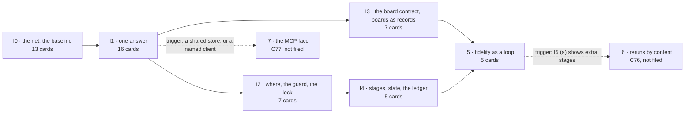

# P158 part 2 — the plan: the cards, their order, and what each iteration must prove

**Status.** The ordered plan the PO asked for on 2026-10-10, at the card level: each unit below is an issue for the board
(a story, a chore or a bug under an epic), and each later gets its own task plan when it enters Build
(`scrum/README.md`, the Build row). **Nothing here is filed, ordered or built.** It realises the design
`docs/2026-10-10-p158-architecture-design.md` ("the design") and places every change of part 1's
`docs/discovery/2026-10-10-p158-gaps-and-refactoring/proposal.md` ("part 1"). It is written **before** the council on the
design and before the PO's answers to the design's §16, in the PO's own order (D the PO 2026-10-10: *"Then, once you
have the plan, shoew me. We will further ask for gaps and bugs from the council and replan again"*). Where it assumes a
recommendation of the design's §16 (DP1–DP15) or a part 1 question (Q1–Q45), the card says which, and *Open questions*
says what a different answer moves.

Written by the plan author on 2026-10-10, against spark 0.8.1 at main `5acbe42` (E `git log -1` →
`5acbe42 2026-10-10 22:26:37 +0200 Merge pull request #129 from xmejkal/p180-council-rules`; E
`.claude-plugin/plugin.json` → `"version": "0.8.1"`).

**The PO's words this plan answers** (verbatim, typos as typed, D the PO 2026-10-10):
- *"Yes, ok, lets take that and add it to the points 1-4, still don't build anything, just please make a thorough plan on
  how to make it work, well designed, refactored, testable, modular, etc, and we can go iteratively. Then, once you have
  the plan, shoew me. We will further ask for gaps and bugs from the council and replan again. So make ure the final
  issues are well defined, separated and ordered in the best way"* — and *"including technical design and validated
  learning"*.
- *"Lets really order it by priority, so were fixing what matters."* · *"lets make sure its really good, with a few
  adversarial rounds, really well thought through. We also want thwe system to be well designed so its well testable and
  understandable where a mistake is happeening and why"*.
- The store: *"Mostlu e need to be able to have the basic globsal vs local store, to be able to create search for and
  update and copy or share the store things, the boards for sure, maybe we should also add how exactly to replace a board
  or a module in the simulation, so wokwi uses the closest board  or maybe we can create one"*.
- The principle he took the same day: *"a placeholder may flow through the chain, but it can never disappear from the
  final verdict. Tolerance without a ledger is just silence."*

**What this rests on**, read for this file:
- the design, whole (2,426 lines; E `wc -l`);
- part 1: its header and the priority rule (`proposal.md:1-107`, `:511-590`), every CH block's *kind / size / card*,
  *fixes*, *removes / adds*, *test*, *prints*, *depends on*, the three projects' lines and *proof* (extracted by a script
  into `<scratch>`, then read), *How the list becomes cards*, §4 (what not to do) and §5 (Q1–Q45) whole;
- `catalogue.md`'s header, the nine `other` rows (lines 57, 79, 89, 91–93, 98, 100, 101) and the count;
- `design/00-system-as-is.md`: the modules table, the nine `other` rows' places, the envelopes and exit codes, what #11
  did and did not do, tests and anchors, the 2026-09-30 verdict re-checked, *Keep*, *Could not check*, *Found on the way*;
- `scrum/README.md` whole, `scrum/STORY_MAP.md` whole, `scrum/WORKING_AGREEMENTS.md` (W6, W14, W16, W19, W20 and the
  habits), `.github/ISSUE_TEMPLATE/item.yml`;
- `docs/2026-10-06-store-1c-plan.md:1-200` (the shape this plan follows);
- P100's `brief.md` (its D8, rounds and Q lines, by grep);
- the code, spot-checked where a card cites it: `scripts/outcomes.py` whole; `boards.py:130-215`, `:530-545`;
  `store.py:25-100`; `check_vendor_pins.py:95-112`; `check_physics.py:536-545`; `compare_design.py:278-285`;
  `copper.py:36-56`; `check_spine.py:212-222`, `:370-377`; `tools.py:40-50`; `parts.py` `OPERATIONS` (`:1473-1530`);
  the literal store paths in `agents/` and `commands/` (grep); `mounting_holes` and `wokwi_is_stand_in` in `boards/*.json`
  (grep); the bin's `Makefile` spark lines (grep, read-only); the folder lists of irrigation and plant-alarm.

**What I ran.** No spark command, nothing against any store, nothing written except this file and a scratch folder.
- Read-only `gh`, 2026-10-10: `issue view` (title, state, labels) of #5–#8, #10, #11, #13, #16, #17, #19–#23, #28, #41–#45,
  #48, #49–#56, #58–#61, #63–#69, #70, #73–#75, #78, #79, #82–#87, #89, #93, #94, #96, #97, #99, #101–#103, #114, #118,
  #119, #123, #124, #126–#128, with the bodies and comments of the cards a card below reuses or absorbs;
  `api …/issues/<n>/sub_issues` for #6, #16, #17, #66, #67, #68, #94, #102, #103, #123 and `…/parent` for 37 cards;
  `project item-list 2` and `1` (every item not Done, with its status).
- A forecast of the order, `<scratch>/sim4.py`: two Build slots, the sizes below mapped to working days (my mapping of part
  1's scale: S → 0.1, S–M → 0.5, M → 1, M–L → 1.5, L → 2.5), each card's hard prerequisites, no council or merge wait
  modelled. It is an estimate and is used only to interleave the two lanes; its output was read before any number from it
  was written here.

**Tags.** **E** a pointer (file:line at `5acbe42` unless another repository is named; a command and what it printed; a
card). **H** a claim, with its source. **D** a decision (who, when). **—** unknown. Sizes are estimates on part 1's scale
(S under an hour, M a day, L more — part 1 §3), labelled as such. Paths under a home are written `~/…`, a scratch folder
`<scratch>`.

**Ids.** C1–C77 are this plan's cards, numbered in the proposed global order (C1 first). CH-, K-, Q-, RC- are part 1's;
DP1–DP15 and I0–I7 are the design's; U1–U7 its units. PQ1–PQ5 are this plan's questions. A card that reuses an existing
issue says so; it keeps that issue's number, and its block is the re-scope.

## 0. How to read a card

Each card is one concern, buildable alone once the cards it depends on are Done, no larger than L. Its block gives:
- **kind** (epic · story · chore · bug), **parent** (the epic it sits under), **reuses** (an existing issue it *is*, or
  none), **slice** (one of `scrum/STORY_MAP.md`'s), **iteration**, **size** (an estimate);
- **needed by** — the PO's words or the design's section, with a pointer (W14: the design it unblocks);
- **value proven by** — a hypothesis (H), the measurement, and a pass line set on 2026-10-10 before any run (W20: it is
  reproduced at Done, or the card does not close);
- **changes** · **removes** (in the same commit, W16) · **tests** (named, written first) · **prints** (the failure
  sentence it introduces: where, and why) · **depends on** (hard; *soft* when marked) · **fixes** (CH and K ids) · **must
  not break** (the run of the bin, irrigation or plant-alarm that would show it, on a scratch copy).

**The order** is: dependency first; then part 1's priority rule (silent harm · blocks the journey · wrong numbers or
documents · friction · polish, with its keys (a)–(g), `proposal.md:513-560`); then the smallest unblocker first. Two
lanes carry it, as the design's §12.1 proposes: the **layer lane** builds the design's units in the design's order (its
work is not ranked by part 1, which never ranked the PO's part-2 asks), and the **fix lane** takes part 1's changes by
rank. Each lane keeps one card in Build. The global numbers interleave the lanes by the forecast above.

## Global constraints

1. **Nothing is built, filed or moved until the PO says so** (D the PO 2026-10-10: *"still don't build anything"*). The
   sequence he set: this plan → the council asks for gaps and bugs in the design and the plan → re-plan → his yes → the
   cards are filed. The design's own §16 answers come in the same round.
2. **One card, one pull request, `Closes #N`; everything reaches `main` by a pull request** (W8, W19). Claude says "ready
   to merge"; the PO merges. A card that one pull request closes together with another still counts on its own
   (`scrum/README.md`, the counting rules), so no pull request closes two cards of this plan.
3. **The council before every pull request** — the PO assistant, the user's journey, the tech lead, three documentation
   experts (for humans, for AI, for examples and help), then the refuter — and its fixes before the merge
   (`scrum/README.md`, *The council before every pull request*; D the PO 2026-10-08 and 2026-10-10). Lenses on Sonnet;
   refuters, the final review and any synthesis on Opus; Fable only where the PO names it (*The token budget*).
4. **Tests first.** Each card's named tests fail before its code and pass after (DoD 2); each behaviour change carries a
   mutation row that is caught (W3); a replacement deletes what it replaces in the same commit (W16); a number enters a
   message only after the output that produced it was read (W13); the card's *Value proven by* is run and posted at Done,
   or it does not close (W20, DoD 4).
5. **The PO's real store is never touched by a test or a measurement.** The suite keeps its guard (`store.py:35-44`: a
   process running unittest gets a scratch `SPARK_HOME`). Every measurement on a card runs on a scratch copy, each command
   prefixed by three separate words — `SPARK_HOME=<scratch>/store HOME=<scratch>/home TMPDIR=<scratch>/tmp` — on every
   command, never exported (the incident of 2026-10-08, #101). The one exception is the drawer's data pass inside C24,
   run with the PO, on his store, after his yes.
6. **The sibling projects are measured on scratch copies only.** The bin's `make check` writes inside the bin (part 1
   §1); nothing in this plan writes under `~/Development/smartbin-local`, `~/Development/irrigation` or
   `~/Development/plant-alarm`. No suite test reads a sibling folder (design §15; 00, *Found on the way*: `test_orphans`
   already does).
7. **Free, few, local** (D the PO 2026-10-06): standard library only, no new runtime dependency (`flash_image.py`'s
   `littlefs-python` stays the one exception, `docs/guide/agents.md:70`); schemas are files for editors, never a run-time
   validator (Q15 (a)); the MCP face is a setting, off by default.
8. **Facts and harnesses, never behaviour** (D the PO 2026-10-01): no card writes or generates firmware.
9. **The limits** (`scrum/README.md:7`): two cards in each working stage, five in Ready, four in flight across both
   boards. A free Build slot takes the highest-ranked Ready card of its lane whose hard prerequisites are Done; when its
   lane has none, it takes the other lane's (ruling R7). Finishing comes before starting (W6; D the PO 2026-10-09:
   *"lets make sure we start finishing more and not starting new epics or bigger things in general"*).
10. **Each iteration ends in a whole that runs**: the suite green; the bin, irrigation and plant-alarm run on scratch
    copies; every placeholder named in the output; the iteration's measurement posted on its cards with the commands and
    their output. Its pass lines are the ones below, set on 2026-10-10 before any run; a pass line changed later says
    when and why.
11. **The stopping rule** (design §4.5) is read at each iteration's council: every `main` through `cli.run`, no folder
    spelled outside `where`, every producer feeding the ledger, the board contract one table — and the warning signs
    (a base class for findings or stages, a `checks/` package, a scheduler before I6, a diff into `parts.py`,
    `emit_board.py` or `assign_pins.py` with no card behind it).
12. **Every word a card adds to an output gets its `GLOSSARY.md` entry in that card's commit** (part 1 §3, *Done, for
    every change*), and a card that edits a page edited by P181 (#127, closed) or P182 (#128) lands after it or goes with
    it.

## Rulings this plan makes, for the PO

Each is a choice the design or part 1 left open, or a place where this plan departs from them. Strike any.

- **R1 · Reuse before filing.** Twenty existing issues *are* cards of this plan, re-scoped and keeping their numbers:
  #58, #52, #65, #82, #118, #119, #78, #69, #61, #84, #101, #23, #60, #114, #59, #55, #44, #79, #85, #10. Four more are
  met whole by a card and are proposed to close into it when that card is Done: #42 into C21, #49 into C39, #51 into C31,
  #53 into C23 (PQ3). Fifty-seven cards are new.
- **R2 · Parents.** A reused card keeps its parent (#67 P133, #68 P134, #17 P94, #123 P178, #66 P132), so no issue is
  moved; the three reused cards with no parent (#10, #60, #78, E `gh api …/parent` → 404) go under P158 (#94). A new card
  sits under P158 (#94), except: C1 and C53 under P166 (#103), whose value line names "mutate's
  import-error catch" (E `gh issue view 103`); C39, C43 and C50 under P165 (#102), whose value line is the ledger's
  ("lets the person go on with the gap marked in the output and the build's record", E `gh issue view 102`); C57 under
  P79 (#16). P158 (#94) is itself a sub-issue of P178 (#123) (E `gh api …/issues/123/sub_issues`), so every new card sits
  inside the store epic's tree. PQ2.
- **R3 · Finer cards than the design's iterations.** One concern per card: I1 becomes four cards (C14, C21, C23, C28),
  I2 two (C31, C33), I4 five (C36, C39, C41, C43, C46), I5 five (C48, C50, C51, C52, C53). The firmware levels (design
  §7.4) ride in C39, because the image stage is a producer like the others.
- **R4 · Placements that differ from the design's tables.**
  - CH-3 (the lock), CH-11 (the guard) and CH-36 (the fab gate) are fix-lane cards (C38, C34, C37) that wait on a layer
    card, not halves of one.
  - CH-20 is its own small bug (C16): part 1's CH-20 is about a *part record's* `body_mm` and `--step`
    (`proposal.md:1165-1180`), not a board's dimensions, which C30's table covers anyway.
  - CH-40's binding of each recorded block leaves I0 for its own card (C67): its JSON twin needs envelope 2, which the
    design's own CH-40 row says ("after I1").
  - CH-47's own-board route as a journey goes into C62 with the rest of CH-47.
  - CH-32 (C26) moves up before C39, which cannot list the board's stand-in until the flag is read (part 1's constraint:
    a prerequisite moves up to sit before its dependent, `proposal.md:554-560`).
  - CH-48's pages and the catalog's writer (C35) and CH-66's data (C49) sit above the cut line: the first is the third
    part of the real-store guard (design §8.5), the second is what I5's plant-alarm measurement needs (design §7.6).
  - CH-18 (C4) does not reuse #10: #10's own value line (*"`--need measure distance` … puts `vl6180x-breakout` in front
    of the reader"*, scenario 4.3 of `STORY_MAP.md`) is delivered by CH-53, so #10 is C70.
- **R5 · Merges.** CH-58 rides in CH-64's card (C20): both make the tally's number true in `cost.py`. The design's found
  card of §13.3 is #78 P144, filed 2026-10-06 (E `gh issue view 78`), not a new card.
- **R6 · #11 (P43) stays closed and is cited** — DP12 (b), against the design's (a). The PO closed it on 2026-10-06 into
  #52 (E its comment), which C21 reuses; its three value lines become pass lines of I1 (one shape: C23 and C28; a `fix`
  for every problem: C21; the size of `assign_pins --json`, reported, not promised). Reopening it would add a fifth card
  for I1's one piece of work.
- **R7 · Slot lending.** When a lane has nothing pullable, its Build slot takes the other lane's next card. The forecast
  shows the fix lane running ahead of the layer lane (`<scratch>/sim4.py`), so I3's layer card (C30) runs beside I2's.
- **R8 · Which iteration a fix card belongs to.** The iteration of the last layer card it needs; with none, the
  iteration during which it is forecast to land. An iteration closes when its cards are Done, so iterations overlap in
  time; each is a milestone, not a time-box.
- **R9 · I6 and I7 are written, not filed** (C76, C77) until their trigger fires (W14: a capability is built when a
  design reaches for it).
- **R10 · Filing in one go, committing in waves** — PQ1 (a): the cards above the cut line are filed in Idea after the
  council and the PO's yes, so the board stays the one ordered list (the bin's `CLAUDE.md`, *Status / next*: "There is
  no other ordered list"); the PO commits Ready through I2 and re-plans at I2's close with what I0–I2 measured. Cards
  below the cut are filed when the cut line is re-planned or a design pulls them.
- **R11 · The data pass (Q6) is a task of C24 (CH-19)**, run with the PO on his own store after his yes — the one task
  in this plan that writes the real store.

## Open questions for the PO

Asked in batches of at most six (`scrum/README.md`, *Asks to the PO*), each in the order the cards need them. Each line
says what the answer moves.

**Batch 1 — before anything is filed.**
1. **DP1 · the base** (design §16): A1 with the grafts, and the 2026-09-30 verdict restated. Moves: every layer card's
   shape. Another base re-plans C14–C53.
2. **DP2 and PQ5 · the order, and D8.** (a) two lanes as here, I2 before I3 when only one slot is free; (b) part 1's tier
   order strictly (part 1 Q42); (c) "start by the boards" first — C30 before C31, and CH-24's prerequisites moved up in
   the fix lane to sit right before it (part 1's constraint for the PO's named first fix). Under (c) the forecast starts
   CH-24's build (C42) at build-day 8.4 instead of 11.5, and C1–C53 end at 18.1 instead of 17.1 (estimates,
   `<scratch>/sim4.py` with the queues reordered). This is also part 1's Q35.
3. **DP15 and PQ4 · the cut line and the appetite.** (a) C1–C53 (I0–I5 plus the fix lane through tier 2's blocks A and B,
   with C35 and C49 pulled up), I6 and I7 on their triggers, an appetite in working days that you set; (b) everything;
   (c) I0–I3 only (43 cards), then re-plan. The forecast for C1–C53 is 17.1 build-days on two slots
   (estimate; no council, review or merge wait counted; elapsed time —).
4. **PQ1 · filing and commitment** (R10): (a) file C1–C53 in Idea, commit through I2, re-plan; (b) file all 77 now;
   (c) file I0's thirteen only.
5. **PQ2 · parents** (R2): (a) as R2; (b) every card of this plan under #94, re-parenting the twenty reused ones;
   (c) new I1 and I4 cards under #67 P133, whose value line they meet ("the agents guide's 'What never to assume' then
   lists no exception", E `gh issue view 67`).
6. **PQ3 and DP12 · closing and re-scoping existing cards.** Close #42, #49, #51 and #53 into C21, C39, C31 and C23 when
   those are Done; accept each reused card's re-scope as its block states it; keep #11 closed (R6). The partial overlaps
   — #19's inert-text line (C46), #20's first line (C48), #21's failed-fetch line (C15), #22's promote line (C33), #23's
   `--keep --into` and `--set-aside` lines (not in this plan) — are yours to trim or keep.

**Batch 2 — before I1 (C14) enters Build.** DP9 (the vocabulary envelope 2 publishes) · DP3 and Q5 (P100's round A as a
baseline before C14, and its board) · Q36 (the bin's `make check` a contract: C3) · Q14 (an unknown id stays exit 1: C14)
· Q25 (`init` run twice: C28) · Q41 (a pick's fit as a field: C22).

**Batch 3 — during I1.** Q6 (the data pass: C24) · Q1 with Q34 and Q38 (holds stored; who may release; the verbs' names:
C27) · Q44 (the stand-in flag required: C26) · Q2 (the guard's rule: C34) · Q42 and Q43 (the ordering keys and "silent",
which order the fix lane inside its tiers).

**Batch 4 — before I2 and I3 close.** Q8 (boards in the store; where the board verbs live: C32, C42, C45) · Q16 (mounting
holes: C30) · Q11 (a board pick with no file: C44) · Q21 (the XIAO's footprint: C49) · Q24 (a need the board serves:
C40) · Q7 (irrigation's file name: C54).

**Batch 5 — before I4.** DP7 (the state folder: C41) · DP8 (what makes a stage stale: C41) · DP10 (how much ledger an
intermediate stage prints: C43) · DP14 (run 2 folded in: C39, C50) · Q3 (`pin_order` owed or broken: C48) · Q4 (an empty
rule list: C59).

**Batch 6 — before I5.** DP4 (a target's exit code: C50) · DP5 (safe defaults: C52) · DP6 (the generic board: C51) ·
DP11 (the evals' token ceiling: C53) · DP13 (Q12, the `parts.py` split, out) · Q13 (the step to a board: C57).

**Below the cut, asked when their cards are pulled:** Q18 (C67), Q19 (C61, C68), Q20 (C69), Q22 (C65), Q29, Q33 and Q45
(C63), Q37 (C58, C65), Q39 (C58). Not gating any card here: Q9, Q10, Q17, Q27, Q28 (P178's concept), Q12 (refused,
DP13), Q23 (a sentence in `idea.md`, no card), Q26 (a stranger's run, slice 5), Q30 (the epic's done line: the PO's
measure), Q31 (answered by PQ1 and DP15), Q32 (answered: #125 merged), Q40 (K42 and K44 stay on #99 and #93).

## The first slice (proposed; the PO orders Ready)

- **In flight today** (E `gh project item-list 2`, 2026-10-10): P100 (#6) and P158 (#94) in Discovery; P181 (#127) in
  Review, though its issue is closed. The bin's board: 3 cards in Ready, 19 in Idea, none in a working stage (E `gh
  project item-list 1`, 2026-10-10).
- **When the plan has his yes and its cards are filed:** P158's card leaves Discovery (an epic counts only in Discovery
  and Design, `scrum/README.md`), and P181's moves to Done.
- **Build (2):** C1 in the layer lane and C2 in the fix lane.
- **Design (1):** C42, D8's first fix — its spec opens now; its build waits on C25, C30 and C32 (part 1, the design §12.5).
- **Ready (5):** C3, C4, C5, C6, C7. C8 comes next.
- **In flight:** #6, C1, C2 and C42 — four, the limit.
- **His answers:** batch 1 before anything is filed; batch 2 before C14 enters Build.

## Size, estimated

W20 and W13: estimates, not measurements. Sizes are part 1's lenses' where part 1 sized the change, the design's for the
layer, and mine where neither did (C7, C12, C39, C43 and the splits; labelled in each card). *Card-days* maps S → 0.1,
S–M → 0.5, M → 1, M–L → 1.5, L → 2.5 working days (my reading of part 1's "S under an hour, M a day, L more"); a card
sized "S + S" counts as S–M. The
forecast places C1–C53 on two Build slots (`<scratch>/sim4.py`). Neither counts the council before each pull request, the
review, or the wait for the PO's merge, which the service level puts at "within 2 working days, 8 times in 10"
(`scrum/README.md`); the elapsed time is —.

| | cards | S | S–M | M | M–L | L | card-days |
| --- | --- | --- | --- | --- | --- | --- | --- |
| I0 | 13 | 7 | 3 | 3 | 0 | 0 | 5.2 |
| I1 | 16 | 8 | 1 | 6 | 1 | 0 | 8.8 |
| I2 | 7 | 0 | 4 | 3 | 0 | 0 | 5.0 |
| I3 | 7 | 2 | 0 | 4 | 1 | 0 | 5.7 |
| I4 | 5 | 0 | 1 | 3 | 1 | 0 | 5.0 |
| I5 | 5 | 0 | 2 | 3 | 0 | 0 | 4.0 |
| **above the cut (C1–C53)** | **53** | 17 | 11 | 22 | 3 | 0 | **33.7** |
| below the cut (C54–C75) | 22 | 11 | 4 | 5 | 1 | 1 | 12.1 |
| on their triggers (C76, C77) | 2 | 0 | 0 | 1 | 1 | 0 | 2.5 |
| **all** | **77** | 28 | 15 | 28 | 5 | 1 | **48.3** |

The forecast for C1–C53 on two Build slots ends at build-day 17.1; under DP2 (c) it ends at 18.1, with C42's build
starting at day 8.4 instead of 11.5 (both from `<scratch>/sim4.py`, estimates). Of the 53, 21 are the layer's: against
the design's own count of 14 for I0–I5 (§12.7), the difference is the finer split of R3. Re-plan point 1 re-sizes I1
with the rows each card moves (C1's `--rows-in`).

## Iterations

Each iteration below gives its goal, its cards in order, the whole that runs at its end for the three projects, its
hypothesis, how that is measured, the pass lines (set on 2026-10-10, before any run; the design's own lines are carried
unchanged unless marked), and — the validated learning — what a refutation teaches and what it changes in this plan.
The layer lane carries the design's iteration; the fix lane's cards are placed by R8. A fix card's own *Value proven by*
is part of its iteration's measurement and is not repeated here.

### I0 — the net and the baseline

- **Goal.** The net exists before any `main` moves, today's outputs are recorded, and the first silent faults of boards
  and search are refused where they happen.
- **Cards, in order.** C1 (CH-2) · C2 (CH-13) · C3 (CH-68) · C4 (CH-18) · C5 (the net) · C6 (CH-26, #82) · C7 (the
  journeys and the baseline) · C8 (#118) · C9 (#119) · C10 (CH-14) · C11 (CH-12) · C12 (#78) · C13 (CH-49).
- **The whole that runs at its end.**
  - The bin (scratch copy): `make check` green; its calls of four spark tools pinned in spark's suite (P41's `boards.py`
    and C3's three); both library boards
    validated on their own silicon (C2) and carrying no bare-number label (C11).
  - Irrigation (scratch copy): `check_spine.py irrigation.requirements.json` exits 1 as today, over its declared
    `STATUS_LED` (part 1 §1; C36 changes it in I4), recorded in the baseline; its interpreter image reads chip id 9 and
    passes C2 (part 1 CH-13, FB verify).
  - Plant-alarm (scratch copy): where its chain stops, recorded in the baseline. Predicted: the schematic, on
    `power.io_volts` (H, design §7.6; not run).
- **Hypothesis.** H0 (design): the net turns red when a change breaks a spark call the bin makes, and a mutant that tests
  nothing is no longer counted as caught. Hf0 (this plan): the fix lane's first nine cards turn silent answers into named
  refusals without changing what the three projects print.
- **Measurement.**
  - (a) In a scratch branch, change the exit code `check_bom`, `check_physics` and `check_vendor_pins` each give the bin
    for one of its findings, one at a time, and run the suite; the control is the same three changes before C3 lands.
  - (b) One mutation row whose mutant does not import, run through `tools/mutate.py`.
  - (c) The baseline, recorded with no pass line: the invariant's failures over 16 `main`s × 4 inputs; the outputs of A3's
    runs 1 and 2; the three projects' statuses and stage lists; a dated full mutation sweep with its wall time; the
    suite's time with C5.
  - (d) The three projects' snapshots before and after I0's layer cards.
- **Pass lines.** (a) red 3 times out of 3, each naming its test; the control green 3 out of 3. (b) `refused`, never
  `caught`. (d) byte-equal, except lines a fix card names on purpose on its own card.
- **If refuted — what we learn, and what changes.**
  - (a) green after C3: the pinned tests do not assert exit codes. C3 is corrected before C21 or C23 moves any `main`,
    and both gain a hard dependency on the corrected C3.
  - (a) the control red: the gap was smaller than part 1 thought. Recorded; C3 stays as the guard.
  - (b) caught: C1 misses compile against import. No I1 card enters Build until C1 is fixed.
  - (c) the suite's time grows past what the PO accepts (P173, #113, already counts it): the invariant runs in the
    gate's archived run only — his call; C5 holds either way.
  - (d) a fix card changed a sibling's output unannounced: C3's class missed a call, and C3 is extended before I1.
- **Re-plan point 1.** At I0's close, C1's `--rows-in` and the dated sweep say how many mutation rows each I1 card moves;
  C14–C28 are re-sized with them (design §14, HI).

### I1 — one answer

- **Goal.** Every spark command answers in envelope 2, through one `main`, under one exit contract; an unreadable input
  is could-not-run naming the file; the store, matching and tally answers stop being silent.
- **Cards, in order.** C14 (#58) · C15 (CH-15) · C16 (CH-20) · C17 (CH-9) · C18 (CH-72) · C19 (CH-55) · C20 (CH-64 with
  CH-58) · C21 (#52) · C22 (CH-17) · C23 (#65) · C24 (CH-19) · C25 (CH-23) · C26 (#69) · C27 (CH-25) · C28 (the mains with
  no JSON) · C29 (CH-30).
- **The whole that runs at its end.**
  - The bin: its five captured values (`boards.py --path`, `--id`, `--paths`, `--get chip`, `--get micropython_port`;
    E the bin's `Makefile:49-53`) byte-identical; exit codes identical except `boards.py` with no selection, 1 → 2, which
    no call of the bin meets because it holds `boards/active.json` (part 1 CH-21); `make check` green.
  - Irrigation: the same statuses in the new shape; `check_all --project` with a `fix` on every problem.
  - Plant-alarm: the same stop in the new shape.
- **Hypothesis.** H1 (design): with one envelope and one exit contract, an agent can act on every spark answer from its
  JSON alone — the status, where, why and what next.
- **Measurement.** The design's I1 (a)–(g), and #11's three lines (R6): `check_all --json` carries a `fix` for every
  problem; every payload has one shape; `assign_pins --json` on the documented example measured in bytes and characters.
- **Pass lines** (the design's). (a) 0 tracebacks over 16 `main`s × 3 file inputs. (b) 16 of 16 carry the envelope-2 key
  set. (c) 100 % of the items in the journeys' answers carry a `where` that parses by the locator grammar, and every
  problem a non-empty `fix`. (d) every `next[].argv` parses with the named script's parser. (e) #11's first two lines met;
  the size reported, not promised (6,446 bytes today, E design §5.1). (f) byte-identical; exit codes identical except the
  pinned one. (g) the exception list `docs/guide/agents.md:297-333` deleted, with the suite green.
- **If refuted — what we learn, and what changes.**
  - (a) above 0: a path bypasses `cli`; the crash list names each frame, and the card that owns that script stays open.
  - (c) below 100 %: a producer makes an item with no place; its constructor is made to refuse it, inside the card.
  - (f) not identical: the value-operation rule is wrong for that call; that script's stdout routing goes back before C28
    closes.
  - The rows moved exceed re-plan point 1's estimate by more than half: I2–I5 are re-sized and the PO re-sets the
    appetite.
  - Later, from C53's cold run: if an agent reads text to decide, the envelope lacks a field. The field is added; a text
    parser never is.

### I2 — where, the guard and the lock

- **Goal.** Every answer names the store and the project it used; a store setting that names nothing is refused;
  spark's own folder receives only spark's own artefacts; no agent's unscoped command reaches the PO's store; one lock
  beside the data.
- **Cards, in order.** C31 (`where`) · C32 (CH-21) · C33 (#84) · C34 (#101) · C35 (#23) · C38 (#114) · C45 (CH-63).
  I2 and I3 run side by side (design §12.2; R7).
- **The whole that runs at its end.** None of the three projects sets `SPARK_HOME` (part 1 CH-1: their grep prints
  nothing), so their outputs change by `context` only. The bin's `make refresh-vendor-pins` (E the bin's `Makefile:223`)
  refreshes spark's shipped header and writes nothing else. An agent's scratch store must exist before a run, and
  `docs/guide/agents.md:85-86` says "make its folder first".
- **Hypothesis.** H2 (design): every answer says which store and which project it used, and spark's folder receives only
  spark's own artefacts. Hf2: with the guard (C34), the catalog's writer through the door (C35) and the lock (C38), an
  agent's unscoped command cannot write the PO's store, and two agents cannot write one store at once.
- **Measurement.** The design's I2 (a)–(f); and (g) #101's own line, run with `HOME` at a scratch folder and no
  `SPARK_HOME`, under Q2's rule; (h) `grep '\.local/share' agents commands`; (i) part 1's K5 and K7 runs, two `TMPDIR`s on
  one scratch store.
- **Pass lines.** (a) exit 2, the sentence naming the folder and its fallback. (b) `git status --short` in a scratch
  clone of spark prints nothing after the suite and the N25 and N26 reproductions. (c), (d) green. (e) 16 of 16 exit 2
  with no traceback. (f) the shipped header refreshed, nothing else written. (g) could-not-run naming the rule, and the
  scratch home's default store unchanged. (h) prints nothing. (i) the writes serialised; 24 of 24 registrations listed.
- **If refuted — what we learn, and what changes.**
  - (b) prints a path: a writer bypasses `check_write`; the grep test names its line, and C33 stays open.
  - (e) a traceback: a module still reads a folder at import; C31 stays open.
  - (g) the incident's class still writes: Q2's rule is asked again, with the failing case shown.
  - (i) not serialised: C38 stays open.
- **Re-plan point 2** (R10). At I2's close the PO commits I3–I5 as planned, or changes them, with I0–I2's measurements on
  the cards. A second council round on the design, if he wants one, reads them.

### I3 — the board contract, and boards as records

- **Goal.** A board file's mistake is refused where it is written, named in the terminal, the JSON and the editor; a
  board the person owns becomes a record from its drawer entry (D8).
- **Cards, in order.** C30 (#61) · C37 (#60) · C40 (CH-54) · C42 (CH-24, the skeleton) · C44 (CH-24, the pick) · C47
  (CH-31) · C49 (#55).
- **The whole that runs at its end.** The bin's `make check` — `boards-valid` and the Gerber recipe's `--validate
  --for-fab` (E the bin's `Makefile:182`, `:232`) — green on a scratch copy: the library S3 and XIAO pass the table in the
  same commit. Irrigation's and plant-alarm's boards validate as before; plant-alarm's XIAO fails `--for-fab` honestly
  (C37) and, after C49's datum, its chain stops at the footprint, not the schematic (or goes further, under Q21 (a)).
- **Hypothesis.** H3 (design): a board file's mistake is refused where it is written, naming the key, in the same way in
  the terminal, in the agent's JSON and in the editor. H3b (D8): a board the PO owns becomes a record from its drawer
  entry, with only its geometry left to measure.
- **Measurement.** The design's I3 (a)–(f); and (g) C42's line: the skeleton command (its name is Q8's) for
  `dfrobot-dfr1075` on a scratch copy of the store, its owed fields filled from the kept drawing, then `check_spine` on
  that board and one LED.
- **Pass lines.** The design's: (a) problems, `where` = the cell's pointer, exit 1; (b) problems naming
  `board-esp32-c6-devkitc-1` and `board-xiao-esp32-c6`; (c) `tools/schemas.py --check` green; (d) the error shows at the
  key in VS Code, a screenshot on the card; (e) exit 0, unchanged; (f) refused, naming both keys. And (g) `[ok] build`:
  round 0's pass line, reached from a command.
- **If refuted — what we learn, and what changes.**
  - (e) red: a table row or a reader is wrong — never the bin's file — and the table is fixed.
  - (b) `ok`: the chip table's map of spellings is wrong (`esp32s3` against `esp32-s3`, part 1 §4).
  - (d) the editor shows nothing without an extension: the editor half moves to P160 (#96) and the schema stays a file
    (nothing to install, D the PO 2026-10-06).
  - (g) the geometry cannot be filled from the kept drawing in one sitting: "automatically" is narrowed on C42's page,
    and the generic header (C52) becomes the route to the simulation for such a board.

### I4 — the stage table, the run record and the ledger

- **Goal.** What ran on what, what is stale and why, and every placeholder from every stage in the final verdict.
- **Cards, in order.** C36 (CH-38) · C39 (the producers) · C41 (the state) · C43 (inheritance and the final verdict) ·
  C46 (the files carry the ledger).
- **The whole that runs at its end.** The bin: ledger lines in text and `assumptions` in JSON, among them one
  `unknown-origin` entry for its own circuit in `check_physics` and `check_bom` (design §7.6); exit codes unchanged;
  `git status` after `make check` on a scratch copy shows no new untracked path. Irrigation: `check_spine` exits 0
  instead of 1 over its declared signal (C36 — the one intended change of verdict, announced on the card). Plant-alarm:
  the same status.
- **Hypothesis.** H4 and HA (design): a placeholder made at any stage reaches the final verdict; one command says what
  ran, what is stale and why; the ledger adds no new facts — it is today's ten channels in one shape, plus the entries
  listed in (e).
- **Measurement.** The design's I4 (a)–(h).
- **Pass lines** (the design's). (a) green; (b) every sentence of irrigation's `sim/WHAT-THIS-CANNOT-SHOW.md`, its
  `STATUS_LED` and the FireBeetle's stand-in present in `check_all`'s `assumptions`; (c) said; (d) both named; (e) equal,
  except the listed additions (the board's stand-in, `edited-after`, `unknown-origin`, the board facts); (f) recorded
  for DP10, no pass line; (g) nothing stale and nothing written; (h) no new untracked path.
- **If refuted — what we learn, and what changes.**
  - (b) missing: a producer is not wired; its basis's subTest names it, and C39 stays open.
  - (e) unequal beyond the listed additions: a missed channel (a bug in C39) or an invented entry (C43 stops until it is
    removed).
  - (f) more lines than a person will read: DP10 moves to counts only, the number being the PO's.
  - (g) stale after a touch that changes only modification times: C41 stays open.
- **Re-plan point 3.** The ledger's size in JSON on irrigation, (f), decides HG (design §14): if it overruns an agent's
  budget, the PO chooses between paging it in `state.py --ledger` and keeping it whole in every answer — a cut, so his.

### I5 — fidelity as a working loop

- **Goal.** From a goal and a chip to a design that builds and simulates in one sitting with every placeholder named,
  then upgraded one fact at a time with nothing leaving unsaid (D the PO 2026-10-10, §0.1–§0.2 of the design).
- **Cards, in order.** C48 (#59) · C50 (targets) · C51 (the generic board) · C52 (the generic header) · C53 (evals).
- **The whole that runs at its end.** The three projects unchanged by default: nothing writes `--as-placeholder` into
  them. Irrigation's regenerated board carries the `PLACEHOLDER` silkscreen on its three placeholder footprints if DP5
  covers part placeholders (announced on C52). Plant-alarm: design §7.6's table, with C49's datum.
- **Hypothesis.** H5 (design), the PO's own of 2026-10-10.
- **Measurement.** The design's I5 (a)–(e): the three tables of §7.6 run on scratch copies; one cold model run (C53);
  `--for pcb` on a placeholder board and on run 2's fixture; the derived owed table against today's `CHAIN_FACTS`; the
  silkscreen text in an exported Gerber.
- **Pass lines** (the design's). (a) each stale list equals its table, 0 extra and 0 missing, and each ledger diff is
  exactly as written; (b) `ok` in the first sitting and every entry said — n = 1, said as such; (c) problems naming the
  placeholder's pointer, exit 1; (d) equal, then `CHAIN_FACTS` deleted; (e) the text present.
- **If refuted — what we learn, and what changes.**
  - (a) extra stages: whole-file digests over-report. I6's trigger has fired: C76 is filed.
  - (a) missing stages: the read-audit missed a read. A bug; I5 does not close.
  - (b) an entry left unsaid: the page changes (`/spark:build`, the review skill) and the run is measured again.
  - (b) not `ok` in the first sitting: the stop names what the default rule refused, and the PO decides through DP5
    whether to widen the rule.
  - (e) absent: the comment in the file is the only mark, said on every placeholder footprint, and the PO decides whether
    a placeholder may reach a Gerber before C52 closes.
- **Re-plan point 4.** H5's result decides C76 and the hand-over to P178's concept (#123).

### I6 — reruns by content (C76, on its trigger)

H6 (design): content digests make a rerun after one upgrade cheaper, and hide nothing. Measured on irrigation's copy
after one record edit: the stages run against the full chain, the wall time, the final `made` digests and ledger
against a full rerun. Pass: the stages run equal the stale set; the digests and the ledger equal. If `tsci build` is not
byte-deterministic (—, HD), every stage after `build` is stale after any rebuild: recorded, and the PO decides whether
`build`'s digest becomes the netlist's. **Trigger:** I5 (a) shows extra stages, or an agent's reruns show a cost the PO
wants removed (design §12.7). The three projects are unchanged unless `state.py --rerun` runs in them.

### I7 — the MCP face (C77, on its trigger)

H7 (design): a client other than Claude Code drives spark through the same envelope, with no second logic. Measured by
the round-trip test over every operation with no effect. Pass: every result equals the CLI's. **Trigger:** P178's shared
store makes spark something other people call, or the PO names a client that is not Claude Code (D the PO 2026-10-10,
option 3, "when the store is shared"). The three projects are unchanged: the face is off by default.

### Below the cut line (C54–C75)

Part 1's rest of tier 2 and its tiers 3–5 that no layer card carries. They are written here so the order is whole;
under PQ1 (a) they are filed when the cut line is re-planned (re-plan points 2 and 4) or when a design pulls one (W14).
Each names the earliest iteration whose cards it needs. If the fix lane runs dry before I5 closes, the PO may pull the
next of them instead of lending the slot (R7).

## The cards, in global order

### C1 · `mutate.py` scores a mutant that no longer imports as caught → a mutant that does not compile, import or parse is refused, and a card can list the rows it re-anchors
- **kind** chore · **parent** P166 #103 · **reuses** none · **slice** 4 · **iteration** I0 (layer lane) · **size** S, plus
  machine time (part 1's estimate)
- **needed by** part 1 CH-2 (`proposal.md:1299`, K53); the design's I0 H0 (§12.3); W3 — every later card proves itself
  with mutation rows, and 2026-09-30's "the safety net, first".
- **value proven by** H: a row whose mutant does not import is refused, never caught. Measure: in a scratch branch, one
  row whose `replace` breaks an import, run with `python3 tools/mutate.py <its table>`; then `--rows-in
  scripts/parts.py`. Pass: `refused` naming the row and the import error; `--rows-in` lists the rows anchored in that file.
- **changes** `tools/mutate.py`: before the suite, in a subprocess, a `.py` mutant is compiled and imported, a `.json` one
  parsed; a `.md`, `.ts` or `.js` row says no load check applies; `--rows-in <file>`. `GLOSSARY.md`'s *refused* gains the
  second reason (part 1 §4: no new outcome word).
- **removes** the verdict read from the suite alone (`tools/mutate.py:88`, E part 1).
- **tests** `tests/test_mutate.py::test_a_mutant_that_does_not_import_is_refused_not_caught` ·
  `::test_a_json_mutant_that_does_not_parse_is_refused` · `::test_a_markdown_row_says_no_load_check_applies` ·
  `::test_rows_in_lists_the_rows_anchored_in_a_file`
- **prints** `refused: <table> row <n> — the mutated scripts/parts.py does not import (NameError: …, line L); a row must
  change behaviour, not break the import — fix the table` — where: the table, the row, the line; why: the import error.
- **depends on** — · **fixes** CH-2; K53
- **must not break** none of the three projects runs `mutate.py`; the pre-push gate's `--anchors` pass stays green.

### C2 · Wrong silicon passes silently: a stand-in of another chip validates, and an interpreter built for another chip is packed → both refused through one chip-name table
- **kind** bug · **parent** P158 #94 · **reuses** none (part 1: "card none") · **slice** 4 · **iteration** I0 (fix lane) ·
  **size** S + S
- **needed by** part 1 CH-13 (`proposal.md:625`, rank 2), reproduced by the controller (#94, comment
  2026-10-10T20:49:59Z); the PO 2026-10-10, *"so wokwi uses the closest board"*; D8, *"we want to start by the boards"*;
  the design §5.5, §8.4.
- **value proven by** H: a board whose stand-in's chip differs from its own is refused, naming the same-chip boards, and a
  wrong-chip interpreter is never packed. Measure: STORE-9's fixture (the S3 file with `chip: esp32c6`) through `boards.py
  --validate` in a scratch project; the FB diagnosis's chip-13 image through the simulation stage. Pass: exit 1 with the
  sentence; the image refused, exit 2, nothing written; both shipped boards exit 0.
- **changes** `data/wokwi-boards.json` — one row per Wokwi board type, its `mcu` as wokwi-boards spells it and spark's
  spelling, copied as facts with a citation at a commit, never the files (STORE-10, STORE-11); `boards.validate`'s
  cross-check through it; a 16-byte image-header read (magic `0xE9`, chip id at byte 12, cited from ESP-IDF's
  `esp_app_format.h`, part 1) in `check_spine`'s simulation stage; `flash_image.py --chip`.
- **removes** —
- **tests** `tests/test_boards.py::test_a_stand_in_of_another_chip_is_refused` ·
  `::test_the_shipped_boards_stand_in_on_their_own_silicon` ·
  `::test_a_stand_in_the_chip_table_lacks_is_could_not_run_naming_the_table` ·
  `::test_the_chip_table_spells_each_chip_both_ways_once` ·
  `tests/test_flash_image.py::test_an_interpreter_for_another_chip_is_refused_before_any_byte_is_written`
- **prints** `wokwi_part_type board-esp32-s3-devkitc-1 is an esp32s3 (wokwi-boards' mcu: esp32-s3); this board's chip is
  esp32c6 — Wokwi boards with that chip: board-esp32-c6-devkitc-1, board-xiao-esp32-c6` · `<type> is not in
  data/wokwi-boards.json, so its chip cannot be compared — could not look; add its row (type, mcu, chip) from
  wokwi-boards at a cited commit` · `<file> is a MicroPython build for chip id 13 (esp32c6) but firebeetle2-esp32s3 is an
  esp32s3 (chip id 9) — refused, nothing written`
- **depends on** — · **fixes** CH-13; STORE-9; K66's silent half
- **must not break** the bin's `boards-valid` (E the bin's `Makefile:232`) validates both library boards, each on its own
  silicon — `test_the_shipped_boards_stand_in_on_their_own_silicon`, which also catches a direct compare of the two
  spellings; irrigation's image reads chip id 9 (part 1, FB verify); plant-alarm has no firmware.

### C3 · Whether a spark change breaks the bin is tested for one of the four spark tools it calls → its `check_vendor_pins`, `check_physics` and `check_bom` calls pinned as spark tests
- **kind** chore · **parent** P158 #94 · **reuses** none · **slice** 6 · **iteration** I0 (layer lane) · **size** S–M
- **needed by** part 1 CH-68 (`proposal.md:1947`); the design's I0 H0 (*"the net turns red when a change breaks a spark
  call the bin makes"*); Q36 (a). C21 and C23 change those scripts' outputs.
- **value proven by** H0 (a), as the iteration states it: red 3 of 3 against a green control.
- **changes** a test class beside P41's `TheCommandLineTheSmartBinDependsOnTest` (`tests/test_boards.py:314`), one case
  per call, each naming the line it pins (E the bin's `Makefile:186`, `:212`, `:220`, `:228`), on synthetic fixtures —
  never the bin's folder (design §15).
- **removes** —
- **tests** `tests/test_boards.py::TheSmartBinsOtherCallsTest` (one case per call); a mutation row that changes
  `check_physics`' line shape, caught.
- **prints** `the smart bin's Makefile:228 runs check_physics.py … --rules .spark/rules.json and reads its exit: this
  change made it 2 where it was 0 — the bin's make check would go red`
- **depends on** — · **fixes** CH-68
- **must not break** the suite on a clean clone: no sibling folder is read.

### C4 · `--need` answers "nothing matches — research it" for parts the person owns, and its answer depends on quoting → one word split, each word still a substring, the missed word and what was not searched named
- **kind** bug · **parent** P158 #94 · **reuses** none (R4: #10 is C70) · **slice** 10 · **iteration** I0 (fix lane) ·
  **size** S
- **needed by** part 1 CH-18 (`proposal.md:668`, rank 3), reproduced by the controller (#94, 2026-10-10T20:49:59Z); the
  PO 2026-10-10, *"to be able to create search for and update and copy or share the store things"*.
- **value proven by** H: quoting no longer changes the answer, and a miss names the word. Measure on a scratch copy of
  the store: `--need "soil sensor"`, `--need soil sensor`, `--need 12 V inlet`, `--need vl6180`. Pass: the first two give
  one answer; the third names the missing words and the counts searched; the fourth still finds `vl6180x-breakout`.
- **changes** one `words()` at layer 1 beside `store.PLAIN`, used by `needs` and `parts`; the miss sentence of `--need`.
- **removes** `needs._words` as a private copy reached from `parts` (`needs.py:122-123`).
- **tests** `tests/test_parts.py::test_need_quoted_or_not_is_one_search` ·
  `::test_need_12_v_inlet_names_the_words_that_missed` · `::test_need_keeps_prefix_finds`; `tests/test_parts.py:790-798`
  stays green.
- **prints** `nothing matches all of: 12, v, inlet — "inlet" alone matches 4 (…); searched id, name, kind and aliases of
  31 records (library 8, shelf 5, catalog 18); the drawer's 110 entries and function words are not searched here —
  parts.py --match <project> searches them` (part 1's shape; the counts are his copy's)
- **depends on** — (soft C31: until it lands, the line names the layers, not the store's path) · **fixes** CH-18; K33
  (step 1)
- **must not break** none of the three runs `--need` (part 1, reasoned).

### C5 · A crash on bad input reads as "problems", and a new upward import goes unseen → the outcome invariant and the import-direction test, today's failures listed as expected
- **kind** chore · **parent** P158 #94 · **reuses** none (#65 is the fix, C23) · **slice** 4 · **iteration** I0 (layer
  lane) · **size** M
- **needed by** the design §10.1 (*"The outcome invariant"*), §4.3 (*"The import rule as a test"*), §12.3 I0; the PO
  2026-10-10, *"well testable and understandable where a mistake is happeening and why"*.
- **value proven by** H: from now on a new crash on bad input or a new upward import turns the suite red, naming the
  script and the input or the edge. Measure: in a scratch branch, one raw `json.loads(…read_text…)` added to a script that
  does not crash today, and one upward import. Pass: both red, each naming its script; today's failures appear only in
  the expected list, counted on the card (the count is I0's baseline).
- **changes** `tests/test_outcome_invariant.py`: every script with a `main` (16, E 00) in a subprocess, fed a non-UTF-8
  file, a list where an object belongs, a missing path, and an empty or missing `SPARK_HOME`; each must give exit 2, one
  item with a `where` and a `sentence`, no `Traceback` in either channel; today's failures listed as expected, the list
  shrinking card by card. `tests/test_layers.py`: the layer list of the design's §4.3, today's 17 function-local imports
  as known exceptions, and no import outside spark and the standard library but `flash_image.py`'s.
- **removes** —
- **tests** `tests/test_outcome_invariant.py::test_every_main_answers_could_not_run_for_unreadable_input` ·
  `::test_every_main_under_an_empty_or_missing_spark_home_exits_2_with_the_sentence_and_no_traceback` ·
  `tests/test_layers.py::test_no_module_imports_a_higher_layer` · `::test_no_import_outside_spark_and_the_standard_library`
- **prints** `check_bom.py, a file that is not a zip: exit 1 and a Traceback — expected exit 2 and one item with a where
  and a sentence (expected to fail until C21)` · `layers: scripts/store.py imports scripts/parts.py — an upward import
  (store is layer 2)`
- **depends on** — · **fixes** CH-5's test half (TL-M-H); the CH-1 test part 1 names for every `main`
- **must not break** the suite's time is said at every push (C7 records it); no sibling folder is read.

### C6 · A copy into a project carries no provenance, and the digests spark writes are read by nothing → one `based_on` shape on every copy, and `--audit` says which copy or proof is behind
- **kind** story · **parent** P94 #17 (its parent) · **reuses** #82 P148, re-scoped: its read-only drift report is
  `--audit`'s field-by-field comparison, and its own example — rc-car's `tactile-button` — is the pass line · **slice** 10
  · **iteration** I0 (fix lane) · **size** M
- **needed by** part 1 CH-26 (`proposal.md:695`, rank 4); #82's Needed by; the PO 2026-10-10, *"copy or share the store
  things"*; the design §8.3 (local ↔ project: a copy pinned by a digest).
- **value proven by** H: `--audit` names every copy behind its source, the fields it differs in and which side moved.
  Measure: `parts.py --audit` on a scratch copy of the store. Pass: rc-car's `tactile-button` copy named with the fields
  it differs in, saying it records no source; nothing else named.
- **changes** every copy writes `based_on {from, project, id, digest}`, its digest over the whole record less
  `SHELF_DROPS`; `--audit` compares field by field and says which side moved; `note_built` returns a sentence.
- **removes** the old shelf shape `{project, digest}`, rewritten on its next write. `BUILD_FACTS` stays (part 1 §4).
- **tests** `tests/test_parts.py::test_every_copy_writes_the_one_based_on_shape` ·
  `::test_audit_names_the_fields_a_copy_differs_in_and_which_side_moved` ·
  `::test_a_copy_edited_here_reads_as_edited_not_behind` ·
  `::test_a_shelf_copy_in_the_old_shape_is_read_compared_and_rewritten` ·
  `::test_audit_says_a_built_line_is_stale_after_its_pin_order_changed` ·
  `tests/test_check_spine.py::test_a_build_of_an_unlisted_project_says_it_was_not_recorded`
- **prints** `rc-car's copy of tactile-button differs from spark's library in host_parts, simulation — it records no
  source, so which side moved cannot be told; compare, then --fact-set or delete the copy`
- **depends on** — (soft C14: until `read_json` lands, an unreadable copy is named by today's reader) · **fixes** CH-26
  (not its `--refresh`, which is P178's, Q9); K13 (its record half), K19
- **must not break** irrigation's four shelf copies match today (part 1, the SL diagnosis) — no line for them.

### C7 · Nothing runs a documented journey end to end, and nobody can say what a change altered in the three projects → the journeys as a table in the suite, and a dated baseline
- **kind** chore · **parent** P158 #94 · **reuses** none · **slice** 4 · **iteration** I0 (layer lane) · **size** M, plus
  machine time
- **needed by** the design §10.1 (the journeys; A3's runs 1 and 2, J1-G8) and §12.3 I0 (c); part 1 CH-2's "sweep before";
  the PO 2026-10-10, *"including technical design and validated learning"* — every later iteration is compared with this.
- **value proven by** H: the journeys reproduce today's answers on fixtures, and the baseline is whole enough that every
  later iteration's "the whole" can be compared with it. Measure: the suite; `tools/snapshot.py` (name proposed) on
  scratch copies of the three projects; a full sweep. Pass: the journeys green with today's statuses; the baseline posted
  on the card — the invariant's count, runs 1 and 2, the three projects' statuses and stage lists, the sweep's summary
  with its date and wall time, the suite's time. No pass line on the numbers (the design).
- **changes** `tests/test_journeys.py` and `tests/data/journeys/*.json`: A3's runs 1 and 2; `commands/build.md`'s
  example; the idea flow S → M → C → L on a fixture store; init → checks. A step that needs `tsci` or the converter is
  skipped and says so. `tools/snapshot.py`: runs a project copy's documented commands and writes their outputs into
  `<scratch>`, quoted on the card, never a suite fixture.
- **removes** —
- **tests** `tests/test_journeys.py` (one test per journey) · `tests/test_snapshot.py::test_it_writes_nothing_inside_the_project`
- **prints** `journey run-2, step 3 (boards.py --validate --for-fab): expected ok, got could-not-run — <the answer's first
  item>` — one line per step that drifts, naming the journey, the step, the command and what it said.
- **depends on** C5 (its count is part of the baseline) · **fixes** — (a measurement; J1-G8)
- **must not break** the three projects' folders: the snapshot reads scratch copies only.

### C8 · The requirements writer replaces a list without a word and writes back two entries that are one name → it reads through `design.read` and refuses both, naming the file
- **kind** bug · **parent** P178 #123 (its parent) · **reuses** #118 P175, re-scoped to add the list file (K59) to its own
  two-names case (K60) · **slice** 4 · **iteration** I0 (fix lane) · **size** S
- **needed by** #118's Needed by; part 1 CH-6 (`proposal.md:893`, rank 9).
- **value proven by** H: a list-shaped file and two entries that are one name are refused, with nothing written.
  Measure: the chain diagnosis's `proj-k59` and `proj-k61` reproductions on scratch copies. Pass: exit 1 with the
  sentence; the file unchanged.
- **changes** `needs.requirements` reads through `design.read` when the file exists and starts from `{}` when it does not;
  `design.read` reads UTF-8; `parts.main` maps `DesignError` to a problem naming the file.
- **removes** the silent replacement at `needs.py:612`.
- **tests** `tests/test_needs.py::test_a_requirements_file_that_is_a_list_is_refused_and_left_alone` ·
  `::test_two_hand_written_entries_that_are_one_name_are_refused_naming_both` ·
  `::test_the_first_requirements_with_no_file_still_writes_one` ·
  `tests/test_design.py::test_a_requirements_file_is_read_as_utf8_in_a_c_locale` ·
  `tests/test_parts.py::test_a_design_error_is_a_problem_naming_the_file_never_a_traceback`
- **prints** `requirements.json holds a list; a requirements file is an object with parts` · `parts[0] is called OpenLid
  and parts[1] Openlid — the build refuses two components of one name …` (exit 1, nothing written)
- **depends on** — · **fixes** CH-6 (K59, K60)
- **must not break** nothing in the three projects (part 1, CC verify C5, reasoned).

### C9 · The component-name rule has a third copy, so an unnamed entry's default name is not checked where the file is read → one `component_name`, in `design.py`
- **kind** bug · **parent** P178 #123 · **reuses** #119 P176 · **slice** 4 · **iteration** I0 (fix lane) · **size** S
- **needed by** #119's Needed by; part 1 CH-6 (`proposal.md:893`).
- **value proven by** H: an unnamed entry's default name is one name with a named one. Measure: the chain diagnosis's
  default-name file. Pass: refused, naming both entries.
- **changes** `component_name` moves into `design.py`; `emit_board.component_name` aliases it, its 12 call sites unchanged.
- **removes** `needs._called` (`needs.py:430-432`) and `_name_after` (`:425-427`).
- **tests** `tests/test_design.py::test_an_unnamed_entry_s_default_name_is_one_name_with_a_named_one`
- **prints** C8's two-names sentence, for the default name.
- **depends on** — · **fixes** CH-6 (K61)
- **must not break** as C8.

### C10 · `--skeleton --kind board` writes a part-shaped record into `parts/`, exit 0 → refused, naming the board route
- **kind** bug · **parent** P158 #94 · **reuses** none · **slice** 10 · **iteration** I0 (fix lane) · **size** S
- **needed by** part 1 CH-14 (`proposal.md:921`, rank 10, STORE-2); D8.
- **value proven by** H: the create verb never writes a part for a board. Measure: STORE-2's run in a scratch project.
  Pass: exit 1 with the sentence; no file under `parts/`.
- **changes** a refusal of `--kind board` in the skeleton operation; one mutation row.
- **removes** the part written for `--kind board`.
- **tests** `tests/test_parts.py::test_a_skeleton_of_kind_board_is_refused_naming_the_board_route`
- **prints** `firebeetle2-esp32c6: a board is not a part record — it is boards/firebeetle2-esp32c6.json, under the board
  contract (boards/README.md); start it as boards/README.md and how-it-works.md's "Your own dev board" say` — the clause
  naming C42's command replaces the route when C42 lands.
- **depends on** — · **fixes** CH-14; STORE-2
- **must not break** none of the three.

### C11 · A board file whose pad labels are bare numbers merges pads in the netlist every check reads, and every check passes → a label or key tscircuit reads as a pin number is refused
- **kind** bug · **parent** P158 #94 · **reuses** none · **slice** 10 · **iteration** I0 (fix lane) · **size** S
- **needed by** part 1 CH-12 (`proposal.md:940`, rank 11; K22, round 0's G0.3, P100 `diary-round-0-board.md:22`); D8.
- **value proven by** H: the round-0 file is refused where it is written. Measure: the digits fixture through `boards.py
  --validate`. Pass: exit 1 with the cell's sentence; the S3 and the XIAO exit 0.
- **changes** `boards.validate` refuses a label, a `pins` key or a `power_pads` key matching `/^\d+$/` or `/^pin(\d+)$/i`
  (tscircuit's own grammar, cited by part 1 from `@tscircuit/core` 0.0.1958 `index.js:11651-11654`). C30 makes it a row
  of `PAD_LABEL_REFUSED`.
- **removes** —
- **tests** `tests/test_boards.py::test_a_bare_number_pad_label_or_key_is_refused` ·
  `::test_the_shipped_boards_carry_no_numeric_label` ·
  `tests/test_emit_footprint.py::test_a_footprint_never_doubles_a_pin_number`
- **prints** `physical.header_order.row_18[13] is "17": a bare number, which tscircuit reads as pin position 17 — the pad
  at position 17 is "3V3", and the two would become one port. Print the silkscreen word (SCK, IO17), never the GPIO
  number.`
- **depends on** — · **fixes** CH-12; K22
- **must not break** the bin's `boards-valid` — `test_the_shipped_boards_carry_no_numeric_label`.

### C12 · A project's copper thickness and other fabrication overrides are ignored by the trace rule and the generator, which read the default at import → every fabrication number read at call time, with the project's rules
- **kind** bug · **parent** P158 #94 (#78 has none, E `gh api`) · **reuses** #78 P144, re-scoped from the trace rule
  alone to the generator and the footprint too (00, *Found on the way*: `copper.py:40`, `:53`, `emit_board.py:114-116`,
  `emit_footprint.py:59`) · **slice** 4 · **iteration** I0 (fix lane) · **size** S–M (my estimate)
- **needed by** #78's Needed by (2026-10-06); the design §13.3 (00's run: `fab.process(…, rules)` → 0.07 while
  `copper.COPPER_THICKNESS_MM` → 0.035); `init_project.py:192-198`'s promise that the override "moves both the check and
  the generator". Silent by part 1's definition (a check judges against the wrong copper and says `ok`), so tier 1 among
  the changes that unblock none (R5).
- **value proven by** #78's line, widened: with 2 oz copper stated in `.spark/rules.json`, the trace rule rates a trace
  above its 1 oz rating, and the generator sizes its traces with the same copper. Measure: a fixture project with the
  override, through `check_physics` and `emit_board`. Pass: both differ from the default's, and a test pins each.
- **changes** `copper.py`, `emit_board.py` and `emit_footprint.py` ask `fab.process(name, rules)` when they run.
- **removes** the import-time constants (`copper.py:40`, `:53`; `emit_board.py:114-116`; `emit_footprint.py:59`).
- **tests** `tests/test_copper.py::test_a_project_s_copper_thickness_moves_the_trace_rating` ·
  `tests/test_emit_board.py::test_the_generator_reads_the_project_s_fabrication_override` ·
  `tests/test_fab.py::test_no_module_reads_a_process_number_at_import`
- **prints** no new refusal; the trace line names its copper and where the number came from (a shape: `… on <t> mm
  copper (fabrication.copper_thickness_mm in .spark/rules.json)`).
- **depends on** — · **fixes** #78; the design §13.3's found fault (no CH id)
- **must not break** the bin's `check_physics` line (E its `Makefile:228`), pinned by C3; whether the bin's or
  irrigation's `rules.json` states a fabrication override is — (read in the card's task plan).

### C13 · A scenario's pass says nothing of what it covered → the pin map's coverage as a note, before a Wokwi minute is spent
- **kind** story · **parent** P158 #94 · **reuses** none (related: #7 P59, #8 P74) · **slice** 3 · **iteration** I0 (fix
  lane) · **size** S
- **needed by** part 1 CH-49 (`proposal.md:1038`, rank 14; K67 in part); slice 3's done-when, *"a check reports Valve4
  never driven"* (`scrum/STORY_MAP.md`).
- **value proven by** H: the coverage is said before a paid minute. Measure: irrigation's scenario on a scratch copy
  through the simulation stage, with no Wokwi run. Pass: the line names the asserted and the never-asserted pin-map
  constants.
- **changes** the simulation stage reports a scenario's coverage of the pin map; an `expect-pin` must name a pin the
  stand-in knows.
- **removes** —
- **tests** `tests/test_sim_project.py::test_a_scenario_s_coverage_of_the_pin_map_is_said` ·
  `::test_an_expect_pin_the_stand_in_lacks_is_refused`
- **prints** `wet-and-dry.scenario.yaml asserts 1 of 12 pin-map constants (VALVE1_VALVE_CTRL on GPIO38); never asserted:
  VALVE2_VALVE_CTRL, VALVE3_VALVE_CTRL, VALVE4_VALVE_CTRL, STATUS_LED, …; a pass proves those pins nothing`
- **depends on** — · **fixes** CH-49
- **must not break** irrigation's `check_spine` exit: a note, not a problem. Whether it becomes a ledger entry is C39's
  (*Found on the way*: the design names it a basis in §12.4 and lists no such basis in §5.3).

### C14 · parts.py's JSON drops what its text says, and its text drops the fix its JSON carries → envelope 2, one renderer of item lists and one `main` (`cli`), through parts.py
- **kind** story · **parent** P133 #67 (its parent) · **reuses** #58 P124, re-scoped from "CONFLICT lines and open facts"
  to "every field of the answer reaches both printers", which holds both · **slice** 4 · **iteration** I1 (layer lane) ·
  **size** M–L
- **needed by** part 1 CH-16, rank 1 (`proposal.md:592`); #58's Needed by; the design §4.2 (U1, U7), §5.1–§5.4,
  §12.3 I1; D the PO 2026-10-04, *"one envelope printer for every command"* (store design §6.1); the PO 2026-10-10,
  *"understandable where a mistake is happeening and why"*.
- **value proven by** H1, for parts.py: an agent acts on every parts.py answer from its JSON alone. Measure: the
  per-field rendering test; parts.py's rows of the invariant; `--show` of a record with a CONFLICT line and
  `--unverified` on the documented example, with `--json`. Pass: the CONFLICT lines in `conflicts`; the open facts in
  `assumptions` (basis `unverified`); every problem's `fix` printed in text; parts.py's invariant rows green; the
  envelope-2 key set.
- **changes** `scripts/outcomes.py` — envelope 2 (§5.1), the item, note and assumption constructors that refuse an
  unknown word, the closed `KINDS` (8), `LEVELS` (5) and `BASES` (13), `render_items`, `read_json` and `Unreadable`,
  `digest_file`, `verdict_sentence`, and `Answer` moved from `parts.py:233`; a new `scripts/cli.py` — `run`, `Parser`,
  the one exception mapping, the crash file, `SPARK_DEBUG=1`; parts.py's `main` through `cli.run`; the store design's
  §6.4.1 amended to envelope 2 (W16); `GLOSSARY.md` entries for envelope 2, item, note, kind, locator, assumption, level
  and basis.
- **removes** `_say`, parts.py's own `try`/`except` and `print(json.dumps(…))` (`parts.py:2171-2212`); `_parse`'s silent
  `None` (`:1270-1274`); envelope 1.
- **tests** `tests/test_outcomes.py` (one test per field and per vocabulary) ·
  `tests/test_cli.py::test_every_answer_field_is_rendered_in_text` · `::test_a_crash_names_the_innermost_spark_frame` ·
  `::test_a_bad_argument_is_unchecked_kind_input_at_its_flag` ·
  `tests/test_parts.py::test_each_answer_field_reaches_both_the_text_and_the_envelope` (subTests `notes`, `conflicts`,
  `unchecked`) · `::test_a_refusal_with_lines_prints_its_fix_in_text` · `::test_a_no_line_refusal_names_its_subject` ·
  `::test_a_note_is_said_once_for_untouched_picks` · `::test_a_skip_entry_reads_as_skipped` ·
  `::test_an_id_with_capitals_is_refused_saying_ids_are_lower_case` ·
  `::test_a_non_utf8_record_is_could_not_run_naming_the_file_never_a_traceback` ·
  `tests/test_vocabulary.py::test_no_closed_vocabulary_is_restated_as_a_literal` (status words and `KINDS`) ·
  `tests/test_json_contracts.py::test_every_json_payload_is_envelope_2`, begun with parts.py
- **prints** `could-not-run · input · store:drawer/dfrobot-sen0193.json — is not UTF-8 at byte 67 (0xE9) — re-save it
  as UTF-8` · `could-not-run · crash · spark:scripts/parts.py:<line> — <Error>; the traceback is in
  <TMPDIR>/spark-crash-parts-<time>.txt (SPARK_DEBUG=1 prints it)`
- **depends on** C1, C5, C7 (the baseline is taken first) · **fixes** CH-16; CH-5 (the reader, parts.py's reads and the
  history line cut by a crash); CH-46 (the kinds and `next` for parts.py); CH-8 (a crash halfway is could-not-run naming
  where); K55, K56. Q14 (a) assumed: an unknown id stays `problems`, exit 1, kind `input`.
- **must not break** the three call no parts.py in their builds (part 1, reasoned); C7's journeys keep their statuses.

### C15 · `--fetch` drops a URL that did not answer and says ok, and an interrupted keep is listed as kept → each named, the fetch answers problems, the leftover skipped
- **kind** bug · **parent** P158 #94 · **reuses** none (#21 P90 keeps the rest of its value line; its failed-fetch half is
  met here, PQ3) · **slice** 10 · **iteration** I1 (fix lane) · **size** S
- **needed by** part 1 CH-15 (`proposal.md:1146`, rank 18).
- **value proven by** H: a failed download is never `ok`. Measure: the store diagnosis's K17 `--fetch --json` against a
  URL that refuses (a `file://` path or a patched fetch: no network in the suite) and a `.part` file, on a scratch store.
  Pass: `"status": "problems"` with the URL in `problems`; `--kept` names the `.part` as interrupted.
- **changes** `fetch_documents` returns each failure with its reason; the record is written only when a document was
  kept; `find_kept` skips a `.part` and names it; `commands/research.md:44-53` and `agents/parts-researcher.md:52-55` say
  what exit 1 means there.
- **removes** the `None` that swallows a failed download (`parts.py:1277-1282`).
- **tests** `tests/test_parts.py::test_a_url_that_does_not_answer_is_named_and_the_fetch_is_problems` ·
  `::test_an_interrupted_keep_is_named_never_listed_as_kept`
- **prints** `not kept: https://… — does not answer (Connection refused) — the record still cites it; --sources lists
  every URL's answer` · `leftover-datasheet.pdf.part: an interrupted keep, not a kept document — delete it`
- **depends on** — (soft C14) · **fixes** CH-15; K16, K17
- **must not break** none of the three fetches.

### C16 · A dimension of −3 × 0 mm "owes nothing", and `--step` lists a folder that does not exist → both refused
- **kind** bug · **parent** P158 #94 · **reuses** none · **slice** 10 · **iteration** I1 (fix lane) · **size** S
- **needed by** part 1 CH-20 (`proposal.md:1165`, rank 19; R4).
- **value proven by** H: a size that is not a size, and a project that is not there, are refused. Measure: the chain
  diagnosis's two reproductions on scratch copies. Pass: both refused with their sentences; nothing listed.
- **changes** `body_mm` width and height must be finite numbers above 0, a present non-number named as one (`--fact-set`
  inherits it); `--step` refuses a folder that does not exist; `commands/idea.md:13-15` puts `--step S` after
  `--needs-set`, which makes the folder.
- **removes** the acceptance of any number as a size (`parts.py:101-104`, `:658-660`).
- **tests** `tests/test_parts.py::test_a_dimension_that_is_not_above_zero_is_refused_by_name` ·
  `::test_a_step_on_a_folder_that_does_not_exist_is_refused_and_lists_nothing`
- **prints** `body_mm.width is -3; a dimension is above 0 mm` · `body_mm.width is 'wide', not a number` · `no folder at
  <path>; run --needs-set first, which makes it — nothing listed`
- **depends on** — · **fixes** CH-20; K54; K63 (its `--step` half)
- **must not break** none of the three.

### C17 · A sync client's conflict copy is counted as owned stock, so is a hand copy, and one label in two Unicode forms is two entries → reads refuse what writes refuse, and two entries with one part number are named
- **kind** bug · **parent** P158 #94 · **reuses** none · **slice** 10 · **iteration** I1 (fix lane) · **size** S
- **needed by** part 1 CH-9 (`proposal.md:1184`, rank 20; STORE-16); the PO 2026-10-10, *"make the whole store synch and
  global and loval and project store sync"*; the design §8.3 (a folder sync survived, not shipped).
- **value proven by** H: a copy is never counted as stock. Measure: K9's `--match` on a scratch store holding a conflict
  copy and a hand copy. Pass: part 1's line — `owned 8 … free 7` where today it reads `owned 16 … free 14` — with both
  copies named.
- **changes** `PLAIN.fullmatch(stem)` on read in `drawer.entries()` and `store.records()`; two entries with one part
  number from one source named, and the read stops; NFC labels; slugs through NFKD; a label with no ASCII letter keyed by
  a hash of it.
- **removes** reading every `*.json` in the drawer as an entry.
- **tests** `tests/test_drawer.py::test_a_conflict_copy_in_the_drawer_is_named_not_counted` ·
  `::test_two_entries_with_one_part_number_are_named` · `::test_two_spellings_of_one_label_are_one_entry`
- **prints** `<store>/drawer/dfrobot-sen0193 (conflicted copy).json is not a drawer entry: its name is not a plain key (a
  sync client's conflict copy?) — compare it with dfrobot-sen0193.json and delete one; the drawer is read whole or not
  at all` · `dfrobot-sen0193.json and dfrobot-sen0193-copy.json both carry part number SEN0193 from dfrobot — one is a
  copy: delete it, or merge the counts into one`
- **depends on** — (soft C14) · **fixes** CH-9; K9, K10
- **must not break** none of the three; his copy holds no non-plain stem and no shared part number today (part 1, E).

### C18 · `--drawer` says "1 owned" for a board another project holds → a `held by` column in the listing and in its JSON
- **kind** bug · **parent** P158 #94 · **reuses** none · **slice** 1b · **iteration** I1 (fix lane) · **size** S
- **needed by** part 1 CH-72 (`proposal.md:1235`, rank 22; K3's listing half); P100's round A (#6), which K3, K29 and K36
  block together (part 1, RISKS-1).
- **value proven by** H: the listing says who holds what. Measure: `--drawer` on a scratch copy of his store. Pass: `held
  by smartbin-local` beside the S3 and the LiPo, and `held by plant-alarm` beside its four.
- **changes** the drawer listing shows each entry's key and `held by <project> (<n>)`; `held` on each entry of
  `--drawer --json`.
- **removes** —
- **tests** `tests/test_drawer.py::test_the_listing_shows_the_key_and_who_holds_it`; `tests/test_json_contracts.py` pins
  `held`.
- **prints** `FireBeetle 2 ESP32-S3 (N16R8) …   1  —  held by smartbin-local (1)` (key `dfrobot-dfr0975`)
- **depends on** — · **fixes** CH-72; K3 (its listing half)
- **must not break** nothing the three run reads `--drawer`.

### C19 · A re-picked board moves `requirements.json` and leaves `boards/active.json` on the old one → the selection follows, and says so
- **kind** bug · **parent** P158 #94 · **reuses** none · **slice** 4 · **iteration** I1 (fix lane) · **size** S
- **needed by** part 1 CH-55 (`proposal.md:1261`, rank 23; K49's `active.json` half).
- **value proven by** H: one board in two files stays one board. Measure: a re-pick in a scratch project, then `boards.py
  --id`. Pass: it agrees with `requirements.json`, and the move was printed.
- **changes** `--requirements` writes `boards/active.json` when the board it writes differs; `boards/README.md:21` ("THE
  one place it is chosen") gains its qualifier.
- **removes** —
- **tests** `tests/test_needs.py::test_a_re_picked_board_moves_active_json_with_it_and_says_so`
- **prints** `boards/active.json: firebeetle2-esp32s3 → xiao-esp32-c6`
- **depends on** — (soft C54) · **fixes** CH-55
- **must not break** the bin keeps its own `active.json`: it has no requirements file.

### C20 · The cost line's number grows each time it is read, one step outside Claude Code spoils a project's tally, and a line separator cuts a transcript line → the window ends at the last marked step, a step outside a session is named and skipped, transcripts split on newline only
- **kind** bug · **parent** P158 #94 · **reuses** none · **slice** 10 · **iteration** I1 (fix lane) · **size** M (CH-64's
  M with CH-58's S, R5)
- **needed by** part 1 CH-64 (`proposal.md:1278`, rank 24; K21's other half; `docs/observations/INDEX.md:210`, E16b) and
  CH-58 (`:2404`, rank 66; K62).
- **value proven by** H: the tally counts the same twice, and a cut is said. Measure: E16b's reproduction with `HOME` at a
  scratch folder; a transcript fixture holding U+2028. Pass: two reads with nothing marked between give one number; the
  spoiled step is named once and the steps after it are counted; the U+2028 line is read whole.
- **changes** `cost.py`: a project's last window ends at its last marked step; a step marked outside a session is named
  and its own window left out; a transcript read as bytes split on `b"\n"`, with the reason for an unreadable line.
- **removes** the window that ends at the moment of reading; `str.splitlines()` at `cost.py:110`.
- **tests** `tests/test_cost.py::test_two_reads_with_nothing_marked_between_count_the_same` ·
  `::test_a_step_outside_a_session_is_named_and_later_steps_still_count` ·
  `::test_a_line_separator_inside_a_transcript_line_does_not_cut_it`
- **prints** `tally: 3 steps counted; the step of spoilt was marked in no Claude Code session — its own cost is not
  counted`
- **depends on** — · **fixes** CH-64, CH-58; K21 (its window half), K62. The exit 2 outside a session stays (D the PO
  2026-10-08; part 1 §4).
- **must not break** none of the three tallies.

### C21 · check_all flattens each finding to "subject: detail" and drops its fix, and its `unmeasured` list mixes advisories with unmeasured figures → check_all answers in envelope 2, every `!` line with what clears it, advisories as notes, unmeasured figures as assumptions counted in its verdict; check_bom with its own `run()` and JSON
- **kind** story · **parent** P133 #67 (its parent) · **reuses** #52 P118, re-scoped from the `!` lines' fix to check_all's
  whole answer; P43's "a fix for every problem" is already in its proof (E #52's comment of 2026-10-06) · **slice** 4 ·
  **iteration** I1 (layer lane) · **size** M
- **needed by** #52's Needed by (P104's council, AG-5, FA-3); #42's (D the PO 2026-10-05: check_all's answer must say how
  many unmeasured values it rests on); the design §4.4 (check_all's rows; 2026-09-30's target 4, check_bom), U1 (J3-g15),
  DP9.
- **value proven by** H: an agent reading check_all's JSON gets every fix and every value the answer rests on. Measure:
  check_all on the documented example (C7's fixture) and on irrigation's scratch copy, in text and `--json`. Pass: the
  documented example's two `!` lines end with their fix (#52); every problem carries a non-empty `fix`; the verdict
  states the count it rests on (#42's line: three nulls read 3); `check_bom --json` is envelope 2; a check not asked reads
  `not-asked` in `data`, and an all-not-asked run stays exit 2.
- **changes** check_all's `main` through `cli`; `data.checks[].outcome` (`ok`, `problems`, `could-not-run`, `not-asked`);
  items with `fix`; advisories into `notes`; unmeasured figures into `assumptions` (basis `unmeasured`); `check_bom.run()`
  and its `--json` through `cli`; W1's text amended to three statuses (DP9 (a); `WORKING_AGREEMENTS.md:17`).
- **removes** the `"subject: detail"` strings and check_all's own shape (`check_all.py:444-476`); its reach into
  check_bom's internals (`check_all.py:263-273`); `skipped` under the key `status` (`check_all.py:59`).
- **tests** `tests/test_check_all.py::test_every_problem_carries_its_fix` · `::test_each_bang_line_ends_with_what_clears_it`
  · `::test_advisories_are_notes_not_assumptions` · `::test_the_verdict_counts_the_assumptions_it_rests_on` ·
  `::test_an_all_not_asked_run_is_could_not_run` · `tests/test_check_bom.py::test_run_answers_in_envelope_2` ·
  `tests/test_json_contracts.py` rows for both
- **prints** `problems · design · project:dist/board/circuit.json — <subject>: <detail> — fix: <the check's own fix>`;
  the verdict, last: `nothing found by the 4 checks that ran, of 5 — on 7 assumptions` (the design's §5.1, illustrative)
- **depends on** C14, C3 · **fixes** #52, #42 (closes into it, PQ3); CH-5 (check_all's and check_bom's reads); J3-g15
- **must not break** the bin's check_bom calls (E its `Makefile:186`, `:212`), pinned by C3; irrigation's check_all
  statuses, unchanged in the new shape.

### C22 · A pick that does not do the need — another verb, other words, no record — is taken in silence, and the needs file cannot say so → the pick records its fit and says it
- **kind** story · **parent** P158 #94 · **reuses** none · **slice** 10 · **iteration** I1 (fix lane) · **size** M (part 1:
  a schema change)
- **needed by** part 1 CH-17 (`proposal.md:739`, rank 5; K34); Q41.
- **value proven by** H: a loose pick is said at the pick and readable the next day. Measure: the NM verifier's run
  `--pick <node> temp=l9110s-module` on a scratch store, then `--needs` and `--requirements`. Pass: the note at the pick;
  `other-verb` shown by both.
- **changes** `needs.json` schema 2: a `fit` per need, keyed by the picked id (`does`, `other-words`, `other-verb`,
  `no-record`); a `CHECKS` row; `--needs` shows it; `--requirements` carries it as a note; the build's unserved note reads
  it; `commands/idea.md`'s M step gains the rule for an all-`[other words]` list.
- **removes** —
- **tests** `tests/test_needs.py::test_a_pick_of_another_verb_is_recorded_and_said` ·
  `::test_a_pick_of_a_candidate_with_other_words_is_recorded_and_said` ·
  `::test_a_pick_with_no_record_says_reserved_not_placed` · `::test_requirements_and_the_build_read_the_fit` ·
  `::test_a_pick_from_before_the_fit_reads_as_not_recorded` · `::test_a_needs_file_holding_a_fit_is_read` ·
  `::test_a_schema_1_file_is_still_read` · `::test_a_schema_2_file_meets_a_schema_1_reader_with_its_sentence`
- **prints** `temp: l9110s-module does drive, not sense — recorded as other-verb; say why to the person, or pick
  another`
- **depends on** C14; Q41 · **fixes** CH-17; K34
- **must not break** plant-alarm's `needs.json` (schema 1) is still read — `test_a_schema_1_file_is_still_read`.

### C23 · Seven checks and generators print seven JSON shapes and crash on a file they cannot read, which exit 1 reads as "problems" → each answers in envelope 2 through `cli`: could-not-run naming the file, a missing tool as kind `tool`, three status words
- **kind** bug · **parent** P133 #67 (its parent) · **reuses** #65 P131, re-scoped from the checks' crash to the seven
  scripts' answer; its own cases are the pass line · **slice** 4 · **iteration** I1 (layer lane) · **size** M
- **needed by** #65's Needed by (P104's second council, FB-2, reproduced); #53's (FB-4); part 1 CH-5
  (`proposal.md:1762`), CH-45 (`:1888`), CH-56 (`:2363`), CH-71 (`:2465`), CH-73's shape (`:2265`); the design §4.4 and
  §12.3 I1 (g).
- **value proven by** H: none of check_physics, check_footprints, compare_design, check_vendor_pins, check_spine,
  emit_footprint and assign_pins crashes on an input it cannot read, and the seven speak one shape. Measure: the seven's
  rows of the invariant; #65's six cases; #53's case (a `PATH` with no `gh`); the envelope-2 key test. Pass: 0 tracebacks;
  each of #65's cases exit 2 with a sentence naming the file; no `gh` → could-not-run, kind `tool`, naming `--offline`; no
  `mismatch`; `assign_pins --json`'s stdout parses for a design in no project; `docs/guide/agents.md:297-333`'s list of
  exceptions deleted with the suite green.
- **changes** the seven `main`s through `cli.run`; their raw reads through `read_json`; check_vendor_pins' per-board word
  kept in `data`; `emit_footprint --json` without `--out` could-not-run, and its missing-drill sentence; check_spine's
  temporary folder printed as `temp:`; check_spine's `--keep` lines into `wrote`; `LIBRARY_NOTE` to stderr (C31 makes it
  an assumption).
- **removes** seven top-level shapes (check_vendor_pins' bare list, `check:` as a first key, assign_pins' missing
  `status`); prose on stdout under `--json` (`check_footprints.py:547-555`, `assign_pins.py:434`, `:438`); the status
  word `mismatch` (`check_vendor_pins.py:230`); emit_footprint's early return (`emit_footprint.py:230`) and its `?`; the
  twelve per-shape tests of `tests/test_json_contracts.py:84-195`, for one parametrised test.
- **tests** the seven leave the invariant's expected list · `tests/test_json_contracts.py::test_every_json_payload_is_envelope_2`
  · `::test_every_json_status_is_one_of_the_three_words` ·
  `tests/test_check_vendor_pins.py::test_no_gh_is_could_not_run_kind_tool_naming_offline` ·
  `tests/test_emit_footprint.py::test_json_needs_out_or_is_could_not_run` · `::test_a_board_with_no_vendor_drill_says_so`
  · `tests/test_check_spine.py::test_no_line_names_the_work_folder` ·
  `tests/test_assign_pins.py::test_json_stdout_parses_for_a_design_in_no_project`
- **prints** `could-not-run · input · project:.spark/rules.json:7 — is not JSON: Expecting ',' delimiter — fix the file,
  or delete it and run /spark:init again` · `could-not-run · tool · gh is not installed — check_vendor_pins.py --offline
  reads the cached header` · `emit_footprint.py: --json needs --out: the module goes to a file, the report to stdout`
- **depends on** C14, C3 · **fixes** #65, #53 (closes into it, PQ3); CH-5 (these reads), CH-45 (check_vendor_pins' half),
  CH-56, CH-71, CH-73 (one shape); K27, K28
- **must not break** the bin's check_vendor_pins (E its `Makefile:220`, `:223`) and check_physics (`:228`) exits, pinned
  by C3; irrigation's `check_spine` exit 1, unchanged until C36; plant-alarm's stop. #41 P107's crash on a null bus
  capacitance becomes could-not-run, kind `crash`, here; its own sentences stay #41's card.

### C24 · 91 of 110 drawer entries can be reached by no need, and no answer says so → counted where they are skipped, asked after an import, and the data pass run with the PO
- **kind** story · **parent** P158 #94 · **reuses** none (related: #93 P157, #99 P162) · **slice** 1b · **iteration** I1
  (fix lane) · **size** S, plus the PO's time
- **needed by** part 1 CH-19 (`proposal.md:814`, rank 7; K36, RISKS-2); P100's round A (#6); Q6 (a).
- **value proven by** H: the silent entries are counted, and after the data pass a need reaches them. Measure: RISKS-2's
  — `--match` for `board — compute / microcontroller` on a copy of his store, before and after the pass. Pass: before, 2
  candidates and the line saying why; after, 6.
- **changes** `--match` counts the silent entries and names up to three nearest by label; `drawer_silent` in `--audit`; a
  `function` column in `--drawer`; a step in `commands/drawer.md` after an import. Its last task is the data pass: the
  agent proposes a `function` for each entry from its label, the PO says yes, and it is written to his drawer (R11);
  synonyms such as `footswitch` become record aliases (G8).
- **removes** —
- **tests** `tests/test_parts.py::test_match_counts_the_entries_no_need_can_reach` ·
  `::test_audit_lists_silent_drawer_entries` · `tests/test_drawer.py::test_the_drawer_listing_shows_a_missing_function`
- **prints** `91 of 110 drawer entries say nothing of what they do, so no need reaches them — /spark:drawer sets function;
  nearest by label for "obstacle ahead": DFRobot SEN0311 …, …`
- **depends on** C14 (`data.searched`); Q6 · **fixes** CH-19; K36
- **must not break** none of the three runs `--match`; the data pass writes his drawer only after his yes.

### C25 · The library S3 cannot build a design that spends MOSI or MISO, and the chain's stop names a terminal two hops from tscircuit's own sentence → the build's messages printed in every case, every alias carried onto the footprint
- **kind** bug · **parent** P158 #94 · **reuses** none · **slice** 4 · **iteration** I1 (fix lane) · **size** S–M
- **needed by** part 1 CH-23 (`proposal.md:1394`, rank 27; K23, G3) — the last hard prerequisite of CH-24 (C42), moved
  up by part 1's constraint.
- **value proven by** H: a design on MISO builds, and a build error is said in tscircuit's words. Measure: the 21-LED S3
  design two lenses reproduced, and round 0's `IO<n>` record, on scratch copies with the toolchain. Pass: `[ok] build` for
  the first; the second builds past `.Mcu > .D3`.
- **changes** check_spine prints the build's error messages before an island and with none; emit_footprint writes every
  `pins` key aliased to a pad as a second hint; the alias rule ("a target that is also a `pins` key maps to the same
  GPIO"); the S3 record's `//pad_aliases` comment rewritten; README's Build row names the limit until this lands (with
  P182, #128).
- **removes** printing only the error types (`check_spine.py:419`, `:433-441`).
- **tests** `tests/test_emit_footprint.py::test_an_aliased_pin_is_a_second_hint_on_its_pad` ·
  `tests/test_check_spine.py::test_a_build_error_s_message_is_printed_before_an_island` ·
  `::test_a_build_error_s_message_is_printed_with_no_island`
- **prints** `[!!  ] build  Could not find port for selector ".Mcu > .MISO" — the footprint has no pad answering to MISO
  (pads: MI, MO, …)`
- **depends on** — · **fixes** CH-23; K23
- **must not break** the bin's footprint comes from its own script; irrigation's committed `FireBeetle2Esp32S3.tsx`
  differs from a regenerated one by one hint and no net (part 1, BR verify) — said on the card.

### C26 · A board's own stand-in never reaches `WHAT-THIS-CANNOT-SHOW.md`, and its flag is read by nothing → the flag required and read, and a stand-in board says what it loses, as a part must
- **kind** bug · **parent** P134 #68 (its parent) · **reuses** #69 P135, re-scoped to CH-32: its own proof line (*"the
  documented example … prints the dev board's stand-in under 'what it cannot show'"*) is the pass line, and its
  "words that fit any project" half stays on it · **slice** 4 · **iteration** I1 (fix lane; moved up, R4) · **size** S
- **needed by** #69's Needed by; part 1 CH-32 (`proposal.md:1669`, rank 36); C39 (the ledger's stand-in entry); Q44.
- **value proven by** H: the board's stand-in is said where the parts' are, and a board file without the flag is refused.
  Measure: `commands/build.md`'s example through check_spine on a scratch copy; a board file without the flag. Pass: the
  board's line in `sim/WHAT-THIS-CANNOT-SHOW.md`; the file refused with the sentence.
- **changes** `wokwi_is_stand_in` required (Q44 (a)); `wokwi_stand_in` required when it is true; `limits_of` reads the
  board; the library XIAO gains `false` and the S3 its sentence in the same commit; a release note.
- **removes** —
- **tests** `tests/test_sim_project.py::test_the_board_s_stand_in_reaches_what_this_cannot_show` ·
  `tests/test_boards.py::test_a_stand_in_board_must_say_what_it_loses` · `::test_the_shipped_boards_carry_the_stand_in_flag`
  · `::test_a_board_file_without_the_flag_is_refused_naming_it`
- **prints** `- **mcu** — the generic ESP32-S3 devkit stands in: same silicon; the silkscreen labels are lost, and
  GPIO43/44 are named TX/RX there` · `xiao-esp32-c6: wokwi_is_stand_in is missing — say true (a Wokwi board of the same
  chip stands in) or false (the Wokwi part is this board)`
- **depends on** — (soft C2); Q44 · **fixes** CH-32; STORE-12
- **must not break** the bin's `boards-valid` validates the library XIAO, which gains `false` in the same commit (part 1
  §4); the bin's `CLAUDE.md:108` stays true.

### C27 · A hold has no operation, and freeing one means writing a JSON file by hand → released with a command
- **kind** story · **parent** P158 #94 · **reuses** none · **slice** 1b · **iteration** I1 (fix lane) · **size** M
- **needed by** part 1 CH-25 (`proposal.md:1466`, rank 29; K3's release half); P100's round A (RISKS-1); Q1 (stored),
  Q34, Q38.
- **value proven by** H: USER-3's walk ends in one command the refusal names. Measure: on a scratch store copy, a pick
  refused by the bin's hold, then the named command's dry run and run. Pass: the refusal prints the command; after it the
  pick succeeds; the history lines stay.
- **changes** `--release <project> [entry …]` and `--forget-project <project>`, each with a dry run, built on the path a
  pick already runs (`needs.py:326-331`); `--audit` names a hold whose folder is gone or that no pick explains.
- **removes** `_how_to_free`'s JSON template with a literal `…` (`needs.py:250-257`).
- **tests** `tests/test_needs.py::test_a_release_lets_another_project_pick_the_board` ·
  `::test_a_release_and_a_pick_share_one_path` · `tests/test_parts.py::test_audit_names_a_hold_whose_folder_is_gone`
- **prints** `firebeetle2-esp32s3 — 1 owned, held by smartbin-local (dfrobot-dfr0975) — 1 picked here · release it:
  parts.py --release smartbin-local dfrobot-dfr0975 --dry-run, then without`
- **depends on** C14; Q1, Q34, Q38 · **fixes** CH-25; K3 (its release half)
- **must not break** the bin's two holds and plant-alarm's four stay until the PO releases them.

### C28 · Six commands answer no JSON, `boards.py`'s exit 1 also means "no selection", and `--describe` is right for one script → every `main` through `cli`, `--describe` generated for each, every `next` parseable, no selection could-not-run kind `decision`
- **kind** story · **parent** P158 #94 · **reuses** none · **slice** 4 · **iteration** I1 (layer lane) · **size** M
- **needed by** the design §4.2 U7, §5.4, §5.8 (value operations), §12.3 I1 (b), (d), (f); part 1 CH-21's `boards.py`
  half (`proposal.md:778`), CH-48's `--describe` and `tools.py` half (`:2110`), CH-45's `init` half (Q25); #11's "every
  payload has one shape" (R6).
- **value proven by** H: every `main` answers in one shape, and the bin sees the same bytes. Measure: the invariant over
  16 `main`s; the bin's value calls (E its `Makefile:49-53`, `:96`) against C7's snapshot; each `--describe` against its
  parser; every `next` argv. Pass: 16 of 16 in envelope 2 under `--json`; the value stdout byte-identical; exit codes
  identical except `boards.py` with no selection, 1 → 2, pinned; every `--describe` equals its parser; every argv parses.
- **changes** `boards`, `cost`, `emit_board`, `flash_image`, `init_project`, `tools` through `cli.run` (`value=True` for
  `boards.py --path --id --paths --get --resolve` and emit_board's board on stdout); `--describe` generated by `cli` for
  every `main`; `tools.py --json`; `boards.py`'s missing selection as kind `decision`.
- **removes** each `main`'s own exit mapping and `print`; "no selection" → exit 1 (`boards.py:537-539`).
- **tests** `tests/test_cli.py::test_describe_lists_exactly_what_the_parser_accepts` (made general from
  `tests/test_parts.py:1688`) · `::test_every_next_argv_parses` ·
  `tests/test_boards.py::test_no_selection_is_could_not_run_kind_decision` ·
  `::test_the_bin_s_value_calls_print_the_same_bytes` · `tests/test_tools.py::test_status_json_is_envelope_2` ·
  `tests/test_init_project.py::test_nothing_to_do_answers_as_decided`
- **prints** `could-not-run · decision · no board selected (boards/active.json is absent) — init_project.py --project .
  --board <id>`
- **depends on** C14, C3 · **fixes** CH-21 (its envelope and exit half; K52), CH-48 (`--describe`, `tools.py --json`;
  K57), CH-45 (`init`, Q25), CH-46 (the kinds everywhere else)
- **must not break** the bin's five values and `--resolve`, byte for byte (`TheCommandLineTheSmartBinDependsOnTest` and
  the new test); `--get no_such_field` stays exit 1 (`tests/test_boards.py:366-369`).

### C29 · How to replace a board or a module in the simulation is written nowhere, and two sentences say a stand-in costs only labels → one section that says it, the sentences amended
- **kind** chore · **parent** P158 #94 · **reuses** none · **slice** 4 · **iteration** I1 (fix lane) · **size** S
- **needed by** the PO 2026-10-10, *"maybe we should also add how exactly to replace a board or a module in the
  simulation, so wokwi uses the closest board  or maybe we can create one"*; part 1 CH-30 (`proposal.md:1643`, rank 35);
  the design §8.4, whose table is this section's content.
- **value proven by** H: one section answers his question, true on the day it merges. Measure: the docs gate; the
  council's documentation experts walk it. Pass: the gate's test green; the section names every `wokwi_*` key and the
  three stances a part can take; the amended sentence names `TX` and `RX`.
- **changes** a section "When Wokwi has no part for it" in `boards/README.md`, with a pointer from `commands/build.md`;
  `how-it-works.md`'s step 1 ("a copied file keeps the old board's stand-in"); `commands/research.md` and
  `agents/parts-researcher.md` ask for a part's simulation stance. It describes what exists on its day; C47 adds the
  per-GPIO rule when it lands.
- **removes** the overclaim of `boards/README.md:96-97` and the S3 record's `//wokwi_part_type` — amended, not deleted
  (part 1 §4).
- **tests** `tests/test_docs.py::test_the_simulation_section_names_every_wokwi_key_and_the_three_part_stances`
- **prints** — (a page)
- **depends on** C2 · **fixes** CH-30; K32 (its documentation half)
- **must not break** none of the three.

### C30 · The board file's contract is documented only by its refusals, five keys are carried and read by nothing, and an editor knows nothing of it → the contract as one table, enforced where it is written, its schema generated for editors
- **kind** chore (with removals) · **parent** P132 #66 (its parent) · **reuses** #61 P127, re-scoped from "spark's steps
  for adding a board" to the table and the page checked against it; its own proof line stays · **slice** 10 ·
  **iteration** I3 (layer lane) · **size** M
- **needed by** part 1 CH-22 (`proposal.md:1356`, rank 26); #61's Needed by; the design U6, §5.5, §12.3 I3; the PO
  2026-10-10, *"rules and editor"*; D8.
- **value proven by** H3, as I3 states it, with its pass lines (a)–(f); and #61's line: following `boards/README.md` in a
  fresh scratch project adds a board that `boards.py --validate` accepts, step by step, with no command that does not
  exist.
- **changes** in `boards.py`, beside `REQUIRED_KEYS` and `PIN_ROLES`: `PHYSICAL_KEYS` (type and range, unit, reader,
  targets, hover sentence), `PAD_LABEL_REFUSED` (C11's rule as a row), the `placeholder` key, `wokwi_pin_naming` checked;
  `validate` and `emit_footprint._missing` read the tables; C2's chip check becomes a row; `tools/schemas.py [--check]`
  writes `schemas/board.schema.json` and `schemas/envelope.schema.json`; a page "the board file, key by key" checked
  against the tables; one sentence: updating a board is an edit of its file, and `--validate` is the check; Q16 decides
  the mounting holes.
- **removes** `footprint_module` (both board files, `board.ts:48`, four fixtures, `agents.md:461`, `boards/README.md:71`)
  and the four S3 keys no script reads (`flush_edge`, `corner_radius_mm`, `thickness_mm`, `header.pad_mm`) unless one
  gains a reader (part 1 CH-22); the physical checks written inline in two modules; the bin-specific steps of
  `boards/README.md`.
- **tests** `tests/test_boards.py::test_every_table_key_has_a_reader` ·
  `::test_every_key_the_shipped_boards_carry_is_read_or_refused` · `::test_a_comment_key_is_skipped_wherever_keys_are_walked`
  · `::test_a_board_dimension_that_is_not_above_zero_is_refused` ·
  `::test_every_board_key_the_converter_reads_is_a_schema_key` ·
  `tests/test_docs.py::test_the_board_schema_page_names_every_physical_key_and_role` ·
  `tests/test_schemas.py::test_the_committed_schemas_are_the_generated_ones` · `tests/test_vocabulary.py` extended to
  `PIN_ROLES`
- **prints** `physical.flush_edge is read by no script, so it would be carried and ignored. Known: footprint_export,
  header, header_order, height_mm, mounting_holes, pad_aliases, width_mm, wokwi_size_px` · C11's sentence with its
  locator, `plugin:boards/x.json#/physical/header_order/0/13`
- **depends on** C14, C2, C11 · **fixes** CH-22 (K24–K27); CH-28 (the board and envelope schemas)
- **must not break** the bin's `boards-valid` and `--for-fab` (E its `Makefile:182`, `:232`): the library files'
  removals land in the rule's commit; its committed `.spark/board.json` goes stale until `make` re-resolves, and its
  converter copy types `footprint_module` as required with no read at run time (part 1) — both said on the card;
  irrigation unchanged unless the holes are emitted (Q16).

### C31 · The store and the project are found seven ways, a `SPARK_HOME` that names nothing reads as an empty store, and no answer says which store answered → one resolver, `where`: missing folders refused, every answer naming its store and its project
- **kind** bug (silent, K1) · **parent** P158 #94 · **reuses** none (#51 P117 closes into it, PQ3) · **slice** 10 ·
  **iteration** I2 (layer lane) · **size** M
- **needed by** part 1 CH-1 (`proposal.md:837`, rank 8), CH-10 (`:1086`, rank 16), CH-73's folder half (`:2265`); #124
  (P179, 2026-10-10): one resolver for "which project owns this file, and where may a script write"; #51's Needed by; the
  design U2, §8.1, §12.3 I2.
- **value proven by** H2 (a), (c), (d), (e) as I2 states them; and #51's line — `check_all.py --project` with a folder
  that does not exist answers could-not-run, exit 2, naming it; and `parts.py --store` on a scratch copy names the store
  and its counts.
- **changes** a new `scripts/where.py`: `resolve`, `here()` at call time, a frozen `Where` (`plugin`, `store`,
  `store_made`, `project`, `shared` = None until P178, `layers`, `owner`, `project_of`, `locator`, `context`) and
  `Refused`; `context` on every envelope; the layers as one table with *written by* and *private* columns (CH-57's half);
  the `no-project` assumption; `docs/guide/agents.md:85-86` gains "make its folder first"; the store design's §5.5 and
  §6.1 amended (W16); `parts.py --store`.
- **removes** `store.py:33` `PLUGIN` (read by nothing, 00); `boards.py:38` `LIBRARY`, `:135-147` `project_root`, `:153`
  `PLUGIN_ROOT`, `:156-167` `project_or_library`; `parts.py:45`; `tools.py:43-48` (the home read at import); `fab.py:27`;
  check_vendor_pins' copy (`:108`); the three folder-counting guesses (`check_physics.py:540`, `compare_design.py:281`,
  `check_spine.py:330`); `design.is_library` and `LIBRARY_NOTE`; the 15 `patch.object` sites on path constants, which
  become `Where` fixtures.
- **tests** `tests/test_where.py::test_no_module_reads_a_folder_at_import` · `::test_the_plugin_folder_is_derived_once` ·
  `::test_one_folder_under_two_spellings_is_one_project` ·
  `tests/test_store.py::test_a_spark_home_that_is_empty_or_names_no_folder_is_refused_on_read_and_write` ·
  `::test_the_refusal_names_the_folder_home_would_otherwise_use` ·
  `::test_a_missing_spark_home_inside_a_repository_names_the_repository` ·
  `tests/test_tools.py::test_changing_spark_home_after_import_moves_the_tools_list` ·
  `tests/test_parts.py::test_every_envelope_names_the_store` · `::test_store_says_which_store_and_what_it_holds` ·
  `tests/test_check_all.py::test_a_missing_project_folder_is_could_not_run` ·
  `tests/test_check_vendor_pins.py::test_a_stray_spark_folder_up_the_tree_is_named` ·
  `::test_a_second_spark_copy_is_not_called_spark`; the invariant's fourth input leaves the expected list
- **prints** `could-not-run · store · SPARK_HOME names <path>, which is not a folder — mkdir it for a new store, or unset
  it to use ~/.local/share/spark` · `could-not-run · store · SPARK_HOME is set but empty — a failed expansion? name a
  scratch store, or unset it to use <the fallback>` · `could-not-run · input · arg:--project — <path> is not a folder`
- **depends on** C21, C23, C28 (every `main` on `cli`) · **fixes** CH-1 (K1; K2's no-sign half), CH-10 (K4's spelling
  half), CH-73 (its folder key; N13, N24, N27), CH-57 (the private column), #51, #124's resolver
- **must not break** none of the three sets `SPARK_HOME` (part 1 CH-1, E their grep); their outputs change by `context`
  only; the bin is still found as its own project (`boards/active.json` or `.spark/`, the rule kept).

### C32 · Boards cannot be searched, shown or validated like records → `--need` and `--show` see boards, and `--validate` runs with no selection
- **kind** bug · **parent** P158 #94 · **reuses** none · **slice** 10 · **iteration** I2 (fix lane) · **size** S–M
- **needed by** part 1 CH-21 (`proposal.md:778`, rank 6; STORE-3, STORE-4, STORE-5); the PO 2026-10-10, *"search …
  the boards for sure"*.
- **value proven by** H: a board is found and checked like a record. Measure: STORE-3's `--need esp32`; STORE-5's
  `--validate` from a folder holding a board file and no `active.json`; both on scratch copies. Pass: the two shipped
  boards listed; that file validated.
- **changes** `--need` walks `boards.records(project)`, matching id, name, chip and SKU; `--show <board>` prints the board
  and its layer; `--validate` computes the selection once and runs with none.
- **removes** the selection asked inside `--validate`'s per-board loop (`boards.py:476`).
- **tests** `tests/test_parts.py::test_need_esp32_lists_both_library_boards` · `::test_show_names_a_board_and_its_layer`
  · `tests/test_boards.py::test_validate_runs_with_no_board_selection`
- **prints** `nothing matches 'esp32 c5' in parts or boards (project, store, library, catalog) — research it:
  /spark:research "esp32 c5"`
- **depends on** C28 (soft C4: one word split for both) · **fixes** CH-21 (its search, show and validate half); STORE-3–5.
  Q8 shapes only the sentence saying where boards are read from.
- **must not break** the bin's text calls of `boards.py` (`TheCommandLineTheSmartBinDependsOnTest`).

### C33 · A person's data is written into spark's own folder — a promoted record, a header through a symlink or from an unmarked folder — which the next update replaces → one write guard: a write into spark's folder names an artefact of spark's own or is refused, and `--promote` from a project goes to the shelf
- **kind** bug · **parent** P132 #66 (its parent) · **reuses** #84 P150, re-scoped: a promoted record lives on the shelf;
  a library chip's compiled binary and a shipped board's header are spark's own artefacts, refreshed in place (#125's
  rule, merged by the PO 2026-10-10); every other write into spark's folder is refused naming the path (PQ3) · **slice**
  10 · **iteration** I2 (layer lane) · **size** M
- **needed by** part 1 CH-4 (`proposal.md:968`, rank 12; K12, N14, N25, N26, N28); #84's Needed by; #22's promote line;
  the design U2 (`check_write`), §8.2 (copy).
- **value proven by** H2 (b) and (f) as I2 states them; and a promote dry run from a scratch project names the shelf.
- **changes** `Where.check_write`; the three writers into spark's folder call it first (`parts.py:1296-1305`,
  `check_vendor_pins.py:178-198`, `sim_project.py:162`); `--promote` from a project writes the shelf with C6's
  `based_on`; `docs/guide/agents.md:131` and `--describe` say "onto your shelf"; a store inside spark's folder refused;
  `docs/guide/developing.md`: a record enters the library by pull request.
- **removes** the library as `--promote`'s target for a project record (`parts.py:1296`).
- **tests** `tests/test_where.py::test_an_unmarked_folder_inside_spark_is_refused_a_write` ·
  `::test_a_symlinked_board_file_does_not_write_into_spark` ·
  `tests/test_parts.py::test_promote_from_a_project_goes_onto_the_shelf_with_based_on` ·
  `tests/test_check_vendor_pins.py::test_a_shipped_board_s_header_is_still_refreshed` ·
  `tests/test_sim_project.py::test_a_library_chip_compile_goes_through_the_guard` ·
  `tests/test_store.py::test_a_spark_home_inside_the_plugin_is_refused`
- **prints** `promoted to your shelf: sen0308-soil-moisture (based on irrigation) — every project finds it` ·
  `could-not-run · store · refused: plugin:.spark/cache/dfrobot_firebeetle2_esp32c6.pins_arduino.h is inside spark's own
  folder, and the board file <path> is not one of spark's boards (it resolves to <real path>) — run the live check from
  the board's own project, or --offline`
- **depends on** C31 (soft C6) · **fixes** CH-4; K12 (its silent-loss half); N14, N25, N26, N28; #22's promote line
- **must not break** the bin's `make refresh-vendor-pins` (E its `Makefile:223`) refreshes spark's shipped headers,
  admitted by name (`test_a_shipped_board_s_header_is_still_refreshed`); irrigation and plant-alarm promote nothing.

### C34 · Nothing keeps an agent's unscoped command off the PO's real store → the guard he chooses, one predicate in `where`, a refusal naming the rule and the store
- **kind** story · **parent** P178 #123 (its parent) · **reuses** #101 P164 · **slice** 10 · **iteration** I2 (fix lane) ·
  **size** S–M
- **needed by** #101's Needed by (the incident of 2026-10-08: twelve scratch projects in his `projects.json`); part 1
  CH-11 (`proposal.md:1013`, rank 13); Q2; the design §8.5.
- **value proven by** #101's own line: an agent's spark command in a fresh shell with no `SPARK_HOME` and no explicit
  "real" never writes the real store — could-not-run naming the rule, exit 2 — while the PO's commands, with the flag he
  set once, write as before; a test and a mutation row pin both. Measured with `HOME` at a scratch folder, so the default
  store lies under it.
- **changes** one predicate in `where`, by Q2: (a) refuse a write to the default home from a project or folder under the
  temp root; (b) `SPARK_STORE=real` set once in his shell; (c) both.
- **removes** —
- **tests** `tests/test_store.py::test_a_write_from_a_temp_folder_never_reaches_the_default_home`; under (b) or (c),
  `::test_the_default_home_is_written_only_with_the_flag`
- **prints** `this command would write your store at <path>; say so with SPARK_STORE=real, or point SPARK_HOME at a
  scratch store — nothing written`
- **depends on** C31; Q2 · **fixes** CH-11; K2 (its incident half)
- **must not break** the three builds write no store; under (b) the PO sets one variable once.

### C35 · Six agent and command pages spell the store's path, and the catalog is written by an agent with the Write tool outside `SPARK_HOME` and the door → one pointer to "your store", and a catalog record written through the door
- **kind** chore · **parent** P94 #17 (its parent) · **reuses** #23 P92, re-scoped to: its own grep line; a catalog
  record written through the door under `SPARK_HOME`; `--describe`'s effects tested. Its `--keep --into` and
  `--set-aside` lines are the PO's to keep or strike (PQ3) · **slice** 10 · **iteration** I2 (fix lane; above the cut, R4)
  · **size** S–M
- **needed by** part 1 CH-48 (`proposal.md:2110`, rank 53); #23's Needed by; the design §8.5: *"No guard in the code can
  hold while a page sends an agent to a literal path."*
- **value proven by** H: a scratch research never writes the person's catalog. Measure: `grep '\.local/share' agents
  commands`; the catalog writer run with `SPARK_HOME` at one scratch store and `HOME` at another scratch folder. Pass:
  the grep prints nothing; the record lands under the scratch `SPARK_HOME`, and the default store under the scratch
  `HOME` stays empty.
- **changes** `agents/parts-researcher.md:53`, `:58`, `commands/research.md:105`, `commands/drawer.md:10`,
  `commands/setup.md:11`, `:51` point at "your store" (one sentence in `how-it-works.md`); one `parts.py` operation that
  writes a catalog record through `store.write_json` (its name set in the card's task plan); the researcher calls it;
  `agents/datasheet-reader.md` loses `Write` and `Edit` once `--fact-set` is shown to set every field it fills (—, part 1).
- **removes** the six literal paths (E my grep, 2026-10-10); the agent's direct write of `catalog/<id>.json`.
- **tests** `tests/test_docs.py::test_no_agent_or_command_page_spells_the_store_path` ·
  `tests/test_parts.py::test_describe_declares_what_each_operation_returns` ·
  `::test_a_catalog_record_is_written_through_the_door_under_spark_home`
- **prints** `agents/parts-researcher.md:53 spells the store's path — point at docs/guide/how-it-works.md#your-store`
- **depends on** C31, C28 · **fixes** CH-48 (its pages and catalog half; K58's documentation half); the design §8.5's
  writer
- **must not break** the bin's `CLAUDE.md` names `parts.py --kept`, which is unchanged.

### C36 · Irrigation's chain says "the chain is broken" for life over a signal its author declared, and an agent tells a simulator's limit from a design fault by a substring → severity from content: the generator called in process, its notes returned with a kind, and the converter's own JSON
- **kind** story · **parent** P158 #94 · **reuses** none · **slice** 4 · **iteration** I4 (layer lane) · **size** M
- **needed by** part 1 CH-38 (`proposal.md:2026`, rank 50) and CH-46's converter half (`:2089`); slice 4's done-when,
  *"the documented example and irrigation: `check_spine` exits 0"* (`scrum/STORY_MAP.md`); C39, which needs the
  generator's notes as values; the design §4.4, §12.3 I4.
- **value proven by** H: a declared signal is said and does not break the chain; a stray stderr line is could-not-run; a
  converter limit is read as kind `limit` from its JSON. Measure: `check_spine.py irrigation.requirements.json` on a
  scratch copy with the toolchain; a fixture generator that writes an unknown stderr line; a design whose part the
  converter lacks. Pass: exit 0, `[ok] build`, the signal named on the schematic line; could-not-run for the stray line;
  kind `limit` from the converter's JSON, no substring matched.
- **changes** check_spine calls emit_board in process, its notes values with a kind; `tools/circuit-to-wokwi` gains
  `--json`, its bundle rebuilt and its pin updated (`tests/test_check_spine.py:845-851`); `how-it-works.md:37`,
  `commands/build.md:41-43`.
- **removes** "any stderr line of the generator is PROBLEMS" (`check_spine.py:374-375`); `CONVERTER_HAS_NO_PART`
  (`:216-221`); the `placed − claimed` note as a problem.
- **tests** `tests/test_check_spine.py::test_a_signal_the_file_declares_is_said_on_the_schematic_line_and_does_not_break_the_chain`
  · `::test_a_stderr_line_that_is_no_note_is_could_not_run` · `::test_a_converter_limit_is_kind_limit_from_its_json`; the
  test at `:1085-1098` extended; the converter's own suite for `--json`
- **prints** `[ok  ] schematic  46 trace(s) written; 1 signal of yours assigned and left for you to wire: STATUS_LED` ·
  `[????] simulation (limit) the stand-in has no pin for GPIO43 …`
- **depends on** C23 · **fixes** CH-38; CH-46 (the converter's JSON, the last substring)
- **must not break** irrigation's `check_spine` goes 1 → 0, intended and announced; the bin's converter copy is its own;
  plant-alarm's stop unchanged.

### C37 · `--validate --for-fab` answers ok for a board whose footprint has no geometry, and judges every board but the one being ordered → the board being fabricated carries its geometry, judged on the selection
- **kind** bug · **parent** P158 #94 (#60 has none, E `gh api`) · **reuses** #60 P126, re-scoped: its first line (the gate
  validates the active board) and #55's `--for-fab` line are this card's; its line on the dev board's unverified facts
  moves to C39 (PQ3) · **slice** 8 · **iteration** I3 (fix lane) · **size** S
- **needed by** part 1 CH-36 (`proposal.md:1058`, rank 15; K30's fab half); #60's Needed by (P104's second council);
  #55's value line.
- **value proven by** H: the fab gate judges the board being ordered by its geometry. Measure: `--validate --for-fab` in
  a scratch project selecting the XIAO, then the S3. Pass: exit 1 with the sentence for the XIAO; exit 0 for the S3.
- **changes** the fab requirement reads `PHYSICAL_KEYS`' targets (C30); it judges the selected board, and with no
  selection every board, saying which.
- **removes** the check that two key names are set (`boards.py:67`, `:391-399`).
- **tests** `tests/test_boards.py::test_a_board_with_no_header_geometry_fails_for_fab` ·
  `::test_for_fab_judges_the_selected_board_and_says_so`; `test_validate_and_validate_for_fab_both_answer`
  (`tests/test_boards.py:378-382`) stays green.
- **prints** `xiao-esp32-c6: not ready to fabricate — physical.header is absent, so the footprint cannot place its pads
  (boards/README.md, the board file key by key)`
- **depends on** C30 · **fixes** CH-36; K30 (its fab half); #60 (its first line)
- **must not break** the bin's Gerber recipe (E its `Makefile:182`) runs `--for-fab` with the S3 selected, green because
  the rule applies to the selection; `test_for_fab_judges_the_selected_board_and_says_so` is that recipe's only guard
  (part 1, R2). Plant-alarm's XIAO fails, honestly.

### C38 · The store's write lock follows `TMPDIR`, `init` and `tools.py` write outside it, and a download holds it with no word → one lock beside the data, held by every writer, never across the network, and a wait that names who holds it
- **kind** bug · **parent** P178 #123 (its parent) · **reuses** #114 P174, re-scoped from the lock's place to the whole of
  CH-3 · **slice** 10 · **iteration** I2 (fix lane) · **size** M
- **needed by** #114's Needed by; part 1 CH-3 (`proposal.md:1106`, rank 17; K5, K6, K7); the design U4 (`locked(path)`,
  kind `busy`); C41, which locks a project the same way.
- **value proven by** #114's line and part 1's: two processes with different `TMPDIR`s on one `SPARK_HOME` cannot hold the
  lock at once; the store diagnosis's K7 run lists 24 of 24 registrations; a waiting writer names the holder and gives up
  after the stated time.
- **changes** `store.locked(path)`: the store's lock at `<store>/.lock`, made with the home on its first write, never by a
  read or a dry run; `init_project`'s registration and `tools.py`'s write of the store's `tools.json` under it; `--fetch`
  downloads outside it; a waiting writer names the holder after 2 s and gives up after 60 s (H, part 1; a setting, HK);
  one mutation row per writing operation.
- **removes** the lock file in `tempfile.gettempdir()` (`store.py:186-187`); the lock a dry run takes.
- **tests** `tests/test_store.py::test_two_processes_with_two_tmpdirs_cannot_hold_one_store_at_once` ·
  `::test_a_write_outside_the_lock_is_refused` · `::test_a_writer_waiting_on_the_lock_names_the_holder_and_gives_up` ·
  `tests/test_parts.py::test_fetch_downloads_outside_the_lock` · `::test_a_dry_run_leaves_the_home_s_listing_unchanged` ·
  `tests/test_tools.py::test_tools_on_writes_through_the_door_under_the_lock` ·
  `tests/test_init_project.py::test_init_registers_under_the_lock`
- **prints** `waiting for the store's lock: held by parts.py --pick (pid 4711) since 14:02:11` · `could-not-run · busy ·
  gave up after 60 s: the store's lock is still held by parts.py --pick (pid 4711) — nothing written`
- **depends on** C31 · **fixes** CH-3; K5, K6, K7; K64's lock half
- **must not break** the three builds run no writing operation. A home inside a git work tree would show `.lock` as
  untracked (part 1): said; Q28 decides whether such a home stays allowed.

### C39 · Placeholders travel in ten channels in ten formats, and the board's own stand-in and unverified facts in none → every producer returns its placeholders as ledger entries in its own answer
- **kind** story · **parent** P165 #102 · **reuses** none (#49 P115 closes into it, PQ3) · **slice** 4 · **iteration** I4
  (layer lane) · **size** M
- **needed by** D the PO 2026-10-10: *"a placeholder may flow through the chain, but it can never disappear from the final
  verdict"*; #102's value line; the design §4.2 (the producers), U3, §7.1 ("said"), §7.4 (the firmware levels); DP14 (A3's
  run 2); #49's line; #60's line on the dev board's unverified facts.
- **value proven by** H: each answer lists what it rests on — today's channels in one shape. Measure: one subTest per
  basis; on irrigation's scratch copy, each producing stage's answer; A3's run 2 fixture through `boards.py --validate`;
  the count against C7's channel lines (HA). Pass: 13 subTests green; every sentence of irrigation's
  `sim/WHAT-THIS-CANNOT-SHOW.md`, its `STATUS_LED` and the FireBeetle's stand-in present in the answer of the stage that
  makes it; run 2's `power.io_volts` (stated) and the board's stand-in named; the count equal to C7's channel lines plus
  the additions listed in I4 (e).
- **changes** a new `scripts/ledger.py` (`identity`, `merge`, `level_of`, `count_sentence`; pure). Entries from:
  `parts.unverified`; a board-facts producer (board facts marked `verified: false`); emit_board (`default` from
  `--assume-missing-sizes`, `placeholder-footprint`, `unserved`); sim_project (`stand-in`, the board's through C26's flag);
  init_project (`null-rule`); check_physics (`unmeasured`); `parts.owes` (`owed`); `where` (`no-project`, C31);
  flash_image (`no-firmware`, its level from the packed files: none · harness · written). Whether C13's coverage line
  becomes an entry or stays a note is settled here.
- **removes** each producer's own marker format where the entry replaces it — `assign_pins --json`'s `unverified` key
  (`assign_pins.py:457-467`) among them (W16).
- **tests** `tests/test_ledger_channels.py::test_each_channel_feeds_the_ledger` (one subTest per basis) ·
  `tests/test_ledger.py::test_identity_is_fact_and_basis` · `::test_level_of_reads_verified_placeholder_and_null` ·
  `tests/test_boards.py::test_a_board_fact_marked_unverified_is_a_stated_entry` ·
  `tests/test_flash_image.py::test_the_firmware_level_comes_from_the_packed_files` ·
  `tests/test_check_all.py::test_a_placeholder_size_is_named_on_its_stage_line_and_in_check_all`
- **prints** `assumption · placeholder · default · project:board.tsx — vl6180x-breakout.body_mm is a placeholder size
  (--assume-missing-sizes) — measure it, then parts.py --fact-set` · `assumption · stated · unverified ·
  plugin:boards/firebeetle2-esp32s3.json#/power/regulator_3v3_a — nobody checked it against a kept document`
- **depends on** C23, C28, C31, C36, C26 · **fixes** the design's producers; DP14; #49 (closes into it); #60's line;
  CH-39 (the nulls as `unstated`), CH-44 (an entry names its key and where), CH-34 (the firmware level); K47 (its
  per-answer half)
- **must not break** the three's statuses and exit codes (an assumption never changes them, the design §5.3); their
  answers gain entries, announced on the card.

### C40 · What a dev board gives for free has no record, so WiFi on an ESP32 reads as "a gap" → `function` on board records, validated and sourced
- **kind** story · **parent** P158 #94 · **reuses** none · **slice** 10 · **iteration** I3 (fix lane) · **size** M
- **needed by** part 1 CH-54 (`proposal.md:1212`, rank 21; K31; USER-4); Q24; P100's round A.
- **value proven by** H: a need the board serves finds the board. Measure: USER-4's walk, `report / communicate / wifi`,
  on a scratch store copy. Pass: the S3 listed, instead of "nothing in the store does this".
- **changes** `boards.validate` calls `parts.function_problems(board)`; the S3 record states `communicate / wifi
  bluetooth` (the WROOM-1 datasheet it cites), `power / lipo-charging` (its schematic) and `connect / usb-device` (a
  source to add); the XIAO no USB device; the key-by-key page says which fact goes where.
- **removes** —
- **tests** `tests/test_needs.py::test_a_need_the_board_serves_lists_the_board` ·
  `tests/test_boards.py::test_a_malformed_function_on_a_board_is_refused`
- **prints** `function is [{"does": one of sense, input, …, "what": words}]` (parts' sentence, now on boards)
- **depends on** C30 (part 1's soft edge, made hard: the table is where `function` becomes a key); Q24 · **fixes** CH-54;
  K31
- **must not break** the bin validates the library S3, which changes in the rule's commit (part 1, RISKS-12).

### C41 · Nothing records that a stage ran, on what, making what, or what is stale → the stage table as data, each project's run record in a folder that ignores itself, and `state.py`
- **kind** story · **parent** P158 #94 · **reuses** none · **slice** 4 · **iteration** I4 (layer lane) · **size** M
- **needed by** the PO's option 1 (D 2026-10-10: the flow as data, with a project state); the design U5, §5.6, §5.7,
  §6.1–§6.4, DP7, DP8, §12.3 I4 (g), (h); part 1 CH-61 (no page says what spark has built) and CH-35's visibility half.
- **value proven by** H: one command says what ran, from what, what is stale and why, and asking writes nothing. Measure:
  on irrigation's scratch copy, a recorded run, `state.py`, an edit of `board.tsx`, a touch of every file's modification
  time, `state.py` again; the bin's `git status` after `make check` on a scratch copy. Pass: the stages listed with
  their stale reasons; `board.tsx` named kept; nothing stale after the touch; `state.py` writes nothing; no new untracked
  path in the bin.
- **changes** `data/stages.json` (the rows of the design §6.1, with `decided_by`, `effects` and the declared
  `reads.records`); a new `scripts/state.py` (`stages`, `State`: `record`, `stale`, `next_after`, `artefact`) and the
  `state.py` command; `cli.run` records stage runs; `.spark/state/` holding `.gitignore` (`*`), `state.json` and `lock`
  (C38's `locked(path)`); `state.schema.json` from `tools/schemas.py`; each page's documented order checked as a path
  through the table (the design §10.1).
- **removes** the stage names written as literals and the header string (`check_spine.py:546`); `check_spine.left_off`'s
  own channel (`:533-556`), which becomes the basis `unserved`.
- **tests** `tests/test_state.py::test_a_checkout_that_changes_only_mtimes_reruns_nothing` · `::test_status_writes_nothing`
  · `::test_a_file_edited_after_spark_wrote_it_is_kept_and_named` ·
  `::test_an_existing_output_with_no_run_record_is_a_source_never_overwritten` · `::test_the_state_folder_ignores_itself`
  · `::test_an_unreadable_state_file_is_could_not_run_naming_it` ·
  `tests/test_journeys.py::test_each_page_s_sequence_is_a_path_through_the_stage_table`
- **prints** `  schematic   stale @ run 15 — requirements.json changed (sha256 3f2a91c0 → 8c11e4d2)` (the design §6.4's
  format) · `could-not-run · input · project:.spark/state/state.json — is not JSON — delete it to start the record again:
  nothing but spark's record of runs is in it`
- **depends on** C31, C38, C28 · **fixes** CH-61 (its state half), CH-35 (its visibility half), CH-41 (the page-order
  half), CH-28 (the state schema)
- **must not break** the bin's `git status` (DP7 (a); the bin tracks `.spark/`: `board.json`, two cached headers,
  `project.json`, `rules.json` — E the design §5.6); irrigation and plant-alarm gain `.spark/state/` only after a recorded
  run in them.

### C42 · A board the person owns with no board file can only be made by a five-step hand route that round 0 ran with ten gaps → a board record from a drawer entry: pins from the vendor's header, chip facts from the chip table, the rest written as owed
- **kind** story · **parent** P158 #94 (D8 is recorded on #123 as the first fix of the store's concept, comment
  2026-10-09T16:13:47Z; #94 sits under #123) · **reuses** none (related: #99 P162, its board half) · **slice** 1b ·
  **iteration** I3 (fix lane) · **size** M–L; its Design opens in the first slice (part 1, the design §12.5)
- **needed by** D8, the PO 2026-10-09 (P100 `brief.md:83`): *"we want to start by the boards when we fix the findings so
  that it can create one automatically based on the DFRobot orders and researches all it needs"*; part 1 CH-24
  (`proposal.md:1427`, rank 28; K29, K72, K73; G0.1, G0.9); Q35, Q8.
- **value proven by** round 0's pass line, from a command: the skeleton command for `dfrobot-dfr1075` on a scratch copy of
  his store writes `boards/<id>.json` with pins from `pins_arduino.h` and chip facts from the table; after the owed fields
  are filled from the kept drawing, `check_spine` on that board and one LED reaches `[ok] build`.
- **changes** one operation (a `parts.py` row or a `boards.py` verb: Q8): the Arduino variant from the core's
  `boards.txt`; `pins` through `check_vendor_pins.parse_pins`; chip facts and the same-chip Wokwi board from a per-chip
  table citing `soc_caps.h` and C2's table; the board's documents kept with their sha256; `function` from the label,
  unverified; geometry, `power_pads` and `power.*` written as owed, each naming the kept document to read. Said plainly
  on its page: "automatically" fills the pin map and the chip facts; the outline, the header rows and the power pads
  stay the person's to measure (part 1).
- **removes** the five-step hand route in `how-it-works.md` (W16), and C10's interim clause.
- **tests** `tests/test_parts.py::test_a_board_skeleton_from_a_drawer_entry_names_its_variant_and_fills_pins_from_the_header`
  (the fetch patched with the C6 header) · `::test_the_chip_table_agrees_with_both_shipped_boards`
- **prints** `wrote boards/firebeetle2-esp32c6.json: pins from espressif/arduino-esp32
  variants/dfrobot_firebeetle2_esp32c6/pins_arduino.h (20); chip facts from spark's esp32c6 table; stand-in
  board-esp32-c6-devkitc-1 (same chip); OWED before it can build: physical.header, physical.header_order,
  physical.width_mm, physical.height_mm (measure them on the kept dimension drawing <sha256…>), power_pads (from the kept
  schematic)`
- **depends on** C2, C10, C32, C30, C25 (soft C11) · **fixes** CH-24 (its skeleton); K29, K72, K73; G0.1, G0.9
- **must not break** none of the bin or irrigation; plant-alarm's board is the XIAO (C49).

### C43 · A placeholder made at one stage is gone by the final verdict → every stage inherits the entries of what it read, check_all prints them all as the final verdict, and a read-audit proves no read goes unreported
- **kind** story · **parent** P165 #102 · **reuses** none · **slice** 4 · **iteration** I4 (layer lane) · **size** M–L
- **needed by** D the PO 2026-10-10 (the principle above); #102's value line, *"lets the person go on with the gap marked
  in the output and the build's record"*; the design §6.3, §7.1 (carry, no laundering, origin, said, complete), J1-G1,
  DP10, §12.3 I4 (a)–(f).
- **value proven by** H4 and its pass lines (a)–(f), as I4 states them.
- **changes** `cli.run` merges `state.inherited(answer.read)`; the five cases of §6.3 (made, kept, unknown-origin,
  merged, not a stage's write); check_all as the final verdict, printing every entry in both channels, never cut;
  intermediate stages print their own new entries and a count of the rest (DP10 (a)); in the journeys, `read_json`,
  `store.records` and the record loaders log every file opened.
- **removes** `check_all.placeholder_components_in` (`check_all.py:152-185`), once the inheritance test holds on
  irrigation's copy (the design §4.4).
- **tests** `tests/test_state.py::test_an_assumption_made_at_the_schematic_reaches_check_all` ·
  `::test_a_rerun_with_nothing_changed_keeps_every_assumption` · `::test_an_entry_leaves_only_when_its_where_changes` ·
  `::test_an_edited_artefact_is_an_assumption_naming_the_edit` · `::test_an_artefact_no_stage_made_is_an_assumption` ·
  `::test_check_all_prints_every_assumption_in_both_channels` · `::test_every_body_reports_every_file_it_read` ·
  `tests/test_ledger.py::test_an_assumption_never_leaves_the_closure` ·
  `::test_only_an_upgraded_input_discharges_an_assumption` (seeded property tests)
- **prints** `assumption · edited-after · project:dist/board/circuit.json was built (run 16) from a board.tsx whose sha256
  is not the one in this folder` · the verdict, last: `nothing found by the 4 checks that ran, of 5 — on 7 assumptions`
- **depends on** C41, C39 · **fixes** K47; K20 (made visible; built by C56); the design's five invariants; HA
- **must not break** the three's exit codes; the bin's `check_physics` and `check_bom` answers gain one `unknown-origin`
  entry for its own circuit (the design §7.6), announced.

### C44 · A board pick with no board file is reserved, recorded as reused, then refused at `--requirements` → the pick names the command that makes the file
- **kind** bug · **parent** P158 #94 · **reuses** none · **slice** 1b · **iteration** I3 (fix lane) · **size** S
- **needed by** part 1 CH-24's pick half (`proposal.md:1427`); Q11.
- **value proven by** H: the person is told the one command at the pick. Measure: a pick of `dfrobot-dfr1075` in a
  scratch project with a scratch store copy. Pass: the pick's answer names C42's command; what it records follows Q11.
- **changes** the pick's note for a board with no file names the command; `reused` recorded or not, per Q11.
- **removes** the warning that names no way forward.
- **tests** `tests/test_parts.py::test_a_pick_of_a_board_with_no_file_names_the_command`
- **prints** `dfrobot-dfr1075: a board needs a board file — make it with <C42's command> --project .` (its name is Q8's)
- **depends on** C42; Q11 · **fixes** CH-24 (its pick half)
- **must not break** none of the three picks.

### C45 · Boards are copied by hand, with no provenance → one copy verb for a board, from the library or the store into a project, writing the same `based_on`
- **kind** story · **parent** P158 #94 · **reuses** none · **slice** 10 · **iteration** I2 (fix lane) · **size** S–M
- **needed by** part 1 CH-63 (`proposal.md:1497`, rank 30; STORE-6's board half; G4); the PO 2026-10-10, *"copy or share
  the store things, the boards for sure"*.
- **value proven by** H: a copied board knows its source. Measure: a copy into a scratch project, then a change to the
  library file in a scratch clone, then `--audit`. Pass: the copy carries `based_on`; `--audit` names it behind.
- **changes** a copy verb for a board (where it lives: Q8); it never overwrites a differing project file; it selects
  nothing silently and says how to select; `how-it-works.md`'s "copy the closest definition" names it.
- **removes** the documented hand `cp`.
- **tests** `tests/test_boards.py::test_a_board_copied_into_a_project_records_where_it_came_from` ·
  `::test_a_copy_never_overwrites_a_differing_board_file`
- **prints** `copied firebeetle2-esp32s3 (library) to boards/firebeetle2-esp32s3.json, based on digest 1a2b… — select it
  in boards/active.json or requirements.json's board` · `boards/firebeetle2-esp32s3.json is here and differs from the
  library's — nothing copied; compare them, or copy under another id`
- **depends on** C32, C6; Q8 · **fixes** CH-63 (library or store → project; project → store is P178's)
- **must not break** the bin keeps its own board files.

### C46 · A board.tsx, a footprint, a pins.py or a WHAT-THIS-CANNOT-SHOW.md leaves spark without the placeholders it rests on → each file spark writes carries its part of the ledger, as inert text
- **kind** story · **parent** P158 #94 · **reuses** none · **slice** 4 · **iteration** I4 (layer lane) · **size** S–M
- **needed by** the design §7.5 (*"A Gerber leaves spark; the envelope does not go with it"*; J1-G10, J2-g5, J3-g11);
  #19's inert-text line; part 1 CH-60's Markdown half (K51).
- **value proven by** H: each generated file names what it rests on. Measure: `commands/build.md`'s example and
  irrigation's copy through `check_spine … --keep <scratch>`; a record whose sentence holds a line break. Pass: the
  headers of `board.tsx` and the footprint list their entries; `pins.py`'s header lists the board's; the limits page is
  written from the same list; the line break forges no heading.
- **changes** emit_board's header comment (today's for assumed sizes, `emit_board.py:591-601`, becomes one case),
  emit_footprint's, `assign_pins --emit-pins`' and sim_project's limits page, all written from the ledger; record text
  made one line where it is written.
- **removes** the assumed-sizes comment as a channel of its own; sim_project's own walk for the limits page.
- **tests** `tests/test_emit_board.py::test_the_header_comment_names_every_assumption` ·
  `tests/test_emit_footprint.py::test_the_header_names_its_assumptions` ·
  `tests/test_assign_pins.py::test_pins_py_header_lists_the_board_s_assumptions` ·
  `tests/test_sim_project.py::test_what_this_cannot_show_is_written_from_the_ledger` ·
  `::test_a_line_break_in_a_record_s_sentence_cannot_forge_a_heading`
- **prints** no refusal; the headers of the design §7.5.
- **depends on** C43 · **fixes** the design §7.5 (less the silkscreen mark, C52); CH-60 (its Markdown half); #19 (its line
  for generated files)
- **must not break** irrigation's regenerated `board.tsx` changes in its header comment only, announced; the bin writes
  its own `board.tsx`.

### C47 · A GPIO the stand-in names differently stops the chain at its last stage, and the table that maps it is undocumented and unchecked → the converter picks a name the stand-in knows, and the table is checked per GPIO at `--validate`
- **kind** bug · **parent** P158 #94 · **reuses** none · **slice** 4 · **iteration** I3 (fix lane) · **size** M
- **needed by** part 1 CH-31 (`proposal.md:1601`, rank 34; K32); the PO 2026-10-10, *"so wokwi uses the closest
  board"*; the design §8.4 (the closest board, per GPIO).
- **value proven by** H: a pin is mapped or named before any build. Measure: the FB diagnosis's one-button design on
  `TX`; round 0's record. Pass: the first converts; the second stops at `--validate` naming GPIO14.
- **changes** the converter picks a label the stand-in knows (`mapping.ts:96`); `wokwi_power_pins` documented as the
  per-pad name table, its name kept (part 1 §4), admitting `null`; `--validate` checks per GPIO against
  `data/wokwi-parts.json`, a generated copy of the converter's registry tested equal to it; the S3 file gains `"TX": "TX",
  "RX": "RX"`; the converter's "not a pin" becomes could-not-run naming the stand-in; the bundle rebuilt; C29's section
  gains the rule.
- **removes** —
- **tests** a converter test (a design on `TX`; the XIAO's `SDA`) ·
  `tests/test_boards.py::test_a_gpio_the_stand_in_names_differently_is_mapped_or_named` ·
  `::test_the_xiao_s_silkscreen_labels_pass_per_gpio` ·
  `tests/test_check_spine.py::test_a_missing_stand_in_pin_is_could_not_run_naming_the_stand_in` ·
  `tests/test_wokwi_parts.py::test_the_registry_copy_equals_the_converter_s`
- **prints** `pins.D3 is GPIO14, which board-esp32-c6-devkitc-1 has no pin for — add "D3": null to wokwi_power_pins (the
  simulation leaves it unwired), or move the signal`
- **depends on** C2, C30 · **fixes** CH-31; K32
- **must not break** the bin's converter copy reads `wokwi_power_pins` by that name — kept; its `make check` validates the
  library XIAO per GPIO (`test_the_xiao_s_silkscreen_labels_pass_per_gpio`); irrigation uses no `TX`/`RX`.

### C48 · One record gets three verdicts from one module — "builds with it", "owes", "does not meet the part contract" → one owed-facts table, derived from the stage rows' declared reads, read by every mouth
- **kind** story · **parent** P133 #67 (its parent) · **reuses** #59 P125: its value line (*"the `owes` wording names,
  per fact, whether the build stops, goes on with a declared stand-in, or skips the simulation stage"*) kept, its
  mechanism named · **slice** 4 · **iteration** I5 (layer lane) · **size** M
- **needed by** #59's Needed by; part 1 CH-37 (`proposal.md:1970`, rank 48; K37, K47, K48); #20's first line; the design
  U3 (`owed_table`), §6.5, §12.3 I5 (d); Q3.
- **value proven by** H: the derived table equals today's consequences, then replaces them. Measure: the derived table
  against `CHAIN_FACTS`' consequences on the fixtures; `--need rtc` on a scratch store copy; the read-audit by key. Pass:
  equal, then `CHAIN_FACTS` deleted; the four DFRobot RTCs listed with what each owes and what that stops; every stage
  reads only the record keys it declares.
- **changes** `ledger.owed_table` from `data/stages.json`'s `reads.records`; `owes` as `{fact, stage, consequence}`;
  `--requirements` refuses exactly the facts that stop; `--need`, `--match`, `--audit` and `--describe` print the same; the
  research skeleton derived from the table plus `function`; `commands/research.md` ends with `--audit --project .`; the
  read-audit at key level (HB).
- **removes** `CHAIN_FACTS`, `owes` and `_about` (`parts.py:97-117`); `needs.LAYOUT_FACTS`; every copy of "builds with it"
  (`parts.py:1631`, `:2088`, `commands/idea.md:141`, `journey.md:468`, `:497`); the six prose restatements, for one
  recorded output and pointers.
- **tests** `tests/test_ledger.py::test_the_owed_table_is_derived_from_the_stage_table` ·
  `tests/test_check_spine.py::test_what_each_owed_fact_does_to_the_chain_is_what_the_table_says` ·
  `tests/test_needs.py::test_requirements_refuses_exactly_the_facts_the_build_stops_on` ·
  `tests/test_parts.py::test_the_skeleton_holds_every_chain_fact_and_function` ·
  `tests/test_state.py::test_every_stage_reads_only_the_record_keys_it_declares`
- **prints** `ds3231-rtc owes simulation — the board builds; the simulation stage will not run until it is filled` ·
  `owes pin_order_proof — the parts stage stops: the loader refuses a pin order without its proof`
- **depends on** C43, C41; Q3 · **fixes** CH-37; K37, K47, K48; #20's first line
- **must not break** the three chains stop where they stop today: the table first equals today's consequences.

### C49 · The XIAO is labelled "stops at the footprint stage" while its schematic stops first, and the stop is spelled in two places → every stop from one function, one sentence each, and the XIAO's data
- **kind** bug · **parent** P134 #68 (its parent) · **reuses** #55 P121, re-scoped: its "either … or" is answered by the
  data, and its `--for-fab` line is C37's · **slice** 4 · **iteration** I3 (fix lane; above the cut, R4) · **size** M
- **needed by** #55's Needed by; part 1 CH-66 (`proposal.md:1794`, rank 41; K30's label half); #94's comment of
  2026-10-08 (the XIAO owes `power.io_volts`); the design §7.6's plant-alarm table, which I5 measures.
- **value proven by** H: the XIAO's stops are said once each, and its data moves plant-alarm forward. Measure: `boards.py
  --list`; plant-alarm's `check_spine` on a scratch copy before and after the data. Pass: both stops listed before, none
  that the data removes after; plant-alarm's schematic `ok`, then the footprint as Q21 decides.
- **changes** `boards.footprint_stop` becomes `chain_stops(board)`, returning every stop with one sentence (C48's table
  later supplies them); the XIAO's `power.io_volts` (3.3 V, cited from the ESP32-C6 datasheet); its footprint as a
  `footprint_source` converted from Seeed's KiCad footprint with `tsci convert` (Q21 (a); CC-BY-SA 4.0, H) — or it stays
  stopping (Q21 (b)).
- **removes** the second spelling of the stop (`needs.py:511-512`).
- **tests** `tests/test_boards.py::test_a_board_that_owes_io_volts_says_it_stops_at_the_schematic` ·
  `::test_every_stop_sentence_comes_from_one_function`
- **prints** `xiao-esp32-c6 (library) stops at: the footprint stage (no header geometry in its board file); the
  schematic, for a part that sizes a resistor from power.io_volts (not stated)`
- **depends on** C30; Q21 · **fixes** CH-66; K30 (its label half)
- **must not break** the bin validates the library XIAO, and its new data must validate; plant-alarm moves forward,
  announced.

### C50 · "Owes" is one list for every step and target, so a breadboard is stopped by a PCB fact → a named target (`--for simulate | breadboard | pcb`) turns an entry below its floor into a problem; every other run lists it and goes on
- **kind** story · **parent** P165 #102 · **reuses** none · **slice** 7 · **iteration** I5 (layer lane) · **size** M
- **needed by** #102, the PO 2026-10-08: *"if I dont want to make a pcb, only breadboard, or perf board, then I dont
  necesssarily need the  particular dimension or other attribute or geometry needed for layout"*; the design §6.5, DP4,
  §12.3 I5 (c).
- **value proven by** H: a target decides what is owed, and only a named target turns a weak fact into a problem.
  Measure: `--for pcb` on a placeholder board and on A3's run 2 fixture; the same runs without `--for`. Pass: problems
  naming the placeholder's pointer, exit 1; without `--for`, the entries listed and the status unchanged.
- **changes** `ledger.below_floor`; floors as data (the design's proposed floors; their content is #102's and the PO's);
  `check_all --for` and `check_spine --for`; `boards.py --validate --for-fab` becomes the `pcb` case.
- **removes** `REQUIRED_FOR_FAB` as a mechanism of its own, folded into the `pcb` floor.
- **tests** `tests/test_ledger.py::test_a_target_turns_an_assumption_below_its_floor_into_a_problem` ·
  `tests/test_check_all.py::test_for_pcb_turns_a_placeholder_into_a_problem_naming_its_pointer` ·
  `::test_no_target_changes_no_status` · `tests/test_boards.py::test_for_fab_is_the_pcb_target`
- **prints** `problems · design · owed for pcb: xiao-esp32-c6.physical.header is placeholder — measure it from the maker's
  drawing, or pick a board that has one`
- **depends on** C48; DP4 · **fixes** the design §6.5; K48 (owed per target); CH-66's sentence from the table
- **must not break** the bin's Gerber recipe: `--for-fab` answers as before for the S3 (C37's test).

### C51 · A project that has not chosen its board cannot reach the simulation, and a silent default would guess → `init_project.py --board <id> --as-placeholder`: a library board plays the role, marked, never chosen silently
- **kind** story · **parent** P158 #94 · **reuses** none · **slice** 1b · **iteration** I5 (layer lane) · **size** S–M
- **needed by** the PO 2026-10-10, *"but uses only some general not well specified board or firmware, etc and upgrade it
  iteratively"*; the design §7.3, DP6.
- **value proven by** H: a project with no board of its own reaches the simulation, saying so first. Measure: a scratch
  project with `--board firebeetle2-esp32s3 --as-placeholder` through the chain; a requirements file naming no board.
  Pass: the simulation reached, with `board.choice` the first ledger entry; `boards.active_id` behaves as before; the
  file naming no board gets no board.
- **changes** `--as-placeholder` writes the `placeholder` key into `boards/active.json`; the `generic-board` basis; the
  chip table names the board that plays the role for each chip.
- **removes** —
- **tests** `tests/test_init_project.py::test_as_placeholder_marks_the_selection` ·
  `::test_a_requirements_file_naming_no_board_gets_no_board` ·
  `tests/test_boards.py::test_active_id_reads_only_the_board_key`; `tests/test_ledger_channels.py`'s `generic-board`
  subTest
- **prints** `assumption · placeholder · generic-board · project:boards/active.json#/placeholder — board.choice: chosen
  for its chip (ESP32-S3), not by you — init_project.py --board <your board's id>`
- **depends on** C39, C28; DP6 · **fixes** the design §7.3 (the role)
- **must not break** nothing writes `--as-placeholder` into the three projects.

### C52 · A board with no header geometry stops at the footprint, and a placeholder footprint can reach a Gerber unmarked → for target `simulate` only, a generic header drawn from the pin labels and listed as a default; `PLACEHOLDER — NOT THIS BOARD` on every placeholder footprint's silkscreen
- **kind** story · **parent** P158 #94 · **reuses** none · **slice** 1b · **iteration** I5 (layer lane) · **size** M
- **needed by** the PO 2026-10-10, *"always simulates or tells you and tolerates problems but informs about it"*; the
  design §7.2, §7.3, §7.5, DP5, §12.3 I5 (c), (e); HE, HN.
- **value proven by** H: a board without geometry reaches the simulation and cannot be ordered unmarked. Measure: the
  design's I5 (e) — a generated placeholder footprint exported to Gerbers; I5 (c) — `--for pcb` on run 2's fixture with
  the generic header; plant-alarm's §7.6 table under DP5 (a). Pass: the silkscreen text present in the Gerber's
  silkscreen layer; problems naming the pointer; plant-alarm's footprint `ok` with one more entry, then `build` and
  `simulation`.
- **changes** `boards.generic_header(pins)` (two rows at 2.54 mm, one pad per pin label, labels passing
  `PAD_LABEL_REFUSED`); the footprint stage calls it for target `simulate` when `physical.header` is owed, never writing
  the record; the silkscreen text on placeholder footprints; the safe-default rule of §7.2 as a test.
- **removes** emit_footprint's "never a guessed footprint", which becomes "never one without a ledger line and a mark"
  (DP5).
- **tests** `tests/test_boards.py::test_a_generic_header_s_labels_pass_the_pad_grammar` ·
  `tests/test_emit_footprint.py::test_a_generic_header_is_drawn_only_for_target_simulate` ·
  `::test_a_placeholder_footprint_carries_the_silkscreen_mark` ·
  `tests/test_ledger.py::test_no_default_on_connectivity_or_a_judged_value` ·
  `tests/test_check_all.py::test_for_pcb_refuses_a_generic_header_by_name`
- **prints** `assumption · placeholder · default · xiao-esp32-c6.physical.header — a generic two-row header drawn from the
  pin labels, for the simulation only; --for pcb refuses it`
- **depends on** C50, C30, C46; DP5 · **fixes** the design §7.2, §7.3 (the header), §7.5 (the mark); A3's run 2 (DP14)
- **must not break** irrigation's regenerated board gains the mark on its three placeholder footprints if DP5 covers part
  placeholders, announced; the bin's board is its own.

### C53 · A cold run's result is a story nobody can compare with the next → `evals/<name>/` with predictions written first, a scorer that reads the artefacts, and an "eval owed" line at the gate
- **kind** chore · **parent** P166 #103 · **reuses** none · **slice** 1b · **iteration** I5 (layer lane) · **size** S–M,
  plus the run's tokens (DP11)
- **needed by** the PO's option 4 (D 2026-10-10: evals, from the start; their deterministic half is C5 and C7); the design
  §10.2, §10.4, DP11, §12.3 I5 (b); #6's rounds B and C (DP3). W14 lists "an eval harness" among the things built only when
  a project reaches for one: #6 is that project.
- **value proven by** H5 (b) and HJ: one cold model run, from a goal, on a scratch project and store, scored by the
  script and read by the PO beside its transcript. Pass: `ok` in the first sitting and every final ledger entry said
  (n = 1, said as such); the PO judges whether the score tracks what matters to him.
- **changes** `evals/<name>/scenario.json`, `predictions.md` (dated before the first run) and `runs.jsonl` (scores and
  digests only, never a transcript); `tools/eval_score.py` (the stages reached, from `state.json`; each final entry
  searched for in the transcript's last messages — a proxy, labelled; writes outside the project and the scratch store;
  requests and tokens from `cost.py`); `tools/check_commit.py` prints "eval owed" as a report line.
- **removes** —
- **tests** `tests/test_eval_score.py::test_the_stages_reached_come_from_state_json` ·
  `::test_an_entry_left_unsaid_is_counted` · `::test_a_write_outside_the_project_is_counted` ·
  `tests/test_check_commit.py::test_eval_owed_is_a_report_line_never_a_failure`
- **prints** `eval owed: commands/idea.md changed since its eval's last run (<date>)`
- **depends on** C43, C41; DP11 · **fixes** the design §10.2; carries #6's rounds B and C
- **must not break** the three projects: evals run on scratch copies only.

### Below the cut line

### C54 · `--requirements` writes a second requirements file beside the project's own → it refuses when another name sits there; irrigation's file renamed by its owner
- **kind** bug (with data) · **parent** P158 #94 · **reuses** none · **slice** 4 · **iteration** below the cut (earliest
  I0) · **size** S
- **needed by** part 1 CH-7 (`proposal.md:1740`, rank 39; K40); Q7.
- **value proven by** H: the writer never writes beside another requirements file. Measure: the tech lead's FEAS-8 (1)
  run on a scratch copy of irrigation. Pass: it stops at the sentence instead of writing a 6-part file beside the 12-part
  one.
- **changes** before the write, a list of `*requirements*.json`; a refusal when one exists under another name, and when
  two differ, naming each. Irrigation's `git mv` is its owner's (Q7).
- **removes** —
- **tests** `tests/test_needs.py::test_a_requirements_file_under_another_name_refuses_the_write_and_names_it` ·
  `::test_two_requirements_files_that_differ_are_both_named` · `::test_the_same_name_merges_as_before`
- **prints** `irrigation.requirements.json is here and is not the file --requirements reads and writes
  (requirements.json): rename it (git mv), then run again — nothing written`
- **depends on** Q7 · **fixes** CH-7; K40
- **must not break** irrigation's own file and the documents that name it (P100 `brief.md`, Q6: the rename's cost) — its
  owner's change; the bin has no requirements file.

### C55 · A write that stops halfway answers with a Python list, and a pick lists the project before the drawer is written → the ordered writes kept, and what landed said
- **kind** bug · **parent** P158 #94 · **reuses** none · **slice** 10 · **iteration** below the cut (earliest I1) · **size** S
- **needed by** part 1 CH-8 (`proposal.md:1816`, rank 42; K8, K9's half-write).
- **value proven by** H: a stop says what is now on disk. Measure: the store diagnosis's K8 and K9 runs on a scratch
  store. Pass: the sentence instead of a list's repr; the K9 pick leaves `projects.json` unchanged.
- **changes** each write step recorded as it lands and said on a stop; `add_project` after `drawer.apply` in the pick;
  `shelvable` computed before `drawer.apply`.
- **removes** the Python list in a stopped write's answer.
- **tests** `tests/test_drawer.py::test_a_drawer_set_that_stops_says_what_was_written` ·
  `tests/test_needs.py::test_a_pick_that_cannot_write_the_drawer_lists_no_project`
- **prints** `could-not-run · store · written before the stop: drawer/k8-widget-one.json, shelf/led-test-k8.json — the rest
  was not; the same command, retried, finishes it`
- **depends on** C14 · **fixes** CH-8 (its say-what-landed half); K8, K9 (its half-write)
- **must not break** none of the three.

### C56 · `--keep` protects `board.tsx` and builds the regeneration, so the verdict describes a board the person does not have → the kept file built in place, and how it differs said
- **kind** story · **parent** P134 #68 (its parent) · **reuses** #44 P110, its value line unchanged · **slice** 4 ·
  **iteration** below the cut (earliest I4) · **size** M
- **needed by** #44's Needed by; part 1 CH-35 (`proposal.md:1836`, rank 43; K20); D the PO 2026-10-05, "build the kept
  file" (part 1).
- **value proven by** #44's line; and part 1's: on a scratch copy of irrigation, `dist/board/circuit.json` holds no
  `BtnModePullupA`, and the stage says 13 lines differ.
- **changes** with a `board.tsx` in `--keep DIR`, the chain still emits it (for the diff) and builds the kept file in
  place; the stage names the line count it differs by; no `built` event when it differs, said; `kept` in the JSON (C14);
  `commands/build.md:72-74`, `journey.md:706-709`, `agents.md:418-429`.
- **removes** building the regeneration beside a kept file; the test that pins it (`tests/test_check_spine.py:316-331`
  flips, its premise changed in its docstring).
- **tests** `tests/test_check_spine.py::test_a_kept_board_tsx_is_what_dist_holds_and_the_stage_says_how_it_differs` ·
  `::test_a_kept_board_that_differs_records_no_built_event_and_says_so`
- **prints** `[ok  ] schematic  board.tsx kept: differs from what requirements.json generates in 13 line(s);
  FireBeetle2Esp32S3.tsx in 1 — delete them to regenerate`
- **depends on** C14, C6, C41 · **fixes** CH-35; K20
- **must not break** irrigation's `dist/` becomes its own board's build and records no `built` until regenerated — said to
  the PO; the bin has no requirements file.

### C57 · The documented journey ends at `pins.py`: nothing says how firmware reaches a board → the flasher and the device-files tool in the tools list, and the two commands on the page
- **kind** chore · **parent** P79 #16 · **reuses** none · **slice** 5 · **iteration** below the cut (earliest I0) ·
  **size** S
- **needed by** part 1 CH-34 (`proposal.md:1860`, rank 44; K66: ★C6, USER-7, PO-11); #16's smallest piece; Q13 (a).
- **value proven by** H: a person can put a build on a board from the page. Measure: the two commands, once, on the owned
  FireBeetle, with the PO's yes and his hands (Q5) — a bench step. Pass: the board's first serial line recorded beside
  the commands.
- **changes** `data/tools.json` gains `esptool` (role `flasher`, a minimum version) and `mpremote` (role
  `device-files`); the Bench section of `journey.md` and README's row carry the two commands composed from the record's
  `chip` and `micropython_port`, with the bin's `deploy.sh` as the worked example, marked as the bin's and unrun on
  hardware; `how-it-works.md`'s tools table.
- **removes** "Not yet. No command does this yet" (`journey.md:913`).
- **tests** `tests/test_tools.py::test_flasher_and_device_files_are_roles_with_a_minimum_version`; the docs gate over the
  page.
- **prints** `[????] flasher  esptool is not installed — install: python3 -m pip install --user "esptool>=4"`
- **depends on** C2; Q13 · **fixes** CH-34; K66
- **must not break** the bin keeps its `deploy.sh`.

### C58 · The docs gate does not read the pages agents follow, names a page by its file name, keys an output on a fence tag, cannot see a closed card, and lets a retired sentence back in → widened, and naming where
- **kind** chore · **parent** P158 #94 · **reuses** none · **slice** 1 · **iteration** below the cut (earliest I0) ·
  **size** S–M
- **needed by** part 1 CH-41 (`proposal.md:1915`, rank 46; K74's scope half); Q39; Q37 (the bin's check's shape).
- **value proven by** H: a wrong flag on a page an agent follows fails the gate. Measure: `python3 tools/check_docs.py`.
  Pass: it reads 22 files (README, AGENTS, five guides, fourteen agent pages, the glossary — part 1's count) and names
  P43 (#11) where `agents.md` cites it.
- **changes** `commands/*.md`, `skills/*/SKILL.md`, `agents/*.md` and `GLOSSARY.md` in `doc_files`; a page named by its
  path; an output keyed on its note; a closed card named by a page reported; a retired-sentence check in the shape of the
  bin's `tools/check-current-docs.py`, seeded with the sentences other cards retire; the version check keyed on README's
  version line; one list of routes shared with `tests/test_orphans.py`; a rule in `developing.md` that a sentence
  documenting a fault names its card.
- **removes** `commands/build.md:80-90`'s second pasted copy of a chain run (a link instead).
- **tests** `tests/test_docs.py::test_the_pages_agents_follow_and_the_glossary_are_read` ·
  `::test_a_page_is_named_by_its_path` · `::test_a_closed_card_named_by_a_page_is_reported` ·
  `::test_a_retired_sentence_is_named_where_it_returns` · `::test_the_version_check_reads_the_version_line`; a mutation
  row "an agent page is not read"
- **prints** `docs/guide/agents.md: names P43 (#11), closed 2026-10-06 — say what replaced it, or drop the link` ·
  `scripts/init_project.py:485 prints a retired sentence: "build, then re-run with --force" (retired by CH-39)`
- **depends on** —; Q39 · **fixes** CH-41; K74 (its scope half)
- **must not break** none of the three reads spark's guides.

### C59 · The rules file is a snapshot of whenever `init` ran, and the pages give two orders and blame the person → the derived half seeded where the picks are, one order on the pages, `init` asking only what the needs do not hold
- **kind** story · **parent** P158 #94 · **reuses** none (related: #48 P114) · **slice** 4 · **iteration** below the cut
  (earliest I0) · **size** M
- **needed by** part 1 CH-39 (`proposal.md:2050`, rank 51; K45, K46, K63's I²C and goal halves); Q4.
- **value proven by** part 1's line: on a scratch copy of irrigation, `check_all` shows no `[FAIL]` and `init --force`
  does not bring the entries back; the K46 sequence reads `rules-vs-netlist [ok]` with no `--force` typed.
- **changes** `--requirements` seeds the derived half (rail names, declared inputs, host-pulled bus lines); the bus fields
  asked only when a bus exists; a battery design's sleep current asked, marked needs-measurement; `init` reads the goal
  from the project's needs; Q4's answer for an empty derived rule list.
- **removes** "after a build, run `init` again with `--force`" wherever it stands (`README.md:74`, `:155`;
  `journey.md:579`, `:717-722`; `commands.md:30`, `:49-53`; `commands/init.md:36-42`, `:47`, `:60`; `agents.md:149`);
  the line `init_project.py:485` prints; the sentences that blame the person (`compare_design.py:254-259`,
  `check_physics.py:471-478`).
- **tests** `tests/test_needs.py::test_requirements_seeds_the_derived_rules_and_keeps_every_answer` ·
  `tests/test_init_project.py::test_init_does_not_ask_a_goal_the_needs_hold` ·
  `::test_a_battery_design_is_asked_its_sleep_current_as_needs_measurement` ·
  `tests/test_compare_design.py::test_an_empty_rule_list_after_the_records_were_read_answers_as_decided`
- **prints** `rules.json: seeded 2 input(s), 2 bus line(s), 3 rail(s) from the picks — every answer kept`
- **depends on** C8, C9, C54; Q4 · **fixes** CH-39 (its seeding half); K45, K46, K63 (its I²C and goal halves)
- **must not break** the bin's hand-written rules (it has no requirements file); irrigation's four hand entries are its
  owner's to delete; plant-alarm's first seed lists its amplifier's inputs unless C60 lands first — said before, not
  found after (part 1).

### C60 · The floating-input rule raises false alarms on I2S lines and on pull-ups to unmarked supplies, and cannot be told what the record already says → a record key saying why an input cannot float, read by the rule
- **kind** bug · **parent** P133 #67 (its parent) · **reuses** #79 P145, its value line unchanged · **slice** 4 ·
  **iteration** below the cut (earliest I0) · **size** S–M
- **needed by** #79's Needed by (the checks read of 2026-10-06); part 1 CH-39's rule half (CC-C3 widened by CC-MC-5).
- **value proven by** #79's line: on the documented example with a MAX98357A added, `rules-vs-netlist` reports no floating
  I2S input; a pull-up to `MOTOR6V` counts as a pull-up; a real floating input is still caught.
- **changes** a record key saying why a floating input is harmless here (a current load, a module-side pull, gated by
  another pin), with `verified` and `source`, read by the rule and by C59's seed; spark's DFR0954 record gains it; a
  pull-up to a supply tscircuit has not marked as power counts.
- **removes** the rule's one word for every input.
- **tests** `tests/test_init_project.py::test_an_input_whose_record_says_why_floating_is_harmless_is_not_seeded_and_the_note_says_which`
  · `tests/test_compare_design.py::test_a_driven_i2s_line_is_not_floating` · `::test_a_pull_up_to_an_unmarked_supply_counts`
  · `::test_a_real_floating_input_is_still_caught`
- **prints** `Valve1.SIGNAL left out of must_not_float: its record says it holds its own level (a current load: the
  opto's LED behind a resistor — open is off)`
- **depends on** — · **fixes** #79; CH-39 (its rule half)
- **must not break** the bin's `make check` runs no rules-vs-netlist (E its spark lines); plant-alarm's amplifier inputs
  stop being flagged.

### C61 · README's one typed block ends in an exit 2 it predicts and is outside the gate → it ends where a shell finishes, the gate runs it, and its output is shown
- **kind** chore · **parent** P158 #94 · **reuses** none · **slice** 1 · **iteration** below the cut (after C58) · **size** S
- **needed by** part 1 CH-43 (`proposal.md:2130`, rank 54; K69); Q19; with P182 (#128).
- **value proven by** H: a reader typing the block gets exit 0 at every line. Measure: the gate runs the block. Pass:
  every line exits 0; the tally's refusal shows as a second, recorded block.
- **changes** the block writes its needs file in the project and keeps `--needs-set`, `--match`, `--pick`,
  `--requirements`, marked `runs: exit 0`, with a recorded output; `failed_examples` prints a failing block's last lines
  and isolates `HOME`, `TMPDIR` and `PATH`.
- **removes** the `--tally` line and the sentence explaining its exit 2.
- **tests** the gate itself (`TheDocsTest`); the existing mutation "a failing example passes".
- **prints** `README.md: the example 'python3 … --pick …' exits 1, not 0: refused, so nothing was written: …`
- **depends on** C58; Q19 · **fixes** CH-43; K69
- **must not break** none of the three reads README's block.

### C62 · The own-board route is documented as unrun and lacks two facts the scripts hold → recorded on today's spark as a journey, and two refusals name the field
- **kind** bug (docs) · **parent** P158 #94 · **reuses** none · **slice** 5 · **iteration** below the cut (after C42) ·
  **size** M
- **needed by** part 1 CH-47 (`proposal.md:2150`, rank 55; K70's runnable part, K72, K73); the design §10.1's own-board
  journey (R4).
- **value proven by** H: a second person makes a validated board file from the page alone. Measure: the journey; a
  second agent, cold, with the page only. Pass: the journey green; the agent meets neither G0.1 nor G0.9.
- **changes** recorded blocks replace the "not run" sentence (`how-it-works.md:156-157`): the `--validate` refusal of an
  unedited copy, then `ok`; `check_vendor_pins` recorded only; how to list the variant folders; `--keep`/`--kept` for a
  board's documents; the 404 sentence names `vendor.arduino_variant` and the listing; `--fetch <board>` refused
  truthfully; after C42, the route is that command; the route as a journey in C7's table.
- **removes** the admission "this was not run for these docs".
- **tests** the own-board journey in `tests/test_journeys.py` ·
  `tests/test_check_vendor_pins.py::test_a_404_names_the_variant_field_and_the_listing` ·
  `tests/test_parts.py::test_fetch_of_a_board_id_says_it_is_a_board`
- **prints** `vendor.arduino_variant names no folder under variants/ of espressif/arduino-esp32 — list them: gh api
  repos/espressif/arduino-esp32/contents/variants --jq '.[].name' | grep -i <vendor>` · `firebeetle2-esp32s3 is a
  board; --fetch takes a part — keep a board's document with --keep <file> --url <url>`
- **depends on** C42, C7 · **fixes** CH-47; K70, K72, K73
- **must not break** the bin's variant is valid.

### C63 · The code's private places are fewer than the spec's, a system with no file locking says nothing, a download has no size cap, and a file at the store's root no place names → spec and code agree, and the rest is said
- **kind** chore · **parent** P158 #94 · **reuses** none · **slice** 10 · **iteration** below the cut (earliest I2) ·
  **size** S
- **needed by** part 1 CH-57 (`proposal.md:2173`, rank 56; K15); Q29, Q33, Q45.
- **value proven by** H: the store keeps what the spec says private. Measure: `ls -ld` of a fresh scratch store's places;
  a download past the cap; `--audit` on a scratch store with a file at its root. Pass: the modes match the spec's
  sentence; the download refused; the root file named.
- **changes** `sources` into `PRIVATE`; the place chmod'ed, not the home; `catalog` and `downloads` per Q29; one stderr
  line where `fcntl` is absent (Q33 may make it a refusal); `FETCH_MAX_BYTES` named in its refusal; `--audit` names a
  file at the store's root that no place names (Q45).
- **removes** —
- **tests** `tests/test_store.py::test_the_private_places_are_the_ones_the_spec_names` ·
  `::test_a_download_past_the_cap_is_refused` · `::test_no_file_locking_is_said` ·
  `::test_a_kept_document_inside_a_git_work_tree_is_refused` ·
  `tests/test_parts.py::test_audit_names_a_file_at_the_store_root_no_place_names`
- **prints** `<url> is 61 MB and spark keeps at most <cap> — download it yourself and --keep it` · `this system has no
  file locking (fcntl): two writers at once could lose a write — run one spark command at a time`
- **depends on** C31; Q29, Q33, Q45 · **fixes** CH-57; K15
- **must not break** none of the three.

### C64 · `verified: true` means four things, and `--show` calls facts verified that cite no kept document → the typed `origin` the PO decided on 2026-10-06
- **kind** story · **parent** P133 #67 (its parent) · **reuses** #85 P151, its value line unchanged · **slice** 10 ·
  **iteration** below the cut (its form is P151's design) · **size** M–L
- **needed by** #85's Needed by; part 1 CH-65 (`proposal.md:2203`, rank 57; K65); D the PO 2026-10-06 (#17, comment
  T11:14, decision 2); the design §5.3 (the levels read `origin` once it exists).
- **value proven by** #85's line; and part 1's: `--show` on the S3 prints the 355 mA figure with `origin maker (WROOM-1
  datasheet v1.1, Table 11)` and says whether that document is kept.
- **changes** an `origin` per fact (`maker`, `measured`, `computed`, `proven-by-use`) with its source; `verified` read as
  its alias for one release, then removed; `--show` says verified only for a fact whose document is kept; the schemas
  carry it; `ledger.level_of` reads it (C39).
- **removes** `verified`, after one release.
- **tests** `tests/test_parts.py::test_every_fact_has_one_origin_word` ·
  `::test_show_calls_verified_only_a_fact_whose_document_is_kept` · `::test_a_record_with_only_verified_reads_as_its_alias`
- **prints** `vl6180x-breakout.pin_order: origin maker (datasheet p.4, not kept) — keep it with --keep <file> --url <url>
  to make it checkable`
- **depends on** — (its form is decided in P151's own design) · **fixes** CH-65; K65 (related: #12 P64a)
- **must not break** the library records the bin and irrigation read: each fact gains its origin in the rule's commit.

### C65 · The board's firmware facts reach no one, and a typo in them is an absence → the deep-sleep facts written into `pins.py`'s header, and a shape check
- **kind** story · **parent** P158 #94 · **reuses** none (related: #7 P59, #8 P74, #64 P130) · **slice** 3 · **iteration**
  below the cut (earliest I0) · **size** S + S
- **needed by** part 1 CH-67 (`proposal.md:2225`, rank 58; K67 in part); Q22 for the held check, which is not this card.
- **value proven by** H: the facts reach the firmware's pin map, and a typo is named. Measure: irrigation's `pins.py`
  regenerated on a scratch copy; a board file with a misspelt key. Pass: the wake facts in the header; the key named.
- **changes** `assign_pins --emit-pins` writes the record's deep-sleep facts into `pins.py`'s header — facts, never
  behaviour (D 2026-10-01); a shape check of the `deep_sleep` block. The use-against-map check stays held (Q22).
- **removes** —
- **tests** `tests/test_assign_pins.py::test_pins_py_carries_the_board_s_deep_sleep_facts` ·
  `tests/test_boards.py::test_a_misspelt_deep_sleep_key_is_named`
- **prints** `deep_sleep.single_pin_apii is not a deep-sleep fact any reader knows — did you mean single_pin_api?`
- **depends on** C1 · **fixes** CH-67 (its two S halves); K67 (in part)
- **must not break** irrigation's `pins.py` gains header lines, announced; the bin's firmware keeps its own map.

### C66 · A figure on a check's line drops the source the record holds → every printed figure names its key and its source, or "unverified" with who and why
- **kind** story · **parent** P158 #94 · **reuses** none · **slice** 4 · **iteration** below the cut (earliest I4) ·
  **size** S
- **needed by** part 1 CH-44 (`proposal.md:2247`, rank 59; USER-HUMAN-9).
- **value proven by** H: README's 355 mA line is traceable from the line alone. Measure: `check_physics` on the
  documented example. Pass: the line names `module_peak_a` and its source.
- **changes** beside every figure `check_physics` prints, its record key and its source — and, once C64 lands, its
  `origin`.
- **removes** the dropped source of a verified figure (`check_physics.py:309-310`).
- **tests** `tests/test_check_physics.py::test_every_printed_figure_names_its_key_and_its_source`
- **prints** `? V33: draws 355 mA (Mcu module_peak_a, WROOM-1 datasheet v1.1, Table 11) of 1.50 A (regulator_3v3_a,
  unverified: the dev board's rating, not found in a kept document)`
- **depends on** C3, C39 · **fixes** CH-44 (its line half)
- **must not break** the bin's `check_physics` (E its `Makefile:228`): its lines gain words, its exit is unchanged — C3
  pins it.

### C67 · Recorded outputs are re-recorded by a hand paste that did not happen at three releases → the recorder tracked, every block bound to a journey step and classified, checked when the version changes
- **kind** story · **parent** P158 #94 · **reuses** none (related: #13 P77, #28 P102d) · **slice** 1 · **iteration** below
  the cut (earliest I1) · **size** L
- **needed by** part 1 CH-40 (`proposal.md:2293`, rank 61; K68); Q18; the design §10.1 (recorded documents bound to
  journey steps, with a JSON twin).
- **value proven by** H: a recorded output cannot drift past a release unseen. Measure: a version bump on a scratch
  branch. Pass: every re-recordable block's note names the shipped version, and the gate compares each twin's status,
  kinds and basis counts.
- **changes** the recorder (Q18: promote the untracked one, cog or mdsh) tracked; each block bound to its command, its
  store state and a journey step of C7, with its `--json` twin; two classes, re-recordable and recorded-only; `--check` in
  `tools/check_commit.py` on a commit that changes `plugin.json`'s version; the count behind the version as a report
  line; DoD 10 gains "a release re-records and `--check` passes".
- **removes** the hand paste; `journey.md:195`'s "recording script" sentence.
- **tests** `tests/test_record_docs.py::test_redaction_of_paths_session_ids_and_the_tsci_line` ·
  `tests/test_check_commit.py::test_a_version_change_runs_the_recorder_check` ·
  `tests/test_docs.py::test_an_output_recorded_on_an_older_version_is_counted_not_failed`
- **prints** `journey.md: the output at line 81 (re-recordable) was recorded on spark 0.7.0; the plugin is 0.8.1` (a
  report line, never a failure)
- **depends on** C7, C28; Q18 · **fixes** CH-40; K68
- **must not break** none of the three reads the guides.

### C68 · A stranger's first pages say where the checks' mistakes show and nothing of the store's → one section on what each store answer looks like when it goes wrong, and the sync case said
- **kind** chore · **parent** P158 #94 · **reuses** none · **slice** 1 · **iteration** below the cut (after C31, C22, C4,
  C27) · **size** S
- **needed by** part 1 CH-42 (`proposal.md:2318`, rank 62); Q19; with P182 (#128).
- **value proven by** H: a reader of `agents.md` alone can tell "nothing owned" from "the wrong store". Measure: the
  council's documentation experts read it cold. Pass: they can, and the gate's name checks are green.
- **changes** `agents.md`'s "What never to assume" and the command pages gain, as symptom → cause → what to do: the store
  each answer names; a held part and its release command; the words `--need` missed; a pick's recorded fit; the drawer's
  silent count. `how-it-works.md` gains one paragraph on a synced store; `commands/idea.md:11`'s pointer becomes the
  page's own words.
- **removes** `commands/idea.md:11`'s pointer to the store design's §8.
- **tests** the gate's name checks over the section; C58's retired-sentence check.
- **prints** —
- **depends on** C31, C22, C4, C27 · **fixes** CH-42
- **must not break** none of the three.

### C69 · A need cannot be dropped or renamed and a pick cannot be cleared; the page says "fix it by hand" → drop and clear through the same set-only door
- **kind** story · **parent** P158 #94 · **reuses** none · **slice** 10 · **iteration** below the cut (after C22) ·
  **size** M
- **needed by** part 1 CH-50 (`proposal.md:2344`, rank 63; K35); Q20.
- **value proven by** H: a wrong need is undone by commands. Measure: the K35 sequence on a scratch copy. Pass: the need
  gone and `used_in` restored, with no file edited by hand.
- **changes** `{"id": "temp", "drop": true}` in `--needs-set`; `--pick <project> temp=` (empty) clears; both release holds
  through one extracted `_reserve`; a rename said as a drop plus an add.
- **removes** "there is no removing or renaming a need yet, so a wrong one is fixed by hand" (`commands/idea.md:25-26`);
  the refusal of an empty pick (`needs.py:287`); the second copy of the reserve code.
- **tests** `tests/test_needs.py::test_a_dropped_need_releases_its_holds_and_is_said` ·
  `::test_an_empty_pick_clears_and_releases` · `::test_a_drop_is_set_only_a_retry_changes_nothing`
- **prints** `dropped temp — released dfrobot-sen0193: 1 of 1` · `temp: no pick — released …`
- **depends on** C22; Q20 · **fixes** CH-50; K35
- **must not break** plant-alarm's `needs.json` is still read.

### C70 · `--need` is an AND over four fields while `--match` reads functions and the drawer, so "measure distance" misses the rangefinder → one word test for both, ranked by words hit, then by having a record
- **kind** story · **parent** P158 #94 (#10 has none, E `gh api`) · **reuses** #10 P39, its value line kept (R4) ·
  **slice** 4 · **iteration** below the cut (after C4, C24) · **size** M
- **needed by** #10's Needed by; part 1 CH-53 (`proposal.md:2380`, rank 65; K33 step 2, K36's ranking case);
  `scrum/STORY_MAP.md`'s scenario 4.3; Q40.
- **value proven by** #10's own line: `--need measure distance` on a scratch copy of irrigation puts `vl6180x-breakout` in
  front of the reader; `--need switch 12 V load` does the same for `dfr0457-mosfet-power-controller`; a miss never prints
  only the research command.
- **changes** one `words_hit` over id, name, kind, aliases, every `function.what` and live drawer entries, used by
  `--need` and `needs._what_matches`; ranked by words hit, then by having a record.
- **removes** `parts._matches` as a rule of its own.
- **tests** `tests/test_parts.py::test_need_reads_a_function_word_the_name_does_not_say` ·
  `::test_need_offers_a_drawer_entry_with_the_word_and_names_it_record_less` ·
  `::test_a_candidate_with_a_record_ranks_above_one_without_at_equal_hits`
- **prints** C4's miss sentence, now over functions and the drawer.
- **depends on** C4, C24 · **fixes** CH-53, #10; K33 (step 2), K36 (its ranking case)
- **must not break** the two recorded outputs that show today's order (part 1) are re-recorded in the card.

### C71 · The store's own words are shown nowhere before a need is written, and `[other words]` has no legend where it prints → shown, and each mark said
- **kind** story · **parent** P158 #94 · **reuses** none · **slice** 10 · **iteration** below the cut (after C4) · **size** S
- **needed by** part 1 CH-52 (`proposal.md:2425`, rank 67; K38).
- **value proven by** H: a person sees the store's words before guessing. Measure: a need whose words match none; a match
  answer with marks. Pass: the verb's words shown; the legend printed beside the marks.
- **changes** the store's (does, what) pairs listed when a need's words match none; a legend where `[other words]` prints.
- **removes** —
- **tests** `tests/test_needs.py::test_a_need_with_no_word_match_is_shown_the_verb_s_words` ·
  `tests/test_parts.py::test_a_match_answer_with_marks_carries_the_legend`
- **prints** a legend line (a shape: `[other words] — the part does this verb, in other words than your need's`)
- **depends on** C4 · **fixes** CH-52; K38
- **must not break** none of the three.

### C72 · The candidate list cuts at eight and the cut is unreachable → the cut listed by its words and ids
- **kind** story · **parent** P158 #94 · **reuses** none · **slice** 10 · **iteration** below the cut (after C24) · **size**
  S–M
- **needed by** part 1 CH-51 (`proposal.md:2445`, rank 68; K41).
- **value proven by** H: nothing cut is out of reach. Measure: a need with more than eight candidates, text and JSON.
  Pass: the cut ones listed by their words and ids, reachable in `--json`; the cap test (`tests/test_needs.py:327`) green.
- **changes** the list says what it cut, by words and ids, reachable in `--json`.
- **removes** a bare "N more" (`parts.py:1955-1956`).
- **tests** `tests/test_needs.py::test_the_cut_candidates_are_listed_by_their_words_and_reachable_in_json`
- **prints** a shape: `… and 5 more: l298n (drive motor), …`
- **depends on** C24 · **fixes** CH-51; K41
- **must not break** none of the three.

### C73 · `--catalog` says 18 records and `--audit` 17 owed of the same layer → one walk, and the shadowed id named
- **kind** chore · **parent** P158 #94 · **reuses** none · **slice** 10 · **iteration** below the cut · **size** S
- **needed by** part 1 CH-59 (`proposal.md:2476`, rank 70; K18).
- **value proven by** H: two commands give one count. Measure: both on a scratch store copy. Pass: one count, the shadowed
  id named.
- **changes** `--catalog` lists through the one walk and names what the shelf shadows.
- **removes** `catalog_records`' own glob (`parts.py:879`).
- **tests** `tests/test_parts.py::test_catalog_and_audit_agree_on_the_catalog_s_count`
- **prints** `18 files, 1 shadowed by the shelf (sen0193-soil-moisture)`
- **depends on** — · **fixes** CH-59; K18
- **must not break** none of the three.

### C74 · A hyphenated chip name is refused and a stray `>` survives a URL → the chip-name rule takes `-`, and the bracket leaves with its URL
- **kind** bug · **parent** P158 #94 · **reuses** none (its Markdown half is C46's) · **slice** 4 · **iteration** below the
  cut · **size** S
- **needed by** part 1 CH-60 (`proposal.md:2486`, rank 71; K50); #94's comment of 2026-10-08.
- **value proven by** H: both contract fixes hold. Measure: the chain diagnosis's two reproductions. Pass: both flip.
- **changes** a chip-name rule of letters, digits, `_` and `-` (whether Wokwi accepts a hyphen is H, checked in the
  card); the `>` after a removed URL goes with it.
- **removes** the narrower rule (`parts.py:185`, `:517`).
- **tests** `tests/test_parts.py::test_a_hyphenated_chip_name_is_a_name` ·
  `tests/test_needs.py::test_a_stray_bracket_after_a_url_leaves_with_it`
- **prints** the existing sentences.
- **depends on** — · **fixes** CH-60 (its two halves left after C46); K50
- **must not break** irrigation's flow-meter chip (`flow-meter`, #94's comment) becomes acceptable — said on the card.

### C75 · No page says what spark has built so far → one sentence per store
- **kind** chore · **parent** P158 #94 · **reuses** none · **slice** 1 · **iteration** below the cut (after C41) · **size** S
- **needed by** part 1 CH-61 (`proposal.md:2499`, rank 72; K71); with P182 (#128).
- **value proven by** H: USER-13's question is answered from README alone. Measure: the council's documentation experts.
  Pass: they find it; the gate's name checks green.
- **changes** one sentence in README's "What it shows on the example": two gadgets built from the library, and `parts.py
  --list` and `boards.py --list` print the rest; `state.py` (C41) says what a project has built.
- **removes** —
- **tests** the gate's name checks.
- **prints** —
- **depends on** C41 · **fixes** CH-61; K71
- **must not break** none of the three.

### On their triggers (written, not filed — R9)

### C76 · After one fact is upgraded, the chain is rerun by hand and what changed is guessed → `state.py --rerun [--dry-run]`: exactly the stale stages, in order, by content
- **kind** story · **parent** P158 #94 · **reuses** none · **slice** 1b · **iteration** I6 · **size** M–L
- **needed by** the PO's option 2 (D 2026-10-10: the chain as a build graph, with incremental reruns); the design §6.4,
  §12.3 I6, §12.7. **Trigger:** I5 (a) shows extra stages, or an agent's reruns cost what the PO wants removed.
- **value proven by** H6, as I6 states it.
- **changes** `state.py --rerun`: the stale stages in `graphlib.TopologicalSorter` order over `after`, each by its
  `run_by` as a process, each recorded, stopping at the first could-not-run; never a `network` or `paid` row unless it is
  named; never a `kept` or `source` artefact; `--dry-run` prints the plan with each reason and writes nothing.
- **removes** —
- **tests** `tests/test_state.py::test_rerun_runs_exactly_the_stale_set` · `::test_rerun_never_overwrites_a_kept_file` ·
  `::test_dry_run_lists_what_next_lists_and_writes_nothing` · `::test_a_network_or_paid_row_never_runs_unless_named`
- **prints** `stopped at simulation: could-not-run · tool · tsci is not installed — nothing after it ran`
- **depends on** C41, C43, C48 · **fixes** the design's I6
- **must not break** the three projects: nothing runs in them unless `--rerun` is run there; measured on scratch copies.

### C77 · A client other than Claude Code cannot drive spark, and a face built now would publish nine shapes → `scripts/mcp_server.py`, a setting off by default, returning the CLI's envelope unchanged
- **kind** story · **parent** P158 #94 (related: #89 P154) · **reuses** none · **slice** 10 · **iteration** I7 · **size** M
- **needed by** the PO's option 3 (D 2026-10-10: an MCP face, "when the store is shared"); D the PO 2026-10-06
  (alternatives and MCP versions as settings, easy to switch); the design §9. **Trigger:** P178's shared store, or a
  client the PO names.
- **value proven by** H7: the round trip over every operation with no effect equals the CLI's `--json`.
- **changes** `scripts/mcp_server.py` (stdio JSON-RPC, standard library; `tools/list` from each `--describe`;
  `tools/call` runs the script with `--json`; a write without `"yes": true` is a dry run; network operations off unless
  turned on); a `data/tools.json` row `spark-mcp`, `kind: mcp`, `on: false`; `/spark:setup` turns it on.
- **removes** —
- **tests** `tests/test_mcp_server.py::test_a_call_returns_the_cli_s_envelope` ·
  `::test_a_write_without_yes_is_a_dry_run` · `::test_could_not_run_is_an_error` ·
  `::test_stdout_carries_only_protocol_lines`
- **prints** the envelope, with `isError` true exactly when the status is could-not-run (HL)
- **depends on** C28; its trigger · **fixes** the design's I7
- **must not break** off by default; the three projects unchanged.

## Coverage

### Part 1's 72 changes → cards

None is refused. Five go whole to P178's concept, as part 1 placed them (§3, *How the list becomes cards*); three more
leave one half there.

| rank · CH | card(s) | rank · CH | card(s) |
| --- | --- | --- | --- |
| 1 · CH-16 | C14 | 37 · CH-33 | P178 (deferred, below) |
| 2 · CH-13 | C2; a row of C30 | 38 · CH-69 | P178 |
| 3 · CH-18 | C4 | 39 · CH-7 | C54 |
| 4 · CH-26 | C6; its `--refresh` P178 | 40 · CH-5 | C14 (the reader), C21, C23, C28 (the reads); C5 tests it |
| 5 · CH-17 | C22 | 41 · CH-66 | C49; its sentence from C48 through C50 |
| 6 · CH-21 | C28 (envelope, exit 2), C32 (search, show, validate) | 42 · CH-8 | C14 (a crash halfway), C55 |
| 7 · CH-19 | C24 | 43 · CH-35 | C41 (visible), C43, C56 (built) |
| 8 · CH-1 | C31 | 44 · CH-34 | C57; the firmware level in C39 |
| 9 · CH-6 | C8, C9 | 45 · CH-45 | C23 (`mismatch`), C28 (`init`); W1's words in C21 |
| 10 · CH-14 | C10 | 46 · CH-41 | C58; the page-order check in C41 |
| 11 · CH-12 | C11; a row of C30 | 47 · CH-68 | C3 |
| 12 · CH-4 | C33 | 48 · CH-37 | C48 |
| 13 · CH-11 | C34 | 49 · CH-28 | C30 (board, envelope), C41 (state); the other kinds P178 / P160 |
| 14 · CH-49 | C13; entry or note decided in C39 | 50 · CH-38 | C36 |
| 15 · CH-36 | C37 | 51 · CH-39 | C59, C60; the nulls as entries in C39 |
| 16 · CH-10 | C31 | 52 · CH-46 | C14 (kinds, `next`), C28, C36 (the converter) |
| 17 · CH-3 | C38 | 53 · CH-48 | C28 (`--describe`, `tools.py --json`), C35 (pages, catalog writer) |
| 18 · CH-15 | C15 | 54 · CH-43 | C61 |
| 19 · CH-20 | C16; boards' dimensions in C30 | 55 · CH-47 | C62 |
| 20 · CH-9 | C17 | 56 · CH-57 | C31 (the private column), C63 |
| 21 · CH-54 | C40 | 57 · CH-65 | C64 |
| 22 · CH-72 | C18 | 58 · CH-67 | C65 |
| 23 · CH-55 | C19 | 59 · CH-44 | C39 (an entry's key and where), C66 |
| 24 · CH-64 | C20 | 60 · CH-73 | C23 (one shape), C31 (the folder key) |
| 25 · CH-2 | C1 | 61 · CH-40 | C67 |
| 26 · CH-22 | C30 | 62 · CH-42 | C68 |
| 27 · CH-23 | C25 | 63 · CH-50 | C69 |
| 28 · CH-24 | C42, C44 | 64 · CH-56 | C23 |
| 29 · CH-25 | C27 | 65 · CH-53 | C70 |
| 30 · CH-63 | C45; project → store P178 | 66 · CH-58 | C20 |
| 31 · CH-27 | P178 | 67 · CH-52 | C71 |
| 32 · CH-70 | P178 | 68 · CH-51 | C72 |
| 33 · CH-29 | P178 | 69 · CH-71 | C23 |
| 34 · CH-31 | C47 | 70 · CH-59 | C73 |
| 35 · CH-30 | C29 | 71 · CH-60 | C74; its Markdown half C46 |
| 36 · CH-32 | C26 | 72 · CH-61 | C41 (state), C75 |

### The catalogue's nine `other` rows, read and placed

No diagnostician analysed these (E `catalogue.md:155`). Each row read whole (`catalogue.md:57`, `:79`, `:89`, `:91-93`,
`:98`, `:100`, `:101`).

| row | what it is | placed |
| --- | --- | --- |
| K21 | the cost line unreachable outside a Claude Code session; the tally's window never closes | C20 (the window and the spoiled step). The exit 2 outside a session stays: D the PO 2026-10-08. Whether a person at a terminal is served is Q19. |
| K43 | no verb for the ways in beyond goal first (extend, swap, module first, revive) | **Refused for this epic**: a verb needs P76's discovery (#5). C41 gives it inputs — which stages ran, on what, the free pins — and C76 what a swap would make stale. |
| K53 | `mutate.py` counts a mutant that no longer imports as caught | C1, first, because every card's rows lean on it |
| K55 | `parts.py --json` carries less than its text | C14 |
| K56 | text refusals lose the `fix` | C14 (all five halves) |
| K57 | `--describe` under-declares; `tools.py` has no `--json` | C28 (`--describe` generated for every `main`, `tools.py --json`); C35 (`--describe`'s effects tested) |
| K62 | the transcript reader cuts at U+2028 | C20 |
| K64 | `parts.py` is 2,214 lines behind a string dispatch; imports inside functions; the lock held across `--fetch` | **Refused for this epic** (Q12; DP13): no K row needs the split, and it would move 266 + 196 mutation rows (part 1 §2.5). Its lock half is C38. |
| K65 | `verified` means four things | C64 (P151, #85) |

### The design's §13.3 faults, placed

| fault | card |
| --- | --- |
| fabrication constants read at import | C12 (#78) |
| `LIBRARY_NOTE` on stdout before the JSON | C23 (to stderr), C31 (the `no-project` assumption) |
| check_all's `unmeasured[]` carries advisories | C21 |
| the catalog written by an agent at a literal path | C35 |
| `compare_design.py` crashes on a JSON list | C23; the invariant's second input in C5 |
| W1 names four outcomes, `outcomes.py` three | C21 (DP9) |
| `test_json_contracts.py`'s stale docstrings | C23 (the file is rewritten) |
| the S3's `verified: false` board facts reach no listing | C39 |
| the bin tracks `.spark/` | C41 (DP7) |
| an invented header passes `--for-fab` and the chain | C39, C50, C52 (DP14) |

### The cards on the board → this plan

| card | here |
| --- | --- |
| #5 P76 | not here (K43); C41 and C76 give its inputs |
| #6 P100 | DP3: round A before C14 as the baseline; rounds B and C through C53 |
| #7 P59, #8 P74 | slice 3; not here. C65 and C39's firmware level give their inputs; the held firmware check (Q22) would be #8's |
| #10 P39 | **is C70** |
| #11 P43 (closed) | cited, not reopened (R6); its three lines are I1's pass lines |
| #12 P64a | related to C64; not here |
| #13 P77, #28 P102d | related to C67; not here |
| #16 P79 (epic) | parent of C57; the `breadboard` floor of C50 is its slot |
| #17 P94 (epic) | parent of C6 and C35; the store design is amended in C14 (§6.4.1) and C31 (§5.5, §6.1) |
| #19 P87 | its inert-text line met for generated files by C46; the rest stays |
| #20 P89 | its first line met by C48; the rest stays |
| #21 P90 | its failed-fetch line met by C15; the rest stays |
| #22 P91 | its promote line met by C33; the rest is the PO's to keep or close |
| #23 P92 | **is C35** |
| #41 P107 | touched by C23 (its crash becomes could-not-run, kind `crash`); its own sentences stay its card |
| #42 P108 | met by C21; proposed to close into it |
| #43 P109 | unblocked by C36 (the generator's notes as values); stays its own card |
| #44 P110 | **is C56** |
| #49 P115 | met by C39; proposed to close into it |
| #51 P117 | met by C31; proposed to close into it |
| #52 P118 | **is C21** |
| #53 P119 | met by C23; proposed to close into it |
| #55 P121 | **is C49** |
| #58 P124 | **is C14** |
| #59 P125 | **is C48** |
| #60 P126 | **is C37**; its third line goes to C39 |
| #61 P127 | **is C30** |
| #65 P131 | **is C23** |
| #67 P133, #68 P134 (epics) | parents of reused cards; their value lines are met by I1 and I4, and they close when their children do |
| #69 P135 | **is C26** |
| #70 P136 (parked) | not here; a new check would join as a stage row of C41's table |
| #78 P144 | **is C12** |
| #79 P145 | **is C60** |
| #82 P148 | **is C6** |
| #84 P150 | **is C33** |
| #85 P151 | **is C64** |
| #89 P154 | not reused; C77 follows its direction (a setting); its council decides the engines |
| #93 P157 | not here (K44); C4 and C31 make search say where it looked |
| #94 P158 (epic) | parent of the new cards |
| #96 P160 (epic) | served by C30's schemas; the editor is P160's |
| #99 P162 | not here (K42); C39's ledger is the list of gaps it researches; C42 is related |
| #101 P164 | **is C34** |
| #102 P165 (epic) | parent of C39, C43, C50 |
| #103 P166 (epic) | parent of C1 and C53; fed by C5 and C7 |
| #114 P174 | **is C38** |
| #118 P175 | **is C8** |
| #119 P176 | **is C9** |
| #123 P178 (epic) | the deferred concepts below; parent of #94 |
| #124 P179 (closed) | its suggested resolver is C31 |
| #127 P181 (closed, in Review on the board) | its page edits precede C30 and C28 on the same pages |
| #128 P182 | C25's README line, C61, C68 and C75 go with it |

## What is deferred to P178's concept, and why

| deferred | what this plan reserves for it |
| --- | --- |
| CH-27 · boards in the person's store (Q8) | C31's layer table has the row and its *written by* and *private* columns |
| CH-70 · the no-code sync experiment on copies | nothing to reserve; it is the first input of #123's council, filed under #123 when that council starts |
| CH-29 · the shared layer, a contribute verb, a project id (Q1, Q17, Q28) | `Where.shared` stays None and a missing clone is refused (C31); a shared record would be one more `read` input for C41 |
| CH-33 · a Wokwi board generated for a board Wokwi lacks (Q10; HH: whether `wokwi-cli` loads a local board is —) | C2's chip table, which it would read |
| CH-69 · the closest module, or a chip skeleton from its pins | C29's page states the three stances it would choose among |
| CH-28 for the part, needs, requirements, rules and drawer kinds (Q15) | C30's `tools/schemas.py`, which generates them from tables |
| CH-26's `--refresh` (Q9) | C6's `based_on`, which a refresh would read |
| CH-63's project → store half | C45's copy verb |
| the design §8's sync table and five verbs | input to #123's council, as written there |
| K42 (#99), K44 (#93), the store editor (#96) | their cards stay where they are |

**Why not here.** The PO set P178's order on #123 (D 2026-10-09): first test what works now (P100, #6), then the council
reads every store item, then the concept. Each item above needs a decision only that concept makes — what a hold is
(Q1), where boards live (Q8), whether projects read through or pin (Q9), whether spark makes Wokwi boards (Q10), what a
shared record may carry (Q17), when a project's record is proven (Q27), whether spark supports the PO's own machines
(Q28). Building any of them now would decide those by code, and start the bigger thing he asked not to start
(D 2026-10-09, *"start finishing more and not starting new epics or bigger things in general"*).

## Sources

All in `~/Development/spark` at `5acbe42` unless named; read 2026-10-10.
- The design, whole; part 1's `proposal.md` as listed under *What this rests on*; `catalogue.md:1-30`, the nine rows,
  `:145-158`; `design/00-system-as-is.md:1-68`, `:246-352`, `:432-501`; `design/judge-1.md`, `judge-2.md`, `judge-3.md`
  (grep for "card" and "split").
- `scrum/README.md`, `scrum/STORY_MAP.md`, `scrum/WORKING_AGREEMENTS.md` (W6, W14, W15b–W21, the habits),
  `.github/ISSUE_TEMPLATE/item.yml`; `docs/2026-10-06-store-1c-plan.md:1-200`;
  `docs/discovery/2026-10-09-p100-real-use/brief.md` (grep: D8, rounds, Q lines).
- The code pointers listed under *What this rests on*; the bin's `Makefile` (grep for spark lines, read-only); `ls` of
  `~/Development/irrigation` and `~/Development/plant-alarm`.
- Read-only `gh` as listed under *What I ran*.
- No web or MCP search.

## Found on the way

- E · P158 (#94) is itself a sub-issue of P178 (#123) (`gh api repos/xmejkal/spark/issues/123/sub_issues`, 2026-10-10);
  neither part 1 nor the design says so, and every new card of this plan lands inside the store epic's tree.
- E · The design's §13.3 proposes a new card for the fabrication constants read at import; #78 P144 has held that fault
  since 2026-10-06 (`gh issue view 78`), and the design never names #78 (`grep -c '#78'` → 0).
- E · #42 P108, #43 P109, #49 P115, #51 P117, #60 P126 and the epics #67 P133 and #68 P134 overlap the design's units and
  part 1's changes; the design names none of them, and part 1 only #42, once, as "related" (`proposal.md:2249`).
- E · #11 P43 is CLOSED (`gh issue view 11`) yet stands in spark's board in Idea (`gh project item-list 2`, 2026-10-10).
- E · #84 P150's value line ("a compiled chip … live[s] in the person's store") contradicts the rule part 1 CH-4 and #125
  set — a library chip's compiled binary is spark's own artefact, refreshed in place (`proposal.md:968-1012`); it must be
  re-scoped when C33 is filed.
- H · The design never draws the line between a `null-rule` or `unmeasured` assumption (which never changes the status,
  §5.3) and W1's could-not-run. #41 P107's value line makes a null rail voltage that skips derating a could-not-run
  naming the rail (`gh issue view 41`); if that null were folded into an assumption, the check would read `ok` — the
  silence W1 forbids. Source: #41 and the design §4.2, §5.3.
- E · The design calls CH-49 "a ledger basis in I4b" (§12.4; §13.1, rank 14), while its closed list of thirteen bases
  (§5.3) has no coverage basis.
- E · The design places CH-20 in I3 as a board's dimensions (§12.4; §13.1, rank 19); part 1's CH-20 is a part record's
  `body_mm` and `--step` (`proposal.md:1165-1180`).
- E · The design binds CH-40's recorded blocks in I0 (§13.1, rank 61) while its JSON twin is envelope 2, which lands in I1
  (the same row: "after I1").
- E · One rule, two homes and two test names: part 1 CH-4 puts `plugin_root()` and `store.write_own` in `store` with
  `test_paths.py::test_the_plugin_folder_is_defined_once` (`proposal.md:968-1012`); the design puts it in `where` with
  `test_where.py::test_the_plugin_folder_is_derived_once` (§4.2 U2). This plan follows the design.
- E · W14 lists "an eval harness" among capabilities not built until a project reaches for one
  (`scrum/WORKING_AGREEMENTS.md`, W14); the design's I5c builds one with no project named as its Needed by (this plan
  names #6, C53).
- E · The issue form holds *Needed by*, *Value proven by* and *Archive* only (`.github/ISSUE_TEMPLATE/item.yml`), while
  the open cards' bodies carry a *Proof* heading (#52, #53, #65, read 2026-10-10) — H: the form changed after they were
  filed. A card's slice and parent are set on the board by hand after filing: 53 cards' worth if PQ1 (a) is taken.
- E · #10 P39, #60 P126 and #78 P144 have no parent epic (`gh api …/parent` → 404), unlike their neighbours under #67 and
  #68.
