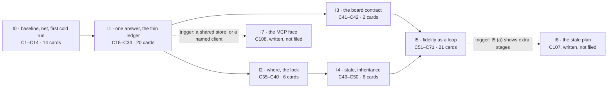

# P158 part 2 — the plan: the cards, their order, and what each iteration must prove

**Status.** The ordered plan the PO asked for on 2026-10-10, at the card level, **rewritten after adversarial round 1**.
Each unit below is an issue for the board (a story, a chore or a bug under an epic); each later gets its own task plan
when it enters Build (`scrum/README.md`, the Build row). **Nothing here is filed, ordered or built.** It realises the
design `docs/2026-10-10-p158-architecture-design.md` ("the design") as the design stands after round 1, and places
every change of part 1's `docs/discovery/2026-10-10-p158-gaps-and-refactoring/proposal.md` ("part 1"). What follows it,
in the PO's own order (D 2026-10-10, *"We will further ask for gaps and bugs from the council and replan again"*): he
reads this plan and the design, answers the asks of batch 1, and the cards of the first wave are filed only on his yes.

**Round 1.** Two adversarial readers read round 0 of this file whole: `design/refuter-round-1.md` ("the refuter";
R1–R14 and §2–§7) and `design/plan-critic.md` ("the critic"; the per-card rows, M1–M15, G1–G3, the ten defects). Every
verdict and defect that concerns this plan is folded below: applied, or refused with its reason in *Rulings*. The design
was rewritten after the same round (its *Changes since round 1*), and this plan follows the rewritten design except
where *Rulings* R4 says why not. The list of what changed is the last section but one, *Changes since round 1*.

Written by the plan author on 2026-10-11 (the brief's date is 2026-10-10; the machine's clock read 2026-10-11 05:27
CEST), against spark 0.8.1 at main `5acbe42` (E `git log -1` → `5acbe42 2026-10-10 22:26:37 +0200 Merge pull request
#129 from xmejkal/p180-council-rules`; E `.claude-plugin/plugin.json:3` → `"version": "0.8.1"`).

**The PO's words this plan answers** (verbatim, typos as typed, D the PO 2026-10-10):
- *"Yes, ok, lets take that and add it to the points 1-4, still don't build anything, just please make a thorough plan on
  how to make it work, well designed, refactored, testable, modular, etc, and we can go iteratively. Then, once you have
  the plan, shoew me. We will further ask for gaps and bugs from the council and replan again. So make ure the final
  issues are well defined, separated and ordered in the best way"* — and *"including technical design and validated
  learning"*.
- *"Lets really order it by priority, so were fixing what matters."* · *"lets make sure its really good, with a few
  adversarial rounds, really well thought through. We also want thwe system to be well designed so its well testable and
  understandable where a mistake is happeening and why"*.
- The store: *"Mostlu e need to be able to have the basic globsal vs local store, to be able to create search for and
  update and copy or share the store things, the boards for sure, maybe we should also add how exactly to replace a board
  or a module in the simulation, so wokwi uses the closest board  or maybe we can create one"* · *"maybe some new file
  formats or synch libraries or techinques could be used from an existing library that does somwthing that would make
  the whole store synch and global and loval and project store sync and rules and editor?"*
- The principle he took the same day: *"a placeholder may flow through the chain, but it can never disappear from the
  final verdict. Tolerance without a ledger is just silence."*
- His standing rules: only free things, one best tool per job, a local CLI first, nothing heavy to install, alternatives
  and MCP versions as settings (2026-10-06); spark exports facts and a harness, never behaviour (2026-10-01); *"lets make
  sure we start finishing more and not starting new epics or bigger things in general"* (2026-10-09); spark is public
  and the hobbyist is the primary persona (2026-10-03).

**What this rests on**, read for this file:
- the design, whole as rewritten (3,184 lines, E `wc -l`): §0–§4 and §12–§17 read line by line, §5–§11 read for every
  unit, contract and test a card below names, and its *Changes since round 1* whole;
- `design/refuter-round-1.md` and `design/plan-critic.md`, whole;
- round 0 of this plan, whole (2,288 lines), which this file replaces;
- part 1: its header, §3's priority rule (`proposal.md:511-591`), *How the list becomes cards*, §4 and §5 (Q1–Q45)
  whole; every CH block's *kind / size / card* and *depends on* line (extracted by a script into `<scratch>/ch3.txt`,
  then read), and CH-2 and CH-20 whole;
- `catalogue.md`'s nine `other` rows (lines 57, 79, 89, 91–93, 98, 100, 101) whole, and its count at `:155`;
- `design/00-system-as-is.md`, through round 0's reading of it and the design's citations;
- `scrum/README.md` (the stages, the counting rules, the council, the token budget, the asks, the DoD),
  `scrum/WORKING_AGREEMENTS.md` (W6, W14, W15, W16, W19 and the headings), `scrum/STORY_MAP.md` (the slices),
  `.github/ISSUE_TEMPLATE/item.yml`; the shape of `docs/2026-10-06-store-1c-plan.md` (its first 40 lines and headings);
- P100's `brief.md` (D6, D8, the rounds, the open questions, by grep);
- the code, spot-checked where a card leans on it (each pointer at `5acbe42`): `boards.py:67`; `check_spine.py:356-362`,
  `:374-375`; `emit_board.py:1126-1146`; `tests/test_check_bom.py:138-146`; `tests/test_boards.py:378-382`;
  `outcomes.py:43`; `store.py:99`, `:186-187`; `cost.py:110`, `:230-233`, `:250-253`; `needs.py:30-31`, `:122-123`;
  `drawer.py:54`; `check_vendor_pins.py:108`; `parts.py:1326-1349`, `:2112-2128`; `sim_project.py:171-177`;
  `check_physics.py:302-312`, `:452-454`; `copper.py:40`, `:53`; `emit_board.py:114-116`; `emit_footprint.py:59`;
  `init_project.py:192-198`; `grep -rli yaml scripts/` (nothing, exit 1); `grep -c '^def main'` (16 scripts);
  `ls tests/test_*.py` (36 files); `ls tests/mutations/*.json` (116 tables); `wc -l scripts/*.py` (11,578 total);
  `tools/board.py` and `tools/check_backlog.py` greped for a dependency field (none);
- the bin's `Makefile`, its spark lines only (grep, read-only: `:28-35`, `:47-53`, `:96`, `:182`, `:186`, `:212`, `:220`,
  `:223`, `:228`, `:232`).

**What I ran.** No spark command, nothing against any store, nothing written except this file and `<scratch>`.
- Read-only `gh`, 2026-10-11: `issue list --state all` (titles, states, labels of 67 cards); `issue view` bodies of
  #10, #11, #19–#23, #41, #43–#46, #48, #50, #52, #53, #55, #58–#61, #65, #69, #71, #75, #78, #79, #81–#85, #97, #101,
  #103, #114, #118, #119; `api …/parent` for 41 cards; `api …/sub_issues` for #6, #16, #17, #66, #67, #68, #94, #102,
  #103, #123; `project item-list 2` and `1` (status counts: spark `{"Discovery":2,"Done":19,"Idea":83,"Review":1}`, the
  bin `{"Done":1,"Idea":19,"Ready":3}`).
- `<scratch>/graph.py`: the card graph of this plan (108 cards, their lanes, sizes and hard edges), the merge rule of
  *The order* below, and R8's iteration rule; `<scratch>/counts.py` and `<scratch>/variants.py`: the counts of *Size,
  estimated* and the two order variants named in *Open questions*. Every number from them below was written after its
  output was read (W13).

**Tags.** **E** a pointer: a file and line at `5acbe42` unless another repository is named; a command and what it
printed; a card. **H** a claim, with its source. **D** a decision, with who made it and when. **—** unknown. Sizes are
estimates on part 1's scale (S under an hour, M a day, L more — part 1 §3), labelled as estimates. Paths under a home are
written `~/…`, a scratch folder `<scratch>`.

**Ids.** C1–C108 are this plan's cards; the number is an id and a proposed sequence, set by the merge rule of *The order*,
never a date. CH-, K-, Q-, RC- are part 1's; DP1–DP21, H0a–H7, HA–HR and the steps I0a–I5c are the design's; U1–U7 its
units. PQ1–PQ7 and R1–R17 are this plan's questions and rulings. A card that reuses an existing issue says so; it keeps
that issue's number, and its block is the re-scope. "Design step" names the design's step a layer card carries.

## 0. How to read a card

Each card is one concern, buildable alone once its hard prerequisites are Done, and no larger than L. Its block gives:
- **kind** (story · bug · chore), **parent** (the epic it sits under), **reuses** (an existing issue it *is*, or none),
  **slice** (one of `scrum/STORY_MAP.md`'s), **lane** (layer or fix), **iteration**, **design step** (layer cards),
  **spec** (what it is built from, DP20), **size** (an estimate);
- **needed by** — the PO's words or the design's section, with a pointer (W14: the design it unblocks);
- **value proven by** — a hypothesis (H), the measurement, and a pass line set on 2026-10-10 before any run (W20: it is
  reproduced at Done, or the card does not close);
- **changes** · **removes** (in the same commit, W16) · **tests** (named, written first) · **prints** (the failure
  sentence it introduces: where, and why) · **depends on** (hard; *soft* marked; a soft edge never holds a card) ·
  **gated by** (the PO's question that must be answered before its Build) · **fixes** (CH and K ids) · **must not break**
  (the run of the bin, irrigation or plant-alarm that would show it, on a scratch copy).

**Where these fields live once a card is filed** (the critic, G2). The issue form holds *Needed by*, *Value proven by* and
*Archive* (E `.github/ISSUE_TEMPLATE/item.yml`). The rest of the block — kind, slice, iteration, spec, size, changes,
removes, tests, prints, depends on, gated by, fixes, must not break — goes into the body under *Value proven by*, as one
list in this order. Each hard edge is also written as a GitHub "blocked by" link, so the board shows it; no spark tool
reads either (E: `grep -n -i 'blocked\|depend'` over `tools/board.py` and `tools/check_backlog.py` finds no dependency
field), so the edge holds by the council's reading, not by a command. Slice and parent are set on the board at filing.

## Global constraints

1. **Nothing is built, filed or moved until the PO says so** (D the PO 2026-10-10: *"still don't build anything"*). His
   sequence: this plan and the design → his answers (the batches below) → the first wave filed → built. The council he
   named reads both files again before that if he wants a round 2.
2. **One card, one pull request, `Closes #N`; everything reaches `main` by a pull request** (W8, W19). Claude says "ready
   to merge"; the PO merges. A card that one pull request closes together with another still counts on its own
   (`scrum/README.md`, the counting rules). Under DP19 (c) — if the PO chooses it — S fix-lane cards of one part-1 story
   may ride one pull request; each card still closes on its own *Value proven by*.
3. **The council before every pull request** — the PO assistant, the user's journey, the tech lead, three documentation
   experts (for humans, for AI, for examples and help), then the refuter — and its fixes before the merge
   (`scrum/README.md`, *The council before every pull request*; D the PO 2026-10-08 and 2026-10-10). Lenses on Sonnet;
   refuters, the final review and any synthesis on Opus; Fable only where the PO names it. Its size per card is DP19.
4. **Tests first.** Each card's named tests fail before its code and pass after (DoD 2); each behaviour change carries a
   mutation row that is caught (W3); a replacement deletes what it replaces in the same commit (W16), with every page that
   reads a removed field edited in that commit (the design §4.4); a number enters a message only after the output that
   produced it was read (W13); the card's *Value proven by* is run and posted at Done, or it does not close (W20, DoD 4).
   A new exit-code test asserts the literal integer a caller reads (0, 1, 2), never the module's own constant (the
   critic, C3; E `tests/test_check_bom.py:138-145` compares with `check_bom.EXIT_PROBLEMS`).
5. **The PO's real store is never touched by a test or a measurement.** The suite keeps its guard (`store.py:40-43`).
   Every measurement runs on a scratch copy, each command prefixed by three separate words — `SPARK_HOME=<scratch>/store
   HOME=<scratch>/home TMPDIR=<scratch>/tmp` — on every command, never exported (the incident of 2026-10-08, #101). The
   one exception is C2, the drawer's data pass: on a copy first, then on his store with him, after his yes (R11).
6. **The sibling projects are measured on scratch copies only.** Nothing in this plan writes under
   `~/Development/smartbin-local`, `~/Development/irrigation` or `~/Development/plant-alarm`; no suite test reads a
   sibling folder (the design §15). A copy never reaches back into its original: no symlink to a sibling's
   `node_modules` (a `tsci build` through it writes where it resolves); a copy that needs `tsci` carries its own
   `node_modules` (irrigation's is 708 MB, E the refuter's `du -sh`) or records the step as skipped. Plant-alarm is not a
   git repository (E the refuter: `git ls-files` → exit 128), and its soil probe resolves only from the PO's store, so
   its copy and the store copy's date and digest are its pin.
7. **Free, few, local** (D the PO 2026-10-06): standard library only, no new runtime dependency (`flash_image.py`'s
   `littlefs-python` stays the one exception, `docs/guide/agents.md:70`); schemas are files for editors, never a run-time
   validator (Q15 (a), accepted with the design); no YAML reader added (DP21 (a)); the MCP face is a setting, off by
   default.
8. **Facts and harnesses, never behaviour** (D the PO 2026-10-01): no card writes or generates firmware.
9. **The limits** (`scrum/README.md:7`): two cards in each working stage, five in Ready, four in flight across both
   boards — every card counts, a run on a card included (`scrum/README.md`, the counting rules), so the data pass (C2)
   and the cold runs (C13, C61) take slots like any card. Each lane keeps at most one card in Build; finishing comes
   before starting (W6; D the PO 2026-10-09). A lane with nothing pullable lends its slot only to a card the PO has
   already committed into Ready (R7).
10. **Each iteration ends in a whole that runs**: the suite green; the bin, irrigation and plant-alarm run on scratch
    copies, the store copy dated; the iteration's measurement posted, with the commands and their output, as a comment
    of its own on the iteration's last layer card (named in each iteration). **What "every placeholder named" means per
    iteration** (the critic, I0; the refuter §2.2 item 6): through I0 and until C33 lands, no channel of today's ten
    loses a line, measured against C1's per-project channel counts; from I1's close every answer names its own
    placeholders (C33); from I4's close every later command also names what it inherited (C45). Pass lines below were set
    on 2026-10-10 (the brief's date), before any run; a pass line changed later says when and why.
11. **The stopping rule and the cap** (the design §4.5) are read at each layer card's council: every `main` through
    `cli.run`, no folder spelled outside `where`, every producer feeding the ledger, the board contract one table — and
    eight new concepts at most; a ninth needs a DP the PO answers. The warning signs: a base class for findings or
    stages, a `checks/` package, a scheduler, a diff into `parts.py`, `emit_board.py` or `assign_pins.py` with no card
    behind it.
12. **Every word a card adds to an output gets its `GLOSSARY.md` entry in that card's commit** (part 1 §3, *Done, for
    every change*). A card that edits a page P182 (#128) edits goes with it or after it; P181 (#127) is closed.

## The order: two lanes and one merge rule

The critic (G3) found round 0's global numbers to be a forecast's schedule, which a changed size renumbers. This round
states the order as rules, and the numbers follow from the rules, not from sizes.

- **The layer lane** carries the design's steps, in the design's order (§12.1): the baseline (I0a), the net (I0c), the
  first cold run (I0d), then I1 → I2 → I3 → I4 → I5, with I6 and I7 on their triggers. Its work is not ranked by part 1,
  which never ranked the PO's part-2 asks; it is ordered by its own hard edges. Where two layer cards are independent,
  part 1's rank of the CH each carries decides (so CH-2, rank 25, before CH-68, rank 47; I2 before I3, by CH-4's rank 12
  against CH-22's 26).
- **The fix lane** carries part 1's own changes in part 1's rank order (§3: tier, then keys (a)–(g)), each pulled when
  its **hard** prerequisites, as part 1's *depends on* lines state them, are Done — whichever lane they sit in. A card
  whose hard prerequisites are not Done is passed over, and the next pullable card goes. The data pass comes first,
  because part 1 puts *"decisions and data, no code"* before rank 1 (`proposal.md:578-585`). Existing cards that part 1
  did not carry, and that the design places in the fix lane, sit where part 1's rule puts them, by my reading (R12).
- **The merge rule, for the numbers.** The two lanes alternate, layer first, one card each; at its turn a lane takes its
  first card whose hard prerequisites are already numbered, and a lane with none lets the other go. The cards below the
  cut line follow in the fix lane's order, then the two cards on triggers. The alternation stands for "one card per lane
  in Build" if cards took equal time, which they will not; so the number says *in which order*, never *when*. The PO's
  order of Ready stays his (W11): the binding orders are each lane's.
- **The cut line** (DP15 (a), proposed): above it, the layer lane I0–I5 and the fix lane through part 1's tier 2, blocks A
  and B, with the tier-1 existing cards of R12 and CH-48's pages and catalog writer (R4 (m)). Below it, the rest of part
  1, filed when the cut is re-planned or a design pulls one (W14). I6 and I7 wait for their triggers.

**The layer lane** (32 cards above the cut, 2 on triggers): C1 · C3 · C5 · C7 · C9 · C11 · C13 (I0) → C15 · C17 · C19 ·
C21 · C23 · C25 · C27 · C29 · C31 · C33 (I1) → C35 · C37 · C39 (I2) → C41 (I3) → C43 · C45 · C47 · C49 (I4) → C51 · C53 ·
C55 · C57 · C59 · C61 · C69 (I5) → C107 (I6) · C108 (I7).

**The fix lane above the cut** (39 cards), in part 1's order: C2 (the data pass) · C4 · C6 (CH-13) · C8 (CH-18) · C10
(CH-26) · C12 (CH-21) · C14 (CH-19) · C16 (CH-1) · C18 (CH-17, after C17) · C20 (CH-6) · C22 (CH-14) · C24 (CH-12) · C26
(CH-11) · C28 (CH-49) · C30 (CH-36) · C32 (CH-3) · C34 (CH-15) · C36 (CH-20) · C38 (CH-9) · C40 (CH-54) · C42 (CH-72) ·
C44 (CH-55) · C46 (CH-64) · then the tier-1 existing cards C48 (#78) · C50 (#41) · C52 (#83) · C54 (#71) · C56 (#75) · C58
(#46) · then block A: C60 (CH-23) · C62 · C63 · C64 (CH-24) · C65 (CH-25) · C66 (CH-63) · and block B: C67 (CH-31) · C68
(CH-30) · C70 (the silkscreen mark) · then C71 (CH-48, the real-store guard's third part, R4 (m)).

**The fix lane below the cut** (35 cards): C72–C106, in part 1's rank order, the existing cards placed by R12.

The counts in the boxes are the cards each iteration holds under R8 (the iteration open when a card's number is
reached), from `<scratch>/counts.py`; the fix-lane cards an iteration holds are not its prerequisites.

## Rulings this plan makes, for the PO

Each is a choice the design or part 1 left open, or a place where this plan departs from them. Strike any.

- **R1 · Reuse before filing.** 27 existing issues *are* cards of this plan, re-scoped, keeping their numbers — above
  the cut: #82 (C10), #58 (C17), #52 (C19), #118 (C20), #65 (C21), #101 (C26), #60 (C30), #84 (C35), #114 (C39), #61
  (C41), #78 (C48), #41 (C50), #59 (C51), #83 (C52), #71 (C54), #75 (C56), #46 (C58), #23 (C71); below it: #55 (C73),
  #44 (C75), #50 (C77), #79 (C80), #48 (C81), #85 (C90), #69 (C97), #10 (C99), #45 (C103). Under DP12 (a) #11 (closed)
  is reopened as C27. Six more close into a card when it is Done (PQ3): #119 into C20, #42 and #43 into C19, #53 into
  C21, #49 into C33, #51 into C35. New issues: 53 above the cut (52 under DP12 (a)), 26 below, 2 on triggers — 81 in all
  (from `<scratch>/counts.py`: 108 cards less 27 reused).
- **R2 · Parents.** A reused card keeps its parent, so no issue moves (E `gh api …/parent`, 2026-10-11): under #67 P133
  #58, #52, #65, #41, #59, #75, #79, #85, #45; under #68 P134 #83, #55, #44, #50, #69; under #66 P132 #84, #61, #71,
  #46, #48; under #17 P94 #82, #23; under #123 P178 #118, #101, #114. The reused cards with no parent (#60, #78, #10,
  and #11 if reopened; E `…/parent` → 404) go under P158 (#94). A new card sits under P158 (#94), except: C3 (CH-2), C13
  and C61 (the evals) under P166 (#103), whose value line names "mutate's import-error catch" and "how far a claim 'it
  works' is backed" (E `gh issue view 103`); C33, C45 and C53 under P165 (#102), whose subject is the ledger and the
  targets; C75 (CH-34) under P79 (#16). P158 (#94) is itself a sub-issue of P178 (#123) (E `gh api
  …/issues/123/sub_issues` → `96 94 99 101 114 93 102 118 119`). PQ2.
- **R3 · One concern per card: the splits.** From the design's steps: I1h → C29 (CH-38: severity from content), C31
  (CH-32: the board's flag) and C33 (the producers); I4c → C47 (the files carry the ledger) and C69 (the converter's
  JSON); I5a → C51 (the owed table) and C53 (targets); I5b → C55 (the generic board), C57 (the generic header) and C59
  (the firmware levels). From part 1: CH-13 → C4, C6 (as the design); CH-19 → C2 (the data pass) and C14 (the count);
  CH-24 → C62 (the chip-facts columns), C63 (the skeleton) and C64 (the pick); CH-3 → C32 (every writer, the wait) and
  C39 (the lock's place); CH-39 → C79 (seeding) and C80 (#79, the rule's words); CH-40 → C93, C94, C95; CH-57 → C86–C89
  and C37's *private* column; CH-48 → C71 (the pages, `--catalog-set`) and C83 (the datasheet reader's tools). Merged:
  CH-6 with #118 and #119 → C20 (the critic, M5).
- **R4 · Where this plan departs from the rewritten design, and why.**
  - (a) **CH-20** is a part record's `body_mm` and `--step`'s folder (part 1 CH-20, `proposal.md:1165-1180`, E), not a
    board's dimensions, as the design's §12.1, §12.4 and §13.1 still read it. C36 lands its `body_mm` half as part 1
    sized it. `--step`'s missing-folder refusal is C35's, because `where` refuses a project folder that names nothing
    and `--step`'s first argument is one. A board's width and height range is C41's own row (the design's I3 (f)).
  - (b) **CH-71** (the `temp:` locator) lands with `check_spine`'s move, C23; C15 adds the root.
  - (c) **The converter's `--json`** (half of design step I4c; CH-46's converter half) is C69, in I5: part 1 gives CH-46
    a hard edge on CH-31 (E `proposal.md`, CH-46 *depends on*: "CH-16, CH-31, CH-45"), and CH-31 is block B. I4's pass
    lines (a)–(i) read nothing of the converter's JSON, so I4 closes without it.
  - (d) **The `null-rule` producer** is C33's, as the design's producers table has it (§4.2); its §13.1 row for CH-39
    puts it in I1d. One place, the producers card.
  - (e) **CH-2 (rank 25) before CH-68 (rank 47)** in the layer lane, by part 1's ranks; the design's labels I0c-1 and
    I0c-2 stay labels.
  - (f) **The dated "before" sweep** is a task of C3, run once C3 has merged, on a scratch worktree of C1's baseline
    commit with C3's `tools/mutate.py`. In I0a, as the design puts it, the sweep would count import-breaking mutants as
    caught, and I4's after-sweep (pass (i)) would report them as escapes; on the baseline commit it stays a "before"
    whatever the fix lane merges meanwhile. Part 1's wording, *"before the first store or `parts.py` commit of the
    epic"* (CH-2), holds by construction.
  - (g) **The first cold run (I0d) runs on spark pinned at C1's baseline commit** — a scratch clone, its scripts called
    by path — so the fix lane may merge after C1 without changing what round A measures. The design's DP3 (a) holds every
    output-changing merge until round A has run, which ties the fix lane to P100's own open questions (the changed
    frame, the domains, the pass lines, who scores, the appetite: E `brief.md:19`, `:113`). PQ6. Whether Claude Code
    loads the plugin from a scratch clone for one session is —; the scripts run by path either way.
  - (h) **The scorer is built in C13, with the first run.** The design's I0d is "a model eval, no code" and also
    "scored by `tools/eval_score.py`" (§12.2, §12.3 H0c). A tool under `tools/` changes no behaviour of spark, and the
    first run needs it; the eval-owed report line goes with it.
  - (i) **No step escapes the limits.** The design's first slice runs I0b and I0d with "no stage limit" (§12.5). Every
    card counts, a run on a card included (`scrum/README.md`, the counting rules): C2 and C13 take slots. Under DP3 (a)
    round A is work on #6, which already counts in Discovery.
  - (j) **CH-45's `init` half is its own card**, C82, after #48 (C81) and #71 (C54), which change the same output (the
    design §12.6). C25 moves `init_project` onto `cli` with its answers unchanged.
  - (k) **#65's cases split by script**: its three check cases ride C21, which reuses #65; its three `check_bom` cases
    ride C19 (#52), which gives `check_bom` its `run()` and `--json`.
  - (l) **C41 (I3) hard-depends on CH-12 (C24) and CH-13a (C4)** as well as CH-36 (C30): it removes their own code to
    make them rows, so they must have landed. The design names CH-36 only.
  - (m) **CH-48 (rank 53) sits above the cut**, as C71, the last card of the fix lane's part above it: its catalog
    writer and its six literal store paths are the third part of the real-store guard (the design §8.5: *"No guard
    in the code can hold while a page sends an agent to a literal path"*), whose first two parts (C16, C26) are above
    the cut. The design's cut (through tier 2, blocks A and B) would leave it below. Round 0 pulled it up for the same
    reason; it keeps part 1's rank inside the lane.
  - (n) **K21's outside-a-session case is measured in C17, not C15.** The design's I1a measures it "on `cost.py`", but
    `cost.py`'s `main` reads one transcript and looks up no session (`cost.py:278-298`, E); the case is `parts.py
    --tally`'s, through `cost.py:230-233`. C15 proves the frame on `cost.py`'s own outcomes.
- **R5 · CH-64 and CH-58 are two cards** (C46, C100): one concern each (the critic, C20). Round 0's merge is reversed.
  DP19 (c) may still let them ride one pull request. PQ5.
- **R6 · #11 (P43).** Under DP12 (a), the design's recommendation, it is reopened as C27, the card whose pass lines are
  its three value lines; under (b) C27 is new and cites it. Round 0 recommended (b); this round follows the design.
- **R7 · Slot lending** only to a card the PO has committed into Ready, and never past the current re-plan point (the
  critic, I2: round 0 lent I2's slot to I3's first card beyond its commitment).
- **R8 · Which iteration a fix card belongs to:** the iteration open when its number is reached in the merge. Iterations
  overlap in time; an iteration closes when its layer cards are Done and its measurement is posted.
- **R9 · I6 and I7 are written, not filed** (C107, C108) until their trigger fires (W14).
- **R10 · Filing in waves, committing at re-plan points** (PQ1 (a)). Wave 1 is I0's fourteen cards (C1–C14) and the
  Design card C63 (once Q8 is answered), filed on his yes to batch 1. Wave 2, I1's twenty, is filed at re-plan point 1,
  with I0's measurements on the cards. Wave 3, I2's and I3's eight, at re-plan point 2, which is also the stop branch.
  Then I4, then I5. The rest stays written here until a re-plan or a design pulls it. The reason: 53 new issues into an
  Idea column of 83 (E `gh project item-list 2`, 2026-10-11) bury the order, and every wave after the first is re-planned
  on measurements. The board stays the one ordered list of what is committed.
- **R11 · The data pass is a card, C2,** run with the PO: on a scratch copy of his store first, its before and after
  printed; then on his store, after his yes. It is the one write to the real store in this plan.
- **R12 · Existing cards part 1 did not carry, placed by part 1's own rule** (my reading, labelled). **Tier 1** — silent
  by part 1's definition (`proposal.md:515-521`): #78 (a trace judged against the wrong copper says ok; class 1), #41 (a
  4 V capacitor on a 5 V rail passes when the rail's volts are null; class 1; reproduced, E `gh issue view 41`), #83 (a
  chip binary reused by file time, a silent name clash; class 1), #71 (`init` prints "named 3 rail(s)", exit 0, having
  written none; class 2), #75 (physics answers ok over buses no rule examined; class 2 under Q43 (a), tier 2 under
  (b)), #46 (`tools.py --status` shows `[ok]` for MCP servers nothing checks; class 2). They sit at the tail of tier 1,
  class 1 first, after part 1's own tier-1 changes by key (g) (none has a catalogue row). **Tier 2:** #50 (`--keep .`
  leaves no diagram for the documented Wokwi steps). **Tier 3:** #48 (a wrong "unanswered" list), #79 (CH-39's rule
  words), #69's words half (generated files speak of a lid in any project). **Tier 4:** #45 (fields "unanswered" for
  ever). So six existing cards sit above the cut. PQ4.
- **R13 · Kinds follow what each card is** (the critic, G1): a new module, table or command is a story; a fault fixed is
  a bug; tests, tools, pages and data passes are chores. Reused issues keep their label unless the re-scope changes what
  they are: #58, #59, #61 and #84 become stories (PQ3).
- **R14 · Every sibling measurement** uses a scratch copy and a dated store copy (constraint 6), and each *must not break*
  names the sibling's line it pins, or says "reasoned" (part 1 §3, *Done, for every change*).
- **R15 · Every measurement has a consequence when it fails**, or is labelled *a record*, with no pass line, and names the
  decision it feeds (the refuter §3.6 item 3).
- **R16 · Sizes** are part 1's for part 1's changes, the design's for its steps (§12.2), and mine for the splits and the
  existing cards, labelled "my estimate". Where part 1 and the design disagree on a change part 1 sized, part 1's is used
  (CH-68: S–M, not the design's S; CH-2: S plus machine time) — the critic, C1.
- **R17 · Pass lines** are dated 2026-10-10, the brief's date (the machine's clock read 2026-10-11), and set before any
  run.

## Open questions for the PO

Asked in batches of at most six, one batch open at a time, each question with Claude's recommendation
(`scrum/README.md`, *Asks to the PO*); a bundled item counts as one ask. The batches are keyed to the first card each
question gates, not to an iteration's close (the critic, *Proposed order*, A). Each line says what the answer moves.

**This plan's own questions.**
- **PQ1 · Filing and commitment** (R10). (a) Waves, as R10 — recommended. (b) File all 71 above the cut in Idea now
  (round 0's (a)). (c) File I0's fourteen only, and write nothing else as an issue until re-plan point 1.
- **PQ2 · Parents** (R2). (a) As R2. (b) Every card under #94, re-parenting the 27 reused ones. (c) New I1 and I4 cards
  under #67 P133, whose value line they meet ("the agents guide's 'What never to assume' then lists no exception", E
  `gh issue view 67`, through round 0).
- **PQ3 · Closing and re-scoping existing cards.** Close #119, #42, #43, #53, #49 and #51 into C20, C19, C19, C21, C33
  and C35 when those are Done. Accept each reused card's re-scope as its block states it, and relabel #58, #59, #61 and
  #84 as stories (R13). Split #69: its stand-in half is met by C31 and C33, its words half stays #69 as C97. Correct #84's
  value line ("a compiled chip … live[s] in the person's store") to #125's rule: a library chip's binary and a shipped
  board's header are spark's own artefacts, refreshed in place. The partial overlaps stay their own cards': #19 (C47
  meets its line for generated files), #20 (C51 its first line), #21 (C34 its failed-fetch line), #22 (C35 its promote
  line, C37 its shelf row), and #23's `--keep --into` and `--set-aside` lines, which this plan does not carry (keep or
  strike).
- **PQ4 · R12's six tier-1 existing cards** (#78, #41, #83, #71, #75, #46). (a) Above the cut, where part 1's rule puts
  them — recommended, because each says success over a false or unchecked result. (b) Below the cut: 65 cards remain
  above it (E `<scratch>/variants.py`). (c) Outside P158, on their own epics' order.
- **PQ5 · CH-64 and CH-58** (R5): (a) two cards — recommended; (b) one.
- **PQ6 · The first cold run on spark pinned at the baseline commit** (R4 (g)). (a) Yes — recommended. (b) Hold every
  output-changing merge of the fix lane until round A has run (the design's DP3 (a) as written). (c) Run H0c on one
  journey (the idea flow, on a scratch store) instead of round A, before the fix lane's first merge.
- **PQ7 · The numbering.** (a) The merge rule of *The order* — recommended: the numbers are size-free. (b) The two lane
  lists only; the PO interleaves them in Ready as he goes.

**Batch 1 — before anything is filed.**
1. **DP1 with DP20** — the base (A1 with the grafts; the 2026-09-30 verdict restated), and which spec each card rests on:
   the accepted design for the layer cards, part 1's CH blocks for the fix lane's, the existing issues their own; C63
   alone enters Design, and C90 waits for P151's own design. *Moves:* another base re-plans C15–C69; under DP20 (b) about
   twenty stories each enter Design with its own council (the design's count).
2. **DP2 with Q42, Q43, Q35 and PQ7** — the order. *Moves:* (b) the refuter's iteration 0 (R4 and §17.10 of the design say
   what of it this order already takes); (c) round 0's. Under "D8 first" (Q35 (c): CH-23 and CH-24's three cards right
   after CH-12), the skeleton C63 moves to position 42 and CH-23 to 26 (E `<scratch>/variants.py`). Q43 (b) moves #75
   to tier 2, below the cut.
3. **DP15 with DP13, Q30 and PQ4** — scope, appetite, the cut, the done line. *Moves:* (c) I0–I3 only is 42 cards, 22.6
   card-days (an estimate, `<scratch>/variants.py`); the done line's three measures are C1's, C10's and C13's/C61's.
4. **DP16** — CH-1 and CH-11 early in the fix lane (C16, C26), moved into `where` by C35. *Moves:* (c) folds both into
   C35 and removes C16 and C26; (b) adds CH-4, CH-10 and CH-3's place to the fix lane as well.
5. **DP19 with PQ5** — how councils are sized for this epic. *Moves:* the council-days of *Size, estimated*.
6. **PQ1 with PQ2 and PQ3** — filing, parents, re-scopes.

**Batch 2 — before the first card enters Build.**
1. **DP3 with Q5 and PQ6** — round A as the first cold run (C13), its board, and on the baseline commit.
2. **Q6** — the drawer's data pass (C2), and which count C14 prints.
3. **Q36** — the siblings' `make check` a contract every merge keeps green (C5).
4. **Q9** — a copy pinned or read through (C10).
5. **Q2** — the real-store guard's rule (C26).
6. **Q8** — boards in the store, and where the board verbs live (C63's Design; C12's sentence; C66's verb).

**Batch 3 — before C7 lists its expected failures, and before C13 and C15.**
1. **DP9 with Q14** — the vocabulary envelope 2 publishes (C15; C7 asserts the item shape from C15 on).
2. **DP18** — which operations a wrong `SPARK_HOME` stops (C7's fourth input; C16).
3. **DP11** — the evals: a token ceiling per run, the second reader (C13).
4. **DP10** — how much of the ledger a text answer prints (C33).
5. **Q19** — whether a person typing spark's scripts without Claude Code is served (C17's text half; later C84, C96,
   C101).
6. **DP21** — CH-49's reader (C28).

**Batch 4 — before the fix lane's next gated cards and the thin ledger.**
1. **Q41** — a pick's fit as a field (C18).
2. **Q1 with Q34 and Q38** — holds stored; who may release; the verbs' names (C65).
3. **Q44** — the stand-in flag required (C31).
4. **Q24** — a need the board serves (C40).
5. **DP12** — #11 reopened or cited (C27).
6. **Q11** — a board pick with no file (C64).

**Batch 5 — before I3 and I4.**
1. **Q16** — mounting holes (C41).
2. **DP7 with Q7** — the state folder and its design key; irrigation's file name (C43; C72).
3. **DP8 with #81's version policy** — what makes a stage stale (C43).
4. **DP17** — who runs the stale stages (C43's `next`; C107).
5. **DP14** — A3's run 2 folded in (C45, C53).
6. **Q3** — `pin_order` owed or broken (C51).

**Batch 6 — before I5.**
1. **DP4** — a target's exit codes (C53).
2. **DP5 with HE's result** — safe defaults, and the silkscreen mark on part placeholders (C57, C70).
3. **DP6** — the generic board (C55).
4. **DP11's later runs** — the ceiling for C61.

**Later, with their cards:** Q4 (C79), Q13 (C76), Q18 (C93), Q20 (C98), Q21 (C73), Q25 (C82), Q26 (C96), Q29 (C87),
Q33 (C88), Q39 (C78), Q40 (C99), Q45 (C89). **Gating no card here:** Q10, Q17, Q27 and Q28 (P178's concept); Q12
(refused, DP13); Q15 (a), accepted with DP1; Q22 (CH-67's held check, which is not a card of this plan); Q23 (a sentence
in `idea.md`, no card); Q31 (answered by PQ1 and DP15); Q32 (answered: #125 merged).

## The first slice (proposed; the PO orders Ready)

- **In flight today** (E `gh project item-list 2` and `1`, 2026-10-11): P100 (#6) and P158 (#94) in Discovery; P181
  (#127) in Review although its issue is CLOSED. The bin's board: 3 in Ready, none in a working stage.
- **When wave 1 is filed:** P158's card leaves Discovery (an epic counts only in Discovery and Design,
  `scrum/README.md`), and P181's moves to Done.
- **Build (2):** C1 (the baseline, layer lane) and C2 (the data pass, fix lane) once Q6 is answered. If Q6 waits, C4
  (CH-13a) takes the fix slot, and merges only after C1's snapshot is posted.
- **Design (1):** C63 (CH-24's skeleton, D8's first fix), once Q8 and DP20 are answered. Its Build waits for C4, C12,
  C22, C41, C60 and C62.
- **Ready (5), in the merge order:** C3 (CH-2) · C4 (CH-13a) · C5 (CH-68, after Q36) · C6 (CH-13b) · C7 (the invariant,
  after DP18). Next: C8, C9, C10 (after Q9).
- **In flight:** #6, C1, C2 and C63 — four, the limit. Under DP3 (a) and PQ6 (a) the first cold run is round A, work on
  #6, which already counts; C13's scorer is a pull request of its own, taken when a slot frees.
- **The PO's answers:** batch 1 before filing; batch 2 before C1 or C2 enters Build.

## Size, estimated

W20 and W13: estimates, not measurements, from `<scratch>/counts.py` over the card graph (`<scratch>/graph.py`).
*Card-days* maps S → 0.1, S–M → 0.5, M → 1, M–L → 1.5, L → 2.5 working days (my reading of part 1's "S under an hour, M
a day, L more"); it is build time only.

| | cards | layer | fix | reused | new | S | S–M | M | M–L | L | card-days |
| --- | --- | --- | --- | --- | --- | --- | --- | --- | --- | --- | --- |
| I0 (C1–C14) | 14 | 7 | 7 | 1 | 13 | 7 | 6 | 1 | 0 | 0 | 4.7 |
| I1 (C15–C34) | 20 | 10 | 10 | 6 | 14 | 6 | 5 | 8 | 1 | 0 | 12.6 |
| I2 (C35–C40) | 6 | 3 | 3 | 2 | 4 | 2 | 2 | 1 | 1 | 0 | 3.7 |
| I3 (C41–C42) | 2 | 1 | 1 | 1 | 1 | 1 | 0 | 0 | 1 | 0 | 1.6 |
| I4 (C43–C50) | 8 | 4 | 4 | 2 | 6 | 1 | 3 | 4 | 0 | 0 | 5.6 |
| I5 (C51–C71) | 21 | 7 | 14 | 6 | 15 | 4 | 9 | 7 | 1 | 0 | 13.4 |
| **above the cut** | **71** | **32** | **39** | **18** | **53** | 21 | 25 | 21 | 4 | 0 | **41.6** |
| below the cut (C72–C106) | 35 | 0 | 35 | 9 | 26 | 19 | 7 | 8 | 1 | 0 | 14.9 |
| on triggers (C107, C108) | 2 | 2 | 0 | 0 | 2 | 0 | 0 | 2 | 0 | 0 | 2.0 |
| **all** | **108** | **34** | **74** | **27** | **81** | 40 | 32 | 31 | 5 | 0 | **58.5** |

**The binding constraint is the councils, not the build** (the refuter §3.7; the design §12.1). Above the cut, 70 cards
end in a pull request (C2, the data pass, ends in none). Every pull request gets a council, full by default, at most one
full council a day, about 90 M input tokens each (E `scrum/README.md`, the council and the token budget):
- under **DP19 (b)**, full councils everywhere: 70 full councils, so at least 70 council-days (an estimate from the
  README's rule);
- under **DP19 (a)**, light councils for the 17 fix-lane cards sized S (C4, C6, C8, C14, C20, C22, C24, C30, C34, C36,
  C38, C42, C44, C54, C58, C64, C68) and full ones for the other 53: at least 53 council-days, and about 4.8 billion input
  tokens for the full ones (an estimate: 53 × 90 M);
- under **DP19 (c)**, grouped S cards cut the count further, by how many ride together — —.

Elapsed time is —: it rests on the councils, on the PO's merges ("within 2 working days, 8 times in 10",
`scrum/README.md`, the service level), and on the stop branch after I1. Re-plan point 1 re-sizes I1 with the anchor rows
each card moves (C3's `--rows-in`).

## Iterations

Each iteration gives its goal, its cards in the merge order, the whole that runs at its end for the three projects, its
hypotheses, how they are measured, the pass lines (set 2026-10-10, before any run; the design's own, §12.3, unless
marked), and — the validated learning — what a refutation teaches and what it changes in this plan (R15). A fix card's
own *Value proven by* is part of its iteration's measurement and is not repeated here; what each fix card may change in
the three projects' outputs is listed before the run, so the snapshot diff can fail (the critic, I0).

### I0 — the baseline, the net and the first cold run

- **Goal.** Today's outputs are recorded before anything changes them; the net is in place before any `main` moves; the
  riskiest belief is measured before any code; the first silent faults of boards and search are refused where they
  happen.
- **Cards, in order.** C1 (the baseline) · C2 (the data pass) · C3 (CH-2) · C4 (CH-13a) · C5 (CH-68) · C6 (CH-13b) · C7
  (the outcome invariant) · C8 (CH-18) · C9 (the layer test) · C10 (CH-26, #82) · C11 (the journeys) · C12 (CH-21's
  search half) · C13 (the evals harness and the first cold run) · C14 (CH-19's count). The measurement is posted on C13.
- **The whole that runs at its end.**
  - The bin (scratch copy): `make check` green; its six spark lines (`Makefile:182`, `:186`, `:212`, `:220`, `:228`,
    `:232`) pinned in spark's suite with the literal exit codes (C5), beside P41's pin of its five values
    (`tests/test_boards.py:314`); both library boards validated on their own silicon (C4).
  - Irrigation (scratch copy): `check_spine.py irrigation.requirements.json` exits 1 as today, over its declared
    `STATUS_LED` (part 1 §1; C29 changes it in I1), recorded by C1; its interpreter image reads chip id 9 and passes C6.
  - Plant-alarm (scratch copy): its measured stop recorded by C1 — `[ok  ] schematic  11 trace(s) written`, two
    `[!!  ] schematic-notes` (`SPK_N`, `SPK_P` drive nets nothing on the board receives), `[????] footprint  no footprint
    could be generated for xiao-esp32-c6`, `the chain is broken`, exit 1 (E the refuter's and the critic's runs on
    scratch copies, 2026-10-11, the same output twice). C1's prediction is that output, unchanged.
- **Hypotheses.** H0a: the baseline is whole — every later line that differs in the three projects is named by a card
  that changed it on purpose. H0b: the net turns red when a change breaks a spark call the bin makes, and a mutant that
  tests nothing is refused. H0c (the riskiest belief, HO): an agent following spark's pages decides from the envelope,
  not from the text. Hf0 (this plan): the fix lane's seven I0 cards turn silent answers into named refusals and change no
  line the three projects print.
- **Measurement.**
  - (a) H0a, Hf0: `tools/snapshot.py` at C1, again at I0's close; a diff.
  - (b) H0b: three mutants, written on C5's card before the run — `check_bom.EXIT_PROBLEMS = 0`; `check_physics`
    returning `EXIT_OK` for a `problems` status; `check_vendor_pins.EXIT_MISMATCH = 0` — each run against today's suite
    (the control) and against C5's tests.
  - (c) H0b: one mutation row whose mutant does not import, through `tools/mutate.py`, after C3.
  - (d) H0c: C13's first run (round A of #6 under DP3 (a) and PQ6 (a); otherwise one journey), scored by C13's scorer
    and by a second reader.
  - (e) *A record, no pass line*: C7's count of expected failures over 16 `main`s × 4 inputs; C3's before-sweep (its
    date, rows, caught, refused, wall time); the suite's time with C7 (P173, #113, counts it); C1's channel counts per
    project. They feed re-plan point 1 and I4's after-sweep.
- **Pass lines.**
  - (a) At I0's close, 0 lines differ in the three projects. Listed before the run, each fix card's expected change in
    them: C2 none (it writes the PO's drawer); C4 and C6 none (their boards pass; irrigation's image reads 9); C8 none
    (none runs `--need`); C10 none in the three (it changes `--audit`, and rewrites the PO's five shelf files on their
    next write, announced on C10); C12 none (the bin's text calls of `boards.py` are pinned, and the bin holds a
    selection); C14 none (none runs `--match` or `--drawer`).
  - (b) Each mutant red under C5's tests, naming its test; under the control, the `check_bom` mutant green — the gap
    shown (E `tests/test_check_bom.py:138-145` compares with the module's own constant). A control mutant today's suite
    already catches is replaced before the run by one it misses.
  - (c) `refused`, never `caught`.
  - (d) Every decision the agent took after a `parts.py` call rests on a JSON field, none on the text; the scorer agrees
    with the second reader on every mark. n = 1, said as such.
- **If refuted — what we learn, and what changes.**
  - (a) A line differs, unexplained: a card changed output unannounced (it is reopened), or the snapshot missed a channel
    (added, and the baseline retaken before I1's measurement).
  - (b) A mutant green under C5's tests: the new test still compares with a constant; C5 is rewritten before C15 enters
    Build. No mutant the suite misses can be found for one of the calls: that call had no gap, and C5's value line for
    it is restated as "pins the contract I1 changes" — a record, not a closed gap.
  - (c) Caught: C3 misses a class (compile against import); C15 does not enter Build until it is fixed.
  - (d) The agent read text: the page did not send it to `--json` (fixed in C17's commit), or the envelope lacked what
    it needed (the field joins C15's envelope before C15 is built); H1 (ii) is measured again at I1's close, and a
    second failure is the stop branch. The scorer disagrees with the reader: the rubric changes before the second run.
- **Re-plan point 1.** H0c's result. C3's `--rows-in` per I1 card re-sizes C15–C33 and fixes the stop line of re-plan
  point 2 (1.5 × the measured floor). Wave 2 is filed with these numbers on the cards.

### I1 — one answer, and the thin ledger

- **Goal.** Every spark command answers in envelope 2, through one `main`, under one exit contract; an unreadable input
  is could-not-run naming the file; every item names where and why; each answer lists its own placeholders; the store's,
  the matching's and the boards' next faults are refused.
- **Cards, in order.** C15 (I1a, the frame on `cost.py`) · C16 (CH-1) · C17 (I1b, `parts.py`, #58) · C18 (CH-17) · C19
  (I1c, `check_all`, #52) · C20 (CH-6, #118) · C21 (I1d, the four checks, #65) · C22 (CH-14) · C23 (I1e, the generators)
  · C24 (CH-12) · C25 (I1f, the `main`s without `--json`) · C26 (CH-11, #101) · C27 (I1g, `--describe` and one contract
  test) · C28 (CH-49) · C29 (CH-38) · C30 (CH-36, #60) · C31 (CH-32) · C32 (CH-3's writers) · C33 (the producers) · C34
  (CH-15). The measurement is posted on C33.
- **The whole that runs at its end.**
  - The bin: its five captured values (`boards.py --path`, `--id`, `--paths`, `--get chip`, `--get micropython_port`;
    E `Makefile:49-53`) and `--resolve` (`:96`): stdout byte-identical to C1's snapshot, stderr empty. Exit codes
    identical except two, each pinned or announced: `boards.py` with no selection, 1 → 2 (no call of the bin meets it:
    it holds `boards/active.json`), and a crash path such as a missing Gerber zip into `check_bom` (`:186`), 1 → 2 (its
    `make` stops on any non-zero exit either way). `make check` green; its checks' text takes the one renderer's shape,
    with the verdict last and ledger lines for the board facts its checks read.
  - Irrigation: `check_spine` exits 0 for the first time, over its declared signal (C29's intended change, announced on
    C29: part 1 §1, "irrigation's chain exits 1 for life"); one coverage note in its simulation stage (C28); its ledger
    on every answer.
  - Plant-alarm: exit 1, unchanged — its two gap notes stay problems, kind `design` (C29) — and its verdict now names
    the stage that could not run beside them: *"the chain is broken: 2 problems; 1 stage could not run (footprint)"*.
- **Hypotheses.** H1 (i), of the output: every `main` answers in one envelope under one exit contract, and every item
  names where and why. H1 (ii), of an agent: it acts on the envelope alone (one cold run at I1's close). H1h, the thin
  ledger (HA): each answer lists its own placeholders, and the ledger adds no fact spark does not print today, except the
  entries added on purpose. Hf1: the fix lane's ten I1 cards change only the lines listed in (f).
- **Measurement.** (a) The outcome invariant over 16 `main`s × the three file inputs, one argument template per `main`.
  (b) The v2 key set on each `main`'s documented example. (c) The share of items in the journeys' answers whose `where`
  parses, and of problems that carry a `fix`. (d) Every `next[].argv` and `upgrade[].argv` parsed with the named
  script's parser. (e) #11's three value lines. (f) The bin's value calls against C1's snapshot, stdout and stderr; the
  snapshot diff of the three projects. (g) The agent guide's exception list. (h) The per-basis subTests; the ledger's
  count per project against C1's channel counts. (i) The cold run at I1's close, through C13's harness.
- **Pass lines.**
  - (a) 0 tracebacks; 48 of 48 exit 2.
  - (b) 16 of 16.
  - (c) 100 % of items carry a `where` (every item does, §5.2 of the design); 100 % of problems carry a `fix`.
  - (d) All of them.
  - (e) `check_all --json` carries a `fix` for every problem; every payload has one shape; `assign_pins --json` on the
    documented example at most 6,446 bytes, today's size (E J2's run R1, through the design §5.1).
  - (f) The bin as above. The snapshot diff equals exactly these lines, listed before the run: the one renderer's
    reshaping of the three projects' check text; the ledger lines (C33); irrigation's exit and verdict (C29) and its
    coverage note (C28); plant-alarm's verdict naming both halves; C30's sentence on the bin's `--validate --for-fab`
    (`:182`) naming the selected board it judged, exit 0 unchanged. Each other fix card of I1 — C16 (none sets
    `SPARK_HOME`), C18 (plant-alarm's `needs.json` is schema 1 and still read), C20, C22, C24 (the shipped boards carry
    no bare-number label), C26 (no build writes the store), C32, C34 — changes nothing in them.
  - (g) Cut to its two cases no script can answer (`docs/guide/agents.md:323-325`, and an unknown id's exit 1 if Q14
    keeps it).
  - (h) 10 of 14 subTests green; `generic-board` (C55), `edited`, `stale` and `unrecorded` (C43) listed as expected, each
    naming its card. The ledger's count per project equals C1's channel lines plus exactly two additions, the board's
    stand-in (C31) and `no-firmware`.
  - (i) Every decision after a spark call rests on a field, and every final entry is said; n = 1, said as such.
- **If refuted — what we learn, and what changes.**
  - (a) Above 0: a path bypasses `cli`; the crash list names each frame; I1 does not close.
  - (b) Below 16: that `main`'s envelope is fixed before I1 closes.
  - (c) Below 100 %: a constructor let an item through; it is made to refuse one, and the producer is fixed.
  - (d) An argv that does not parse: the step is wrong, and the test names it.
  - (e) Above 6,446 bytes: entries carry prose they should point to; trimmed before I1 closes.
  - (f) A value differs or stderr is not empty: that script's value routing goes back before its card closes. An
    unexplained snapshot line: its card is reopened.
  - (g) A third case remains: it is named in the design's §5.4 with its reason, or fixed.
  - (h) Unequal beyond the two additions: a channel was missed (a bug) or the ledger invents an entry (removed); I1 does
    not close.
  - (i) The agent read text: the field it needed is added — never a text parser — or the page is fixed. With H0c, a
    second failure is the stop branch.
- **Re-plan point 2 — the stop branch** (the design §12.8). If the anchor rows moved in I1 exceed 1.5 × the floor
  measured at re-plan point 1, or H1 (ii) fails twice (H0c and (i)), **the layer stops after I1**: the envelope and the
  thin ledger stay, C35–C69's layer cards are not filed (R10), and the fix lane continues alone. The PO decides on those
  two numbers. Until re-plan point 1 measures the floor: the design's per-step floors for I1 sum to 64 (§12.2: 3 + 15 +
  10 + 10 + 10 + 5 + 2 + 9), so the line would be 96; its §12.8 states 83, from a floor of 55. The measured count
  replaces both. If he goes on, wave 3 (I2, I3) is filed.

### I2 — `where`, and the lock

- **Goal.** Every answer names the store and the project it used; a store setting that names nothing is refused by the
  operations that read the store; spark's folder receives only spark's own artefacts; one lock, beside the data.
- **Cards, in order.** C35 (I2a, the resolver, #84) · C36 (CH-20) · C37 (I2b, `context` and the layers table) · C38
  (CH-9) · C39 (I2c, the lock's place, #114) · C40 (CH-54). The measurement is posted on C39.
- **The whole that runs at its end.** None of the three projects sets `SPARK_HOME` (E part 1 CH-1: their grep prints
  nothing), so their outputs change by `context` only; a check that reads no store says `not read` (DP18 (a)). The bin's
  `make refresh-vendor-pins` (`Makefile:223`, a network call: it passes no `--offline`) refreshes spark's shipped header
  and writes nothing else. An agent's scratch store must exist before a run, and `docs/guide/agents.md:85-86` gains
  "make its folder first". The library S3 record gains its `function` facts (C40), validated by the bin's `boards-valid`
  in the rule's commit (part 1, RISKS-12).
- **Hypotheses.** H2 (the design): every answer says which store and which project it used; a missing folder is refused
  where the store is read; spark's folder receives only spark's own artefacts. Hf2 (this plan): with the guard (C26,
  landed in I1), the write guard (C35) and the lock beside the data (C39), an agent's unscoped command cannot write the
  PO's store, and two processes cannot write one store at once.
- **Measurement and pass, each with what a refutation changes.**
  - (a) The P100 refuter's reproduction (a pick dry run, `SPARK_HOME` at a missing folder): exit 2, naming the folder
    and its fallback. It passes from C16 on; C35 re-measures it after the move. *If refuted:* the refusal is off the
    pick's path; the path is named, and I2 does not close.
  - (b) The suite and the N25 and N26 reproductions, in a scratch clone of spark; then `git status --short` there prints
    nothing. *If refuted:* a writer bypasses `check_write`; the grep test names its line.
  - (c) `test_where.py::test_the_plugin_folder_is_derived_once` green. *If refuted:* the derivation it names goes before
    close.
  - (d) The test that no module reads a folder at import, green. *If refuted:* the module it names is changed before
    close.
  - (e) The invariant's fourth input over 16 `main`s: exit 2 with no traceback for every `main` that reads the store, an
    unchanged answer for each that reads none; the two lists written on C35's card before the run. *If refuted:* a
    traceback means a module still reads a folder at import; a pure check refused means the store is not resolved
    lazily.
  - (f) The bin's `make refresh-vendor-pins`, on scratch copies of the bin and of spark: the shipped header refreshed,
    nothing else written. *If refuted:* `check_write`'s allowed list is wrong, and it is corrected.
  - (g) #101's own line, with `HOME` at a scratch folder and no `SPARK_HOME`, under Q2's rule: could-not-run naming the
    rule; the scratch home's default store unchanged. *If refuted:* the incident's class still writes; Q2 is asked
    again with the failing case shown.
  - (h) Part 1's K5 and K7 runs, two `TMPDIR`s on one scratch store: the writes serialised; 24 of 24 registrations
    listed. *If refuted:* C39 stays open.
- **Re-plan point 3a.** At I2's close the PO commits I3 as planned or changes it, with I0–I2's measurements on the cards.

### I3 — the board contract as one table

- **Goal.** A board file's mistake is refused where it is written, naming the key, the same way in the terminal, in the
  agent's JSON and in the editor; CH-12, CH-13a and CH-36, landed in the fix lane, become rows of one table.
- **Cards, in order.** C41 (I3, #61) · C42 (CH-72). The measurement is posted on C41.
- **The whole that runs at its end.** The bin's `make check` on a scratch copy — `boards-valid` (`:232`) and the Gerber
  recipe's `--validate --for-fab` (`:182`) — green: `footprint_module` is removed only now, after C30 took it out of
  the fab rule (the refuter R3). Irrigation's and plant-alarm's boards validate as before. The library XIAO fails
  `--for-fab` naming `physical.header`, which none of the three runs on it.
- **Hypothesis.** H3 (the design): a board file's mistake is refused where it is written, naming the key, in the
  terminal, in the agent's JSON and in the editor.
- **Measurement, pass, and what a refutation changes.**
  - (a) Round 0's file as a fixture, `header_order.row_18` cells "17" and "15": problems, `where` =
    `#/physical/header_order/row_18/<i>`, exit 1. *If refuted:* a cell the grammar misses; added.
  - (b) STORE-9's fixture (the S3 file with `chip: esp32c6`): problems naming `board-esp32-c6-devkitc-1` and
    `board-xiao-esp32-c6`. *If refuted:* the chip table's spellings are wrong (`esp32s3` against `esp32-s3`).
  - (c) `tools/schemas.py --check` green. *If refuted:* the committed schema is regenerated and the difference read.
  - (d) One bad board file opened in VS Code with the schema mapped; a screenshot on C41: the error at the key. *If
    refuted:* the mapping the page documents is wrong, and the page is fixed; if no mapping shows it without an
    extension, the editor half moves to P160 (#96) and the schema stays a file (nothing to install).
  - (e) The bin's `--validate` and `--for-fab`: exit 0, unchanged. *If refuted:* a row or a reader is wrong — never the
    bin's file — and the table is fixed.
  - (f) A board with `width_mm: -3`, `height_mm: 0`: refused, naming both keys. *If refuted:* the range row is wrong.
- **Re-plan point 3b.** With I2 and I3 closed, whether I4 is still worth its size given what the thin ledger already
  says (HP; the design §12.8 point 3): if each check already prints its whole ledger to every verdict the three projects
  read, I4's value is inheritance across separate commands only, and the PO may park it. Wave 4 is filed if he goes on.

### I4 — the stage table, the project state, inheritance across commands

- **Goal.** What ran on what, what is stale and why; and a placeholder made by one command reaches the final verdict of
  a later, separate one.
- **Cards, in order.** C43 (I4a, the state) · C44 (CH-55) · C45 (I4b, inheritance) · C46 (CH-64) · C47 (I4c, the files
  carry the ledger) · C48 (#78) · C49 (I4d, the page sequences) · C50 (#41). The measurement is posted on C49.
- **The whole that runs at its end.**
  - The bin: ledger lines on its checks' text and `assumptions` in their JSON, for the board facts its checks read;
    `.spark/state/` (it ignores itself) records the `board` stage under the key `-`; no `unrecorded` entry for its
    circuit (the design §6.3, case 3 applies only to a project with a design); exit codes unchanged; its `check_physics`
    trace line names its copper and where the number came from (C48), no number moving (none of the three states a
    fabrication override: E the refuter R12).
  - Irrigation: `unrecorded` entries until its first recorded run; `edited` where its `board.tsx` differs from the
    regeneration (P100 `brief.md`, ★C5); and, from C50, its physics answer could-not-run for each supply rail with
    capacitors whose voltage its rules leave null (every rail's is null, E its `.spark/rules.json`, read 2026-10-11) —
    intended (W1), announced on C50 with the before and after.
  - Plant-alarm: exit 1, unchanged.
- **Hypotheses.** H4 (the design): a placeholder made at any stage reaches the final verdict of a later, separate
  command, and one command says what ran, what is stale and why. HA again: the ledger adds no fact beyond the state's
  three bases.
- **Measurement.** (a) The six invariants (the design §7.1); 13 of 14 per-basis subTests; the read-audit at file level,
  `build` and `simulation` declared. (b) Irrigation's copy, `sim/` first regenerated with `check_spine …
  --sim-dir sim` (`--keep .` does not keep `sim/`, #50; the file is tracked nowhere in irrigation, E the refuter R4);
  the sentences of the regenerated `WHAT-THIS-CANNOT-SHOW.md` written on C45's card before C45's code runs; then
  `check_all`'s `assumptions` read. (c) Irrigation's copy after `check_spine … --keep .`. (d) A3's run 2 as a fixture,
  with its own `power.io_volts` at `verified: false` (the library S3 holds it `true`, E the design's *Found on the
  way*). (e) The ledger's count per project against I1's. (f) *A record*: the text lines `check_all` prints on
  irrigation, and the ledger's size in JSON bytes; it feeds DP10 and HG. (g) An mtime-only touch of every file, then
  `state.py`; whether `state.py` writes anything. (h) The bin's `git status` after `make check`, on a scratch copy.
  (i) The after-sweep: a dated full sweep on HEAD with C3's tool, against C3's before-sweep.
- **Pass lines.** (a) Green. (b) Every sentence listed on the card present, and the `STATUS_LED` entry and the
  FireBeetle's stand-in. (c) `check_all` says, basis `edited`, that the circuit was built from a `board.tsx` other than
  the one in the folder. (d) The verdict names the board's stand-in and the fixture's `power.io_volts`. (e) I1's count
  plus only the state's entries (`edited`, `stale`, `unrecorded`), each listed. (g) Nothing stale, nothing written.
  (h) No new untracked path. (i) No row caught by the before-sweep is uncaught now, except rows whose code I1–I4
  removed, each listed.
- **If refuted — what we learn, and what changes.** (a), (b) A missing entry: a producer or an inheritance case is not
  wired, and its subTest names it. (c), (d) Unsaid: the case of §6.3 that should hold is fixed. (e) Unequal beyond the
  state's entries: a missed channel (a bug) or an invented entry, which stops C45 until it is removed. (f) More lines
  than a person will read: the PO's call, and DP10 moves to counts only; the ledger past an agent's budget: HG's paging
  is the PO's cut. (g) Stale after an mtime touch: modification times leak into staleness; fixed before close. (h) An
  untracked path: the self-ignoring folder fails; DP7 is reopened. (i) A caught row now uncaught: a re-anchor hid a dead
  mutant; the row is fixed before I5.
- **Re-plan point 4.** H4 and the after-sweep; DP10 from (f); whether I5 goes ahead as one iteration or card by card.
  Wave 5 is filed if he goes on.

### I5 — fidelity as a working loop

- **Goal.** From a goal and a chip to a design that builds and simulates in one sitting with every placeholder named,
  then upgraded one fact at a time with nothing leaving unsaid (the design §0.1–§0.2); and D8's board record, made from
  a drawer entry.
- **Cards, in order.** C51 (I5a, the owed table, #59) · C52 (#83) · C53 (I5a, targets) · C54 (#71) · C55 (I5b, the
  generic board) · C56 (#75) · C57 (I5b, the generic header) · C58 (#46) · C59 (I5b, the firmware levels) · C60 (CH-23) ·
  C61 (I5c, the model eval) · C62 · C63 · C64 (CH-24) · C65 (CH-25) · C66 (CH-63) · C67 (CH-31) · C68 (CH-30) · C69 (the
  converter's JSON) · C70 (the silkscreen mark) · C71 (CH-48, #23). The measurement is posted on C69, the last layer
  card.
- **The whole that runs at its end.** The three projects unchanged by default: nothing writes `--as-placeholder` into
  them. Irrigation's regenerated board carries `PLACEHOLDER — NOT THIS BOARD` on its three placeholder footprints if DP5
  covers part placeholders and HE holds (announced on C70); its chips are reused only when their sources' digest matches
  (C52). Plant-alarm under target `simulate` reaches `footprint` with one more entry (C57), then `build` and `simulation`
  (whether a net with one member lets the build route is —), and still exits 1 while its amplifier drives no speaker — a
  gap in its own design, not in spark (the design's *Found on the way*). The bin's `check_physics` gains notes naming
  the buses and analogue pins no rule examined (C56), its exit unchanged. The library S3 gains `"TX": "TX", "RX": "RX"`
  (C67), and the bin's converter copy keeps reading `wokwi_power_pins` by that name.
- **Hypotheses.** H5 (the design; the PO's own of 2026-10-10): from a goal and a chip, spark reaches a design that builds
  and simulates in one sitting with every placeholder named, and upgrades it one fact at a time with nothing leaving
  unsaid. H3b (D8): a board the PO owns becomes a record from its drawer entry, with only its geometry left to measure.
- **Measurement.** (a) The three tables of the design's §7.6, on scratch copies. (b) One cold model run (C61), from a goal
  — not plant-alarm's — on a scratch project and store. (c) `--for pcb` on a placeholder board, and on run 2's fixture
  with spark's generic header. (d) The derived owed table against `CHAIN_FACTS`' consequences, on the fixtures. (e) C63's
  line: its command for `dfrobot-dfr1075` on a scratch store copy, the owed fields filled from the kept drawing, then
  `check_spine` on that board and one LED.
- **Pass lines.** (a) Each stale list equals its table, 0 extra and 0 missing; each ledger diff exactly as written.
  (b) The chain's status `ok` in the first sitting, read from the state; every final entry said; the scorer agrees with
  the second reader on every mark; n = 1, said. (c) The placeholder board: could-not-run, kind `decision`, exit 2; run 2
  with the generic header: problems naming the placeholder's pointer, kind `design`, exit 1. (d) Equal; then
  `CHAIN_FACTS` deleted. (e) `[ok] build`: round 0's pass line, reached from a command; n = 1, with one network fetch
  and one parse of a vector drawing, said.
- **If refuted — what we learn, and what changes.** (a) Extra stages: whole-file digests over-report, and C107 (I6)'s
  trigger has fired; missing stages: the read-audit missed a read — a bug, and I5 does not close. (b) An entry left
  unsaid: the page changes (`/spark:build`, the review skill) and the run is measured again; not `ok`: the stop names
  what the default rule refused, and the PO decides through DP5 whether to widen it; the scorer disagrees with the
  reader: the rubric changes before another run. (c) Another kind or code: `below_floor`'s mapping is wrong; fixed.
  (d) Unequal: the declared reads or the floors are wrong; `CHAIN_FACTS` stays until they agree. (e) The geometry cannot
  be filled from the kept drawing in one sitting: "automatically" is narrowed on C63's page, and the generic header (C57)
  is the route to the simulation for such a board.
- **Re-plan point 5.** H5's result decides C107 and the hand-over to P178's concept (#123); the cut line is re-planned
  with what is below it.

### I6 — the stale plan (C107, on its trigger)

H6 (the design): content digests make a rerun after one upgrade cheaper, and hide nothing. Measured on irrigation's copy
after one record edit: under DP17 (a), `state.py --plan`'s list against `next`'s and against a full rerun; under (b), the
stages `--rerun` ran, the wall time, and the final `made` digests and ledger against a full rerun. Pass: (a) the plan
equals the stale set, and running it gives the same digests and ledger as a full rerun; (b) the stages run equal the stale
set, the digests and the ledger equal. If `tsci build` is not byte-deterministic (HD, —), every stage after `build` is
stale after any rebuild: recorded, and the PO decides whether `build`'s digest becomes the netlist's. **Trigger:** I5 (a)
shows extra stages, or an agent's reruns cost what the PO wants removed. The three projects are unchanged unless the plan
is run in them.

### I7 — the MCP face (C108, on its trigger)

H7 (the design): a client other than Claude Code drives spark through the same envelope, with no second logic. Measured
by the round trip over every operation with no effect, and one real client (HL). Pass: every result equals the CLI's; the
real client does not loop on `isError`. If refuted: a difference means the adapter adds logic, which is removed; a loop
means `isError` stays false and the envelope's status is the only signal, as the PO decides. **Trigger:** P178's shared
store makes spark something other people call, or the PO names a client that is not Claude Code (D the PO 2026-10-10,
option 3, "when the store is shared"). The three projects are unchanged: the face is off by default.

### Below the cut line (C72–C106)

Part 1's rest of tier 2 and its tiers 3–5 that no layer card carries, and the existing cards R12 places there. They are
written here so the order is whole; under R10 they are filed when the cut is re-planned (re-plan points 3b, 5) or when a
design pulls one (W14). Each names the cards it needs. If the fix lane runs dry before I5 closes, the PO may pull the
next of them instead of lending the slot (R7).

## The cards, in global order

The numbers follow *The order*; each block follows *0. How to read a card*. "E" pointers are at `5acbe42`.

**I0 — the baseline, the net and the first cold run**

### C1 · Nobody can say what a change altered in the three projects, and today's answers are recorded nowhere → a dated baseline of the three projects, A3's runs and the round-0 fixtures, taken before any output changes
- **kind** chore · **parent** P158 #94 · **reuses** none (related #97 P161, #103 P166) · **slice** 4 · **lane** layer ·
  **iteration** I0 · **design step** I0a · **spec** the design §10.1 (*the baseline is not in the suite*), §12.3 H0a
  (DP20 (a)) · **size** S–M (the design's estimate)
- **needed by** the design §12.1 (*"Nothing that changes an output merges before the three projects' outputs, A3's runs,
  STORE-9's and round 0's fixtures are recorded as they answer today"*); the critic, M1; the refuter §3.1 item 2; the PO
  2026-10-10, *"including technical design and validated learning"* — every later iteration's whole is a diff against it.
- **value proven by** H (H0a): the baseline is whole enough that a change shows. Measure: `tools/snapshot.py` on scratch
  copies of the three projects and of the store; then, on a scratch branch, one word changed in one sentence
  `boards.py --validate` prints, and the snapshot taken again. Pass: the snapshot posted on the card — the bin's spark
  lines with their exits, irrigation's stage list and exit 1, plant-alarm's measured stop (I0's whole), A3's runs 1 and
  2, STORE-9's and round 0's fixtures as they answer today, today's ten channels counted per project, the store copy's
  date and sha256 — and the seeded change shows in the diff as exactly one line, naming its command.
- **changes** `tools/snapshot.py` (name proposed): copies a project — with its own `node_modules` where a step needs
  `tsci`, never a link to the original (constraint 6) — runs its documented spark commands under the three scratch
  variables, and writes each command's stdout, stderr and exit, and the channel counts, into `<scratch>`; `--against
  <older>` prints the lines that differ, per command. The commands, as data: the bin's `Makefile:49-53`, `:96`, `:182`,
  `:186`, `:212`, `:220`, `:228`, `:232` (`:223` is a network call, left out and said); irrigation's `check_spine.py
  irrigation.requirements.json` and `check_all.py --project .`; plant-alarm's `check_spine.py requirements.json`. A3's
  runs 1 and 2 as fixtures under `tests/data/`; run 2's chain half needs `tsci`, so its output lives in the snapshot,
  not in the suite (the critic, C7).
- **removes** —
- **tests** `tests/test_snapshot.py::test_it_writes_nothing_inside_the_project` ·
  `::test_a_changed_line_is_reported_once_with_its_command` ·
  `::test_a_step_needing_tsci_without_node_modules_is_recorded_as_skipped`
- **prints** `irrigation: check_spine.py irrigation.requirements.json — 3 lines differ from the snapshot of <date>: …` ·
  `plant-alarm: build — skipped: no node_modules in the copy (tsci needed); copy it, never link it`
- **depends on** — · **gated by** —
- **fixes** — (a measurement: J1-G8; the critic, M1)
- **must not break** the three projects' folders and the PO's store: it reads copies only, and dates them.

### C2 · Most drawer entries carry no `function`, so no need reaches them, and `--match` for a board finds 2 of the boards he owns → the data pass, with the PO: a `function` per entry proposed from its label, written after his yes
- **kind** chore · **parent** P158 #94 · **reuses** none (related #93 P157, #99 P162) · **slice** 1b · **lane** fix
  (before rank 1) · **iteration** I0 · **spec** part 1 CH-19's data half and Q6 (`proposal.md:814`, `:578-585`) ·
  **size** S, plus the PO's time
- **needed by** part 1, *"Before rank 1 — decisions and data, no code"*, and RISKS rank 1 (`proposal.md:578-585`);
  RISKS-2 (*"one `--drawer-set` of `function` on four ESP SKUs took `--match` for a board from 2 candidates to 6 on a
  copy, no code changed"*); P100's round A (#6), which K36 blocks; the critic, M6.
- **value proven by** H (RISKS-2): data alone makes the drawer reachable. Measure: on a scratch copy of his store,
  `parts.py --match` for `board — compute / microcontroller` before and after the proposed functions are written, and
  the count of entries with no `function` key by a `python3` pass over the copy's `drawer/`. Pass: before, 2 candidates
  (RISKS-2) and 98 of 110 entries without `function` (E the refuter, its pass over the copy of 2026-10-11; re-read on the
  day); after, 6 candidates or more, and every entry carries a `function` or is named on the card as one the PO left
  without, with why. Then the same writes on his store after his yes, and the count re-read there.
- **changes** no code. The agent proposes one `function` (`does`, `what`) per entry from its label and part number, as a
  table on the card; the PO keeps or strikes each row; `parts.py --drawer-set` writes them (its `function` field,
  validated at `drawer.py:71`), first on the copy (dry run, then run), then on his store; a synonym such as `footswitch`
  becomes a record alias where a record exists (G8).
- **removes** —
- **tests** none: no code. The before and after counts are the proof (DoD 4).
- **prints** — (the existing `--drawer-set` answers)
- **depends on** — · **gated by** Q6 (a)
- **fixes** CH-19 (its data half); K36 (in part); RISKS-2
- **must not break** none of the three reads his drawer's functions; his store is written only after his yes, and only
  once the copy's before and after are posted.

### C3 · `mutate.py` scores a mutant that no longer imports as caught, and no full sweep is dated since 2026-09-29 → a mutant that does not compile, import or parse is refused, a card can list the rows it re-anchors, and a dated sweep before the first `main` moves
- **kind** chore · **parent** P166 #103 · **reuses** none · **slice** 4 · **lane** layer · **iteration** I0 · **design step**
  I0c-2 · **spec** part 1 CH-2 (`proposal.md:1299-1333`) · **size** S, plus machine time (at most ≈12.3 h for a sweep,
  part 1's upper bound)
- **needed by** part 1 CH-2 (K53); the design §12.3 H0b and §15 (*re-anchoring 55 rows hides a dead mutant*); W3 — every
  later card proves itself with mutation rows.
- **value proven by** H: a row whose mutant does not import is refused, never caught. Measure: on a scratch branch, one
  row whose `replace` breaks an import, through `python3 tools/mutate.py <its table>`; `--rows-in scripts/parts.py`;
  then the before-sweep. Pass: `refused`, naming the row and the import error; `--rows-in` lists the rows anchored in that
  file; the sweep's summary posted — date, rows, caught, refused, escapes, wall time.
- **changes** `tools/mutate.py`: before the suite, in a subprocess, a mutated `.py` file is compiled and imported, a
  mutated `.json` parsed; such a mutant is `refused`; a `.md`, `.ts` or `.js` row says no load check applies;
  `--rows-in <file>`. `GLOSSARY.md`'s *refused* gains the second reason (no new outcome word, part 1 §4). **Its last
  task:** the dated "before" sweep, `tools/mutate.py tests/mutations/*.json`, run on a scratch worktree of C1's baseline
  commit with this card's `tools/mutate.py` (R4 (f)).
- **removes** the verdict read from the suite alone (`tools/mutate.py:88`).
- **tests** `tests/test_mutate.py::test_a_mutant_that_does_not_import_is_refused_not_caught` ·
  `::test_a_json_mutant_that_does_not_parse_is_refused` · `::test_a_markdown_row_says_no_load_check_applies` ·
  `::test_rows_in_lists_the_rows_anchored_in_a_file`
- **prints** `refused: <table> row <n> — the mutated scripts/parts.py does not import (NameError: …, line L); a row must
  change behaviour, not break the import — fix the table`
- **depends on** — · **gated by** —
- **fixes** CH-2; K53
- **must not break** none of the three runs `mutate.py`; the pre-push gate's `--anchors` pass stays green.

### C4 · A board whose Wokwi stand-in is another chip validates `ok` (STORE-9) → refused through one chip-name table, naming the boards of the same chip
- **kind** bug · **parent** P158 #94 · **reuses** none · **slice** 4 · **lane** fix · **iteration** I0 · **spec** part 1
  CH-13 (`proposal.md:625`), its board half (the critic, C2; the design's CH-13a) · **size** S (part 1: "S + S" for both
  halves)
- **needed by** part 1 CH-13, rank 2, reproduced by the controller (#94, comment 2026-10-10T20:49:59Z); D8, *"we want to
  start by the boards"*; the PO 2026-10-10, *"so wokwi uses the closest board"*; the design §5.5, §8.4.
- **value proven by** H: a board whose stand-in's chip differs from its own is refused, naming the boards that would do.
  Measure: STORE-9's fixture (the S3 file with `chip: esp32c6`) through `boards.py --validate` in a scratch project; the
  two shipped boards. Pass: exit 1, naming `board-esp32-c6-devkitc-1` and `board-xiao-esp32-c6`; both shipped boards
  exit 0.
- **changes** `data/wokwi-boards.json`: `source` (repository, commit, date read), `chips` (spark's spelling → the `mcu`
  as wokwi-boards spells it, and the board types of that chip), `boards` (type → `mcu`) — facts copied with a citation at
  a commit, never the files (STORE-10, STORE-11). `boards.validate` compares the stand-in's chip through it; a type the
  table lacks is could-not-run naming the table, never `ok`.
- **removes** —
- **tests** `tests/test_boards.py::test_a_stand_in_of_another_chip_is_refused_naming_the_candidates` ·
  `::test_the_shipped_boards_stand_in_on_their_own_silicon` ·
  `::test_a_stand_in_the_chip_table_lacks_is_could_not_run_naming_the_table` ·
  `::test_the_chip_table_spells_each_chip_both_ways_once`
- **prints** `wokwi_part_type board-esp32-s3-devkitc-1 is an esp32s3 (wokwi-boards' mcu: esp32-s3); this board's chip is
  esp32c6 — Wokwi boards with that chip: board-esp32-c6-devkitc-1, board-xiao-esp32-c6` · `<type> is not in
  data/wokwi-boards.json, so its chip cannot be compared — could not look; add its row from wokwi-boards at a cited
  commit`
- **depends on** — · **gated by** —
- **fixes** CH-13 (its board half); STORE-9
- **must not break** the bin's `boards-valid` (`Makefile:232`) validates both library boards on their own silicon —
  `test_the_shipped_boards_stand_in_on_their_own_silicon`, which also fails on a direct compare of `esp32s3` with
  `esp32-s3` (part 1 §4).

### C5 · Whether a spark change breaks the bin is pinned for one of the four spark tools it calls, and today's exit tests compare with the module's own constants → the bin's `check_bom`, `check_physics`, `check_vendor_pins` and `boards.py --validate` calls pinned as spark tests, asserting the literal exit codes
- **kind** chore · **parent** P158 #94 · **reuses** none · **slice** 6 · **lane** layer · **iteration** I0 · **design
  step** I0c-1 · **spec** part 1 CH-68 (`proposal.md:1947`) and the design §10.1, §12.3 H0b · **size** S–M (part 1's;
  the design says S — R16)
- **needed by** part 1 CH-68; the design's H0b (*"the net turns red when a change breaks a spark call the bin makes"*);
  Q36 (a); C19 and C21 change those scripts' outputs.
- **value proven by** H0b, I0's measurement (b): its three mutants written on this card before the run, each red under
  these tests and the `check_bom` one green under today's.
- **changes** a test class beside P41's `TheCommandLineTheSmartBinDependsOnTest` (`tests/test_boards.py:314`), one case
  per line the bin runs (`Makefile:182`, `:186`, `:212`, `:220`, `:228`, `:232`), on synthetic fixtures built from those
  command lines — never the bin's folder (the design §15). Each asserts the literal integer the bin's `make` reads.
  `tests/test_boards.py:378-382`, which accepts 0 or 1 for `--validate --for-fab` (E), asserts 0 for the bin's
  selection. `:223` is a network call and is not pinned: I2 (f) measures it (the critic, C3).
- **removes** —
- **tests** `tests/test_boards.py::TheSmartBinsOtherCallsTest` (one case per line) ·
  `::test_validate_for_fab_on_the_bin_s_selection_is_0`; the three mutants as mutation rows, caught.
- **prints** `the smart bin's Makefile:228 runs check_physics.py … --rules .spark/rules.json and stops on a non-zero
  exit: this change made it 2 where it was 0 — the bin's make check would go red`
- **depends on** C1 (the snapshot records the bin's exits today) · **gated by** Q36
- **fixes** CH-68
- **must not break** the suite on a clean clone: no sibling folder is read.

### C6 · An interpreter built for another chip is packed for a board without a word → refused by a 16-byte header read, through the same chip table
- **kind** bug · **parent** P158 #94 · **reuses** none · **slice** 4 · **lane** fix · **iteration** I0 · **spec** part 1
  CH-13, its image half (the critic, C2; the design's CH-13b) · **size** S
- **needed by** part 1 CH-13 (its FB verify); K66's silent half.
- **value proven by** H: a wrong-chip interpreter is never packed. Measure: the FB diagnosis's chip-13 image through the
  simulation stage for the S3, and through `flash_image.py --chip esp32s3`, on scratch copies. Pass: refused, exit 2,
  nothing written; irrigation's image reads chip id 9 and passes.
- **changes** the columns `image_chip_id` and `micropython_port` in `data/wokwi-boards.json` (S3 = 9, E
  EXISTING-FIRST-18; C6 = 13, H FB-M5 — both re-read from ESP-IDF's `esp_app_format.h`, cited, when written); a 16-byte
  read of the image header (magic `0xE9`, chip id at byte 12) in `check_spine`'s simulation stage, where the resolved
  board and `--firmware` meet; `flash_image.py --chip`.
- **removes** —
- **tests** `tests/test_flash_image.py::test_an_interpreter_for_another_chip_is_refused_before_any_byte_is_written` ·
  `tests/test_check_spine.py::test_a_wrong_chip_image_stops_the_simulation_stage_naming_both_chips` ·
  `tests/test_boards.py::test_each_chip_id_cites_its_header`
- **prints** `<file> is a MicroPython build for chip id 13 (esp32c6), but firebeetle2-esp32s3 is an esp32s3 (chip id 9) —
  refused, nothing written`
- **depends on** C4 · **gated by** —
- **fixes** CH-13 (its image half); K66 (its silent half)
- **must not break** irrigation's interpreter image (chip id 9, part 1, FB verify); the bin deploys with its own script;
  plant-alarm has no firmware.

### C7 · A crash on bad input reads as `problems`, and nothing turns red when a new one appears → the outcome invariant over every `main`, today's failures listed as expected
- **kind** chore · **parent** P158 #94 · **reuses** none (#65 is the fix, C21) · **slice** 4 · **lane** layer ·
  **iteration** I0 · **design step** I0c-3 · **spec** the design §10.1 (*the outcome invariant*) · **size** S–M
- **needed by** the design §10.1 and §12.3 I0; the PO 2026-10-10, *"understandable where a mistake is happeening and
  why"*; the critic, C5 (split from the layer test).
- **value proven by** H: from now on a new crash on bad input turns the suite red, naming the script and the input.
  Measure: on a scratch branch, one raw `json.loads(path.read_text())` added to a `main` that does not crash today.
  Pass: red, naming the script and the input; today's failures appear only in the expected list, whose count is posted
  (a record for I1 (a)).
- **changes** `tests/test_outcome_invariant.py`: each of the 16 scripts with a `main` (E `grep -c '^def main'`) in a
  subprocess, with one argument template per `main`, fed a non-UTF-8 file, a list where an object belongs, a missing
  path, and an empty or missing `SPARK_HOME`. Each must give exit 2 and no `Traceback` in either channel; from C15 on,
  also one item with a `where` and a `sentence` (DP9). The fourth input expects exit 2 only from the `main`s that read the
  store, and an unchanged answer from the rest (DP18 (a)); both lists are written in the test. Today's failures are
  listed as expected, and the list may only shrink.
- **removes** —
- **tests** `::test_every_main_answers_could_not_run_for_unreadable_input` ·
  `::test_a_wrong_spark_home_stops_only_the_mains_that_read_the_store` ·
  `::test_an_expected_failure_that_now_passes_leaves_the_list`
- **prints** `check_bom.py, a file that is not a zip: exit 1 and a Traceback — expected exit 2 and no traceback (listed as
  expected until C19)`
- **depends on** — · **gated by** DP18 (the fourth input's lists); DP9 (the item shape, from C15)
- **fixes** CH-5's test half; the per-`main` test part 1's CH-1 names
- **must not break** the suite's time, said at every push (P173, #113, counts it); no sibling folder is read.

### C8 · `--need` answers "nothing matches — research it" for parts the person owns, and its answer depends on quoting → one word split, each word still a substring, the missed word and what was not searched named
- **kind** bug · **parent** P158 #94 · **reuses** none (#10 is CH-53, C99) · **slice** 10 · **lane** fix · **iteration**
  I0 · **spec** part 1 CH-18 (`proposal.md:668`) · **size** S
- **needed by** part 1 CH-18, rank 3, reproduced by the controller (#94, 2026-10-10T20:49:59Z); the PO 2026-10-10, *"to
  be able to create search for and update and copy or share the store things"*.
- **value proven by** H: quoting no longer changes the answer, and a miss names the word. Measure on a scratch copy of the
  store: `--need "soil sensor"`, `--need soil sensor`, `--need 12 V inlet`, `--need vl6180`. Pass: the first two give
  one answer; the third names the missing words and the counts searched per layer; the fourth still finds
  `vl6180x-breakout`.
- **changes** one `words(text)` in `store.py`, beside `PLAIN` (`store.py:99`), used by `needs` and `parts`; `--need`
  splits each argument into words, each still a substring test over id, name, kind and aliases (`parts.py:1326-1329`);
  the miss sentence names the words that missed, the counts searched, and what was not searched.
- **removes** `needs._words` (`needs.py:122-123`), moved down as `store.words()`; and `drawer._words` (`drawer.py:54`), a
  truthiness check under the same name, renamed `drawer._has_words` with its callers (`needs.py:30-31`), so one name
  means one thing (the critic, C4).
- **tests** `tests/test_parts.py::test_need_quoted_or_not_is_one_search` ·
  `::test_need_12_v_inlet_names_the_words_that_missed` · `::test_need_keeps_prefix_finds`; `tests/test_parts.py:790-798`
  stays green.
- **prints** `nothing matches all of: 12, v, inlet — "inlet" alone matches 4 (…); searched id, name, kind and aliases of
  31 records (library 8, shelf 5, catalog 18); the drawer's entries and function words are not searched here —
  parts.py --match <project> searches them` (part 1's shape; the counts are his copy's)
- **depends on** — (soft C16: until CH-1 lands the line names the layers, not the store's folder; soft C37: `context`) ·
  **gated by** —
- **fixes** CH-18; K33 (step 1)
- **must not break** none of the three runs `--need` (part 1, reasoned).

### C9 · A new upward import goes unseen, and nothing holds the 17 imports that live inside functions where they are → the import rule as a test, today's edges frozen by name
- **kind** chore · **parent** P158 #94 · **reuses** none · **slice** 4 · **lane** layer · **iteration** I0 · **design
  step** I0c-4 · **spec** the design §4.3 (*the import rule as a test*) · **size** S
- **needed by** the design §4.3 and §1's criterion (e); the critic, C5 (split from the invariant).
- **value proven by** H: a new upward import or a new function-local edge turns the suite red, naming the edge. Measure:
  on a scratch branch, `store` importing `parts`, and a new import inside a function. Pass: both red, each naming its
  module and line; the 17 frozen edges listed by name and line (E the design §4.3; the refuter's AST pass).
- **changes** `tests/test_layers.py`: the layer list of the design §4.3 for all 25 modules, with the new names reserved
  (`where`, `ledger`, `state`, `cli`); the 17 function-local edges frozen by name and line; no import outside spark and
  the standard library except `flash_image.py`'s `littlefs`.
- **removes** —
- **tests** `::test_no_module_imports_a_higher_layer` · `::test_no_new_function_local_edge` ·
  `::test_no_import_outside_spark_and_the_standard_library`
- **prints** `layers: scripts/store.py:12 imports parts — an upward import (store is layer 2; parts is above it)` ·
  `layers: a new function-local import, scripts/boards.py:250 → parts — add it to the frozen list with its reason, or
  move it`
- **depends on** — · **gated by** DP1 (the layer list)
- **fixes** — (the design §4.3's test)
- **must not break** nothing outside the suite.

### C10 · A copy into a project carries no provenance, and the digests spark writes are read by nothing → one `based_on` shape on every copy, and `--audit` says which copy is behind and which side moved
- **kind** story · **parent** P94 #17 (its parent) · **reuses** #82 P148, re-scoped: its read-only drift report is
  `--audit`'s field-by-field comparison, and its own example is the pass line · **slice** 10 · **lane** fix ·
  **iteration** I0 · **spec** part 1 CH-26 (`proposal.md:695`) and #82's body · **size** M
- **needed by** part 1 CH-26, rank 4; #82's *Needed by*; the PO 2026-10-10, *"copy or share the store things"*; the
  design §8.3 (local ↔ project: a copy pinned by a digest).
- **value proven by** #82's own line (E `gh issue view 82`): `--audit` on a scratch copy of the store, run for rc-car,
  names `tactile-button`'s `host_parts`, `host_requirements` and `simulation` as differing from the library, each with
  both sides' source and `verified` flag, says whether its chip differs and that the copy records no source, writes
  nothing and needs no network. And: spark-quickstart's `led-red-5mm` copy is not named, because it equals the library's
  (E the critic's field compare, 2026-10-11).
- **changes** every copy writes `based_on {from, project, id, digest}`, its digest over the whole record less
  `SHELF_DROPS` (`parts.py:899`); `--audit` compares field by field and says which side moved; `note_built` returns a
  sentence.
- **removes** the old shelf shape `{project, digest}`, rewritten on its next write — the PO's five shelf files among them
  (E the critic's listing of the store copy), announced on the card. `BUILD_FACTS` stays (part 1 §4).
- **tests** `tests/test_parts.py::test_every_copy_writes_the_one_based_on_shape` ·
  `::test_audit_names_the_fields_a_copy_differs_in_and_which_side_moved` ·
  `::test_a_copy_edited_here_reads_as_edited_not_behind` ·
  `::test_a_shelf_copy_in_the_old_shape_is_read_compared_and_rewritten` ·
  `::test_audit_says_a_built_line_is_stale_after_its_pin_order_changed` ·
  `tests/test_check_spine.py::test_a_build_of_an_unlisted_project_says_it_was_not_recorded`
- **prints** `rc-car's copy of tactile-button differs from spark's library in host_parts, host_requirements, simulation
  — it records no source, so which side moved cannot be told; compare, then --fact-set or delete the copy`
- **depends on** — (soft C15: until `read_json` lands, an unreadable copy is named by today's reader) · **gated by** Q9
- **fixes** CH-26 (not its `--refresh`, which is P178's, Q9); K13 (its record half), K19
- **must not break** irrigation's four shelf copies match today (part 1, the SL diagnosis) — no line for them; rc-car's
  and spark-quickstart's folders are read, never written.

### C11 · Nothing runs a documented journey end to end, so a change that drops a step or a field passes → the journeys as a table in the suite, each step asserting its status and kinds
- **kind** chore · **parent** P158 #94 · **reuses** none · **slice** 4 · **lane** layer · **iteration** I0 · **design
  step** I0c-5 · **spec** the design §10.1 (*journeys*) · **size** S–M
- **needed by** the design §10.1 (J1-G8); the critic, C7 (split from the baseline); part 1 CH-47's own-board route.
- **value proven by** H: a change to a journey's behaviour turns that journey red, naming the step. Measure: on a scratch
  branch, a seeded change to one journey's script — a mutation row that drops the searched counts from `--need`'s miss
  line. Pass: that journey red, naming the journey, the step, the command and what it said; every other journey green
  (the critic, C7: "green with today's statuses" passes by construction, this cannot).
- **changes** `tests/test_journeys.py` and `tests/data/journeys/*.json`: A3's run 1, and the steps of run 2 that need no
  `tsci`; `commands/build.md`'s example without its `tsci` steps; the idea flow S → M → C → L on a fixture store; the
  own-board route (CH-47); init → checks. Each step asserts its status and the kinds of its items; from C33 the
  assumption count per basis; from C43 the stage table. A step that needs `tsci` or the converter is skipped and says so.
  The bin's command lines are C5's, not repeated here.
- **removes** —
- **tests** `tests/test_journeys.py` (one test per journey); a mutation row "a journey step's command drops a line",
  caught.
- **prints** `journey run-1, step 3 (parts.py --need …): expected problems, kind input; got ok — <the answer's first
  item>`
- **depends on** C1 (each step's expected answer is today's, read from the baseline) · **gated by** —
- **fixes** — (J1-G8); CH-47's journey half
- **must not break** no sibling folder is read; the suite's time is said.

### C12 · Boards cannot be searched or shown like records, and `--validate` asks for the selection inside its loop → `--need` and `--show` see boards, and `--validate` runs with no selection
- **kind** bug · **parent** P158 #94 · **reuses** none · **slice** 10 · **lane** fix · **iteration** I0 · **spec** part 1
  CH-21 (`proposal.md:778`), its search, show and validate half · **size** S–M
- **needed by** part 1 CH-21, rank 6 (STORE-3, STORE-4, STORE-5); the PO 2026-10-10, *"search … the boards for sure"*.
- **value proven by** H: a board is found and checked like a record. Measure, on scratch copies: STORE-3's `--need
  esp32`; `--show firebeetle2-esp32s3`; STORE-5's `--validate` from a folder holding a board file and no `active.json`.
  Pass: the two shipped boards listed; the board shown with its layer; that file validated, exit 0.
- **changes** `--need` walks `boards.records(project)`, matching id, name, chip and SKU, through C8's words once they have
  landed; `--show <board>` prints the board and its layer; `--validate` computes the selection once and runs with none.
- **removes** the selection read inside `--validate`'s per-board loop (`boards.py:476`, E the refuter's *Found on the
  way*: a project without a selection fails every board with the same error).
- **tests** `tests/test_parts.py::test_need_esp32_lists_both_library_boards` · `::test_show_names_a_board_and_its_layer` ·
  `tests/test_boards.py::test_validate_runs_with_no_board_selection`
- **prints** `nothing matches 'esp32 c5' in parts or boards (project, store, library, catalog) — research it:
  /spark:research "esp32 c5"`
- **depends on** — (soft C8: one word split for both) · **gated by** — (Q8 shapes only the sentence that says where
  boards are read from)
- **fixes** CH-21 (its search, show and validate half); STORE-3, STORE-4, STORE-5
- **must not break** the bin's text calls of `boards.py` (`TheCommandLineTheSmartBinDependsOnTest`); the bin holds a
  selection.

### C13 · Whether an agent following spark's pages acts on the envelope or on the text has never been measured, and a cold run's result is a story nobody can compare → `evals/<name>/` with predictions written first, a scorer checked against a second reader, and the first run
- **kind** chore · **parent** P166 #103 · **reuses** none (related #6 P100, #97 P161) · **slice** 1b · **lane** layer ·
  **iteration** I0 · **design step** I0d · **spec** the design §10.2, §12.3 H0c, DP11 (and R4 (h)) · **size** S–M, plus
  the run's tokens (DP11)
- **needed by** the PO's option 4 (D 2026-10-10: evals, "from the start"); the refuter §3.6 item 2 (*"the riskiest belief
  is tested last"*); the design's H0c, HO and HJ; #6's round A (DP3). W14 builds an eval harness only when a project
  reaches for one: #6 reaches for it here.
- **value proven by** H0c and HJ. Measure: one cold run — under DP3 (a) and PQ6 (a), P100's round A on spark at C1's
  baseline commit; otherwise the idea-flow journey from a goal, on a scratch project and store — scored by
  `tools/eval_score.py`, and the same transcript marked by a second reader (the PO, or a fresh agent if he prefers).
  Pass: the scorer agrees with the reader on every mark; every decision the agent took after a `parts.py` call rests on
  a JSON field (n = 1, said as such); `runs.jsonl` holds scores and digests only.
- **changes** `evals/<name>/scenario.json` (the fixture, the page, the goal, the rubric), `predictions.md` (dated before
  the run) and `runs.jsonl` (date, spark's version and commit, the digests of the pages and scripts covered, the model,
  requests and tokens from `cost.py`, the scores); `tools/eval_score.py <project> <transcript>`: the stages reached (from
  the commands' outputs in the transcript until C43, then from `state.json`), each decision after a spark call marked
  JSON or text (a proxy, labelled), each final ledger entry looked for in the last messages (a proxy, labelled; from
  C33), writes outside the project and the scratch store, requests and tokens; `tools/check_commit.py` prints `eval
  owed` as a report line when a page's digest differs from its eval's last row.
- **removes** —
- **tests** `tests/test_eval_score.py::test_a_decision_after_a_spark_call_is_marked_json_or_text` ·
  `::test_the_stages_reached_come_from_the_commands_outputs` · `::test_a_write_outside_the_project_is_counted` ·
  `::test_a_run_row_holds_no_transcript_text` · `tests/test_check_commit.py::test_eval_owed_is_a_report_line_never_a_failure`
- **prints** `eval owed: commands/idea.md changed since its eval's last run (<date>)` · `eval idea-flow, run 1: <n>
  decisions after a spark call — <j> on JSON, <t> on text (a proxy); <w> writes outside the project; <r> requests`
- **depends on** C1 (the baseline commit) · **gated by** DP3, DP11, PQ6
- **fixes** — (the design §10.2; H0c); under DP3 (a), #6's round A runs here
- **must not break** evals run on scratch copies only; a transcript is read where the PO names it, and no transcript
  text enters the repository.

### C14 · Drawer entries no need can reach are skipped in silence → counted where they are skipped, the nearest named by label, and asked after an import
- **kind** story · **parent** P158 #94 · **reuses** none (related #93 P157, #99 P162) · **slice** 1b · **lane** fix ·
  **iteration** I0 · **spec** part 1 CH-19 (`proposal.md:814`), its code half · **size** S
- **needed by** part 1 CH-19, rank 7 (K36, RISKS-2); P100's round A (#6); the critic, C24 (split from the data pass).
- **value proven by** H: an answer that skips silent entries says how many, and which are nearest. Measure: on a scratch
  copy of his store taken after C2, `--match` for a need whose words reach no function ("obstacle ahead"); `--audit`;
  `--drawer`. Pass: the count printed equals the copy's count of entries with no `function`, by a `python3` pass over its
  `drawer/` — the measure named in the sentence ("carry no function", not part 1's "reached by no need": E the refuter
  R13, 98 against 91 on one store); up to three nearest by label named; `--audit` lists them; `--drawer` shows a
  `function` column.
- **changes** `--match` counts the silent entries and names up to three nearest by label; `drawer_silent` in `--audit`; a
  `function` column in `--drawer`; a step in `commands/drawer.md` after an import. The count rides `data` until C17 gives
  it `data.searched`.
- **removes** —
- **tests** `tests/test_parts.py::test_match_counts_the_entries_that_carry_no_function` ·
  `::test_audit_lists_silent_drawer_entries` · `tests/test_drawer.py::test_the_drawer_listing_shows_a_missing_function`
- **prints** `<n> of <m> drawer entries carry no function, so no need reaches them — /spark:drawer sets one; nearest by
  label for "obstacle ahead": DFRobot SEN0311 …, …`
- **depends on** C2 (the data pass first) (soft C17: `data.searched`) · **gated by** Q6
- **fixes** CH-19 (its code half); K36
- **must not break** none of the three runs `--match` or `--drawer`.

**I1 — one answer, and the thin ledger**

### C15 · Nine scripts print nine JSON shapes and seven print none, an unreadable file ends in a traceback, and no item says where → envelope 2, the closed words, one reader, one renderer and one `main`, proven on `cost.py`
- **kind** story · **parent** P158 #94 · **reuses** none (related #23 P92; #11 P43, R6) · **slice** 4 · **lane** layer ·
  **iteration** I1 · **design step** I1a · **spec** the design U1, U7, §5.1–§5.4, §5.8 (DP20 (a)) · **size** M
- **needed by** part 1 CH-5 (the reader, rank 40), CH-46 (the closed kinds and a filled `next`), CH-8's crash half; the
  design §4.2 U1 and U7; D the PO 2026-10-04, *"one envelope printer for every command"* (store design §6.1); the refuter
  §3.3 (the frame proven on a small `main` before `parts.py` moves).
- **value proven by** H1 (i) for one `main`: the frame answers every outcome of `cost.py` in envelope 2, under one exit
  contract, every item with a `where`. Measure: `cost.py`'s rows of C7's invariant; `cost.py` on a transcript that
  counts, on a missing path, on a non-UTF-8 file and on a file with no time; `tests/test_cli.py`'s fake bodies, one per
  outcome and per error class; `tools/schemas.py --check`. Pass: `cost.py` leaves C7's expected list; the four runs
  answer `ok` exit 0, then could-not-run kind `input` exit 2 three times, each `where` naming the argument or the file
  and the byte; every fake body's envelope equals its expected one; `--check` green. (The design's I1a names K21's case
  here; `--tally` is `parts.py`'s operation, so it is measured in C17.)
- **changes** `scripts/outcomes.py`: envelope 2 (the design §5.1: `envelope`, `tool`, `op`, `status`, `verdict`,
  `context`, `data`, `problems`, `unchecked`, `notes`, `assumptions`, `wrote`, `next`, `truncated`); the closed tuples
  `KINDS` (9, or 8 under Q14 (b)), `LEVELS` (5), `BASES` (14), `ROOTS` (9) and `LEVEL_OF_BASIS`; the constructors `item`,
  `note` and `assumption`, which refuse an unknown word, a kind under the wrong status and an item with no `where`;
  `Answer`, moved from `parts.py:233`, with the fields `data lines notes problems unchecked assumptions read wrote stages
  next truncated`, all defaulted (every `Answer(` call passes only `data` and `lines`, E the refuter's grep); `envelope`;
  `verdict_sentence`, which names the problems, what could not run, and the assumptions, each when above zero;
  `render_items`; `read_json(path, what, expect=dict)` and `Unreadable`; `digest_file`. A new `scripts/cli.py`: `run(tool,
  argv, parser, body, render, *, value=False)`, a `Parser` that raises, and the one exception mapping (a bad argument →
  `input` at `arg:--<flag>`; `Unreadable` → `input`; any other → `crash` at the innermost frame under `scripts/`, the
  traceback in `<TMPDIR>/spark-crash-<tool>-<time>.txt`, printed with `SPARK_DEBUG=1`; Ctrl-C → 130). `cost.py`'s `main`
  through `cli.run`. `outcomes.envelope` emits version 2 for every caller, `parts.py`'s `_say` included, so no second
  format lives beside it (W16; v2 keeps every v1 key with its meaning, the design §5.1; no page quotes `"envelope": 1`, E
  grep of `docs/guide`, `commands`, `skills`, `agents`, README and the glossary). `tools/schemas.py [--check]` and
  `schemas/envelope.schema.json`. The store design's §6.4.1 amended to envelope 2 (W16). `GLOSSARY.md`: envelope 2,
  item, note, kind, locator, assumption, level, basis, verdict.
- **removes** envelope 1 (`outcomes.py:65-74`); `cost.py`'s own exit mapping and prints; the `Answer` at `parts.py:233`.
- **tests** `tests/test_outcomes.py` (one test per field and per vocabulary) ·
  `tests/test_vocabulary.py::test_each_kind_maps_to_one_status` · `::test_no_closed_vocabulary_is_restated_as_a_literal`
  · `tests/test_cli.py::test_every_answer_field_is_rendered_in_text` · `::test_a_crash_names_the_innermost_spark_frame`
  · `::test_a_bad_argument_is_unchecked_kind_input_at_its_flag` · `::test_a_mixed_answer_names_both_in_its_verdict` ·
  `tests/test_schemas.py::test_the_committed_schemas_are_the_generated_ones` · `tests/test_cost.py::test_main_answers_in_envelope_2`
  · `tests/test_json_contracts.py`'s `parts.py` rows read `envelope: 2`
- **prints** `could-not-run · input · arg:<transcript> — no file at <path>` · `could-not-run · crash ·
  spark:scripts/cost.py:<line> — <Error>; the traceback is in <TMPDIR>/spark-crash-cost-<time>.txt (SPARK_DEBUG=1
  prints it)`
- **depends on** C3, C5, C7, C9, C11, C13 (the net, and H0c's result at re-plan point 1) · **gated by** DP9 (with Q14),
  DP1
- **fixes** CH-5 (the reader), CH-46 (the closed kinds and `next`, for `cost.py`), CH-8 (a crash halfway is could-not-run
  naming where), CH-28 (the envelope schema)
- **must not break** none of the three calls `cost.py`; `parts.py`'s readers see `envelope: 2` with every v1 key.

### C16 · A `SPARK_HOME` that is set but empty silently reads another store, and one naming no folder silently becomes a new empty store → refused in `store.home()`, every store-reading `main` mapping the refusal to exit 2, and `--store` naming the store
- **kind** bug · **parent** P158 #94 · **reuses** none · **slice** 10 · **lane** fix · **iteration** I1 · **spec** part 1
  CH-1 (`proposal.md:837`), under DP16 (a) · **size** S–M
- **needed by** part 1 CH-1, rank 8 (K1: an empty store answers "known, not owned", exit 0; P100 `council/refuter.md:54-55`,
  through part 1); the first part of the real-store guard (the design §8.5); part 1's R2, which made it independent of
  CH-5 on purpose.
- **value proven by** H: a store setting that names nothing is never read as an empty store. Measure: the P100 refuter's
  reproduction — a pick dry run with `SPARK_HOME` at a missing folder — and with `SPARK_HOME` set but empty, on scratch
  copies; `parts.py --store` on a scratch store copy. Pass: exit 2, naming the folder and the one `home()` would
  otherwise use; exit 2 for the empty value, the same way; `--store` names the store and its counts per place.
- **changes** `store.home()` refuses a `SPARK_HOME` that is set but empty, or names no folder; each `main` that reads the
  store (the list C7 holds, DP18 (a)) maps the refusal to exit 2 with one sentence until `cli` does; `parts.py --store`;
  `docs/guide/agents.md:85-86` gains "make its folder first".
- **removes** the silent fallback and the silent new store; C35 later removes this card's per-`main` mapping (W16).
- **tests** `tests/test_store.py::test_a_spark_home_that_is_empty_or_names_no_folder_is_refused_on_read_and_write` ·
  `::test_the_refusal_names_the_folder_home_would_otherwise_use` ·
  `::test_a_missing_spark_home_inside_a_repository_names_the_repository` ·
  `tests/test_parts.py::test_store_says_which_store_and_what_it_holds`; the store-reading `main`s leave C7's fourth input's
  expected list.
- **prints** `could-not-run · store · SPARK_HOME names <path>, which is not a folder — mkdir it for a new store, or unset
  it to use ~/.local/share/spark` · `could-not-run · store · SPARK_HOME is set but empty — a failed expansion? name a
  scratch store, or unset it to use <the fallback>`
- **depends on** — · **gated by** DP16 (a), DP18
- **fixes** CH-1 (K1; K2's no-sign half)
- **must not break** none of the three sets `SPARK_HOME` (part 1 CH-1: their grep prints nothing); agents' scratch stores
  must exist before a run, and the page says so.

### C17 · `parts.py --json` drops what its text says, and its text drops the fix its JSON carries → `parts.py` onto `cli`, with notes, graded CONFLICT lines, open facts as assumptions, and every page that reads the moved fields edited with it
- **kind** story (#58 is labelled bug; R13) · **parent** P133 #67 (its parent) · **reuses** #58 P124, re-scoped from
  "CONFLICT lines and open facts" to "every field of the answer reaches both printers", which holds both · **slice** 4 ·
  **lane** layer · **iteration** I1 · **design step** I1b · **spec** part 1 CH-16 (`proposal.md:592`) and the design U1,
  §4.4, §5.1 · **size** M (the design's; part 1 sizes CH-16 alone S–M)
- **needed by** part 1 CH-16, rank 1; #58's *Needed by*; #43 P109's `parts` half (D the PO 2026-10-05: *"a CONFLICT built
  on verified facts is a problem, one built on unverified facts is a `?` line"*); the PO 2026-10-10, *"understandable
  where a mistake is happeening and why"*.
- **value proven by** #58's own line: in `--json`, `--show` carries each CONFLICT line where an agent reads findings, and
  `--unverified` carries its open facts so the envelope does not read as a clean ok; a test reads both from the documented
  example. Measure, on a scratch copy: `--show l9110s-module --project . --json` and `--unverified … --json` on the
  documented example; the per-field rendering test; `parts.py`'s rows of C7; K21's case, `--tally` outside a Claude Code
  session with `HOME` at a scratch folder. Pass: the two CONFLICT lines (AIA, AIB) a problem kind `design` if their facts
  are verified, else assumptions basis `unmeasured`, both grades pinned by a test; the five open facts in
  `assumptions`, basis `unverified`, and the verdict naming the five it rests on; every problem's `fix` printed in text;
  `parts.py` out of C7's expected list; `--tally` outside a session could-not-run, kind `tool`, its `fix` naming
  `--step`, exit 2 as today (D the PO 2026-10-08).
- **changes** `parts.py`'s `main` through `cli.run`; `notes` (the pick's and `--requirements`' notes); CONFLICT lines
  graded by #43's rule; `--unverified`'s facts as `assumptions`; `data.searched` (the layers read and their sizes); every
  `fix` and every `next` printed by the one renderer; K56's other halves — a refusal with lines prints its fix, a no-line
  refusal names its subject, a note is said once, a `skip` entry reads as skipped, an id with capitals is refused saying
  ids are lower case; `--tally` outside a session as kind `tool`. Every page that reads a moved field, edited in this
  commit (E the design §4.4's grep, 2026-10-11): `docs/guide/agents.md:263`, `:265-266`, `:464`; `commands/research.md:85`,
  `:97`; `commands/identify.md:52`; `agents/datasheet-reader.md:53`; `skills/spark-review/SKILL.md:72`;
  `skills/spark-design/SKILL.md:96`.
- **removes** `_say`, `parts.py`'s own `try`/`except` and `print(json.dumps(…))` (`parts.py:2171-2212`); `_parse`'s silent
  `None` (`:1270-1274`); `data.questions` (`:1610-1617`); CONFLICT lines kept in `lines` only (`:1459-1461`).
- **tests** `tests/test_parts.py::test_each_answer_field_reaches_both_the_text_and_the_envelope` (subTests `notes`,
  `problems`, `unchecked`, `assumptions`, `next`) · `::test_a_conflict_on_verified_facts_is_a_problem_and_on_unverified_an_assumption`
  · `::test_unverified_facts_are_assumptions_and_the_verdict_counts_them` ·
  `::test_a_refusal_with_lines_prints_its_fix_in_text` · `::test_a_no_line_refusal_names_its_subject` ·
  `::test_a_note_is_said_once_for_untouched_picks` · `::test_a_skip_entry_reads_as_skipped` ·
  `::test_an_id_with_capitals_is_refused_saying_ids_are_lower_case` · `::test_tally_outside_a_session_is_kind_tool_naming_step`
  · `::test_a_non_utf8_record_is_could_not_run_naming_the_file` ·
  `tests/test_docs.py::test_no_page_names_a_json_field_that_no_longer_exists` (against `envelope.schema.json` and the
  retired fields: `data.questions`, and from C19, C21, C23 `unmeasured`, `results[]`, `skipped`, `mismatch`)
- **prints** `could-not-run · input · store:drawer/dfrobot-sen0193.json — is not UTF-8 at byte 67 (0xE9) — re-save it as
  UTF-8` · `problems · design · plugin:parts/l9110s-module.json — CONFLICT: AIA idles HIGH on a supply above 5 V
  (10 kΩ pull-down against the module's own 10 kΩ pull-up) — fix: <the CONFLICT test's own fix>`
- **depends on** C15 · **gated by** Q19 (its text half)
- **fixes** CH-16; CH-5 (`parts.py`'s reads; the history line a crash cuts); CH-46 (kinds and `next` for `parts.py`);
  K55, K56; #43 (its `parts` half); K21's shape under I1
- **must not break** none of the three calls `parts.py` in its build (part 1, reasoned); C11's journeys keep their
  statuses.

### C18 · A pick that does not do the need — another verb, other words, no record — is taken in silence, and the needs file cannot say so → the pick records its fit and says it
- **kind** story · **parent** P158 #94 · **reuses** none · **slice** 10 · **lane** fix · **iteration** I1 · **spec** part 1
  CH-17 (`proposal.md:739`) · **size** M (part 1: a schema change)
- **needed by** part 1 CH-17, rank 5 (K34); Q41.
- **value proven by** H: a loose pick is said at the pick and readable the next day. Measure: the NM verifier's run
  `--pick <node> temp=l9110s-module` on a scratch store, then `--needs` and `--requirements`. Pass: the note at the pick;
  `other-verb` shown by both.
- **changes** `needs.json` schema 2: a `fit` per need, keyed by the picked id (`does`, `other-words`, `other-verb`,
  `no-record`); a `CHECKS` row; `--needs` shows it; `--requirements` carries it as a note; the build's unserved note reads
  it; `commands/idea.md`'s M step gains the rule for a list of `[other words]` only.
- **removes** —
- **tests** `tests/test_needs.py::test_a_pick_of_another_verb_is_recorded_and_said` ·
  `::test_a_pick_of_a_candidate_with_other_words_is_recorded_and_said` ·
  `::test_a_pick_with_no_record_says_reserved_not_placed` · `::test_requirements_and_the_build_read_the_fit` ·
  `::test_a_pick_from_before_the_fit_reads_as_not_recorded` · `::test_a_schema_1_file_is_still_read` ·
  `::test_a_schema_2_file_meets_a_schema_1_reader_with_its_sentence`
- **prints** `temp: l9110s-module does drive, not sense — recorded as other-verb; say why to the person, or pick another`
- **depends on** C17 (part 1: CH-16) · **gated by** Q41
- **fixes** CH-17; K34
- **must not break** plant-alarm's `needs.json` (schema 1) is still read — `test_a_schema_1_file_is_still_read`.

### C19 · `check_all` flattens each finding to "subject: detail" and drops its fix, mixes advisories with unmeasured figures, reaches into `check_bom`'s internals, and says `skipped` under the key `status` → `check_all` and `check_bom` onto `cli`: every finding with its fix, advisories as notes, unmeasured figures as assumptions, `asked` beside `status`, the generator's CONFLICT lines graded
- **kind** story · **parent** P133 #67 (its parent) · **reuses** #52 P118, re-scoped from the `!` lines' fix to
  `check_all`'s whole answer; #42 P108 and #43 P109 close into it (PQ3) · **slice** 4 · **lane** layer · **iteration**
  I1 · **design step** I1c · **spec** the design §4.4, §5.1, U1; DP9 · **size** M
- **needed by** #52's *Needed by* (P104's council, AG-5, FA-3); #42 (D the PO 2026-10-05: *check_all's answer says how
  many unmeasured values it rests on*); #43's `check_all` half; #65's `check_bom` cases (R4 (k)); 2026-09-30's target 4
  (`check_bom.run()`); J3-g15.
- **value proven by** #52's line — each `!` line `check_all` prints ends with the step that clears it, read from the
  check's own finding; a test reads the fix on the documented example's two lines — and, on the documented example (C11's
  fixture) and irrigation's scratch copy, in text and `--json`: every problem carries a non-empty `fix`; the verdict
  states the count of assumptions it rests on (#42: three nulls read 3); the L9110S CONFLICT named and graded by #43's
  rule (#43's line); `check_bom --json` is envelope 2; #65's three `check_bom` cases answer could-not-run, exit 2, naming
  the file; a check not asked reads `asked: false`, `status: null`, and a run with every check not asked stays exit 2.
- **changes** `check_all`'s `main` through `cli`; `data.checks[]` with `check`, `asked`, `status`, `what`; items with
  `fix`; advisories into `notes`; needs-measurement figures into `assumptions`, basis `unmeasured`; the generator's
  CONFLICT test run on the project's requirements and graded by #43's rule; `check_bom.run()` and its `--json` through
  `cli`; **W1's text amended to three statuses, in its own commit**, quoting the PO's DP9 answer
  (`WORKING_AGREEMENTS.md:17`), with `outcomes.py:21-22`'s comment in that commit (the refuter R10; the critic, C21). Pages
  in this card's commit: `docs/guide/agents.md:176`, `:195`, `:224`, `:232`, `:237`, `:367`, `:384`;
  `skills/spark-review/SKILL.md:43` (E the design §4.4).
- **removes** the `"subject: detail"` strings and `check_all`'s own shape (`check_all.py:444-476`); its reach into
  `check_bom`'s internals (`:263-273`); `skipped` under the key `status` (`:59`); `unmeasured[]` as one list of two things
  (`:149`, `:236-240`).
- **tests** `tests/test_check_all.py::test_every_problem_carries_its_fix` · `::test_each_bang_line_ends_with_what_clears_it`
  · `::test_advisories_are_notes_not_assumptions` · `::test_the_verdict_counts_the_assumptions_it_rests_on` ·
  `::test_the_generator_s_conflict_is_graded_by_whether_its_facts_are_verified` ·
  `::test_a_check_not_asked_reads_asked_false_and_status_null` · `::test_an_all_not_asked_run_is_could_not_run` ·
  `tests/test_check_bom.py::test_run_answers_in_envelope_2` · `::test_an_unreadable_package_is_could_not_run_naming_it`
  (three subTests, asserting 2) · `tests/test_json_contracts.py` rows for both
- **prints** `problems · design · project:dist/board/circuit.json — <subject>: <detail> — fix: <the check's own fix>`;
  the verdict, last: `nothing found by the 4 checks that ran, of 5 asked; 1 not asked — on 7 assumptions` (the design
  §5.1, illustrative)
- **depends on** C15 · **gated by** DP9, DP10
- **fixes** #52; #42 and #43's `check_all` half (both close into it); CH-5 (`check_all`'s and `check_bom`'s reads); CH-45
  (`skipped` → `asked`); J3-g15; #65's `check_bom` cases
- **must not break** the bin's `check_bom` calls (`Makefile:186`, `:212`), pinned by C5 with literal exits; a missing
  Gerber zip goes 1 → 2, announced; irrigation's `check_all` statuses unchanged in the new shape.

### C20 · The requirements writer replaces a list without a word, writes back two entries that are one name, and the naming rule has a third copy → it reads through `design.read`, refuses both, and names with one function
- **kind** bug · **parent** P178 #123 (#118's) · **reuses** #118 P175, re-scoped to the whole of CH-6 (K59, K60, K61);
  #119 P176 closes into it (the critic, M5; PQ3) · **slice** 10 · **lane** fix · **iteration** I1 · **spec** part 1 CH-6
  (`proposal.md:893`) and the two issues' bodies · **size** S
- **needed by** #118's and #119's *Needed by* (P163's refuter, 2026-10-09); part 1 CH-6, rank 9.
- **value proven by** the two issues' lines: `parts.py --requirements` on a file holding two entries that are one name
  (OpenLid / Openlid) names both and writes nothing; a file whose unnamed entry's default name is one name with a named
  one is refused at the requirements stage, naming both; and a list-shaped file is refused, the file unchanged. Measure:
  the chain diagnosis's `proj-k59` and `proj-k61` reproductions, and #119's `tactile-button` beside `Tactilebutton`, on
  scratch copies. Pass: each refused with its sentence, exit 1, the file's bytes unchanged.
- **changes** `needs.requirements` reads through `design.read` when the file exists and starts from `{}` when it does not;
  `design.read` reads UTF-8; a `DesignError` in `parts.py`'s body becomes a problem naming the file, never a crash;
  `component_name` moves into `design.py`, and `emit_board.component_name` aliases it, its 12 call sites unchanged.
- **removes** the silent replacement at `needs.py:612`; `needs._called` (`needs.py:430-432`) and `_name_after` (`:425-427`).
- **tests** `tests/test_needs.py::test_a_requirements_file_that_is_a_list_is_refused_and_left_alone` ·
  `::test_two_hand_written_entries_that_are_one_name_are_refused_naming_both` ·
  `::test_the_first_requirements_with_no_file_still_writes_one` ·
  `tests/test_design.py::test_a_requirements_file_is_read_as_utf8_in_a_c_locale` ·
  `::test_an_unnamed_entry_s_default_name_is_one_name_with_a_named_one` ·
  `tests/test_parts.py::test_a_design_error_is_a_problem_naming_the_file_never_a_traceback`
- **prints** `requirements.json holds a list; a requirements file is an object with parts` · `parts[0] is called OpenLid and
  parts[1] Openlid — the build refuses two components of one name …` (exit 1, nothing written)
- **depends on** — · **gated by** —
- **fixes** CH-6 (K59, K60, K61); #118; #119
- **must not break** nothing in the three (part 1, CC verify C5, reasoned).

### C21 · Four checks print four JSON shapes, crash on a file they cannot read — exit 1, read as problems — and one adds a fourth status word → `check_physics`, `check_footprints`, `compare_design` and `check_vendor_pins` onto `cli`: could-not-run naming the file, `mismatch` gone, a missing `gh` kind `tool`
- **kind** bug · **parent** P133 #67 (its parent) · **reuses** #65 P131, re-scoped to the four checks (its three
  `check_bom` cases ride C19, R4 (k)); #53 P119 closes into it (PQ3) · **slice** 4 · **lane** layer · **iteration** I1 ·
  **design step** I1d · **spec** the design §4.4, §12.2 I1d; part 1 CH-5, CH-45, CH-73 · **size** M
- **needed by** #65's *Needed by* (P104's second council, FB-2, reproduced); #53's (FB-4); #41 P107's crash half; part 1
  CH-5 (`proposal.md:1762`), CH-45 (`mismatch`, `:1888`), CH-73 (one shape, `:2265`).
- **value proven by** #65's line for its three check cases — each answers could-not-run, exit 2, with a sentence naming
  the file, and its `--json` is the envelope: `check_footprints.py bad.json --json`, `check_physics.py bad.json --rules
  bad.json --json`, `check_vendor_pins.py bad.json --offline --json`; #53's line — with no `gh` on the `PATH`, could-not-run,
  exit 2, saying `gh` is missing and that `--offline` reads the cached header; #41's crash half — a null bus capacitance
  with `i2c_hz` stated gives could-not-run naming the field, not a `TypeError` (E #41's body); `mismatch` appears in no
  answer; the four leave C7's expected list.
- **changes** the four `main`s through `cli.run`; their raw reads through `read_json`; `check_vendor_pins`' per-board word
  kept in `data`, and whose copy answered as one key (CH-73's shape half); prose on stdout under `--json` removed; pages:
  `docs/guide/agents.md` (the shapes, `mismatch`).
- **removes** four top-level shapes (`check_vendor_pins`' bare list; `check:` as a first key); the status word `mismatch`
  (`check_vendor_pins.py:230`); prose on stdout under `--json` (`check_footprints.py:547-555`).
- **tests** the four leave C7's expected list ·
  `tests/test_check_vendor_pins.py::test_no_gh_is_could_not_run_kind_tool_naming_offline` ·
  `::test_a_mismatch_is_problems_with_the_board_s_word_in_data` ·
  `tests/test_check_physics.py::test_a_null_bus_capacitance_is_could_not_run_naming_the_field` ·
  `tests/test_check_footprints.py::test_an_unreadable_circuit_is_could_not_run_naming_it` ·
  `tests/test_compare_design.py::test_a_list_where_an_object_belongs_is_could_not_run` · `tests/test_json_contracts.py` rows
- **prints** `could-not-run · input · project:.spark/rules.json:7 — is not JSON: Expecting ',' delimiter — fix the file, or
  delete it and run /spark:init again` · `could-not-run · tool · tool:gh — gh is not installed — check_vendor_pins.py
  --offline reads the cached header`
- **depends on** C15 · **gated by** DP9
- **fixes** #65 (its check cases); #53 (closes into it); #41 (its crash half); CH-5 (these reads), CH-45 (`mismatch`),
  CH-73 (one shape); K27, K28
- **must not break** the bin's `check_vendor_pins` (`Makefile:220`) and `check_physics` (`:228`) exits, pinned by C5;
  #41's two other cases stay #41's (C50).

### C22 · `--skeleton --kind board` writes a part-shaped record into `parts/`, exit 0 → refused, naming the board route
- **kind** bug · **parent** P158 #94 · **reuses** none · **slice** 10 · **lane** fix · **iteration** I1 · **spec** part 1
  CH-14 (`proposal.md:921`) · **size** S
- **needed by** part 1 CH-14, rank 10 (STORE-2); D8.
- **value proven by** H: the create verb never writes a part for a board. Measure: STORE-2's run in a scratch project.
  Pass: exit 1 with the sentence; no file under `parts/`.
- **changes** a refusal of `--kind board` in the skeleton operation; one mutation row.
- **removes** the part written for `--kind board`.
- **tests** `tests/test_parts.py::test_a_skeleton_of_kind_board_is_refused_naming_the_board_route`
- **prints** `firebeetle2-esp32c6: a board is not a part record — it is boards/firebeetle2-esp32c6.json, under the board
  contract (boards/README.md); start it as boards/README.md and how-it-works.md's "Your own dev board" say` — C63 replaces
  the route with its command.
- **depends on** — · **gated by** —
- **fixes** CH-14; STORE-2
- **must not break** none of the three.

### C23 · `assign_pins` prints 174 bytes of prose before its JSON, `emit_footprint` prints TSX under `--json`, and the chain prints a folder that is gone a second later → `assign_pins`, `emit_footprint`, `emit_board` and `check_spine` onto `cli`, the open facts in `assumptions`, the work folder as `temp:`
- **kind** story · **parent** P158 #94 · **reuses** none · **slice** 4 · **lane** layer · **iteration** I1 · **design
  step** I1e · **spec** the design §4.4, §5.8, U7; part 1 CH-56 (`proposal.md:2363`), CH-71 (`:2465`) · **size** M
- **needed by** part 1 CH-56, CH-71; the critic, C23 (`assign_pins`' facts in `assumptions` from I1, never an empty list);
  #11's size line; J2's run R1 (`LIBRARY_NOTE`, 174 bytes on stdout before the JSON).
- **value proven by** H: each generator's `--json` stdout parses, its open facts sit in `assumptions`, and no line names a
  deleted folder. Measure: `assign_pins --json` on the documented example, once for a design in a project and once for
  one in no project; `emit_footprint --json` without `--out`; `check_spine`'s text on irrigation's scratch copy. Pass:
  both `assign_pins` stdouts parse as one envelope each, its open facts in `assumptions` (basis `unverified`, and
  `no-project` outside a project), at most 6,446 bytes; `emit_footprint --json` without `--out` could-not-run naming
  `--out`; no `check_spine` line names the work folder; the four leave C7's expected list.
- **changes** the four `main`s through `cli.run`, `emit_board`'s board on stdout a value operation; `assign_pins`'
  `unverified` key into `assumptions`; `LIBRARY_NOTE` into the `no-project` assumption, produced by `design.is_library`
  until C37 moves it into `where`; `emit_footprint --json` without `--out` could-not-run, and its missing-drill sentence
  (CH-56); `check_spine`'s work folder printed as `temp:` (CH-71); its `--keep` lines into `wrote`, in both channels;
  `Answer.stages` for its four stages; its verdict from `verdict_sentence`; pages: `docs/guide/agents.md` (`assign_pins`'
  payload), `commands/build.md` where it quotes `check_spine`'s lines.
- **removes** `assign_pins`' `unverified` key (`assign_pins.py:457-467`) and its prose on stdout (`:434`, `:438`);
  `emit_footprint`'s early return (`emit_footprint.py:230`) and its `?`; `check_spine`'s own verdict lines
  (`check_spine.py:550-555`) and `main` (`:668-688`).
- **tests** `tests/test_assign_pins.py::test_json_stdout_parses_for_a_design_in_no_project` ·
  `::test_open_facts_are_assumptions_never_a_second_key` ·
  `tests/test_emit_footprint.py::test_json_needs_out_or_is_could_not_run` · `::test_a_board_with_no_vendor_drill_says_so`
  · `tests/test_check_spine.py::test_no_line_names_the_work_folder` · `::test_keep_lists_what_it_wrote_and_replaced` ·
  `::test_a_mixed_verdict_names_problems_and_what_could_not_run`
- **prints** `emit_footprint.py: --json needs --out: the module goes to a file, the report to stdout` · `the chain is
  broken: 2 problems; 1 stage could not run (footprint)` (plant-alarm's, the design §7.6)
- **depends on** C15 · **gated by** DP9
- **fixes** CH-56, CH-71; CH-5 (these reads); #11's size line
- **must not break** plant-alarm's exit 1 (its verdict now names both halves); irrigation's exit 1 until C29; the bin
  writes its own `board.tsx`.

### C24 · A board file whose pad labels are bare numbers merges pads in the netlist every check reads, and every check passes → a label or key tscircuit reads as a pin number is refused, naming the cell
- **kind** bug · **parent** P158 #94 · **reuses** none · **slice** 10 · **lane** fix · **iteration** I1 · **spec** part 1
  CH-12 (`proposal.md:940`) · **size** S
- **needed by** part 1 CH-12, rank 11 (K22; round 0's G0.3, P100 `diary-round-0-board.md:22`); D8.
- **value proven by** H: the round-0 file is refused where it is written. Measure: the digits fixture through `boards.py
  --validate`. Pass: exit 1 with the cell's sentence; the S3 and the XIAO exit 0.
- **changes** `boards.validate` refuses a label, a `pins` key or a `power_pads` key matching `^\d+$` or `^pin\d+$`
  (case-insensitive; tscircuit's own grammar, cited by part 1 from `@tscircuit/core` 0.0.1958 `index.js:11651-11654`),
  every cell of every `header_order` row with the `//` key skipped, and every name in `pad_aliases`. C41 makes it a row of
  `PAD_LABEL_REFUSED` and removes this code (W16).
- **removes** —
- **tests** `tests/test_boards.py::test_a_bare_number_pad_label_is_refused_with_its_pointer` ·
  `::test_the_shipped_boards_carry_no_numeric_label` · `tests/test_emit_footprint.py::test_a_footprint_never_doubles_a_pin_number`
- **prints** `problems · design · plugin:boards/x.json#/physical/header_order/row_18/13 is "17": a bare number, which
  tscircuit reads as pin position 17 — the pad at position 17 is "3V3", and the two would become one port; print the
  silkscreen word (SCK, IO17), never the GPIO number` (the locator in the file's real shape, E the refuter R7)
- **depends on** — · **gated by** —
- **fixes** CH-12; K22
- **must not break** the bin's `boards-valid` — `test_the_shipped_boards_carry_no_numeric_label`.

### C25 · `boards.py`, `init_project`, `flash_image` and `tools.py` answer no JSON, and `boards.py`'s exit 1 also means "no selection" → onto `cli`: no selection could-not-run kind `decision`, the value operations silent on stderr, `tools.py --json`
- **kind** story · **parent** P158 #94 · **reuses** none · **slice** 4 · **lane** layer · **iteration** I1 · **design
  step** I1f · **spec** the design §5.4, §5.8, U7; part 1 CH-21's envelope half, CH-48's `tools.py` half · **size** M
- **needed by** part 1 CH-21 (its envelope and exit half; K52), CH-48 (`tools.py --json`; K57); #23's `tools.py --status`
  line; the refuter §5 (the bin's stderr on every `make`).
- **value proven by** H: the four answer in one shape, and the bin sees the same bytes. Measure: the bin's value calls
  (`Makefile:49-53`, `:96`) on a synthetic fixture in the suite, and against C1's snapshot on a scratch copy — the
  comparison with the snapshot is I1's measurement (f), not a suite test (the critic, C28); `boards.py` with no
  selection; `tools.py --status --json`. Pass: the five values and `--resolve` byte-identical on stdout, stderr empty; no
  selection → exit 2, kind `decision`, its `next` naming `init_project.py --board`; `tools.py --json` an envelope;
  `init_project`'s answers as today.
- **changes** the four `main`s through `cli.run`, with `value=True` for `boards.py --path --id --paths --get --resolve`;
  `boards.py`'s missing selection as kind `decision`; `tools.py --json`; pages: `docs/guide/agents.md` (the exit codes).
- **removes** each `main`'s own exit mapping and `print`; "no selection" → exit 1 (`boards.py:537-539`).
- **tests** `tests/test_boards.py::test_no_selection_is_could_not_run_kind_decision` ·
  `::test_the_bin_s_value_calls_print_the_same_bytes_and_nothing_on_stderr` (a synthetic fixture) ·
  `tests/test_tools.py::test_status_json_is_envelope_2` · `tests/test_flash_image.py::test_main_answers_in_envelope_2` ·
  `tests/test_init_project.py::test_init_answers_as_before_through_cli`; `--get no_such_field` stays exit 1
  (`tests/test_boards.py:366-369`).
- **prints** `could-not-run · decision · project:boards/active.json — no board selected (the file is absent) —
  init_project.py --project . --board <id>`
- **depends on** C15 · **gated by** DP9, DP18
- **fixes** CH-21 (its envelope and exit half; K52); CH-48 (`tools.py --json`; K57); CH-46 (the kinds)
- **must not break** the bin's five values and `--resolve`, byte for byte, stderr empty (`TheCommandLineTheSmartBinDependsOnTest`
  and the new test).

### C26 · Nothing keeps an agent's unscoped command off the PO's real store → the guard he chooses, one predicate beside CH-1's refusal, a refusal naming the rule and the store
- **kind** bug (#101's label; part 1 calls CH-11 a story) · **parent** P178 #123 (its parent) · **reuses** #101 P164 ·
  **slice** 10 · **lane** fix · **iteration** I1 · **spec** part 1 CH-11 (`proposal.md:1013`), under DP16 (a); #101's body
  · **size** S–M
- **needed by** #101's *Needed by* (the incident of 2026-10-08: twelve scratch projects in his `projects.json`); part 1
  CH-11, rank 13; Q2; the design §8.5, the guard's second part.
- **value proven by** #101's own line: an agent's spark command in a fresh shell with no `SPARK_HOME` and no explicit
  "real" never writes the real store — could-not-run naming the rule, exit 2 — while the PO's commands, with the flag he
  set once, write as before; a test and a mutation row pin both. Measured with `HOME` at a scratch folder, so the default
  store lies under it.
- **changes** one predicate, by Q2, on the path a write to the default home takes (`store.home()`, C16): (a) refuse a
  write to the default home from a project or folder under the temp root; (b) `SPARK_STORE=real` set once in his shell;
  (c) both. C35 moves the predicate into `where`, its tests unchanged.
- **removes** —
- **tests** `tests/test_store.py::test_a_write_from_a_temp_folder_never_reaches_the_default_home`; under (b) or (c),
  `::test_the_default_home_is_written_only_with_the_flag`
- **prints** `could-not-run · store · this command would write your store at <path>; say so with SPARK_STORE=real, or
  point SPARK_HOME at a scratch store — nothing written`
- **depends on** — (soft C16) · **gated by** Q2, DP16 (a)
- **fixes** CH-11; K2 (its incident half)
- **must not break** the three builds write no store; under (b) the PO sets one variable once.

### C27 · `--describe` is right for one script, a `next` argv may not parse, the JSON contract is twelve tests of nine shapes, and the agent guide lists the exceptions → `--describe` generated for every `main`, every argv parsed, one contract test, the exception list cut to two
- **kind** story · **parent** P158 #94 (under DP12 (a) #11, reopened, which has no parent) · **reuses** #11 P43 under DP12
  (a), reopened (R6); under (b), none · **slice** 4 · **lane** layer · **iteration** I1 · **design step** I1g · **spec**
  the design §10.1, §5.4; part 1 CH-48's describe half · **size** S–M
- **needed by** #11's *Needed by* (every skill and command that reads a script's output); part 1 CH-48 (K57); the design
  I1 (b), (d), (g).
- **value proven by** #11's three lines, re-scoped (PQ3): `check_all --json` on irrigation carries a `fix` for every
  problem; every `--json` payload has the same top-level shape, held by one test; `assign_pins --json` on the documented
  example is at most 6,446 bytes, today's size — #11's own "under 4 KB" was written against 35,852 bytes of which 28,739
  were unverified facts (E #11's body), and those facts now stay as entries without prose, because the ledger is never
  cut; whether to keep 4 KB as the line is the PO's (PQ3). And: every `--describe` equals its parser; every `next[].argv`
  and `upgrade[].argv` parses; `docs/guide/agents.md:297-333` cut to its two cases.
- **changes** `cli` generates `--describe` for every `main` from its parser; the test that `--describe` lists exactly what
  the parser accepts (`tests/test_parts.py:1688`) made general; every `next[].argv` and `upgrade[].argv` parsed with the
  named script's parser; `tests/test_json_contracts.py` collapsed to one parametrised test over every `main`'s documented
  example (the v2 key set, three statuses, every kind, level, basis and root inside its closed set); the agent guide's
  exception list cut to the two cases no script can answer (`CLAUDE_PLUGIN_ROOT` unset, `:323-325`; an unknown id's
  exit 1 if Q14 keeps it).
- **removes** the twelve per-shape tests (`tests/test_json_contracts.py:82-188`, the tests at `:101-181`, E the refuter
  R8) and the file's stale docstrings (`:4`, `:13`); the exception list's other items.
- **tests** `tests/test_cli.py::test_describe_lists_exactly_what_the_parser_accepts` (every `main`) ·
  `::test_every_next_and_upgrade_argv_parses` · `tests/test_json_contracts.py::test_every_json_payload_is_envelope_2` ·
  `::test_every_status_kind_level_basis_and_root_is_in_its_closed_set`
- **prints** `boards.py: next[0].argv ["init_project.py", "--board"] does not parse with init_project.py's parser:
  argument --board: expected one argument`
- **depends on** C17, C19, C21, C23, C25 · **gated by** DP12
- **fixes** CH-48 (`--describe`; K57); #11 (under DP12 (a)); the design I1 (b), (d), (g)
- **must not break** nothing the three run reads `--describe`.

### C28 · A scenario's pass says nothing of what it covered → the pin map's coverage as a note of the simulation stage, read by a line reader, before a Wokwi minute is spent
- **kind** story · **parent** P158 #94 · **reuses** none (related #7 P59, #8 P74) · **slice** 3 · **lane** fix ·
  **iteration** I1 · **spec** part 1 CH-49 (`proposal.md:1038`); DP21 (a) · **size** S–M (my estimate: part 1's S plus
  the line reader)
- **needed by** part 1 CH-49, rank 14 (K67 in part); slice 3's done-when, *"a check reports Valve4 never driven"*
  (`scrum/STORY_MAP.md`); the critic, C13.
- **value proven by** H, and HR: the coverage is said before a paid minute, from every scenario the three projects hold.
  Measure: irrigation's scenario on a scratch copy through the simulation stage, with no Wokwi run; the reader over every
  `.scenario.yaml` in the three projects. Pass: the note names the asserted and the never-asserted pin-map constants; every
  scenario read to its end, or a note naming the line where the reader stopped.
- **changes** a reader of `expect-pin` steps, line by line, standard library only (spark has no YAML reader: E `grep -rli
  yaml scripts/` → nothing, exit 1); the simulation stage reports a scenario's coverage of the pin map as a **note**, never
  a stage flip and never a ledger basis (the design §12.4: the verdict does not rest on a Wokwi run); an `expect-pin` must
  name a pin the stand-in knows.
- **removes** —
- **tests** `tests/test_sim_project.py::test_a_scenario_s_coverage_of_the_pin_map_is_said` ·
  `::test_an_expect_pin_the_stand_in_lacks_is_refused` · `::test_a_step_the_reader_cannot_read_is_named_with_its_line`
- **prints** `wet-and-dry.scenario.yaml asserts 1 of 12 pin-map constants (VALVE1_VALVE_CTRL on GPIO38); never asserted:
  VALVE2_VALVE_CTRL, …; a pass proves those pins nothing` · `wet-and-dry.scenario.yaml:24: a step the line reader does
  not read — coverage counted up to line 23`
- **depends on** — · **gated by** DP21
- **fixes** CH-49
- **must not break** irrigation's `check_spine` exit: a note, never a problem.

### C29 · Irrigation's chain says "the chain is broken" for life over a signal its author declared, because any stderr line of the generator is a problem → the generator called in process, each note returned with its kind: the declared signal an `unserved` entry, the four circuit-gap notes problems, any other line could-not-run
- **kind** story · **parent** P158 #94 · **reuses** none · **slice** 4 · **lane** layer · **iteration** I1 · **design
  step** I1h (its CH-38 half) · **spec** part 1 CH-38 (`proposal.md:2026`) with its clause, *"the four circuit-gap notes
  stay problems"*; the design §4.4 · **size** M (my estimate; part 1 sizes CH-38 S–M without the in-process call)
- **needed by** part 1 CH-38; slice 4's done-when, *"the documented example and irrigation: `check_spine` exits 0"*; the
  critic, C36; the refuter §2.2 item 2.
- **value proven by** H: a declared signal is said and does not break the chain; a circuit gap stays a problem; a stray
  line is could-not-run. Measure: irrigation's scratch copy through `check_spine` (its own `node_modules`); plant-alarm's
  scratch copy; a fixture generator that writes each of the five note classes and one unknown line. Pass: irrigation exit
  0, `[ok] build`, `STATUS_LED` named on the schematic line; plant-alarm exit 1, its `SPK_N` and `SPK_P` notes problems,
  kind `design`, its verdict naming both halves; each note class its kind (five subTests); the unknown line could-not-run.
- **changes** `check_spine` calls `emit_board` in process (the subprocess at `check_spine.py:356-362` goes);
  `emit_board` returns its notes as values with a kind: a signal placed that no part claims (`emit_board.py:1128-1130`) →
  an `unserved` entry for the declared signal; an output nothing receives (`:1131-1134`), a side of a driven pair with no
  driver (`:1137-1140`), a net nothing sources (`:1142-1143`), a rail driven by two supplies (`:1144-1146`) → problems,
  kind `design`; any other stderr line → could-not-run; pages: `commands/build.md:41-43`, `how-it-works.md:37`.
- **removes** "any stderr line of the generator is PROBLEMS" (`check_spine.py:374-375`).
- **tests** `tests/test_check_spine.py::test_a_declared_signal_is_a_ledger_entry_not_a_broken_chain` ·
  `::test_each_generator_note_class_has_its_kind` (five subTests) · `::test_a_stderr_line_that_is_no_note_is_could_not_run`;
  the test at `:1085-1098` extended
- **prints** `[ok  ] schematic  46 trace(s) written; 1 signal of yours assigned and left for you to wire: STATUS_LED`
  (a shape) · `problems · design · stage:schematic — DFRobot DFR0954 MAX98357A I2S amplifier.SPK_N drives net.SPEAKER_N
  and nothing on this board receives it — add whatever it drives, or that net has one member and will not route`
- **depends on** C23 · **gated by** —
- **fixes** CH-38; K45
- **must not break** irrigation goes 1 → 0, intended and announced (part 1 §1); plant-alarm stays exit 1 (its notes are an
  output nothing receives, a gap; E the refuter's run); the bin writes its own `board.tsx`.

### C30 · `--validate --for-fab` answers ok for a board whose footprint has no geometry, because it checks only that two key names are set, and judges every board but the one being ordered → the board being fabricated is judged by its geometry
- **kind** bug (#60 is labelled story; R13 keeps the label) · **parent** P158 #94 (#60 has none, E `gh api`) · **reuses**
  #60 P126, re-scoped: its first line (the gate validates the active board) is this card's; its second and third (what
  `board.tsx`'s header leaves undecided; the dev board's `verified: false` facts listed) are met by C33's ledger (PQ3);
  #55's `--for-fab` line is met here too · **slice** 8 · **lane** fix (F→A) · **iteration** I1 · **spec** part 1 CH-36
  (`proposal.md:1058`) · **size** S
- **needed by** part 1 CH-36, rank 15 (K30's fab half); #60's *Needed by* (P104's second council); #55's line; the
  refuter R3 and the critic, C37, M7 (it must retire the key check before C41 removes `footprint_module`).
- **value proven by** H: the fab gate judges the board being ordered, by its geometry. Measure: `--validate --for-fab` in
  a scratch project selecting the XIAO, then the S3; the bin's call on its own selection (C5's test). Pass: exit 1 with
  the sentence for the XIAO; exit 0 for the S3; the bin's call exit 0.
- **changes** `--validate --for-fab` judges the selected board — with no selection every board, saying which — by its
  geometry (`physical.header` present and well formed, as `emit_footprint._missing` checks today); `REQUIRED_FOR_FAB`'s
  key-presence check is retired; `footprint_module` stays in the files until C41 removes it (R4 (l)); pages:
  `boards/README.md:71`, `docs/guide/agents.md:461`.
- **removes** the check that two key names are set (`boards.py:67`, `:391-399`).
- **tests** `tests/test_boards.py::test_a_board_with_no_header_geometry_fails_for_fab` ·
  `::test_for_fab_judges_the_selected_board_and_says_so`; C5's `test_validate_for_fab_on_the_bin_s_selection_is_0` green
- **prints** `xiao-esp32-c6: not ready to fabricate — physical.header is absent, so the footprint cannot place its pads
  (boards/README.md, the board file key by key)`
- **depends on** — · **gated by** —
- **fixes** CH-36; K30 (its fab half); #60 (its first line); #55 (its `--for-fab` line)
- **must not break** the bin's Gerber recipe (`Makefile:182`) runs `--for-fab` with the S3 selected: exit 0, pinned by
  C5 with the literal 0. Plant-alarm's XIAO fails, honestly; none of the three runs it on the XIAO.

### C31 · A board's own stand-in never reaches `WHAT-THIS-CANNOT-SHOW.md`, and its flag is read by nothing → the flag required and read, and a stand-in board says what it loses, as a part must
- **kind** bug · **parent** P158 #94 · **reuses** none — #69 P135's stand-in half is met here and by C33; its words half
  stays #69, C97 (the critic, C26; PQ3) · **slice** 4 · **lane** layer · **iteration** I1 · **design step** I1h (its CH-32
  half) · **spec** part 1 CH-32 (`proposal.md:1669`) · **size** S
- **needed by** part 1 CH-32, rank 36; #69's stand-in line; C33 (the ledger's board stand-in entry); Q44.
- **value proven by** #69's stand-in line: building the documented example prints the dev board's stand-in under "what it
  cannot show". Measure: `commands/build.md`'s example through `check_spine` on a scratch copy; a board file without the
  flag. Pass: the board's line in `sim/WHAT-THIS-CANNOT-SHOW.md`; the file without the flag refused with the sentence; both
  shipped boards validate.
- **changes** `wokwi_is_stand_in` required (Q44 (a)); `wokwi_stand_in` required when it is true; `sim_project.limits_of`
  reads the board; the library XIAO gains `false` and the S3 its sentence in the same commit; a release note.
- **removes** —
- **tests** `tests/test_sim_project.py::test_the_board_s_stand_in_reaches_what_this_cannot_show` ·
  `tests/test_boards.py::test_a_stand_in_board_must_say_what_it_loses` · `::test_the_shipped_boards_carry_the_stand_in_flag`
  · `::test_a_board_file_without_the_flag_is_refused_naming_it`
- **prints** `- **mcu** — the generic ESP32-S3 devkit stands in: same silicon; the silkscreen labels are lost, and GPIO43/44
  are named TX/RX there` · `xiao-esp32-c6: wokwi_is_stand_in is missing — say true (a Wokwi board of the same chip stands
  in) or false (the Wokwi part is this board)`
- **depends on** — (soft C4) · **gated by** Q44
- **fixes** CH-32; STORE-12; #69 (its stand-in half)
- **must not break** the bin's `boards-valid` validates the library XIAO, which gains `false` in the same commit (part 1
  §4); the bin's `CLAUDE.md:108` stays true.

### C32 · `init` and `tools.py` write the store outside its lock, a download holds the lock with no word, and a waiting writer says nothing → every writer holds the lock, never across the network, and a wait that names who holds it and gives up
- **kind** bug · **parent** P158 #94 (#114 is the lock's place, C39) · **reuses** none · **slice** 10 · **lane** fix ·
  **iteration** I1 · **spec** part 1 CH-3 (`proposal.md:1106`), its writers' half (the design §12.4, CH-3) · **size** S–M
  (my estimate; part 1 sizes CH-3 M whole)
- **needed by** part 1 CH-3, rank 17 (K6, K7); the design U4 (a wait that names the holder, kind `busy`).
- **value proven by** H: no writer writes outside the lock, and a wait is said. Measure, on a scratch store: `init`'s
  registration and `tools.py`'s write while a lock is held; a `--fetch` with the lock watched; a second writer while one
  holds it. Pass: both wait for the lock; the download runs outside it; the waiting writer names the holder after 2 s and
  gives up after 60 s (H, part 1; a setting, HK) as could-not-run, kind `busy`; a dry run takes no lock.
- **changes** `init_project`'s registration and `tools.py`'s write of the store's `tools.json` under `store.locked()`;
  `--fetch` downloads outside it; a waiting writer names the holder (process, operation, since when) and gives up after the
  stated time; one mutation row per writing operation.
- **removes** the lock a dry run takes; the lock held across downloads.
- **tests** `tests/test_store.py::test_a_write_outside_the_lock_is_refused` ·
  `::test_a_writer_waiting_on_the_lock_names_the_holder_and_gives_up` · `tests/test_parts.py::test_fetch_downloads_outside_the_lock`
  · `::test_a_dry_run_leaves_the_home_s_listing_unchanged` ·
  `tests/test_tools.py::test_tools_on_writes_through_the_door_under_the_lock` ·
  `tests/test_init_project.py::test_init_registers_under_the_lock`
- **prints** `waiting for the store's lock: held by parts.py --pick (pid 4711) since 14:02:11` · `could-not-run · busy ·
  gave up after 60 s: the store's lock is still held by parts.py --pick (pid 4711) — nothing written`
- **depends on** — (soft C16) · **gated by** —
- **fixes** CH-3 (its writers' half); K6, K7 (with C39); K64's lock half
- **must not break** the three builds run no writing operation.

### C33 · Placeholders travel in ten channels in ten formats, and the board's stand-in and the generator's defaults in none an answer carries → each producer returns its placeholders as ledger entries in its own answer, and the checks and the chain gather what they ran
- **kind** story · **parent** P165 #102 · **reuses** none (#49 P115 closes into it; PQ3) · **slice** 4 · **lane** layer ·
  **iteration** I1 · **design step** I1h · **spec** the design U3 (`identity`, `merge`, `level_of`, `count_sentence`), §4.2
  (the producers), §5.3, §5.8, §7.1 (*said*, *no swap*) · **size** M–L (my estimate, after C29 and C31 split out)
- **needed by** D the PO 2026-10-10, *"a placeholder may flow through the chain, but it can never disappear from the final
  verdict"*; #102's value line; #49's line (*"/spark:build names its stand-ins on a stage line, not only inside
  board.tsx"*); #60's line on the dev board's unverified facts; the refuter §7 and §2.2 item 6 (the principle early); the
  critic, C39.
- **value proven by** H1h (HA): each answer lists its own placeholders, and the ledger adds no fact spark does not print
  today except the two added on purpose. Measure: one subTest per basis; on irrigation's and plant-alarm's scratch copies,
  each producing stage's answer; the ledger's count per project against C1's channel counts; a null that stops a physics
  rule. Pass: 10 of 14 subTests green, `generic-board` (C55), `edited`, `stale` and `unrecorded` (C43) listed as
  expected, each naming its card; the count equals C1's channel lines plus the board's stand-in and `no-firmware`; the null
  stays an unchecked item beside its `null-rule` entry (invariant 6); #49's line — the stand-ins named on the build's stage
  line.
- **changes** a new `scripts/ledger.py` (pure: `identity` = (fact, basis), `merge`, `level_of`, `count_sentence`).
  Producers, each in the module that reads the fact (the design §4.2): `parts.owes` → `owed`; `check_physics` →
  `unmeasured` (its needs-measurement findings, the S3's `regulator_3v3_a` among them, E `check_physics.py:302-312`) and
  `null-rule` (a null that stops no rule); `check_all.placeholder_components_in`, **kept**, → `placeholder-footprint` for
  a circuit no run made (`check_all.py:152-185`; the refuter §2.2 item 1); `emit_board` → `default`
  (`--assume-missing-sizes`, which the chain always passes, `check_spine.py:358-361`), `placeholder-footprint`,
  `unserved` for each need the requirements' note leaves off the board, and the board facts it reads (`power.io_volts`
  when it sizes a resistor, `emit_board.py:659-664`); `sim_project` → `stand-in` (parts, and the board through C31's
  flag) and `no-firmware` (`sim_project.py:173-176`). `check_spine` and `check_all` merge the entries of what they ran,
  and their verdicts name the count. Every check prints its whole ledger; a generator run alone prints its own entries and
  a count naming the command that lists the rest (DP10 (a)).
- **removes** `check_spine.left_off`'s own channel (`check_spine.py:533-556`), its need lines now `unserved` entries from
  `emit_board`; each producer's own marker format where an entry replaces it.
- **tests** `tests/test_ledger_channels.py::test_each_channel_feeds_the_ledger` (14 subTests; 4 listed as expected) ·
  `tests/test_ledger.py::test_identity_is_fact_and_basis` · `::test_level_of_reads_verified_placeholder_and_null` ·
  `::test_every_basis_has_a_level` · `::test_a_null_that_stops_a_rule_stays_unchecked_beside_its_entry` ·
  `tests/test_check_all.py::test_a_placeholder_size_is_named_on_its_stage_line_and_in_check_all` ·
  `tests/test_check_spine.py::test_the_build_line_names_its_stand_ins` ·
  `tests/test_check_physics.py::test_an_unverified_regulator_rating_is_one_unmeasured_entry`
- **prints** `assumption · placeholder · default · project:board.tsx — vl6180x-breakout.body_mm is a placeholder size
  (--assume-missing-sizes) — measure it, then parts.py --fact-set` · `assign_pins: 2 entries of its own; 5 more from the
  records it read — check_all.py --project . lists every one`
- **depends on** C17, C19, C21, C23, C29, C31 · **gated by** DP10
- **fixes** the design's producers (I1h); #49 (closes into it); #60's third line; CH-39 (the nulls as `null-rule`
  entries); CH-44 (an entry names its key and where); CH-34 (the `no-firmware` level); K47 (its per-answer half)
- **must not break** the three's statuses and exit codes (an assumption never changes them, the design §5.3); their answers
  gain entries, announced on the card.

### C34 · `--fetch` drops a URL that did not answer and says ok, and an interrupted keep is listed as kept → each named, the fetch answers problems, the leftover skipped
- **kind** bug · **parent** P158 #94 · **reuses** none (#21 P90 keeps the rest of its value line; its failed-fetch half is
  met here, PQ3) · **slice** 10 · **lane** fix · **iteration** I1 · **spec** part 1 CH-15 (`proposal.md:1146`) · **size** S
- **needed by** part 1 CH-15, rank 18 (K16, K17).
- **value proven by** H: a failed download is never `ok`. Measure: the store diagnosis's K17 `--fetch --json` against a URL
  that refuses (a `file://` path, or a patched fetch: no network in the suite) and a `.part` file, on a scratch store. Pass:
  `"status": "problems"` with the URL in `problems`; `--kept` names the `.part` as interrupted.
- **changes** `fetch_documents` returns each failure with its reason; the record is written only when a document was kept;
  `find_kept` skips a `.part` and names it; `commands/research.md:44-53` and `agents/parts-researcher.md:52-55` say what
  exit 1 means there.
- **removes** the `None` that swallows a failed download (`parts.py:1277-1282`).
- **tests** `tests/test_parts.py::test_a_url_that_does_not_answer_is_named_and_the_fetch_is_problems` ·
  `::test_an_interrupted_keep_is_named_never_listed_as_kept`
- **prints** `not kept: https://… — does not answer (Connection refused) — the record still cites it; --sources lists every
  URL's answer` · `leftover-datasheet.pdf.part: an interrupted keep, not a kept document — delete it`
- **depends on** — (soft C15) · **gated by** —
- **fixes** CH-15; K16, K17
- **must not break** none of the three fetches.

**I2 — `where`, and the lock**

### C35 · spark's folder is derived six times, the project is guessed four ways, the home is read at import, and a person's data is written into spark's own folder → one resolver, `where`: who owns a file and where a script may write, a write into spark's folder refused unless it names an artefact of spark's own
- **kind** story (#84 is labelled bug; R13) · **parent** P132 #66 (#84's) · **reuses** #84 P150, re-scoped: a promoted
  record goes to the shelf; a library chip's compiled binary and a shipped board's header are spark's own artefacts,
  refreshed in place (#125's rule, merged by the PO 2026-10-10); every other write into spark's folder is refused naming
  the path (PQ3). #51 P117 closes into it; #124's suggested resolver is this card · **slice** 10 · **lane** layer ·
  **iteration** I2 · **design step** I2a · **spec** the design U2, §8.1, §8.2; part 1 CH-4, CH-10 · **size** M–L (my
  estimate: the design says M; fifteen test sites, three writers and ten derivations move — R16)
- **needed by** part 1 CH-4 (rank 12; K12, N14, N25, N26, N28), CH-10 (rank 16; K4), CH-73's folder half; #124 (P179,
  2026-10-10): *one resolver for "which project owns this file, and where may a script write"*; #84's and #51's *Needed
  by*; #22's promote line.
- **value proven by** H2 (b), (c), (d) and (e), as I2 states them; #51's line — `check_all.py --project` with a folder that
  does not exist answers could-not-run, exit 2, naming it; and #84's re-scoped line — a promote dry run from a scratch
  project names the shelf, and a shipped board's header is still refreshed in place.
- **changes** a new `scripts/where.py`: `resolve(env, cwd, project=None, plugin=PLUGIN) -> Where`; `here()`, at call time;
  a frozen `Where` (`plugin`, `project`, `shared` = None until P178, `store` and `store_made` resolved on first use —
  DP18 (a) —, `layers(kind, drafts=False)`, `owner`, `project_of` — never the plugin —, `check_write(path, operation,
  artefact=None)`, `locator`, `context`); `Refused(path, why, fix)`. The rule, stated once: a read may fall back to
  spark's folder, a write never (`boards.py:150-152`, made general). The three writers into spark's folder call
  `check_write` first (`parts.py:1296-1305`, `check_vendor_pins.py:178-198`, `sim_project.py:162`); `--promote` from a
  project writes the shelf with C10's `based_on`; a store inside spark's folder is refused; a `--project` or a `--step`
  folder that names nothing is refused (R4 (a)), and `commands/idea.md:13-15` puts `--step S` after `--needs-set`, which
  makes the folder; C16's and C26's code moves here from `store.home()`, their tests unchanged (W16);
  `docs/guide/developing.md`: a record enters the library by pull request; `docs/guide/agents.md:131` and `--describe`
  say "onto your shelf".
- **removes** `store.py:33` `PLUGIN`, with its mutation row rewritten in the same commit
  (`tests/mutations/sprint-10-p95-1.json:9`, E the refuter R5); `boards.py:38` `LIBRARY`, `:135-147` `project_root`,
  `:153` `PLUGIN_ROOT`; `parts.py:45`; `tools.py:43-48` (the home read at import); `fab.py:27`; the alias at
  `check_vendor_pins.py:108` with its `project_header` and `whose`; the three project guesses (`check_physics.py:540`,
  `compare_design.py:281`, `check_spine.py:330`); the library as `--promote`'s target for a project record
  (`parts.py:1296`); C16's per-`main` mapping; the 15 `patch.object` sites on path constants, which become `Where`
  fixtures.
- **tests** `tests/test_where.py::test_no_module_reads_a_folder_at_import` · `::test_the_plugin_folder_is_derived_once` ·
  `::test_one_folder_under_two_spellings_is_one_project` · `::test_an_unmarked_folder_inside_spark_is_refused_a_write`
  (N25) · `::test_a_symlinked_board_file_does_not_write_into_spark` (N26) ·
  `::test_a_check_that_reads_no_store_is_not_refused_for_a_wrong_spark_home` ·
  `tests/test_parts.py::test_promote_from_a_project_goes_onto_the_shelf_with_based_on` ·
  `tests/test_check_vendor_pins.py::test_a_shipped_board_s_header_is_still_refreshed` ·
  `::test_a_stray_spark_folder_up_the_tree_is_named` · `tests/test_sim_project.py::test_a_library_chip_compile_goes_through_the_guard`
  · `tests/test_store.py::test_a_spark_home_inside_the_plugin_is_refused` ·
  `tests/test_check_all.py::test_a_missing_project_folder_is_could_not_run` ·
  `tests/test_tools.py::test_changing_spark_home_after_import_moves_the_tools_list`
- **prints** `could-not-run · store · refused: plugin:.spark/cache/dfrobot_firebeetle2_esp32c6.pins_arduino.h is inside
  spark's own folder, and the board file <path> is not one of spark's boards (it resolves to <real path>) — run the live
  check from the board's own project, or --offline` · `promoted to your shelf: sen0308-soil-moisture (based on irrigation)
  — every project finds it` · `could-not-run · input · arg:--project — <path> is not a folder`
- **depends on** C15 (soft C10, C16, C26) · **gated by** DP18
- **fixes** CH-4 (K12's silent-loss half; N14, N25, N26, N28), CH-10 (K4's spelling half), CH-73 (its folder key; N13,
  N24, N27), CH-20 (its `--step` half); #84; #51 (closes into it); #124's resolver; #22's promote line
- **must not break** the bin's `make refresh-vendor-pins` (`Makefile:223`) refreshes spark's shipped header, admitted by
  name — I2 (f); none of the three sets `SPARK_HOME`; the bin is still found as its own project (`boards/active.json` or
  `.spark/`, the rule kept).

### C36 · A part's dimension of −3 × 0 mm "owes nothing" → `body_mm` must be finite numbers above 0, and a non-number is named
- **kind** bug · **parent** P158 #94 · **reuses** none · **slice** 10 · **lane** fix · **iteration** I2 · **spec** part 1
  CH-20 (`proposal.md:1165-1180`), its `body_mm` half (R4 (a)) · **size** S
- **needed by** part 1 CH-20, rank 19 (K54).
- **value proven by** H: a size that is not a size is refused. Measure: the chain diagnosis's reproduction, and
  `--fact-set` with `-3` and with `'wide'`, on scratch copies. Pass: each refused with its sentence; nothing listed as
  owing nothing.
- **changes** `body_mm` width and height must be finite numbers above 0, and a present non-number is named as one
  (`parts.py:101-104`, `:658-660`; `--fact-set` inherits it).
- **removes** the acceptance of any number as a size.
- **tests** `tests/test_parts.py::test_a_dimension_that_is_not_above_zero_is_refused_by_name` ·
  `::test_a_dimension_that_is_not_a_number_is_named`
- **prints** `body_mm.width is -3; a dimension is above 0 mm` · `body_mm.width is 'wide', not a number`
- **depends on** — · **gated by** —
- **fixes** CH-20 (its `body_mm` half); K54
- **must not break** none of the three (part 1, reasoned).

### C37 · No answer says which store or which project answered, the layers are a literal list with no column for who may write, and the "library" note is prose → `context` on every answer, the layers as one table with *written by* and *private*, and the `no-project` assumption from `where`
- **kind** story · **parent** P158 #94 · **reuses** none (#22 P91's shelf row is met here; PQ3) · **slice** 10 · **lane**
  layer · **iteration** I2 · **design step** I2b · **spec** the design U2, §5.1 (`context`), §8.1; part 1 CH-1's store
  field, CH-57's *private* column · **size** S–M
- **needed by** part 1 CH-1 (*"name the store in every answer"*), CH-57's private column; the store design §6.1 (the
  column it asked for); the design §8.1.
- **value proven by** H2's first half: every envelope names its store, or says it read none, and its project. Measure: one
  answer of each of the 16 `main`s on a scratch project with a scratch store; `parts.py --store`; `assign_pins --json` for
  a design in no project. Pass: 16 of 16 carry `context` with `store` (or `null`, with `not read`, for a `main` that read
  none) and `project`; the layers listed with *written by* and *private*; the `no-project` entry from `where`, with the
  identity C23's had, so the ledger's count does not move.
- **changes** `context` on every envelope; the layers as one table, `Where.layers(kind, drafts=False)`, with *written by*
  and *private* columns (`drafts` kept: `--need`'s catalog row reads it, `store.py:84`); the `no-project` assumption
  from `Where.project is None`; a line on every text answer naming the store and the project; the store design's §5.5 and
  §6.1 amended (W16).
- **removes** `store.layers`' literal list (`store.py:71-81`); `boards.project_or_library` (`boards.py:156-167`);
  `design.is_library` and `LIBRARY_NOTE` (`design.py:151-158`).
- **tests** `tests/test_where.py::test_layers_is_one_table_with_written_by_and_private` ·
  `tests/test_parts.py::test_every_envelope_names_the_store_or_says_not_read` · `::test_need_s_catalog_row_still_reads_drafts`
  · `tests/test_assign_pins.py::test_no_project_is_an_assumption_from_where`
- **prints** `store ~/.local/share/spark · project ~/projects/plant-thirst` (the text's context line) · `assumption ·
  placeholder · no-project · arg:<design> — this design lies in no project, so nothing it rests on is recorded —
  init_project.py --project <folder>`
- **depends on** C35 · **gated by** —
- **fixes** CH-1 (the store named in every answer); CH-57 (its *private* column); #22 (its shelf row)
- **must not break** the three's outputs change by `context` only.

### C38 · A sync client's conflict copy is counted as owned stock, so is a hand copy, and one label in two Unicode forms is two entries → reads refuse what writes refuse, and two entries with one part number are named
- **kind** bug · **parent** P158 #94 · **reuses** none · **slice** 10 · **lane** fix · **iteration** I2 · **spec** part 1
  CH-9 (`proposal.md:1184`) · **size** S
- **needed by** part 1 CH-9, rank 20 (STORE-16); the PO 2026-10-10, *"make the whole store synch and global and loval and
  project store sync"*; the design §8.3 (a folder sync survived, not shipped).
- **value proven by** H: a copy is never counted as stock. Measure: K9's `--match` on a scratch store holding a conflict
  copy and a hand copy. Pass: part 1's line — `owned 8 … free 7` where today it reads `owned 16 … free 14` — with both
  copies named.
- **changes** `PLAIN.fullmatch(stem)` on read in `drawer.entries()` and `store.records()`; two entries with one part number
  from one source named, and the read stops; NFC labels; slugs through NFKD; a label with no ASCII letter keyed by a hash.
- **removes** reading every `*.json` in the drawer as an entry.
- **tests** `tests/test_drawer.py::test_a_conflict_copy_in_the_drawer_is_named_not_counted` ·
  `::test_two_entries_with_one_part_number_are_named` · `::test_two_spellings_of_one_label_are_one_entry`
- **prints** `<store>/drawer/dfrobot-sen0193 (conflicted copy).json is not a drawer entry: its name is not a plain key (a
  sync client's conflict copy?) — compare it with dfrobot-sen0193.json and delete one; the drawer is read whole or not at
  all`
- **depends on** — (soft C15) · **gated by** —
- **fixes** CH-9; K9, K10
- **must not break** none of the three; his copy holds no non-plain stem and no shared part number today (part 1, E).

### C39 · The store's write lock follows `TMPDIR`, so two processes with different temp folders can write one store at once → the lock beside the data, and kind `busy` when it is held past the wait
- **kind** bug · **parent** P178 #123 (its parent) · **reuses** #114 P174 · **slice** 10 · **lane** layer · **iteration** I2
  · **design step** I2c · **spec** the design U4; part 1 CH-3, its place half · **size** S–M
- **needed by** #114's *Needed by*; part 1 CH-3 (K5); C43, which locks a project the same way.
- **value proven by** #114's own line: two processes with different `TMPDIR` and the same `SPARK_HOME` cannot hold
  `locked()` at once (a test with two children); the lock's place does not depend on `TMPDIR` and is never a stray file
  in a repository. And part 1's K7 run on a scratch store with two `TMPDIR`s lists 24 of 24 registrations.
- **changes** `store.locked(path)` takes the lock file's place: the store's at `<store>/.lock`, made with the home on its
  first write, never by a read or a dry run; where there is no `fcntl` a note says no lock was taken (U4; C88 asks Q33
  whether that becomes a refusal).
- **removes** the lock file in `tempfile.gettempdir()` (`store.py:186-187`).
- **tests** `tests/test_store.py::test_two_processes_with_two_tmpdirs_cannot_hold_one_store_at_once` ·
  `::test_the_lock_lives_beside_the_data` · `::test_no_lock_without_fcntl_is_said`
- **prints** `could-not-run · busy · store:.lock — gave up after 60 s: held by parts.py --pick (pid 4711) since 14:02:11 —
  nothing written` · `note · this system has no file locking (fcntl): no lock was taken`
- **depends on** C35 (soft C32) · **gated by** —
- **fixes** CH-3 (its place half); K5; #114
- **must not break** the three builds run no writing operation. A home inside a git work tree shows `.lock` as untracked
  (part 1): said; Q28 decides whether such a home stays allowed.

### C40 · What a dev board gives for free has no record, so WiFi on an ESP32 reads as "a gap" → `function` on board records, validated and sourced
- **kind** story · **parent** P158 #94 · **reuses** none · **slice** 10 · **lane** fix · **iteration** I2 · **spec** part 1
  CH-54 (`proposal.md:1212`) · **size** M
- **needed by** part 1 CH-54, rank 21 (K31; USER-4); Q24; P100's round A.
- **value proven by** H: a need the board serves finds the board. Measure: USER-4's walk, `report / communicate / wifi`, on
  a scratch store copy. Pass: the S3 listed, instead of "nothing in the store does this".
- **changes** `boards.validate` calls `parts.function_problems(board)`; the S3 record states `communicate / wifi
  bluetooth` (the WROOM-1 datasheet it cites), `power / lipo-charging` (its schematic) and `connect / usb-device` (a source
  to add); the XIAO no USB device; `boards/README.md` says which fact goes where (C41's key-by-key page takes it over).
- **removes** —
- **tests** `tests/test_needs.py::test_a_need_the_board_serves_lists_the_board` ·
  `tests/test_boards.py::test_a_malformed_function_on_a_board_is_refused`
- **prints** `function is [{"does": one of sense, input, …, "what": words}]` (the parts' sentence, now on boards)
- **depends on** — (part 1: soft CH-22, C41) · **gated by** Q24
- **fixes** CH-54; K31
- **must not break** the bin validates the library S3, which changes in this card's commit (part 1, RISKS-12).

**I3 — the board contract as one table**

### C41 · The board file's contract is documented only by its refusals, keys are carried and read by nothing, and an editor knows nothing of it → the contract as one table, enforced where it is written, its schema generated for editors
- **kind** story (#61 is labelled chore; R13) · **parent** P132 #66 (its parent) · **reuses** #61 P127, re-scoped from
  "spark's steps for adding a board" to the table and the page checked against it; its own line stays · **slice** 10 ·
  **lane** layer · **iteration** I3 · **design step** I3 · **spec** the design U6, §5.5; part 1 CH-22 (`proposal.md:1356`)
  · **size** M–L
- **needed by** part 1 CH-22, rank 26 (K24–K27); #61's *Needed by*; the PO 2026-10-10, *"rules and editor"*; D8.
- **value proven by** H3, I3's pass lines (a)–(f); and #61's line: following `boards/README.md` in a fresh scratch project
  with spark alone adds a board that `boards.py --validate` accepts, step by step, with no command that does not exist.
- **changes** in `boards.py`, beside `REQUIRED_KEYS` and `PIN_ROLES`: `PHYSICAL_KEYS` (type and range, unit, reader,
  targets, hover sentence); `PAD_LABEL_REFUSED` (C24's rule as a row, its code removed); the chip check as a row (C4's,
  its code removed); the fab rule as `PHYSICAL_KEYS`' `pcb` targets (C30's, its code removed); width and height above 0
  (I3 (f)); the `placeholder` key; `wokwi_pin_naming` checked. `validate` and `emit_footprint._missing` read the tables;
  `tools/schemas.py` writes `schemas/board.schema.json`; a page "the board file, key by key" in `boards/README.md`,
  checked against the tables; one sentence: updating a board is an edit of its file, and `--validate` is the check. Q16
  decides the mounting holes.
- **removes** `footprint_module` (both board files, `lib/board.ts:48`, four fixtures, `docs/guide/agents.md:461`,
  `boards/README.md:71`) — now, after C30 took it out of the fab rule; the four S3 keys no script reads (`flush_edge`,
  `corner_radius_mm`, `thickness_mm`, `header.pad_mm`) unless one gains a reader (Q16); the physical checks written inline
  in two modules; C4's, C24's and C30's own code (W16); the bin-specific steps of `boards/README.md`.
- **tests** `tests/test_boards.py::test_every_table_key_has_a_reader` ·
  `::test_every_key_the_shipped_boards_carry_is_read_or_refused` ·
  `::test_a_comment_key_is_skipped_wherever_keys_are_walked` · `::test_a_board_dimension_that_is_not_above_zero_is_refused`
  · `::test_every_board_key_the_converter_reads_is_a_schema_key` ·
  `tests/test_docs.py::test_the_board_schema_page_names_every_physical_key_and_role` ·
  `tests/test_schemas.py` (the board schema) · `tests/test_vocabulary.py` extended to `PIN_ROLES`; C4's, C24's and C30's
  tests unchanged and green
- **prints** `physical.flush_edge is read by no script, so it would be carried and ignored. Known: footprint_export,
  header, header_order, height_mm, mounting_holes, pad_aliases, width_mm, wokwi_size_px` · C24's sentence, with its
  locator `plugin:boards/x.json#/physical/header_order/row_18/13`
- **depends on** C15, C30, C24, C4 (R4 (l)) · **gated by** Q16
- **fixes** CH-22 (K24–K27); CH-28 (the board schema); #61
- **must not break** the bin's `boards-valid` and `--for-fab` (`Makefile:182`, `:232`) green on a scratch copy —
  `footprint_module` goes only now (the refuter R3); its committed `.spark/board.json` goes stale until `make`
  re-resolves, and its converter copy types `footprint_module` as required with no read at run time (part 1) — both said
  on the card; irrigation unchanged unless the holes are emitted (Q16).

### C42 · `--drawer` says "1 owned" for a board another project holds → a `held by` column in the listing and in its JSON
- **kind** bug · **parent** P158 #94 · **reuses** none · **slice** 1b · **lane** fix · **iteration** I3 · **spec** part 1
  CH-72 (`proposal.md:1235`) · **size** S
- **needed by** part 1 CH-72, rank 22 (K3's listing half); P100's round A (#6), which K3, K29 and K36 block together (part
  1, RISKS-1).
- **value proven by** H: the listing says who holds what. Measure: `--drawer` on a scratch copy of his store. Pass: `held by
  smartbin-local` beside the S3 and the LiPo, and `held by plant-alarm` beside its four.
- **changes** the drawer listing shows each entry's key and `held by <project> (<n>)`; `held` on each entry of `--drawer
  --json`.
- **removes** —
- **tests** `tests/test_drawer.py::test_the_listing_shows_the_key_and_who_holds_it`; C27's contract test pins `held`.
- **prints** `FireBeetle 2 ESP32-S3 (N16R8) …   1  —  held by smartbin-local (1)` (key `dfrobot-dfr0975`)
- **depends on** — · **gated by** —
- **fixes** CH-72; K3 (its listing half)
- **must not break** nothing the three run reads `--drawer`.

**I4 — the stage table, the project state, inheritance across commands**

### C43 · Nothing records that a stage ran, on what, making what, or what is stale, and the stage names live only as literals in one 187-line function → the stage table as data, each project's run record in a folder that ignores itself, and `state.py`
- **kind** story · **parent** P158 #94 · **reuses** none (#44 P110's visibility half is met here) · **slice** 4 · **lane**
  layer · **iteration** I4 · **design step** I4a · **spec** the design U5, §5.6, §5.7, §6.1–§6.4 · **size** M
- **needed by** the PO's option 1 (D 2026-10-10: the flow as data, with a project state); part 1 CH-61 (its state half),
  CH-35 (its visibility half); the design I4 (g), (h).
- **value proven by** H (half of H4): one command says what ran, from what, what is stale and why, and asking writes
  nothing. Measure: on irrigation's scratch copy, a recorded run, `state.py`, an edit of `board.tsx`, an mtime-only touch
  of every file, `state.py` again; the bin's `git status` after `make check` on a scratch copy. Pass: the stages listed
  with their stale reasons; `board.tsx` named `edited`; nothing stale after the touch; `state.py` writes nothing; no new
  untracked path in the bin; the subTests `edited`, `stale` and `unrecorded` green through `state.py --ledger --json`.
- **changes** `data/stages.json` (the rows of the design §6.1, with `decided_by`, `effects`, `audited` and the declared
  `reads.records`); a new `scripts/state.py` — `stages()`, `State(where, design, clock)` with `record`, `stale`,
  `next_after`, `artefact` (made · edited · merged · unrecorded) and `inherited` — and the `state.py` command (`--project`,
  `--design`, `--ledger`, `--stages`, `--json`); `cli.run` records each entry of `answer.stages` under the project's lock
  (`<project>/.spark/state/lock`, through C39's `locked(path)`); `.spark/state/` holding `.gitignore` (`*`), `state.json`
  and `lock`; a project with no design records under the key `-`; the record holds the project's requirements file and
  its digest, never `check_spine`'s temporary copy (`check_spine.py:601`); `state.schema.json` from `tools/schemas.py`;
  the overwrite rule binds reruns only (the design §6.3); `next` lists the stale and never-run stages downstream; the
  design's §4.5 sentence "a run without `--keep` writes nothing into the project" amended (the refuter R14).
- **removes** the stage names written as literals, and the header (`check_spine.py:546`).
- **tests** `tests/test_state.py::test_a_checkout_that_changes_only_mtimes_reruns_nothing` · `::test_status_writes_nothing`
  · `::test_a_file_edited_after_spark_wrote_it_is_edited_and_named` ·
  `::test_an_unrecorded_output_is_never_overwritten_by_a_rerun` ·
  `::test_a_design_less_project_records_under_its_reserved_key` · `::test_the_state_folder_ignores_itself` ·
  `::test_an_unreadable_state_file_is_could_not_run_naming_it` ·
  `tests/test_check_spine.py::test_the_record_names_the_project_s_requirements_not_its_temp_copy` ·
  `tests/test_cli.py::test_a_body_with_four_stages_records_four`
- **prints** `  schematic   stale @ run 15 — requirements.json changed (sha256 3f2a91c0 → 8c11e4d2)` · `  build       stale
  if schematic's output changes · reads declared, not audited` · `could-not-run · input · project:.spark/state/state.json
  — is not JSON — delete it to start the record again: nothing but spark's record of runs is in it`
- **depends on** C27, C33, C35, C37, C39 · **gated by** DP7 (with Q7), DP8 (with #81's policy), DP17
- **fixes** CH-61 (its state half), CH-35 (its visibility half), CH-28 (the state schema); K20 (made visible)
- **must not break** the bin's `git status` (DP7 (a); the bin tracks `.spark/`: `board.json`, two cached headers,
  `project.json`, `rules.json` — E the refuter); irrigation and plant-alarm gain `.spark/state/` only after a recorded run
  in them; `--keep .` and `--resolve` do what they do today and list what they replaced
  (`tests/test_check_spine.py:326-331` stays green).

### C44 · A re-picked board moves `requirements.json` and leaves `boards/active.json` on the old one → the selection follows, and says so
- **kind** bug · **parent** P158 #94 · **reuses** none · **slice** 4 · **lane** fix · **iteration** I4 · **spec** part 1
  CH-55 (`proposal.md:1261`) · **size** S
- **needed by** part 1 CH-55, rank 23 (K49's `active.json` half).
- **value proven by** H: one board in two files stays one board. Measure: a re-pick in a scratch project, then `boards.py
  --id`. Pass: it agrees with `requirements.json`, and the move was printed.
- **changes** `--requirements` writes `boards/active.json` when the board it writes differs; `boards/README.md:21` ("THE one
  place it is chosen") gains its qualifier.
- **removes** —
- **tests** `tests/test_needs.py::test_a_re_picked_board_moves_active_json_with_it_and_says_so`
- **prints** `boards/active.json: firebeetle2-esp32s3 → xiao-esp32-c6`
- **depends on** — (soft C72) · **gated by** —
- **fixes** CH-55
- **must not break** the bin keeps its own `active.json`: it has no requirements file.

### C45 · A placeholder made by one command is gone by the time a later command gives its verdict, and no test proves a body reports every file it read → every command inherits the entries of what it read, `check_all` prints them all as the final verdict, and a read-audit proves no read goes unreported
- **kind** story · **parent** P165 #102 · **reuses** none · **slice** 4 · **lane** layer · **iteration** I4 · **design step**
  I4b · **spec** the design §6.3, §7.1, DP10 · **size** M
- **needed by** D the PO 2026-10-10 (the principle); #102's value line; the design H4; J1-G1 (the read-audit).
- **value proven by** H4, as I4 states it: its measurements (a)–(e) and (g), with their pass lines.
- **changes** `cli.run` merges `state.inherited(answer.read)` into every envelope, by the cases of the design §6.3 —
  made; edited; unrecorded, only in a project with a design; merged; not a stage's write; `check_all` as the final
  verdict, printing every entry in both channels, never cut; in the journeys, `read_json`, `store.records` and the record
  loaders log every file opened, which must be a subset of `answer.read`, with `build` and `simulation` declared and said
  on their lines; `check_all.placeholder_components_in` stays, as the producer for a circuit no run made (one identity
  with an inherited entry, so listed once).
- **removes** — (round 0 removed `placeholder_components_in`; it stays: the refuter §2.2 item 1)
- **tests** `tests/test_state.py::test_an_assumption_made_at_the_schematic_reaches_check_all` ·
  `::test_a_rerun_with_nothing_changed_keeps_every_assumption` · `::test_an_entry_leaves_only_when_its_fact_changes` ·
  `::test_copying_a_record_keeps_its_entry_with_the_new_where` · `::test_an_edited_artefact_is_an_assumption_naming_the_edit`
  · `::test_an_unrecorded_artefact_is_an_assumption` · `::test_a_design_less_project_s_circuit_carries_no_unrecorded_entry`
  · `::test_check_all_prints_every_assumption_in_both_channels` · `::test_every_body_reports_every_file_it_read` ·
  `tests/test_check_all.py::test_a_circuit_no_run_made_still_names_its_placeholder_footprints` ·
  `tests/test_ledger.py::test_an_assumption_never_leaves_the_closure` · `::test_only_an_upgraded_input_discharges_an_assumption`
  (seeded property tests)
- **prints** `assumption · edited · project:board.tsx was changed after the schematic stage made it (run 15). spark built
  the regeneration, not this file — npx --no tsci build board.tsx builds yours` · the verdict, last: `nothing found by
  the 4 checks that ran, of 5 asked; 1 not asked — on 12 assumptions`
- **depends on** C43 · **gated by** DP10, DP14
- **fixes** K47; K20 (made visible); the design's invariants carry, no laundering, origin, said and complete; HA
- **must not break** the three's exit codes; the bin's circuit carries no `unrecorded` entry; irrigation's `--keep .`
  replaces `dist/` as today and lists it in `wrote`.

### C46 · The cost line's number grows each time it is read, and one step outside Claude Code spoils a project's tally for good → the window ends at the last marked step, and a step outside a session is named and skipped
- **kind** bug · **parent** P158 #94 · **reuses** none · **slice** 10 · **lane** fix · **iteration** I4 · **spec** part 1
  CH-64 (`proposal.md:1278`) · **size** M
- **needed by** part 1 CH-64, rank 24 (K21's window half; `docs/observations/INDEX.md:210`, E16b). No question gates it
  (the critic, C20; the design §12.4).
- **value proven by** H: the tally counts the same twice, and a step it cannot count is said. Measure: E16b's
  reproduction with `HOME` at a scratch folder. Pass: two reads with nothing marked between give one number; the spoiled
  step is named once, and the steps after it are counted.
- **changes** `cost.py`: a project's last window ends at its last marked step; a step marked outside a session is named,
  and its own window left out.
- **removes** the window that ends at the moment of reading.
- **tests** `tests/test_cost.py::test_two_reads_with_nothing_marked_between_count_the_same` ·
  `::test_a_step_outside_a_session_is_named_and_later_steps_still_count`
- **prints** `tally: 3 steps counted; the step of spoilt was marked in no Claude Code session — its own cost is not
  counted`
- **depends on** — · **gated by** —
- **fixes** CH-64; K21 (its window half). The exit 2 outside a session stays (D the PO 2026-10-08; part 1 §4).
- **must not break** none of the three tallies.

### C47 · A `board.tsx`, a footprint or a `WHAT-THIS-CANNOT-SHOW.md` leaves spark without the placeholders it rests on, and a record's sentence can forge Markdown in it → each file spark writes carries its part of the ledger, as inert text
- **kind** story · **parent** P158 #94 · **reuses** none · **slice** 4 · **lane** layer · **iteration** I4 · **design step**
  I4c (its files half) · **spec** the design §7.5 · **size** M
- **needed by** the design §7.5 (*"A Gerber leaves spark; the envelope does not go with it"*; J1-G10, J2-g5, J3-g11);
  #19's inert-text line; part 1 CH-60's Markdown half (K51).
- **value proven by** H: each generated file names what it rests on, and no record text forges structure in it. Measure:
  `commands/build.md`'s example and irrigation's copy through `check_spine … --keep <scratch>`; a record whose sentence
  holds a line break. Pass: the header comments of `board.tsx` and the footprint list their entries;
  `WHAT-THIS-CANNOT-SHOW.md` is written from the same list; the line break forges no heading.
- **changes** `emit_board`'s header comment (today's assumed-sizes comment, `emit_board.py:591-601`, becomes one case of
  it), `emit_footprint`'s header, and `sim_project`'s limits page, all written from the entries C33's producers return;
  record text made one line where it is written. `pins.py`'s header is C91's (CH-67, below the cut).
- **removes** the assumed-sizes comment as a channel of its own; `sim_project`'s own walk for the limits page.
- **tests** `tests/test_emit_board.py::test_the_header_comment_names_every_assumption` ·
  `tests/test_emit_footprint.py::test_the_header_names_its_assumptions` ·
  `tests/test_sim_project.py::test_what_this_cannot_show_is_written_from_the_ledger` ·
  `::test_a_line_break_in_a_record_s_sentence_cannot_forge_a_heading`
- **prints** no refusal; the headers of the design §7.5.
- **depends on** C33 · **gated by** —
- **fixes** the design §7.5 (less the silkscreen mark, C70, and `pins.py`'s header, C91); CH-60 (its Markdown half; K51);
  #19 (its line for generated files)
- **must not break** irrigation's regenerated `board.tsx` changes in its header comment only, announced; the bin writes
  its own `board.tsx`.

### C48 · A project's copper thickness and other fabrication overrides are ignored by the trace rule and the generator, which read the default at import → every fabrication number read at call time, with the project's rules
- **kind** bug · **parent** P158 #94 (#78 has none, E `gh api`) · **reuses** #78 P144, re-scoped from the trace rule alone
  to the generator and the footprint too (`copper.py:40`, `:53`; `emit_board.py:114-116`; `emit_footprint.py:59`, E) ·
  **slice** 4 · **lane** fix · **iteration** I4 · **spec** #78's body; the design §13.3 · **size** S–M (my estimate)
- **needed by** #78's *Needed by* (2026-10-06); `init_project.py:192-198`'s promise that a stated override "moves both
  the check and the generator", E; tier 1 by R12 (a check judged against the wrong copper says ok).
- **value proven by** #78's line, widened: with 2 oz copper stated in `.spark/rules.json`, the trace rule rates a trace
  above its 1 oz rating, and the generator sizes its traces with the same copper. Measure: a fixture project with the
  override, through `check_physics` and `emit_board`. Pass: both differ from the default's, and a test pins each.
- **changes** `copper.py`, `emit_board.py` and `emit_footprint.py` ask `fab.process(name, rules)` when they run.
- **removes** the import-time constants (`copper.py:40`, `:53`; `emit_board.py:114-116`; `emit_footprint.py:59`).
- **tests** `tests/test_copper.py::test_a_project_s_copper_thickness_moves_the_trace_rating` ·
  `tests/test_emit_board.py::test_the_generator_reads_the_project_s_fabrication_override` ·
  `tests/test_fab.py::test_no_module_reads_a_process_number_at_import`
- **prints** no new refusal; the trace line names its copper and where the number came from: `… on <t> mm copper
  (fabrication.copper_thickness_mm in .spark/rules.json)`.
- **depends on** — · **gated by** — (the design's DP15 treats it as found work; it is an issue already, #78)
- **fixes** #78; the design §13.3's found fault (no CH id)
- **must not break** none of the three states an override — the bin's rules carry no fabrication key, irrigation's
  `fabrication` is `{}`, plant-alarm has no rules file (E the refuter R12; the critic, C12) — so no number moves; the
  bin's `check_physics` line (`Makefile:228`) gains words, its exit unchanged (C5).

### C49 · A page that sends an agent to a step before its inputs exist, or drops a step, passes every gate → each page's documented sequence checked as a path through the stage table and run on the fixtures
- **kind** chore · **parent** P158 #94 · **reuses** none · **slice** 1 · **lane** layer · **iteration** I4 · **design step**
  I4d · **spec** the design §10.1 (J1-G7); part 1 CH-41's page-order half (the critic, C41) · **size** S–M
- **needed by** the design §10.1 and §10.3; part 1 CH-41 (K74); the critic, C41 (split from the state card).
- **value proven by** H: a page whose order is no path through the table fails, naming the page, its line and the missing
  input. Measure: on a scratch branch, `commands/idea.md`'s order with `--requirements` moved before `--pick`. Pass: red,
  naming the page, the line and the missing input; every shipped page green.
- **changes** `tests/test_journeys.py::test_each_page_s_sequence_is_a_path_through_the_stage_table`: each command page and
  skill names its scripts in an order; the order must be a path through `data/stages.json` in which every stage's reads
  were written by an earlier step or are inputs the person brings; the sequence then runs on the fixtures, its final
  status and assumption ids asserted. **I4's measurement is posted on this card**, the after-sweep with it.
- **removes** —
- **tests** as above; a mutation row "a page's step moved", caught.
- **prints** `commands/idea.md:41 sends the reader to parts.py --requirements before any pick: its input needs.json#/pick is
  written by the pick stage, which comes later on the page`
- **depends on** C43, C11 · **gated by** —
- **fixes** CH-41 (its page-order half)
- **must not break** none of the three.

### C50 · `check_physics` skips a rail whose voltage is null without a word, so a 4 V capacitor on a 5 V rail passes, and takes an absent bus capacitance as 50 pF → a null that stops a rule is could-not-run naming the field, an absent key named, and `init`'s sentence true again
- **kind** bug · **parent** P133 #67 (its parent) · **reuses** #41 P107; its crash half is C21's · **slice** 4 · **lane**
  fix · **iteration** I4 · **spec** #41's body; the design §7.1 (invariant 6) · **size** S–M (my estimate)
- **needed by** #41's *Needed by* (P104's council, FA-1, FB-1, FB-5, AG-1; reproduced: `[ok  ] physics` against `[FAIL] …
  C1: is rated 4.0 V on a 5.0 V rail`); `check_physics.run`'s docstring (`check_physics.py:452-454`, E: *"Missing inputs
  are `could-not-run` findings"*); R12 (tier 1).
- **value proven by** #41's line for its two other cases: a null `nominal_volts` on a rail with capacitors gives a
  could-not-run finding naming the rail; an absent `i2c_bus_capacitance_pf` is named, not assumed; `init`'s sentence is
  true again. Measure: the council's repro in a scratch project; a rules file without the key. Pass: each could-not-run,
  naming the rail or the key; the null's `null-rule` entry stands beside the item (invariant 6).
- **changes** `check_physics`: a supply rail with capacitors and a null `nominal_volts` is could-not-run naming the rail, a
  ground rail excepted; an absent `i2c_bus_capacitance_pf` named, never taken as 50 pF; `init_project`'s sentence (`:153`,
  `:476`) and the rules template's comment made true.
- **removes** the silent skip and the silent 50 pF.
- **tests** `tests/test_check_physics.py::test_a_null_rail_voltage_with_capacitors_is_could_not_run_naming_the_rail` ·
  `::test_a_ground_rail_needs_no_voltage` · `::test_an_absent_bus_capacitance_is_named_not_assumed`
- **prints** `could-not-run · input · project:.spark/rules.json#/physics/rails/V5V/nominal_volts — null, so the capacitors
  on V5V could not be checked against its voltage — state it`
- **depends on** — (soft C33) · **gated by** —
- **fixes** #41 (its two other cases); the design §7.1's invariant 6, by example
- **must not break** the bin's rules state `MOTOR6V` 6.4 V and `V33` 3.3 V, `GND` with no voltage, and a bus capacitance of
  50 pF (E the bin's `.spark/rules.json`, read 2026-10-11): a ground rail is excepted, pinned by
  `test_a_ground_rail_needs_no_voltage`, so its `check_physics` (`:228`, C5) keeps exit 0. Irrigation's rules hold every
  rail's voltage and its bus fields null (E its `.spark/rules.json`, read 2026-10-11): its physics answer gains a
  could-not-run item per supply rail that carries capacitors — intended (W1), announced on the card with the before and
  after of its `check_all` on a scratch copy.

**I5 — fidelity as a working loop**

### C51 · One record gets three verdicts from one module — "builds with it", "owes", "does not meet the part contract" — and what each missing fact does to the build is said nowhere → one owed-facts table, derived from the stage rows' declared reads, read by every mouth
- **kind** story (#59 is labelled bug; R13) · **parent** P133 #67 (its parent) · **reuses** #59 P125: its value line kept,
  its mechanism named · **slice** 4 · **lane** layer · **iteration** I5 · **design step** I5a (its owed-table half) ·
  **spec** part 1 CH-37 (`proposal.md:1970`); the design U3 (`owed_table`), §6.5 · **size** M
- **needed by** #59's *Needed by*; part 1 CH-37, rank 48 (K37, K47, K48); #20's first line; the design I5 (d); Q3.
- **value proven by** #59's line — the `owes` wording names, per fact, whether the build stops, goes on with a declared
  stand-in, or skips the simulation stage; a test reads it for a record missing each. Measure: the derived table against
  `CHAIN_FACTS`' consequences on the fixtures; `--need rtc` on a scratch store copy; the read-audit by key (HB). Pass: equal,
  then `CHAIN_FACTS` deleted; the four DFRobot RTCs listed with what each owes and what that stops; every stage reads only
  the record keys it declares — or, if HB fails (a recording dict breaks a check deep in `emit_board`), every stage's
  declared keys reviewed by hand and listed on the card, with the table equal to `CHAIN_FACTS`' consequences (the design's
  HB fallback; the critic, C48).
- **changes** `ledger.owed_table`, from `data/stages.json`'s `reads.records`; `owes` as `{fact, stage, consequence}`;
  `--requirements` refuses exactly the facts that stop; `--need`, `--match`, `--audit` and `--describe` print the same;
  the research skeleton derived from the table plus `function`; `commands/research.md` ends with `--audit --project .`;
  the read-audit at key level (HB); one stop sentence per fact, from one rule (CH-66's sentence).
- **removes** `CHAIN_FACTS`, `owes` and `_about` (`parts.py:97-117`); `needs.LAYOUT_FACTS`; every copy of "builds with it"
  (`parts.py:1631`, `:2088`, `commands/idea.md:141`, `journey.md:468`, `:497`); the six prose restatements, for one
  recorded output and pointers.
- **tests** `tests/test_ledger.py::test_the_owed_table_is_derived_from_the_stage_table` ·
  `tests/test_check_spine.py::test_what_each_owed_fact_does_to_the_chain_is_what_the_table_says` ·
  `tests/test_needs.py::test_requirements_refuses_exactly_the_facts_the_build_stops_on` ·
  `tests/test_parts.py::test_the_skeleton_holds_every_chain_fact_and_function` ·
  `tests/test_state.py::test_every_stage_reads_only_the_record_keys_it_declares` (or, under HB's fallback, the hand review
  on the card)
- **prints** `ds3231-rtc owes simulation — the board builds; the simulation stage will not run until it is filled` · `owes
  pin_order_proof — the parts stage stops: the loader refuses a pin order without its proof`
- **depends on** C41, C45 · **gated by** Q3
- **fixes** CH-37; K37, K47, K48; #59; #20's first line; CH-66's sentence
- **must not break** the three chains stop where they stop today: the table first equals today's consequences.

### C52 · A Wokwi chip is reused by its file time, two chips of one name collide in silence, and the record's digest leaves the chip out → a chip reused only when its sources' sha256 matches, a name clash refused, the chip inside the record's digest
- **kind** bug · **parent** P134 #68 (its parent) · **reuses** #83 P149 · **slice** 4 · **lane** fix · **iteration** I5 ·
  **spec** #83's body · **size** M (my estimate)
- **needed by** #83's *Needed by* (the data read of 2026-10-06; the PO: *"download new components and modules as
  chips"*); the design §6.4 (a chip reused by file time is a read no digest sees, until #83); R12 (tier 1, class 1).
- **value proven by** #83's own line: a chip is reused only when the sha256 of its source files matches, two chips with one
  name are refused by name, and the record digest changes when its chip's source changes. Measure, on a scratch copy of
  irrigation: an mtime-only touch of a chip's sources, then an edit; two chips of one name. Pass: the touched chip reused,
  the edited one rebuilt; the clash refused, naming both; the record's digest moves with the chip's source.
- **changes** `sim_project`'s reuse by file time (`sim_project.py:147`) becomes reuse by the sha256 of the chip's sources,
  kept beside the binary; a name clash is refused; the record's digest (`parts.py:828-834`) covers the chip's sources;
  the `simulation` line stops saying a chip is reused by file time (the design §6.4).
- **removes** reuse by file time.
- **tests** `tests/test_sim_project.py::test_a_chip_is_reused_only_when_its_sources_digest_matches` ·
  `::test_two_chips_of_one_name_are_refused_by_name` · `tests/test_parts.py::test_the_record_digest_covers_its_chip_sources`
- **prints** `chips: two chips are named flow-meter (<first source>, <second source>) — rename one; nothing compiled`
- **depends on** — · **gated by** —
- **fixes** #83
- **must not break** irrigation's chips are rebuilt once on their first run after this card (no digest kept yet),
  announced; the bin's converter copy is its own.

### C53 · "Owes" is one list for every step and target, so a breadboard is stopped by a PCB fact → a named target (`--for simulate | breadboard | pcb`) turns an entry below its floor into an item; every other run lists it and goes on
- **kind** story · **parent** P165 #102 · **reuses** none · **slice** 7 · **lane** layer · **iteration** I5 · **design step**
  I5a (its targets half) · **spec** the design §6.5, U3 (`below_floor`), §5.3; DP4 · **size** M
- **needed by** #102, the PO 2026-10-08: *"if I dont want to make a pcb, only breadboard, or perf board, then I dont
  necesssarily need the  particular dimension or other attribute or geometry needed for layout"*; the design I5 (c).
- **value proven by** H: a target decides what is owed, and only a named target turns a weak fact into an item. Measure:
  `--for pcb` on a fixture board whose `placeholder` map marks `/physical/header`, and on a design that lies in no project
  (a person-decided basis, `no-project`); the same runs without `--for`; the bin's `--for-fab` on a scratch copy. Pass: the marked header — problems, kind `design`, its
  pointer named, exit 1; the person-decided basis — could-not-run, kind `decision`, exit 2; without `--for`, the entries
  listed and the status unchanged; the bin's `--for-fab` exit 0, with a note naming `--for pcb` and the release that
  retires the alias.
- **changes** `ledger.below_floor`; floors as data (the design's proposed floors, §6.5; their content is #102's and the
  PO's); `check_all --for` and `check_spine --for`; `boards.py --validate --for pcb`, `--for-fab` its alias with a note
  naming the release that retires it (the PO names the release); the `pcb` target's stages exclude simulation and image,
  so a stand-in never blocks an order.
- **removes** `REQUIRED_FOR_FAB` as a mechanism of its own (a row of `PHYSICAL_KEYS`' targets since C41), folded into the
  `pcb` floor.
- **tests** `tests/test_ledger.py::test_a_target_turns_an_assumption_below_its_floor_into_a_problem` ·
  `::test_a_person_decided_basis_below_a_floor_is_a_decision` ·
  `tests/test_check_all.py::test_for_pcb_turns_a_placeholder_into_a_problem_naming_its_pointer` ·
  `::test_no_target_changes_no_status` · `tests/test_boards.py::test_for_fab_is_the_pcb_target_and_says_so`; C5's bin test
  green
- **prints** `problems · design · plugin:boards/x.json#/physical/header — owed for pcb: x.physical.header is placeholder —
  measure it from the maker's drawing, or pick a board that has one` · `note · --for-fab is --for pcb now; --for-fab stops
  working in <release>`
- **depends on** C51, C41 · **gated by** DP4
- **fixes** the design §6.5; K48 (owed per target)
- **must not break** the bin's Gerber recipe (`Makefile:182`): `--for-fab` exit 0 for the S3, pinned by C5's literal 0; the
  recipe's terminal gains the alias note, announced.

### C54 · `init` run again prints "named 3 rail(s)" having written none, and "no board chosen" with a board chosen → `init` says only what it did
- **kind** bug · **parent** P132 #66 (its parent) · **reuses** #71 P137 · **slice** 4 · **lane** fix · **iteration** I5 ·
  **spec** #71's body · **size** S (my estimate)
- **needed by** #71's *Needed by* (P104's final review, Important 1, ST-4); R12 (tier 1, class 2); C82, which changes the
  same output after it.
- **value proven by** #71's own line: in a scratch copy of the documented example with a built `dist/board/circuit.json`
  and an existing `.spark/rules.json`, `init_project.py --project .` without `--force` no longer claims to have named rails
  it did not write (it says how to name them: `--force`), and without `--board` it names the board `boards/active.json`
  selects.
- **changes** `init`'s lines say what it wrote: "left alone", with no "named N rail(s)" when nothing was written, and how
  to name them; with no `--board`, the selected board named.
- **removes** the "named … rail(s)" line when nothing was written; "no board chosen" with a board chosen.
- **tests** `tests/test_init_project.py::test_init_without_force_names_no_rails_it_did_not_write` ·
  `::test_init_without_board_names_the_selected_board`
- **prints** `rules.json already exists, left alone — its rails were not touched; init_project.py --project . --force names
  them from circuit.json`
- **depends on** — · **gated by** —
- **fixes** #71
- **must not break** none of the three runs `init` in its build.

### C55 · A project that has not chosen its board cannot reach the simulation, and a silent default would guess → `init_project.py --board <id> --as-placeholder`: a library board plays the role, marked, never chosen silently
- **kind** story · **parent** P158 #94 · **reuses** none · **slice** 1b · **lane** layer · **iteration** I5 · **design step**
  I5b (its board half) · **spec** the design §7.3, DP6 · **size** S–M
- **needed by** the PO 2026-10-10, *"but uses only some general not well specified board or firmware, etc and upgrade it
  iteratively"*; the design §7.3.
- **value proven by** H: a project with no board of its own reaches the simulation, saying so first. Measure: a scratch
  project with `--board firebeetle2-esp32s3 --as-placeholder` through the chain; a requirements file naming no board;
  `--for pcb` on the first. Pass: `board.choice` is the first ledger entry — the entry alone is the line, since the
  simulation is reached with the S3 today (the critic, C51; `commands/build.md:80-90`); `boards.active_id` behaves as
  before; the file naming no board gets no board; under `--for pcb`, could-not-run, kind `decision`, exit 2.
- **changes** `--as-placeholder` writes the `placeholder` key into `boards/active.json`; the `generic-board` basis; a role
  column in C4's chip table: the first board of a chip that spark has as a library record.
- **removes** —
- **tests** `tests/test_init_project.py::test_as_placeholder_marks_the_selection` ·
  `::test_a_requirements_file_naming_no_board_gets_no_board` · `tests/test_boards.py::test_active_id_reads_only_the_board_key`;
  `tests/test_ledger_channels.py`'s `generic-board` subTest leaves the expected list
- **prints** `assumption · placeholder · generic-board · project:boards/active.json#/placeholder — board.choice: chosen for
  its chip (ESP32-S3), not by you — init_project.py --board <your board's id>`
- **depends on** C53 · **gated by** DP6
- **fixes** the design §7.3 (the role)
- **must not break** nothing writes `--as-placeholder` into the three projects.

### C56 · Physics says nothing about the buses and signals no rule examined, so they read as a pass → each bus line and analogue pin no rule examined named, as a note that does not change the outcome
- **kind** bug · **parent** P133 #67 (its parent) · **reuses** #75 P141 · **slice** 4 · **lane** fix · **iteration** I5 ·
  **spec** #75's body; the design §1, *Not* (a note, not a ledger entry) · **size** S–M (my estimate)
- **needed by** #75's *Needed by* (the checks read of 2026-10-06; the PO's question, *"is it going to check other buses and
  parts too? like SPI?"*); R12 (tier 1 under Q43 (a)).
- **value proven by** #75's own line: on a board with an SPI device, an I2S amplifier and an analogue input,
  `check_physics.py` names each bus line and analogue pin that no rule examined, as a note that does not change the
  outcome, and `check_all` shows the note.
- **changes** `check_physics` lists as notes the nets of a bus or an analogue input that no rule examined (SPI, I2S, UART,
  1-Wire, analogue), as `check_footprints` already names what it could not measure (`check_footprints.py:408-446`);
  `check_all` prints them under `notes`.
- **removes** —
- **tests** `tests/test_check_physics.py::test_unexamined_buses_and_analogue_pins_are_notes` ·
  `::test_a_note_never_changes_the_status`
- **prints** `note · physics: no rule examined I2S (BCLK, LRC, DIN) or the analogue input SENSE_ADC — a pass says nothing
  of them`
- **depends on** — · **gated by** — (Q43 decides only its tier)
- **fixes** #75
- **must not break** the bin's `check_physics` (`Makefile:228`) gains notes for its audio lines and `SENSE_ADC` (E #75's
  body), its exit unchanged (C5).

### C57 · A board with no header geometry stops at the footprint, so no project on the library XIAO reaches the simulation → for target `simulate` only, a generic header drawn from the pin labels and listed as a default
- **kind** story · **parent** P158 #94 · **reuses** none · **slice** 1b · **lane** layer · **iteration** I5 · **design step**
  I5b (its header half) · **spec** the design §7.2, §7.3; DP5 · **size** M
- **needed by** the PO 2026-10-10, *"always simulates or tells you and tolerates problems but informs about it"*; the
  design §7.3 and I5 (c); HN.
- **value proven by** H: a board without geometry reaches the simulation, said, and is refused for `pcb` by name. Measure:
  plant-alarm's scratch copy under `--for simulate`; run 2's fixture with the generic header under `--for pcb`. Pass:
  plant-alarm's footprint `ok`, with one more entry (`xiao-esp32-c6.physical.header`, placeholder, basis `default`), then
  `build` and `simulation` run — whether a net with one member lets the build route is —, recorded — and exit 1 stays
  while its amplifier drives no speaker; under `--for pcb`, problems naming the placeholder's pointer, kind `design`,
  exit 1.
- **changes** `boards.generic_header(pins)`: two rows at 2.54 mm, one pad per pin label, the labels passing
  `PAD_LABEL_REFUSED`; the footprint stage calls it for target `simulate` when `physical.header` is owed, and never writes
  the record; one entry, basis `default`; the safe-default rule of the design §7.2 as a test.
- **removes** `emit_footprint`'s "never a guessed footprint", which becomes "never one without a ledger line and a mark"
  (DP5).
- **tests** `tests/test_boards.py::test_a_generic_header_s_labels_pass_the_pad_grammar` ·
  `tests/test_emit_footprint.py::test_a_generic_header_is_drawn_only_for_target_simulate` ·
  `tests/test_ledger.py::test_no_default_on_connectivity_or_a_judged_value` ·
  `tests/test_check_all.py::test_for_pcb_refuses_a_generic_header_by_name`
- **prints** `assumption · placeholder · default · plugin:boards/xiao-esp32-c6.json#/physical/header — a generic two-row
  header drawn from the pin labels, for the simulation only; --for pcb refuses it`
- **depends on** C53, C41 · **gated by** DP5
- **fixes** the design §7.2, §7.3 (the header); A3's run 2 (DP14)
- **must not break** the three projects are unchanged when no target is named: no header is drawn.

### C58 · spark's MCP servers start unpinned with `npx -y`, and `tools.py --status` shows them `[ok]` though nothing checks them → pinned to exact versions, the community package named, the rows labelled "declared, not checked"
- **kind** chore · **parent** P132 #66 (its parent) · **reuses** #46 P112 · **slice** 1 · **lane** fix · **iteration** I5 ·
  **spec** #46's body (D the PO 2026-10-05: pin both, name the community package, label the rows) · **size** S
- **needed by** #46's *Needed by* (P104's council, ST-12, ST-13); R12 (tier 1, class 2); the design's *Found on the way*
  (`.mcp.json` and `data/tools.json` state one fact twice, and nothing holds them equal).
- **value proven by** #46's own line: `.mcp.json` names exact versions; `tools.py --status` shows the MCP rows as
  "declared, not checked", and a test pins that label. And the two files name the same servers.
- **changes** `.mcp.json`'s two servers pinned to exact versions; `data/tools.json`'s rows for `jlcpcb` and
  `espressif-docs` name their package, and say where it is a community one; `tools.py --status` labels MCP rows "declared,
  not checked"; `docs/mcp.md` says so.
- **removes** `npx -y` with no version.
- **tests** `tests/test_tools.py::test_mcp_rows_read_declared_not_checked` · `::test_mcp_json_pins_exact_versions` ·
  `::test_mcp_json_and_tools_json_name_the_same_servers`
- **prints** `[ -- ] jlcpcb  declared, not checked — @jlcpcb/mcp@<version>, a community package (l3wi/jlc-cli)`
- **depends on** — · **gated by** —
- **fixes** #46
- **must not break** none of the three uses an MCP server in its build.

### C59 · The ledger says only that no firmware was named, not whether the image holds the pin harness or the conversation's code → the firmware level read from the image's packed files: none · harness · written
- **kind** story · **parent** P158 #94 · **reuses** none · **slice** 3 · **lane** layer · **iteration** I5 · **design step**
  I5b (its firmware half) · **spec** the design §7.4 · **size** S–M
- **needed by** D the PO 2026-10-01 (spark exports facts and a harness; the conversation writes the firmware; the bench is
  a protocol); the design §7.4; part 1 CH-34's level half.
- **value proven by** H: the verdict says what firmware the simulation ran, and spark writes none. Measure: three scratch
  images through `flash_image.py` — none named, `pins.py` only, `pins.py` and a `main.py` — then the simulation stage.
  Pass: the `firmware` entry at placeholder (`no-firmware`), placeholder ("pins only — the board boots to the REPL") and
  stated ("behaviour run in simulation only"), each read from the packed-file list.
- **changes** `flash_image`'s answer lists the files it packed; the simulation stage reads that list and gives the
  `firmware` entry its level; the level `bench` stays P79's (#16).
- **removes** —
- **tests** `tests/test_flash_image.py::test_the_packed_files_are_listed` ·
  `tests/test_sim_project.py::test_the_firmware_level_comes_from_the_packed_files`
- **prints** `assumption · placeholder · no-firmware · project:sim/wokwi.toml — pins only: the image holds pins.py and no
  main.py, so the board boots to the REPL — the conversation writes main.py, then flash_image.py`
- **depends on** C33, C25 · **gated by** —
- **fixes** CH-34 (its level half); the design §7.4
- **must not break** irrigation's image packs its own firmware (level `written`), announced; the bin deploys with its own
  script.

### C60 · The library S3 cannot build a design that spends MOSI or MISO, and the chain's stop names a terminal two hops from tscircuit's own sentence → the build's messages printed in every case, every alias carried onto the footprint
- **kind** bug · **parent** P158 #94 · **reuses** none · **slice** 4 · **lane** fix · **iteration** I5 · **spec** part 1
  CH-23 (`proposal.md:1394`) · **size** S–M
- **needed by** part 1 CH-23, rank 27 (K23, G3) — CH-24's last hard prerequisite, right before it (part 1's constraint for
  the PO's named first fix).
- **value proven by** H: a design on MISO builds, and a build error is said in tscircuit's words. Measure: the 21-LED S3
  design two lenses reproduced, and round 0's `IO<n>` record, on scratch copies with the toolchain. Pass: `[ok] build` for
  the first; the second builds past `.Mcu > .D3`.
- **changes** `check_spine` prints the build's error messages, before an island and with none; `emit_footprint` writes
  every `pins` key aliased to a pad as a second hint; the alias rule ("a target that is also a `pins` key maps to the same
  GPIO"); the S3 record's `//pad_aliases` comment rewritten; README's Build row names the limit until this lands (with
  P182, #128).
- **removes** printing only the error types (`check_spine.py:419`, `:433-441`).
- **tests** `tests/test_emit_footprint.py::test_an_aliased_pin_is_a_second_hint_on_its_pad` ·
  `tests/test_check_spine.py::test_a_build_error_s_message_is_printed_before_an_island` ·
  `::test_a_build_error_s_message_is_printed_with_no_island`
- **prints** `[!!  ] build  Could not find port for selector ".Mcu > .MISO" — the footprint has no pad answering to MISO
  (pads: MI, MO, …)`
- **depends on** — · **gated by** —
- **fixes** CH-23; K23
- **must not break** the bin's footprint comes from its own script; irrigation's committed `FireBeetle2Esp32S3.tsx` differs
  from a regenerated one by one hint and no net (part 1, BR verify) — said on the card.

### C61 · Whether a person's goal reaches a design that builds and simulates in one sitting, every placeholder said, has never been measured end to end → one cold model run from a goal, scored, the scorer checked against a second reader
- **kind** chore · **parent** P166 #103 · **reuses** none (carries #6's rounds B and C as model evals, DP3) · **slice** 1b ·
  **lane** layer · **iteration** I5 · **design step** I5c · **spec** the design §10.2, I5 (b), DP11 · **size** S–M, plus
  the run's tokens
- **needed by** H5, the PO's own of 2026-10-10; the design I5 (b); the refuter §3.4 and the critic, C53 (a judgement is no
  pass line: the scorer's agreement is).
- **value proven by** H5 (b): the chain's status `ok` in the first sitting, read from `state.json`; every final ledger entry
  said; the scorer agrees with the second reader on every mark; n = 1, said as such.
- **changes** one `evals/<name>/` for a goal that is not plant-alarm's (its own design leaves its amplifier without a
  speaker), its predictions dated before the run; the scorer reads the stages reached from `state.json` (C43); its row in
  `runs.jsonl`.
- **removes** —
- **tests** `tests/test_eval_score.py::test_the_stages_reached_come_from_state_json` · `::test_an_entry_left_unsaid_is_counted`
- **prints** `eval <name>, run 1: stages reached through simulation (state.json); <e> final entries, <s> said; <r>
  requests, <t> tokens`
- **depends on** C55, C57, C13 · **gated by** DP11 (its later runs)
- **fixes** the design §10.2's I5 run; #6's rounds B and C, under DP3
- **must not break** evals run on scratch copies only.

### C62 · A board record from a drawer entry needs the chip's facts, and spark holds them nowhere a script reads → the chip table gains each chip's facts, cited from Espressif's own headers
- **kind** story · **parent** P158 #94 · **reuses** none · **slice** 1b · **lane** fix · **iteration** I5 · **spec** part 1
  CH-24 (`proposal.md:1427`), its per-chip table (the critic, C42; the design §8.2) · **size** S–M (my estimate)
- **needed by** part 1 CH-24 (a per-chip table citing `soc_caps.h`); C63; C4's, C6's and C55's columns live in the same
  table.
- **value proven by** H: the chip facts a board record needs come from one cited table. Measure: the table's rows for
  `esp32s3` and `esp32c6` against both shipped boards' own chip facts. Pass: they agree; every fact cites `soc_caps.h` at
  an ESP-IDF commit.
- **changes** per-chip columns in `data/wokwi-boards.json` — the facts `soc_caps.h` states that a board record reads (the
  GPIO count, the ADC-capable, strapping and input-only GPIOs) — each cited at an ESP-IDF commit.
- **removes** —
- **tests** `tests/test_boards.py::test_the_chip_table_agrees_with_both_shipped_boards` ·
  `::test_each_chip_fact_cites_its_header`
- **prints** `data/wokwi-boards.json: esp32c6 states <n> GPIOs, but boards/xiao-esp32-c6.json uses GPIO <m> — the table or
  the board is wrong`
- **depends on** C4 · **gated by** —
- **fixes** CH-24 (its chip-facts half)
- **must not break** both shipped boards agree with it, or the card does not close.

### C63 · A board the person owns with no board file can only be made by a five-step hand route that round 0 ran with ten gaps → a board record from a drawer entry: pins from the vendor's header, chip facts from the chip table, the rest written as owed
- **kind** story · **parent** P158 #94 (D8 is recorded on #123, comment 2026-10-09T16:13:47Z; #94 sits under #123) ·
  **reuses** none (related #99 P162, its board half) · **slice** 1b · **lane** fix · **iteration** I5 · **spec** enters
  Design after Q8 (DP20 (a)); part 1 CH-24 · **size** M–L (my estimate for this half; part 1 sizes CH-24 L whole)
- **needed by** D8, the PO 2026-10-09 (P100 `brief.md:83`): *"we want to start by the boards when we fix the findings so
  that it can create one automatically based on the DFRobot orders and researches all it needs"*; part 1 CH-24, rank 28
  (K29, K72, K73; G0.1, G0.9); Q35, Q8. Its input is the drawer the DFRobot importer fills (`data/importers/dfrobot.js`,
  through `parts.py --drawer-import`; the refuter §4.3).
- **value proven by** round 0's pass line, from a command: the command (its home is Q8's) for `dfrobot-dfr1075` on a
  scratch copy of his store writes `boards/<id>.json` with pins from `pins_arduino.h` and chip facts from C62's table;
  after the owed fields are filled from the kept drawing, `check_spine` on that board and one LED reaches `[ok] build`.
  n = 1, said: it rests on one network fetch of the maker's drawing and one parse of a vector PDF, as round 0 did (P100
  `diary-round-0-board.md:24`, `:28`); no DFR1075 document is in his store copy (E the critic's search).
- **changes** one operation (a `parts.py` row or a `boards.py` verb: Q8): the Arduino variant from the core's
  `boards.txt`; `pins` through `check_vendor_pins.parse_pins`; chip facts and the same-chip Wokwi board from C62's table;
  the board's documents kept with their sha256; `function` from the label, unverified; geometry, `power_pads` and
  `power.*` written as owed, each naming the kept document to read. Said plainly on its page: "automatically" fills the
  pin map and the chip facts, and the outline, the header rows and the power pads stay the person's to measure.
- **removes** the five-step hand route in `how-it-works.md` (W16), and C22's interim clause.
- **tests** `tests/test_parts.py::test_a_board_skeleton_from_a_drawer_entry_names_its_variant_and_fills_pins_from_the_header`
  (the fetch patched with the C6 header) · `::test_the_skeleton_writes_every_unfilled_fact_as_owed`
- **prints** `wrote boards/firebeetle2-esp32c6.json: pins from espressif/arduino-esp32
  variants/dfrobot_firebeetle2_esp32c6/pins_arduino.h (20); chip facts from spark's esp32c6 table; stand-in
  board-esp32-c6-devkitc-1 (same chip); OWED before it can build: physical.header, physical.header_order,
  physical.width_mm, physical.height_mm (measure them on the kept dimension drawing <sha256…>), power_pads (from the kept
  schematic)`
- **depends on** C4, C22, C12, C41, C60, C62 (soft C24) · **gated by** Q8 (before its Design), DP20
- **fixes** CH-24 (its skeleton); K29, K72, K73; G0.1, G0.9
- **must not break** none of the bin or irrigation; plant-alarm's board is the library XIAO.

### C64 · A board pick with no board file is reserved, recorded as reused, then refused at `--requirements` → the pick names the command that makes the file
- **kind** bug · **parent** P158 #94 · **reuses** none · **slice** 1b · **lane** fix · **iteration** I5 · **spec** part 1
  CH-24, its pick half · **size** S
- **needed by** part 1 CH-24's pick half; Q11.
- **value proven by** H: the person is told the one command at the pick. Measure: a pick of `dfrobot-dfr1075` in a scratch
  project with a scratch store copy. Pass: the pick's answer names C63's command; what it records follows Q11.
- **changes** the pick's note for a board with no file names the command; `reused` recorded or not, per Q11.
- **removes** the warning that names no way forward.
- **tests** `tests/test_parts.py::test_a_pick_of_a_board_with_no_file_names_the_command`
- **prints** `dfrobot-dfr1075: a board needs a board file — make it with <C63's command> --project .`
- **depends on** C63 · **gated by** Q11
- **fixes** CH-24 (its pick half)
- **must not break** none of the three picks.

### C65 · A hold has no operation, and freeing one means writing a JSON file by hand → released with a command
- **kind** story · **parent** P158 #94 · **reuses** none · **slice** 1b · **lane** fix · **iteration** I5 · **spec** part 1
  CH-25 (`proposal.md:1466`) · **size** M
- **needed by** part 1 CH-25, rank 29 (K3's release half); P100's round A (RISKS-1); Q1, Q34, Q38.
- **value proven by** H: USER-3's walk ends in one command the refusal names. Measure: on a scratch store copy, a pick
  refused by the bin's hold, then the named command's dry run and run. Pass: the refusal prints the command; after it the
  pick succeeds; the history lines stay.
- **changes** `--release <project> [entry …]` and `--forget-project <project>`, each with a dry run, built on the path a pick
  already runs (`needs.py:326-331`); `--audit` names a hold whose folder is gone or that no pick explains.
- **removes** `_how_to_free`'s JSON template with a literal `…` (`needs.py:250-257`).
- **tests** `tests/test_needs.py::test_a_release_lets_another_project_pick_the_board` ·
  `::test_a_release_and_a_pick_share_one_path` · `tests/test_parts.py::test_audit_names_a_hold_whose_folder_is_gone`
- **prints** `firebeetle2-esp32s3 — 1 owned, held by smartbin-local (dfrobot-dfr0975) — 1 picked here · release it:
  parts.py --release smartbin-local dfrobot-dfr0975 --dry-run, then without`
- **depends on** C17 (part 1: CH-16) · **gated by** Q1, Q34, Q38
- **fixes** CH-25; K3 (its release half)
- **must not break** the bin's two holds and plant-alarm's four stay until the PO releases them.

### C66 · Boards are copied by hand, with no provenance → one copy verb for a board, from the library into a project, writing the same `based_on`
- **kind** story · **parent** P158 #94 · **reuses** none · **slice** 10 · **lane** fix · **iteration** I5 · **spec** part 1
  CH-63 (`proposal.md:1497`), scoped library → project (the critic, C45; the design §8.2) · **size** S–M
- **needed by** part 1 CH-63, rank 30 (STORE-6's board half; G4); the PO 2026-10-10, *"copy or share the store things, the
  boards for sure"*.
- **value proven by** H: a copied board knows its source. Measure: a copy into a scratch project, then a change to the
  library file in a scratch clone of spark, then `--audit`. Pass: the copy carries `based_on`; `--audit` names it behind.
- **changes** a copy verb for a board, library → project (where it lives: Q8); it never overwrites a differing project file;
  it selects nothing silently and says how to select; `how-it-works.md`'s "copy the closest definition" names it. A copy
  from the store waits for boards to have a store place (CH-27, P178's).
- **removes** the documented hand `cp`.
- **tests** `tests/test_boards.py::test_a_board_copied_into_a_project_records_where_it_came_from` ·
  `::test_a_copy_never_overwrites_a_differing_board_file`
- **prints** `copied firebeetle2-esp32s3 (library) to boards/firebeetle2-esp32s3.json, based on digest 1a2b… — select it in
  boards/active.json or requirements.json's board` · `boards/firebeetle2-esp32s3.json is here and differs from the
  library's — nothing copied; compare them, or copy under another id`
- **depends on** C12, C10 · **gated by** Q8 (the verb's home)
- **fixes** CH-63 (library → project; the store → project and project → store halves are P178's)
- **must not break** the bin keeps its own board files.

### C67 · A GPIO the stand-in names differently stops the chain at its last stage, and the table that maps it is undocumented and unchecked → the converter picks a name the stand-in knows, and the table is checked per GPIO at `--validate`
- **kind** bug · **parent** P158 #94 · **reuses** none · **slice** 4 · **lane** fix · **iteration** I5 · **spec** part 1
  CH-31 (`proposal.md:1601`) · **size** M
- **needed by** part 1 CH-31, rank 34 (K32); the PO 2026-10-10, *"so wokwi uses the closest board"*; the design §8.4 (the
  closest board, per GPIO); C69, which part 1 makes wait for it.
- **value proven by** H: a pin is mapped or named before any build. Measure: the FB diagnosis's one-button design on `TX`;
  round 0's record. Pass: the first converts; the second stops at `--validate`, naming GPIO14.
- **changes** the converter picks a label the stand-in knows (`mapping.ts:96`); `wokwi_power_pins` documented as the
  per-pad name table, its name kept (part 1 §4), admitting `null`; `--validate` checks per GPIO against
  `data/wokwi-parts.json`, a generated copy of the converter's registry tested equal to it; the S3 file gains `"TX": "TX",
  "RX": "RX"`; the converter's "not a pin" becomes could-not-run naming the stand-in; the bundle rebuilt; C68's section
  gains the rule.
- **removes** —
- **tests** a converter test (a design on `TX`; the XIAO's `SDA`) ·
  `tests/test_boards.py::test_a_gpio_the_stand_in_names_differently_is_mapped_or_named` ·
  `::test_the_xiao_s_silkscreen_labels_pass_per_gpio` ·
  `tests/test_check_spine.py::test_a_missing_stand_in_pin_is_could_not_run_naming_the_stand_in` ·
  `tests/test_wokwi_parts.py::test_the_registry_copy_equals_the_converter_s`
- **prints** `pins.D3 is GPIO14, which board-esp32-c6-devkitc-1 has no pin for — add "D3": null to wokwi_power_pins (the
  simulation leaves it unwired), or move the signal`
- **depends on** C4, C41 · **gated by** —
- **fixes** CH-31; K32
- **must not break** the bin's converter copy reads `wokwi_power_pins` by that name — kept; its `make check` validates the
  library XIAO per GPIO (`test_the_xiao_s_silkscreen_labels_pass_per_gpio`); irrigation uses no `TX`/`RX`.

### C68 · How to replace a board or a module in the simulation is written nowhere, and two sentences say a stand-in costs only labels → one section that says it, the sentences amended
- **kind** chore · **parent** P158 #94 · **reuses** none · **slice** 4 · **lane** fix · **iteration** I5 · **spec** part 1
  CH-30 (`proposal.md:1643`); the design §8.4, whose table is the section's content · **size** S
- **needed by** the PO 2026-10-10, *"maybe we should also add how exactly to replace a board or a module in the simulation,
  so wokwi uses the closest board  or maybe we can create one"*; part 1 CH-30, rank 35.
- **value proven by** H: one section answers his question, true on the day it merges. Measure: the docs gate with the new
  test. Pass: the test green — the section names every `wokwi_*` key of the board contract and the three stances a part can
  take (its own part, a built-in or custom chip, skipped with a reason) — and the amended sentence names `TX` and `RX`.
- **changes** a section "When Wokwi has no part for it" in `boards/README.md`, with a pointer from `commands/build.md`;
  `how-it-works.md`'s step 1 ("a copied file keeps the old board's stand-in"); `commands/research.md` and
  `agents/parts-researcher.md` ask for a part's simulation stance. It describes what exists on its day; C67 adds the
  per-GPIO rule when it lands.
- **removes** the overclaim of `boards/README.md:96-97` and the S3 record's `//wokwi_part_type` — amended, not deleted
  (part 1 §4).
- **tests** `tests/test_docs.py::test_the_simulation_section_names_every_wokwi_key_and_the_three_part_stances`
- **prints** `boards/README.md, "When Wokwi has no part for it": names no wokwi_power_pins — the section names every wokwi_*
  key of the board contract` (the test's failure)
- **depends on** C4 (part 1: CH-13) · **gated by** —
- **fixes** CH-30; K32 (its documentation half)
- **must not break** none of the three.

### C69 · An agent tells a simulator's limit from a design fault by a substring of the converter's message → the converter's own `--json`, its limits read as kind `limit`
- **kind** story · **parent** P158 #94 · **reuses** none · **slice** 4 · **lane** layer · **iteration** I5 (R4 (c)) · **design
  step** I4c (its converter half) · **spec** part 1 CH-46's converter half (`proposal.md:2089`); the design §5.2 · **size** M
- **needed by** part 1 CH-46, rank 52 (*"an agent tells a design fault from a tool's limit by matching strings"*); the design
  §5.2's rule, *"an agent branches on `kind`, never on a sentence"*.
- **value proven by** H: a converter limit is read as kind `limit` from its JSON, with no substring matched. Measure: a
  design whose part the converter lacks, and one on a GPIO the stand-in lacks, through `check_spine` on scratch copies
  with the toolchain. Pass: could-not-run, kind `limit`, the item's `where` naming the part or the pin; no
  `CONVERTER_HAS_NO_PART` in `scripts/`; the bundle's digest test green. **I5's measurement is posted on this card.**
- **changes** `tools/circuit-to-wokwi` gains `--json`; its bundle rebuilt and its pin updated
  (`tests/test_check_spine.py:845-851`); `check_spine` reads the converter's items and their kinds.
- **removes** the substring classifier `CONVERTER_HAS_NO_PART` (`check_spine.py:216-221`); the `Traceback` prefix
  `docs/guide/agents.md` teaches.
- **tests** the converter's own suite for `--json` · `tests/test_check_spine.py::test_a_converter_limit_is_kind_limit_from_its_json`
  · `tests/test_vocabulary.py::test_no_kind_is_derived_from_a_message_substring`
- **prints** `could-not-run · limit · stage:simulation — the stand-in board-esp32-c6-devkitc-1 has no pin for GPIO14 (D3) —
  move the signal, or accept the stand-in and say so`
- **depends on** C23, C67 (part 1: CH-16, CH-31, CH-45) · **gated by** —
- **fixes** CH-46 (the converter's JSON, the last substring)
- **must not break** the bin's converter copy is its own (part 1); irrigation's simulation stage answers as before, with
  kinds.

### C70 · A placeholder footprint can reach a Gerber with nothing on the board saying so → `PLACEHOLDER — NOT THIS BOARD` on every placeholder footprint's silkscreen, once a one-hour check shows the text reaches the Gerber
- **kind** story · **parent** P158 #94 · **reuses** none · **slice** 8 · **lane** fix · **iteration** I5 · **spec** the
  design §7.5 (DP20 (a)); HE; DP5 · **size** S–M (my estimate, the one-hour check included)
- **needed by** the design §7.5 (*"A Gerber leaves spark; the envelope does not go with it"*; J1-G10, J2-g5, J3-g11); the
  critic, C52 (split from the generic header); HN.
- **value proven by** HE, then H: the mark reaches the Gerber's silkscreen layer. Measure: the card's first task, one hour —
  a generated footprint with `<silkscreentext>` exported to Gerbers with the bin's tscircuit core (0.0.1958, where the
  element exists: E `grep -c silkscreentext` → 6, the design §7.5); then irrigation's regenerated board exported, on a
  scratch copy. Pass: the text in the silkscreen layer, and then on each of irrigation's three placeholder footprints. If
  HE fails, the card closes on its first task: the comment in the file is the only mark, said on every placeholder
  footprint, and the PO decides through DP5 whether a placeholder may reach a Gerber.
- **changes** `emit_footprint` writes `PLACEHOLDER — NOT THIS BOARD` as silkscreen text on a footprint marked
  `footprint_placeholder: true` (it exists today) and on one drawn from a default (C57).
- **removes** —
- **tests** `tests/test_emit_footprint.py::test_a_placeholder_footprint_carries_the_silkscreen_mark`
- **prints** — (a mark on the board)
- **depends on** — (soft C57) · **gated by** DP5 (part placeholders), HE's result
- **fixes** the design §7.5 (the mark)
- **must not break** irrigation's regenerated board gains the mark on its three placeholder footprints, announced; the bin's
  board is its own.

### C71 · Six agent and command pages spell the store's path, and the catalog is written by an agent with the Write tool outside `SPARK_HOME` and the door → one pointer to "your store", and a catalog record written through the door
- **kind** chore · **parent** P94 #17 (its parent) · **reuses** #23 P92, re-scoped to its grep line, a catalog record
  written through the door under `SPARK_HOME`, and `--describe`'s effects tested; its `tools.py --status` line is met by
  C25; its `--keep --into` and `--set-aside` lines are the PO's to keep or strike (PQ3) · **slice** 10 · **lane** fix ·
  **iteration** I5 (above the cut, R4 (m)) · **spec** part 1 CH-48 (`proposal.md:2110`); the design §8.5 · **size** S–M
- **needed by** part 1 CH-48, rank 53; #23's *Needed by*; the design §8.5: *"No guard in the code can hold while a page
  sends an agent to a literal path."*
- **value proven by** #23's grep line and H: a scratch research never writes the person's catalog. Measure: `grep
  '\.local/share' agents commands`; the catalog writer run with `SPARK_HOME` at one scratch store and `HOME` at another
  scratch folder. Pass: the grep prints nothing; the record lands under the scratch `SPARK_HOME`, and the default store
  under the scratch `HOME` stays empty; `--describe` declares what each operation returns.
- **changes** the six pages that spell the store's path (E round 0's grep, 2026-10-10: `agents/parts-researcher.md:57-58`
  and `commands/research.md:104-105` among them, E the refuter §1.2) point at "your store", one sentence in
  `how-it-works.md`; **`parts.py --catalog-set FILE [--dry-run]`** writes a catalog record through `store.write_json`
  (the name proposed now, because agents call it: the critic, C35; the design §8.5); the researcher calls it.
- **removes** the six literal paths; the agent's direct write of `catalog/<id>.json`.
- **tests** `tests/test_docs.py::test_no_agent_or_command_page_spells_the_store_path` ·
  `tests/test_parts.py::test_describe_declares_what_each_operation_returns` ·
  `::test_a_catalog_record_is_written_through_the_door_under_spark_home`
- **prints** `agents/parts-researcher.md:57 spells the store's path — point at docs/guide/how-it-works.md#your-store`
- **depends on** C17 (part 1: CH-16) · **gated by** —
- **fixes** CH-48 (its pages and catalog half; K58's documentation half); the design §8.5's writer; #23 (re-scoped)
- **must not break** the bin's `CLAUDE.md` names `parts.py --kept`, which is unchanged.

**Below the cut line (C72–C106)** — filed when the cut is re-planned or a design pulls one (R10, W14).

### C72 · `--requirements` writes a second requirements file beside the project's own → it refuses when another name sits there; irrigation's file renamed by its owner
- **kind** bug (with data) · **parent** P158 #94 · **reuses** none · **slice** 4 · **lane** fix · **iteration** below ·
  **spec** part 1 CH-7 (`proposal.md:1740`) · **size** S
- **needed by** part 1 CH-7, rank 39 (K40); Q7.
- **value proven by** H: the writer never writes beside another requirements file. Measure: the tech lead's FEAS-8 (1) run
  on a scratch copy of irrigation. Pass: it stops at the sentence instead of writing a 6-part file beside the 12-part one.
- **changes** before the write, a list of `*requirements*.json`; a refusal when one exists under another name, and when two
  differ, naming each. Irrigation's `git mv` is its owner's (Q7).
- **removes** —
- **tests** `tests/test_needs.py::test_a_requirements_file_under_another_name_refuses_the_write_and_names_it` ·
  `::test_two_requirements_files_that_differ_are_both_named` · `::test_the_same_name_merges_as_before`
- **prints** `irrigation.requirements.json is here and is not the file --requirements reads and writes (requirements.json):
  rename it (git mv), then run again — nothing written`
- **depends on** — · **gated by** Q7
- **fixes** CH-7; K40
- **must not break** irrigation's own file and the documents that name it (P100 `brief.md`, Q6: the rename's cost) — its
  owner's change; the bin has no requirements file.

### C73 · The XIAO's stops are spelled in two places, and its board file lacks the data a design on it needs → every stop from one function, one sentence each, and the XIAO's data
- **kind** bug · **parent** P134 #68 (its parent) · **reuses** #55 P121, re-scoped: its "either … or" answered by the data
  (Q21); its `--for-fab` line met by C30 · **slice** 4 · **lane** fix · **iteration** below · **spec** part 1 CH-66
  (`proposal.md:1794`) · **size** M
- **needed by** #55's *Needed by*; part 1 CH-66, rank 41 (K30's label half); #94's comment of 2026-10-08 (the XIAO owes
  `power.io_volts`). Round 0 pulled it above the cut for plant-alarm's "schematic stop", which does not exist: plant-alarm
  builds its schematic and stops at the footprint (E the refuter R1, reproduced by the critic); `io_volts` stops only a
  part that sizes a resistor from it (`emit_board.py:659-664`; `docs/guide/agents.md:316-318`).
- **value proven by** H: the XIAO's stops are said once each, and its data moves a design that needs it. Measure: `boards.py
  --list`; a design with an LED whose resistor is sized from `power.io_volts`, on the XIAO, on a scratch copy; under Q21
  (a), plant-alarm's chain on a scratch copy. Pass: each stop listed once, with its sentence; the LED design past the
  schematic after the datum; under Q21 (a) plant-alarm past the footprint, under (b) its footprint stop said as today.
- **changes** `boards.footprint_stop` becomes `chain_stops(board)` (C51's table supplies the sentences once it has landed);
  the XIAO's `power.io_volts` (3.3 V, cited from the ESP32-C6 datasheet); its footprint as a `footprint_source` converted
  from Seeed's KiCad footprint with `tsci convert` (Q21 (a); CC-BY-SA 4.0, H) — or it stays stopping (Q21 (b)).
- **removes** the second spelling of the stop (`needs.py:511-512`).
- **tests** `tests/test_boards.py::test_every_stop_sentence_comes_from_one_function` ·
  `::test_a_board_that_owes_io_volts_stops_only_a_part_that_sizes_from_it`
- **prints** `xiao-esp32-c6 (library) stops at: the footprint stage (no header geometry in its board file); the schematic,
  for a part that sizes a resistor from power.io_volts (not stated)`
- **depends on** C41 (part 1: CH-22) · **gated by** Q21
- **fixes** CH-66; K30 (its label half); #55
- **must not break** the bin validates the library XIAO, and its new data must validate; plant-alarm moves only under Q21
  (a), announced.

### C74 · A write that stops halfway answers with a Python list, and a pick lists the project before the drawer is written → the ordered writes kept, and what landed said
- **kind** bug · **parent** P158 #94 · **reuses** none · **slice** 10 · **lane** fix · **iteration** below · **spec** part 1
  CH-8 (`proposal.md:1816`), its say-what-landed half (its crash half is C15's) · **size** S
- **needed by** part 1 CH-8, rank 42 (K8, K9's half-write).
- **value proven by** H: a stop says what is now on disk. Measure: the store diagnosis's K8 and K9 runs on a scratch store.
  Pass: the sentence instead of a list's repr; the K9 pick leaves `projects.json` unchanged.
- **changes** each write step recorded as it lands and said on a stop; `add_project` after `drawer.apply` in the pick;
  `shelvable` computed before `drawer.apply`.
- **removes** the Python list in a stopped write's answer.
- **tests** `tests/test_drawer.py::test_a_drawer_set_that_stops_says_what_was_written` ·
  `tests/test_needs.py::test_a_pick_that_cannot_write_the_drawer_lists_no_project`
- **prints** `could-not-run · store · written before the stop: drawer/k8-widget-one.json, shelf/led-test-k8.json — the rest
  was not; the same command, retried, finishes it`
- **depends on** — · **gated by** —
- **fixes** CH-8 (its say-what-landed half); K8, K9 (its half-write)
- **must not break** none of the three.

### C75 · `--keep` protects `board.tsx` and builds the regeneration, so the verdict describes a board the person does not have → the kept file built in place, and how it differs said
- **kind** story · **parent** P134 #68 (its parent) · **reuses** #44 P110, its value line unchanged · **slice** 4 · **lane**
  fix · **iteration** below · **spec** part 1 CH-35 (`proposal.md:1836`) · **size** M
- **needed by** #44's *Needed by*; part 1 CH-35, rank 43 (K20); D the PO 2026-10-05, "build the kept file" (part 1).
- **value proven by** #44's line; and part 1's: on a scratch copy of irrigation, `dist/board/circuit.json` holds no
  `BtnModePullupA`, and the stage says 13 lines differ.
- **changes** with a `board.tsx` in `--keep DIR`, the chain still emits it (for the diff) and builds the kept file in place;
  the stage names the line count it differs by; no `built` event when it differs, said; the `edited` entry's sentence of
  the design §6.3 case 2 changed to say spark built this file; `commands/build.md:72-74`, `journey.md:706-709`,
  `docs/guide/agents.md:418-429`.
- **removes** building the regeneration beside a kept file; the test that pins it (`tests/test_check_spine.py:316-331`
  flips, its premise changed in its docstring).
- **tests** `tests/test_check_spine.py::test_a_kept_board_tsx_is_what_dist_holds_and_the_stage_says_how_it_differs` ·
  `::test_a_kept_board_that_differs_records_no_built_event_and_says_so`
- **prints** `[ok  ] schematic  board.tsx kept: differs from what requirements.json generates in 13 line(s);
  FireBeetle2Esp32S3.tsx in 1 — delete them to regenerate`
- **depends on** C17, C10 (part 1: CH-16, CH-26; round 0's wait on the state is removed, the design §12.4) · **gated by** —
- **fixes** CH-35; K20; #44
- **must not break** irrigation's `dist/` becomes its own board's build and records no `built` until regenerated — said to
  the PO; the bin has no requirements file.

### C76 · The documented journey ends at `pins.py`: nothing says how firmware reaches a board → the flasher and the device-files tool in the tools list, and the two commands on the page
- **kind** chore · **parent** P79 #16 · **reuses** none · **slice** 5 · **lane** fix · **iteration** below · **spec** part 1
  CH-34 (`proposal.md:1860`), its page half (its level half is C59's) · **size** S
- **needed by** part 1 CH-34, rank 44 (K66: ★C6, USER-7, PO-11); #16's smallest piece; Q13 (a).
- **value proven by** H: a person can put a build on a board from the page. Measure: the two commands, once, on the owned
  FireBeetle, with the PO's yes and his hands (Q5) — a bench step. Pass: the board's first serial line recorded beside the
  commands.
- **changes** `data/tools.json` gains `esptool` (role `flasher`, a minimum version) and `mpremote` (role `device-files`);
  the Bench section of `journey.md` and README's row carry the two commands composed from the record's `chip` and
  `micropython_port`, the bin's `deploy.sh` as the worked example, marked as the bin's and unrun on hardware;
  `how-it-works.md`'s tools table.
- **removes** "Not yet. No command does this yet" (`journey.md:913`).
- **tests** `tests/test_tools.py::test_flasher_and_device_files_are_roles_with_a_minimum_version`; the docs gate over the
  page.
- **prints** `[????] flasher  esptool is not installed — install: python3 -m pip install --user "esptool>=4"`
- **depends on** C4 (part 1: CH-13) · **gated by** Q13
- **fixes** CH-34 (its page half); K66
- **must not break** the bin keeps its `deploy.sh`.

### C77 · `/spark:build --keep .` keeps the board and the build but not the simulation project → `sim/` kept too
- **kind** bug · **parent** P134 #68 (its parent) · **reuses** #50 P116 · **slice** 4 · **lane** fix · **iteration** below ·
  **spec** #50's body · **size** S–M (my estimate)
- **needed by** #50's *Needed by* (P104's council, FA-2, FB-15, ST-9); the design §6.1 and I4 (b), which regenerate `sim/`
  with `--sim-dir` until it lands; R12 (tier 2).
- **value proven by** #50's own line: `check_spine.py requirements.json --keep .` leaves `sim/` in the project with the
  diagram, `wokwi.toml` and the chips, and a test checks it.
- **changes** `keep_into` keeps `sim/` as `--sim-dir` does, `diagram.json` merged by the converter's `merge.ts` (an
  artefact the person tunes, the design §6.3 case 4); `wrote` lists it.
- **removes** —
- **tests** `tests/test_check_spine.py::test_keep_keeps_the_simulation_project`
- **prints** — (`wrote` lists `project:sim/diagram.json (merged)`)
- **depends on** — · **gated by** —
- **fixes** #50
- **must not break** irrigation's committed `sim/` keeps the positions the person tuned (the merge), announced.

### C78 · The docs gate does not read the pages agents follow, names a page by its file name, keys an output on a fence tag, cannot see a closed card, and lets a retired sentence back in → widened, and naming where
- **kind** chore · **parent** P158 #94 · **reuses** none · **slice** 1 · **lane** fix · **iteration** below · **spec** part 1
  CH-41 (`proposal.md:1915`); its page-order half is C49's · **size** S–M
- **needed by** part 1 CH-41, rank 46 (K74's scope half); Q39; Q37 (the bin's check's shape).
- **value proven by** H: a wrong flag on a page an agent follows fails the gate. Measure: `python3 tools/check_docs.py`
  with one wrong flag seeded on an agent page, on a scratch branch. Pass: red, naming the page and line; it reads the
  pages agents follow and the glossary; it names P43 (#11) where `docs/guide/agents.md` cites it (closed).
- **changes** `commands/*.md`, `skills/*/SKILL.md`, `agents/*.md` and `GLOSSARY.md` in `doc_files`; a page named by its
  path; an output keyed on its note; a closed card named by a page reported; a retired-sentence check in the shape of the
  bin's `tools/check-current-docs.py`, seeded with the sentences other cards retire; the version check keyed on README's
  version line; one list of routes shared with `tests/test_orphans.py`; a rule in `developing.md` that a sentence
  documenting a fault names its card.
- **removes** `commands/build.md:80-90`'s second pasted copy of a chain run (a link instead).
- **tests** `tests/test_docs.py::test_the_pages_agents_follow_and_the_glossary_are_read` · `::test_a_page_is_named_by_its_path`
  · `::test_a_closed_card_named_by_a_page_is_reported` · `::test_a_retired_sentence_is_named_where_it_returns` ·
  `::test_the_version_check_reads_the_version_line`; a mutation row "an agent page is not read"
- **prints** `docs/guide/agents.md: names P43 (#11), closed 2026-10-06 — say what replaced it, or drop the link` ·
  `scripts/init_project.py:485 prints a retired sentence: "build, then re-run with --force" (retired by C79)`
- **depends on** — · **gated by** Q39
- **fixes** CH-41 (its widening half); K74 (its scope half)
- **must not break** none of the three reads spark's guides.

### C79 · The rules file is a snapshot of whenever `init` ran, and the pages give two orders and blame the person → the derived half seeded where the picks are, one order on the pages, `init` asking only what the needs do not hold
- **kind** story · **parent** P158 #94 · **reuses** none (#48 is C81, #79 is C80) · **slice** 4 · **lane** fix · **iteration**
  below · **spec** part 1 CH-39 (`proposal.md:2050`), its seeding half · **size** M
- **needed by** part 1 CH-39, rank 51 (K45, K46, K63's I²C and goal halves); Q4.
- **value proven by** part 1's line: on a scratch copy of irrigation, `check_all` shows no `[FAIL]` and `init --force` does
  not bring the entries back; the K46 sequence reads `rules-vs-netlist [ok]` with no `--force` typed.
- **changes** `--requirements` seeds the derived half (rail names, declared inputs, host-pulled bus lines); the bus fields
  asked only when a bus exists; a battery design's sleep current asked, marked needs-measurement; `init` reads the goal
  from the project's needs; Q4's answer for an empty derived rule list.
- **removes** "after a build, run `init` again with `--force`" wherever it stands (`README.md:74`, `:155`;
  `journey.md:579`, `:717-722`; `commands.md:30`, `:49-53`; `commands/init.md:36-42`, `:47`, `:60`; `agents.md:149`);
  the line `init_project.py:485` prints; the sentences that blame the person (`compare_design.py:254-259`,
  `check_physics.py:471-478`).
- **tests** `tests/test_needs.py::test_requirements_seeds_the_derived_rules_and_keeps_every_answer` ·
  `tests/test_init_project.py::test_init_does_not_ask_a_goal_the_needs_hold` ·
  `::test_a_battery_design_is_asked_its_sleep_current_as_needs_measurement` ·
  `tests/test_compare_design.py::test_an_empty_rule_list_after_the_records_were_read_answers_as_decided`
- **prints** `rules.json: seeded 2 input(s), 2 bus line(s), 3 rail(s) from the picks — every answer kept`
- **depends on** C20, C72 (part 1: CH-6, CH-7) · **gated by** Q4
- **fixes** CH-39 (its seeding half); K45, K46, K63 (its I²C and goal halves)
- **must not break** the bin's hand-written rules (it has no requirements file); irrigation's four hand entries are its
  owner's to delete; plant-alarm's first seed lists its amplifier's inputs unless C80 lands first — said before, not found
  after (part 1).

### C80 · The floating-input rule raises false alarms on I2S lines and on pull-ups to unmarked supplies, and cannot be told what the record already says → a record key saying why an input cannot float, read by the rule
- **kind** bug · **parent** P133 #67 (its parent) · **reuses** #79 P145, its value line unchanged · **slice** 4 · **lane**
  fix · **iteration** below · **spec** #79's body; part 1 CH-39's rule half (CC-C3 widened by CC-MC-5) · **size** S–M
- **needed by** #79's *Needed by* (the checks read of 2026-10-06); part 1 CH-39.
- **value proven by** #79's line: on the documented example with a MAX98357A added, `rules-vs-netlist` reports no floating
  I2S input; a pull-up to `MOTOR6V` counts as a pull-up; a real floating input is still caught.
- **changes** a record key saying why a floating input is harmless here (a current load, a module-side pull, gated by
  another pin), with `verified` and `source`, read by the rule and by C79's seed; spark's DFR0954 record gains it; a
  pull-up to a supply tscircuit has not marked as power counts.
- **removes** the rule's one word for every input.
- **tests** `tests/test_init_project.py::test_an_input_whose_record_says_why_floating_is_harmless_is_not_seeded_and_the_note_says_which`
  · `tests/test_compare_design.py::test_a_driven_i2s_line_is_not_floating` · `::test_a_pull_up_to_an_unmarked_supply_counts`
  · `::test_a_real_floating_input_is_still_caught`
- **prints** `Valve1.SIGNAL left out of must_not_float: its record says it holds its own level (a current load: the opto's
  LED behind a resistor — open is off)`
- **depends on** — · **gated by** —
- **fixes** #79; CH-39 (its rule half)
- **must not break** the bin's `make check` runs no rules-vs-netlist (E its spark lines); plant-alarm's amplifier inputs
  stop being flagged.

### C81 · `init --force` lists fields the person answered as unanswered, and its help says `--force` overwrites files it merges → only what is still unanswered listed, and the help says what `--force` keeps
- **kind** bug · **parent** P132 #66 (its parent) · **reuses** #48 P114 · **slice** 4 · **lane** fix · **iteration** below ·
  **spec** #48's body · **size** S
- **needed by** #48's *Needed by* (P104's council, AG-7, FA-13); C82, which changes the same output after it.
- **value proven by** #48's own line: a test answers every rules value, runs `init --force`, and sees none listed; the help
  text says what `--force` merges and what it keeps.
- **changes** the unanswered list taken from the merged `rules.json` it wrote (`init_project.py:472`); the help text.
- **removes** the list read from the derived template.
- **tests** `tests/test_init_project.py::test_init_force_lists_only_what_is_unanswered` ·
  `::test_help_says_what_force_merges_and_keeps`
- **prints** `2 field(s) nobody has answered: physics.i2c_hz, physics.rails.V5V.nominal_volts — --force kept every answer
  already given`
- **depends on** — · **gated by** —
- **fixes** #48
- **must not break** none of the three runs `init` in its build.

### C82 · `/spark:init` run twice answers `problems` through an exit alias, which is the PO's to decide → `init` run twice answers as Q25 decides
- **kind** chore · **parent** P158 #94 · **reuses** none · **slice** 4 · **lane** fix · **iteration** below · **spec** part 1
  CH-45, its `init` half; Q25 · **size** S
- **needed by** part 1 CH-45 (`proposal.md:1888`) and Q25; the design §12.6 (after #48 and #71, which change the same
  output).
- **value proven by** H: `init` run twice answers as decided. Measure: `init` twice in a scratch project. Pass: under Q25 (a)
  `ok`, exit 0; under (b) `problems`, exit 1, with the sentence that nothing was to do — as today, and then this card is a
  test only.
- **changes** `init`'s "nothing to do" answer per Q25 (the `NOTHING_TO_DO` alias, sanctioned at `outcomes.py:9-11`).
- **removes** —
- **tests** `tests/test_init_project.py::test_init_run_twice_answers_as_decided` (asserting the literal code)
- **prints** `nothing to do: .spark/rules.json and .spark/project.json are here and answered — init_project.py --force asks
  again`
- **depends on** C81, C54 · **gated by** Q25
- **fixes** CH-45 (its `init` half)
- **must not break** none of the three runs `init` in its build.

### C83 · The datasheet reader may change a record with the Write and Edit tools, around the contract `--fact-set` enforces → its tool list loses them, once a read shows `--fact-set` sets every field it fills
- **kind** chore · **parent** P158 #94 · **reuses** none · **slice** 10 · **lane** fix · **iteration** below · **spec** part 1
  CH-48 (the critic, C35; the design §8.5) · **size** S
- **needed by** the design's *Found on the way* (`agents/datasheet-reader.md:5` gives the agent `Write` and `Edit`, beside
  `parts.py --fact-set` as the writer of facts, `:17`, `:52-53`); the critic, C35 (the tool-list change waits on a read).
- **value proven by** H: the agent changes records only through the door. Measure: the card's first task, a read of every
  field `agents/datasheet-reader.md` fills against what `--fact-set` sets. Pass: every field settable by `--fact-set`, and
  the tool list without `Write` and `Edit`; or the read names the fields `--fact-set` cannot set, and the card closes on
  that list, the tools kept and the gap filed.
- **changes** `agents/datasheet-reader.md`'s tool list.
- **removes** `Write` and `Edit` from that list, under the first branch.
- **tests** `tests/test_routes.py::test_the_datasheet_reader_holds_no_write_or_edit` (under the first branch)
- **prints** —
- **depends on** C71 · **gated by** —
- **fixes** CH-48 (its agent half)
- **must not break** none of the three.

### C84 · README's one typed block ends in an exit 2 it predicts and is outside the gate → it ends where a shell finishes, the gate runs it, and its output is shown
- **kind** chore · **parent** P158 #94 · **reuses** none · **slice** 1 · **lane** fix · **iteration** below · **spec** part 1
  CH-43 (`proposal.md:2130`) · **size** S
- **needed by** part 1 CH-43, rank 54 (K69); Q19; with P182 (#128).
- **value proven by** H: a reader typing the block gets exit 0 at every line. Measure: the gate runs the block. Pass: every
  line exits 0; the tally's refusal shows as a second, recorded block.
- **changes** the block writes its needs file in the project and keeps `--needs-set`, `--match`, `--pick`,
  `--requirements`, marked `runs: exit 0`, with a recorded output; `failed_examples` prints a failing block's last lines
  and isolates `HOME`, `TMPDIR` and `PATH`.
- **removes** the `--tally` line and the sentence explaining its exit 2.
- **tests** the gate itself (`TheDocsTest`); the existing mutation "a failing example passes".
- **prints** `README.md: the example 'python3 … --pick …' exits 1, not 0: refused, so nothing was written: …`
- **depends on** C78 (part 1: CH-41) · **gated by** Q19
- **fixes** CH-43; K69
- **must not break** none of the three reads README's block.

### C85 · The own-board route is documented as unrun and lacks two facts the scripts hold → recorded on today's spark, and two refusals name the field
- **kind** bug (docs) · **parent** P158 #94 · **reuses** none · **slice** 5 · **lane** fix · **iteration** below · **spec**
  part 1 CH-47 (`proposal.md:2150`); its journey half is C11's · **size** M
- **needed by** part 1 CH-47, rank 55 (K70's runnable part, K72, K73).
- **value proven by** H: a second person makes a validated board file from the page alone. Measure: C11's own-board
  journey; a second agent, cold, with the page only (through C13's harness). Pass: the journey green; the agent meets
  neither G0.1 nor G0.9.
- **changes** recorded blocks replace the "not run" sentence (`how-it-works.md:156-157`): the `--validate` refusal of an
  unedited copy, then `ok`; `check_vendor_pins` recorded only; how to list the variant folders; `--keep`/`--kept` for a
  board's documents; the 404 sentence names `vendor.arduino_variant` and the listing; `--fetch <board>` refused truthfully;
  the route is C63's command.
- **removes** the admission "this was not run for these docs".
- **tests** `tests/test_check_vendor_pins.py::test_a_404_names_the_variant_field_and_the_listing` ·
  `tests/test_parts.py::test_fetch_of_a_board_id_says_it_is_a_board`; C11's own-board journey
- **prints** `vendor.arduino_variant names no folder under variants/ of espressif/arduino-esp32 — list them: gh api
  repos/espressif/arduino-esp32/contents/variants --jq '.[].name' | grep -i <vendor>` · `firebeetle2-esp32s3 is a board;
  --fetch takes a part — keep a board's document with --keep <file> --url <url>`
- **depends on** C63 (part 1: CH-24) · **gated by** —
- **fixes** CH-47; K70, K72, K73
- **must not break** the bin's variant is valid.

### C86 · A download has no size cap → a cap, named in its refusal
- **kind** chore · **parent** P158 #94 · **reuses** none · **slice** 10 · **lane** fix · **iteration** below · **spec** part 1
  CH-57 (`proposal.md:2173`), its cap half — the one half no question gates (the critic, C63) · **size** S
- **needed by** part 1 CH-57, rank 56 (K15).
- **value proven by** H: a download past the cap is refused and says its number. Measure: a `file://` download past the cap
  on a scratch store. Pass: refused, the sentence naming the size and the cap; nothing written.
- **changes** `FETCH_MAX_BYTES` in `store.py`, named in its refusal (a store file-name limit exists, `store.py:111`; no
  download cap does, E grep).
- **removes** —
- **tests** `tests/test_store.py::test_a_download_past_the_cap_is_refused`
- **prints** `<url> is 61 MB and spark keeps at most <cap> — download it yourself and --keep it`
- **depends on** — · **gated by** —
- **fixes** CH-57 (its cap half); K15 (in part)
- **must not break** none of the three.

### C87 · The code's private places are fewer than the spec's, so a kept document may sit inside a git work tree → spec and code agree
- **kind** chore · **parent** P158 #94 · **reuses** none · **slice** 10 · **lane** fix · **iteration** below · **spec** part 1
  CH-57, its private-places half · **size** S
- **needed by** part 1 CH-57 (K15); the store design §5.8 (document bytes are never published); Q29.
- **value proven by** H: the store keeps what the spec says private. Measure: `ls -ld` of a fresh scratch store's places; a
  kept document under a store home inside a git work tree. Pass: the modes match the spec's sentence; the keep refused.
- **changes** `sources` into `PRIVATE`; the place chmod'ed, not the home; `catalog` and `downloads` per Q29.
- **removes** —
- **tests** `tests/test_store.py::test_the_private_places_are_the_ones_the_spec_names` ·
  `::test_a_kept_document_inside_a_git_work_tree_is_refused`
- **prints** `refused: <store>/sources would sit inside the git work tree <repo>, and a kept document is private — move the
  store, or unset SPARK_HOME`
- **depends on** — · **gated by** Q29 (its catalog and downloads half)
- **fixes** CH-57 (its private half); K15
- **must not break** none of the three; his home is already `0700` (part 1, reasoned).

### C88 · A system with no file locking takes no lock, said only as a note → which systems spark serves, decided, and the note made a refusal or kept
- **kind** chore · **parent** P158 #94 · **reuses** none · **slice** 10 · **lane** fix · **iteration** below · **spec** part 1
  CH-57, its no-locking half; Q33 · **size** S
- **needed by** part 1 CH-57; the completeness critic's Q-d (platforms), through the refuter §4.3; C39's note.
- **value proven by** H: a system without `fcntl` is told what it gets. Measure: a run with `fcntl` patched away. Pass: under
  Q33 (a), the refusal; under (b), the note C39 prints — and a name Windows or exFAT refuse is refused when written (G10).
- **changes** C39's note becomes a refusal or stays, per Q33; names Windows or exFAT refuse are refused when written, if Q33
  serves those systems.
- **removes** —
- **tests** `tests/test_store.py::test_no_file_locking_is_said_or_refused_as_decided`
- **prints** `this system has no file locking (fcntl): two writers at once could lose a write — run one spark command at a
  time`
- **depends on** C39 · **gated by** Q33
- **fixes** CH-57 (its no-locking half)
- **must not break** none of the three (macOS has `fcntl`).

### C89 · A file at the store's root that no place names is invisible → `--audit` names it
- **kind** chore · **parent** P158 #94 · **reuses** none · **slice** 10 · **lane** fix · **iteration** below · **spec** part 1
  CH-57, its root-file half; Q45 · **size** S
- **needed by** part 1 CH-57; the PO's store holds such a file, `b12-kept-from-the-bin.jsonl` (E the refuter's listing of
  a copy).
- **value proven by** H: nothing in the store is unaccounted for. Measure: `--audit` on a scratch store with a file at its
  root. Pass: the file named, with Q45's answer for it.
- **changes** `--audit` names a file at the store's root that no place names; Q45 decides where his B12 file goes.
- **removes** —
- **tests** `tests/test_parts.py::test_audit_names_a_file_at_the_store_root_no_place_names`
- **prints** `<store>/b12-kept-from-the-bin.jsonl is in no place spark knows — keep it, fold it into the kept documents, or
  delete it`
- **depends on** — · **gated by** Q45
- **fixes** CH-57 (its root-file half)
- **must not break** none of the three.

### C90 · `verified: true` means four things, and `--show` calls facts verified that cite no kept document → the typed `origin` the PO decided on 2026-10-06
- **kind** story (#85 is labelled bug; its form is P151's design) · **parent** P133 #67 (its parent) · **reuses** #85 P151,
  its value line unchanged · **slice** 10 · **lane** fix · **iteration** below · **spec** enters Design through P151's own
  design (DP20 (a); the critic, C64) · **size** M–L
- **needed by** #85's *Needed by*; part 1 CH-65 (`proposal.md:2203`, rank 57; K65); D the PO 2026-10-06 (#17, comment
  T11:14, decision 2); the design §5.3 (the levels read `origin` once it exists).
- **value proven by** #85's line; and part 1's: `--show` on the S3 prints the 355 mA figure with `origin maker (WROOM-1
  datasheet v1.1, Table 11)` and says whether that document is kept.
- **changes** an `origin` per fact (`maker`, `measured`, `computed`, `proven-by-use`) with its source; `verified` read as its
  alias for one release, then removed; `--show` says verified only for a fact whose document is kept; the schemas carry
  it; `ledger.level_of` reads it.
- **removes** `verified`, after one release.
- **tests** `tests/test_parts.py::test_every_fact_has_one_origin_word` · `::test_show_calls_verified_only_a_fact_whose_document_is_kept`
  · `::test_a_record_with_only_verified_reads_as_its_alias`
- **prints** `vl6180x-breakout.pin_order: origin maker (datasheet p.4, not kept) — keep it with --keep <file> --url <url>
  to make it checkable`
- **depends on** — (its form is P151's design) · **gated by** P151's Design
- **fixes** CH-65; K65 (related #12 P64a)
- **must not break** the library records the bin and irrigation read: each fact gains its origin in the rule's commit.

### C91 · The board's firmware facts reach no one, and a typo in them is an absence → the deep-sleep facts written into `pins.py`'s header, and a shape check
- **kind** story · **parent** P158 #94 · **reuses** none (related #7 P59, #8 P74, #64 P130) · **slice** 3 · **lane** fix ·
  **iteration** below · **spec** part 1 CH-67 (`proposal.md:2225`), its two S halves; the design §7.4 · **size** S–M (part
  1: "S + S")
- **needed by** part 1 CH-67, rank 58 (K67 in part); the design §4.2's producers table (`power.deep_sleep_ua` is read by no
  script, so it belongs in `pins.py`'s header, which firmware rests on). Q22 is for the held check, which is not this card.
- **value proven by** H: the facts reach the firmware's pin map, and a typo is named. Measure: irrigation's `pins.py`
  regenerated on a scratch copy; a board file with a misspelt key. Pass: the wake facts and `deep_sleep_ua` in the header;
  the key named.
- **changes** `assign_pins --emit-pins` writes the record's deep-sleep facts into `pins.py`'s header — facts, never
  behaviour (D 2026-10-01); a shape check of the `deep_sleep` block.
- **removes** —
- **tests** `tests/test_assign_pins.py::test_pins_py_carries_the_board_s_deep_sleep_facts` ·
  `tests/test_boards.py::test_a_misspelt_deep_sleep_key_is_named`
- **prints** `deep_sleep.single_pin_apii is not a deep-sleep fact any reader knows — did you mean single_pin_api?`
- **depends on** — (part 1's CH-2 edge is the held check's only; the critic, C65) · **gated by** —
- **fixes** CH-67 (its two S halves); K67 (in part)
- **must not break** irrigation's `pins.py` gains header lines, announced; the bin's firmware keeps its own map.

### C92 · A figure on a check's line drops the source the record holds → every printed figure names its key and its source, or "unverified" with who and why
- **kind** story · **parent** P158 #94 · **reuses** none · **slice** 4 · **lane** fix · **iteration** below · **spec** part 1
  CH-44 (`proposal.md:2247`), its line half (its entry half is C33's) · **size** S
- **needed by** part 1 CH-44, rank 59 (USER-HUMAN-9).
- **value proven by** H: README's 355 mA line is traceable from the line alone. Measure: `check_physics` on the documented
  example. Pass: the line names `module_peak_a` and its source.
- **changes** beside every figure `check_physics` prints, its record key and its source — and, once C90 lands, its
  `origin`.
- **removes** the dropped source of a verified figure (`check_physics.py:309-310`).
- **tests** `tests/test_check_physics.py::test_every_printed_figure_names_its_key_and_its_source`
- **prints** `? V33: draws 355 mA (Mcu module_peak_a, WROOM-1 datasheet v1.1, Table 11) of 1.50 A (regulator_3v3_a,
  unverified: the dev board's rating, not found in a kept document)`
- **depends on** — (soft C5; the critic, C66) · **gated by** —
- **fixes** CH-44 (its line half)
- **must not break** the bin's `check_physics` (`Makefile:228`): its lines gain words, its exit is unchanged — C5 pins it.

### C93 · The recorder that re-records spark's documented outputs is untracked → the recorder tracked, its choice made
- **kind** chore · **parent** P158 #94 · **reuses** none (related #13 P77, #28 P102d) · **slice** 1 · **lane** fix ·
  **iteration** below · **spec** part 1 CH-40 (`proposal.md:2293`), its "S" piece (the critic, C67) · **size** S
- **needed by** part 1 CH-40, rank 61 (K68); Q18.
- **value proven by** H: a recorded block can be re-recorded by a command in the repository. Measure: the recorder run on
  one page, on a scratch branch. Pass: the block re-recorded with its redaction, by a tracked command.
- **changes** the recorder Q18 chooses (promote the untracked one, cog or mdsh), tracked, with its redaction of paths,
  session ids and the `tsci` line.
- **removes** `journey.md:195`'s "recording script" sentence (its tool now exists).
- **tests** `tests/test_record_docs.py::test_redaction_of_paths_session_ids_and_the_tsci_line`
- **prints** —
- **depends on** — · **gated by** Q18
- **fixes** CH-40 (its recorder); K68 (in part)
- **must not break** none of the three reads the guides.

### C94 · A recorded output is bound to nothing, so nobody can tell which run it came from or compare it → each block bound to a journey step, with its `--json` twin, classified re-recordable or recorded-only
- **kind** story · **parent** P158 #94 · **reuses** none · **slice** 1 · **lane** fix · **iteration** below · **spec** part 1
  CH-40, its first "M" piece; the design §10.1 · **size** M
- **needed by** part 1 CH-40; the design §10.1 (recorded documents bound to journey steps, with a JSON twin).
- **value proven by** H: a recorded block's claims are checked, not only its prose. Measure: one block's twin edited on a
  scratch branch so its status differs. Pass: the gate names the block and the difference in status, kinds or basis counts;
  a prose difference reported as a line, never a failure.
- **changes** each recorded block bound to its command, its store state and a journey step of C11, with its `--json` twin;
  two classes, re-recordable and recorded-only; the docs gate compares each twin's status, kinds and basis counts.
- **removes** the hand paste.
- **tests** `tests/test_docs.py::test_a_recorded_block_s_twin_is_compared_by_status_kinds_and_bases` ·
  `::test_a_prose_difference_is_a_report_line`
- **prints** `docs: journey.md:212, recorded on 0.7.0, differs from the run on 0.9.0 in status (ok → could-not-run)`
- **depends on** C93, C11, C15 · **gated by** —
- **fixes** CH-40 (its binding); K68 (in part)
- **must not break** none of the three reads the guides.

### C95 · Recorded outputs are re-recorded by a hand paste that did not happen at three releases → `--check` runs when the version changes, and the count behind the version is a report line
- **kind** chore · **parent** P158 #94 · **reuses** none · **slice** 1 · **lane** fix · **iteration** below · **spec** part 1
  CH-40, its second "M" piece · **size** M
- **needed by** part 1 CH-40 (of 42 blocks, 15 marked 0.6.0 and 27 marked 0.7.0, none 0.8.x: E 00, through the design §3);
  DoD 10 (a version bump is a release).
- **value proven by** H: a recorded output cannot drift past a release unseen. Measure: a version bump on a scratch branch.
  Pass: every re-recordable block's note names the shipped version, and the gate runs the recorder's `--check`.
- **changes** `--check` in `tools/check_commit.py` on a commit that changes `plugin.json`'s version; the count of blocks
  behind the version as a report line; DoD 10 gains "a release re-records and `--check` passes".
- **removes** —
- **tests** `tests/test_check_commit.py::test_a_version_change_runs_the_recorder_check` ·
  `tests/test_docs.py::test_an_output_recorded_on_an_older_version_is_counted_not_failed`
- **prints** `journey.md: the output at line 81 (re-recordable) was recorded on spark 0.7.0; the plugin is 0.8.1` (a report
  line, never a failure)
- **depends on** C94 · **gated by** —
- **fixes** CH-40 (its version check); K68
- **must not break** none of the three reads the guides.

### C96 · A stranger's first pages say where the checks' mistakes show and nothing of the store's → one section on what each store answer looks like when it goes wrong, and the sync case said
- **kind** chore · **parent** P158 #94 · **reuses** none · **slice** 1 · **lane** fix · **iteration** below · **spec** part 1
  CH-42 (`proposal.md:2318`) · **size** S
- **needed by** part 1 CH-42, rank 62; Q19, Q26; after P182 (#128).
- **value proven by** H: a reader of `agents.md` alone can tell "nothing owned" from "the wrong store". Measure: the docs
  gate's name checks and one new assertion over the section. Pass: the section names each answer shape — the store each
  answer names, a held part and its release command, the words `--need` missed, a pick's recorded fit, the drawer's silent
  count — and every command it names exists (the gate's name check, `TheDocsTest`).
- **changes** `docs/guide/agents.md`'s "What never to assume" and the command pages gain, as symptom → cause → what to do,
  the five shapes above; `how-it-works.md` gains one paragraph on a synced store; `commands/idea.md:11`'s pointer becomes
  the page's own words.
- **removes** `commands/idea.md:11`'s pointer to the store design's §8.
- **tests** `tests/test_docs.py::test_the_store_failure_section_names_each_answer_shape`; `TheDocsTest`'s name checks
- **prints** `docs/guide/agents.md, "What never to assume": names no held part — each of the five store answer shapes has
  its line`
- **depends on** C16, C18, C8, C65 (part 1: CH-1, CH-17, CH-18, CH-25) · **gated by** Q19, Q26
- **fixes** CH-42
- **must not break** none of the three.

### C97 · `board.tsx`'s generated header and the power inlet's record speak of a lid and a bin in any project → generated files and library records in words that fit any project
- **kind** bug · **parent** P134 #68 (its parent) · **reuses** #69 P135, re-scoped to its words half (its stand-in half is
  met by C31 and C33; PQ3) · **slice** 4 · **lane** fix · **iteration** below · **spec** #69's body · **size** S–M (my
  estimate)
- **needed by** #69's *Needed by* (P104's second council, ST-22, ST-25); the critic, C26 (this half reached no card in round
  0); R12 (tier 3).
- **value proven by** #69's words line: no generated file or library record names a lid, a bin or another project's hardware
  outside a labelled, sourced example. Measure: the documented example's `board.tsx`, and a test over emit_board's header
  text and the library records. Pass: none outside a labelled example.
- **changes** `emit_board`'s generated header text; the power inlet's record text — the bin's words moved into a labelled
  example, or removed.
- **removes** the bin's sentences from the generic header and the generic record.
- **tests** `tests/test_emit_board.py::test_the_generated_header_names_no_project_s_hardware` ·
  `tests/test_parts.py::test_no_library_record_speaks_of_one_project_outside_a_labelled_example`
- **prints** —
- **depends on** — (soft C47, which rewrites the same header) · **gated by** —
- **fixes** #69 (its words half)
- **must not break** irrigation's regenerated `board.tsx` header changes, announced.

### C98 · A need cannot be dropped or renamed and a pick cannot be cleared; the page says "fix it by hand" → drop and clear through the same set-only door
- **kind** story · **parent** P158 #94 · **reuses** none · **slice** 10 · **lane** fix · **iteration** below · **spec** part 1
  CH-50 (`proposal.md:2344`) · **size** M
- **needed by** part 1 CH-50, rank 63 (K35); Q20.
- **value proven by** H: a wrong need is undone by commands. Measure: the K35 sequence on a scratch copy. Pass: the need gone
  and `used_in` restored, with no file edited by hand.
- **changes** `{"id": "temp", "drop": true}` in `--needs-set`; `--pick <project> temp=` (empty) clears; both release holds
  through one extracted `_reserve`; a rename said as a drop plus an add.
- **removes** "there is no removing or renaming a need yet, so a wrong one is fixed by hand" (`commands/idea.md:25-26`);
  the refusal of an empty pick (`needs.py:287`); the second copy of the reserve code.
- **tests** `tests/test_needs.py::test_a_dropped_need_releases_its_holds_and_is_said` ·
  `::test_an_empty_pick_clears_and_releases` · `::test_a_drop_is_set_only_a_retry_changes_nothing`
- **prints** `dropped temp — released dfrobot-sen0193: 1 of 1` · `temp: no pick — released …`
- **depends on** C18 (part 1: CH-17) · **gated by** Q20
- **fixes** CH-50; K35
- **must not break** plant-alarm's `needs.json` is still read.

### C99 · `--need` is an AND over four fields while `--match` reads functions and the drawer, so "measure distance" misses the rangefinder → one word test for both, ranked by words hit, then by having a record
- **kind** story · **parent** P158 #94 (#10 has none, E `gh api`) · **reuses** #10 P39, its value line kept · **slice** 4 ·
  **lane** fix · **iteration** below · **spec** part 1 CH-53 (`proposal.md:2380`) · **size** M
- **needed by** #10's *Needed by*; part 1 CH-53, rank 65 (K33 step 2, K36's ranking case); `scrum/STORY_MAP.md`'s scenario
  4.3; Q40.
- **value proven by** #10's own line: `--need measure distance` on a scratch copy of irrigation puts `vl6180x-breakout` in
  front of the reader; `--need switch 12 V load` does the same for `dfr0457-mosfet-power-controller`; a miss never prints
  only the research command.
- **changes** one `words_hit` over id, name, kind, aliases, every `function.what` and live drawer entries, used by `--need`
  and `needs._what_matches`; ranked by words hit, then by having a record.
- **removes** `parts._matches` as a rule of its own (`parts.py:1326-1329`).
- **tests** `tests/test_parts.py::test_need_reads_a_function_word_the_name_does_not_say` ·
  `::test_need_offers_a_drawer_entry_with_the_word_and_names_it_record_less` ·
  `::test_a_candidate_with_a_record_ranks_above_one_without_at_equal_hits`
- **prints** C8's miss sentence, now over functions and the drawer.
- **depends on** C8, C14 (part 1: CH-18, CH-19) · **gated by** Q40
- **fixes** CH-53; #10; K33 (step 2), K36 (its ranking case)
- **must not break** the two recorded outputs that show today's order (part 1) are re-recorded in the card.

### C100 · A line separator inside a transcript line cuts it, and the cut line is counted unreadable without saying why → transcripts split on newline only, an unreadable line's reason said
- **kind** bug · **parent** P158 #94 · **reuses** none · **slice** 10 · **lane** fix · **iteration** below · **spec** part 1
  CH-58 (`proposal.md:2404`) · **size** S
- **needed by** part 1 CH-58, rank 66 (K62); split from CH-64 (R5).
- **value proven by** H: a transcript line is read whole. Measure: a transcript fixture holding U+2028. Pass: the line read
  whole; an unreadable line's reason printed.
- **changes** `cost.py` reads a transcript as bytes split on `b"\n"`, as the history reader already does, with the reason
  for a line it cannot read.
- **removes** `str.splitlines()` at `cost.py:110`.
- **tests** `tests/test_cost.py::test_a_line_separator_inside_a_transcript_line_does_not_cut_it` ·
  `::test_an_unreadable_line_says_why`
- **prints** `<transcript>: line 214 is not JSON (Expecting value) — its cost is not counted`
- **depends on** — · **gated by** —
- **fixes** CH-58; K62
- **must not break** none of the three tallies.

### C101 · The store's own words are shown nowhere before a need is written, and `[other words]` has no legend where it prints → shown, and each mark said
- **kind** story · **parent** P158 #94 · **reuses** none · **slice** 10 · **lane** fix · **iteration** below · **spec** part 1
  CH-52 (`proposal.md:2425`) · **size** S
- **needed by** part 1 CH-52, rank 67 (K38); Q19.
- **value proven by** H: a person sees the store's words before guessing. Measure: a need whose words match none; a match
  answer with marks. Pass: the verb's words shown; the legend printed beside the marks.
- **changes** the store's (does, what) pairs listed when a need's words match none; a legend where `[other words]` prints.
- **removes** —
- **tests** `tests/test_needs.py::test_a_need_with_no_word_match_is_shown_the_verb_s_words` ·
  `tests/test_parts.py::test_a_match_answer_with_marks_carries_the_legend`
- **prints** `[other words] — the part does this verb, in other words than your need's`
- **depends on** C8 (part 1: CH-18) · **gated by** Q19
- **fixes** CH-52; K38
- **must not break** none of the three.

### C102 · The candidate list cuts at eight and the cut is unreachable → the cut listed by its words and ids
- **kind** story · **parent** P158 #94 · **reuses** none · **slice** 10 · **lane** fix · **iteration** below · **spec** part 1
  CH-51 (`proposal.md:2445`) · **size** S–M
- **needed by** part 1 CH-51, rank 68 (K41).
- **value proven by** H: nothing cut is out of reach. Measure: a need with more than eight candidates, text and JSON. Pass:
  the cut ones listed by their words and ids, reachable in `--json`; the cap test (`tests/test_needs.py:327`) green.
- **changes** the list says what it cut, by words and ids, reachable in `--json`.
- **removes** a bare "N more" (`parts.py:1955-1956`).
- **tests** `tests/test_needs.py::test_the_cut_candidates_are_listed_by_their_words_and_reachable_in_json`
- **prints** `… and 5 more: l298n (drive motor), …`
- **depends on** C14 (part 1: CH-19) · **gated by** —
- **fixes** CH-51; K41
- **must not break** none of the three.

### C103 · A field a design does not need stays "nobody has answered" for ever → an explicit not-applicable value the checks accept, flagged if the design later gains the thing
- **kind** story · **parent** P133 #67 (its parent) · **reuses** #45 P111 · **slice** 4 · **lane** fix · **iteration** below
  · **spec** #45's body (D the PO 2026-10-05) · **size** S–M (my estimate)
- **needed by** #45's *Needed by* (P104's council, AG-19); the design §5.3 (a field set to it is no `null-rule` entry);
  R12 (tier 4).
- **value proven by** #45's own line: a `rules.json` field set to the not-applicable value leaves init's unanswered list,
  the checks accept it, and a test shows it is flagged once the design gains an I²C bus or a capacitor.
- **changes** one not-applicable value (its spelling proposed on the card) accepted in `rules.json`; `init`'s unanswered list
  skips it; the checks accept it and flag it once the design gains the thing; `ledger.level_of` gives such a field no entry.
- **removes** —
- **tests** `tests/test_init_project.py::test_a_not_applicable_field_leaves_the_unanswered_list` ·
  `tests/test_check_physics.py::test_not_applicable_is_flagged_when_the_design_gains_the_thing` ·
  `tests/test_ledger.py::test_a_not_applicable_field_is_no_assumption`
- **prints** `physics.i2c_hz is marked not applicable, but the design now has an I²C bus (SDA, SCL) — state it`
- **depends on** — (soft C33) · **gated by** —
- **fixes** #45
- **must not break** none of the three (the bin answers its fields; irrigation's nulls stay entries until its owner marks
  them).

### C104 · `--catalog` says 18 records and `--audit` 17 owed of the same layer → one walk, and the shadowed id named
- **kind** chore · **parent** P158 #94 · **reuses** none · **slice** 10 · **lane** fix · **iteration** below · **spec** part 1
  CH-59 (`proposal.md:2476`) · **size** S
- **needed by** part 1 CH-59, rank 70 (K18).
- **value proven by** H: two commands give one count. Measure: both on a scratch store copy. Pass: one count, the shadowed id
  named.
- **changes** `--catalog` lists through the one walk and names what the shelf shadows.
- **removes** `catalog_records`' own glob (`parts.py:879`).
- **tests** `tests/test_parts.py::test_catalog_and_audit_agree_on_the_catalog_s_count`
- **prints** `18 files, 1 shadowed by the shelf (sen0193-soil-moisture)`
- **depends on** — · **gated by** —
- **fixes** CH-59; K18
- **must not break** none of the three.

### C105 · A hyphenated chip name is refused and a stray `>` survives a URL → the chip-name rule takes `-`, and the bracket leaves with its URL
- **kind** bug · **parent** P158 #94 · **reuses** none (its Markdown half is C47's) · **slice** 4 · **lane** fix ·
  **iteration** below · **spec** part 1 CH-60 (`proposal.md:2486`) · **size** S
- **needed by** part 1 CH-60, rank 71 (K50); #94's comment of 2026-10-08.
- **value proven by** H: both contract fixes hold. Measure: the chain diagnosis's two reproductions. Pass: both flip.
- **changes** a chip-name rule of letters, digits, `_` and `-` (whether Wokwi accepts a hyphen is H, checked in the card);
  the `>` after a removed URL goes with it.
- **removes** the narrower rule (`parts.py:185`, `:517`).
- **tests** `tests/test_parts.py::test_a_hyphenated_chip_name_is_a_name` ·
  `tests/test_needs.py::test_a_stray_bracket_after_a_url_leaves_with_it`
- **prints** the existing sentences.
- **depends on** — · **gated by** —
- **fixes** CH-60 (its two halves left after C47); K50
- **must not break** irrigation's flow-meter chip (`flow-meter`, #94's comment) becomes acceptable — said on the card.

### C106 · No page says what spark has built so far → one sentence per store
- **kind** chore · **parent** P158 #94 · **reuses** none · **slice** 1 · **lane** fix · **iteration** below · **spec** part 1
  CH-61 (`proposal.md:2499`); `state.py`'s half is C43's · **size** S
- **needed by** part 1 CH-61, rank 72 (K71); with P182 (#128).
- **value proven by** H: USER-13's question is answered from README alone. Measure: the docs gate with one new assertion.
  Pass: README's sentence names the two gadgets built from the library and the commands that list the rest, each command
  real (`TheDocsTest`'s name check).
- **changes** one sentence in README's "What it shows on the example": two gadgets built from the library; `parts.py
  --list` and `boards.py --list` print the rest; `state.py` (C43) says what a project has built.
- **removes** —
- **tests** `tests/test_docs.py::test_readme_s_built_sentence_names_commands_that_exist`
- **prints** `README.md: "what spark has built" names parts.py --built, which no script accepts` (the test's failure)
- **depends on** — · **gated by** —
- **fixes** CH-61; K71
- **must not break** none of the three.

**On their triggers (written, not filed — R9)**

### C107 · After one fact is upgraded, the chain is rerun by hand and what changed is guessed → `state.py --plan`: exactly the stale stages, in order, by content, for the conversation to run
- **kind** story · **parent** P158 #94 · **reuses** none · **slice** 1b · **lane** layer · **iteration** I6 · **design step**
  I6 · **spec** the design §6.4, DP17 · **size** M under DP17 (a); M–L under (b)
- **needed by** the PO's option 2 (D 2026-10-10: the chain as a build graph, with incremental reruns); the design §6.4,
  §12.7. **Trigger:** I5 (a) shows extra stages, or an agent's reruns cost what the PO wants removed.
- **value proven by** H6, as I6 states it.
- **changes** under DP17 (a): `state.py --plan` prints the stale stages in `graphlib.TopologicalSorter` order over `after`,
  each with its `run_by` argv and its reason, and writes nothing; the conversation runs them, each recorded. Under (b):
  `state.py --rerun [--dry-run]` runs them as processes, stopping at the first could-not-run and at any `edited` or
  `unrecorded` artefact. Either way, never a `network` or `paid` row unless named.
- **removes** —
- **tests** `tests/test_state.py::test_the_plan_lists_exactly_the_stale_set_in_order` ·
  `::test_the_plan_writes_nothing` · `::test_a_network_or_paid_row_is_planned_only_when_named`; under (b) also
  `::test_an_unrecorded_output_is_never_overwritten_by_a_rerun`
- **prints** `plan: 2 stages stale — check_spine.py requirements.json --keep .  (requirements.json changed after run 15)`
- **depends on** C43, C61 · **gated by** DP17, its trigger
- **fixes** the design's I6
- **must not break** the three projects: nothing runs in them unless the plan is run there; measured on scratch copies.

### C108 · A client other than Claude Code cannot drive spark, and a face built before the envelope would publish nine shapes → `scripts/mcp_server.py`, a setting off by default, returning the CLI's envelope unchanged
- **kind** story · **parent** P158 #94 (related #89 P154, #46 P112) · **reuses** none · **slice** 10 · **lane** layer ·
  **iteration** I7 · **design step** I7 · **spec** the design §9 · **size** M
- **needed by** the PO's option 3 (D 2026-10-10: an MCP face, "when the store is shared"); D the PO 2026-10-06 (alternatives
  and MCP versions as settings, easy to switch). **Trigger:** P178's shared store, or a client the PO names.
- **value proven by** H7: the round trip over every operation with no effect equals the CLI's `--json`; one real client does
  not loop on `isError`.
- **changes** `scripts/mcp_server.py` (stdio JSON-RPC, standard library; `tools/list` from each `--describe`; `tools/call`
  runs the script with `--json`; a write without `"yes": true` is a dry run; network operations off unless turned on); a
  `data/tools.json` row `spark-mcp`, `kind: mcp`, `on: false`, labelled "declared, not checked" as C58 labels the others;
  `/spark:setup` turns it on.
- **removes** —
- **tests** `tests/test_mcp_server.py::test_a_call_returns_the_cli_s_envelope` · `::test_a_write_without_yes_is_a_dry_run` ·
  `::test_could_not_run_is_an_error` · `::test_stdout_carries_only_protocol_lines`
- **prints** the envelope, with `isError` true exactly when the status is could-not-run (HL)
- **depends on** C27 · **gated by** its trigger
- **fixes** the design's I7
- **must not break** off by default; the three projects unchanged.

## Coverage

### Part 1's 72 changes → cards

None is refused. Five go whole to P178's concept, as part 1 placed them (*How the list becomes cards*); three leave a half
there (CH-26's `--refresh`, CH-63's store halves, CH-28 for every kind but the envelope, the board and the state).

| rank · CH | card(s) | rank · CH | card(s) |
| --- | --- | --- | --- |
| 1 · CH-16 | C17 | 37 · CH-33 | P178 |
| 2 · CH-13 | C4 (board), C6 (image); a row of C41 | 38 · CH-69 | P178 |
| 3 · CH-18 | C8 | 39 · CH-7 | C72 |
| 4 · CH-26 | C10; its `--refresh` P178 | 40 · CH-5 | C15 (the reader); C17, C19, C21, C23, C25 (the reads); C7 tests it |
| 5 · CH-17 | C18 | 41 · CH-66 | C73; its sentence from C51 |
| 6 · CH-21 | C12 (search, show, validate); C25 (envelope, exit 2) | 42 · CH-8 | C15 (a crash halfway); C74 (what landed) |
| 7 · CH-19 | C2 (data pass); C14 (the count) | 43 · CH-35 | C43 (visible); C75 (built) |
| 8 · CH-1 | C16 (refusal, DP16 (a)); C35 (moved); C37 (the store in every answer) | 44 · CH-34 | C33 (`no-firmware`); C59 (levels); C76 (the page) |
| 9 · CH-6 | C20 | 45 · CH-45 | C19 (`asked`, W1's words); C21 (`mismatch`); C82 (`init`) |
| 10 · CH-14 | C22 | 46 · CH-41 | C49 (page order); C78 (the gate widened) |
| 11 · CH-12 | C24; a row of C41 | 47 · CH-68 | C5 |
| 12 · CH-4 | C35 | 48 · CH-37 | C51 |
| 13 · CH-11 | C26; moved by C35 | 49 · CH-28 | C15 (envelope), C41 (board), C43 (state); the other kinds P178 / P160 |
| 14 · CH-49 | C28 | 50 · CH-38 | C29 |
| 15 · CH-36 | C30; a row of C41 | 51 · CH-39 | C33 (`null-rule` entries); C79 (seeding); C80 (#79, the rule's words) |
| 16 · CH-10 | C35 | 52 · CH-46 | C15 (kinds, `next`); C17, C25 (kinds); C69 (the converter) |
| 17 · CH-3 | C32 (every writer); C39 (the place) | 53 · CH-48 | C25 (`tools.py --json`); C27 (`--describe`); C71 (pages, `--catalog-set`); C83 (the agent's tools) |
| 18 · CH-15 | C34 | 54 · CH-43 | C84 |
| 19 · CH-20 | C36 (`body_mm`); C35 (`--step`'s folder) | 55 · CH-47 | C11 (the journey); C85 |
| 20 · CH-9 | C38 | 56 · CH-57 | C37 (*private* column); C86, C87, C88, C89 |
| 21 · CH-54 | C40 | 57 · CH-65 | C90 |
| 22 · CH-72 | C42 | 58 · CH-67 | C91 |
| 23 · CH-55 | C44 | 59 · CH-44 | C33 (the entry); C92 (the line) |
| 24 · CH-64 | C46 | 60 · CH-73 | C21 (one shape); C35 (the folder key) |
| 25 · CH-2 | C3 (and its before-sweep); the after-sweep is I4's (i) | 61 · CH-40 | C93, C94, C95 |
| 26 · CH-22 | C41 | 62 · CH-42 | C96 |
| 27 · CH-23 | C60 | 63 · CH-50 | C98 |
| 28 · CH-24 | C62, C63, C64 | 64 · CH-56 | C23 |
| 29 · CH-25 | C65 | 65 · CH-53 | C99 |
| 30 · CH-63 | C66 (library → project); the rest P178 | 66 · CH-58 | C100 |
| 31 · CH-27 | P178 | 67 · CH-52 | C101 |
| 32 · CH-70 | P178 | 68 · CH-51 | C102 |
| 33 · CH-29 | P178 | 69 · CH-71 | C23 (C15 adds the root) |
| 34 · CH-31 | C67 | 70 · CH-59 | C104 |
| 35 · CH-30 | C68 | 71 · CH-60 | C105; its Markdown half C47 |
| 36 · CH-32 | C31; its entry in C33 | 72 · CH-61 | C43 (`state.py`); C106 |

The 72 is part 1's own list: CH-1 to CH-73 less CH-62, which left part 1 when #125 merged (`proposal.md`, "CH-62 leaves the
list"). The mapping was checked by `<scratch>/graph.py`: every CH id from CH-1 to CH-73 but CH-62 lands on a card, except
the five P178 ones.

### The catalogue's nine `other` rows, read and placed

No diagnostician analysed these (E `catalogue.md:155`: "other 9"). Each row read whole (`catalogue.md:57`, `:79`, `:89`,
`:91-93`, `:98`, `:100`, `:101`).

| row | what it is | placed |
| --- | --- | --- |
| K21 | the cost line unreachable outside a Claude Code session; the tally's window never closes | C46 (the window and the spoiled step); C17 (outside a session: could-not-run, kind `tool`, its `fix` naming `--step`). The exit 2 outside a session stays: D the PO 2026-10-08. Whether a person at a terminal is served is Q19, which gates other cards. |
| K43 | no verb for the ways in beyond goal first (extend, swap, module first, revive) | **Refused for this epic**: a verb needs P76's discovery (#5). C43 gives it inputs — which stages ran, on what, with which free pins — and C107 what a swap would make stale. |
| K53 | `mutate.py` counts a mutant that no longer imports as caught | C3, before the first `main` moves |
| K55 | `parts.py --json` carries less than its text | C17 |
| K56 | text refusals lose the `fix` | C17, through C15's one renderer |
| K57 | `--describe` under-declares; `tools.py` has no `--json` | C25 (`tools.py --json`); C27 (`--describe` generated for every `main`); C71 (`--describe`'s effects tested) |
| K62 | the transcript reader cuts at U+2028 | C100 |
| K64 | `parts.py` is 2,214 lines behind a string dispatch; imports inside functions; the lock held across `--fetch` | **Refused for this epic** (Q12; DP13): no K row needs the split, and it would move 266 + 196 mutation rows (part 1 §2.5). The function-local imports are frozen by name (C9); the lock's half is C32. |
| K65 | `verified` means four things | C90 (P151, #85) |

### The design's found faults (§13.3), placed

| fault | card |
| --- | --- |
| fabrication constants read at import | C48 (#78 — the design still proposes a new card; see *Found on the way*) |
| `LIBRARY_NOTE` on stdout before the JSON | C23 (off stdout, an assumption); C37 (its producer moves into `where`) |
| `check_all`'s `unmeasured[]` carries advisories | C19 |
| the catalog written by an agent at a literal path | C71 |
| `compare_design.py` crashes on a JSON list | C21; C7's second input |
| W1 names four outcomes, `outcomes.py` three (its own comment the fourth) | C19, in its own commit |
| `tests/test_json_contracts.py`'s stale docstrings | C27 |
| `regulator_3v3_a` reaches `unmeasured[]`; `deep_sleep_ua` reaches nothing | C33 (one `unmeasured` entry); C91 (`pins.py`'s header) |
| the bin tracks `.spark/` | C43 (DP7) |
| an invented header passes `--for-fab` and the chain | C30, C33, C53, C57 (DP14) |
| a mixed answer names one half | C15 (`verdict_sentence`); C23 (`check_spine`) |
| exit codes tested against the module's constants | C5; global constraint 4 |
| `tests/test_boards.py:378-382` accepts 0 or 1 | C5 |
| plant-alarm's design drives a speaker it does not have | not spark's: noted in I5's whole and C61's choice of goal |

### The cards on the board → this plan

| card | here |
| --- | --- |
| #5 P76 | not here (K43); C43 and C107 give its inputs |
| #6 P100 | round A as C13's first run under DP3 (a) and PQ6; rounds B and C as C61's model evals |
| #7 P59, #8 P74 | slice 3; not here. C59 and C91 give their inputs; the held firmware check (Q22) would be #8's |
| #10 P39 | **is C99** |
| #11 P43 (closed) | **is C27** under DP12 (a), reopened; cited under (b) |
| #12 P64a | related to C90; not here |
| #13 P77, #28 P102d | related to C93–C95; not duplicated |
| #16 P79 (epic) | parent of C76; the `breadboard` target's slot (C53); the `bench` firmware level |
| #17 P94 (epic) | parent of C10 and C71; the store design amended by C15 (§6.4.1) and C37 (§5.5, §6.1) |
| #19 P87 | its line for generated files met by C47; the rest stays |
| #20 P89 | its first line met by C51; the rest stays |
| #21 P90 | its failed-fetch line met by C34; the rest stays |
| #22 P91 | its promote line met by C35, its shelf row by C37; the rest stays |
| #23 P92 | **is C71**; its `tools.py --status` line met by C25 |
| #41 P107 | **is C50**; its crash half rides C21 |
| #42 P108 | met by C19; closes into it |
| #43 P109 | its `parts` half C17, its `check_all` half C19; closes into C19 |
| #44 P110 | **is C75**; its visibility half met by C43 |
| #45 P111 | **is C103** |
| #46 P112 | **is C58**; C108's row follows its label |
| #48 P114 | **is C81** |
| #49 P115 | met by C33; closes into it |
| #50 P116 | **is C77**; until it lands I4 (b) regenerates `sim/` with `--sim-dir` |
| #51 P117 | met by C35; closes into it |
| #52 P118 | **is C19** |
| #53 P119 | met by C21; closes into it |
| #55 P121 | **is C73**; its `--for-fab` line met by C30 |
| #58 P124 | **is C17** |
| #59 P125 | **is C51** |
| #60 P126 | **is C30**; its other lines met by C33 |
| #61 P127 | **is C41** |
| #64 P130 | related to C91 (part 1's CH-67 names it); not here |
| #65 P131 | **is C21**; its `check_bom` cases ride C19 |
| #66 P132, #67 P133, #68 P134 (epics) | parents of reused cards; they close when their children do |
| #69 P135 | its stand-in half met by C31 and C33; **its words half is C97** |
| #70 P136 (parked) | not here; a new check would join as a stage row of C43's table |
| #71 P137 | **is C54** |
| #75 P141 | **is C56** |
| #78 P144 | **is C48** |
| #79 P145 | **is C80** |
| #81 P147 | not a card here: DP8 (b)'s precondition, asked with DP8 in batch 5 |
| #82 P148 | **is C10** |
| #83 P149 | **is C52** |
| #84 P150 | **is C35** |
| #85 P151 | **is C90** |
| #89 P154 | not reused; C108 follows its direction (a setting) |
| #93 P157 | not here (K44); C8 and C37 make search say where it looked |
| #94 P158 (epic) | parent of the new cards |
| #96 P160 (epic) | served by C15's, C41's and C43's schemas; the editor is P160's |
| #97 P161 | fed by C1's baseline and C3's sweep; not duplicated |
| #99 P162 | not here (K42); C33's ledger is the list of gaps it researches; C63 is related |
| #101 P164 | **is C26** |
| #102 P165 (epic) | parent of C33, C45, C53 |
| #103 P166 (epic) | parent of C3, C13, C61 |
| #113 P173 | C7 reports the suite's time against it |
| #114 P174 | **is C39** |
| #118 P175 | **is C20** |
| #119 P176 | closes into C20 |
| #123 P178 (epic) | the deferred concepts below; parent of #94 |
| #124 P179 (closed) | its suggested resolver is C35 |
| #127 P181 (closed, in Review on the board) | moves to Done when wave 1 is filed |
| #128 P182 | C84, C96 and C106 go with it or after it |

## What is deferred to P178's concept, and why

| deferred | what this plan reserves for it |
| --- | --- |
| CH-27 · boards in the person's store (Q8) | C37's layer table has the row, with its *written by* and *private* columns |
| CH-70 · the no-code sync experiment on copies | nothing to reserve; it is the first input of #123's council |
| CH-29 · the shared layer, a contribute verb, a project id (Q1, Q17, Q28) | `Where.shared` stays None and a missing clone is refused (C35); a shared record is one more `read` input for C43 |
| CH-33 · a Wokwi board generated for a board Wokwi lacks (Q10; HH: whether `wokwi-cli` loads a local board is —) | C4's chip table, which it would read |
| CH-69 · the closest module, or a chip skeleton from its pins | C68's page states the three stances it would choose among |
| CH-28 for the part, needs, requirements, rules and drawer kinds (Q15) | C15's `tools/schemas.py`, which generates them from tables |
| CH-26's `--refresh` (Q9) | C10's `based_on`, which a refresh would read |
| CH-63's store → project and project → store halves | C66's copy verb |
| the design §8's sync table and five verbs | input to #123's council, as written there |
| K42 (#99), K44 (#93), the store editor (#96) | their cards stay where they are |

**Why not here.** The PO set P178's order on #123 (D 2026-10-09): first test what works now (P100, #6), then the council
reads every store item, then the concept. Each item above needs a decision only that concept makes — what a hold is (Q1),
where boards live (Q8), whether projects read through or pin (Q9), whether spark makes Wokwi boards (Q10), what a shared
record may carry (Q17), when a project's record is proven (Q27), whether spark supports the PO's own machines (Q28).
Building any of them now would decide those by code, and start the bigger thing he asked not to start (D 2026-10-09,
*"start finishing more and not starting new epics or bigger things in general"*).

## Sources

All in `~/Development/spark` at `5acbe42` unless named; read 2026-10-11.
- `docs/2026-10-10-p158-architecture-design.md` (as rewritten after round 1); round 0 of this file;
  `docs/discovery/2026-10-10-p158-gaps-and-refactoring/design/refuter-round-1.md` and `design/plan-critic.md`, whole.
- Part 1's `proposal.md`: `:505-592`, `:1165-1184`, `:1299-1333`, `:2173-2202`, `:2509-2660`; every CH heading and its
  *kind* and *depends on* lines (`<scratch>/ch3.txt`); `catalogue.md:57`, `:79`, `:89`, `:91-93`, `:98`, `:100`, `:101`,
  `:155`.
- `scrum/README.md` (the stages, counting rules, council, token budget, asks, DoD), `scrum/WORKING_AGREEMENTS.md` (W6,
  W14, W15, W16, W19, headings), `scrum/STORY_MAP.md` (the slices), `.github/ISSUE_TEMPLATE/item.yml`;
  `docs/2026-10-06-store-1c-plan.md` (its header and headings); P100's `brief.md` (by grep).
- The code and tests listed under *What this rests on*; the bin's `Makefile` (its spark lines) and `.spark/rules.json`;
  irrigation's `.spark/rules.json`; plant-alarm's `.spark/` listing — all read-only.
- Read-only `gh` as listed under *What I ran*.
- No web or MCP search.

## Changes since round 1

One line per change; the finding it answers in brackets. "Round 0" is this file before the round.

- The order is stated as rules — two lane lists and a size-free merge rule — and the global numbers follow from it; round
  0's forecast and its 17.1 build-days are gone (critic G3, M14; refuter §3.7, §6).
- The iterations follow the rewritten design: I0 the baseline, the net and the first cold run; I1 the envelope and the
  thin ledger; I2 `where`; I3 the board table; I4 the state and inheritance; I5 targets, the generic board and header,
  the firmware levels and the H5 eval (the design's *Changes since round 1*).
- 77 cards became 108, 53 above the cut became 71: one concern per card, and the existing cards round 0 left unplaced
  (R1, R3, R12; critic M13; refuter §3.3, §4.2).
- The baseline (C1) is the first card, before any output-changing merge, and records plant-alarm's measured stop
  (critic M1; refuter §3.1 item 2, R1).
- The data pass is a card of its own, C2, first in the fix lane and gated by Q6 (critic C24, M6; refuter §3.2 item 4).
- CH-2 (C3) has one size, part 1's, and carries the dated before-sweep, run on a scratch worktree of the baseline commit;
  the after-sweep is I4's measurement (i) (critic C1, M12; R4 (f)).
- CH-68 (C5) writes its three mutants on the card before the run, asserts literal exit codes, makes
  `tests/test_boards.py:378-382` assert 0, and leaves `Makefile:223` to I2 (f) (critic C3; refuter's *Found on the way*).
- CH-13 is two cards, the board's silicon (C4) and the image's chip (C6) (critic C2; refuter §3.3).
- The outcome invariant (C7) and the layer test (C9) are two cards; C7 asserts exit 2 and no traceback from I0, the item
  shape from C15 (critic C5).
- CH-18 (C8) names its module, `store.words()`, and renames `drawer._words`; round 0's claim that `parts` reached
  `needs._words` is gone (critic C4).
- CH-26 (C10) names three differing fields in its pass line, predicts spark-quickstart's copy unnamed, and announces the
  shelf's rewrite (critic C6).
- The journeys (C11) split from the baseline; their value line is a seeded change that turns one red (critic C7; refuter
  §3.4).
- CH-21's search half (C12) waits for nothing; its envelope half rides C25 (critic C32, M10).
- The first cold run (C13) is in I0, with the scorer and a second reader, so H0c is measured before any code (refuter
  §3.6 item 2; critic, I1).
- CH-19's count (C14) names the measure it prints, after the data pass (refuter R13; critic C24).
- The frame is proven on `cost.py` (C15) before `parts.py` moves (C17) (refuter §3.3).
- K21's outside-a-session case is measured in C17, not C15: `--tally` is `parts.py`'s (R4 (n); my read of `cost.py:278-298`).
- CH-1 (C16) and CH-11 (C26) land early in the fix lane under DP16 (a), and C35 moves them into `where` (refuter §3.1 item
  5, §7; critic M15).
- C17 lists every page that reads a field it moves, and adds the test that fails on a retired field (critic C14; refuter
  §4.3).
- C19 amends W1 in its own commit, quoting the PO's DP9 answer; `asked` sits beside `status`; #42 and #43 close into it;
  #65's `check_bom` cases ride it (critic C21; refuter §2.1 item 6, R10).
- CH-6, #118 and #119 are one card, C20 (critic C9, M5).
- C21 reuses #65 for the four checks, closes #53, and carries #41's crash half (refuter §4.2).
- C23 puts `assign_pins`' open facts into `assumptions` in I1, never an empty list (critic C23).
- C25 keeps `init`'s answers; CH-45's `init` half is C82, after #48 (C81) and #71 (C54) (critic C28, C59; refuter §4.2).
- C27 reuses #11 under DP12 (a), its size line re-scoped to 6,446 bytes with the 4 KB question put to the PO (critic, I1).
- CH-49 (C28) reads scenarios with a line reader (DP21 (a)); its coverage is a note, not a ledger basis (critic C13, C39
  (c)).
- CH-38 (C29) keeps part 1's clause — the four circuit-gap notes stay problems — with one test per note class;
  plant-alarm's exit 1 is announced (critic C36; refuter §2.2 item 2).
- CH-36 (C30) lands early as F→A and retires `REQUIRED_FOR_FAB`'s key check before C41 removes `footprint_module`
  (refuter R3; critic C37, M7).
- CH-32 (C31) is a new card; #69 keeps its words half as C97 (critic C26).
- CH-3 is two cards: every writer (C32) early in the fix lane, the lock's place (C39) in I2 (critic C38, M8).
- The producers (C33) bring `ledger.py` into I1; 10 of 14 subTests at I1's close, the other 4 naming their cards;
  `unserved` is `emit_board`'s alone; the regulator is one `unmeasured` entry; `placeholder_components_in` stays (critic
  C39; refuter R2, §2.2 item 1).
- C35 (`where`) is sized M–L, and `context` with the layers table split out as C37 (critic C31).
- CH-20 is read as part 1 wrote it: a part's `body_mm` (C36); its `--step` folder half goes into `where` (R4 (a)).
- C41 removes `footprint_module` only after C30, and depends on C4, C24 and C30 (R4 (l); refuter R3).
- C43 records a design-less project under `-`, keeps the project's requirements file and not the temporary copy, binds
  the overwrite rule to reruns only, and amends the design's "writes nothing" sentence (refuter §2.3 item 1, §2.4 items
  1–2, R14).
- C45 keeps `placeholder_components_in`, renames the identity test and adds the copy test (refuter §2.2 item 1, §2.3 item
  6).
- The page-sequence check is its own card, C49 (critic C41).
- I4 (b) regenerates irrigation's `sim/` first and lists the expected sentences before the run (refuter R4; critic C43).
- C50 (#41) excepts a ground rail, because the bin's rules give `GND` no voltage, and announces irrigation's change (my
  read of both rules files, 2026-10-11).
- C51 carries HB's fallback (critic C48).
- C53 keeps `--for-fab` as an alias with a note, and turns a person-decided basis below a floor into `decision`, exit 2
  (refuter §2.1 items 2, 5).
- C55's pass line is the entry alone (critic C51).
- The generic header (C57) and the silkscreen mark (C70) are two cards; the mark opens with HE's one-hour check (critic
  C52).
- C61's pass line is the scorer's agreement with a second reader, and its goal is not plant-alarm's (refuter §3.4, §5;
  critic C53).
- CH-24 is three cards — the chip facts (C62), the skeleton (C63), the pick (C64); C63's Design opens after Q8; its n = 1
  and network fetch are said (critic C42, M4; refuter §4.3: its input is the DFRobot importer's drawer).
- CH-63 (C66) is scoped library → project (critic C45).
- The converter's `--json` (C69) sits in I5, after CH-31, by part 1's own edge (R4 (c)).
- CH-48 (C71) names its writer `--catalog-set` and sits above the cut as the guard's third part; the datasheet reader's
  tools are their own card, C83 (critic C35; R4 (m)).
- CH-66 (C73) is back at its rank, below the cut (refuter §3.1 item 4; critic C49, M11).
- CH-35 (C75) no longer waits for the state (the design §12.4).
- CH-57 is four cards by its questions (C86–C89), its *private* column in C37 (critic C63).
- CH-40 is three cards (C93–C95) (critic C67).
- C96 names the gate assertion that holds its section, with no hard edge on the gate card (critic C68).
- C91 (CH-67) depends on nothing and C92 (CH-44) is soft on C5 only (critic C65, C66).
- CH-64 (C46) and CH-58 (C100) are two cards; Q19 no longer gates CH-64 (R5; critic C20).
- C68 and C106 name their test's failure sentence (critic C29, C75).
- #41, #45, #46, #48, #50, #71, #75, #81, #83, #97, #28 and #13 are placed (refuter §4.2).
- The asks are batched by the first card each gates; DP16–DP21 are asked; PQ6 and PQ7 are new (critic, *Proposed order*,
  A).
- The first slice holds C1 and C2 in Build and C63's Design after Q8, and counts every card in the limits (R4 (i); critic,
  I2).
- *Size, estimated* counts the councils under DP19 (a) and (b) and gives no elapsed time (refuter §3.7).
- Every measurement has a consequence or is labelled a record (R15; refuter §3.6 item 3).
- H1 is split into the output (i) and the agent (ii), the latter measured at I1's close (critic, I1).
- I1 (e) has a pass line, at most 6,446 bytes (critic, I1).
- Re-plan point 2 is the stop branch; its line comes from the floor measured at re-plan point 1, and the design's two
  figures (64 and 55) are named (refuter §3.6 item 1).
- Constraint 10 says what "every placeholder named" means in each iteration (critic, I0; refuter §2.2 item 6).
- Section 0 says where a card's fields live once filed (critic G2).
- Kinds follow what each card is; #58, #59, #61 and #84 are relabelled stories (critic G1; R13).
- I0's expected sibling differences are listed before the run (critic, I0; refuter §3.4).
- I3's whole stays green for the bin throughout, `footprint_module` going last (refuter R3).
- R10 files in waves and commits at re-plan points (critic, I2; refuter §3.7).
- #81's version policy is asked with DP8, in batch 5 (refuter §3.6 item 4).
- Q30 (the done line) and Q33 (platforms) are asked (refuter §4.3).
- C1 copies a sibling's `node_modules` or records the step skipped, never links it (constraint 6).

## Found on the way

- E · The rewritten design names none of #10, #20, #60, #78, #79 or #82 anywhere (E `grep -o` over the design, 0 for
  each, 2026-10-11), though round 0 of this plan reused all six; its §13.3 still proposes a new card for the import-time
  constants that #78 has held since 2026-10-06.
- E · The design's per-step anchor floors for I1 sum to 64 (§12.2: 3 + 15 + 10 + 10 + 10 + 5 + 2 + 9) while its stop branch
  uses a floor of 55 (§12.8, "≥ 55 is the floor … so 83 or more").
- E · The design runs I0b and I0d with "no stage limit" (§12.5), against `scrum/README.md`'s counting rules: every card
  counts, a run on a card included.
- E · The design's I0d is "a model eval, no code" (§12.2) and is also "scored by `tools/eval_score.py`" (§12.3 H0c), which no
  step before I5c builds.
- E · The design puts the `null-rule` entries in I1d (§13.1, CH-39 row) and in I1h (§4.2, the producers table).
- E · The design's I1a measures K21's case "on `cost.py`", whose `main` reads one transcript and looks up no session
  (`scripts/cost.py:278-298`); the outside-a-session case is `parts.py --tally`, through `cost.py:230-233`.
- E · The design (§12.1, §12.4, §13.1) still reads CH-20 as a board's dimensions; part 1's CH-20 is a part's `body_mm` and
  `--step`'s folder (`proposal.md:1165-1180`).
- E · Irrigation's `.spark/rules.json` leaves every rail's `nominal_volts` and `max_current_a`, and both bus fields, null (my
  read, 2026-10-11): #41's fix (C50) turns its physics answer could-not-run per supply rail with capacitors — a W1-correct
  change no document announces yet.
- E · The bin's `.spark/rules.json` gives its `GND` rail no `nominal_volts` while `MOTOR6V` (6.4 V) and `V33` (3.3 V) state
  theirs (my read): a rule that demands a voltage of every rail with capacitors would turn the bin's `check_physics` red.
- E · `tests/` holds 36 `test_*.py` files (my `ls`, 2026-10-11), against the brief's "40 test files".
- E · No page under `docs/guide`, `commands`, `skills`, `agents`, README or the glossary quotes `"envelope": 1` (my grep),
  so moving to envelope 2 changes no page by its version number alone.
- E · `tools/board.py` and `tools/check_backlog.py` read no dependency or "blocked by" field (my grep), so a card's hard
  edges hold by the council's reading, not by a command.
- E · #6 (P100), #16 (P79) and #102 (P165) have no sub-issues (`gh api …/sub_issues` → empty, 2026-10-11): P100's rounds
  are not cards, and the cards this plan puts under #16 and #102 would be their first.
- E · `store.py` has a file-name limit (`FILE_NAME_MAX_BYTES = 255`, `:111`) and no download size cap (my grep for
  `FETCH_MAX`), as part 1's CH-57 says.
- H · Whether Claude Code loads the spark plugin from a scratch clone for one session (R4 (g)) is —; spark's scripts run by
  path either way, so a cold run can call a pinned commit's scripts.
- E · The design's §12.6 lets #69's words half "ride I4c's header-comment card", and C47 rewrites that same header: two
  cards on one header text, so C97 depends softly on C47.
