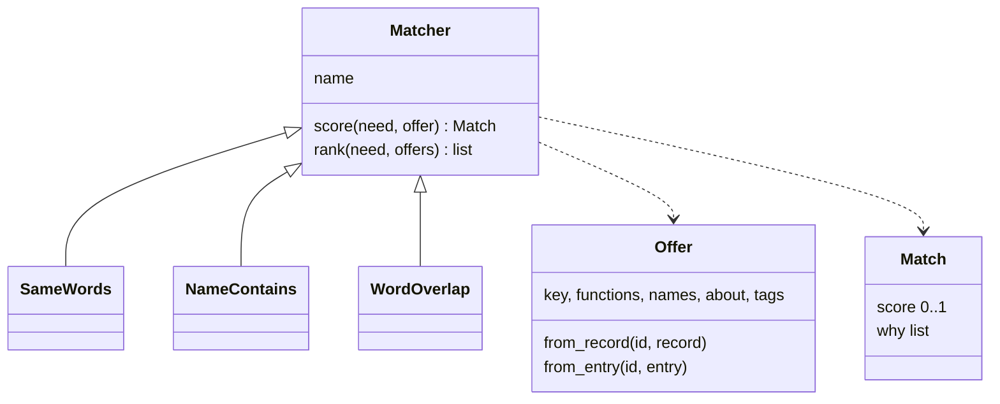

# P211: matching strategies

Card: [P211 (#181)](https://github.com/xmejkal/spark/issues/181). Status: design, for its council and the PO's yes.

The PO, 2026-10-12: *"the matching is actually one of the most important parts that will determin the usefulness of
spark"*, and *"make it a class, like a streategy or whatever pattern is the best, we can keep making better and better
strategies later"*.

## The problem

A need is a verb and a few words, for example `sense distance`. Ideation finds parts for it in two steps.

1. `needs.candidates` keeps only the parts that have the need's verb. A part filed under another verb never appears.
2. `needs._what_matches` gives each part yes or no: yes when every word of the need is in a same-verb function's `what`,
   or in the part's name or an alias. Claude then judges "similar enough", from the short keys and labels only.

So a need for `sense range` gets no word match on a part filed as `sense distance`. In the text output, such a part can
also fall out of view, because `parts.py --match` shows the first 8 candidates plus the word matches.

`parts.py --need WORD` matches by a second rule of its own, `parts._matches`. Every word must be a substring of the id,
name, kind or aliases. It has no verb, and a substring rule lets `vl6180` find `vl6180x`.

## The design

### The data

A part record and a drawer entry each get two optional fields.

- `about`: one plain sentence on what the part does for a person, at most 200 characters.
- `tags`: a list of other words for the part, at most 12, each lowercase. Example: `["knob", "dial", "volume", "menu"]`.

`--fact-set` writes them on a record and `--drawer-set` on an entry. Old data stays valid without them. The pass that
fills them for the PO's drawer is P206 (#170).

### The classes

A new module, `scripts/matching.py`, holds the matching. Nothing else in spark decides whether a part matches a need or a search word.

- `Offer` is one thing that can be matched. It is built in one place, from a record or from a drawer entry.
- `Match` holds a score from 0 to 1 and the reasons, for example `range: in tags`.
- `Matcher` is the base class. `rank` sorts by score, highest first, and keeps the input order for equal scores.
- `SameWords` is today's `_what_matches`, moved unchanged. It scores 1 or 0.
- `NameContains` is today's `parts._matches`, moved unchanged. It scores 1 or 0.
- `WordOverlap` keeps the verb gate. Its score is the share of the need's words that it finds. A word found in a
  same-verb `what` counts 1, in `tags` 0.8, in a name or an alias 0.6, and in `about` 0.4. It folds a plural "s" and
  drops a short list of filler words ("a", "the", "of", "for", "to").
- `MATCHERS` maps a name to each class. Each caller names its default in one constant: `SameWords` for ideation and
  `NameContains` for `--need`. If the test set shows a higher score for another class, that class becomes the default.

### The callers

- `needs.candidates` and `parts.py --match` call the ideation matcher. The JSON adds `score` and `why`. It keeps
  `what_matches`, which is true for a score of 1. The text output shows the first 8 candidates and every other candidate
  with a score above 0. It prints each candidate's `about` sentence, so Claude can judge by meaning.
- `parts.py --need` and `catalog_matches` call the `--need` matcher.
- `--matcher NAME` on `--match` and `--need` picks another class. An unknown name is refused, and the refusal lists
  the names.

### The test set

A case is a need in the PO's words and the part that it must find: `{"does", "what", "expect"}`. There are two case
files, because the drawer is private and spark is public.

- `tests/matching/cases.json` runs on spark's own library records and a small invented drawer, in the test suite.
- The PO's own file lives in his store and runs on his real drawer. It starts with 15 needs worded differently from
  the keys, which Claude proposes and the PO corrects.

`tools/match_eval.py --cases FILE [--matcher NAME ...]` prints, per strategy, how many cases land first and how many
land in the top 5, and it lists the misses. If a new strategy scores higher on both files, it becomes the default.

## What does not change

With the defaults, every candidate list, every order and every `what_matches` is the same as before. The existing
tests of `needs.py` and `--need` pass without edits.

## Out of scope

Judging by meaning with a model, relaxing the verb gate, and filling the PO's entries (P206). Each later one is a new
`Matcher` subclass or a data pass, and the test set shows whether it helps.

## Testing

- Unit tests per class, including the weights, the plural fold and the filler words.
- Parity tests: `SameWords` and `NameContains` give the old functions' results on the existing fixtures.
- `match_eval.py` tests on a three-case file, one of them a miss.
- The refuter mutates the changed lines (P208).

## Value proven by

`match_eval.py` on the repository's case file: `WordOverlap` lands more cases in the top 5 than `SameWords`. On the
PO's file, both scores are recorded now as the baseline. The gain there needs P206's `about` and `tags`.
