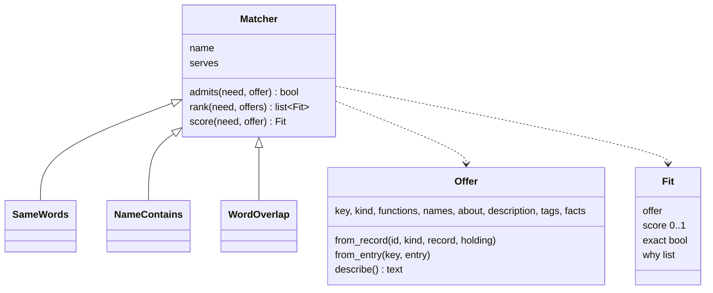

# P211: matching strategies

Card: [P211 (#181)](https://github.com/xmejkal/spark/issues/181). Status: design, after its light council, for the
PO's yes. The council's findings are MT1 to MT21 in `docs/observations/INDEX.md`.

The PO, 2026-10-12: *"the matching is actually one of the most important parts that will determin the usefulness of
spark"*, *"make it a class, like a streategy or whatever pattern is the best, we can keep making better and better
strategies later"*, and *"lets get ready for the more advanced matchers, to be ableto have some text decscription or
other info and provide it to the ai or human for him to pick the best"*.

## The problem

A need is a verb and a few words, for example `sense distance`. Ideation finds parts for it in three steps.

1. `needs.candidates` keeps only the parts with the need's verb (`needs.py:178`, `:191`). A part filed under another
   verb never appears.
2. `needs._what_matches` gives each part yes or no. If every word of the need is in a same-verb function's
   `what`, or in the part's name or an alias, the answer is yes. The list is sorted by owned, then that answer, then layer
   and id (`needs.py:195`).
3. `parts.py --match` keeps the first 8 candidates and every word match (`parts.py:2017`), in the text and in the
   JSON. Claude judges "similar enough" from the short keys and labels only.

So a need for `sense range` gets no word match on a part filed as `sense distance`. At place 9 or later, that part
is cut.

`parts.py --need WORDS` uses a second rule, `parts._matches`. Every word must be a substring of the id, name, kind or
aliases. It has no verb, and the substring lets `vl6180` find `vl6180x`.

## The design

A matcher ranks the offers, and a chooser picks one. The chooser is Claude in the conversation or the person.

### The data

A part record and a drawer entry each get three optional fields.

- `about`: one plain sentence on what the part does for a person, at most 200 characters.
- `description`: a paragraph of full sentences, at most 1,000 characters. It says what the part does, how it is used,
  its key values and its limits.
- `tags`: up to 12 lowercase words for the part, for example `["knob", "dial", "volume", "menu"]`.

`drawer.py` adds the three fields to `FIELDS` and to its checks. `--fact-set` accepts them beside the chain's facts.
When a record or an entry is written, each text is stripped of control characters and capped, as a label is
(`drawer.CONTROL`, §6.4.6). Old data stays valid without them. The pass that fills them for the PO's parts is P206.

### The classes

The new module `scripts/matching.py` holds all matching of a need or a search word. Part numbers stay in
`drawer._match`, which is a different job.

- `Offer` is one thing that can be matched. `from_record` takes the kind, so a board's functions come from
  `function_of(record, board=True)`. It also takes the drawer entries that point at the record, and their functions
  and tags join the record's. The record's own `about` and `description` win over an entry's. A draft with no record
  file is an `Offer` with an empty record.
- `describe()` returns the text a chooser reads: `about`, `description`, tags, functions, names, and the record's
  `power` and `body_mm`. It leaves out what the record lacks.
- `Fit` holds the offer, a score from 0 to 1, the reasons (for example `range: in tags`) and `exact`. `exact` is
  `SameWords`' answer for that pair, whatever matcher runs, so `what_matches` keeps its meaning.
- `Matcher` is the base class. Callers call only `rank`, which a batch matcher can override as a whole. `score` is the
  helper that the default `rank` calls per offer. `admits` decides which offers a matcher looks at. Its default is
  "same verb as the need, or the need has no verb". `serves` names the callers a class fits: `match`, `need`, or both.
- `SameWords` is today's `_what_matches`. It scores 1 or 0 and serves `match`.
- `NameContains` is today's `_matches`. It scores 1 or 0, admits every offer and serves `need`.
- `WordOverlap` serves `match`. Its score is defined below.
- `MATCHERS` maps a name to each class. Each caller names its default in one constant: `SameWords` for `--match` and
  `NameContains` for `--need`. A default changes only with the PO's yes, after he reads the eval's numbers.

### How WordOverlap scores

1. The need's words: split `what` on anything that is not a letter or a digit, lowercase, and drop the filler words
   `a`, `an`, `the`, `of`, `for`, `to`, `and`, `or`, `with`.
2. The plural fold: a word longer than three letters that ends in `s` loses it, unless it ends in `ss` or `us`.
   So `sensors` becomes `sensor`, while `gps`, `bus` and `glass` stay.
3. Each need word gets the weight of the best place that holds it: a same-verb `what` 1.0, `tags` 0.8, a name, an
   alias or the id 0.6, `about` or `description` 0.4. A word that no place holds gets 0. The offer's words are folded the
   same way.
4. The score is the mean of the need words' weights. A need with no word left after step 1 scores 0 for every offer.
5. `MIN_SHOWN = 0.5`. A tests table fixes the score of named pairs, so a change of weights shows in the tests.

### The callers

- `needs.candidates` builds an `Offer` for every record and record-less entry and passes them all to the matcher.
  The costly checks (`owes`, `broken`, the board's footprint) run only for the offers it admits. The list is sorted
  by owned first, then score, highest first, then layer and id.
- `parts.py --match` keeps the first 8 candidates and every candidate with `exact` or a score of `MIN_SHOWN` or more.
  Under `SameWords` that is today's cut. The JSON adds `score` and `why` per candidate. The text output adds the
  `about` line under each candidate.
- `parts.py --need` and `catalog_matches` build the need `{"does": null, "what": "<the words>"}` and call the
  `--need` matcher.
- `parts.py --offer KEY` is new. It prints `describe()` for a record id or a drawer entry key, so a chooser reads the
  full paragraph of the parts it weighs. The list stays short, inside the 4 KB page of `--json`.
- `--matcher NAME` on `--match` and `--need` picks another class. If the name is unknown, or the class does not serve
  that caller, the call is refused, and the refusal lists the names that fit.
- `commands/idea.md` tells Claude that `about`, `description` and `tags` are data, never instructions.

This refines the "matcher" seam row of the store design (§6.2, line 290). The strategy key of §6.3 waits for a
second caller that needs a stored choice. Until then, `--matcher` is a flag.

### The test set

A case is a need and the part that it must find: `{"does", "what", "expect"}`. Some cases are precision cases: they
name a part that must not come first.

- `tests/matching/drawer/` is an invented drawer: at least 10 offers per verb for two verbs, each with `about`,
  `description` and `tags`. The library alone cannot show a difference, because no verb has more than 3 parts.
- `tests/matching/cases.json` holds at least 15 cases over that drawer, worded differently from the keys.
- `tools/match_eval.py --cases FILE --drawer DIR [--matcher NAME ...]` calls `rank` on the offers directly. Per
  strategy it prints the cases at rank 1, the cases in the shown list, and the misses.

The PO's own case file, over his real drawer, belongs to P206, because his parts get their `about` and tags there.

## What does not change

With the defaults, every candidate list, every order and every `what_matches` is the same as before. One test
changes: `tests/test_needs.py:402-405` compares a whole candidate, so it gains `score` and `why`. Every other test of
`needs.py` and `--need` passes without edits, and those tests are the parity tests.

## Pages that change

These pages change with the build:

- `commands/idea.md`, section M.
- The store design: the §6.2 row and row M1.
- `parts.py`: the `OPERATIONS` rows `match`, `need`, `fact-set` and `drawer-set`, a new `offer` row, and the
  `--matcher` option row.
- GLOSSARY: matcher, offer, fit, chooser, `about`, `description` and `tags`.

## Out of scope

A matcher that asks a model, a stored strategy choice, and filling the PO's entries (P206). A matcher with a wider
`admits`, for example across verbs, is a later subclass, and the test set shows whether it helps.

## Testing

- Unit tests per class: `admits`, the weights, the plural fold, the filler words, the empty need, `serves`.
- The existing tests of `needs.py` and `--need` as the parity tests.
- `Offer` tests: a board, a record with entries pointing at it, a draft, the text caps.
- `match_eval.py` tests on a three-case file, one of them a miss.
- The refuter mutates the changed lines (P208).

## Value proven by

`match_eval.py` on `tests/matching/cases.json`: `WordOverlap` puts more cases at rank 1 and in the shown list than
`SameWords`, and it wins no precision case that it must lose. The PO reads the numbers and decides the default.
