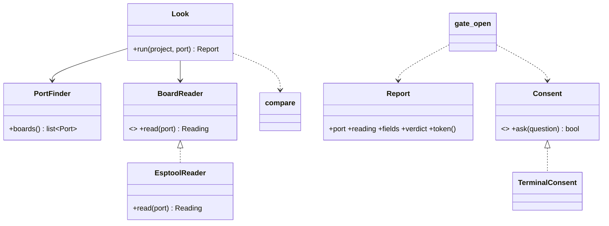

# P219: the board check and the gate, the plan

Card: [P219 (#201)](https://github.com/xmejkal/spark/issues/201), under the epic [P218 (#200)](https://github.com/xmejkal/spark/issues/200).
Status: the plan after its six lenses and the refuter (rows in [the council file](observations/2026-10-13-p219-council.md)),
for the PO's yes. Nothing is built.

## The short version

`deploy.py` erases the board on USB, whatever board it is. This card makes it sure that the board is the right one,
and the person can still go on where spark is not sure. Four PRs, each one working on its own:

1. DE2: a run log that tested another image refuses the flash (the PO's ruling, commit `3188a62`).
2. The reader: the two board records get their flash size, and a library reads a board and compares it with a record.
3. The look: `look.py` reads the board on USB without changing it and prints the comparison.
4. The gate: `deploy.py` erases only after the look agrees and the person types yes in their own terminal.

### Words used here

- **look**: a read-only reading of the board on USB, compared with the project's board record.
- **field**: one fact that the look compares: the chip and the flash size. Each reads `same`, `differs` or `unknown`.
  The look also prints the board's MAC, its fixed hardware address, which no record holds yet.
- **gate**: the part of `deploy.py` that refuses to erase until the look agrees and the person says yes.
- **the yes**: the person types `yes` in their own terminal. Claude must not type it. A program can fake a terminal,
  so the barrier is a rule plus `deploy.py` kept out of Claude's `allowed-tools`, so the person approves the command.
- **token**: a short code that the look prints, in two halves: one from the board's MAC, one from the image. It shows
  that a look was made on this board for this image. It is not the yes, and it is not a secret (see PO question 1).

### What the person sees

```
$ look.py
  the board restarts while it is read: a running program stops and starts again. Nothing is erased or written.
  port   /dev/cu.usbmodem101
  mac    8c:bf:ea:xx:xx:xx
  chip   same      esp32c6
  flash  same      4 MB
  all fields match the board record xiao-esp32-c6.
  token  3f9a-0c1e  for deploy.py --token. It is not your yes: deploy.py asks for that.

$ deploy.py --token 3f9a-0c1e
  the board restarts while it is read.
  /dev/cu.usbmodem101  8c:bf:ea:xx:xx:xx  esp32c6  4 MB  all fields match
  erase ALL of this board's flash and write sim/firmware.bin? type yes to go on: _
```

The MAC in every doc and fixture is masked as `xx`, as the bench files are.

## Why, in the PO's words

The PO, 2026-10-13: *"add a mechanism, since we're adding deploy already, that checks if it all really applies for
the connected board, if it really is the one it's meant for ... It should also however allow this to be ignored."*

On the way of working, the same day: *"epic by epic, journey by journey, use case by use case and story by story ...
we always have something working and we're just adding stuff one by one ... well object oriented designed, great
architecture that makes it easy for us to extend or change various strategies and settings, and modules, also well
documented iteration by iteration."*

## Where it sits

v1.0 is the basic journey ([the story map](../scrum/STORY_MAP.md)). Its order: P219, this card. P215, the first real
flash, where the board prints `ready`. P213, `/spark:deploy` and `--json`. P100, the PO's walk to a lit LED. This card is the first story of deploy slice 0
([the deploy map](discovery/2026-10-13-p218-deploy-and-board/story-map.md)). Its second story, another board with the
same chip, is v1.2.

## The decisions it rests on

All are the PO's, from P218's discovery ([brief.md](discovery/2026-10-13-p218-deploy-and-board/brief.md)).

| | decision |
| --- | --- |
| D8 | the gate is in the core, so no interface can skip it |
| D19 | a token from the core's own look, bound to the board and the image, and a yes in the person's own terminal |
| D24 | an unknown field is a warning that only the person can accept. Another chip is always a stop |
| D25 | with two or more boards on USB, the port is needed |
| D36 | the two board records only (FireBeetle 2 ESP32-S3, XIAO ESP32-C6). Another board points to P230, board research |
| D37 | the look is its own read-only command. Claude can run it unasked. It says that the board restarts |
| D47 | DE2 is carried in from `origin/p192-deploy`, and that branch is deleted after P219 merges |
| 2026-10-13 | the terminal asks before every erase for now. v1.1's known board makes a repeat flash quiet later |

## The design

Two library modules. `look.py` and `deploy.py` only parse arguments, call them and print. The seams are where a second
strategy is already named. How a board is read: a REPL reader for P222, another platform for P221. How the person
says yes: an MCP or web yes, D19's caveat. Everything else stays a function until a second case needs a class.



`scripts/board_look.py`, read-only:

- `PortFinder.boards()` runs `mpremote devs` and splits each line in four (`split(None, 3)`): port, serial, USB id,
  product. It drops rows with the id `0000:0000` (Bluetooth and the debug console). It keeps every other USB id, so a
  CH340 or CP210x board is not hidden. It never opens a port or runs code on the board (`exec` failed on the blank
  XIAO, `bench/p228/02-mpremote.txt`).
- `EsptoolReader.read(port)` runs `esptool --port P flash_id`. The underscore form works in esptool 3, 4 and 5, as
  `deploy.py` already does. It parses, anchored at the line start:
  - the chip from the last `Detecting chip type... ESP32-C6` line, written as the record writes it (`esp32c6`). On a
    classic ESP32 the first such line reads `Autodetection failed, trying again...`.
  - the flash from `Detected flash size: 4MB` (MB or KB). Not `Embedded Flash` from the features line, since an
    external flash shows only in the detected line.
  - the MAC from `BASE MAC:` when present, else `MAC:`. On the C6, `MAC:` is the 8-byte form and `BASE MAC:` the
    6-byte one that `mpremote devs` also shows.
  A field it cannot parse is `None`. A read that cannot connect is not a reading: it raises, and the look says
  "could not read the board" with the BOOT hint. The parser is read only on esptool 5.5.0's output. If the person
  pointed the `flasher` role at another tool, the reader says "could not read: the look reads only esptool".
- `compare(reading, record)` returns `{field: same | differs | unknown}` over a small table of fields (chip, flash).
  A new field, such as PSRAM in v1.2, is one row. It becomes a class when a field needs its own logic.
- `Look.run(project, port)` picks the port: the one given, else the only board, else a stop that lists every board
  with its port and serial number from `mpremote devs` (the MAC on a native-USB board, `None` on a CH340), and the
  command to copy. It never reads every board, since each read restarts a board. It reads the record named by `requirements.json`'s `board`. A board
  with no record stops and points to P230 (D36).
- `Report.verdict` is one of: all match; a warning (a field `unknown`, or the flash `differs`, see PO question 2);
  a stop (another chip). `Report.token()` is two halves of 4 hex digits: sha256 of the MAC, and sha256 of the image
  file. So the gate can say which one changed. The port is not in it, because a native-USB board can come back on
  another port name after a reset (PO question 1). There is no token when the MAC cannot be read, when there is no
  image yet, or when no passed run names the image: the look still prints the fields, and says why there is no token.

`scripts/deploy_gate.py`, the only way to the erase (D8):

- `Consent` is the strategy for the yes. `TerminalConsent` asks only when stdin and stdout are both a real terminal
  (`isatty()`). A pipe, a heredoc or Claude's shell is no terminal, and it answers no with the sentence below.
- `gate_open(report, token, consent)` refuses on a stop, on a missing token, or on a token that differs. A differing
  token names what changed: the board (MAC) or the image, each with "run look.py again". Then it asks the
  question with every warning in it. The person's `yes` accepts the warnings.

### What each outcome prints, and its exit code

spark's three outcomes stay: 0 ok, 1 problems, 2 could not run ([agents.md](guide/agents.md)). The look builds its
exit with `outcomes.status_of`: a field that differs is a problem, and a field that is `unknown` was not checked.

| case | exit | first line, then the next step |
| --- | --- | --- |
| look: all fields match | 0 | `all fields match the board record <id>.` then the token |
| look: a field unknown | 2 | `1 field unknown (flash): deploy.py will ask you to accept it.` then the token |
| look: a field differs | 1 | `the flash differs: 8 MB, the record says 16 or 4. deploy.py will ask you to accept it.` then the token |
| look: no MAC, no image, or an image no passed run names | 2 | the fields, then `no token: <why>` |
| look: another chip | 1 | `this board is an esp32s3, the project is for an esp32c6: deploy.py will refuse.` no token |
| no board on USB | 2 | `no board found. Plug it straight into the computer with a data cable, not a hub that gives power only.` |
| cannot connect | 2 | `could not read the board on <port>.` then the BOOT hint that `deploy.py` already has |
| two boards, no port | 2 | one line per board (port, MAC), then `look.py --port <port>`, and `unplug one to tell them apart` |
| no record for the board | 2 | `no board record for <board>: P230 will research one.` |
| deploy: no token | 2 | `run look.py first, then deploy.py --token <token>.` |
| deploy: token differs | 2 | `the image changed since the look: run look.py again.` (or the board) |
| deploy: its own look finds another chip | 1 | the look's chip line, and `not flashed.` |
| deploy: no terminal | 2 | `no terminal to ask you in. Run this line yourself (in Claude Code, type ! first):` and the full line with the script's real path, the token and the port |
| deploy: the person answers no | 2 | `not flashed: you answered no.` (the EPILOG and agents.md say so) |

`--dry-run` never touches USB, as today: it prints the commands and `board: not looked at: run look.py`. A look in a
dry run would restart the PO's board on every push, since the push hook runs `tests/test_journey_basic.py`.
`main()` takes the port finder and the reader as arguments, as it takes `run` today, so the gate tests use fakes. After the yes, `deploy.py` erases and
writes as it does today. P215 runs that on the PO's board and adds the `ready` check.

## The plan, step by step

Each step is one PR, test-first, with a small refactor at its end. Each updates its docs in the same PR (the table
below) and records one real run from the PO's XIAO in the journey guide, with its `<!-- output: run DATE, spark X -->`
marker. The XIAO fixtures are real (P228's bench). The FireBeetle S3 fixtures are written by hand and marked so,
because the S3 is missing (D13).

### Step 1: DE2 (about 40 lines, tests in the commit)

Cherry-pick `3188a62`: a run log that tested another image refuses, and `--ignore-older-runs` flashes anyway.

Done when: the suite passes and `deploy.py --help` names `--ignore-older-runs`.

### Step 2: the reader (about 250 lines with tests)

1. `flash_mb` in both records, each with its `//` source: the XIAO 4 (Seeed's wiki and the P228 bench), the FireBeetle
   `[16, 4]` (16 for DFR0975, 4 for DFR1145, from DFRobot). A read size in the list is `same`. `boards/README.md`
   names the field.
2. `board_look.py`: `PortFinder`, `EsptoolReader`, `compare`, `Look`, `Report`.
3. Tests with the bench outputs copied to `tests/data/board_look/`: one board, two boards and no port, no board, the
   `0000:0000` rows dropped, a failed connect, the wrong chip, a classic ESP32's two detecting lines, a flash that
   differs, a field that cannot be parsed, the C6's 6-byte BASE MAC, a size in KB, a board with no record, no MAC,
   no image, another flasher.

Done when: the suite passes. Nothing a person runs changes yet.

### Step 3: the look (about 150 lines with tests and docs)

`scripts/look.py` (`--project`, `--port`) and its docs.

Done when: `look.py` on the PO's XIAO prints chip and flash `same` and a token, and `check_docs.py`, `inventory.py`
and the suite pass.

### Before step 4: one bench line

The PO runs `! python3 -c "import sys; print(sys.stdin.isatty(), sys.stdout.isatty())"` in Claude Code. If `!` gives
no terminal, the no-terminal sentence says "in your own terminal window" and drops the `!` hint.

### Step 4: the gate (about 200 lines with tests)

1. `deploy_gate.py`, and `deploy.py --token`. The real path: the look, the gate, then the erase and write on the port
   the look picked.
2. Tests: no token, a token for another MAC or image, a new port name with the same MAC (passes), no terminal
   (a pipe counts as none), the answer no, a warning named in the question, another chip stopped before the question,
   `--dry-run` with no board.

Done when: on the PO's XIAO, `deploy.py --token T` stops at the question, and he answers no. The real flash is P215.
Then `origin/p192-deploy` is deleted (D47).

### The docs, step by step

| page | step 1 | step 3 | step 4 |
| --- | --- | --- | --- |
| `--help` | `deploy.py`: `--ignore-older-runs` | `look.py`: what it reads, that it writes nothing, the restart, the token, every option, the exit codes | `deploy.py`: `--token`, the yes in a real terminal, what `--dry-run` skips, `--port` now picks among the look's boards |
| `commands/build.md`, "Put it on the board" | the DE2 refusal | Claude runs `look.py` before it proposes a flash and when asked "is this the right board". It says first that the board restarts. `look.py` goes in `allowed-tools`, and `deploy.py` stays out on purpose | the order look, token, yes. Claude relays a refusal word for word, gives the person the line to run, then waits. Drop "esptool tries each port" |
| `docs/guide/agents.md` | | `look.py` in the scripts list and in what reads and what writes. Text only until P213's `--json`. `unknown` is not a pass | in "What never to assume": never pipe, script or fake the yes, and "go ahead" in chat is not the yes. The token is not consent |
| `skills/spark-design/SKILL.md` | | | after a passed scenario: `look.py`, then `deploy.py --token` |
| `GLOSSARY.md` | | look, token | gate, the yes |
| `docs/guide/journey.md`, Bench | | a recorded `look.py` run | a recorded `deploy.py --token` run that stops at the question |
| README "What works today", `tools/journey.py`, the Miro journey board | | the Bench note names the look. The status stays partly | the note names the gate. Partly until P215 |
| `docs/guide/how-it-works.md` script list, `data/tools.json`'s esptool and mpremote lines | | `look.py`, `board_look.py`; the tools are needed for `look.py` too | `deploy_gate.py` |
| `docs/observations/INDEX.md` | each step's review rows | each step's review rows | each step's review rows |

"Nothing has run this on a board yet" stays in `commands/build.md` and the journey guide until P215.

## Out of scope

The MAC in the store and a quiet repeat flash (v1.1). Migrate and another board's record (v1.2). The real flash,
`ready` and the facts file on the board (P215, D42), and with it D34's offer to back up firmware spark did not write.
`--json` and `/spark:deploy` (P213). PSRAM. Two boards told apart by a blink (D38). A USB id in the record.

## Questions for the PO

1. The token (D19). D19 binds it to the port, the MAC and the image. The plan drops the port, because a native-USB
   board can come back on another port name after a reset, and a token would then fail for no reason you can see.
   The gate also looks again itself, and Claude can copy the token, so the yes in the terminal is the real guard.
   Three options: the token on the MAC and the image (the plan), the token as D19 says with the port, or no token
   (about 40 lines and 4 tests less).
2. A flash size that differs. With the two records it cannot happen: the XIAO's flash is inside the chip, and the
   FireBeetle record allows 16 and 4. It can happen with another board of the same chip, for example an ESP32-S3
   DevKitC with 8 MB on a FireBeetle project. A warning that your yes accepts,
   or a stop? The plan makes it a warning, because you asked that the check can be ignored. Another chip stays a stop.
