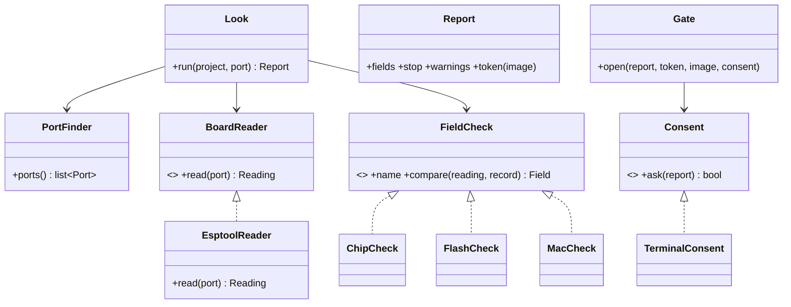

# P219: the board check and the gate, a basic plan

Card: [P219 (#201)](https://github.com/xmejkal/spark/issues/201), under the epic [P218 (#200)](https://github.com/xmejkal/spark/issues/200).
Status: a basic plan for the council to revisit, then for the PO's yes. Nothing is built.

## The short version

`deploy.py` today flashes whatever board is on USB. This card adds three steps, one PR each:

1. `look.py` reads the board on USB without changing it and compares it with the project's board record.
2. `deploy.py` flashes only with a token from that look, and only after the person types yes in their own terminal.
3. Both board records get a sourced flash size, so the look can compare it.

Each step works on its own, is tested with outputs kept from the real XIAO ESP32-C6 (P228), and updates its docs.

## Why, in the PO's words

The PO, 2026-10-13: *"add a mechanism, since we're adding deploy already, that checks if it all really applies for
the connected board, if it really is the one it's meant for ... It should also however allow this to be ignored."*

And on the way of working, 2026-10-13: *"epic by epic, journey by journey, use case by use case and story by story ...
we always have something working and we're just adding stuff one by one ... well object oriented designed, great
architecture that makes it easy for us to extend or change various strategies and settings, and modules, also well
documented iteration by iteration."*

## Where it sits

The release v1.0 is the basic journey ([the story map](../scrum/STORY_MAP.md)): P219 (this card), then P215 (the
first real flash and `ready`), then P213 (`/spark:deploy` and `--json`), then the PO's walk, P100. This card is the
first story of deploy slice 0 ([the deploy map](discovery/2026-10-13-p218-deploy-and-board/story-map.md)). Its second
story, another board with the same chip, is v1.2.

## The decisions it rests on

All are the PO's, from P218's discovery ([brief.md](discovery/2026-10-13-p218-deploy-and-board/brief.md)).

| | decision |
| --- | --- |
| D8 | the gate is in the core, so no interface can skip it |
| D19 | a token from the core's own look, bound to the port, the MAC and the image, and a yes in the person's terminal |
| D24 | an unknown field is a warning that only the person can accept. Another chip is always a stop |
| D25 | with two or more boards on USB, the port is needed |
| D36 | the two board records only (FireBeetle 2 ESP32-S3, XIAO ESP32-C6). Another board points to P230 |
| D37 | the look is its own read-only command. Claude can run it unasked. It says that the board restarts |
| D47 | the DE2 ruling (commit `3188a62`) is carried onto this card's branch |
| 2026-10-13 | the terminal asks before every erase for now. v1.1's known-board path makes a repeat flash quiet later |

## What exists today

- `scripts/deploy.py` (192 lines): `plan()` checks that a passed run names the image, finds the chip in the board
  record (`chip_of`), finds `esptool` and `mpremote` on the tools list, and builds the erase and write commands.
  `main()` runs them. Tests: `tests/test_deploy.py`, with a fake `run`.
- `boards.get(project, field, board)` reads one field of the project's board record.
- `tools.find("flasher" | "board-shell", project)` finds esptool and mpremote.
- P228's bench kept the real outputs: `esptool flash-id` (chip, features, MAC, `Detected flash size: 4MB`),
  `esptool --chip esp32s3 read-mac` on the C6 (the wrong-chip refusal, exit 2) and `mpremote devs`
  ([bench/p228/](discovery/2026-10-13-p218-deploy-and-board/bench/p228/)).

## The design

One new library module, `scripts/board_look.py`. Each class has one job. `look.py` and `deploy.py` only parse
arguments, call it and print.



- `PortFinder` lists the boards on USB through `mpremote devs`: port, serial number and USB id.
- `BoardReader` is the strategy that reads a board. `EsptoolReader` runs `esptool --port P flash-id`, which is
  read-only, and parses the chip, the flash size and the MAC into a `Reading`. A field it cannot parse stays `None`.
  A REPL reader (P222) or another platform (P221) is a new class later.
- `FieldCheck` compares one field of the reading with the board record and answers `same`, `differs` or `unknown`.
  `ChipCheck`: another chip is a stop. `FlashCheck`: the read size against the record's sizes. `MacCheck`: recorded
  only, since no record holds a MAC until v1.1. A new field (PSRAM in v1.2) is a new class in the list.
- `Look` picks the port: the one given, else the only board, else a stop that lists them (D25). It reads the board and
  runs every check. A project whose board has no record stops and points to P230 (D36).
- `Report` holds the fields, the stop and the warnings. `token(image)` is the first 8 hex digits of
  sha256(port, MAC, the image's sha256).
- `Gate.open` refuses when the report has a stop, when the token is missing or differs, or when `Consent.ask`
  answers no. An unknown field is named in the question, so the person accepts it there (D24).
- `Consent` is the strategy for the person's yes. `TerminalConsent` reads `yes` from a real terminal. With no
  terminal (Claude's shell), it answers no and says to run the command with `! deploy.py ...`. An MCP or web yes is
  a new class later (D19's caveat).
- The command a strategy runs comes from the tools list (`flasher`, `board-shell`), as today.

### What the person sees

```
$ look.py
  the board restarts while it is read
  port   /dev/cu.usbmodem101
  chip   same      esp32c6
  flash  same      4 MB
  mac    read      8c:bf:ea:..:..:..
  token  3f9a0c1e  (for deploy.py --token, this port, this board, this image)

$ deploy.py --token 3f9a0c1e
  ...the look again...
  erase and write /dev/cu.usbmodem101 (esp32c6, 4 MB)? type yes: yes
  running: esptool ... erase_flash
```

The exit codes stay spark's: 0 done, 2 could not run, with the sentence that says why.

## The plan, step by step

Each step is one PR on its own branch. Each is test-first, ends with a small refactor, and updates `--help`,
`docs/guide/agents.md`, `commands/build.md`'s deploy section and the journey guide in the same PR.

### Step 1: the look (about 200 lines with tests)

1. `board_look.py` with `PortFinder`, `EsptoolReader`, `ChipCheck`, `FlashCheck`, `MacCheck`, `Look` and `Report`.
2. `scripts/look.py`: `--project`, `--port`. It prints the fields and the token. Exit 0, or 2 with the reason.
3. Tests with the bench outputs as fixtures (copied to `tests/data/board_look/`): one board, two boards and no
   port, no board, the wrong chip, a flash size that differs, an output that cannot be parsed (unknown), a board with
   no record.
4. Until step 3 lands, `FlashCheck` reads `unknown` for both records. That is the honest answer.

Done when: `look.py` on the PO's XIAO prints chip `same` and a token, and the suite passes.

### Step 2: the gate in deploy.py (about 150 lines with tests)

1. Cherry-pick `3188a62` (DE2): a run log that tested another image refuses, `--ignore-older-runs` flashes anyway.
2. `Gate` and `TerminalConsent`. `deploy.py` takes `--token`. A real flash runs the look, then the gate, then
   erase and write on the port the look picked. `--dry-run` needs no token and no yes.
3. Tests: no token refuses. A token for another MAC or image refuses. No terminal refuses with the `!` hint. `no`
   refuses. An unknown field is named in the question. Another chip stops before the question.

Done when: on the PO's XIAO, `deploy.py --dry-run` prints the plan, and `deploy.py --token T` stops at the question
(the real flash is P215).

### Step 3: the flash size in the records (about 30 lines)

1. `flash_mb` in `boards/xiao-esp32-c6.json` (4, from Seeed's wiki and the P228 bench) and
   `boards/firebeetle2-esp32s3.json` (16 for DFR0975, 4 for DFR1145, from DFRobot), each with its `//` source.
2. `FlashCheck` then reads `same` or `differs`.

Done when: the look on the XIAO says flash `same`, and a scratch record changed to 16 MB says `differs`.

## Out of scope

The known-board path and the MAC in the store (v1.1). Migrate and another board's record (v1.2). The real flash and
`ready` (P215). `--json` and `/spark:deploy` (P213). PSRAM. Two boards told apart by a blink (D38).

## Questions for the council

1. Is `mpremote devs` the right port list, or must `PortFinder` read esptool's or pyserial's list? Which ports
   does it keep: every port with a USB id, or Espressif's `303a` only (the FireBeetle S3 and the XIAO C6 both use the
   chip's own USB)?
2. Is the token's binding enough: port, MAC and image sha256? Must it also bind the project?
3. Is `Gate` in `board_look.py` right, or its own module?
4. Is the step order right: can step 3 come first, so that step 1 never prints `unknown` for the flash?
5. What is missing for the PO's walk (P100) that this card should hold?
