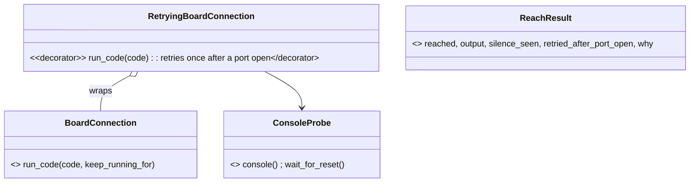

# P235 slice 0 (Live 0): the slice plan

Approved by the PO on 2026-10-15 in plan mode, after a plan council (one Sonnet lens, one Opus refuter; report:
[the council](observations/2026-10-15-p235-slice0-plan-council.md)). Epic: P235 (#224). Discovery:
[docs/discovery/2026-10-15-p235-live-on-board/](discovery/2026-10-15-p235-live-on-board/brief.md). This is the plan of
the epic's first slice (P257). Each story gets its own short plan and plan council at its Build start.

## Context

P235 (#224, in Design) asks for live work on a running board. Its discovery closed on 2026-10-15 (PR #261,
`docs/discovery/2026-10-15-p235-live-on-board/`). Slice 0 is "reach and read": Claude runs one line on the PO's
running XIAO C6 inside one grant he typed, and a console that went silent after a power-on (AT187) no longer stops it.
P257 (PR #273) says an epic gets a plan of its slices before its first story, and each story's Build starts with its
own plan and plan council. This plan is the slice plan. Only the next code story, P251, is planned in detail.

The PO chose on 2026-10-15: P251 brings a small `reach.py` that runs one fixed line, and P247 later grows it. This
becomes D24 in the brief, with its scope: the PO runs `reach.py` at the bench; Claude does not run it, and
`docs/guide/agents.md` does not list it, until P253's grant gates it (D9, D12; the plan council's finding).

## The slice, in build order

| # | card | what lands | proof |
| --- | --- | --- | --- |
| 1 | P252 #263 spike | bench only, no code: pins after soft and hard reset, `resume` keeps a value, meanings of `reset_at_end` | finding + bench log; the PO picks the meaning |
| 2 | P251 #264 + P255's Decorator and Fake rows | `RetryingBoardConnection`, `ReachResult`, the `ConsoleProbe` rename, `scripts/reach.py` (PO's bench tool) | D22's line, counted from separate silent and cured columns |
| 3 | P253 #265 | `LiveGrant`, `LiveGrantStore` (store place `grants`), a grant command with one look and a terminal yes | a grant found inside its limit, refused after it |
| 4 | P254 #266 | C6 record: `pin_roles.usb` GPIO12-13, `pin_roles.flash` GPIO24-30 with sources; `RestrictedPins.why_refused(code)` | a try naming GPIO12 refused, with role and source |
| 5 | P246 #260 | new board-only project with LED effects (D18), outside this repo | Wokwi pass, `ready` on the bare XIAO C6 |
| 6 | P247 #267 | `reach.py --code ... --json` behind the grant and the pins, ends with the reset P252 chose; agents.md lists it | a log of Claude's try on the C6, fake-run tests |
| beside | P256 #268 | the upstream post (after this plan, D8) | the issue URL |

P252 stays first (D10: "First story of slice 0"), though P251 does not depend on it. Each row is its own story: its
own plan in plan mode and plan council at Build start, its own PR, a council sized to the change.

## The shape (settles the open points of shape-for-design.md)

### Names: one word for one thing (the PO, 2026-10-15)

The thing that runs code on the board is a connection, as it is today. The plan's draft mixed "console" and
"connection" for it, so every new name now says connection:

| name | role | what it is |
| --- | --- | --- |
| `BoardConnection` | Adapter, existing, unchanged | mpremote on one board's port: runs code, copies and reads files |
| `RetryingBoardConnection` | Decorator, new | wraps a `BoardConnection`; when mpremote says "could not enter raw repl", it opens the port once with DTR and RTS off, waits for the restart and retries once |
| `ConsoleProbe` | Adapter, existing `DownloadModeProbe` renamed | reads the board's console with DTR and RTS off, and waits for the port to go and come back. It does more than find download mode now, so its old name would mislead |
| `ReachResult` | Result, new | reached or not, what the board printed, whether a silent console was seen, whether the retry came after a port open, and why when not reached |

"Console" stays only for what the board prints (the console the probe reads), never for the class that runs code.
No base class: `RetryingBoardConnection` has the same `run_code` as `BoardConnection`, and a base class waits until a
second platform needs one (D7, least code). The rename to a platform name waits for v0.13 (#94).



### What the shape settles

- `ConsoleProbe.console()` is the port open with DTR and RTS off. AT187 saw that open followed by a cure in 1 clear
  and 1 likely case, so the plan calls it the likely cure until P251's proof passes. The rival (a plain reboot, or
  the Mac enumerating the port again) stays open.
- The retry runs only on "could not enter raw repl". A timeout can come after the code ran, and a missing port or
  mpremote cannot be cured by a reset, so each of those is "not reached" at once, with mpremote's words.
- After the port open, it waits for the restart: `wait_for_reset()` or `booted(console)` (P245), then retries once.
- No firmware check (D11): when the retry also fails, `why` names both causes, a silent console and firmware that
  does not read its console.
- The retry stays out of deploy in this slice: deploy also uses `copy_to_board` and `repl_command`.
- An exec stops the running firmware (reach-test.md). Until P252's reset lands in P247, `reach.py` says so: "the
  firmware is stopped: press R or replug to run it".
- The grant (step 3) takes the gate's `ConsentStrategy` and one look (`board_look.looker`), and writes through
  `store.write_json("grants", mac_slug, ...)`. P242 reuses it (D12).

## P251 in detail (step 2)

```mermaid
sequenceDiagram
  participant R as reach.py (the PO, at the bench)
  participant T as RetryingBoardConnection
  participant C as BoardConnection
  participant P as ConsoleProbe
  R->>T: run_code(fixed marker line)
  T->>C: run_code
  C-->>T: BoardUnreachableError "could not enter raw repl"
  T->>P: console() (DTR and RTS off; keeps what it heard)
  T->>P: wait_for_reset(), unless the console already printed ready
  T->>C: run_code, once more
  C-->>T: the marker
  T-->>R: ReachResult(reached, silence_seen, retried_after_port_open)
```

Files:
- `scripts/download_mode.py`: rename `DownloadModeProbe` to `ConsoleProbe`, and its callers in `scripts/deploy.py`,
  `tests/fakes.py` (`FakeConsoleProbe`, which gains a `console()` method), `tests/test_download_mode.py` and
  `tests/test_deploy_gate.py`. A rename only, in its own commit.
- new `scripts/board_reach.py` (library): `RetryingBoardConnection(connection, probe)`, `ReachResult`, and
  `reach(connection)` that runs the fixed marker line and returns a `ReachResult`.
- new `scripts/reach.py` (CLI, `main()` parses and prints only): `--project`, `--port` (only with two boards, D25,
  via `board_look.PortFinder`), `--json`. It finds mpremote and the probe as deploy.py does
  (`tools.find("board-shell", project)`, `ConsoleProbe.for_tool`). Exit 0 reached, 2 not reached (could-not-run,
  never a pass).
- `tests/fakes.py`: `FakeBoardConnection` gains a silent-on-cue answer (raises, then answers).
- `docs/guide/developing.md`: the Decorator and Fake rows (P255, D8 says after the plan), in the same PR, so
  `RetryingBoardConnection` has its row.
- tests first, `tests/test_board_reach.py`: reached at once; silent, then cured; silent twice (both causes named); a
  timeout or a missing port is not retried; the probe could not open the port (named, never a pass); `--json`.
- docs: `reach.py --help` says it is the PO's bench tool for P251. Not in agents.md until P247. The journey status
  does not change (live work comes after step 10).

The bench protocol is P251's own plan at its Build start. It must count silent boots apart from cures (D22's
diagnostic listen, items.md:25), include cold-port runs, and collect `--json` lines into the bench log, not a new
project file.

## Order of work after the PO's OK

1. Write this plan as `docs/2026-10-15-p235-slice0-plan.md`, add D24 to the brief, PR it, light council. P235
   leaves Design when it merges and the PO says yes.
2. P252, the bench spike (his hands).
3. P251's Build: its short plan with the bench protocol, its plan council, then test-first code.

## Naming check of this plan (the PO's rule)

One word per thing: a connection runs code, a console is what the board prints, a probe reads the console, a reach is
one fixed try, a grant is the PO's one yes. Library and CLI pairs follow `board_look.py` and `look.py`:
`board_reach.py` and `reach.py`. Each new class names its role from developing.md's table: `RetryingBoardConnection`
(Decorator, its row lands in the same PR), `ReachResult` (Result), `ConsoleProbe` (Adapter). Left for their own
plans, with this check: `LiveGrantStore` (a wrapper of the store's files has no row yet) and `RestrictedPins` (a
Value with an action).

## Verification

- Slice plan PR: `python3 tools/check_docs.py` and the push hook's own output.
- P251: `python3 -m unittest discover -s tests` green; the mutation tester on the changed lines; at the bench, D22's
  line from the bench log: at least 3 silent boots, each retried after the reset and reached, every other replug
  reached. A run with zero silent boots does not pass.
