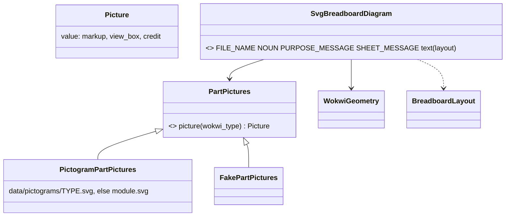

# P268 (#302): the breadboard as a picture in the sheet, with spark's own pictograms

> Beside `breadboard.json`, the build writes `breadboard.svg`: the same layout drawn by spark, each part as a plain
> pictogram of its Wokwi type at its holes, and each jumper as a line in its step's color with its step number. The
> sheet shows it inline, in VS Code and on GitHub. The pictures come from a swappable source, so pictures from
> online replace them later without other changes.

Step 2 of P269 (#304). It stands on step 1 (P270, PR #315): one more entry in `DRAWING_RENDERERS`. Council: two
rounds on 2026-10-16 (an architecture lens and a senior on Sonnet, the refuter and the tech lead on Opus, and the
PO-assistant), folded in below. This file moves that plan onto step 1's base.

## Context

The PO, 2026-10-16 (#302): "at least symbolic pictograms or pictures of the parts and modules we have", then "start
with a small version of svg and our custom modules/parts/boards pictures, just some basic ones for a start, then we
can upgrade it to pictures from online". In P269's discovery he said he wires from the picture (D4).

What slice 1 does not do: a part with no Wokwi drawing is not placed, so it is not on the picture. The XIAO
ESP32-C6 is the only board with its own pictogram. Any other placed type gets a labeled box.

Done when, for button-light on the XIAO C6: the build writes `breadboard.svg`; it holds four pictures (board, LED,
button, resistor), each with its id, and one numbered line per jumper in its step's color; the sheet shows it.

## Design

- `scripts/part_pictures.py`, its own module so the parts table and the drawer can use it later: `PartPictures`
  (strategy), `PictogramPartPictures` (reads `data/pictograms/<type>.svg`, else `module.svg`), `Picture` (value).
  It knows nothing of the breadboard or of sizes. `FakePartPictures` goes in `tests/fakes.py`.
- `data/wokwi-geometry.json` gains a cited `size` per type (wokwi-elements, wokwi-boards). The picture fills that
  box, and the turn stays about the measured `center`.
- `SvgBreadboardDiagram` (renderer, beside the Wokwi one), built with ElementTree so text is escaped. The root has
  the SVG namespace, `width`, `height` and `viewBox`, in Wokwi px. The breadboard comes first, with its holes as one
  path, then the rails' red and blue lines. Each part is a `<g transform="translate(left top) rotate(d cx cy)">`
  holding a scaled picture, a dot on each pin's hole and its id. The jumpers come last, each a line in its step's
  color with its number at the middle. Every number is rounded once.
- `DRAWING_RENDERERS` gains it. The sheet shows `` with its
  `SHEET_MESSAGE`, only when the drawings were written, and prints each non-empty credit.

## Steps

1. Five pictograms in `data/pictograms/`, by hand in plain shapes with a `viewBox` and no `id`, `<defs>`, `<style>`,
   `<use>`, `url(` or XML declaration: `board-xiao-esp32-c6.svg`, `wokwi-led.svg`, `wokwi-pushbutton.svg`,
   `wokwi-resistor.svg`, `module.svg`. Each about 1 KB, MIT.
2. `size` in the geometry file; `part_pictures.py`; `SvgBreadboardDiagram`; the table entry; the sheet line.
3. Docs: `--help`, the agents guide, the build page, the journey guide with the picture, the README's status and
   `tools/journey.py`, and Miro.

## Tests

- Every pictogram has a `viewBox` and none of the forbidden elements.
- The SVG parses, its root has the SVG namespace, it holds no `http` but the namespace, and it is under 30 KB.
- The same layout gives the same bytes, and the bytes are pinned by sha256 like the Wokwi file.
- Each part appears once with its id; an unknown type gets `module.svg`; a fake pictures source changes only the
  pictures.
- Each jumper's line ends at its holes' centers, computed in the test from `data/wokwi-geometry.json`, in
  `StepColors().color(step)`, with its number.
- The sheet's image link resolves to the written file; with no drawing there is no image line; an old
  `breadboard.svg` is removed in every branch.

## Out of scope

Parts with no Wokwi drawing, pictures from online, a picture in the parts table, millimeters, any change to the
planner.
