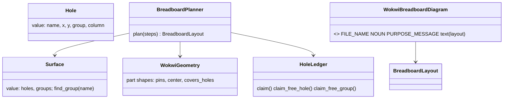

# P270 (#306): a small common base, breadboard only

> The drawn breadboard's code becomes the first member of one base for every stage. The layout holds millimeters,
> its holes form joined groups, and its parts and connections are plain values. Renderers sit in one table, so
> step 2's SVG is one more entry. `breadboard.json` stays byte for byte the same. No new output.

Council: a tech lead on Opus and an architecture and names lens on Sonnet, 2026-10-16. Their findings are folded in
at the end.

## Context

P269's discovery (PR #305, D7 and D8): step 1 is "a small common base, breadboard only", built as far as the
breadboard and the picture need. When the perfboard comes, rework is accepted. The PO's words: "please also create
some common base". The PR #303 review asked for the same seams (AT270): a parts catalog class, a table of drawings,
and one write loop.

Done when: the suite passes, and the XIAO fixture's `breadboard.json` keeps its sha256 (cf3f8e53…).

## Design

- `Surface` (value): the holes of a board and which are joined. A group is the holes joined inside the board: a row
  or a rail on a breadboard, one hole on a perfboard later. `netlist.py` says net only once something is wired.
  `Hole` gets an explicit `column`. The data key `rail_group` becomes `rail_block`, because it means the visual
  blocks of five rail holes, not joined holes.
- The candidate order is exact: each letter ranked by its distance from the gap, bottom side first, so float ties
  never decide a placement. A test pins the order f, e, g, d, h, c, i, b, j, a.
- `DRAWING_RENDERERS`, beside `WIRING_VIEWS`: renderer instances, each with `FILE_NAME`, `NOUN` and
  `PURPOSE_MESSAGE` and `text(layout)`. `write()` plans once and gives the layout or the reason to `sheet()`.
  `WriteResult(sheet, drawings, why)` holds every written path and the one reason a plan failed. `keep_breadboard`
  loops over the renderers in all three branches. Every kept line and sheet line stays byte for byte the same.
- Names by the roles table: the ledger's `free_hole` and `free_row` become `claim_free_hole` and
  `claim_free_group`, because they claim. `BreadboardLayout` and `Jumper` keep their names until the perfboard needs
  a change, and a bare `Connection` is avoided, because `BoardConnection` is the board's adapter.
- `docs/guide/developing.md` gets a Renderer row: a value in, text or lines out, named by what it draws.

## Steps

1. A sha256 test for the fixture's drawing (done).
2. The exact candidate order, with its test.
3. `Surface`, `Hole.group` and `Hole.column`, `rail_block`, the ledger's verb names.
4. `DRAWING_RENDERERS`, `WriteResult`, one plan per write, the `keep_breadboard` loop, with tests.
5. Docs: the Renderer row, the agents guide.

Each step keeps the suite green and is its own commit.

## Out of scope

The SVG (step 2), a layout file, any perfboard code, keying pictures by record id. Millimeters move to the
perfboard step, where they pay off: the tech lead found that float ties would reorder the holes, and an SVG draws
in px with a viewBox. A parts catalog class waits too, because step 2 does not need it.

## Verification

`python3 -m unittest tests.test_breadboard_layout tests.test_breadboard tests.test_check_spine`, the sha256 test,
the push hook, and a review sized to a logic refactor: a Sonnet lens, an Opus refuter, and the mutation tester's
table rerun on the moved code.

## Council, folded in

Tech lead (Opus): float ties in the hole order would move parts, so the order is exact and mm waits; the write loop
needs each view's noun and the reason, and `sheet()` planned twice; `rail_group` clashes with "group"; `Hole` needs
an explicit column; the catalog would drag heavy imports into the planner, so it waits. Architecture and names
(Sonnet): a Renderer role row; no base class for one renderer; no bare `Connection`; keep `BreadboardLayout` and
`Jumper`; verbs for functions that claim; `WriteResult` with a reason.
