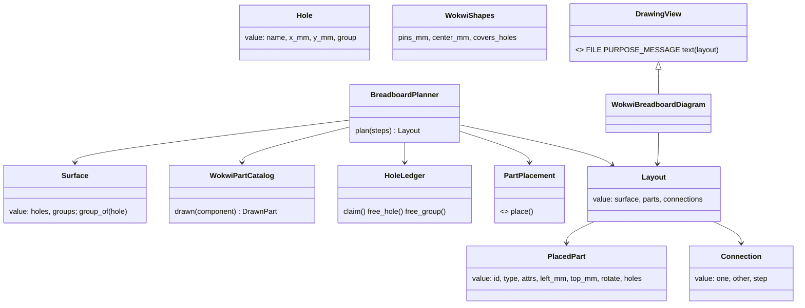

# P270 (#306): a small common base, breadboard only

> The drawn breadboard's code becomes the first member of one base for every stage. The layout holds millimeters,
> its holes form joined groups, and its parts and connections are plain values. Renderers sit in one table, so
> step 2's SVG is one more entry. `breadboard.json` stays byte for byte the same. No new output.

Council: a tech lead on Opus and an architecture and names lens on Sonnet, 2026-10-16. Their findings are folded in
at the end.

## Context

P269's discovery (PR #305, D7 and D8): step 1 is "a small common base, breadboard only", built as far as the
breadboard and the picture need. When the perfboard comes, rework is accepted. The PO's words: "please also create
some common base". The PR #303 review asked for the same seams (AT270): a parts catalog class, a table of drawings,
and one write loop.

Done when: the suite passes, and the XIAO fixture's `breadboard.json` keeps its sha256 (cf3f8e53…).

## Design

- Units: `data/wokwi-geometry.json` stays in Wokwi px, as measured. `WokwiGeometry.load` converts to mm once, with
  `MM_PER_PX = 25.4 / 96`. The Wokwi renderer converts back and rounds once. The tolerance becomes mm too.
- One word for one thing: a "group" is the holes joined inside the board. On a breadboard it is a row or a rail,
  and on a perfboard later it is a single hole. `Hole.row` becomes `Hole.group`, and the ledger's `free_row`
  becomes `free_group`. The sheet's words stay "row", because a person reads them.
- `Surface` (value): the holes and their groups, from the data file. `WokwiGeometry` keeps only the part shapes.
- `WokwiPartCatalog` moves from `breadboard.py`'s `_describe_parts` into `breadboard_drawing.py`. It asks the
  shapes through their own method, which raises `NotDrawn`.
- `DRAWING_VIEWS`, beside `WIRING_VIEWS`: renderer instances, each with `FILE`, `PURPOSE_MESSAGE` and `text(layout)`.
  `write()` plans once, writes each view, and removes each stale one. `Written.drawings` is a list of paths.
  `keep_breadboard` loops over it. `DRAWING_WHY` and `DRAWING_FILE` go.
- `Layout` replaces `BreadboardLayout`, and `Connection` replaces `Jumper`, because a perfboard wire is not a jumper.

## Steps

1. A sha256 test for the fixture's drawing, before any change: it pins the bytes.
2. mm in the geometry and back in the renderer.
3. `Surface`, `Hole.group`, `free_group`.
4. `WokwiPartCatalog`.
5. `Layout`, `Connection`, `DRAWING_VIEWS`, the write loop and `keep_breadboard`.
6. Docs: `docs/guide/developing.md` gets the Renderer role, and the agents guide names `DRAWING_VIEWS`.

Each step keeps the suite green and is its own commit.

## Out of scope

The SVG (step 2), a layout file, any perfboard code, keying pictures by record id.

## Verification

`python3 -m unittest tests.test_breadboard_layout tests.test_breadboard tests.test_check_spine`, the sha256 test,
the push hook, and a review sized to a logic refactor: a Sonnet lens, an Opus refuter, and the mutation tester's
table rerun on the moved code.
