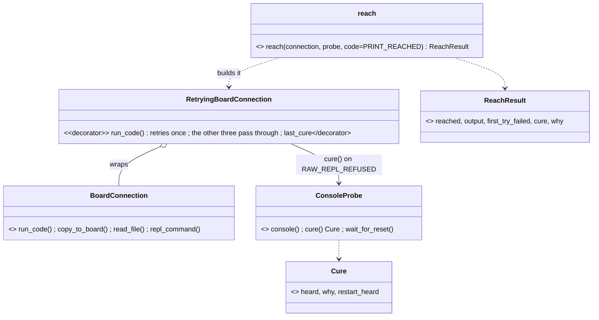

# P251 (#264): spark cures a board whose USB output died at power-on — the story plan

Short version: one probe method does the cure (a DTR/RTS-off port open, as the bench saw), a Decorator around
`BoardConnection` retries once after it, and `reach.py` is the PO's bench tool. The bench passes when 3 silent boots
are each cured and reached. Two council rounds changed this plan (rows below).

## Context

P235's reach test (AT186, AT187) found that after some power-on boots the XIAO C6's USB output stays dead: input
works, mpremote says "could not enter raw repl", and a port open with DTR and RTS off restarts the chip and cures it.
The PO chose "both" (D6): spark detects the silence, does the USB-side reset, says so, and retries once. The slice
plan (`docs/archive/2026-10-15-p235-slice0-plan.md`, #274) set the first shape. This plan replaces its P251 details (lines
68-69, 79-116): step 6 edits those lines to point here (council B6).

## The shape



```mermaid
sequenceDiagram
  participant R as reach.py
  participant F as reach()
  participant T as RetryingBoardConnection
  participant C as BoardConnection
  participant P as ConsoleProbe
  R->>F: reach(connection, probe)
  F->>T: run_code(PRINT_REACHED)
  T->>C: run_code
  C-->>T: BoardUnreachableError "...could not enter raw repl"
  T->>P: cure(): open with DTR/RTS off, read 2 s, wait up to PORT_BACK_S for the port
  P-->>T: Cure(heard, why, restart_heard)
  T->>C: run_code, once more
  T-->>F: output, or the error; last_cure kept
  F-->>R: ReachResult
```

Who owns what (council N6, N8):
- `ConsoleProbe.cure()` owns the platform part: the open with DTR and RTS off, the read, `restarted(heard)` (true
  when it holds `rst:`, beside `booted`), and the wait for the port to exist again (`PORT_BACK_S = 10`). It does not
  call `wait_for_reset`, because its own open causes the restart during the read (council R1, L1). A read that fails
  mid-restart gives `Cure(None, why, False)`, and the retry still runs (council R2).
- `RetryingBoardConnection` owns the policy only: retry once when the error holds `RAW_REPL_REFUSED` (a new constant
  in `board_connection.py`, "could not enter raw repl", matched as a substring, council R7, N8). A timeout, a missing
  or busy port and `BoardCodeError` pass through at once. It has no platform strings. `copy_to_board`, `read_file`
  and `repl_command` pass through in three one-line methods, so it is a true drop-in (council N5).
- `reach(connection, probe, code=PRINT_REACHED)` builds the Decorator, runs the code, and returns `ReachResult`. A
  second failure names both causes: a silent console, or firmware that does not read its console (D11). `code=` is
  for P247 (`reach.py --code`).
- `PRINT_REACHED` is one fixed line that prints `reached` (council B4, N3). No uptime: the `rst:` text is the evidence.
- No deploy change now. Deploy can call `cure()` later.

## Steps, each its own commit on branch `p251-reach`

1. Move and rename: `DownloadModeProbe` → `ConsoleProbe`, with `SystemClock`, into new `scripts/board_console.py`
   (council N7). `download_mode.py` keeps `DOWNLOAD_MODE`, `PRESS_RESET`, `NO_RESET`, `READ_AGAIN`, `booted`.
   Callers updated: `scripts/deploy.py`, `tests/test_download_mode.py`, `tests/test_deploy_gate.py`, and the mutation
   file `tests/mutations/p243-download-mode.json`. `FakeDownloadModeProbe` → `FakeConsoleProbe`, its text field
   renamed `printed` (council N1). No re-export. Tests green.
2. `PortFinder.require_one_port(script)` in `scripts/board_look.py` (council N4): the rule of `Look.only_port`, which
   then calls it with "look.py". New tests for 0 and 2 boards, and the message text unchanged (council B8).
3. Tests first, `tests/test_board_reach.py` and `tests/test_board_console.py`:
   - reached at once (no cure);
   - the full line `mpremote.transport.TransportError: could not enter raw repl`, then cured (first_try_failed,
     reached, cure kept);
   - the cure's read failed, the retry reaches (the read error kept);
   - silent twice (not reached, why names both causes);
   - the port does not come back in `PORT_BACK_S`: not reached, why says so;
   - "no answer in 20 s", a missing port, and `BoardCodeError` are not retried;
   - no probe (`for_tool` gave None): no retry, why says so;
   - the three pass-through methods reach the wrapped connection;
   - `ConsoleProbe.cure()` with a fake run and FakeClock: `rst:` heard, read failed, port never back.
   `FakeConsoleProbe` gains `cure()` that calls `on_cure` and returns a given `Cure`.
4. `scripts/board_reach.py` and `ConsoleProbe.cure()`, `restarted()`, `Cure`, `RAW_REPL_REFUSED`, `PORT_BACK_S`.
5. `scripts/reach.py` (CLI; `main()` parses and prints): `--project` (default `.`), `--port`, `--json`. Port: given or
   `PortFinder.require_one_port("reach.py")`. mpremote via `tools.find("board-shell", project)` and
   `image_check.runnable`; probe via `ConsoleProbe.for_tool`. Prints what happened and "the firmware is stopped:
   press R or replug to run it". Exit 0 reached (`outcomes.EXIT_OK`), 2 not reached (`EXIT_COULD_NOT_RUN`). `--help`
   says it is the PO's bench tool for P251. Tests: `--json` keys, exit codes, two boards without `--port`.
6. Docs: the Decorator, Fake and Value-with-role rows in developing.md's table (P255, D8); the slice plan's P251
   lines point here (B6); rows in `docs/observations/INDEX.md` for L1-L10, R1-R8, B1-B8, N1-N8, with the council
   reports beside them.
7. After the story: a small refactor if one makes the code simpler, or a line in the PR that says why none.

Cut by the council (B2, B3, B5): the download-mode branch in the retry, the `console()` method on the fake, the
separate `console` and `restart_heard` fields of `ReachResult`. Not in this story: agents.md (P247), the README
journey table (status does not change), deploy's flow.

## The bench protocol (the PO's hands, on the branch)

Project `~/Development/button-light` on the XIAO C6, plugged straight into the Mac.

- Warm arm (D22): unplug, plug in, wait 10 s, run `python3 <spark>/scripts/reach.py --project . --json`, append the
  line to the log. At most 30 replugs.
- A silent boot is a first try that failed. It is cured when the retry reached (council B1). `restart_heard` is a log
  column, the evidence for the rival "a plain delay cured it" (H3). Earlier bare retries on a silent board failed
  (reach-test.md, 08:25 and 08:47).
- PASS: at least 3 silent boots, each cured, and every other replug reached (D22). FAIL: a silent boot not reached
  after the retry. INCONCLUSIVE: 30 replugs with fewer than 3 silent boots; the story stays in Build and the PO
  decides (council L4).
- Cold arm (the issue asks for it; the rival "the cure needs mpremote's DTR-True open first"): 5 replugs, then only
  `ConsoleProbe(...).cure()` through `python3 -c`, no mpremote first. It settles the rival only if `rst:0x15` is heard
  5 of 5. It cannot pass or fail the story (council R5, B7).
- Log: `docs/observations/2026-10-15-p251-bench.md` with the JSON lines and the counts per arm; rows in INDEX.md.

## Naming check

One word per thing: a connection runs code, the console is what the board prints, a probe reads the console, a cure
is the probe's DTR/RTS-off open and a `Cure` is its evidence, a reach is one try of fixed code. Roles per
developing.md's table: `RetryingBoardConnection` (Decorator), `ConsoleProbe` (Adapter), `Cure` (Value),
`ReachResult` (Result), `FakeConsoleProbe` (Fake). Verbs for actions: `cure`, `restarted`, `require_one_port`,
`reach`. Constants say what they hold: `PRINT_REACHED`, `RAW_REPL_REFUSED`, `PORT_BACK_S`. Module names say their
job: `board_console.py` reads the console, `download_mode.py` holds the ROM's download-mode words. No base class (D7).

## Round 3 changes (problems and gaps, Opus, G1-G8), these override the text above where they differ

- G4: `RetryingBoardConnection` lives in `board_connection.py` (the probe is injected), so deploy and P253 never
  import a CLI-side module. Its `run_code` takes and passes on `keep_running_for`. `board_reach.py` holds only
  `reach()` and `ReachResult`. `reached` means `run_code` returned, never "the output holds `reached`".
- G3: `cure()` waits until the port exists (at most `PORT_BACK_S`), not for it to go and come back. The Decorator
  always retries once after a cure. The "port does not come back" branch and its test are cut. A second failure's
  `why` names the cure's `why` and the retry's error.
- G2: `download_mode.py` stays a leaf and keeps `DOWNLOAD_MODE`, `RESET_WAIT_S`, `PRESS_RESET`, `NO_RESET`,
  `READ_AGAIN`, `booted`. `board_console.py` gets `READ_S`, `POLL_S`, `UNREAD`, `READ_CONSOLE`, `PORT_BACK_S`,
  `SystemClock`, `ConsoleProbe`, `Cure`, `restarted`, and imports from `download_mode`, never the reverse. The
  `READ_CONSOLE` exec test moves to `tests/test_board_console.py`. The 7 rows of `p243-download-mode.json` point at
  `board_console.py`, and its 3 rows already refused on main are fixed in the same commit.
- G5: a silent boot is `cure is not None`. Other first failures (a timeout, no port) are their own column and do not
  count. `--json` writes `Cure` as a nested object (`_asdict()`) and adds `at`, the time of the line.
- G6: the cold arm runs `reach.py --cure-first` (cure, then one `run_code`, the same JSON), tested. It replaces the
  `python3 -c` line, which could not find `scripts/` or pyserial's Python. It settles the rival only if every cold
  run hears `rst:` and reaches.
- G7: both cures in the reach test were followed by `resume exec`; `run_code` soft-resets first. The bench log names
  this difference.
- G8: three more tests: the retry fails with another error (why names both); `cure()`'s read times out
  (`Cure(None, why, False)`); a `BoardCodeError` on the retry passes through with the cure kept. Plus a test that
  `keep_running_for` reaches the wrapped connection.
- G1: step 6 adds one line to `docs/guide/developing.md` naming `reach.py` and its flags (`--project`, `--port`,
  `--json`, `--cure-first`), so `tests/test_orphans.py` passes and `tools/check_docs.py` sees each flag in `--help`.

## Plan council (done)

Round 1 on the first version: a Sonnet lens (L1-L10) and an Opus refuter (R1-R8). Round 2 on the fixed version: a
Sonnet bloat check (B1-B8) and an Opus naming and architecture lens (N1-N8). Where they disagreed, the plan took
B3 (no download-mode branch, least code) over N6's stop, and kept `output` in `ReachResult` against B5 because
P247's `--code` needs it. Round 3 (the PO's standing rule: one extra problems-and-gaps round after the fixes): an
Opus reviewer, G1-G8, applied above. Every G, L, R, B and N row goes into INDEX.md in step 6.

## Verification

- `python3 -m unittest discover -s tests` green after each step; the push hook's own output quoted.
- On the PR: the mutation tester (Opus) on `board_reach.py` and `cure()`, a Sonnet lens, an Opus refuter.
- At the bench: the PASS line from the bench log. The PR stays a draft until the bench says PASS.
