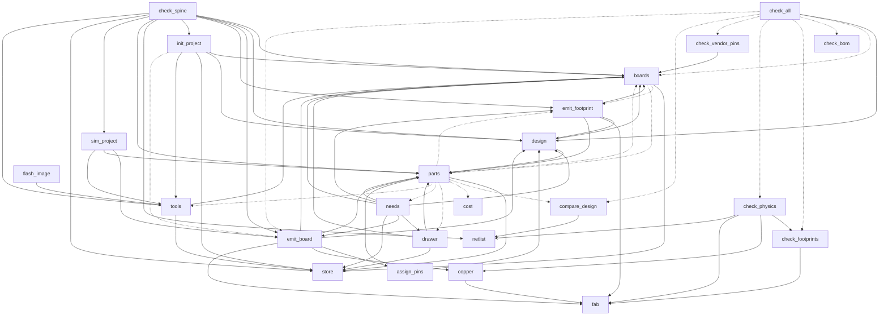

# P158 part 2 — 00 · The system as it is

Written 2026-10-10 by the grounding engineer, against spark 0.8.1 at main `5acbe42` (E `git log -1` → `5acbe42 2026-10-10 22:26:37 +0200 Merge pull request #129`). This is a map of the code, the flow, the tests and the docs mechanism as they are, for the architects who write part 2's design and plan. It proposes nothing; where the evidence leaves a decision to the PO, the section says so.

**Code identical to what part 1 read.** Part 1 cites main `4a18333`. E `git diff --stat 4a18333 HEAD -- scripts tests tools data boards parts commands skills agents .claude-plugin .mcp.json` printed nothing (my run): the four commits between them (P180 and its merge) touch only `docs/` and `scrum/`. Every pointer into code below is therefore also valid for part 1's citations.

**Tags.** E a pointer (file:line at `5acbe42`, a command and what it printed, a card), H a claim with its source, D a decision (who, when), — unknown. **Measures.** *raw lines* is `wc -l`. *code lines* is `code_lines()` of `tools/check_commit.py:58-74` — the measure W15 uses: docstrings, comments and blank lines excluded. *Tests* are counted as `def test_` lines; the run reports the same number (1,713 = 1,713). *Edges* of the dependency graph come from the `ast` of each script (an import anywhere in the file; "top-level" or "function-local"). *Anchors* are rows of `tests/mutations/*.json`. Every count below comes from a command I ran in this session; the scratch folder is `<scratch>`.

**A number in the brief that differs from what I measured.** The brief gives 11,487 raw lines and `check_vendor_pins.py` 189. E `git show a8aa34d:scripts/check_vendor_pins.py | wc -l` → 189 and the sum of `scripts/*.py` at `a8aa34d` → 11,487; at `4a18333` and at `5acbe42` the sum is 11,578 and the file is 280 lines. The brief's numbers are those of `a8aa34d`; between it and `4a18333` the only change under `scripts/` is P179's (#125), 91 raw lines in that one file (E `git diff --stat a8aa34d 4a18333 -- scripts`, the sums above). All other numbers in the brief reproduce: 6,973 raw lines at `06e8ca0` (the last commit before 2026-10-01 00:00 +0200; E my sum), and every per-script count except `check_vendor_pins.py`. One more differs: the brief says 40 test files; I count 36 `test_*.py` and the helper `suite_temp.py` (E `ls tests`); `tests/` also holds `data/` and `mutations/` (116 tables).

**What I ran, and where.** A copy of the repository at `5acbe42` (without `node_modules` and `.worktrees`) in `<scratch>/repo`, with `SPARK_HOME`, `HOME` and `TMPDIR` each pointed at an empty folder of `<scratch>` on every command, as three separate words. The PO's real store was not opened, copied or touched. Nothing was written under `~/Development/spark` except this file and the interpreter's gitignored `__pycache__` files, which the few imports I made from the live tree (`parts`, `tools/check_commit`) refreshed; E `git status --short` shows only the two untracked discovery folders. One early `import parts`, to count `OPERATIONS`, ran before I had set the three variables; importing it computes paths and reads no store (`store.home()` is called only inside functions).

## Modules

25 scripts, 11,578 raw lines, 6,546 code lines, 504 `def`s (E my `ast` pass, 2026-10-10). 16 have a `main()` and are command-line programs; 9 are libraries only (`copper`, `design`, `drawer`, `fab`, `needs`, `netlist`, `outcomes`, `sim_project`, `store`). `outcomes` is imported at top level by 16 scripts (listed under the table).

Imports are the scripts' own, from `scripts/` only. "lazy" = inside a function body; a lazy import is how a cycle is kept out of import time (E `boards.py:239` — "here, not at the top: it imports this module"). `○` = also imports `outcomes` at top level.

| script | raw / code | role | purpose (docstring and `main`) | imports at top level | imports lazily |
| --- | --- | --- | --- | --- | --- |
| `assign_pins.py` | 479 / 238 | CLI + lib | Which pin each signal goes on, and why: most-constrained signal first, each on the least capable pin that can do the job; refuses an impossible set naming the signal and the pins that could have served; `--emit-pins` writes the firmware's pin map | design, parts ○ | — |
| `boards.py` | 544 / 301 | CLI + lib | Which board a project is built around: finds it (`boards/active.json`, the project's `boards/` over spark's library), validates every board file against a contract of facts (closed role vocabulary, forbidden decision keys), `--resolve` writes `.spark/board.json`; also owns the upward project walk and `PLUGIN_ROOT` | store ○ | emit_footprint, parts |
| `check_all.py` | 479 / 241 | CLI | Every deterministic check in one call: finds the inputs of `--project` by convention, runs the five checks, answers once with `ok / problems / could-not-run` and the fourth word `skipped` | design ○ | boards, check_bom, check_footprints, check_physics, check_vendor_pins, compare_design, emit_board |
| `check_bom.py` | 185 / 82 | CLI + lib | Whether the fab package's `bom.csv` orders what the schematic specifies (one part number for two values; footprint mismatch; missing supplier part; fatal-at-fab design warnings) | ○ | — |
| `check_footprints.py` | 570 / 310 | CLI + lib | Buildability: drill against the pin that goes in it, annular ring, vias, package against value, two swappable connectors; advisories under the board house's recommendation | fab ○ | — |
| `check_physics.py` | 570 / 323 | CLI + lib | Arithmetic against the world: IPC-2221 trace current, capacitor derating, resistor dissipation, I²C rise time, rail supply; an unstated number is reported, never assumed | check_footprints, copper, fab, netlist ○ | — |
| `check_spine.py` | 691 / 323 | CLI | The chain end to end in a temp folder — board, parts, schematic, footprint, build, simulation — and the stage that stopped it; a pass is copper counted, not an absent exception | boards, design, emit_board, emit_footprint, init_project, netlist, parts, sim_project, store, tools ○ | — |
| `check_vendor_pins.py` | 280 / 146 | CLI + lib | Board file against the vendor's own `pins_arduino.h` (fetched with `gh`, or `--offline` from the cache); keeps the fetched header in the owning project's `.spark/cache/` | boards ○ | — |
| `compare_design.py` | 289 / 159 | CLI + lib | Written rules (`i2c_buses`, `must_not_float`) against the netlist that was built | netlist ○ | — |
| `copper.py` | 122 / 21 | lib | IPC-2221 width ↔ current arithmetic, once, for the checker and the generator | fab | — |
| `cost.py` | 302 / 181 | CLI + lib | What a project's run cost, counted from Claude Code session transcripts (tool names and counts only); as a CLI, one transcript | ○ | — |
| `design.py` | 347 / 159 | lib | The one loader of a design: requirements file → project, board, part instances, signals, rules; every bad input a `DesignError` sentence | boards, parts | — |
| `drawer.py` | 384 / 262 | lib | What the person owns: entries keyed by plain keys, linked to a record only by exact part number, written by *setting* (dry run first); importers' payloads | boards, parts, store | — |
| `emit_board.py` | 1152 / 592 | CLI + lib | Requirements + pin map → tscircuit `board.tsx` on stdout, notes on stderr; refuses (exit 2) a part with no footprint, pin order, outline, or a name written twice rather than guess | assign_pins, boards, copper, design, fab, parts ○ | — |
| `emit_footprint.py` | 243 / 124 | CLI + lib | Board definition → the footprint module the generated board imports, from measured geometry; the hole is sized from the pin, never from the vendor's drawing | boards, design, fab, parts ○ | — |
| `fab.py` | 57 / 11 | lib | Reads `data/fabrication.json` at import: `process()` (what a board house makes; the project's `.spark/rules.json` `fabrication` may override) and `part()` (what a component is) | — | — |
| `flash_image.py` | 113 / 72 | CLI | MicroPython interpreter + the project's files → one 4 MB littlefs flash image for the headless simulator | tools ○ | — |
| `init_project.py` | 508 / 264 | CLI + lib | Writes `.spark/rules.json`, `.spark/project.json`, `boards/active.json`, `package.json` with every unknown `null`; puts the project on the store's projects list | boards, design, store, tools ○ | emit_board |
| `needs.py` | 632 / 400 | lib | A project's needs (`.spark/needs.json`), their candidates in the store, picks and holds, and the content of `requirements.json` they imply | boards, design, drawer, emit_board, emit_footprint, parts, store | — |
| `netlist.py` | 138 / 57 | lib | One walk over a built netlist: connectivity from `source_trace`, a trace naming no net is a net of its own | — | — |
| `outcomes.py` | 99 / 27 | lib | `ok / problems / could-not-run`, their exit codes, `status_of`, `answer`, `envelope`, `step`, `page` | — | — |
| `parts.py` | 2214 / 1477 | CLI + lib | The part-record contract (`validate`, `owes`, `digest`, shelf, documents) **and** 28 command-line operations — list, show, validate, need, skeleton, sources, fetch, keep, read, kept, promote, catalog, drawer(-set, -import), function-set, fact-set, audit, needs(-set), match, pick, requirements, step, tally, describe, signals, unverified — in one file | store ○ | boards, compare_design, cost, drawer, emit_footprint, needs, tools |
| `sim_project.py` | 179 / 111 | lib | The simulation project a design implies: a Wokwi mapping per component from the part records, chips staged and compiled, `wokwi.toml`, the "what this cannot show" note | emit_board, parts, tools | — |
| `store.py` | 405 / 221 | lib | Where spark keeps what it keeps and how bytes get there: the home, the places, the layers, atomic writes, the lock, the projects list, the history, the one network door, the checked keep | — | — |
| `tools.py` | 596 / 444 | CLI + lib | The tools spark depends on, from one merged list (`data/tools.json`, the person's, the project's): find, status, install, on/off, use, pin, new | boards, store ○ | — |

The 16 `○` are `assign_pins, boards, check_all, check_bom, check_footprints, check_physics, check_spine, check_vendor_pins, compare_design, cost, emit_board, emit_footprint, flash_image, init_project, parts, tools` (E `ast` pass). `tools/check_commit.py` and `tools/mutate.py` also import `outcomes` (E `tools/check_commit.py:28`, `tools/mutate.py:56`).

**Size facts.** `parts.py` is 22.6 % of the code lines (1,477 / 6,546) and has 120 `def`s (E my `ast` pass; part 1's grep counted 115 column-0 `def` lines, `council/tech-lead.md` TECH-LEAD-5, and the difference is nested `def`s). It holds, in order: the contract (`:72-794`), shelf and digests (`:895-965`), documents (`:985-1283`), the matcher's first copy, `OPERATIONS` (`:1472-1529`), `OPTIONS` and the parser (`:1531-1569`), 28 `_op_*` handlers (`:1571-2159`) and `main` (`:2188`) dispatching with `globals()["_op_" + op.replace("-", "_")]` (`:2201`). Of the 28 operations, 15 declare no effect, 11 `writes`, `sources` `network`, `fetch` `network` + `writes` (E `parts.OPERATIONS` printed by a run: `{(): 15, ('writes',): 11, ('network',): 1, ('network', 'writes'): 1}`).

**Where the code lines went since 2026-09-30.** E `scripts_size()` of `tools/check_commit.py` at `16d326a` (the commit that recorded the verdict) and at `5acbe42`: 18 scripts / 3,552 code lines → 25 scripts / 6,546 (+2,994, +84.3 %). Seven scripts are new — `cost` 181, `drawer` 262, `fab` 11, `needs` 400, `netlist` 57, `store` 221, `tools` 444 — 1,576 code lines (52.6 % of the growth). The 18 old ones grew by 1,418: `parts` +856, `emit_board` +153, `init_project` +97, `check_spine` +51, `design` +39, `boards` +38, `check_vendor_pins` +37, the rest less (E the same pass).

### Where the nine "other" catalogue rows sit in the code

Part 1's diagnosis stage ran per area; nine of the catalogue's 74 rows are area `other` and no diagnostician analysed them (E `catalogue.md:155`, 20 + 14 + 11 + 10 + 9 + 7 + 3 = 74). This table gives each row's place in the code, verified by me; it places no row in the plan.

| row | what it is, one line | where it sits | verified |
| --- | --- | --- | --- |
| K21 | the cost line is unreachable outside a Claude Code session; the tally's window never closes | `cost.py:67-86` (`session_id`, `session_note`, `step_event`), `parts.py:2129-2156` (`_op_tally`) | E read; `--tally` outside a session exits 2 by design (D the PO 2026-10-08, #94, quoted in `proposal.md` §4) |
| K43 | no verb for ways in beyond goal-first (extend, swap, module-first, revive) | absent: `parts.py:1472` `OPERATIONS` has no such operation; #5 (P76) | E `OPERATIONS` printed above |
| K53 | `mutate.py` scores a mutant "caught" when the file no longer imports | `tools/mutate.py:62-87` (`suite_is_green` — the verdict is "suite not green", with no separate import check) | E read; the full sweep was not run (see Could not check) |
| K55 | `parts.py --json` carries less than its text (CONFLICT lines, `--unverified`) | `parts.py:233` (`Answer`), `:2171-2186` (`_say`), `_op_show` | E `_say` read; `docs/guide/agents.md:263-266` documents both gaps |
| K56 | text-mode refusals lose the `fix` | `parts.py:2182` (`if not answer.lines:` is the only branch that prints a problem's `fix`) | E read |
| K57 | `--describe` under-declares; `tools.py` has no `--json` | `parts.py:2159-2169` (`_op_describe`), `tools.py:515-596` (no `--json` argument) | E `grep -n -- --json tools.py` → nothing |
| K62 | the transcript reader cuts on `str.splitlines()` | `cost.py:110` | E read |
| K64 | `parts.py` is 2,214 lines behind a string dispatch; function-local imports; the lock held across `--fetch` | `parts.py:2200-2201`; 22 function-local sibling imports in `parts.py` (3 boards, 8 drawer, 1 emit_footprint, 6 needs, 1 tools, 2 cost, 1 compare_design — E my grep) | E |
| K65 | `verified` means four things; a record links 5 of 12 forms | `parts.py:1354-1375` (`skeleton`: `verified` and `source`, no `origin`), #17, #85 (P151) | E read of `skeleton`; the 5-of-12 count is H (#17 comment 2026-10-06) |

## Dependency graph

88 edges between the 25 scripts: 71 at top level, 17 function-local (E my `ast` pass). `outcomes` (16 importers) is left out of the picture; solid arrows are top-level imports, dashed arrows are function-local.



What the graph says (E `ast` pass unless marked):

- **No top-level cycle exists; with function-local imports there is one component of nine.** `assign_pins, boards, design, drawer, emit_board, emit_footprint, needs, parts, tools` can all reach each other, and only the 17 function-local imports keep the cycle out of import time. The pairs the comments name: `boards ↔ emit_footprint` (`boards.py:239`), `boards ↔ parts` (`boards.py:240`, `parts.py` 3 lazy `import boards`), `parts ↔ drawer`, `parts ↔ needs` (`needs.py:15-21` import `parts` at top; `parts.py` imports `needs` 6 times inside functions).
- **Fan-in:** `outcomes` 16, `boards` 11, `parts` 9, `design` 7, `store` 7, `emit_board` 5, `fab` 5, `tools` 5. **Fan-out:** `check_spine` 11, `check_all` 9, `parts` 9, `emit_board` 7, `needs` 7, `init_project` 6.
- **The library layer is already visible:** `fab`, `netlist`, `outcomes`, `store` import no sibling; `copper` imports only `fab`.
- **`needs.py` imports two generators** (`emit_board`, `emit_footprint`; `needs.py:18-19`), and `sim_project.py` imports `emit_board` — a library of the store imports the board generator.
- **The scripts are not a package.** Each is run as `python3 scripts/<name>.py` and finds its siblings because `scripts/` is `sys.path[0]`; 9 insert it themselves (`assign_pins, check_all, check_physics, check_spine, design, emit_board, emit_footprint, init_project, tools`; E `grep -n "sys.path.insert" scripts/*.py`), the other 12 scripts that import a sibling (`boards`, `check_bom`, `check_footprints`, `check_vendor_pins`, `compare_design`, `copper`, `cost`, `drawer`, `flash_image`, `needs`, `parts`, `sim_project`) rely on `scripts/` already being on the path — as `sys.path[0]` when run, or because the importer inserted it.
- **Edges that are not imports** (processes): `check_spine → emit_board.py` (`subprocess`, `check_spine.py:358-361`, stdout is the board file, stderr the notes), `→ tsci build` (`:399`), `→ converter` (`:476`, with `SPARK_BOARD_JSON` in the environment, `:481`), `→ wokwi-cli chip compile` through `sim_project.stage_chips`; `check_vendor_pins → gh api` (`check_vendor_pins.py:66-68`); `tools → npm / pip / brew`, `curl -fsSL -o <file>.part <url>` for a download (`tools.py:370`) and `claude mcp add` (`:360`); `parts.read → pdftotext` through `tools.find("pdf-text")`. `check_spine` therefore reaches `emit_board` twice: as a module (`emit_board.supply_inputs`, `emit_board.loads_across_a_pair`, `emit_board.GROUND_NETS`) and as a process.

## Shared state

### Process-wide: environment, globals, import-time effects

| what | where | read or written by | note |
| --- | --- | --- | --- |
| `SPARK_HOME`, else `XDG_DATA_HOME`, else `HOME` | `store.py:46-52` (`home()`, every call) | every store access | a set but empty `SPARK_HOME` falls through (`if os.environ.get("SPARK_HOME"):`); part 1 K1/K2 |
| `store.place("tools")`, `store.place("downloads")` at import | `tools.py:47-48` (`PERSONAL`, `DOWNLOADS`) | `tools`, and so everything that imports it | the one module that reads the home at import; tests patch the constants (`tools.PERSONAL` ×3, `tools.DOWNLOADS` ×1 patch sites) |
| `"unittest" in sys.modules` | `store.py:40-43`, `:337` | `store` import | under unittest, `SPARK_HOME` and `CLAUDE_CODE_SESSION_ID` are **overwritten** in `os.environ` and `file:` URLs are allowed; "no script imports unittest — `tests/test_store.py` proves it" (`store.py:38`) |
| `CLAUDE_CODE_SESSION_ID` | `cost.py:69`, `:77` | `--step` (records it), `--tally` | set to `spark-suite` by the guard under unittest |
| `HOME` for the transcripts | `cost.py:96` (`Path.home() / ".claude" / "projects"`) | `--tally` | a second use of `HOME`, besides `store.home()`'s fallback |
| `SPARK_BOARD_JSON` | `check_spine.py:481` (set), `tools/circuit-to-wokwi/lib/board.ts` (read at import; throws if unset) | spine → converter | the whole board definition travels as a file path in an environment variable |
| `tempfile.gettempdir()` | lock `spark-<16 hex>.lock` (`store.py:178-200`), spine work folder `spark-spine-*` (`check_spine.py:600`) | `store.locked()`, `check_spine` | the lock lives in the temp folder, named from the home's hash, not in the store |
| `sys.path.insert(0, scripts/)` | 9 scripts | import time | see the graph section |
| files read at import | `fab.py:31-33` (`data/fabrication.json`), `init_project.py:356` (`tools._read(tools.DEFAULTS)["tscircuit"]` → `data/tools.json`) | `fab` and every importer; `init_project` and `check_spine` | `check_spine` imports `init_project`, so an unreadable `data/tools.json` would fail at the spine's import (read, not run) |
| numbers fixed at import from `fab.process(name)` with no rules | `copper.py:40` `COPPER_THICKNESS_MM`, `:53` `MIN_TRACE_WIDTH_MM`; `emit_board.py:114-116` `VIA_HOLE_MM`, `VIA_PAD_MM`, `BOARD_THICKNESS_MM`; `emit_footprint.py:59` `PLATING_THICKNESS_MM` | `check_physics`, `emit_board`, `emit_footprint` | a project's `fabrication` override reaches `check_footprints` and `emit_footprint`'s drill but not these; E my run: `fab.process("copper_thickness_mm", rules)` → 0.07 and `copper.COPPER_THICKNESS_MM` → 0.035 for the same rules; `init_project.py:192-198` promises the override "moves both the check and the generator" |
| the network | `store.fetch` (`store.py:345`, urllib, http/https only, "spark's one door"); **and** `gh api` (`check_vendor_pins.py:66`); `curl` (`tools.py:370`), `npm`, `pip`, `brew`, `claude mcp add` (`tools.install`); `wokwi-cli`, `tsci`, `node`/`bun` | | `store.py:348` says "Nothing else in spark's code opens a URL" — true of Python's `urllib`; `check_vendor_pins` (`gh`) and `tools.install` (`curl`) open URLs through other programs |
| git | `store.inside_git` (walks up for `.git`), `tools/check_commit.py` | the store's door refuses private places inside a work tree (`store.py:209-219`) | |

### The plugin's folder: derived seven ways, written into on three paths

The plugin folder is computed from `__file__` in seven places and aliased in one more (E `grep -nE "parent\.parent|SCRIPTS\.parent" scripts/*.py`):

| place | name | used for |
| --- | --- | --- |
| `boards.py:38` | `LIBRARY` (`…/boards`) | board layer of `store.records` |
| `boards.py:153` | `PLUGIN_ROOT` | `project_or_library`, `design.is_library`, `check_vendor_pins` |
| `parts.py:45` | `LIBRARY` (`…/parts`) | part layer; `promote`'s target |
| `store.py:33` | `PLUGIN` | **read by nothing** (E `grep -rn "store.PLUGIN\|\bPLUGIN\b"` over scripts, tests, tools → the definition only) |
| `tools.py:43` | `PLUGIN` (`SCRIPTS.parent`) | `data/tools.json`, bundled tools (`:166`) |
| `fab.py:27` | `FILE` (`…/data/fabrication.json`) | process numbers |
| `check_spine.py:330` | `project = project or SCRIPTS.parent` | the reference design's project |
| `check_vendor_pins.py:108` | `PLUGIN_ROOT = boards.PLUGIN_ROOT` | an alias since P179 (#125), which removed its own definition |

Test seams on these names: 15 `patch.object` sites on `parts.LIBRARY` (4), `tools.PERSONAL` (3), `tools.DEFAULTS` (2), `check_vendor_pins.PLUGIN_ROOT` (2), `boards.LIBRARY` (2), `tools.PLUGIN` (1), `tools.DOWNLOADS` (1), across 7 test files (E `grep` over `tests/*.py`).

"Which project owns this file" is answered by `boards.project_root` (`boards.py:135-147`: the nearest directory up holding `boards/active.json` or `.spark/`) and by three other rules:

| rule | where | answers |
| --- | --- | --- |
| `boards.project_root(start)` / `project_or_library(start)` | `boards.py:135`, `:156` | used by `design.project_for`, `check_vendor_pins.project_header` (since P179), `emit_footprint.main` |
| `circuit.parent.parent.parent / ".spark/rules.json"` (count three folders up from `dist/board/circuit.json`) | `check_physics.py:540`, `compare_design.py:281` | the default rules file |
| `project or SCRIPTS.parent` | `check_spine.py:330` | the reference design's project |
| `Path(args.project).resolve()` if given, else `project_root()` for `--resolve` (never the plugin), `project_or_library()` otherwise | `boards.py:512` | the one place the rule "a command that writes never falls back to the plugin" is spelled (`boards.py:150-152`) |

The plugin folder holds `.spark/` (two tracked vendor headers: `XIAO_ESP32C6.pins_arduino.h`, `dfrobot_firebeetle2_esp32s3.pins_arduino.h`; E `git ls-files .spark`), so `boards.project_root` called from anywhere inside the plugin returns the plugin as a "project". Paths that write into the plugin folder today:

1. `check_vendor_pins.py:178-198` (`keep_live_header`) when the board file's owning project is the plugin — by design since P179: "For a board spark ships, that project is spark itself, so a live run refreshes the shipped header" (`check_vendor_pins.py:27-31`).
2. `parts.py:1285-1305` (`promote`, project → library): `shutil.copy2` / `copytree` into `LIBRARY` (`parts.py:45`).
3. `sim_project.py:162` (`stage_chips`): `shutil.copy2(target / binary.name, binary)` writes the compiled `.wasm` beside the record, which for a library part is `parts/<id>/chip/` inside the plugin; the binaries are tracked (E `git ls-files parts` lists `l9110s.chip.wasm`, `vl6180x.chip.wasm`). Part 1's CH-4 names paths 2 and 3 (`proposal.md` §2.3).

### The store: `<home>/…`

| place | holds | private (0600 / 0700, refused inside git) | written by |
| --- | --- | --- | --- |
| `sources/<sha256>/<name>` | kept documents | no (`PRIVATE`, `store.py:96`, omits it) | `store.keep` (via `parts.keep_in_store`, `--fetch`, `--keep`) |
| `catalog/<id>.json` | researched, not chosen | no | **no script**: the `parts-researcher` agent writes it with the Write tool at the literal path `~/.local/share/spark/catalog/<id>.json` (`agents/parts-researcher.md:57-58`, `commands/research.md:104-105`), so it ignores `SPARK_HOME` and the door; scripts only read it (`parts.py:876-897`) and `promote` copies out of it |
| `downloads/` | tool downloads | no | `tools.settle_download` (`tools.py:421-433`) |
| `tools.json` | the person's tools list | no | `tools.choose` (`tools.py:436-445`, a plain `write_text`) |
| `drawer/<key>.json`, `drawer-import/` | what the person owns | yes | `drawer.apply` through `store.write_json` (`drawer.py:273`) |
| `shelf/<id>.json` | records chosen before | yes | `parts.shelve`, `_refresh_shelf_copy` |
| `projects.json` | name → folder | yes | `store.add_project` — called by `init_project.py:417`, `parts.py:2003` (`--pick`, a real run), `:2118` (`--step`); `--needs-set` does not list the project |
| `history.jsonl` | `step`, `reused`, `passed_over`, `built` events | yes | `store.append_event` (`store.py:314`), idempotent by `EVENT_KEYS` |

`store.write_file` and `write_json` write a `.part` and rename it, and write nothing when the bytes are equal (`store.py:138-160`); `write_json`, `copy_folder` and `append_event` also check the key and refuse a private place inside a git work tree (`:202-219`; `copy_folder` is `copytree`, and `append_event` appends, so neither is atomic); `keep` has its own `.part`, read-back and checksum (`:382-405`). The writes outside that door — E my grep of `write_text|write_bytes|copy2|copytree|.replace(` over `scripts/` outside `store.py`, str-`replace` excluded — are 25 lines: `assign_pins.py:454` (`--emit-pins`), `boards.py:272` (`.spark/board.json`), `check_spine.py:145, 371, 468, 469, 473, 601, 632, 659, 663`, `check_vendor_pins.py:194`, `emit_footprint.py:226`, `flash_image.py:105`, `init_project.py:324, 327`, `parts.py:1303, 1305, 1651`, `sim_project.py:122, 147, 149, 162`, `tools.py:433, 445`. Part 1 counted the same 25 (`proposal.md` §4, "prove 'nothing writes the plugin' with a grep").

The lock is taken by `parts.main` only for an operation whose `OPERATIONS` row says `writes` (`parts.py:2198-2200`), and by `note_built` (`parts.py:926`); `init_project`, `tools` and `check_spine` write without it. It is re-entrant per thread (`store.py:178-200`).

### A project: `<project>/…`

| path | written by | read by |
| --- | --- | --- |
| `boards/active.json` | `init_project.py:473-474` (`--board`), the person | `boards.active_id` → everything |
| `boards/<id>.json`, `parts/<id>.json` | the person, `parts --skeleton`, `--promote` | `store.records` (nearest layer wins) |
| `requirements.json` (and any `*requirements.json`) | the person, `parts --requirements` (`parts.py:2070`, via `store.write_file`) | `design.read`; `check_all` globs `*requirements.json` (`check_all.py:177`, `:202`); `init_project.py:72` |
| `.spark/rules.json` | `init_project.py` (`merge` keeps answers), the person | `design.rules_in`, `check_physics`, `compare_design`, `check_footprints` (`--rules`), `check_all` |
| `.spark/project.json` | `init_project.py`, the person | `parts.py:848`, `:1315` (`prefer`, `sellers`); the `spark-review` skill (`must`) |
| `.spark/needs.json` | `needs.write` (`store.write_file`) | `needs.read`, `--match`, `--tally` |
| `.spark/tools.json` | `tools.choose` | `tools.merged` |
| `.spark/board.json` | `boards.resolve` (`--resolve`) | the converter, when a caller sets `SPARK_BOARD_JSON` to it |
| `.spark/cache/<variant>.pins_arduino.h` | `check_vendor_pins` live | `check_vendor_pins --offline`, `check_all` vendor-truth |
| `package.json` | `init_project.py` (never rewritten) | `npm`, `tsci` |
| `board.tsx`, `<Footprint>.tsx`, `dist/<name>/circuit.json` | `check_spine --keep DIR` (`keep_into`, `check_spine.py:637-665`; an existing `.tsx` is left alone) | `check_all` (`CIRCUIT_PATHS`, `design.py:53`), `init_project`, the converter |
| `sim/` (`diagram.json`, `wokwi.toml`, `wokwi-mapping.json`, `board.json`, `chips/`, `WHAT-THIS-CANNOT-SHOW.md`) | `check_spine --sim-dir` | `wokwi-cli` |
| `*-gerbers.zip`, `fab/*.zip` | `tsci export` (not spark) | `check_bom` through `check_all` |

Two scripts decide "which built circuit" with the same globs and separate ambiguity code: `check_all.discover` (`check_all.py:308-343`) and `init_project.main` (`init_project.py:422-445`).

## Output envelopes and exit codes

### What each command-line script prints and returns

16 scripts have a `main()`. 9 take `--json` (`assign_pins`, `check_all`, `check_footprints`, `check_physics`, `check_spine`, `check_vendor_pins`, `compare_design`, `emit_footprint`, `parts`); 7 do not (`boards`, `check_bom`, `cost`, `emit_board`, `flash_image`, `init_project`, `tools`). E `grep -n '"--json"' scripts/*.py` and `parts.OPTIONS`; `docs/guide/agents.md:268-271` lists the same nine. `tests/test_json_contracts.py:4` says "Ten scripts declare `--json`", and `:13` "five different envelopes": both are stale (see Found on the way).

**No two of the nine print the same top-level shape** (E `tests/test_json_contracts.py:84-195`, and my runs of each):

| script | top-level keys when it ran | when it could not run, under `--json` |
| --- | --- | --- |
| `parts.py` | `envelope, tool, op, status, data, problems, unchecked, next, truncated` — the only script that uses `outcomes.envelope` (`outcomes.py:65-74`); compact JSON (`parts.py:2178`) | the same envelope, `status: could-not-run`, also for a bad argument (`_Parser.error` raises `BadArgument`, `parts.py:1553-1558`) |
| `check_all.py` | `tool, status, resolved, results[]`; each result `check, what, status` + `reason` / `problems[str]` / `unchecked[str]` / `unmeasured[str]`; per-check status adds the word `skipped` (`check_all.py:59`) | the same shape; a check that crashed is a result with `status: could-not-run` and `unchecked: ["Type: message"]` (`:90-95`) |
| `check_physics.py` | `tool, status, design, findings[{rule, subject, detail, severity, fix}]` (`:99-101`) | `{tool, status, reason}` (`:540-546`) |
| `check_footprints.py` | `tool, status, findings[]` | **prose on stdout**, exit 2: `no built design at …` / `no rules file at …` (`:547-555`) — verified by a run |
| `compare_design.py` | `tool, status, design, checked, problems[{rule, subject, detail, fix}]` | `{tool, status, reason, fix?}`, plus `design, checked` when it knows them (`:64`) |
| `check_vendor_pins.py` | **a bare list**, one entry per board: ran `board, status, source, compared, problems[str], not_recorded[]` (+ `wrote`); could not run `board, status, reason` (+ `wrote`); `status` is `ok`, `mismatch` or `could-not-run` (`:206-235`) | a missing board file is a traceback, exit 1 (verified by a run: `FileNotFoundError`) |
| `check_spine.py` | `check: "spine", status, stages[{name, status, detail}]` (+ `unserved`); first key is `check`, not `tool` (`:675`) | the same shape with one stage |
| `emit_footprint.py` | `check: "emit-footprint", status, message` (`:236`) | the same |
| `assign_pins.py` | `tool, board, unverified[], assignments[], free[]` — **no `status`** (`:461-467`) | **prose on stdout**, exit 2 (`:434`) or 1 (`:443`, `:450`) |

Each of the nine prints with its own settings: `parts` compact with `ensure_ascii=False`; `check_all`, `check_physics`, `check_footprints`, `compare_design`, `check_vendor_pins`, `assign_pins` with `indent=2`; `check_spine`, `emit_footprint` compact with the default separators.

**Three other things an agent meets in these outputs** (E my runs, 2026-10-10, in an empty store):

- `assign_pins.py requirements.json --json` run for a requirements file inside no project prints the library note **on stdout, before the JSON**: `assign_pins.py:438` is `print(design_library.LIBRARY_NOTE)` with no `file=`. The whole stdout does not parse as JSON (`json.loads` → `Expecting value: line 1 column 1`), exit 0. The test runs it inside a project (`a_project()`), where the note is not printed. `emit_board.py:1052` sends the same note to stderr.
- The same call's output is 6,446 bytes on the documented example, of which `unverified` is 2,120 of 6,444 characters (32.9 %) (E my run on `commands/build.md`'s example).
- `check_all.py` flattens each finding to `"subject: detail"` strings; it reads no `.fix` (E `grep -n "\.fix\|\"fix\"" scripts/check_all.py` → nothing), though `check_physics.Finding.as_data()` carries one.

### Exit codes: what 0, 1 and 2 mean in each

`outcomes.py:19` — `EXIT_OK, EXIT_PROBLEMS, EXIT_COULD_NOT_RUN = 0, 1, 2`; `:21-23` the words; `:28` `EXIT_FOR`; `:32-43` `status_of` (`problems` if any problem, else `could-not-run` if anything unchecked, else `ok`). `outcomes.py:9-13` blesses a local alias of the middle code. Aliases in use: `EXIT_IMPOSSIBLE` (`assign_pins.py:46`), `EXIT_INVALID` (`boards.py:116`, `parts.py:223`), `EXIT_MISMATCH` (`check_vendor_pins.py:43`), `EXIT_NOTHING_TO_DO` (`init_project.py:43`), `EXIT_ESCAPED` (`tools/mutate.py:56`). Seven scripts derive their exit from `EXIT_FOR[...]` (`check_all, check_footprints, check_physics, check_spine, check_vendor_pins, compare_design, parts`); the rest return the constants directly.

| script | 0 | 1 | 2 | where one code carries two meanings (quoted) |
| --- | --- | --- | --- | --- |
| `assign_pins` | placed | `Impossible`: cannot place every signal, or cannot write the pin map (`:444`, `:451`) | the design could not be loaded (`:434-435`) | — |
| `boards` | the answer | **every** `BoardError`: no project, no board selection, no definition, unreadable file; and `--validate` found a contract violation (`:539`, `:485`) | never returned | `except BoardError as broken: print(…); return EXIT_INVALID` (`boards.py:538-539`) — a board that cannot be found and a board that breaks the contract both exit 1; run: `boards.py --path` in an empty folder → exit 1, `no board selection at <plugin>/boards/active.json` |
| `check_all` | nothing found by the checks that ran | a check found a problem | a check could not look; **or every check was skipped** (`verdict`, `:428-441`) | — |
| `check_bom` | order matches | problems (`:181`) | no package at the path (`:166`) | an unreadable zip or a zip with no `bom.csv` also exits 1: `raise SystemExit("no %s in %s" …)` (`:57`) is exit 1 with a message; a bad zip is a traceback — verified by runs |
| `check_footprints` | buildable | problems | no circuit, no rules file (`:548`, `:555`) | a malformed rules file: traceback, exit 1 — verified by a run |
| `check_physics` | nothing to answer for | problems | no circuit, no rules (`:546`) | a malformed circuit: traceback, exit 1 — verified by a run |
| `check_spine` | the chain runs end to end | a stage reported `problems`, **including `schematic-notes`: any stderr line of `emit_board` is a PROBLEMS stage** (`:374-375`) | a stage could not run; an unforeseen exception (`:616-621`); a build over 300 s (`:613-615`) | — |
| `check_vendor_pins` | ok | a pin differs from the vendor's header (`mismatch`) | no `vendor.arduino_variant`; no cached header; no project owns the board file for a live run; parsed no pins | a missing or unreadable board file, and `gh` missing without `--offline`, are tracebacks, exit 1 (`:202` unguarded `json.loads(path.read_text())`; verified by a run; documented at `docs/guide/agents.md:301-318`) |
| `compare_design` | every rule holds | a rule does not hold | no circuit, no rules, not JSON, no rule to compare (`:227-258`) | — |
| `cost` | printed | never | usage, unreadable transcript, no time in it (`:282-291`) | — |
| `emit_board` | the file is on stdout | never | any refusal: the design cannot be loaded or a pin assigned, no verified footprint, a name written twice, no footprint recorded, no pin order, no outline, a resistor it cannot size (`:1061`–`:1121`, 7 sites) | — (its consumer `check_spine` reads 2 as could-not-run and any other non-zero as a crash, `check_spine.py:362-370`) |
| `emit_footprint` | wrote / printed | "the board definition disagrees with itself" (`:223`) | no board, a gap in the board file (`:210`, `:214`) | — |
| `flash_image` | wrote | never | tool missing, no interpreter, not a directory, image too large (`:92-104`) | — |
| `init_project` | wrote (or `--board` named and written) | **"nothing to do — everything already exists"** (`:499-501`) | no directory, tools file unreadable, unknown board (`:410`, `:415`, `:472`); rails left unseeded because two built designs exist (`:504`) | exit 1 of `init_project` is not "problems"; a crash is also 1 (`docs/guide/agents.md:327-332`) |
| `parts` | ok | `problems`: a named id that does not exist, a refused record or write (`PartError`, `parts.py:2204-2207`; store design §6.4.1 defines it so) | `could-not-run`: unreadable store/file, bad argument, tool missing (`OSError`, `StoreProblem`, `BadArgument`) | `parts.py --show nonesuch` → `status: problems`, exit 1 (verified by a run) — an input error, in the slot the other scripts give a finding about a design |
| `tools` | done | never | any `ToolProblem`; `--status` with any row missing (`tools.py:536`) | — |

`docs/guide/agents.md:297-333` already lists five "not yet true everywhere" items for these codes (cards #11 P43, #65 P131, #53 P119, #41 P107, #55 P121). I re-ran these and each reproduced: `check_footprints` and `check_physics` on a file that is not JSON, `check_vendor_pins` on a board file that is not there, `check_bom` on a zip with no `bom.csv` and on a file that is not a zip, and `parts.py --show nonesuch`. The `init_project` exits I read and did not run.

**Tests reach exit codes mostly through `main(argv)` in-process.** 30 `subprocess.run` calls in 10 of the 36 test files (E `grep -c "subprocess.run" tests/test_*.py`); the unhandled-exception path of a script (a traceback, exit 1) is the one a `main()` call cannot show, and it is the path of the crashes reproduced above.

### What #11 (P43), closed 2026-10-06, did and did not do

E `gh issue view 11` (read-only, 2026-10-10): CLOSED 2026-10-06T11:31:24Z; "Value proven by": (a) `check_all --json` carries a `fix` for every problem it reports, (b) `assign_pins --json` is under 4 KB, (c) every `--json` payload has the same top-level shape, which P41's tests then hold; Proof: `_No response_`.

- (a) not met: `check_all` reads no `fix` (above). (b) not met on the documented example: 6,446 bytes of stdout. (c) not met: nine shapes (above). `parts.py` did get the envelope (`tests/test_json_contracts.py:47-48`, P95), and `parts.py --catalog --json` ignoring the flag (P43's other measured item) is fixed (`test_json_contracts.py:181-185`).

## Tests and anchors

**The suite.** E my run, 2026-10-10, in `<scratch>/repo` (Python 3.10.0, no `node_modules`, no `tsci`, no sibling repositories): `python3 -m unittest discover -s tests -t tests` → `Ran 1713 tests in 32.615s` / `OK (skipped=3)`, exit 0; a second run with `-v`: `Ran 1713 tests in 32.011s`, `OK (skipped=3)`. 36 `test_*.py` files plus the helper `tests/suite_temp.py`. The three skips: `test_converter.TheConvertersOwnSuiteTest.test_it_passes` ("development only: run `bun install` in tools/circuit-to-wokwi" — a consequence of my copy leaving `node_modules` out, so on a full checkout it runs), `test_emit_footprint…test_every_pad_agrees_with_the_hand_checked_footprint` ("the hand-checked reference is not on this machine": `REFERENCE` is `smartbin-local/FireBeetle2Esp32S3.tsx` beside the checkout, `tests/test_emit_footprint.py:38`), `test_needs…test_a_catalog_pick_whose_name_would_end_the_board_s_comment_is_built_with_it_inert` ("no tsci to build with").

The command in the brief ends `2>&1 | tail -3`. On this suite those three lines are not the verdict: the tests' own `print`s are flushed after unittest's stderr summary when stdout is a file or a pipe, so the summary sat at lines 624-626 of 724 and `tail -3` showed test output (E `<scratch>/suite.out`).

**Own test file per script, and anchors** (E my counts; 1,411 tests are in a script's own file, 302 in cross-cutting or developer-tool files):

| script | own tests | anchors (rows in `tests/mutations`) | what the own file says it pins (its docstring) |
| --- | --- | --- | --- |
| `parts` | 202 | 266 in 48 tables | a part says what it needs and admits what nobody checked; also the contract |
| `needs` | 198 | 196 in 17 | P96: needs and candidates |
| `emit_board` | 128 | 56 in 16 | a module list becomes a board file, and the file admits what it is |
| `check_spine` | 89 | 48 in 18 | a board with no copper cannot satisfy "done"; a crash is not a verdict |
| `drawer` | 74 | 40 in 7 | P95: entries set, linked by exact part number |
| `store` | 71 | 72 in 15 | P88: the home is read on every call; never the person's during the suite |
| `cost` | 62 | 55 in 2 | P97: transcripts |
| `init_project` | 57 | 25 in 10 | setting up guesses nothing |
| `check_footprints` | 56 | 11 in 4 | bites, and does not cry wolf |
| `tools` | 56 | 41 in 6 | P82: the merged tools list |
| `check_physics` | 53 | 16 in 7 | bites; refusals are not passes; arithmetic pinned to hand numbers |
| `assign_pins` | 51 | 26 in 9 | scarce pins last; an impossible set is refused |
| `check_all` | 50 | 13 in 8 | four outcomes told apart |
| `boards` | 45 | 21 in 9 | a project's definition wins; resolved to one place; the smart bin's command lines |
| `design` | 43 | 23 in 7 | a design is loaded once; bad input is a sentence |
| `check_vendor_pins` | 29 | 15 in 3 | bites and fails loudly when it cannot look |
| `sim_project` | 25 | 19 in 8 | P31: the mapping from the records |
| `emit_footprint` | 21 | 3 in 2 | geometry against an independent reference; never a guessed footprint |
| `netlist` | 20 | 6 in 4 | P35: one walk |
| `check_bom` | 17 | 6 in 1 | the BOM check bites |
| `copper` | 17 | 2 in 1 | arithmetic against a handbook table |
| `fab` | 16 | 6 in 2 | one home for fab numbers |
| `compare_design` | 15 | 8 in 3 | P8: floating inputs against the generator's connectivity |
| `flash_image` | 9 | 9 in 2 | P31: the image layout |
| `outcomes` | 7 | 6 in 4 | the three outcomes are one definition |
| total | 1,411 | 989 in `scripts/*.py` | |

Cross-cutting: `test_json_contracts` 12 (key sets of the nine `--json` payloads, characterisation), `test_routes` 22 (the documented flow reaches the chain; runs the documented steps from an empty folder; no command pre-approves a network operation), `test_docs` 16, `test_orphans` 10 (every script is named by a command, skill, agent, README, a sibling project's Makefile, or imported; nothing names one person's home), `test_self_confirmation` 4 (a test may not build its expected value from the module under test; every file is named by a mutation table or excepted), `test_suite_temp` 6, `test_converter` 9 (runs the TypeScript suite; skipped without `bun` and `node_modules`). Developer-tool tests (not the product): `test_check_backlog` 115, `test_board` 61, `test_mutate` 30, `test_check_commit` 17.

**Anchors.** E `tests/mutations/*.json`: 116 tables, 1,281 rows; 989 on `scripts/*.py`, 243 on `tools/*.py`, 9 on `tests/*.py`, 40 on `.md`, `.json`, `.js`, `.ts` files (1,281 − 989 − 243 − 9 = 40). Part 1 counted 1,241 on `.py` = 989 + 243 + 9 ✓. A row is `{file, name, find, replace}`. **The gate checks only that each `find` occurs exactly once**: `tools/check_commit.py` runs `tools/mutate.py --anchors` over every table (E `check_commit.py` `measure()`), and `--anchors` "checked without running anything" (`tools/mutate.py:137-140`). E my run: `mutate.py --anchors tests/mutations/*.json --root .` → `1281 mutation(s) in 116 table(s): every anchor present, once`. Whether each of the 1,281 mutants still turns the suite red is measured only by a deliberate sweep (`tools/mutate.py tests/mutations/<table>.json`), which I did not run (see Could not check).

**The gate.** `.git/hooks/pre-push` → `tools/pre-push` → `tools/check_commit.py`: archive the commit, run `unittest discover` in the archive with a temp folder of its own, run `mutate.py --anchors` over all tables, run `check_backlog`, print `scripts/: N code lines (+M since origin/main)`. E `ls -la .git/hooks/pre-push` → symlink dated Sep 29 (installed on this clone); `.github/` holds only `ISSUE_TEMPLATE/item.yml` — no workflow, so nothing runs on GitHub (E `ls -R .github`).

**Seams the tests use.** Module constants patched (15 sites, above); the environment patched (44 lines of `patch.dict(os.environ, …)` / `os.environ[…]` in 11 test files — `test_store` 12, `test_cost` 9, `test_drawer` 8); `check_spine.find_toolchain` patched to `None` so `run()` stops at `build` (`test_routes.py:140-154`, `test_check_spine.py`); `fake_tsci` (`test_check_spine.py:580`) and a fake `wokwi-cli` compiler for the stages; `run()` called as a function on a work folder. A test that needs a sibling repository: `test_orphans.py:32-33` (Makefiles of `smartbin-local` and `rc-car` are added to the routes when present), `test_emit_footprint.py:38`.

## The flow today

### Who orchestrates

The conversation. A person (or another agent) types `/spark:<command>` or triggers a skill; Claude Code loads the page (`commands/*.md`, `skills/*/SKILL.md`), and the model runs the scripts the page names. No script calls the page; the page's `allowed-tools` frontmatter pre-approves script patterns one by one (`Bash(${CLAUDE_PLUGIN_ROOT}/scripts/parts.py --pick *)`), leaving out those that reach the network (`--fetch`, `--sources`, `tools.py --install`/`--on`). 7 commands, 3 skills, 4 agents, 2 MCP servers declared (`espressif-docs`, `jlcpcb`; E `.mcp.json`).

| page | runs | order inside |
| --- | --- | --- |
| `/spark:init` | `boards.py --list`, `init_project.py --project . --board <id> [--force]`, `check_all.py --project .` | board → initialise → read the nulls → confirm |
| `/spark:drawer` | `parts.py --drawer`, `--drawer-set`, `--drawer-import` | list → set (dry run first) → import |
| `/spark:idea` | `parts.py --step`, `--needs-set`, `--match`, `--audit`, `--function-set`, `--pick`, `--fact-set`, `--requirements`, `--tally` | S (goal → needs) → M (match, mark) → [G: `/spark:research`] → C (pick, fill owed facts) → L (`/spark:init --board`, `--requirements`) → T (tally) |
| `/spark:research` | `parts.py --need`, `--kept`, `--keep`, `--skeleton`, `--fetch`, `--read`, `--validate`, `--sources`, `--unverified`, `--catalog`; `tools.py --install`; agents `part-finder` (haiku; web + JLCPCB MCP; writes nothing), `datasheet-reader` (sonnet), `parts-researcher` (opus) | reuse (no network) → find → keep the datasheet → read the pages a decision needs → validate |
| `/spark:identify` | `parts.py --drawer-set`, `--need`, `--validate`, `--sources`, `--unverified`; agent `parts-researcher` | photo → record, every fact unverified |
| `/spark:setup` | `tools.py --status`, `--install`, `--on/--off`, `--use`, `--pin`, `--new` | status → install on a yes |
| `/spark:build` | `check_spine.py requirements.json --keep .` (+ `--sim-dir`, `--firmware`), the single steps `assign_pins`, `emit_board`, `emit_footprint`, `parts --list/--show/--need`, `boards.py`; documented but not pre-approved: `flash_image.py`, `tools.py --install` | the chain; then `check_all.py --project .` |
| skill `spark-design` | `parts.py --list`, `assign_pins`, `emit_board`, `emit_footprint`, `check_spine`; hands off to `spark-review` | scope → parts → requirements → chain → rules → verify |
| skill `spark-review` | `check_all.py --project .`, `boards.py --validate --for-fab`, `parts.py --unverified`; five `design-reviewer` agents (opus; `Read`, `Grep` only) one per dimension, in one message | build → checks → reviewers in parallel → one action → the fabrication gate |
| skill `spark-reverse-engineer` | no script (E `grep scripts/ skills/spark-reverse-engineer/SKILL.md` → nothing) | procedure from photos |

### Where a project's state lives, and how a stage knows the previous one ran

It does not know. No script reads a marker "stage X ran". Each reads the artefacts it needs (the table under *Shared state*) and, when one is absent, says so:

- `check_all.discover` prints each resolved path, `not found (looked for …)` for an absent one, and `AMBIGUOUS, N matches` for two (`check_all.py:308-343`); an absent input makes that check `skipped`, "not asked", exit 0 unless all are skipped.
- `check_spine` builds in a temp folder (`tempfile.mkdtemp(prefix="spark-spine-")`, `check_spine.py:600`), gives it a copy of the requirements file, and passes state between its own stages as files in that folder (`board.tsx` from `emit_board`'s stdout, `<Export>.tsx` from `emit_footprint.main` called in-process, `dist/board/circuit.json` from `tsci`, `sim/`). `--keep DIR` copies `*.tsx` (never over an existing one, `:652-660`) and copies `dist/` over the project's (`copytree` with `dirs_exist_ok`, `:663`). Without `--keep` all of it is deleted (`:686`).
- `parts --tally` reads the history and `.spark/needs.json`; it prints `not built yet — check_spine records it when the chain runs end to end` when no `built` event exists (`parts.py` `_op_tally`).
- The persisted record that something ran is the store's `history.jsonl`: `step` (written by `parts --step`, which the *conversation* must call at the start of S, M, C, L — `commands/idea.md`; if it forgets, the cost line says "its cost was not counted"), `reused` and `passed_over` (written by `--pick`), `built` (written only by `check_spine`, through `parts.note_built`, only for a project on the projects list and only when the verdict is ok: `check_spine.py:625-629`). Nothing records that `init`, `emit_board`, `check_all` or `boards.py --resolve` ran.
- The order S → M → C → G → L → T → build → checks → review is documented in the pages and enforced by nothing: `--requirements` works from whatever picks `.spark/needs.json` holds; `check_spine` takes any requirements file.

### check_spine's stages: declared nowhere, sequenced by the order of the code

`run()` is one function, `check_spine.py:319-505` (187 lines): 19 early `return stages + […]` exits, 23 `Stage(…)` constructions, 7 stage names that exist only as string literals — `board`, `parts`, `schematic`, `schematic-notes`, `footprint`, `build`, `simulation` — plus `requirements` and `check_spine` built in `main` (`:571-621`). There is no list of stages as data: the set is found by running it or reading it. The header the renderer prints, `idea -> parts -> pin map -> schematic -> footprint -> build -> simulation` (`:546`), names seven steps; the stages it reports are the seven above, and `docs/guide/how-it-works.md` says the pin map is made inside `schematic`. Order and dependence, as the code has them:

| # | stage | what runs | consumes | produces | decides status by |
| --- | --- | --- | --- | --- | --- |
| 1 | `board` | `boards.load(project, requirements["board"])` | requirements, board file | board dict | an exception → could-not-run (`:335`) |
| 2 | `parts` | `design.parts_of`; empty parts list → could-not-run | part records | part list | `DesignError` → could-not-run |
| 3 | `schematic` | `subprocess` `emit_board.py … --project P --assume-missing-sizes` (`:358-361`) | work-folder `requirements.json` | `board.tsx` = stdout | exit 2 → could-not-run; other non-zero → could-not-run "crashed"; else ok with `N trace(s) written` |
| 3b | `schematic-notes` | the same subprocess's stderr | | | **non-empty stderr → PROBLEMS** (`:374-375`) |
| 4 | `footprint` | `emit_footprint.main([...])` in-process (`:379`) | board id | `<Export>.tsx` | non-zero → could-not-run |
| 5 | `build` | `tsci build board.tsx` (`:399`), a preflight on a trivial board if nothing came out (`:135-148`), then islands, errors, trace count (`:433-446`) | `board.tsx`, footprint | `dist/board/circuit.json` | no toolchain → could-not-run; the toolchain cannot build a resistor → could-not-run; islands, `*_error` elements, or `0` traces → PROBLEMS |
| 6 | `simulation` | find converter, `sim_project.mapping_for`, stage chips, write `sim/`, run the converter (`:476`), count wires | circuit, records | `sim/diagram.json`, `wokwi.toml` | converter missing/unmapped part/chip not compiled → could-not-run; the converter says "no Wokwi part is mapped" (substring, `:216`) → could-not-run; no diagram or 0 wires → PROBLEMS |

`verdict(stages)` is `status_of(problems=[PROBLEMS stages], unchecked=[COULD_NOT_RUN stages])` mapped through `EXIT_FOR` (`:526-530`). The early stages are tested without a toolchain by calling `run()` with `find_toolchain` patched (`test_routes.py:140-154`); no test on a machine without `tsci` reaches stage 6 (`simulation_detail`'s docstring, `:507-516`). The build is the only stage whose evidence is not a file spark wrote: tscircuit's circuit JSON.

### check_all's five checks and how it finds their inputs

`CHECKS` (`check_all.py:281-292`): `vendor-truth` (needs `boards`), `buildability` (`circuit`), `the-order` (`package`), `physics` (`circuit`, `rules`), `rules-vs-netlist` (`circuit`, `rules`). `CONVENTIONS` (`:301-305`): `circuit` ← `dist/board/circuit.json`, else `dist/*/circuit.json`; `rules` ← `.spark/rules.json`; `package` ← `*-gerbers.zip`, else `fab/*.zip`; `boards` ← `boards.available(project)` (in `discover`, `:347-358`). `vendor-truth` always runs `check_board(path, offline=True, repo="")` (`:248`), i.e. from the cache; `physics` and `buildability` also read the project's `*requirements.json` files to get rail loads and the placeholder list (`:152-214`).

## The docs mechanism

**What is checked, and by what.** `tools/check_docs.py` (207 lines; `tests/test_docs.py`, 16 tests, the last of which runs it on the real docs) reads 7 files: `README.md`, `AGENTS.md`, `docs/guide/{agents,commands,developing,how-it-works,journey}.md` (E my run: `docs: 7 file(s), nothing named that is not there`, 5.7 s). Checks: a `/spark:<name>` or `<name>.py` named that does not exist; a `--flag` shown after a script that its `--help` (run by the checker, 60 s limit) does not list; a relative link or anchor that does not resolve; a command, skill or agent that README and `commands.md` do not name; a row of the Skills or Agents table that names none; a path under a person's home or a temp folder, or the name `smartbin-local` (`check_docs.py:22`); README not saying `v<plugin.json version>`; a ```` ```text ```` block with no `<!-- output: run DATE, spark X.Y.Z -->` above it; a ```` ```sh ```` block marked `<!-- runs: exit N -->` that, run in an empty project and an empty store with `CLAUDE_PLUGIN_ROOT` and `SPARK_HOME` set, does not exit N.

**What is not.** The pages that route an agent — `commands/*.md`, `skills/*/SKILL.md`, `agents/*.md` — and `GLOSSARY.md`, `boards/README.md`, `docs/*.md` are outside `doc_files()` (`check_docs.py:30-34`). `tests/test_routes.py` reads the first three for routing facts (22 tests) and compares one recorded number against a live run: the `schematic` line's trace count in `commands/build.md` (`test_routes.py:156-173`). The output note's version is never compared with anything: `OUTPUT_NOTE` is `<!-- output: run \d{4}-\d{2}-\d{2}, spark \d+\.\d+\.\d+ -->$` (`check_docs.py:20`), so any version and any date satisfy it.

**Recorded outputs, counted** (E my greps over README, AGENTS and `docs/guide/*.md`): 42 ```` ```text ```` blocks, each with a note: 15 say `spark 0.6.0`, 27 say `spark 0.7.0`, 0 say 0.8.x; the product is 0.8.1 (`.claude-plugin/plugin.json`). 44 ```` ```sh ```` blocks, 3 marked `runs: exit 0`. Outputs are pasted by hand. There is no recorder in the tracked tree: `docs/guide/journey.md:195` says "These commands ran from a recording script" and `git ls-files .superpowers` lists nothing; the scripts that exist are `record.sh` and `record-journey.sh` in the gitignored `.superpowers/discovery-inputs/2026-10-08/` (E `find .superpowers -name "*record*"`; `.gitignore:8`). Part 1's DR diagnosis (`diagnosis/docs-and-recorded-outputs.md` RC-1) re-ran five blocks on 0.8.1 and found them identical in form (H, theirs).

## The simulation mapping

**What chooses the Wokwi board.** A person writes it into the board file; no code selects or checks it. `wokwi_part_type` is in `REQUIRED_KEYS` (`boards.py:62`) and nothing else about the Wokwi part is required.

| field | where | who reads it | validated in Python? |
| --- | --- | --- | --- |
| `wokwi_part_type` | board file; FireBeetle: `board-esp32-s3-devkitc-1` (a stand-in), XIAO: `board-xiao-esp32-c6` | `lib/mapping.ts:115` (the `Mcu` mapping), `lib/placement.ts:38`, `lib/geometry.ts:29` | required key only; not compared with the board's `chip` |
| `wokwi_pin_naming` (`"gpio"` or `"silkscreen"`) | board file | `lib/mapping.ts:82` — `board.wokwi_pin_naming === "gpio"`; any other value or none means silkscreen names | **no** (not in `REQUIRED_KEYS`; only `tests/test_boards.py:51` sets it) |
| `wokwi_power_pins` (pad → Wokwi pin) | board file | `lib/mapping.ts:108` merges it over the generated table | yes, when it is a dict: every `power_pads` key needs an entry (`boards.py:307-312`); absent, the check is skipped |
| `wokwi_is_stand_in` | FireBeetle `true`; XIAO has none | `lib/board.ts:35` declares it; **no code reads it**; `boards/README.md:96` documents it (E `grep -rn wokwi_is_stand_in` over `scripts tests tools boards docs/guide`) | no |
| `physical.wokwi_size_px` | board file | `lib/geometry.ts:29` | no; a missing value falls through to a default size |
| `physical.pad_aliases` | board file | `lib/mapping.ts:88-103` and `lib/board.ts:94-115` (`labelForGpio`, `gpioForLabel`) | yes (`boards.py` pads check) |
| `pins` (label → GPIO) | board file | `lib/mapping.ts:84-104` builds the label → Wokwi pin table | yes |
| `deep_sleep.simulated_by_wokwi` | board file | declared in `lib/board.ts`; read by nothing in `scripts/` | no |

**What stands in for a part.** Each part record's `simulation` is `{"skip": "why"}` or `{"wokwi": {part | chip, pins{pad → stand-in pin or null}, stand_in, attrs}}`; `parts.simulation_problems` (`parts.py:481-541`) requires exactly one of `part` and `chip`, a `stand_in` sentence for a built-in part, and a pin for every wired pad. `sim_project.mapping_for(design)` (`sim_project.py:37-72`) turns the records into `{component name → {wokwiType, pins, attrs}} | {skip}`, naming components as `emit_board.component_name` does, and adds a `wokwi-resistor` entry for each resistor spark placed. A record with no `simulation` is `unmapped`, which stops the stage as could-not-run (`sim_project.unmapped_detail`). `sim_project.limits_of` gathers each stand-in record's "what this cannot show" sentence into `sim/WHAT-THIS-CANNOT-SHOW.md`. A custom chip is `parts/<id>/chip/<chip>.chip.{c,json,wasm}`; `stage_chips` copies the sources into `sim/chips/`, reuses a `.wasm` no older than its `.c`, else compiles with `wokwi-cli chip compile` and writes the binary back beside the record (`sim_project.py:148-162`).

**The path.** `check_spine` stage 6 writes `sim/wokwi-mapping.json` (the mapping), `sim/board.json` (the board definition, whole) and `sim/wokwi.toml`, then runs the converter with `--circuit dist/board/circuit.json --out sim/diagram.json --mapping … --chips sim/chips` and `SPARK_BOARD_JSON=sim/board.json` (`check_spine.py:466-486`). The converter is, in order of preference, a project's own `tools/circuit-to-wokwi/cli.ts` under `bun` (never a spark checkout's own source: `find_converter`, `:176-190`), else the tools list's `diagram-converter`, which is the bundled `tools/circuit-to-wokwi/dist/converter.mjs` under `node` (`converter_command`, `:192-201`; `data/tools.json` `circuit-to-wokwi` `kind: bundled`). `tests/test_check_spine.py:845-851` fails while `dist/converter.sources.sha256` does not match the sources (`bundle.sh` rebuilds both).

**Inside the converter** (1,338 lines of TypeScript in `cli.ts` and `lib/**`; 9 Python tests run its own suite): `netlist.ts` reads connectivity only from `circuit-json-to-connectivity-map`; `mapping.ts` consults the file's entries first (`findMapping`, `findSkipRule`), then a **hand table** `PARTS` (`:119-203`, regexes on component names: `/^Btn|Button/`, `/Oled|SSD1306/`, `/SensorHeader|Ir(Sensor)?|Tof|Rangefinder|Vl6180/i`, `/^MotorDriver$|L9110/i`, `/StatusLed/`, `/^Led/`, `/^R\d|Resistor|^Pullup/`) and a `SKIP` list (`:215-247`, with the smart bin's names: `^BinConnector$`, `^Speaker$`, `^AudioAmp$`, `^(TofInt|BtnOpen)Pull(up|down)$` …); `geometry.ts` asks `@wokwi/diagram-lint`'s `PartRegistry` (137 parts) and the staged `*.chip.json` files whether a pin exists on a part, with a `SIZES` table for stacking; `placement.ts` is deterministic and grid-snapped; `merge.ts` keeps positions a person tuned in the editor; `validate.ts` lints and checks every net reached the diagram. A mapping or pin problem is a collected error, the run exits non-zero, and `check_spine` classifies it by looking for the words "no Wokwi part is mapped" in the output (`:216-221`).

**What a "stand-in" costs today**, as the code has it: a stand-in is whatever `wokwi_part_type` names; `scripts/` never compares its chip with the board's. `flash_image.py` is chip-blind: `FLASH_SIZE = 4 MB` and `FILESYSTEM_OFFSET = 0x200000` are constants (`flash_image.py:28-29`), and the interpreter is the tools list's `micropython-esp32s3` download (`interpreter_path`, `:72-77`). Part 1 files both under CH-13 (`proposal.md` §2.1 R5).

## The 2026-09-30 verdict, re-checked

`docs/archive/2026-09-30-refactoring-architecture.md`: "this is not a refactoring project". Each premise, then what the evidence says today.

| # | premise (2026-09-30) | 2026-10-10 | holds? |
| --- | --- | --- | --- |
| V1 | "3,552 code lines against a 4,000 ceiling" | 3,552 reproduces (E `scripts_size` at `16d326a`: 18 files, 3,552 code, 6,546 raw). Now 25 files, **6,546 code lines** (11,578 raw): +2,994 (+84.3 %) in 10 days. The ceiling no longer exists: W15 — "It is a number, not a cap (P99, the PO, 2026-10-04), and there is no line budget" (`scrum/WORKING_AGREEMENTS.md:210-211`) | the size premise: **no**; the budget premise is retired by D (PO, 2026-10-04) |
| V2 | "596 tests green" | 1,713 tests, `OK (skipped=3)` (above); 2.87× | green: yes; the number is a different order |
| V3 | "132 mutation anchors"; "a perfect de-duplication … disturbs 20 of 132" | 1,281 rows in 116 tables, 989 on `scripts/`; `parts.py` 266, `needs.py` 196, `store.py` 72, `emit_board.py` 56, `cost.py` 55, `check_spine.py` 48 | the safety net is 9.7× larger; every re-anchoring cost is correspondingly larger |
| V4 | "no design is blocked by the shape of this code. Three designs are blocked by its behaviour: P34, P35, P29" | P34, P35 and P29 landed (the doc's own postscripts; `netlist.py` has three callers: `check_physics`, `compare_design`, `check_spine`). Part 1 puts the question to the catalogue's rows, not to designs: its tech lead finds "the boundary that is missing is contract / documents / CLI" and "no K row needs" the split; K64 is filed as friction; Q12 asks the PO (`proposal.md` §2.5, §4, Q12). Designs in front of the code now: P178's store epic (#123), P160 the store editor, P154 switchable engines, P136 full circuit checks — none was read against the code by part 1 or by me | **—**: not contradicted by part 1's catalogue, and not established for the designs that are coming |
| V5 | the duplication ledger: status rule ×6 (one wrong), status→exit ×5 with `EXIT_FOR` at zero callers, netlist walk ×3, `Finding` ×2, unguarded `json.loads` 8 raw vs 3 guarded, project/library resolution ×2, `main()` scaffolding ×16 | status rule: one definition (`outcomes.status_of`, called by 5 scripts and by `answer` / `envelope`); `EXIT_FOR`: 7 callers; netlist walk: one (`netlist.py:75` holds the only `trace:` fallback); `Finding`-like classes: 3 (`check_physics.py:88`, `check_footprints.py:54`, `compare_design.py:44`); `json.loads(…read_text…)`: **37 sites in 16 scripts**, with crashes on unreadable input reproduced in four scripts; project/library record resolution: one walk (`store.records`, `boards.py:214`, `parts.py:253`) but two loaders (`BoardError` / `PartError`); `main()` scaffolding: 16 | status and netlist: fixed; unreadable-input class: **grew**; Findings: unchanged |
| V6 | the new copies the ledger missed (P46: data, "a ledger of literals would have found all four in a minute") | the plugin folder is derived seven ways (above); "which project" is answered by `boards.project_root` and by two other rules (three folders up from a circuit, in `check_physics.py:540` and `compare_design.py:281`; `SCRIPTS.parent` in `check_spine.py:330`) — P179 replaced a third (`path.parent.parent` in `check_vendor_pins`, E `git show a8aa34d:scripts/check_vendor_pins.py` line 111); import-time `fab` constants ignore a project's override (above) | **the same kind of miss the P46 note named**: data and paths that no ledger of ideas counts; found here after P179 (#124) |
| V7 | "Ten scripts declare `--json`; one test passes the flag" | 9 declare it; `test_json_contracts.py` has 12 tests pinning key sets | the safety net exists; the count in the premise is stale |
| V8 | "Five different JSON shapes", `check_vendor_pins` says `mismatch`, `parts --catalog --json` ignores the flag | nine scripts, nine shapes; `mismatch` remains; `--catalog --json` fixed; only `parts.py` uses `outcomes.envelope` | the shapes now differ script by script; `parts.py` alone is on the envelope |
| V9 | Target 1: `outcomes.verdict(…)` and `outcomes.report(…)` so "a `main` can no longer invent a status" | `status_of`, `answer`, `envelope`, `step`, `page` exist; `verdict`, `report` do not (E `grep -n "def verdict\|def report" outcomes.py` → nothing); 9 scripts return exit constants directly | partly |
| V10 | Target 2: `scripts/netlist.py`, one walk | done (V5) | yes |
| V11 | Target 3: `outcomes.read_json(path, what)` retiring the exit-1-for-unreadable-file class at "eight sites" | not built (V5); crashes on unreadable input reproduced in `check_footprints`, `check_physics`, `check_vendor_pins`, `check_bom` | **no** |
| V12 | Target 4: `check_bom` gets `--json` and a `run()` so `check_all` stops reaching into its internals | not built: `check_bom` has no `--json`; `check_all.py:263-273` calls `read_bom`, `check_duplicate_parts`, `check_missing_parts`, `check_design_warnings` | **no** |
| V13 | "Do not refactor `parts.py`, `emit_board.py`, `assign_pins.py` — 1,273 code lines, 36 % of the budget, 72 of 132 anchors" | 2,307 code lines (1,477 + 592 + 238) = 35.2 % of 6,546; 348 of 1,281 anchors (27.2 %); `parts.py` alone went 621 → 1,477 code lines and is 28.6 % of all growth | the three files are still a third of the code; one of them (`parts.py`) more than doubled and holds 28 operations |
| V14 | "The per-script standalone design is right and no framework is coming" | `parts.py` is a framework inside one script: a table of 28 operations (`OPERATIONS`), `Answer`, `_say`, `_Parser`, a `globals()` dispatch, a generated `--describe`; the store design dated 2026-10-04 records the PO's decision (D) that every `--json` run is one envelope and that the first refactor is "Option B, refactor first: one envelope printer for every command, one walk over every layer" (`docs/2026-10-04-store-design.md` §6.1, §6.4.1) — four days after the verdict | the premise was overtaken by a PO decision; the walk is done, the printer is done for one of nine |
| V15 | "Do not refactor: merging `boards`/`parts` resolution" | the walk is merged (`store.records`); the two loaders and two contracts remain; part 1: "P158 part 2 meets this seam first" (TECH-LEAD-6, H) | partly |
| V16 | "Do not refactor `check_spine.run`'s simulation stage — no test on this machine reaches it" | still true: no test reaches stage 6 without `tsci` and a converter; `simulation_detail` was split out to be testable (`:507`) | yes |
| V17 | the stopping rule: "one command's behaviour has one home: the verdict, and the netlist walk" | held for those two. Both are libraries every check imports. The things that have since grown a second or seventh home are other things (V6) | yes, for what it named |
| V18 | the order and the net: P41 first | P41 landed; `test_json_contracts.py`, `TheCommandLineTheSmartBinDependsOnTest` (`test_boards.py:314`) exist | yes |

**What the evidence supports, and what it does not.** The two premises that carried the verdict's tone — a small code base inside a budget, a small safety net — no longer hold: the code is 1.84× the size, the budget is retired, the net is 9.7× larger. The structural findings of 2026-09-30 that were acted on (one verdict rule, one netlist walk, a characterisation test of every payload) hold up and are the reason this file can count shapes. The unread-input class and the envelope were left, and both grew. The new fact since 2026-09-30 is not the size but the shape of the growth: 52.6 % of it is seven new scripts, and three of them (`drawer`, `needs`, `tools`) sit in the nine-module cycle component with `parts.py` that only function-local imports keep acyclic.

**Decisions this leaves to the PO** (none is taken here): whether the verdict's premise "no framework is coming" is to be restated now that `parts.py` is one (V14); whether the split of `parts.py` (Q12 in `proposal.md`) is in or out of the epic given V13 and the 266 + 196 anchors; whether the retired size budget is to be replaced by anything (V1).

## Keep

Five things the code gets right, each with its pointer and the test that holds it. A refactor that moves them needs the test updated in the same commit.

1. **The three outcomes are one definition, and `ok` is unreachable while anything went unchecked.** `outcomes.py:19-43` (`EXIT_*`, `status_of`); `check_all.py:428-441` reads both the field and the status, and an all-skipped run is `could-not-run` (`:437-440`); `check_all.py:90-95` catches `SystemExit` as well as `Exception`. Held by `tests/test_outcomes.py` (7), `test_check_all.py` (50), 6 + 13 anchors. It cost a defect to learn: six copies of the rule, one wrong (`outcomes.py:36-41`).
2. **Refusal by name, from one loader per concept.** `design.read` / `design.load` turn every bad input into a `DesignError` sentence (`design.py:93-128`, `:337-346`); `emit_board.main` refuses with the missing fact named in 7 places (`:1061-1121`); `boards.validate` enforces a closed role vocabulary and forbids decision keys in a facts file (`boards.py:76-107`, `:281-445`); `assign_pins.Impossible` names the signal and the pins that could have served. The one-walk seams are already in place: `boards.project_root`, `store.records`, `netlist.Netlist`, `fab` + `copper` (a number in one file). Held by `test_design` (43), `test_emit_board` (128), `test_boards` (45), `test_assign_pins` (51), `test_netlist` (20).
3. **A pass is measured, not inferred.** `check_spine.py:433-446`: an island, an error element or zero `pcb_trace`s is PROBLEMS even when nothing raised; `:362-370` a crash of the generator is could-not-run, not problems; `:616-621` an unforeseen exception is could-not-run. Held by `test_check_spine` (89), 48 anchors, `test_routes`.
4. **The store's door.** One writer function that is atomic and idempotent (`store.py:138-160`), a key that cannot leave its place (`:202-207`), private places refused inside a git work tree (`:209-219`), a re-entrant `flock` (`:178-200`), one network door that opens only http(s) and checks a redirect (`:330-362`), a checked keep that deletes what does not match (`:382-405`), and a guard that gives every test process a scratch `SPARK_HOME` (`:40-43`) so the suite cannot reach the person's store, itself tested (`test_store`, `test_suite_temp`). P179's rule is in the same spirit: a read fallback must never be a write target (`check_vendor_pins.py:130-146`).
5. **The safety net is run on what is committed, and is itself tested.** `tools/check_commit.py` archives the commit and runs the suite and the anchors there (so "Ran N tests, OK" is measured on the tree the message describes); `test_json_contracts` pins every payload's key set; `test_orphans` fails when a script is named by nothing; `test_self_confirmation` fails when a test builds its expectation from the module under test; `parts.py --describe` is generated from the table the parser is built from, and `test_describe_lists_exactly_what_the_parser_accepts` (`tests/test_parts.py:1688`) fails if they differ (store design §6.4.3).

## Could not check

- **Not all 11,578 lines were read.** Read whole: `outcomes.py`, `store.py`, `boards.py`, `check_all.py`, `check_vendor_pins.py`, `fab.py`, `flash_image.py`, and from the converter `cli.ts`, `lib/board.ts`, `lib/mapping.ts` and `ARCHITECTURE.md`. Read in large part: `check_spine.py` (all but lines 135-171), `init_project.py` (1-75, 300-508), `tools.py` (1-200, 328-435, 480-596), `design.py` (1-200, 321-347), `sim_project.py` (1-80, 100-179). Read at the head and `main` only: `parts.py` (1-260, 905-935, 1285-1308, 1464-1620, 2070-2214), `needs.py` (1-60, 108-120, 578-632), `cost.py` (1-100, 278-302), `emit_board.py` (1-80, 1034-1152), `assign_pins.py` (1-60, 395-479), `check_physics.py` (1-70, 505-570), `check_footprints.py` (1-50, 520-570), `check_bom.py` (1-60, 133-185), `compare_design.py` (1-60, 215-289), `emit_footprint.py` (1-50, 195-243), `drawer.py` (1-45), `copper.py` (1-60), `netlist.py` (1-60). Not read: the bodies of those files between the ranges — in particular the contract and documents sections of `parts.py`, the rule functions of the checks, `assign_pins.assign` and `emit_board`'s emitters. Their purposes in the table are from their docstrings and mains; their shared-state rows come from a grep of every write, glob and environment read plus the mains.
- **Not run.** The build and simulation stages (`tsci`, the converter, `wokwi-cli`) — no tscircuit or Wokwi in the scratch copy; the TypeScript converter's suite (`bun`); `tools.py --install`; a live `check_vendor_pins` (`gh`); the full mutation sweep (`tools/mutate.py <table>`), so whether each of the 1,281 mutants is caught is not re-measured; any command against a real store or a real project.
- **Not re-measured.** The 2026-09-30 note's "79 % of the 596 tests reach into a module by symbol" — its method is not stated, and I did not guess one. The 91-line difference in `check_vendor_pins.py` was measured, not explained beyond P179's diff stat.
- **Machine-dependent results.** The suite's verdict depends on `node_modules`, `tsci` and two sibling repositories being present (the 3 skips); on the PO's machine, up to three more tests run (`test_converter`, the footprint reference, and — with `tsci` — the `needs` build test) and `test_orphans` also reads two Makefiles.
- **Part 1's cards.** I read #11 only. The state of the other cards listed in the brief (#52, #53, #65, #101, #114, #96, #99, #102, #93, #5, #89, #70, #16, #17, #19, #22, #23, #58, #59, #118, #119, #123, #94, #6) is not used in this file.
- **Readers.** Whether anyone outside this project calls these scripts' exit codes (the smart bin's `Makefile`, irrigation's, plant-alarm's) — part 1 records `TheCommandLineTheSmartBinDependsOnTest` pins the bin's `boards.py` calls only; I did not read the sibling repositories.

## Searches

none. No web or MCP search. One read-only `gh issue view 11 --repo xmejkal/spark`.

## Found on the way

Each is outside the question of this file. "Part 1" means the finding is already in `proposal.md`; the controller can drop those.

- **Import-time constants ignore a project's `fabrication` override** — `copper.py:40`, `:53`, `emit_board.py:114-116` read `fab.process(name)` with no rules, while `init_project.py:192-198` tells the person that stating one "moves both the check and the generator"; E my run (`fab.process(…, rules)` → 0.07, `copper.COPPER_THICKNESS_MM` → 0.035). Not in part 1 (E `grep copper_thickness_mm` over `proposal.md` and `docs/observations/INDEX.md` → nothing).
- **`assign_pins.py --json` prints prose before the JSON** when the requirements file is in no project — `assign_pins.py:438` prints `LIBRARY_NOTE` to stdout; E my run, stdout does not parse. Part 1 has the `unverified` bulk and the missing `status` (CH-16 area), not this.
- **`store.PLUGIN` (`store.py:33`) is read by nothing** — E `grep -rn "store.PLUGIN\|\bPLUGIN\b"` over `scripts tests tools` → the definition only. Part 1's seven-or-five count of plugin-folder definitions includes it (TECH-LEAD-4) but does not say it is dead.
- **`wokwi_is_stand_in` has no reader, and `wokwi_pin_naming` and `physical.wokwi_size_px` are unvalidated in Python** — a board file with no `wokwi_pin_naming` converts as `silkscreen` silently (`lib/mapping.ts:82`). Part 1: CH-32 gives `wokwi_is_stand_in` a reader and lists `wokwi_pin_naming` among the fields it documents (`proposal.md:1651`); that `boards.validate` checks neither `wokwi_pin_naming` nor `wokwi_size_px`: —.
- **Two more network paths outside `store.fetch`**: `check_vendor_pins.py:66` (`gh api`) and `tools.py:370` (`curl -fsSL`), against `store.py:348` "Nothing else in spark's code opens a URL". `cost.py:32` counts `gh api` and `curl` as network calls (`NETWORK_SHELL`) when a model runs them by shell, not when a script spawns them. Whether part 1 treats this as a "door" question: —.
- **`tests/test_json_contracts.py:4` and `:13` are stale** — "Ten scripts declare `--json`" (nine do) and "five different envelopes" (nine shapes). E above.
- **A suite verdict depends on sibling repositories** — `tests/test_orphans.py:32-33` adds `smartbin-local` and `rc-car` Makefiles to the routes when they exist, so a script named only by a sibling's Makefile passes on the PO's machine and fails on a clean clone; `tests/test_emit_footprint.py:38` skips its independent-reference test elsewhere. E above (3 skips).
- **`python3 -m unittest … 2>&1 | tail -3` does not show the verdict on this suite** — the summary is not the last lines (E above). Any agent told to "report the tail" reports test output instead.
- **`init_project.py:356` reads `data/tools.json` at import**, so `check_spine`, which imports `init_project`, would fail at import if that file were unreadable (`tools._read` raises `ToolProblem`). E read; not run.
- **`check_spine` reaches `emit_board` as a module and as a process** (`check_spine.py:62`/`:358-361`); the process is what makes stderr the severity channel (part 1: CH-38).
- **The catalog place has no writer in `scripts/`**: only an agent writes it, at a literal home path (`agents/parts-researcher.md:57-58`), outside `store.py`'s key check, privacy and lock, and outside `SPARK_HOME` — so a run under a scratch `SPARK_HOME` that researches a part writes the person's real catalog. E read of `grep -n catalog scripts/parts.py` (readers only) and the two pages; not run. Part 1 CH-48 removes the six literal paths from the pages; whether it gives the catalog a script writer: —.
- **Tracked binaries and headers in the plugin that scripts rewrite**: `parts/*/chip/*.wasm` (`sim_project.py:162`) and `.spark/cache/*.h` (`check_vendor_pins.py:178-198`) — part 1: CH-4 / #125.
- **No CI**: `.github/` holds only an issue template; the only gate is a local pre-push hook that is installed per clone (`tools/pre-push` comment: "Installed once per clone"). E `ls -R .github`.
- **`docs/guide/journey.md:195` names a recording script that is not tracked** — part 1: DR-M1.
