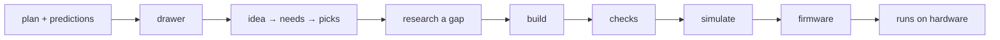
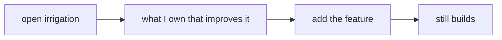

# Jobs and journeys
<!-- Tags as in the brief: E with a pointer, H with its source, D with who and when; an unknown is —. -->

## Who
<!-- One line per persona: who · evidence status (E pointer | H source).
e.g. `- Team leads who assign work · H Lena's belief, no interview yet` -->
- The hobbyist <!-- REQUIRED:who --> — an idea in words, whatever ESP32 board is in the drawer, some modules; a terminal, no EDA, maybe no meter, no Wokwi licence · E scrum/VISION.md "Who it is for", primary row (confirmed by the PO 2026-10-03) · caveat: no stranger has run spark yet — every logged run was an agent or the PO (E VISION "The agent at the keyboard": "Every logged run was one")
- The maker, Petr — the PO, directs Claude rather than typing commands, buys from Czech shops; the only person who has used spark, so the decider is the user, n = 1 · E scrum/VISION.md "The test bench" row; D5
- The agent at the keyboard — acts on a script's answer without reading its source; a constraint, not a persona · E scrum/VISION.md constraint row

## Jobs
<!-- One job story per line, each clause tagged: When …, I want to …, so I can ….
e.g. `- When I assign a task in a meeting [E tickets.csv:6], I want the assignee to see it that day [H Lena], so I can stop chasing people [E tickets.csv:7]` -->
- When I have a new idea in words and a drawer of modules <!-- REQUIRED:jobs --> [E VISION primary row], I want spark to walk me from the idea to a board that builds and firmware that runs on hardware I own [D1 the card: "actually test the whole functionality"; D2 R2.6: "ends in firmware that runs"], so I can build it at home as documented and see where spark stalls [D2 "the plugin used only as documented"]
- When I have an existing project (irrigation) [E ~/Development/irrigation/.spark/project.json: the brief, five musts, two decisions], I want spark to look at the modules and parts I have and offer improvements, and walk me through adding one feature [D1 verbatim: "actually test the whole functionality of actually looking at the modules and parts we have and offering improvements … make a plan of an improvement, adding a feature"], so the project improves and the store's reuse is exercised
- When a round finds a gap [D5: filed, not fixed mid-round], I want it written with its need and scored against a prediction made before the round [D2 R2.6: "predictions scored by someone who did not write them"], so the store version (P178) starts from a measured list [D3]

## Today they…
<!-- Per job: what they do instead today (a competitor, a workaround or nothing), tagged.
e.g. `- Job 1 · paste each task into Slack by hand · E tickets.csv:7` -->
- Job 1 <!-- REQUIRED:today --> · the goal-first way in runs as documented up to a built board: `/spark:drawer` → `/spark:idea` (needs, match, pick, requirements) → `/spark:build` (check_spine) → checks; firmware is "partly" (the pin map exported; nothing tests firmware against the board), simulate "partly" (Wokwi, paid), bench "not yet" · E README.md "What works today" table (2026-10-09); scrum/STORY_MAP.md rows 0–12 · caveat: the table's "works" rows were run by agents on the reference design and the plant alarm, not by a stranger
- Job 2 · irrigation was built on 2026-09-29 by an agent following the plugin's documents (the third cold test): a GENERATED board.tsx (corrected by the tech lead, FEAS-7: its header says so; a regeneration differs in 13 lines from later spark changes), a DIARY.md and a PLAN.md with eight predictions; its requirements file exists as `irrigation.requirements.json` (a name `--requirements` does not read) and it has no needs.json — it predates store 1a–1c, so the "extend" and "swap" ways in (the store design §2) have never run on it, and the story map says the ways in beyond goal first are not designed (P76) · E ~/Development/irrigation/ (DIARY.md, PLAN.md, .spark/project.json; `ls`: no requirements.json) ; scrum/STORY_MAP.md slice 1b "Not designed yet"
- Job 3 · the third cold test's diary and plan exist as the model (ten gaps I1–I10 and two facts I11–I12 — the diary's own count, DIARY.md:218-219; #15's "twelve gaps, ten invisible to the tests" has no source in the diary — refuter) · E R2.6's card text (#15); ~/Development/irrigation/DIARY.md, PLAN.md

## Journeys
<!-- One ### per actor and scenario: the table, then a Mermaid flowchart of the same steps. Never a Mermaid
journey block: it forces a score on every task. "n/a — a one-step job" may replace both.
e.g. `| 2 | opens the app | E analytics, 90 days | never sees the task | not yet | Do they read email? |` -->
### The maker (the PO at the keyboard with Claude) — rounds A and B, a new demo project from an idea (A from owned parts; B needing parts not in the store, D6) <!-- REQUIRED:journey -->
| step | what they do | evidence | friction or harm | today | open question |
| --- | --- | --- | --- | --- | --- |
| 1 | writes the plan with predictions, picks the domain | D2 (R2.6: predictions first); the menu: battery sensor node, USB MIDI foot controller, or his own | a domain spark's library cannot serve (no board record) turns the round into research, not a test of the chain | — | Q2 which domain |
| 2 | `/spark:drawer` — says what he owns | E README "Drawer: partly"; his drawer has 110 entries (`--drawer` on a copy, 2026-10-09 — refuter; the store design's "about 112" was its 2026-10-04 estimate) from the DFRobot import (store design §4 1a) | the DFRobot import and words→entries "were not run here" (README) | partly | — |
| 3 | `/spark:idea` — the goal becomes needs, matched against the drawer and the records, a part picked per need, requirements.json written | E README "Idea: partly"; STORY_MAP row 0, 3 | `--need measure distance` misses the rangefinder (P39); brainstorming kinds of module not designed (P76) | partly | — |
| 4 | `/spark:research` for a gap — an agent writes a cited record to the catalog (round B's heart: find online, create a record, build with it; D6) | E README "Research: partly … done by agents, not run here" | the record's facts are owed until read from a datasheet; research costs a web budget; the person must say yes to each fetch | partly | round A: zero gaps expected; round B: how many parts, and is a record the person can read the pass line? |
| 5 | `/spark:build` — check_spine: board, schematic, footprint, build, simulation | E README "Build: works"; the reference design runs end to end (2026-10-09) | a board without header geometry stops at the footprint (P121); a short by names was possible until P163 (fixed today) | works | — |
| 6 | checks and review — `check_all`, `spark-review` | E README "Checks: works" | the agent loses `fix` (P43) | works | — |
| 7 | simulate in Wokwi | E README "Simulate: partly"; D4 (asks first, paid minutes) | minutes are the PO's; Wokwi does not wake a C6 from a GPIO (the bin's B27 for the S3) | partly | — |
| 8 | firmware — `pins.py` exports the pin map; the conversation writes the firmware | E README "Firmware: partly"; VISION non-goal: spark writes no behaviour (P56) | nothing tests firmware against the board on a Mac (P59, P74) | partly | — |
| 9 | the firmware runs on hardware he owns | D2 ("ends in firmware that runs"); STORY_MAP row 10 "Breadboard: nothing" (P79) | spark has no bench step; a breadboard needs through-hole parts, spark's passives are SMD | not yet | Q3 the pass line: what must run? |

### The maker — round C, irrigation improved by one feature
| step | what they do | evidence | friction or harm | today | open question |
| --- | --- | --- | --- | --- | --- |
| 1 | opens the existing project | E ~/Development/irrigation (a generated board.tsx; `irrigation.requirements.json`; no needs.json) — tech-lead FEAS-7/8 | it BUILDS on 0.8.1; `check_spine` exits 1 on the documented STATUS_LED note (since 2026-09-29) and `check_all` FAILs since B13 (★C4); it predates the store slices; it came onto a SCRATCH store only after the bin's hold on the S3 was deleted by hand (★C5) — on the real store the pick is refused | not yet | Q6 the two causes recorded; what feature; the board under D7 |
| 2 | asks spark what he owns that could improve it | D1 ("looking at the modules and parts we have and offering improvements") | `--match` scores needs, not projects; "ideas from what I have" (I) is not built (store design §2) | not yet | — |
| 3 | adds the feature: a need → a pick → the board and firmware updated | D1 | the free pins of an existing board are read by nothing (store design "Extend: the project's free pins") | not yet | — |
| 4 | the project still builds and simulates | the frame's "must not get worse" | — | works today for the current board.tsx | — |

