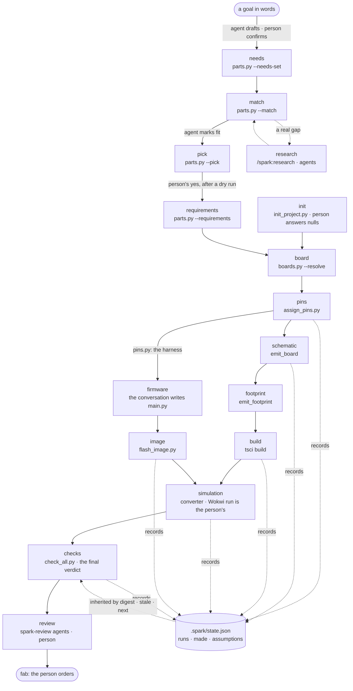

# P158 part 2 — design A1 · The smallest layer

Written 2026-10-10 by the architect for angle A1, against spark 0.8.1 at main `5acbe42` (E `git log -1` →
`5acbe42 2026-10-10 22:26:37 +0200 Merge pull request #129`), the commit `design/00-system-as-is.md` maps. Two other
architects draft other angles in parallel; this file makes the case for one: **keep the scripts, add the thinnest
structural layer that makes every mistake land in one named place, and show what that layer leaves unfixed.** It proposes;
nothing here is decided, filed or built. What the PO must decide is listed in §10.

**Tags.** E a pointer (file:line at `5acbe42` unless named; a command and what it printed; a card), H a claim with its
source, D a decision (who, when), — unknown. Sizes are estimates, labelled: S under an hour, M a day, L more (the scale
part 1 uses, H `proposal.md` "How to read"). Paths under a person's home are written `~/…`; my scratch folder is
`<scratch>`.

**What I read.** Whole: `design/00-system-as-is.md`; `scripts/outcomes.py`; `store.py:1-135`; `boards.py:30-216`,
`:280-330`, `:440-545`; `check_all.py:50-215`, `:276-306`, `:420-479`; `check_vendor_pins.py:95-200`. In part:
`parts.py:218-262`, `:900-965`, `:1290-1306`, `:1464-1490`, `:2156-2214`; `check_spine.py` (its function list, `:319-334`,
`:520-560`, `:660-691`); `sim_project.py:75-135`, `:158-179`; `assign_pins.py:434-470`; `emit_board.py` (grep of
placeholder/assume/stand-in); `init_project.py:14-24`; `check_physics.py:530-550`; `compare_design.py:272-289`;
`tools.py:40-50`; `fab.py:25-34`; `design.py` (grep); `boards/*.json` keys; `data/tools.json` keys and roles; `.mcp.json`;
`docs/mcp.md:1-40`; `commands/build.md:14-40`. Part 1: `proposal.md` §1, §2, §3 (every CH heading and every *removes /
adds*), §4, §5, the cards section; `catalogue.md` rows K21, K43, K53, K55–K57, K62, K64, K65; council `tech-lead.md`
(findings, Missing, smallest set, seams), `user-ai-agent.md` (findings, Missing), `store-scenarios.md` (STORE-8…STORE-17,
scenario C, §3, §4), `existing-first.md` (EXISTING-FIRST-23/-24, Missing). `docs/2026-09-30-refactoring-architecture.md`
(the target, the order, *Do not refactor*, the stopping rule); `docs/2026-10-04-store-design.md` §6, §10, §11;
`scrum/README.md:1-40`, the Ready row; `scrum/WORKING_AGREEMENTS.md` W15, W16. The bin's `Makefile` lines that call spark
(read only). Cards, read-only with `gh issue view`: #94 (latest comment), #123 (body), #17 (the `origin` decision), and
the state and title of #5, #6, #7, #8, #11, #16, #17, #19, #21, #22, #23, #41, #44, #52, #53, #55, #58, #59, #61, #65,
#69, #70, #83, #84, #85, #89, #93, #94, #96, #99, #101, #102, #114, #118, #119, #123 (all OPEN except #11, CLOSED).

**What I ran,** all in `<scratch>` on a `git archive` of `5acbe42` (scripts, boards, parts, data, commands, docs/guide,
tests/data, tests/mutations), with `SPARK_HOME`, `HOME` and `TMPDIR` each set to an empty folder of `<scratch>` as three
separate words and `PYTHONDONTWRITEBYTECODE=1`. The PO's real store was not opened, copied or touched; nothing was
written under `~/Development/spark` but this file. Three measurements, quoted where they are used: (M1) `assign_pins.py
requirements.json --json` on `commands/build.md`'s example; (M2) ten scripts fed a non-UTF-8 file, a JSON list and a
missing path; (M3) the mutation rows anchored inside each `main()` and inside the helpers this design moves.

## 1. The idea in one paragraph

Keep the 25 scripts, each script's argparse and its own `render()` prose, and the conversation as the only
orchestrator; add five small pieces that give each class of mistake one home. **`outcomes`** grows into the one answer:
an envelope (version 2) whose items carry a closed `kind`, a `where` locator, a `sentence` (the why) and a `fix` (what to
do), plus `verdict`, `context` (which spark, store and project answered) and `assumptions` — the ledger. **`cli`** is the
one `main`: parse, resolve the folders, run the script's body, turn any exception into could-not-run with where and why,
print the envelope or the script's prose plus one shared footer, record the run, exit by one contract (0 ok, 1 problems, 2
could-not-run, nothing else). **`where`** resolves the four folders — spark's own, the person's store, the project, later
P178's shared clone — once per call; a folder that is named and missing is refused, never read as an empty store; every
write into spark's folder passes one guard. **`state`** holds spark's stage table and each project's `.spark/state.json`:
which stage made which artefact from which inputs, by sha256, and which assumptions it rests on — so a stage inherits the
assumptions of what it reads, and a placeholder can flow through the chain but cannot leave the final verdict. **The board
contract** becomes one table — every physical key with its reader, the pad-label grammar tscircuit misreads, a
`placeholder` map, the chip-name table — and JSON Schemas are generated from it for editors. The ledger adds no new facts:
it is one shape over ten channels spark already prints in ten formats (each with its pointer in §2, "The producers"). The layer finishes the two targets the
2026-09-30 note set and never built (E `docs/2026-09-30-refactoring-architecture.md:65` `outcomes.report`, `:73`
`outcomes.read_json`) and the PO's "one envelope printer for every command" (D the PO 2026-10-04, `store-design.md` §6.1),
and it holds six of part 1's eight shapes (R1, R2, R3, R6, R7, R8) and the board half of a seventh (R5) — `proposal.md` §2.1. It moves 63 of the 989 mutation
rows anchored in `scripts/` (M3), where splitting `parts.py` and `needs.py` would move 462 (E `proposal.md` §2.5).

**Why the smallest layer, and not more.** (a) The PO's standing direction: *"lets make sure we start finishing more and
not starting new epics or bigger things in general"* (D 2026-10-09). (b) The defect classes part 1 found are shapes
repeated, not a wrong architecture: one printer and one reader were specified ten days ago and not built (E
`00-system-as-is.md` V9, V11), and the faults they would have caught grew (37 raw reads in 16 scripts, E my grep; 10 of
30 malformed-input runs end in a traceback, M2). (c) Every unit below is testable without a toolchain, through a pure
function or a subprocess. (d) Each iteration in §10 ends in a whole that runs for the bin, irrigation and plant-alarm. (e)
The build graph, the MCP face and the measured evals the PO's flow options named (D the PO 2026-10-10, options 2–4)
need exactly what this layer provides — content digests per artefact, one envelope, one stage table — and come as
iterations on top (I6, I7, §8), not as a rewrite.

### 1.1 What this design does not fix

Said once here; §11 lists it per change.

- **Nothing runs by itself.** The state says what is stale and fills `next`; the conversation still decides what to run.
  Reruns by content hash are I6.
- **No split of `parts.py`, no merge of the board and part loaders, no break of the nine-module import cycle** (E
  `00-system-as-is.md`, "one component of nine"). A traceback out of `--pick` still crosses five modules (H `tech-lead.md` TECH-LEAD-5); `cli` turns it
  into one item naming the innermost spark frame, which is a where, not a structure. Q12 stays the PO's.
- **No semantics change in matching, holds, identity or sync** — the `--need` word split (CH-18), the pick's fit
  (CH-17), holds (CH-25, CH-72), the project id and conflict copies (CH-9, CH-10's copy half, CH-29), record-copy
  provenance (CH-26, CH-63). The layer gives each answer a field to say where it looked; the rule it looks by is the
  change's own.
- **No new simulation capability**: the stand-in pin names (CH-31), a generated Wokwi board (CH-33), the closest part for a
  module (CH-69). The ledger only makes each stand-in travel to the final verdict.
- **The ledger is only as honest as the marks.** A wrong fact marked `verified: true` is invisible to it; it lists what
  spark knows it does not know.
- **Agents still read prose to sequence the journey** (USER-AI-AGENT-13): the pages stay the orchestrator; only a
  refusal in code is a guard.
- **25 of the 72 changes are untouched and 31 get only their place or their report** from this layer (§11).

## 2. Module boundaries

Layers for the new and grown units, each importing only from a lower one: **0** `outcomes` (beside `fab`, `netlist`,
`copper`, which import no sibling today, E `00-system-as-is.md`) · **1** `where` · **2** `store` · **3** `state` · **4**
`cli`. Above them the existing modules keep the order the dependency graph in `00-system-as-is.md` shows — the record
contracts (`boards`, `parts`), then `design`, `assign_pins`, `tools`, the checks as libraries, the generators, then
`sim_project`, `drawer`, `needs`, `cost`, then the commands. No existing module imports `cli`; only a `main` calls it.
Today's upward edges (`parts` importing `drawer`, `needs`, `cost`, `tools` inside functions; `boards` importing
`emit_footprint`; 17 function-local imports in all, E `00-system-as-is.md`) stay (§1.1) as the known list of an
import-direction test, so a new upward edge fails (the seam TL proposes, E `tech-lead.md` "Module boundaries", seam 4).

### U1 · `outcomes` — the answer's shapes and rules (exists; grows)

- **One purpose:** what an answer is — three statuses, the item, the assumption, the envelope, the exit for a status, and
  the one reader of a JSON file. Standard library only; no folder of its own, no printing; `read_json` is its one read.
- **Interface.** `status_of(problems, unchecked)` (unchanged, E `outcomes.py:32-43`); `EXIT_FOR` (unchanged, `:28`);
  `KINDS`, `LEVELS`, `BASES` (closed tuples, §3.2–3.3); `item(kind, sentence, where=None, subject=None, fix=None) -> dict`;
  `assumption(fact, where, level, basis, sentence, since, upgrade) -> dict`; `Answer` (moved from `parts.py:233`, the
  fields `data lines problems unchecked next truncated` kept, plus `notes conflicts assumptions read wrote`, all
  defaulted, so the 28 `_op_*` handlers return what they return today); `envelope(tool, op, answer, context, inherited,
  next_steps) -> dict` (§3.1); `read_json(path, what, expect=dict) -> value` raising `Unreadable(path, why)` — opens with
  `utf-8-sig`, names the byte of a decode error, the line of a JSON error, the type found when `expect` differs (CH-5).
- **Errors:** `Unreadable` only. `KINDS`/`LEVELS`/`BASES` refuse an unknown word with `ValueError` at construction, so a
  typo in a script fails its own test, not an agent.
- **Depends on:** nothing.
- **Seam:** pure functions; `tests/test_outcomes.py` (7 tests today, E `00-system-as-is.md`) grows a test per field.
- **Today's code becomes:** `outcomes.py:65-74` `envelope` → v2; `parts.py:233` `Answer` → here; `boards.py:170-176`
  `_read_json`, `tools.py:62-71` `_read`, `parts._parse` (`parts.py:1270-1274`) and the 37 raw `json.loads(…read_text…)`
  sites in 16 scripts (E my grep at `5acbe42`: `16 scripts, 37 sites`) → `read_json`, each caller keeping its own
  sentence for a well-formed but wrong file.

### U2 · `where` — the four folders and the write guard (new, 1 module)

- **One purpose:** which folder is spark's, which is the person's store, which is the project, which (later) is the shared
  clone — and whether a path may be written. It reads the environment and stats folders; it writes nothing.
- **Interface.** `resolve(env, cwd, project=None, plugin=PLUGIN) -> Where` (pure but for `stat`); `here(project=None) ->
  Where` = `resolve(os.environ, Path.cwd(), project)` at call time, never at import (CH-1's rule, E `proposal.md` §2.3).
  `Where` is frozen: `.plugin`, `.store`, `.store_made` (bool), `.project` (a folder or None), `.shared` (None until P178);
  `.library(kind)`; `.layers(kind) -> [(layer, path, writable_by, private)]` (§6); `.owner(path) -> (root, relative)` with
  root ∈ `project | store | plugin | shared | temp | elsewhere`, comparing resolved paths (`samefile` for an existing
  folder, CH-10's rule); `.project_of(path)` — the nearest folder up from a file holding `boards/active.json` or `.spark/`,
  **excluding the plugin**, or None; `.check_write(path, artefact=None)`; `.locator(path) -> "project:requirements.json"`
  (§3.1); `.context() -> {spark, plugin, store, store_made, project}`. Reads may still fall back to spark's folder —
  a design in no project builds from the library, and `--offline` reads spark's cached header — and writes never do: the
  rule `boards.py:150-152` already states. #125's write stays as decided: a board file that **resolves** to one of
  spark's own `boards/*.json` names its artefact, and its live header is written to spark's cache; any other file inside
  spark's tree has no project, and a live check of it is refused (N25, N26; E `proposal.md` CH-4).
- **Errors:** `Refused(path, why, fix)`, one class: `SPARK_HOME` set but empty, or naming no folder (CH-1, with the
  folder it would otherwise use); `--project` naming no folder (CH-20's second half); a configured shared clone that is
  missing; a store inside spark's folder; a write into spark's folder that does not name a spark artefact (CH-4) — the two
  artefacts #125's rule and part 1 allow: the vendor header of a board whose **resolved** file is one of the plugin's own
  `boards/*.json`, and the compiled binary of a library chip (E `proposal.md` §2.3, N25, N26); and, once the PO picks it,
  the real-store guard's rule (Q2, CH-11) as one predicate here. The default store (`SPARK_HOME` unset) may not exist yet:
  `store_made` is False and `context` says so; the store's door makes it on the first write (CH-1 keeps this, E
  `proposal.md` CH-1).
- **Depends on:** `outcomes` (for `item`).
- **Seam:** `resolve` takes a dict and folders, so a test builds `Where(plugin=tmp/a, store=tmp/b, project=tmp/c)` and needs
  no patch. The 15 `patch.object` sites on path constants across 7 test files (E `00-system-as-is.md`, "Test seams on these
  names") become fixtures; the home test TL proposes (import every module under one `SPARK_HOME`, change it, ask again)
  becomes `test_where.py::test_no_module_reads_a_folder_at_import`.
- **Today's code becomes:** `store.py:33` `PLUGIN` (read by nothing, E `00-system-as-is.md`) → removed; `store.py:46-52`
  `home()` → `Where.store` (the `store` module asks `where.here()`); `store.py:71-81` `layers` → `Where.layers`;
  `boards.py:38` `LIBRARY`, `:135-147` `project_root`, `:153` `PLUGIN_ROOT`, `:156-167` `project_or_library`;
  `parts.py:45` `LIBRARY`; `tools.py:43-48` `PLUGIN`, `DEFAULTS`, `PERSONAL`, `DOWNLOADS` (the last two read the home at
  import, E `tools.py:47-48`); `fab.py:27` `FILE`; `check_vendor_pins.py:108` `PLUGIN_ROOT`, `:113-127` `project_header`,
  `:149-151` `whose`; `check_physics.py:540` and `compare_design.py:281` (the rules file found by counting three folders up
  from the circuit); `check_spine.py:330` (`project or SCRIPTS.parent`); `design.py:151-158` `is_library` and
  `LIBRARY_NOTE` → `Where.project is None` plus an assumption (basis `no-project`, §3.3) instead of a printed note — which
  also ends `assign_pins.py:438` printing that note on stdout before the JSON (M1: 172 bytes of prose before the `{`; the
  whole stdout does not parse). The three writers into spark's folder — `parts.py:1296-1305` (`promote`'s `copy2`),
  `check_vendor_pins.py:194` (`keep_live_header`'s `write_text`, in `:178-198`), `sim_project.py:162` (`stage_chips`' `copy2`) —
  call `check_write` first.

### U3 · `state` — the stage table, the project state, the ledger's memory (new, 1 module + 1 CLI)

- **One purpose:** what has run in this project, from what, making what, resting on what.
- **Interface.** `STAGES` (spark's data, §4.1); `State(where, now=clock)`; `.inherited(paths) -> [assumption]` — for each
  input path, the assumptions of the run that made it when its digest matches, an `edited-after` assumption when it does
  not, an `unknown-origin` assumption when the path is a stage's output and no run made it (§4.3); `.record(stage, argv,
  answer, envelope)` — the run's `read` and `wrote` digests, its status, its assumptions; `.stale() -> {stage: [why]}`;
  `.next_after(stage) -> [step]` — the downstream stages now stale or never run, with argv from `STAGES` (fills the
  envelope's `next`, USER-AI-AGENT-3). A command line: `state.py [--project P] [--ledger] [--json]` prints the stage table
  with each stage's last run, what is stale and why, and the whole ledger — the "where am I" a person and an agent read.
- **Errors:** an unreadable `state.json` → `Unreadable` (could-not-run, naming the file and saying "delete it to start the
  record again — nothing but spark's record of runs is in it"); a failed record → no status change, the footer and
  `context.state` say "not recorded: <why>", and every output of this run is `unknown-origin` to the next stage (§3.6).
- **Depends on:** `outcomes`, `where`, `store` (its atomic `write_file`, E `store.py:138-160`, and its lock, generalised to
  take the lock file's place — CH-3 moves it beside the data anyway).
- **Seam:** a temporary project folder, a fake clock, files written by the test; no script runs. The ledger's invariants
  are four tests (§5.2).
- **Today's code becomes:** the seven stage names that exist only as string literals in `check_spine.run` and its header
  line `check_spine.py:546` (E `00-system-as-is.md` "declared nowhere") → `STAGES`; `check_spine.py:533-541` `left_off`
  (the `unserved` note) → an assumption basis `unserved`; nothing in the store's `history.jsonl` moves — it stays the
  store's record of proof by use and cost (`built`, `step`, `reused`, `passed_over`, E `00-system-as-is.md`), a different
  relation from a project's provenance.

### U4 · `cli` — the one `main` (new, 1 module)

- **One purpose:** run one script's body under the one contract.
- **Interface.** `run(tool, argv, parser, body, render, *, value=False, stage=None) -> int`. `parser` is the script's own
  argparse (built through `cli.Parser`, which raises instead of exiting — the mechanism `parts.py:1553-1558` already uses
  so a bad argument is an envelope); `body(args, where) -> Answer`; `render(answer) -> [lines]` is the script's own prose,
  unchanged; `value=True` marks an operation whose stdout a program captures (§3.5); `stage` names a `STAGES` row.
  Steps: parse → `where.here(args.project)` → `body` → `state.inherited(answer.read)` → `envelope` → `state.record` → print
  → `return EXIT_FOR[status]`.
- **Errors, all mapped here and nowhere else:** a bad argument → unchecked, kind `input`, `where` `arg:--<flag>`;
  `where.Refused` → kind `store` or `input`; `Unreadable` → kind `input`; any other `Exception` → kind `crash`, `where` the
  innermost frame under `scripts/` (`spark:scripts/check_bom.py:57`), `fix` "a fault in spark — the traceback is in
  <temp>/spark-crash-<tool>-<time>.txt; report it", the traceback written there, never to stdout. `KeyboardInterrupt`
  passes (the shell's 130). Nothing else exits non-zero.
- **Depends on:** `outcomes`, `where`, `state`.
- **Seam:** `run` with a fake `body` that returns each shape or raises each class (in-process); and the outcome invariant,
  one subprocess test over every script with a `main` (§8.1), because the traceback path is the one a `main(argv)` call
  cannot show (E `00-system-as-is.md`: 30 `subprocess.run` calls in 10 of 36 test files).
- **Today's code becomes:** each of the 16 `main`s keeps its parser and its prose and hands them to `run` — `parts.py:2188-2212`
  (its `try`/`except` mapping and `globals()` dispatch become the `body`; the dispatch itself stays, §1.1), `parts.py:2171-2185`
  `_say` → `run`'s printer; `check_all.py:444-476`; `check_spine.py:668-688` `report` (its `--keep` lines become
  `answer.wrote` and print in both channels — USER-AI-AGENT-6); `check_physics.py:530-570`; `compare_design.py:272-286`;
  `check_vendor_pins` main (its bare list → `data.boards`); `boards.py:486-545`; `assign_pins.py:414-470`;
  `emit_footprint` main (JSON, never TSX, under `--json` — CH-56); `check_bom`, `check_footprints`, `cost`, `emit_board`,
  `flash_image`, `init_project`, `tools` mains, which gain `--json` through `run` (USER-AI-AGENT M-E, CH-48's `tools.py`).

### U5 · The record contracts — one table each, schemas generated (grows in place)

- **One purpose:** what a board file (and, after it, a part record, the requirements, the rules, the needs file) must
  hold, stated once where it is enforced.
- **Interface.** In `boards.py`, beside `REQUIRED_KEYS`, `PIN_ROLES`, `FORBIDDEN_KEYS` (E `boards.py:62-107`):
  `PHYSICAL_KEYS` — key → (type and range, unit, the function that reads it, the targets that need it, the sentence for its
  editor hover); `PAD_LABEL_REFUSED` — the grammar `^\d+$` and `^pin\d+$` (case-insensitive), cited from tscircuit's core
  (E `proposal.md` CH-12: `@tscircuit/core` 0.0.1958 `index.js:11651-11654`), applied to every `pins` and `power_pads` key,
  every `header_order` cell and every `pad_aliases` name; `PLACEHOLDER_KEY` — an optional `"placeholder": {"<JSON
  pointer>": "<why this value is invented>"}` in a board file, a part record and `boards/active.json` (§5.1); and the
  chip-name table `data/wokwi-boards.json` (`{wokwi type: mcu}` from wokwi-boards' `board.json` files at a cited commit,
  plus spark's spelling of each `mcu` — CH-13's one table, E `store-scenarios.md` STORE-10). `validate(board, path)` stays
  the enforcer and returns sentences with a locator. `tools/schemas.py [--check]` (a developer tool, not the product)
  writes `schemas/board.schema.json`, `schemas/envelope.schema.json`, `schemas/state.schema.json` from these tables and
  from `outcomes`; part, requirements, rules and needs schemas follow with CH-28.
- **Errors:** the validator's sentences, each now an item with `where` = `project:boards/<id>.json#/physical/header_order/row_18/13`.
- **Depends on:** `outcomes`.
- **Seam:** `validate` is pure (dict in, items out); `tools/schemas.py --check` exits 1 when a committed schema differs from
  the generated one — the pattern the converter's bundle already uses (E `tests/test_check_spine.py:845-851`, the
  `converter.sources.sha256` check). No run-time `jsonschema` dependency: spark's validators stay the enforcer and their
  sentences the message (CH-28 Q15 (a), E `proposal.md` CH-28; `jsonschema` is not in the standard library, FEASIBILITY-7).
- **Today's code becomes:** the inline physical checks of `boards.validate` and `emit_footprint._missing` read
  `PHYSICAL_KEYS`; the five keys of the S3 file read by nothing (E `proposal.md` CH-22, BR-M3) are given a reader or
  removed in the same commit (Q16 for mounting holes); the converter's TypeScript board type (`lib/board.ts:27-68`, E
  `existing-first.md` EXISTING-FIRST-24) is held to the schema by one test that every `board.<key>` the converter reads is
  a schema key — one direction only; generating the TypeScript type is left for later (H `json-schema-to-typescript`,
  unchecked).

### The producers: where today's ten placeholder channels are made

Not a unit: each module that already marks a placeholder returns it as an `assumption` in its `Answer` instead of in its
own format. No central adapter, so no module learns every other module's internals.

| basis (§3.3) | made today by | printed today as | becomes |
| --- | --- | --- | --- |
| `unverified` | `parts.unverified` (`parts.py:834`) | `assign_pins --json` `unverified[]`, `{part, fact, assumed, why_it_matters, source}` (`assign_pins.py:457-467`); `parts --unverified` `data.questions` | `parts.unverified` returns assumptions (the same five facts, `source` behind `where`); the `unverified` key goes |
| `assumed-size` | `emit_board --assume-missing-sizes` (`emit_board.py:1040`, `:1102-1107`) | a comment in `board.tsx` and a stderr note | an assumption per resistor; the comment stays in the artefact |
| `placeholder-footprint` | `parts.has_placeholder_footprint`, `emit_board.placeholders` (`parts.py:325`, `emit_board.py:305-318`, `:978-985`) | `stand_in_lines` in `board.tsx`; `check_all`'s `placeholder_components_in` re-reads every requirements file to learn them (`check_all.py:152-185`) | an assumption per component, inherited by `check_all` from the build — its re-derivation can go once the inheritance holds (§9) |
| `stand-in` | `sim_project.limits_of` (`sim_project.py:75-104`); the board's `wokwi_is_stand_in`, read by no code (E `00-system-as-is.md`) | `sim/WHAT-THIS-CANNOT-SHOW.md` (parts only) | an assumption per stand-in, the board's included (CH-32); the file is still written, from the same list |
| `unserved` | `parts --requirements` (`requirements.json` `unserved`) | `check_spine.left_off` → "— but not every need is on the board" (`check_spine.py:533-556`) | an assumption per need |
| `null-rule` | `init_project` ("Every value is null", `init_project.py:16-21`) | `check_physics` "no maximum current stated…" findings | an assumption per null the checks read |
| `unmeasured` | `check_physics` `NEEDS_MEASUREMENT` (`check_physics.py:84`) | `check_all`'s `unmeasured[]` (`check_all.py:149`, `:240`) | an assumption (the `unmeasured` field goes) |
| `owed` | `parts.owes`, `CHAIN_FACTS` (`parts.py:98`, `:107`) | `--audit`'s "owes" lines; the chain's stop | an assumption per owed fact (its consequence per stage is CH-37's table) |
| `no-project` | `design.is_library` (`design.py:151-158`) | `LIBRARY_NOTE` on stdout or stderr | one assumption |
| `no-firmware` | the simulation stage, when `wokwi.toml` names no image (`sim_project.py:173-176`) | a commented line in `wokwi.toml` | one assumption, levelled by §5.1's firmware levels |

Two more bases are the state's own, not a producer's: `edited-after` and `unknown-origin` (§4.3). The rails `emit_board`
cannot sum (`unverified` loads, `emit_board.py:485-538`) are `unverified` too.

## 3. Data contracts

### 3.1 The envelope every script prints — version 2

One shape for all 16 `main`s under `--json`, built only by `outcomes.envelope` and printed only by `cli.run`. Version 1 is
`{envelope, tool, op, status, data, problems[{subject, sentence, fix}], unchecked[{sentence, fix}], next, truncated}` and
one script prints it (E `outcomes.py:65-74`; `00-system-as-is.md`: nine `--json` scripts, nine shapes). Version 2 keeps
every v1 key and its meaning, so `parts.py`'s consumers change one number. Illustrative values, not a run:

```json
{
  "envelope": 2,
  "tool": "check_all",
  "op": null,
  "status": "ok",
  "verdict": "nothing found by the 3 checks that ran, of 5 — on 6 assumptions",
  "context": {"spark": "0.9.0", "plugin": "<path>", "store": "<path>", "store_made": true,
              "project": "<path>", "state": "recorded run 17"},
  "data": {"checks": [{"check": "physics", "outcome": "ok", "what": "the board obeys physics, not just itself"}]},
  "problems": [],
  "unchecked": [{"kind": "input", "subject": "package", "where": "project:*-gerbers.zip",
                 "sentence": "no fab package (looked for *-gerbers.zip, fab/*.zip)",
                 "fix": "tsci export -f gerbers board.tsx -o board-gerbers.zip, then run this again"}],
  "assumptions": [{"fact": "l9110s-module.pin_order", "where": "plugin:parts/l9110s-module.json#/pin_order",
                   "level": "stated", "basis": "unverified", "since": "pins",
                   "sentence": "a pin order read wrong reverses a supply or swaps a signal",
                   "upgrade": "keep the maker's drawing or a photo of the silkscreen and set verified (parts.py --keep, --fact-set)"}],
  "next": [{"op": "build", "argv": ["check_spine.py", "requirements.json", "--keep", "."],
            "why": "the schematic is stale: requirements.json changed after run 15", "effects": ["writes"], "needs_yes": false}],
  "truncated": null
}
```

| key | rule | replaces |
| --- | --- | --- |
| `status` | `status_of(problems, unchecked)`, never declared; three words only (W1) | `check_vendor_pins`' `mismatch` (CH-45); `check_all`'s per-check `skipped` moves to `data.checks[].outcome` (`ok`, `problems`, `could-not-run`, `not-asked`), so the word `status` has three values everywhere |
| `verdict` | one sentence, the same as the text's last line; it states the assumption count whenever it is non-zero | the verdict line `check_spine.render` picks from three (`check_spine.py:550-555`); `check_all.render`'s summary |
| `context` | which spark, plugin, store and project answered, and whether the run was recorded | nothing — no answer names its store today (E `proposal.md` CH-1, USER-AI-AGENT-4) |
| `problems`, `unchecked` | one item shape, §3.2 | v1's two shapes; `check_all`'s `"subject: detail"` strings that drop the `fix` (E `00-system-as-is.md`; #52) |
| `assumptions` | the ledger in force for this answer, §3.3; never cut — the one list exempt from the 4 KB default (§6.4.4 of the store design), because cutting it would be the silence the PO named; each entry carries no source prose, which sits one `where` away | `assign_pins`' `unverified[]`, `check_all`'s `unmeasured[]`, `check_spine`'s `unserved`, `parts --unverified`'s `data.questions` |
| `next` | filled: a stage's from `state.next_after` (§4.2), an operation's from its own knowledge (CH-46) — or the PO removes the key (Q14) | `next: []` in every v1 answer (E USER-AI-AGENT-3) |
| `data` | the tool's own payload, declared by its `--describe` row | eight top-level shapes |

**Size, measured on the documented example (M1).** `assign_pins --json` today: 6,444 bytes; `unverified` holds 5
entries in 1,910 JSON characters, most of it `source` prose. The same five as v2 assumptions without the prose: an
estimate of about 1.2 KB (5 × ~250 characters, labelled an estimate, not measured).

**The locator.** `where` is `<root>:<path>[#<JSON pointer> | :<line>]`, root ∈ `project`, `store`, `plugin`, `shared`,
`temp`, `stage`, `arg`, `spark` (spark's own code, for a crash). One grammar a person reads as it is and an agent splits on
the first `:`. A temp work folder is `temp:` — never a path that is deleted a second later (CH-71).

### 3.2 The item: problems and unchecked

`{kind, subject, where, sentence, fix}`; `sentence` is the why, `fix` what to do (a command when one exists), `subject`
the thing (an id, a component, a check), `where` the locator. `kind` is closed (CH-46's six, E `proposal.md` CH-46):

| kind | in | means | example |
| --- | --- | --- | --- |
| `design` | problems | the thing asked about is wrong | a pad label tscircuit reads as a pin number |
| `input` | unchecked; problems only for the unknown id | an input missing, unreadable, ambiguous; a bad argument | `no rules file at …`; `--show nonesuch` (problems, exit 1, by D the PO 2026-10-04 — Q14 may move it) |
| `tool` | unchecked | a tool missing or failing | no `tsci` |
| `limit` | unchecked | a tool cannot represent this | the stand-in has no pin named `14` |
| `store` | unchecked | the store refused | `SPARK_HOME names <path>, which is not a folder` |
| `crash` | unchecked | a fault in spark | `spark:scripts/check_bom.py:57 — BadZipFile` |

An agent branches on `kind`; the substring classifiers go (`CONVERTER_HAS_NO_PART`, `check_spine.py:216-221`; the
`Traceback` prefix `agents.md` teaches — E `00-system-as-is.md`, USER-AI-AGENT-5).

### 3.3 The assumption: the ledger's entry

`{fact, where, level, basis, since, sentence, upgrade}` — `fact` a dotted name (`board.choice`, `<part>.<key>`,
`rules.<rail>.max_current_a`, `firmware`), `since` the stage that introduced it, `upgrade` what raises it a level. It is
the row `parts.unverified` already returns — `{part, fact, assumed, why_it_matters, source}` (M1; E
`assign_pins.py:457-467`) — generalised with `level` and `basis`.

**Levels** (closed, ordered; the PO's four `origin` words — the maker's words, computed, measured, proven by use, D 2026-10-06 on #17 — split across the top two):

| level | a fact that is | stated where | example |
| --- | --- | --- | --- |
| `placeholder` | put there so the chain can run, by spark or the person, and said to be | the record's or the selection's `placeholder` map (U5); a flag spark passed (`--assume-missing-sizes`); a stand-in | the generic board; a 0603 resistor size assumed; a placeholder footprint; a Wokwi stand-in; no firmware |
| `unstated` | absent: nobody said | a `null` in `rules.json`; a key the contract owes and the record lacks | `max_current_a: null` |
| `stated` | written, not checked against evidence | `verified: false` (or absent) on the fact | the L9110S pin order |
| `checked` | checked against its evidence: the maker's words or computed (D the PO 2026-10-06) | `verified: true` and, once P151 (#85) lands, `origin` | a pinout cited to a kept datasheet page |
| `proven` | measured, or proven by use | `origin: measured` / `proven-by-use`; a bench log (P79, #16); a `built` line whose digests match (CH-26's reader) | — none in spark today |

The ledger lists everything below `checked` that an answer rests on. The level is computed from the record when read,
never stored a second time (W21).

**Bases** (closed; the channel that made it — §2 "The producers"): `unverified`, `assumed-size`, `placeholder-footprint`,
`stand-in`, `unserved`, `null-rule`, `unmeasured`, `owed`, `no-project`, `no-firmware`, `generic-board`, and the state's
own two, `edited-after` and `unknown-origin`. `kind` (§3.2) and `basis` are two words for two things on purpose: a cause of
a failure, and the source of a placeholder.

**Assumptions never change the status or the exit code**, with one exception made explicit: a run for a named target
(`--for simulate | breadboard | pcb`, I5) turns an assumption below the target's level for its fact into a problem,
kind `design`, sentence `owed for pcb: <fact> is <level> — <upgrade>`. `boards.py --validate --for-fab` is that rule's
first and today only case (E `boards.py:67`, `REQUIRED_FOR_FAB`). Which level each target needs per fact is P165's
table (#102) and the PO's (§10).

### 3.4 The exit-code contract

| code | status | means | never means |
| --- | --- | --- | --- |
| 0 | `ok` | it looked at everything it was asked and found nothing wrong; assumptions in force are listed | that nothing could be looked at (an all-`not-asked` `check_all` stays 2, E `check_all.py:437-440`) |
| 1 | `problems` | it looked and found something wrong in what it was asked about — and, by D the PO 2026-10-04, an id that does not exist (kind `input`) | a crash, an unreadable file, a missing selection, a refused store |
| 2 | `could-not-run` | it could not look, at all or in part: an input missing, unreadable or ambiguous, a bad argument, a tool missing, the store refused, a fault in spark | a finding |

No other code leaves a spark script except 130 on Ctrl-C. A local alias of 1 (`EXIT_IMPOSSIBLE`, `EXIT_INVALID`,
`EXIT_MISMATCH`, `EXIT_NOTHING_TO_DO` — E `00-system-as-is.md`) may stay as a name, because `outcomes.py:9-13` sanctions it;
the one mapping that adds a meaning, `boards.py`'s "no selection" → 1 (E `boards.py:537-539`), becomes 2. `init` run twice
is the PO's (Q25). The developer tools under `tools/` are not the product and keep theirs.

**Measured today (M2):** 10 scripts × 3 malformed inputs = 30 runs; 10 end in a traceback with exit 1, in 5 scripts —
`check_footprints`, `check_physics`, `check_vendor_pins`, `check_bom` on a non-UTF-8 file; those four and
`compare_design` on a JSON list; `check_vendor_pins` on a missing path. `compare_design` on a list (`AttributeError: 'int'
object has no attribute 'get'`, exit 1) is not among the crashes `00-system-as-is.md` reproduced. The other 20 runs exit 2
with a sentence.

### 3.5 What goes to stdout and stderr, as text

- **stdout:** the script's own `render(answer)` lines, then one shared footer: every problem and unchecked item not
  already in the lines, each with its `fix` (CH-16's text half, K56); the ledger — grouped by level, one line per entry,
  the entries this stage introduced marked; `next`; the store and project line; the `verdict` last.
- **A value operation** (`boards.py --path --id --paths --get --resolve`; `emit_board` writing the board to stdout):
  stdout is the value alone and the footer goes to stderr. The bin's Makefile captures five of these with `$(shell …)` (E
  `~/Development/smartbin-local/Makefile:49-53`); `TheCommandLineTheSmartBinDependsOnTest` (E `tests/test_boards.py:314`)
  pins them, and a new test pins stdout byte for byte.
- **stderr:** otherwise only what a tool spark ran printed; never a Python traceback (it goes to the crash file, §2 U4).
- **How long the ledger prints.** Every stage prints its entries one line each; the final verdict (`check_all`, `state.py
  --ledger`) prints all of them, in text and in JSON. Whether an intermediate stage prints all or counts plus its own new
  ones is a choice for the PO (§10), measured in I3.

### 3.6 The project state — `<project>/.spark/state.json` (illustrative values, not a run)

```json
{
  "state": 1,
  "next_run": 18,
  "runs": {
    "schematic": {"run": 15, "at": "2026-10-11T09:12:03Z", "spark": "0.9.0", "status": "ok",
                  "argv": ["check_spine.py", "requirements.json", "--keep", "."],
                  "read":  {"project:requirements.json": "sha256:…", "plugin:boards/firebeetle2-esp32s3.json": "sha256:…",
                            "plugin:parts/l9110s-module.json": "sha256:…"},
                  "wrote": {"project:board.tsx": "sha256:…"},
                  "assumptions": ["… the entries this run's outputs rest on, inherited ones included …"]},
    "build":     {"run": 16, "…": "…"}
  },
  "made": {"project:board.tsx": {"digest": "sha256:…", "run": 15, "stage": "schematic"},
           "project:dist/board/circuit.json": {"digest": "sha256:…", "run": 16, "stage": "build"}}
}
```

- **Kept:** the last run of each stage, not a history; the store's `history.jsonl` keeps its own events (E `store.py:314`).
  `read` holds every file the run loaded — the requirements, the selection, every board and part record by layer — so a
  library record changed by a spark update makes the stages that read it stale, which is K12's silent loss made visible.
  A run's `assumptions` are a record of what its outputs rested on when they were made — the one thing a `circuit.json`
  cannot carry — not a second statement of today's facts (W21): while the run is current its `read` digests say the
  records are the ones it read, and once it is stale the `edited-after` entry travels with it (§4.3).
- **Written:** by `cli.run` after the body, through `store.write_file` (atomic, idempotent, E `store.py:138-160`) under a
  lock beside the file (`<project>/.spark/.lock`, the same `flock` code as the store's, which CH-3 moves beside the data).
  Two agents in one project are serialised by it; two machines on one synced project folder are not (§12).
- **Not written:** for a requirements file in no project (`where.project is None`); the answer then carries the
  `no-project` assumption and the ledger lives only in that answer.
- **Committed or ignored** in the project's git is the PO's choice (§10); the digests make a committed copy
  self-checking, and an ignored one costs a rerun on a fresh clone, which the ledger then says (`unknown-origin`).

### 3.7 Where the fidelity of a fact lives

| what | where | who changes it |
| --- | --- | --- |
| a record fact's level | the record: `verified`, `source`, later `origin` (P151); a `placeholder` entry | the person; `parts.py --fact-set`; research |
| a choice's level (the board, the firmware) | `boards/active.json`'s `placeholder` key; the image's file list | `init_project --board`, the person; `flash_image` |
| a rule's level | `rules.json` (`null` = `unstated`) | the person, `init` |
| a spark-made placeholder | the flag that made it, recorded in the run (`argv`) and in the artefact's own header | the stage, rerun without it |
| what an artefact rests on | `state.json` `runs[stage].assumptions`, keyed through `made` by digest | `cli.run` only |
| what a target requires | one table, P165's (`#102`), beside CH-37's owed-facts table | the PO |

### 3.8 The schemas

- **The board file** (I4): `REQUIRED_KEYS`, `PHYSICAL_KEYS` (new, with its reader per key and the "carried and ignored"
  refusal `PIN_ROLES` already has — CH-22), `PIN_ROLES`, `FORBIDDEN_KEYS`, `PAD_LABEL_REFUSED` (CH-12), the `placeholder`
  map, the `wokwi_*` keys documented and their values checked: `wokwi_pin_naming` ∈ {`gpio`, `silkscreen`} (unchecked
  today, E `00-system-as-is.md` "Found on the way"), `wokwi_part_type` ∈ `data/wokwi-boards.json` with its `mcu` matching
  `chip` through the table (CH-13). The refusal the PO's example of a silent fault needs: `plugin:boards/x.json#/physical/header_order/row_18/13
  is "17": a bare number, which tscircuit reads as pin position 17 — print the silkscreen word (SCK, IO17), never the GPIO
  number` (sentence from `proposal.md` CH-12).
- **The envelope and the state file** (I1, I3): generated from `outcomes` and `state`, used by the MCP face (I7) and by any
  agent that validates; spark's own test checks the key sets in plain Python, as `tests/test_json_contracts.py` does now.
- **The part record, requirements, rules, needs, drawer entry** (CH-28, after I4): the same generator from the tables
  CH-28 names; not part of this layer's first four iterations.
- **For editors:** a `json.schemas` mapping in the docs (VS Code associates a schema by `$schema` or by `fileMatch`, E
  `existing-first.md` EXISTING-FIRST-23); nothing is installed.

## 4. The flow

### 4.1 The stage table — spark's data, in `state.STAGES`

Today the order S → M → C → G → L → T → build → checks → review is documented in the pages and enforced by nothing, no
script reads a marker that a stage ran, and `check_spine`'s seven stages exist only as string literals (E
`00-system-as-is.md`, "Where a project's state lives", "check_spine's stages"). The table states them once. A row:
`name · run_by (the argv, with the project's paths) · reads (globs in the project, plus "the records the design loads") ·
writes (globs) · after (upstream rows) · decided_by`. It enforces no order: a stage may run at any time, and what it read
is recorded, so running out of order is visible instead of forbidden.

| stage | run by | reads | writes | decided by |
| --- | --- | --- | --- | --- |
| `init` | `init_project.py --project . [--board ID]` | — | `.spark/rules.json`, `.spark/project.json`, `boards/active.json` | the person answers the nulls |
| `needs` | `parts.py --needs-set` | the goal (a file) | `.spark/needs.json` | the agent drafts, the person confirms |
| `match` | `parts.py --match` | `.spark/needs.json`, the store | — (an answer) | the agent marks each fit |
| `research` | `/spark:research` (agents) | a gap | records in the catalog or the project | the agent, with the person |
| `pick` | `parts.py --pick` | `.spark/needs.json`, the drawer | `.spark/needs.json`, the drawer's holds, the history | the person's yes after a dry run |
| `requirements` | `parts.py --requirements` | `.spark/needs.json`, records | `requirements.json` | script |
| `board` | `boards.py --resolve` | `boards/active.json`, board records | `.spark/board.json` | script |
| `pins` | `assign_pins.py requirements.json [--emit-pins F]` | `requirements.json`, records | the pin map file, when named | script |
| `schematic` | `emit_board.py` / `check_spine` | `requirements.json`, records | `board.tsx` | script |
| `footprint` | `emit_footprint.py` / `check_spine` | the board record | `<Export>.tsx` | script |
| `build` | `check_spine` (`tsci build`) | `board.tsx`, `<Export>.tsx` | `dist/*/circuit.json` | tool |
| `simulation` | `check_spine` (the converter) | `dist/*/circuit.json`, records, the image | `sim/diagram.json`, `sim/wokwi.toml`, `sim/WHAT-THIS-CANNOT-SHOW.md` | tool; a Wokwi run is the person's (W10) |
| `image` | `flash_image.py` | the project's firmware files | the image | the conversation writes the firmware; the person builds |
| `checks` | `check_all.py --project .` | `dist/*/circuit.json`, `.spark/rules.json`, the fab package, board records | — (the final verdict) | script |
| `review` | `spark-review` (agents) | everything | — (findings) | the agents, the person |
| `fab` | `boards.py --validate --for-fab` + `check_all` | the board, the package | — | the person orders |

`review`, `research`, `match` and `needs` are listed so the flow is whole; only rows run by a script are recorded in the
state (`review` and `research` leave records and findings the next scripted stage reads). `check_spine` runs `pins`
through `simulation` in a temporary folder and records them as the runs of `pins`, `schematic`, `footprint`, `build` and
`simulation` (whether `pins` can be told apart inside it is H, §13); the artefacts it keeps with `--keep` are entered in
`made`, those it deletes are not.

### 4.2 The graph — who runs what, where a human or an AI decides



Every arrow is a file one stage writes and the next reads; every dotted line into `state` is `cli.run` recording a run;
the one line out of it is what each stage gets back: the assumptions of what it read, what is stale, and `next`.

### 4.3 How a stage knows what ran before

It reads `state.json`, through `state.inherited(paths)`, for every input the body reports in `answer.read`:

1. the input's current sha256 equals `made[path].digest` → the stage inherits `runs[made[path].stage].assumptions`; and
   when that run is itself stale (§4.4), one more entry, basis `edited-after`, naming the input of that run which has
   changed since: "dist/board/circuit.json was built (run 16) from a board.tsx whose sha256 is not the one in this folder";
2. the input exists, matches a stage's `writes`, and its digest differs from `made[path]` → one assumption, basis
   `edited-after`: "board.tsx was changed after the schematic stage made it (run 15) — what it rests on now is that edit";
3. the input matches a stage's `writes` and no run made it → one assumption, basis `unknown-origin`: "dist/board/circuit.json
   was made by no recorded run — what it rests on is not known; check_spine requirements.json --keep . makes it again";
4. the input matches no stage's `writes` (the person's own `requirements.json`, a record) → no assumption from the state;
   its own facts bring theirs through the producers (§2).

Case 1's second half is K20 (CH-35) made visible without fixing it. With `--keep .`, `keep_into` leaves an existing
`.tsx` alone and copies `dist/` over (E `00-system-as-is.md`, `check_spine.py:637-665`): `check_spine` records the build
as having read `project:board.tsx` — the file its temporary copy stands for — with the regenerated file's digest, so the
`build` run is stale against the person's own `board.tsx` the moment it is recorded, and `check_all`, reading the kept
`dist/`, says that the circuit it judged was built from another `board.tsx`.

### 4.4 What "stale" means

A stage that ran is **stale** when a file in its recorded `read` now has another digest or is gone. Nothing else: a stage
rerun upstream that wrote the same bytes leaves it current, so the rule is content, not time — the property I6's reruns
need. A run on another spark version is not stale; its `spark` field is printed beside it. A stage that never ran is
`never`. `state.py` prints, per stage: `never`, `ok @ run N`, `problems @ run N`, `could-not-run @ run N`, or `stale @ run N
— requirements.json changed`. `next` lists the stale and never-run stages downstream of the one that just ran, in table
order, with their argv.

## 5. Iterative fidelity

The PO's words: *"rather have the system put together a not so fully detailed model and sxhema and software but in
itearations so that it might be siplified but always simulates or tells you and tolerates problems but informs about it,
but uses only some general not well specified board or firmware, etc and upgrade it iteratively with better and better
detai"* (D 2026-10-10). The rule this design enforces: **a placeholder may flow through the chain, but it can never
disappear from the final verdict** (the assistant's principle the PO took, 2026-10-10).

### 5.1 Two first-class placeholders

**The generic board is a role, not a new record.** A project that has not chosen its board selects one that builds,
marked as a stand-in for the choice: `boards/active.json` gains `"placeholder": "chosen for its chip (ESP32-S3), not by
you — pick your own board with init_project.py --board <id>"` (the key is additive; `boards.active_id` reads only `board`,
E `boards.py:183-210`). `init_project.py --board <id> --as-placeholder` writes it. Every stage then carries one assumption,
`board.choice`, level `placeholder`, basis `generic-board`, and the board record's own placeholders and stand-in after it.
Which board plays the role per chip is data: for the ESP32-S3 the library FireBeetle 2 S3, on which the documented example
runs end to end (E `commands/build.md:80-90`, a recorded run — pasted by hand, so as current as CH-40 makes it); for the ESP32-C6 the
library XIAO **cannot** play it yet, because its schematic stops (CH-66, Q21) — said, not hidden. The alternative — a
`generic-esp32-s3` record of the chip's own facts on Espressif's devkit, which Wokwi simulates without a stand-in — is new
data to research under the board contract and is the PO's choice (§10, D-A5). Either way the board record's labels must
pass the pad grammar (U5): a generic board labelled `17` is exactly K22's merged-pad fault.

**The firmware has levels, and spark writes none of them** (D the PO 2026-10-01: spark exports facts and a harness, the
conversation writes the firmware, the bench is a protocol; spark never emits behaviour):

| firmware level | what exists | ledger entry | how it is known |
| --- | --- | --- | --- |
| none | no image named | `firmware`, `placeholder`, basis `no-firmware`: "the simulation has wiring and no firmware — a run shows nothing moving" | `wokwi.toml` names no image (E `sim_project.py:173-176`) |
| harness | `pins.py` from `assign_pins --emit-pins` packed with MicroPython, no `main.py` | `firmware`, `placeholder`: "pins only — the board boots to the REPL" | the `image` run's packed-file list |
| written | the conversation's `main.py` in the image | `firmware`, `stated`: "behaviour run in simulation only" | the same list |
| bench | flashed and run on the board | `firmware`, `proven` | a bench log — P79 (#16), not this design |

### 5.2 The rule, as four mechanisms and four tests

| invariant | mechanism | test (proposed, `tests/test_state.py` unless named) |
| --- | --- | --- |
| **carry** — a stage's assumptions include those of everything it read | `cli.run` merges `state.inherited(answer.read)` into every envelope | `test_an_assumption_made_at_the_schematic_reaches_check_all` |
| **no laundering** — an entry leaves only when its fact changes | entries are recomputed from the records and the state, never filtered by a stage; `(fact, basis)` is the identity | `test_a_rerun_with_nothing_changed_keeps_every_assumption`; `test_an_entry_leaves_only_when_its_where_changes` |
| **origin** — an artefact no run made, one edited since, or one whose maker is stale, is itself an entry | §4.3: case 1's second half, cases 2 and 3 | `test_an_edited_artefact_is_an_assumption_naming_the_edit`; `test_an_artefact_no_stage_made_is_an_assumption` |
| **said** — the final verdict prints every entry, in text and JSON, and the verdict sentence counts them | `assumptions` is never cut; `verdict` states the count when non-zero | `test_check_all_prints_every_assumption_in_both_channels`; and, per basis, `tests/test_ledger_channels.py::test_each_channel_feeds_the_ledger` (a subTest for each of the 13 bases) |

### 5.3 One upgrade, walked

The documented example (E `commands/build.md:14-26`: the S3, an L9110S, an inlet, two buttons), in a project, started
from a goal:

1. **First pass.** `init_project.py --board firebeetle2-esp32s3 --as-placeholder`; the parts from the library; `check_spine
   requirements.json --keep .`. The chain runs end to end — "on N assumptions": `board.choice` (placeholder,
   generic-board), the board's stand-in on the devkit (placeholder, stand-in), five `stated` part facts (M1 counts five
   `unverified` entries on this example), the L9110S's and the buttons' simulation stand-ins, `firmware` (placeholder,
   no-firmware), and the rules' nulls the checks read. N is not given here: it is counted on the run (W13).
2. **Upgrade one fact: the board.** The person picks the owned board: `init_project.py --board <id>` rewrites
   `boards/active.json`. `state.py` now prints as stale every stage that ran and read `boards/active.json` or the board
   record — here `pins`, `schematic`, `footprint`, `build`, `simulation` and `checks`. `next` names `check_spine requirements.json --keep
   .` then `check_all.py --project .`. After the rerun the ledger lost `board.choice` and the old board's stand-in entry,
   and gained whatever the new board's record states — the diff is the board's, nothing else.
3. **Upgrade one fact: a pin order.** The maker's drawing is kept and `l9110s-module.pin_order` set `verified: true`
   (`parts.py --keep`, `--fact-set`). The record's digest changed; every stage whose `read` holds it — `pins` and after —
   is stale; after the rerun one `stated` entry is gone.
4. **Upgrade the firmware.** The conversation writes `main.py`; `flash_image.py` builds the image; `simulation` is stale
   (it reads the image); after the rerun `firmware` is `stated`.

**What reruns** is the stale set and whatever its outputs change downstream — which is known only after the upstream
rerun, because staleness is by content. Until I6 the person or the agent runs `next` in order; I6 runs it.

## 6. The store

The PO's words: *"Mostlu e need to be able to have the basic globsal vs local store, to be able to create search for and
update and copy or share the store things, the boards for sure, maybe we should also add how exactly to replace a board
or a module in the simulation, so wokwi uses the closest board  or maybe we can create one"* and *"maybe some new file
formats or synch libraries or techinques could be used …"* (D 2026-10-10). This angle adds no store mechanism. It gives
the store's levels one statement and makes every answer say which level answered; the verbs and sync are changes inside
that shape, most of them P178's (#123).

### 6.1 The levels, stated once — `Where.layers(kind)`

Today `store.layers()` is a literal list with `if kind == "parts"` branches and no writable column (E `store.py:71-81`;
the store design asked for the column, `store-design.md` §6.1). One table in `where`, read nearest first:

| layer | the PO's word | kinds | folder | written by | private (§5.8) |
| --- | --- | --- | --- | --- | --- |
| `project` | project | parts, boards | `<project>/parts`, `<project>/boards` | the person; `parts.py` (skeleton, catalog → project) | the project's choice |
| `shelf` | local | parts; boards if the PO says so (CH-27, Q8) | `<store>/shelf` | `parts.py`, through the store's door only | yes |
| `library` | global (spark's) | parts, boards | `<plugin>/parts`, `<plugin>/boards` | spark's maintainer, by pull request — never a script (CH-4) | no |
| `shared` | global (everyone's) | parts, boards (chips with a licence, Q17) | a git clone at a pinned commit | nobody locally; a contribution is a pull request (CH-29) | no |
| `catalog` | local, drafts | parts | `<store>/catalog` | research — today an agent with the Write tool at a literal path that ignores `SPARK_HOME` (E `00-system-as-is.md`, "Found on the way") | the PO's (Q29) |

The row `shared` is reserved and empty until P178: `Where.shared` is None and `layers` omits it. The person's other
places (drawer, history, projects list, tools list, downloads, kept documents) are not record layers and keep their
`store.PLACES` names (E `store.py:61-63`). **A missing folder is an error at every level**: a `SPARK_HOME` that is set and
names nothing, a `--project` that names nothing, a configured shared clone that is gone — each `Refused`, could-not-run,
naming the folder (CH-1). The one exception, said in `context`: the default store not made yet (`store_made: false`),
which is a new person's first run, not a wrong setting.

### 6.2 The five verbs — what the layer gives each, and what stays its own change

| verb | today | the change that does it (part 1) | what this layer adds |
| --- | --- | --- | --- |
| create | `parts.py --skeleton` writes a part file even for `--kind board` (E STORE-2) | CH-14 (refuse), CH-24 (a board record from a drawer entry) | the skeleton's unfilled facts are `unstated` entries, so a half-made record flows and says what it owes |
| search | `--need` over parts only, an AND of substrings (E STORE-3, CH-18) | CH-18, CH-21 (boards), CH-19 (what is unreachable), CH-53 | `context` names the store and project; `data.searched` names the layers and their sizes (USER-AI-AGENT M-C) — an empty store cannot read as "not owned" |
| update | `--fact-set`, `--function-set` for parts; a board is edited by hand | CH-22's sentence: editing the file is the update and `boards.py --validate` the check | the board schema (U5) gives the editor its hover and errors; the record's digest change makes every stage that read it stale (§4.4) |
| copy | `--promote`: catalog → project, or project → **spark's library** (E `parts.py:1296`) | CH-4 (→ the shelf), CH-63 (boards), CH-26 (`based_on` on every copy) | `check_write` refuses a copy into spark's folder, naming the path and the operation |
| share | nothing (E STORE-7) | CH-29 (a read-only git layer and a contribute verb that prints the `git` commands for the person's yes) — P178 | the reserved `shared` row; a missing clone refused, not read as empty |

### 6.3 Sync

Three relations, three mechanisms (E `store-scenarios.md` STORE-8; part 1 §2.3): shared ↔ local carries records only,
through git, which spark already requires (STORE-14); the person's own machines are the person's choice, and spark's job
is to survive a folder sync — a conflict copy refused by name (CH-9; Syncthing's names fail `PLAIN`, E STORE-16); local ↔
project is a copy pinned by a digest, a lockfile `--audit` reads (CH-26, STORE-15). No new format and no sync library (E
`proposal.md` §4: SQLite, CRDT libraries, Dolt, CouchDB and the large-file tools each solve another problem or bring a
dependency). What this layer adds to sync is small and real: `state.json` is per project and travels with its folder; its
digests make a copy on another machine self-checking; and `context` puts the store's path in every answer, so a synced
store and a local one are told apart in the output, not by guess. What it does not add: anything that keeps two machines
from writing one synced store at once — `flock` serialises one machine's processes (E `proposal.md` §2.3).

### 6.4 Replacing a board or a module in the simulation

What Wokwi allows, from the store-scenarios lens (E `store-scenarios.md`, read 2026-10-10 from wokwi-boards and Wokwi's
documents): a board's stand-in must be a Wokwi board of the **same silicon** — wokwi-boards' `board.json` names each
board's `mcu` (`esp32-s3-devkitc-1` → `esp32-s3`, `xiao-esp32-c6` → `esp32-c6`) and none of its 55 folders is a DFRobot
board (STORE-10); a module may be replaced by a built-in part with a `stand_in` sentence, by a custom chip (GPIO, analog,
timers, UART, I2C, SPI — a peripheral, never a CPU), or skipped with a reason (STORE-12, STORE-13); a custom **board** is
`board.json` + `board.svg` and loads locally only in the wokwi.com editor; whether `wokwi-cli` loads a local board is
unknown (STORE-11: —; my search, §14, did not settle it); and wokwi-boards declares no licence, so spark copies its `mcu`
facts with a citation and never its files (STORE-11).

The closest board, then, is a lookup, not a guess: `data/wokwi-boards.json` (U5) maps each Wokwi board type to its `mcu`
and spark's spelling of that chip, `boards.validate` refuses a `wokwi_part_type` whose `mcu` is not the board's `chip` and
names the same-chip candidates (CH-13's sentence: *"wokwi_part_type board-esp32-s3-devkitc-1 is an esp32-s3; this board's
chip is esp32c6 — Wokwi boards with that chip: board-esp32-c6-devkitc-1, board-xiao-esp32-c6"*). Making one is CH-33 —
generated from the record, for the web editor and an upstream pull request, Q10's decision. What this layer adds is the
part no change in part 1 owns end to end: **every replacement is an entry in the ledger** — the board's own stand-in
included, which today reaches no output (`wokwi_is_stand_in` is read by no code, E `00-system-as-is.md`) — so the final
verdict of every run says what the simulation could not show, and an upgrade from a stand-in to the real part removes
exactly that entry.

## 7. The MCP face — a later iteration (I7)

**What it is.** One adapter, `scripts/mcp_server.py`, standard library only, over MCP's stdio transport — JSON-RPC 2.0
messages, one per line, never an embedded newline, and nothing on stdout that is not a protocol message (E
modelcontextprotocol.io, specification 2025-06-18, "Transports", fetched 2026-10-10). It owns no logic: `tools/list` is
generated from each script's `--describe` (the table `parts.py` already builds its parser from, E `parts.py:1468-1471`,
and the same table every other `main` gets through `cli`), and `tools/call` runs the script as a subprocess with `--json`
and returns its envelope unchanged — the same bytes the CLI prints, re-serialised compact because the transport forbids a
newline inside a message.

**What it exposes.** Every operation with no effect, as is. An operation that `writes` runs as a dry run unless the call
carries `"yes": true`, and the MCP client's own approval is the person's yes — the rule `allowed-tools` keeps for Claude
Code (E `store-design.md` §6.4.5). An operation that reaches the network (`parts.py --fetch`, `--sources`; `tools.py
--install`) is not exposed unless the person turns it on. `state.py --json` is exposed, so a client can ask what ran and
what is stale.

**How it stays a setting.** The interface is a strategy (D the PO 2026-10-04, `store-design.md` §6.4.7: "CLI + JSON now,
MCP later"). `data/tools.json` gains one entry, the adapter, kind `bundled`, off by default; `/spark:setup add spark-mcp`
registers it with `claude mcp add` (the path `tools.install` already has, E `00-system-as-is.md`: `tools.py:360`), and
`/spark:setup remove spark-mcp` takes it away. Nothing is installed: the adapter is Python spark already needs. The CLI
stays the default, because a CLI costs nothing until it is called and an MCP server's tools load into every session (E
`docs/mcp.md:3-5`). This meets the PO's rule of 2026-10-06 (alternatives and MCP versions as settings, easy to switch) and
P154's card (#89) without an engine adapter.

**When.** When a client that is not Claude Code needs spark, or when P178's shared store makes spark a service others call
(the PO's flow option 3, "when the store is shared", D 2026-10-10). Not before I1: an MCP face over nine output shapes would
publish the nine.

**Test.** `tests/test_mcp_server.py::test_a_call_returns_the_cli_s_envelope` — a fake client in the suite sends
`initialize`, `tools/list`, `tools/call` for every operation with no effect on a fixture project, and compares each result
with the CLI's `--json` output; `::test_a_write_without_yes_is_a_dry_run`; `::test_stdout_carries_only_protocol_lines`.
**What it does not fix:** anything a script gets wrong; it repeats it faithfully, which is the point.

## 8. Evals — the cold tests and the recorded documents as a measured suite

The PO's option 4 was "evals instead of prompt optimisation — the cold tests and the recorded docs as a measured suite",
recommended from the start (D 2026-10-10). In this angle the deterministic half starts in I0 and the model half in I5. The
store design's rule holds throughout: *"A seam an agent implements is tested by the artefact it leaves — the payload, the
record, the history line — never by the agent"* (E `store-design.md` §6.2).

### 8.1 The deterministic suite — every push

- **Journeys** (`tests/test_journeys.py`, a table `tests/data/journeys/*.json`): each journey is a fixture project and a
  fixture store, and a list of steps — argv, then the expected `status`, the problem and unchecked `kind`s, the assumption
  count per `basis`, and the stage table after the step (`state.py --json`). The journeys: the documented build (E
  `commands/build.md`), the idea flow S → M → C → L on a fixture store (E `commands/idea.md`), the own-board route (CH-47),
  init → checks, and the bin's command lines (CH-68). A step needing `tsci` or the converter is skipped and says so
  (two of the suite's three skips today are this case, E `00-system-as-is.md`: the converter's suite without `node_modules`, the `needs` build without `tsci`).
- **The outcome invariant** (`tests/test_outcome_invariant.py`): every script with a `main`, in a subprocess, fed a
  non-UTF-8 file, a list where an object belongs, a missing path, and an empty or missing `SPARK_HOME` → exit 2, one item
  with `where` and `sentence`, no `Traceback` anywhere in either channel (TL-M-H; CH-1; CH-5). Its baseline in I0 is M2's
  shape over all 16 `main`s.
- **One envelope** (`tests/test_json_contracts.py`): today 12 tests characterising nine shapes (E `00-system-as-is.md`);
  after I1 one parametrised test over every `main`'s documented example asserting the v2 key set, three status words, every
  `kind` and `basis` in its closed set.
- **Pages against the stage table** (`tests/test_routes.py`, new test): each command and skill page names its scripts in an
  order; the order must be a path through `STAGES` in which every stage's `reads` are written by an earlier stage on the
  page or are inputs the person brings. A skill change that sends an agent to `check_all` before anything builds a circuit,
  or to `--requirements` before a pick, fails here, naming the page, the line and the missing input.
- **Recorded documents** (CH-40): each recorded block is bound to a journey step; the recorder runs the journey and keeps
  the text and the `--json` twin; the docs gate compares the twin's `status`, `kind`s and `basis` counts and reports a prose
  difference as a line, never a failure (the version check as a report line, E `proposal.md` §2.6).

**What a run proves:** that spark's scripts keep their contract on these fixtures, on this machine. Not that a person or
an agent can follow the pages.

### 8.2 The model suite — deliberate, dated, its cost counted

- **Cold runs** — the P100 discipline (predictions first, documented-only, a diary; E P100 `brief.md`): a subagent with the
  README, one command page and a goal, in a scratch project and a scratch store, nothing else. **Scored from artefacts by a
  script**, `tools/eval_score.py <project> <transcript>` (a developer tool): the stages reached (from `state.json`); every
  ledger entry at the end said to the person (each entry's `fact` found in the transcript's final messages — a proxy,
  labelled as one); writes outside the project and the scratch store (`git status`, a listing diff of the store); requests
  and tokens (`cost.py`, the transcript reader spark has).
- **When:** before and after any change to a page an agent follows, and at each iteration from I5. A dated row per run —
  model, date, cost, scores — in the iteration's card.
- **How a skill change fails:** at once, in 8.1 — a page naming a flag a script lacks (CH-41 widens `check_docs` to the
  pages agents follow), a page whose order is no path through `STAGES`, an `allowed-tools` pattern that reaches the network
  (E `tests/test_routes.py`, which holds this today); and on the next model run — fewer stages reached, or a ledger entry
  not said, than the run before.
- **What a run proves:** one model, one day, one page, one goal: a sample of n = 1. A difference between two runs is a
  hypothesis until a third reproduces it (W9).

## 9. What is removed

Each goes in the commit that replaces it (W16). Pointers at `5acbe42`.

| removed | where | replaced by | iteration |
| --- | --- | --- | --- |
| eight of the nine `--json` top-level shapes | `check_all`, `check_physics`, `check_footprints`, `compare_design`, `check_vendor_pins` (a bare list), `check_spine` and `emit_footprint` (`check:` as the first key), `assign_pins` (no `status`) — E `00-system-as-is.md` | envelope v2 | I1 |
| the status word `mismatch` | `check_vendor_pins.py:230` (E `proposal.md` CH-45) | `problems`, the per-board word kept in `data` | I1 |
| the fourth status word `skipped` under the key `status` | `check_all.py:59` | `data.checks[].outcome: not-asked` | I1 |
| "no selection" → exit 1 | `boards.py:537-539` | exit 2, kind `input` | I1 |
| prose on stdout for could-not-run under `--json` | `check_footprints.py:547-555`; `assign_pins.py:434`; `LIBRARY_NOTE` at `assign_pins.py:438` (M1) | an envelope; the note as the `no-project` assumption | I1, I2 |
| `_say`, and the per-script `try`/`except` exit mapping | `parts.py:2171-2212`; each `main`'s own `print(json.dumps(…))` | `cli.run` | I1 |
| 37 raw `json.loads(…read_text…)` sites and the readers that only translate "unreadable" | 16 scripts (my grep); `parts._parse`'s silent `None` (`parts.py:1270-1274`) | `outcomes.read_json` | I1 |
| `agents.md`'s "Not yet true everywhere" list, row by row | `docs/guide/agents.md:297-333` (E `00-system-as-is.md`) | the exit contract | I1 |
| the `unverified` key of `assign_pins --json`; `check_all`'s `unmeasured[]`; `parts --unverified`'s `data.questions` | `assign_pins.py:457-467`; `check_all.py:149`, `:240`; `parts.py:1610-1617` (E `catalogue.md` K55) | `assumptions` | I1 |
| the plugin folder spelled seven times and the project guessed three ways | `store.py:33` (dead), `boards.py:38`, `:153`, `parts.py:45`, `tools.py:43`, `fab.py:27`, `check_vendor_pins.py:108`; `check_physics.py:540`, `compare_design.py:281`, `check_spine.py:330` (E my grep) | `where` | I2 |
| home reads at import | `tools.py:47-48` | `where.here()` at call time | I2 |
| `boards.project_or_library`, `design.is_library` | `boards.py:156-167`, `design.py:151-158` | `Where.project` (None is said, as an assumption) | I2 |
| 15 `patch.object` sites on path constants | 7 test files (E `00-system-as-is.md`) | `Where` fixtures | I2 |
| the substring classifier | `check_spine.py:216-221` `CONVERTER_HAS_NO_PART` | `kind: limit` from the converter's `--json` (CH-46) | I3 |
| "any stderr line of the generator is PROBLEMS" | `check_spine.py:374-375` (E `00-system-as-is.md`) | the generator's notes as values with a kind, called in-process (TL-M-A; CH-38) | I3 |
| the seven stage names as literals, and the header string | `check_spine.run`; `check_spine.py:546` | `state.STAGES` | I3 |
| `check_spine.left_off`'s private channel | `check_spine.py:533-556` | the `unserved` basis (the note in `requirements.json` stays: it is the design's) | I3 |
| `check_all.placeholder_components_in` re-reading every requirements file | `check_all.py:152-185` | the `placeholder-footprint` entries inherited from the build — removed only when the inheritance test holds on irrigation's copy, because it also covers a circuit no recorded run made | I3 |
| the inline physical checks spread over two modules | `boards.validate`, `emit_footprint._missing` | `PHYSICAL_KEYS` | I4 |
| keys carried and read by nothing | the S3 file's four, and `footprint_module` (E `proposal.md` CH-22) | a reader, or gone (Q16) | I4 |

Dead and kept, with the reason: `wokwi_is_stand_in` (read by no code today; it gains its reader, CH-32 — part 1 §2.2 keeps
it); `deep_sleep.simulated_by_wokwi` (read by nothing in `scripts/`, E `00-system-as-is.md`; not this layer's to judge).
Not removed, against the temptation: each script's argparse and `render()` (the prose is the product, E
`2026-09-30-refactoring-architecture.md:112`); `parts.py`'s `OPERATIONS` and its `globals()` dispatch (§1.1); the
local exit aliases (`outcomes.py:9-13`); the store's `history.jsonl` events.

## 10. Migration — iterations, each a whole that runs

Every iteration ends with the suite green, the three sibling projects run on **scratch copies** (never in their folders —
the bin's `make check` writes inside the bin, E `proposal.md` §1, "not run by anyone"), and its hypothesis measured against
a pass line written on the card before the run (W9, W13). Sizes are estimates. "Anchors" are the mutation rows the
iteration must move, from M3: **51** rows of 989 sit inside a `main()` (E my run: `boards` 5, `check_spine` 9,
`emit_board` 7, `init_project` 8, `tools` 4, `cost` 3, `check_footprints` 3, `parts` 3, `assign_pins`, `check_physics`,
`check_vendor_pins`, `flash_image` 2 each, `check_bom` 1) and **12** inside the helpers this layer moves (`parts._say` 1,
`check_spine.report` 2, `outcomes.envelope` 1, `store.home` 2, `store.layers` 2, `boards.project_or_library` 1,
`check_vendor_pins.project_header` 1, `header_to_read` 2) — 63 in all, a floor: rows in renderers and tests are not
counted.

**The whole that runs, per project, measured each time.** *The bin:* the spark command lines its Makefile runs — five
`$(shell boards.py …)` captures, `--resolve`, `--validate [--for-fab]`, `check_bom`, `check_vendor_pins [--offline]`,
`check_physics` (E `~/Development/smartbin-local/Makefile:49-53`, `:96`, `:182-232`; it parses nothing else: `--resolve >
/dev/null` is the one redirect, E my grep) — pinned as spark tests (CH-68) and run on a scratch copy of the bin: same exit
codes, value stdout byte-identical, except the changes the iteration lists. *Irrigation:* `check_spine.py
irrigation.requirements.json --json` and `check_all.py --project . --json` on a scratch copy: same statuses and stages as
I0's snapshot, except the changes listed. *Plant-alarm:* `parts.py --match`, `--tally` and `check_spine.py
requirements.json --json` on a scratch copy with a scratch copy of the store: same candidates and statuses.

### I0 — the net and the baseline · no behaviour changes · M–L

- **Lands.** CH-2 (a mutant that does not compile, import or parse is `refused`; `--rows-in`; a dated full sweep before the
  first move); CH-68 (the bin's `check_vendor_pins`, `check_physics`, `check_bom` lines as spark tests beside
  `TheCommandLineTheSmartBinDependsOnTest`); `tests/test_outcome_invariant.py` over all 16 `main`s × 4 inputs, today's
  failures listed as expected so the test goes red only for a new crash and its list shrinks each iteration; the three
  projects' snapshots as fixtures; `tests/test_journeys.py` characterising today's outputs.
- **Hypothesis H0.** The net catches a change that breaks any spark call the bin makes — today only its `boards.py` lines
  are pinned (E `tests/test_boards.py:314-382`). **Measure:** in a scratch branch, change the exit code each of
  `check_bom`, `check_physics` and `check_vendor_pins` gives the bin for one of its findings, one at a time, and run the
  suite. **Pass:** red each time, naming the test (before CH-68 the same three changes are expected green — run that
  too, as the control). Also recorded, with no pass line (a baseline): the invariant's failure count over 16 × 4 (M2
  found 10 of 30 over ten scripts and three inputs).
- **Cards.** CH-2 and CH-68 have none; #11's three unmet measures are recorded here as the baseline (E
  `00-system-as-is.md`, "What #11 did and did not do").

### I1 — one answer: envelope v2, `cli`, the exit contract, `read_json` · L

- **Lands.** U1, U4; all 16 `main`s through `cli.run`; `--json` on the seven that lack it; `read_json` at the 37 sites;
  `Answer.notes` and `.conflicts` (CH-16); the text footer printing every `fix` and `next`; `boards.py` no-selection → 2;
  `mismatch` → `problems`; `check_all`'s items with their `fix` (#52); `emit_footprint --json` as JSON (CH-56); the
  `assumptions` the producers already print in JSON (`assign_pins`' `unverified`, `check_all`'s `unmeasured`, `parts
  --unverified`'s `questions`) moved into the field; `agents.md:297-333` deleted. Anchors: 55.
- **Changes CH:** CH-16, CH-5, CH-45, CH-46 (the kinds), CH-21 (the envelope and exit half), CH-56, CH-48 (`tools.py
  --json`), CH-71, CH-73 (one shape). **Cards reused:** #11 (P43, closed — its measures are this proof; reopen or cite is
  the PO's), #52 P118, #53 P119, #65 P131, #58 P124, #23 P92, #41 P107 (its crash half).
- **Hypothesis H1.** One envelope and one exit contract let an agent act on every spark answer without reading prose.
  **Measure:** (a) the invariant: tracebacks over 16 `main`s × the three file inputs (the `SPARK_HOME` input is I2's); (b) `test_json_contracts`: the v2 key set on every `main`'s
  documented example; (c) `agents.md`'s exception list deleted with the suite green; (d) the bin's value stdout against
  I0's snapshot; (e) #11's (a) and (c): `check_all --json` carries a `fix` for every problem, every payload one shape.
  **Pass:** (a) 0; (b) 16 of 16; (c) green; (d) byte-identical, exit codes identical but `boards.py` with no selection (1 →
  2, pinned); (e) both. #11's (b), `assign_pins --json` under 4 KB, is measured and reported, not promised (M1: 6,444
  bytes today, of which 1,910 the `unverified` list).
- **The whole:** the bin as above; irrigation and plant-alarm: same statuses, new shape.

### I2 — `where`: one resolution, a missing folder refused, one write guard · M

- **Lands.** U2; CH-1 (the refusal in one place; `tools` reads its paths at call time; `context` on every answer); CH-4
  (`check_write` before the three writers into spark's folder; `--promote` from a project → the shelf); CH-20's phantom
  project; CH-10's comparison by real path; the lock file's place beside the data (CH-3's first half); the predicate slot
  for the real-store guard (CH-11, the rule Q2's); CH-73's folder name. Anchors: 8.
- **Cards reused:** #101 P164, #114 P174, #84 P150, #22 P91.
- **Hypothesis H2.** Every answer can say which store and project it used, and spark's folder receives only spark's own
  artefacts. **Measure:** (a) the P100 refuter's reproduction — a pick dry run with `SPARK_HOME` at a missing folder, which
  answered `known, not owned` and `would write to your history: 1 reused`, exit 0 (E `proposal.md` CH-1 "proof"); (b) the
  suite and the N25/N26 reproductions run in a scratch clone of spark, then `git status --short` in that clone; (c)
  `test_where.py::test_the_plugin_folder_is_spelled_once` (a grep over `scripts/` for `parent.parent` and the old names);
  (d) the home test; (e) the invariant's fourth input, an empty or missing `SPARK_HOME`, over all 16 `main`s. **Pass:**
  (a) exit 2 with the sentence; (b) prints nothing; (c), (d) green; (e) exit 2 and no traceback, 16 of 16.
- **The whole:** the bin's `make refresh-vendor-pins` on scratch copies of the bin and of spark refreshes spark's shipped
  header (an allowed artefact) and writes nothing else (`git status` in the spark copy); none of the three projects sets
  `SPARK_HOME` (E `proposal.md` CH-1: their grep prints nothing), so their outputs change by `context` only.

### I3 — the state and the ledger · L

- **Lands.** U3 — `STAGES`, `.spark/state.json`, `inherited`, `record`, `stale`, `next_after`, `state.py`; all ten
  producers' assumptions; `check_all` as the final verdict printing every entry; CH-32 (the board's stand-in);
  CH-38 (`emit_board` called in-process, its notes values with a kind, TL-M-A); the converter's `--json` and `kind: limit`
  (CH-46's last third).
- **Cards reused:** #69 P135, #44 P110 (visibility half), #59 P125, #102 P165 (the entries; not the targets).
- **Hypothesis H3.** A placeholder introduced at any stage reaches the final verdict, and one command tells a person or an
  agent what ran and what is stale. **Measure:** (a) the four invariant tests and the 13 per-basis subtests; (b)
  irrigation's copy: every sentence of its `sim/WHAT-THIS-CANNOT-SHOW.md` and its declared `STATUS_LED` signal appear in
  `check_all`'s `assumptions`; (c) irrigation's copy after `check_spine … --keep .`: `check_all` names that `dist/` was built
  from another `board.tsx` than the one in the folder (its regeneration differs, E P100 `brief.md` ★C5); (d) the line count
  of a text run of `check_all` on irrigation's copy, for D-A6. **Pass:** (a) green; (b) every sentence present; (c) named;
  (d) recorded, no pass line.
- **The whole:** irrigation's `check_spine` exits **0 instead of 1** over its declared signal — the one intended verdict
  change, CH-38's own (E `proposal.md` §1, "irrigation's chain exits 1 for life"); the bin's lines gain ledger lines in text
  and `assumptions` in JSON, exit codes unchanged; plant-alarm unchanged in status.

### I4 — the board contract as one table · M

- **Lands.** U5 for boards: `PHYSICAL_KEYS` with readers and ranges (CH-22; CH-20's −3 × 0 mm); the pad grammar (CH-12); the
  `placeholder` map; `data/wokwi-boards.json` and the same-silicon check (CH-13's stand-in half); `wokwi_pin_naming` values;
  `--for-fab` requiring the geometry the table marks for a PCB (CH-36); `tools/schemas.py` and
  `schemas/board.schema.json`; the converter-keys test.
- **Cards reused:** #61 P127, #55 P121 (its data question stays Q21's).
- **Hypothesis H4.** A board file's mistake is refused where it is written, naming the key, in the terminal, in the agent's
  JSON and in the editor. **Measure:** (a) a digits fixture; (b) STORE-9's fixture — the S3 file with `chip: esp32c6`, which
  validates `ok`, exit 0 today (E #94 comment 2026-10-10, reproduced by the controller); (c) `tools/schemas.py --check`; (d)
  one bad board file opened in VS Code with the mapping (one screenshot on the card). **Pass:** (a) refused with the pad's
  locator; (b) refused naming `board-esp32-c6-devkitc-1, board-xiao-esp32-c6`; (c) green; (d) the error shows.
- **The whole:** the bin's `boards.py --validate` and `--for-fab` keep exit 0 on its S3; irrigation's and plant-alarm's
  boards validate as before.

### I5 — fidelity as a working loop: placeholders and targets · M, plus the PO's table

- **Lands.** `init_project.py --board <id> --as-placeholder`; the `board.choice` entry; the firmware levels from
  `flash_image`'s packed files; `check_all --for <simulate | breadboard | pcb>` turning entries below the target's level into
  problems, from P165's table (its content the PO's); the first model eval (§8.2).
- **Cards reused:** #102 P165, #16 P79 (the bench level), #5 P76 (a vague start), #6 P100 (its rounds may walk this).
- **Hypothesis H5 — the PO's of 2026-10-10.** From a goal and a chip, spark reaches a design that builds and simulates in
  one sitting with every placeholder named, and upgrades it one fact at a time, nothing leaving unsaid. **Measure:** one cold
  run (§8.2): the chain's status in the first sitting, from `state.json`; each final ledger entry found in the transcript;
  then a switch to an owned board: the stale list from `state.py`, the ledger before and after from two state snapshots,
  and a no-laundering check over the pair. **Pass, dated before the run:** ok in the first sitting; every entry said; the
  stale list is exactly the stages whose `read` held the board; the ledger diff is the board's entries only; zero entries
  gone without their `where` changing. n = 1, said as such.
- **The whole:** the three projects are not changed by default (no `--as-placeholder` is written into them).

### I6 — the build graph, on the state's digests · M–L (the PO's option 2)

- **Lands.** `state.py --rerun [--dry-run]`: the stale stages in table order, each by its `run_by`, stopping at the first
  could-not-run, each recorded. No new state; the hashing exists since I3.
- **Hypothesis H6.** Content digests make a rerun after one upgrade cheaper and hide nothing. **Measure:** on irrigation's
  copy after one record edit: stages run against the full chain, wall time, and the final `made` digests and ledger against
  a full rerun's. **Pass:** stages run = the stale set; digests and ledger equal. Whether `tsci build` is byte-deterministic
  is unknown (—); if it is not, every stage after `build` is stale after any rebuild, which costs time and hides nothing.

### I7 — the MCP face · M (the PO's option 3)

- §7. **Hypothesis H7.** A client other than Claude Code drives spark through the same envelope with no second logic.
  **Measure:** the round-trip test over every operation with no effect. **Pass:** every result equal to the CLI's.
  **When:** after P178's shared store, or when such a client exists — the PO's.

### Decisions this design needs from the PO

| # | decision | options | my lean, and why |
| --- | --- | --- | --- |
| D-A1 | envelope v2's item fields | (a) keep `sentence` and `fix`, add `kind`, `where`; (b) rename to `why` and `do` | (a): one script and 12 contract tests use them today; the meaning is the same |
| D-A2 | `.spark/state.json` in the project's git | (a) ignored; (b) committed | — : (b) is self-checking by digest and churns on every run; (a) costs a rerun on a fresh clone, which the ledger says |
| D-A3 | the stage names in `STAGES` as public words | adopt, with glossary entries; or rename | adopt: they are the words `check_spine` already prints |
| D-A4 | may an assumption change the exit code? | (a) never, except under a named target; (b) a placeholder makes `problems`; (c) a fourth word | (a): W1's three words stay; a target is where "not good enough yet" is asked |
| D-A5 | the generic board | (a) a role on the selection, played by a library board (the S3 now; no C6 until CH-66); (b) a new chip-devkit record per chip, researched | (a) first: no new data; (b) when a C6 project needs it |
| D-A6 | an intermediate stage's text ledger | all entries, or counts plus its own new ones; the final verdict always prints all | measured in I3 (d) |
| D-A7 | `where` as a module, or inside `store.py` | (a) a module; (b) in `store` | (a): `store` is the person's store and its door; `where` is four folders, and its seam is a pure function |
| D-A8 | the iteration order puts the net (I0) and the layer before part 1's ranked fixes | (a) as here, interleaving ranked fixes into the iteration that owns their place; (b) part 1's ranks, the layer built as each change needs it | — : part 1 states that enabling work is not a ranking key (`proposal.md` §3, Q42); this order is the 2026-09-30 note's "the safety net, first" (`2026-09-30-refactoring-architecture.md:80`); the trade is the PO's |
| D-A9 | the closed `kind` (6) and `basis` (13) sets | as listed, each later addition a commit with its test | — |

Part 1's questions this design leans on: Q2 (the guard's rule, for `where`), Q8 (boards on the shelf, a layer row), Q12
(this design says no split), Q14 (the unknown id's status and `next`), Q15 (a — schemas for editors and the suite only),
Q16 (mounting holes), Q25 (`init` run twice), Q42 (the order), and P165's table of levels per target.

## 11. How this design meets part 1's changes

**A** — the layer does it. **P** — the layer gives the change its place or its report, and the fix is still the change's
own. **N** — not addressed by this design; the change stands as part 1 wrote it. Rank and id from `proposal.md` §3.

| rank · CH | | where in this design | iteration | left to the change itself |
| --- | --- | --- | --- | --- |
| 1 · CH-16 | A | `Answer.notes`, `.conflicts`; the shared footer prints every `fix`, `next` (§3.5) | I1 | K56's other halves inside `parts.py` (a note said once, `skip` reads skipped, ids lower-case) |
| 2 · CH-13 | P | the chip-name table and the same-silicon check (U5) | I4 | the interpreter's chip read in `flash_image` |
| 3 · CH-18 | P | `context` and `data.searched` say where it looked | I1, I2 | the word split; naming the word that missed |
| 4 · CH-26 | N | — (a record copy's provenance; the state's digests are a project's, not a copy's) | — | all; P178's |
| 5 · CH-17 | N | — | — | the fit field, needs schema 2 |
| 6 · CH-21 | P | `boards.py` through `cli`: the envelope, `--json`, no selection → 2 | I1 | boards in `--need` and `--show`; `--validate` with no selection |
| 7 · CH-19 | P | `data.searched` can carry "unreachable: 91" | I1 | the count itself; the data pass (Q6) |
| 8 · CH-1 | A | `where.Refused`; `context` on every answer; no folder read at import | I2 | `parts.py --store`'s one-line summary |
| 9 · CH-6 | P | `read_json` ends the silent replacement of a non-object file | I1 | `component_name` in one place; the loader through `design.read` |
| 10 · CH-14 | N | — | — | the refusal in `--skeleton` |
| 11 · CH-12 | A | `PAD_LABEL_REFUSED` in the board contract | I4 | — |
| 12 · CH-4 | A | `Where.check_write`; `--promote` from a project → the shelf | I2 | — |
| 13 · CH-11 | P | one predicate in `where` | I2 | the rule (Q2) |
| 14 · CH-49 | P | a scenario's coverage becomes a ledger entry when it lands (a basis added with its test) | I3 | computing the coverage |
| 15 · CH-36 | P | `PHYSICAL_KEYS`' targets drive `--for-fab` | I4 | the selected-board half |
| 16 · CH-10 | P | `Where.owner` compares resolved paths | I2 | the projects list's own comparison |
| 17 · CH-3 | P | the lock's place beside the data, one `flock` for store and project | I2 | every writer holding it; no lock across the network; the waiting message |
| 18 · CH-15 | N | — (its refusals print through `cli`) | — | all |
| 19 · CH-20 | A | dimensions > 0 in `PHYSICAL_KEYS`; a missing project folder refused | I2, I4 | — |
| 20 · CH-9 | N | — | — | all |
| 21 · CH-54 | N | — | — | all |
| 22 · CH-72 | N | — | — | all |
| 23 · CH-55 | P | a stale `board` stage, and an entry when `requirements.json` and `boards/active.json` name two boards | I3 | the selection following the pick |
| 24 · CH-64 | N | — | — | all |
| 25 · CH-2 | A | the net, before the first move | I0 | — |
| 26 · CH-22 | A | `PHYSICAL_KEYS`, the "carried and ignored" refusal, the generated schema | I4 | Q16 |
| 27 · CH-23 | P | the build's error messages become items with a `where` | I3 | carrying every alias onto the footprint |
| 28 · CH-24 | P | a skeleton's unfilled facts are `unstated` entries, so it flows and says what it owes | I3 | the board record from a drawer entry |
| 29 · CH-25 | N | — | — | all (Q1) |
| 30 · CH-63 | N | — | — | all |
| 31 · CH-27 | P | a row in `Where.layers` | I2 | the place (Q8) |
| 32 · CH-70 | N | — (an experiment) | — | all |
| 33 · CH-29 | P | the reserved `shared` row; a missing clone refused | I2 | all of P178's |
| 34 · CH-31 | N | — (the stand-in's entry travels; the naming fix is the change's) | — | all |
| 35 · CH-30 | P | §6.4 of this design is the content | — | the page |
| 36 · CH-32 | A | the board's stand-in is an entry and reaches the final verdict | I3 | Q44 (required or absent-is-false) |
| 37 · CH-33 | N | — | — | all (Q10) |
| 38 · CH-69 | N | — | — | all |
| 39 · CH-7 | N | — | — | all (Q7) |
| 40 · CH-5 | A | `outcomes.read_json`, `Unreadable`, `cli`'s mapping | I1 | the history line cut by a crash |
| 41 · CH-66 | P | the stop is one `owed` entry from one rule, one sentence | I3 | the XIAO's data (Q21) |
| 42 · CH-8 | P | a crash halfway is could-not-run naming where | I1 | saying what landed |
| 43 · CH-35 | P | `edited-after` names the board the verdict judged | I3 | building the kept file |
| 44 · CH-34 | P | the firmware levels in the ledger | I5 | the page and the tools list entries |
| 45 · CH-45 | A | three status words; `mismatch` gone | I1 | `init` run twice (Q25) |
| 46 · CH-41 | P | the pages-against-`STAGES` test | I0–I3 | the rest of the gate's widening |
| 47 · CH-68 | A | the bin's command lines as spark tests | I0 | — |
| 48 · CH-37 | P | owed facts render as entries | I3 | the table and Q3 |
| 49 · CH-28 | P | the board schema generated from its table | I4 | the other kinds |
| 50 · CH-38 | A | the generator's notes as values; severity by `kind` | I3 | the seeding of the rule's words (CH-39) |
| 51 · CH-39 | P | the rules' nulls are entries the checks inherit | I3 | seeding at `--requirements`; Q4 |
| 52 · CH-46 | A | the closed `kind`; `next` filled from `STAGES`; the converter's `--json` | I1, I3 | Q14 |
| 53 · CH-48 | P | `tools.py --json` through `cli` | I1 | the `--describe` test; six literal store paths in the pages |
| 54 · CH-43 | N | — | — | all |
| 55 · CH-47 | P | the own-board route as a journey (§8.1) | I0 | recording it on 0.8.1; the two refusals |
| 56 · CH-57 | P | `Where.layers`' private column | I2 | the rest |
| 57 · CH-65 | P | the levels read `verified` and, later, `origin` | I3 | the record field (P151, #85) |
| 58 · CH-67 | N | — | — | all (Q22) |
| 59 · CH-44 | P | an unverified figure's entry names its key and its `where` | I3 | every printed figure's source on the check's own line |
| 60 · CH-73 | A | one shape; the answering folder in `where` | I1, I2 | — |
| 61 · CH-40 | P | each recorded block bound to a journey step with a JSON twin | I0 | promoting the recorder (Q18) |
| 62 · CH-42 | N | — | — | all |
| 63 · CH-50 | N | — | — | all |
| 64 · CH-56 | A | `emit_footprint --json` through `cli` | I1 | the missing-drill sentence |
| 65 · CH-53 | N | — | — | all |
| 66 · CH-58 | N | — | — | all |
| 67 · CH-52 | N | — | — | all |
| 68 · CH-51 | N | — | — | all |
| 69 · CH-71 | A | the `temp:` locator | I1 | — |
| 70 · CH-59 | N | — | — | all |
| 71 · CH-60 | N | — | — | all |
| 72 · CH-61 | P | `state.py` says what a project has built | I3 | per store |

**Counted from the table:** A 16, P 31, N 25 (72).

### The nine "other" catalogue rows, placed

No diagnostician analysed these (E `catalogue.md:155`; `00-system-as-is.md`, which places each in the code). Each, read from
`catalogue.md` (rows at its lines 57, 79, 89, 91–93, 98, 100, 101):

| row | what it is | placed |
| --- | --- | --- |
| K21 | the cost line unreachable outside a Claude Code session; the tally's window never closes | CH-64 (N here). The exit 2 outside a session is by design (D the PO 2026-10-08); under I1 it is an `unchecked` item, kind `tool`, whose `fix` names `--step`. Whether a terminal person is served is Q19 |
| K43 | no verb for the ways in beyond goal-first (extend, swap, module-first, revive) | **refused for this design**: a verb needs P76's discovery (#5). What I3 gives it: `state.py` on an existing project says which stages ran and on what, so "improve an existing project" can enter at any stage whose inputs exist |
| K53 | `mutate.py` scores a mutant that no longer imports as caught | CH-2, **I0** — first, because every iteration's anchors lean on it |
| K55 | `parts.py --json` carries less than its text | CH-16, **I1** (`notes`, `conflicts`; `--unverified`'s facts as `assumptions`) |
| K56 | text refusals lose the `fix` | CH-16's text half, **I1** (the footer); its other four halves are CH-16's inside `parts.py` |
| K57 | `--describe` under-declares; `tools.py` has no `--json` | CH-48: `tools.py --json` through `cli` in **I1**; the `--describe`-against-answer test is CH-48's |
| K62 | the transcript reader cuts at U+2028 | CH-58 (N here) |
| K64 | `parts.py` 2,214 lines behind a string dispatch; function-local imports; the lock held across `--fetch` | **refused for this design**: 63 rows move here against 462 for the split (M3; `proposal.md` §2.5), no K row needs it, and the 2026-09-30 note's "do not refactor" stands until the PO trades it (Q12). The lock half is CH-3's |
| K65 | `verified` means four things | CH-65; the levels in §3.3 use the PO's `origin` words (D 2026-10-06), and the record field is P151's (#85) |

## 12. Risks, and what breaks for current users

| risk | who meets it | how this design handles it | test or measure |
| --- | --- | --- | --- |
| every `--json` consumer breaks at once in I1 — eight shapes become one | agents; `agents.md`; the `spark-review` skill and command pages that read `check_all`'s JSON | the version field goes 1 → 2; each page edited in the same commit (W16); `test_routes` reads the pages | `test_json_contracts`; the pages-against-`STAGES` test |
| the footer buries the verdict for a person | a person at the terminal | the verdict prints last; the ledger groups by level; D-A6 | I3 (d)'s line count |
| the ledger, never cut, exceeds an agent's 4 KB default | an agent on a design with many parts | entries carry no source prose (an estimate of ~250 characters each); `state.py --ledger` pages; the exemption is deliberate | the size on irrigation's copy in I3 (—) |
| false comfort: a fact marked `verified: true` and wrong is not in the ledger | everyone | said in every `state.py` view: "the ledger lists what spark knows it does not know" | none can catch it; CH-65's `origin` narrows it |
| a lost state record, or two machines on one synced project | parallel agents; a person with two machines | one `flock` per project serialises one machine; a lost record makes the outputs `unknown-origin` — said, not silent | `test_an_artefact_no_stage_made_is_an_assumption` |
| the bin's Makefile reads a changed stdout | the bin | value operations keep stdout byte-identical, footer on stderr; no-selection 1 → 2 is caught by `make` as any non-zero | the bin's pinned command lines (CH-68) |
| irrigation's recorded diary says its chain exits 1 | irrigation | I3 changes it to 0, CH-38's intended change, announced on the card | irrigation's snapshot diff names it |
| re-anchoring 63 rows hides a dead mutant | the acceptance bar | CH-2 lands in I0, so a row that no longer imports is `refused`, not caught; `--rows-in` counts what each card moved | a dated sweep before I1 and after I3 |
| the `SPARK_HOME` refusal stops agent briefs and tests that expect the first write to make the folder | agents (`agents.md:85-86` says use a scratch store, E `proposal.md` CH-1); tests (how many: —) | the page gains "make its folder first"; tests gain a `mkdir` | the invariant's `SPARK_HOME` case |
| the generic board is taken for a real one | a person in a hurry | `board.choice` is the first ledger entry; `--for pcb` refuses it | `test_a_placeholder_board_is_owed_for_pcb` (I5) |
| `cli.run` grows into a framework | maintainers | the 2026-09-30 warning signs stand (E `2026-09-30-refactoring-architecture.md:126-130`): no base class for checks or stages, no `checks/` package, no scheduler before I6. Stop when every `main` exits through `cli.run`, no folder is spelled outside `where`, every channel feeds the ledger, and the board contract is one table | review at each iteration |
| the crash file lives in `TMPDIR`, which agents set per run | a maintainer reading a report | the item names the file; the sentence alone says where in spark | — |

## 13. Could not check

- Whether `wokwi-cli` loads a local custom board: — (STORE-11 left it open; my one search, §14, did not settle it).
- Whether `tsci build` writes byte-identical output for identical input — I6's reruns depend on it: —.
- The ledger's real size per project and the footer's real line count: estimated only (§3.1, §12); measured in I3.
- How many tests point `SPARK_HOME` at a folder they expect the first write to make (part 1 left it — too).
- MCP's structured tool output (`outputSchema`, `structuredContent`) in the 2025-06-18 specification: H from memory; I read
  only its transports page. §7 does not depend on it — the envelope can travel as text content.
- The full mutation sweep (not run; part 1 and `00-system-as-is.md` did not either); whether each of the 63 rows M3 counts
  still kills its mutant.
- Not read: the bodies of `parts.py`'s contract and documents sections, `emit_board`'s emitters, `needs.py`, `drawer.py`,
  the converter's TypeScript beyond what `00-system-as-is.md` reports, and the command and skill pages beyond
  `commands/build.md:14-40`. The producer table (§2) rests on greps and the functions named, not on reading every emitter.
- The sibling projects were not run — their copies are for the iterations; I read only the bin's Makefile and the lists of
  irrigation's and plant-alarm's folders.
- Whether `check_spine`'s six internal stages map one-to-one onto `STAGES`: `how-it-works.md` says the pin map is made
  inside `schematic` (E `00-system-as-is.md`); recording `pins` separately inside `check_spine` is H, to settle in I3.

## 14. Searches

| query, verbatim | decision served | used? |
| --- | --- | --- |
| fetch of `https://modelcontextprotocol.io/specification/2025-06-18/basic/transports` with the prompt "Quote exactly how the stdio transport frames messages …" | whether an MCP adapter can be standard-library only and pass the envelope through unchanged (§7) | yes: JSON-RPC, one message per line, no embedded newline, stdout only protocol messages, logs on stderr |
| `wokwi-cli custom board board.json local diagram.json "board" wokwi.toml` | whether a generated Wokwi board could run in the chain's simulation stage (§6.4) | no: the results (Espressif's Wokwi pages, docs.wokwi.com/vscode/platformio) describe `wokwi.toml` and `diagram.json` and say nothing of a local `board.json`; left — |

## Found on the way

- **`compare_design.py` crashes on a JSON list**: `compare_design.py list.json --rules list.json` → `AttributeError: 'int'
  object has no attribute 'get'`, a traceback, exit 1 (E my probe M2, `<scratch>`, 2026-10-10). `00-system-as-is.md`
  reproduced the class in four scripts and not this one; part 1's CH-5 covers the class.
- **`check_footprints.py` and `check_physics.py` crash on a JSON list too**, `AttributeError` at exit 1, besides the non-UTF-8
  case on record (E M2); `check_vendor_pins.py` crashes on all three malformed inputs (E M2).
- **`assign_pins.py --json`'s library note is 172 bytes of prose before the JSON** on the documented example, measured (E
  M1); `00-system-as-is.md` found the note, not its size — the same finding, one number added.
- **The bin's Makefile parses no spark output but five `$(shell …)` values and exit codes** (E
  `~/Development/smartbin-local/Makefile:49-53`, `:96`, and a grep for pipes and redirects on the spark lines → only
  `--resolve > /dev/null`). That bounds what a change of spark's text can break in the bin; no card records it.
- **The 2026-09-30 note's target 1 (`outcomes.report(payload, as_json, render) -> int`) is the one envelope printer the PO
  decided on 2026-10-04**, and neither document cites the other (E `2026-09-30-refactoring-architecture.md:65-67`;
  `store-design.md` §6.1). A card that builds it can close both.
- **Mutation rows sit mostly outside the `main()`s**: 51 of 989 rows on `scripts/` are inside a `main` (E M3). A change that
  only moves `main`s is cheap for the net; one that moves libraries is not.
- **`STAGES` has no home today, and `check_spine`'s header names "pin map" as a step it never reports** (E
  `check_spine.py:546` against the seven stage names; `00-system-as-is.md`) — part 1 does not file the header line itself.
