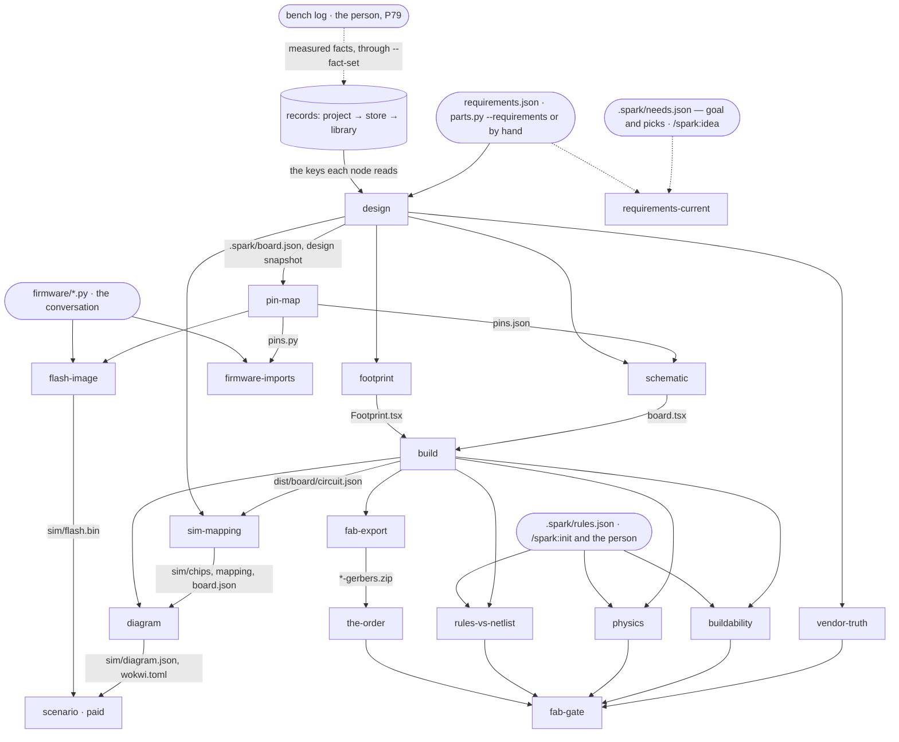

# P158 part 2 — design A2: the chain as a build graph

Written 2026-10-10 by the architect for angle A2, against spark 0.8.1 at main `5acbe42` (E `git log -1` →
`5acbe42 2026-10-10 22:26:37 +0200 Merge pull request #129`). One of three drafts written in parallel; this one makes
the strongest case for one angle — **the chain is a graph of artefacts with content hashes, the ledger of assumptions is
the graph's own metadata, and `check_spine` becomes its runner** — and does not hedge towards the others. Nothing is
built; this file proposes and decides nothing for the PO.

**Tags.** **E** a pointer (file:line at `5acbe42` unless another repository is named; a command and what it printed; a
card read with `gh issue view`, read-only, 2026-10-10), **H** a claim with its source, **D** a decision (who, when), **—**
unknown. *Estimate* marks every size and time that is not measured. Sizes: S under an hour, M a day, L more (estimates).

**What rests on what I ran.** No spark command was run, and the PO's store was neither copied nor opened. My runs,
2026-10-10, all read-only: `make --version` → `GNU Make 3.81`; `command -v` for `make just redo doit snakemake ninja
bazel tup` → only `/usr/bin/make` and `/opt/homebrew/bin/ninja` found; `importlib.util.find_spec` → `doit False`,
`snakemake False`, `graphlib True`; `/usr/bin/python3 -c "import graphlib …"` → `3.9.6 ['a', 'b', 'c']` (a topological
sort from the standard library on macOS's own Python); one sha256 pass over 53 files the chain reads or is (the three
projects' boards, circuits, requirements, rules and part records, spark's library records and `scripts/*.py`) →
`53 files 2496605 bytes 11.9 ms`; a read of the three projects' records counting placeholder classes (§5); greps cited
where used. Read: the files the brief names (§13 says what I did not read).

## 1. The idea in one paragraph

spark's chain is already a graph — requirements and records → resolved board → pin map → `board.tsx` → footprint →
`circuit.json` → checks → simulation mapping → diagram → flash image → scenario — but nothing in spark knows it: the
order lives in the 19 early returns of one 187-line function (`check_spine.py:319-505`, E 00 §"check_spine's stages"),
each run starts from nothing in a temp folder that is deleted (`:600`, `:686`), "what ran before" is known only by
re-running (E 00: "It does not know. No script reads a marker 'stage X ran'"), and the placeholders a run rests on are
said in seven different places in seven different shapes (`--assume-missing-sizes`, `footprint_placeholder`, the
stand-in sentences, `WHAT-THIS-CANNOT-SHOW.md`, `unserved`, `core_note`, the stderr notes) or not at all. The PO's own
test bench already runs its chain as a build graph and wrote down why: *"Make is used rather than a script because the
dependencies are real files: change `board.tsx` and only the things downstream of it are rebuilt, in order, and `make -n`
explains the plan"* (E `~/Development/smartbin-local/Makefile:12-13`). This design makes the graph spark's own, as data:
every step is a **node** with declared input artefacts (including the exact record keys it reads), declared outputs and
one function; every artefact is identified by a **content hash**, so a changed fact reruns only its downstream, a
`git checkout` that only touches mtimes reruns nothing, a file the person edited after spark wrote it is kept and named,
and **stale** is a question `--status` answers without running anything; every node's answer is one **envelope** that
carries its problems (each with where, why, what to do) and its **assumptions** (each with the fidelity it lacks and the
command that upgrades it); the run record of every node is kept in the project, so the **ledger** of a target is the
union of the assumptions of the nodes it rests on — a placeholder may flow through the chain, but it can never disappear
from the final verdict, because the verdict *is* that union. Decisions — the goal, the picks, the requirements, the
firmware, the bench — are **sources** that only a person or the conversation produces; where a target needs one that
has no safe default, the runner stops and names the command that makes it; where a safe default exists (a size, a
stand-in, a generic board, no firmware yet), the runner goes on and the default becomes a ledger entry. The runner is a
few hundred lines of standard-library Python over `graphlib` (an estimate), because spark promises "nothing outside its
standard library" (E `docs/guide/agents.md:70`) and none of the existing runners is installed or installable on those
terms (§2, U4).

**Not LangGraph, not DSPy** (H, from memory of their documentation; not searched, because nothing here rests on them and
the assistant already recommended against option 5 on 2026-10-10, the brief). LangGraph runs a state machine whose nodes
call a model; spark's nodes are deterministic programs and its model is the conversation in Claude Code, so the graph
spark needs is a build graph whose decision points hand back to the conversation, not an agent runtime inside spark.
DSPy optimises prompts against a metric; §8 builds the metric (evals) and leaves the prompts to the pages, where W14's
"pull, never push" already governs them.

## 2. Module boundaries

Nine units. A unit imports only from a lower layer (part 1's layers, `proposal.md` §2.5: 0 `outcomes`, `fab`,
`netlist`, `copper` · 1 `store` · 2 records · 3 `boards`, `design`, `assign_pins` · 4 `emit_board`, `emit_footprint` ·
5 `drawer`, `needs`, `cost` · 6 the commands); the new units take the layer named in their row, and part 1's
import-direction test (§2.5 seam 4) covers them.

### U1 · `outcomes` (extended) — one answer, two renderings

- **Purpose.** The one shape every script answers in, and the one function that prints it as text or JSON.
- **Interface.** `envelope(tool, op, data=None, problems=(), unchecked=(), assumptions=(), nodes=None, target=None,
  next_steps=(), truncated=None, store=None, project=None) -> dict` (envelope 2, §3.1); `problem(kind, where, why,
  fix=None) -> dict`; `assumption(id, what, fidelity, where, introduced_by, lacks, upgrade) -> dict` (shape in §3.5,
  the rules in U2); `render(envelope, as_json: bool) -> str` — the only printer; `read_json(path, what) -> object`
  raising `Unreadable(path, why)`; `exit_for(envelope) -> int`. Layer 0, standard library only.
- **Errors.** `Unreadable` (not there / not UTF-8 at byte N / not JSON / a list where an object belongs); every `main`
  maps it to `could-not-run`, kind `input`, naming the path.
- **Depends on.** Nothing.
- **Seam.** Pure functions. `test_outcomes.py::test_both_renderings_carry_every_field` (each field of a fully populated
  envelope appears in the text rendering — per field by name, never "every text line is reachable", which part 1 §4
  refuses as vacuous); the outcome invariant, part 1's seam (1): every `main` fed a non-UTF-8 file, a list where an object
  belongs and a missing path exits 2 with one sentence and no traceback.
- **Today's code becomes.** `outcomes.py:46-74` (`answer`, `envelope`) → `envelope` 2; `status_of` (`:32-43`) stays as
  is (00 "Keep" 1); `parts._say` (`parts.py:2171-2186`), `check_spine.render`/`report` (`check_spine.py:544-556`,
  `:668-691`), `check_all.render` (`check_all.py:383-427`) and the `print(json.dumps(…))` of the other six `--json`
  scripts (E 00 "Output envelopes": nine shapes, printed with three different `json.dumps` settings) → `render`; the 37
  `json.loads(…read_text…)` sites in 16 scripts (E 00 V5) → `read_json` (the 2026-09-30 note's unbuilt target 3).

### U2 · `ledger` — fidelity and assumptions, as rules

- **Purpose.** Decide the fidelity of a fact or an artefact, and hold the four ledger invariants (§5).
- **Interface.** `LEVELS = ("placeholder", "stated", "datasheet", "measured")`; `fidelity_of(record, key, kept) -> level`
  (from the fact's `origin` and whether its document is kept, §3.4); `lowest(levels) -> level`; `closure(assumption_sets)
  -> list` (union by `id`, stable order); `below_floor(assumptions, floor) -> [problem]` (a target's fidelity floor,
  §4.3); `owed_table(nodes) -> {fact: [(node, targets)]}` — the owed-facts table **derived** from node declarations.
  Layer 0.
- **Errors.** None raised; a fact with no readable `origin` is `stated`, said as such (never a guess upward).
- **Depends on.** Nothing (records arrive as dicts).
- **Seam.** Pure; property tests over seeded random graphs from the standard library's `random`:
  `test_ledger.py::test_an_assumption_never_leaves_the_closure`, `::test_only_an_upgraded_input_discharges_an_assumption`,
  `::test_a_target_turns_an_assumption_below_its_floor_into_a_problem`.
- **Today's code becomes.** `parts.CHAIN_FACTS`, `owes`, `_about` (`parts.py:98-117`, the regex over problem sentences
  TECH-LEAD-3 (e) names) → `owed_table` read from the nodes; `check_all.placeholder_components_in` (`check_all.py:152`),
  `emit_board.placeholders` (`emit_board.py:305-318`), `check_spine.left_off` (`:533`), `core_note` (`:300`) and
  `sim_project.limits_of`/`write_limits` → producers of assumptions; `WHAT-THIS-CANNOT-SHOW.md` stays as a file and
  becomes a rendering of the simulation target's ledger.

### U3 · `paths` — which project owns a file, and where a script may write

- **Purpose.** The resolver the P179 fix suggested (#124): one answer to "where is spark", "which project owns this
  path" and "may this operation write here".
- **Interface.** `plugin_root() -> Path`; `project_of(path) -> Path | None` (the nearest folder up holding
  `boards/active.json` or `.spark/`, compared by resolved folder, never by spelling — CH-10); `write_target(path,
  operation) -> Path` raising `Refused(path, operation, why)` — a person's data never into `plugin_root()`, spark's own
  regenerable artefact only when the operation names it as such (part 1 R2, N14, N28); `state_dir(project) -> Path`
  (`.spark/state/`, created with its own `.gitignore` holding `*`). Layer 1, beside `store` (which keeps `home()`).
- **Errors.** `Refused`, mapped to `could-not-run`, kind `store`, naming the path and the operation.
- **Depends on.** `outcomes`.
- **Seam.** Temp folders: `test_paths.py::test_an_unmarked_folder_inside_spark_is_refused_a_write` (N25),
  `::test_a_symlinked_board_file_does_not_write_into_spark` (N26), `::test_one_folder_under_two_spellings_is_one_project`
  (CH-10), `::test_no_module_but_paths_derives_the_plugin_folder` (a grep test over `scripts/`).
- **Today's code becomes.** `boards.py:38` (`LIBRARY`), `:135` (`project_root`), `:153` (`PLUGIN_ROOT`), `:156`
  (`project_or_library`); `parts.py:45`; `store.py:33` (read by nothing, E 00); `tools.py:43`; `fab.py:27`;
  `check_spine.py:330` (`project or SCRIPTS.parent`); `check_vendor_pins.py:108` (alias); `check_physics.py:540` and
  `compare_design.py:281` (three folders up from a circuit) → `paths`. `boards.py:150-152`'s written rule ("--resolve,
  which writes, never does [fall back to the plugin]") becomes `write_target`'s one rule.

### U4 · `runner` — the graph engine, which knows nothing about electronics

- **Purpose.** Given declared nodes and artefacts, a project's state and a target: plan what must run and why, run it
  in order, record each run, and answer with one envelope.
- **Interface.**
  - `Artefact(id, path, owner, hash)` — `owner` ∈ `spark` (a node writes it), `person` (a decision source),
    `store` (a record, read through the layers), `tool` (a program, hashed by its version); `hash` ∈ `bytes` (sha256 of
    the file), `keys` (sha256 of canonical JSON over the record keys a node reads — today's `parts.digest`,
    `parts.py:909-915`, generalised), `tree` (over a folder's sorted entries), `version` (a tool's reported version),
    `merged` (an output the node itself merges with the person's edits — the diagram, §4.4).
  - `Node(name, inputs, reads, outputs, run, effects=(), decided_by=None)` — `reads` = `{kind: [keys]}` per record
    input; `effects` ⊆ `{"network", "paid", "writes-project"}`; `run(ctx) -> envelope`.
  - `Target(name, nodes, floor)`.
  - `plan(graph, state, target, force=()) -> [(node, action, reason)]`; `run(graph, state, target, force=()) ->
    envelope`; `status(graph, state, target) -> envelope` (writes nothing).
  - State: one run record per node per design in `paths.state_dir(project)/runs/<design>/<node>.json` (§3.3).
- **Errors.** `GraphError` (a cycle, two producers of one artefact, an input nobody produces and nobody decides) —
  raised when the graph is declared, so a test fails, never a person's run; a node that raises → its own
  `could-not-run`, kind `crash`, its downstream `not-reached`; an unreadable run record → `could-not-run`, kind
  `input`, naming the file (it is a cache: `--force` rebuilds it); a run already holding the project's lock →
  `could-not-run`, kind `busy`, naming the holder's pid and start time.
- **Depends on.** `outcomes`, `ledger`, `paths`, and one `locked(file)` helper shared with `store` (today's
  `store.locked`, `store.py:178-200`, takes a path instead of computing one in the temp folder — CH-3's own move).
- **Seam.** Fake nodes that write files in a temp project, an injected clock and an injected hasher; no tsci, no
  converter. `test_runner.py::test_a_changed_input_reruns_only_its_downstream`,
  `::test_identical_output_bytes_stop_the_cascade` (early cutoff), `::test_a_checkout_that_changes_only_mtimes_reruns_nothing`,
  `::test_a_file_edited_after_spark_wrote_it_is_kept_and_named`, `::test_a_missing_decision_stops_with_kind_decision_and_its_command`,
  `::test_a_node_that_raises_is_could_not_run_and_stops_its_downstream`, `::test_a_cycle_or_two_producers_is_refused_when_declared`,
  `::test_a_second_run_in_one_project_names_the_holder`, `::test_status_writes_nothing`.
- **Today's code becomes.** `check_spine.verdict` (`:526-530`) → the runner's verdict over the plan; the temp work
  folder (`:600-603`, `:686`) and `keep_into` (`:637-665`) → removed (§9); `design_handed_to` (`:558-568`) → the
  `design` node's output, which is the snapshot `built` names; `parts.note_built` (`parts.py:918-929`), called by
  `check_spine.main` (`:625-629`) → written by the runner when a target ends `ok`, with the target and the ledger's ids.

**The runner, judged against what exists** (the PO's rule, D 2026-10-06: only free things, one best tool per job, a
local CLI first, nothing heavy to install; and spark's own: Python 3.9+ and nothing outside its standard library, E
`docs/guide/agents.md:70`, `README.md:85`):

| candidate | content hashing | installed here | what a hobbyist installs | fits spark's "stdlib only" | can stop for a decision and answer in the envelope | verdict |
| --- | --- | --- | --- | --- | --- | --- |
| make | no: modification times (H, make's documented model); a stamp-file idiom can emulate hashes | yes, GNU Make 3.81 (E) | nothing on macOS; Windows has none (H) | n/a (not Python); recipes are shell, and on 3.81 `pipefail` is ignored, which the bin's Makefile records as the trap that let two checks pass silently (E `Makefile:15-20`) | no: exit codes and shell text only | **not spark's runner**; stays the bin's own outer loop, which may call `check_spine --target <t>` |
| doit (pydoit) | — (the two pages I fetched do not say whether `file_dep` compares checksums or times, §14; H from memory: checksums) | no (E `find_spec`) | `pip install doit` | no — a third-party package | through Python actions, yes | **no**: the stdlib rule |
| snakemake | — | no (E) | a large package with many dependencies (H) | no | built for data pipelines (H) | **no** |
| redo | optional (H) | no (E) | one of several implementations (H) | no | no | **no** |
| just | none: a command runner, not a build system (H) | no (E) | a binary | no | no | **no** |
| ninja | no: times plus `restat` (H) | yes, via Homebrew (E) — not a default anywhere (H) | a binary, and a generator to write `build.ninja` | no | no | **no** |
| own runner over `graphlib.TopologicalSorter` + `hashlib` | yes, by construction | yes: `graphlib` in 3.9.6 and 3.10.0 (E my runs); `hashlib` already used by `parts.digest` and `store.keep` | nothing | yes | yes: the node returns the envelope | **adopt** — 200 to 300 lines (estimate) |

Hashing is not a cost to design around: one sha256 pass over everything the three projects' chains read, plus spark's
library and scripts, took 11.9 ms for 2,496,605 bytes in 53 files on `/usr/bin/python3` (E, one run). The value of the
graph for spark is not speed — the chain builds in "seconds" (H, `commands/build.md:2`) — but **state**: knowing what ran
on which inputs, saying what is stale, keeping the person's edits, and sparing the two kinds of node that do cost: the
network (`effects: network`, the vendor header) and the paid simulator (`effects: paid`, a scenario run spends Wokwi CI
minutes, E `commands/build.md:209`). Neither is ever in a default plan (§4.3).

### U5 · `chain` — spark's graph, as data

- **Purpose.** The one statement of spark's nodes, artefacts and targets. The composition root: it imports the node
  implementations; nothing imports it but the CLIs and the MCP face.
- **Interface.** `ARTEFACTS`, `NODES`, `TARGETS` (§4); `graph() -> (artefacts, nodes)` validated at import by
  `runner`. Layer 6.
- **Errors.** `GraphError` at import (a test catches it).
- **Depends on.** `runner` and every node implementation (U6).
- **Seam.** `test_chain.py::test_the_graph_is_valid`; **the read-audit seam**:
  `::test_every_node_reads_only_the_record_keys_it_declares` runs each node on the fixtures with records wrapped in a
  dict that records the keys read, and asserts read ⊆ declared — the test that catches an undeclared input, the one way
  content hashing can be wrong (§12, risk 3); `::test_the_owed_facts_table_is_derived_from_the_nodes` (the derived table
  equals today's `CHAIN_FACTS` consequences on the fixtures, then replaces it).
- **Today's code becomes.** `check_spine.run`'s sequencing (`:319-505`); `check_all.CHECKS` (`:281-292`),
  `CONVENTIONS` and `discover` (`:301-358`); `init_project.py:422-445`'s second copy of the circuit glob;
  `parts.BUILD_FACTS`/`BOARD_FACTS` (`parts.py:903-906`) → each node's `reads`.

### U6 · node implementations — the existing scripts, each with a function the runner calls

- **Purpose.** Do one step. Each script keeps its command line (the bin calls `boards.py`, `check_vendor_pins.py`,
  `check_physics.py`, `check_bom.py` directly, E the bin's `Makefile:49-53`, `:96`, `:182-186`, `:212-232`), and gains one
  function `node(ctx) -> envelope` that the CLI's `main` and the runner both call.
- **Interface.** `ctx` = `{project, design, inputs: {artefact: Path}, reads: Reads, out: {artefact: Path}, tools}`;
  the function writes only `ctx.out` paths and returns the envelope with its assumptions.
- **Depends on.** Their own layer, as today.
- **Seam.** Their own test files, unchanged in substance (1,411 tests are in a script's own file, E 00); each gains one
  `node(ctx)` test with a fake `ctx`.
- **Today's code becomes** (one row per node of §4):

| node | function | from today's code |
| --- | --- | --- |
| `design` | `design.node` | `design.load` + `boards.load` + the `requirements`, `board` and `parts` stages (`check_spine.py:333-351`, `:578-583`); writes `.spark/board.json` (today `boards.py --resolve`, `boards.py:260-272`) and the design snapshot |
| `pin-map` | `assign_pins.node` | `assign_pins.assign` + `pin_module` (`assign_pins.py:392-454`); writes `pins.py` and `pins.json` — today computed again inside `emit_board` |
| `schematic` | `emit_board.node` | `emit_board.render(design, pins) -> (text, notes)` (TECH-LEAD M-A); notes become assumptions or problems by `kind`, never by channel (`check_spine.py:374-375` goes) |
| `footprint` | `emit_footprint.node` | `emit_footprint.main` called in-process today (`check_spine.py:379`) |
| `build` | `engine_tscircuit.node` | `find_toolchain`, `modules_for`, `toolchain_can_build`, `tsci_version`, `count_in`, `islands_in` (`check_spine.py:94-300`, `:386-446`) — the adapter for the `board-engine` role that P154 (#89) asks to make switchable (TECH-LEAD-8, M-F) |
| `sim-mapping` | `sim_project.node` | `mapping_for`, `stage_chips`, `wokwi_toml` (`check_spine.py:455-473`) |
| `diagram` | `sim_project.diagram_node` | `find_converter`, `converter_command`, the converter call, `write_limits` (`check_spine.py:176-221`, `:475-504`); classification by the converter's own `--json` (CH-46), not by `CONVERTER_HAS_NO_PART` |
| `flash-image` | `flash_image.node` | `flash_image.main` (113 lines) |
| `firmware-imports` | new, a harness | slice 3's "irrigation's firmware imports without running" (E `STORY_MAP.md:68`); P59 (#7) |
| `scenario` | `sim_project.scenario_node` | the bin's `make simulate` (E `Makefile:147-158`); `effects: paid` |
| `vendor-truth`, `buildability`, `the-order`, `physics`, `rules-vs-netlist` | each check's `run` | `check_all`'s five `Check` subclasses (`check_all.py:120-273`) |
| `fab-export` | `engine_tscircuit.export_node` | the bin's `$(GERBERS)` rule (E `Makefile:180-186`) |
| `fab-gate` | `boards.fab_node` | `boards.py --validate --for-fab` plus the `pcb` target's floor (CH-36) |
| `requirements-current` | `needs.current_node` | `needs.requirements` as a dry run compared with `requirements.json` (§4.2) |

### U7 · `check_spine.py` — the runner's command line

- **Purpose.** The one command for every target. Keeps its name: seven pages, the routes test and `/spark:build` name it
  (E `tests/test_routes.py:31`; `commands/build.md:3`).
- **Interface.** `check_spine.py [requirements.json] [--project DIR] [--target circuit|firmware|simulation|checks|pcb|scenario]
  [--plan] [--status] [--force NODE …] [--json]`. Default target `simulation` (today's behaviour). `--plan` prints what
  would run and why and runs nothing; `--status` prints every node's state; `--force` reruns named nodes.
- **Removed flags.** `--keep` and `--sim-dir` (outputs are kept in place, §4.4, §9). `--firmware` becomes the
  `firmware/` source artefact.
- **Seam.** `test_routes` (the documented commands still route), `test_check_spine`'s CLI tests; the 89 tests of
  `test_check_spine.py` keep their meaning, re-pointed at nodes (E 00: 89 own tests, 48 anchors in 18 tables).

### U8 · `mcp_server.py` — the MCP face, a setting (§7)

### U9 · evals — fixtures, golden envelopes and the recorder (§8)

## 3. Data contracts

### 3.1 The envelope (version 2) — every script, every node, the MCP face

```json
{
  "envelope": 2,
  "tool": "check_spine",
  "op": "run",
  "target": "simulation",
  "status": "ok",
  "verdict": "the chain runs end to end, on 12 assumptions",
  "store": "~/.local/share/spark",
  "project": {"path": ".", "id": "…"},
  "data": {},
  "problems": [],
  "unchecked": [],
  "assumptions": [
    {"id": "part:dc-barrel-jack-12v-inlet.footprint", "what": "drawn with a placeholder footprint",
     "fidelity": "placeholder", "lacks": "stated",
     "where": {"file": "parts/dc-barrel-jack-12v-inlet.json", "key": "footprint_placeholder"},
     "introduced_by": "schematic", "affects": ["schematic", "build", "buildability"], "blocks": ["pcb"],
     "upgrade": {"op": "parts.fact-set", "argv": ["dc-barrel-jack-12v-inlet", "--project", "."],
                 "why": "a vendor footprint (footprint_source) or a measured one replaces the placeholder"}}
  ],
  "nodes": [
    {"name": "schematic", "status": "ok", "action": "ran", "reason": "input-changed: requirements.json",
     "seconds": 0.0}
  ],
  "next": [],
  "truncated": null
}
```

- A **problem** is `{kind, where, why, fix}`. `where` is an object with at least one of `node`, `file`, `key`,
  `subject`, `line` — so a person and an agent are told the place in one field (criterion b). `why` is the sentence;
  `fix` is what to do, a sentence. Envelope 1's `subject` and `sentence` (`outcomes.py:65-74`) become `where.subject`
  and `why`; envelope 2 replaces 1 in the same commit (W16).
- `kind` is one of eight closed words: `design` (a fault of the design), `input` (a file spark could not use), `tool`
  (a program missing or failing on a trivial input), `limit` (spark or a tool cannot express this — today's "converter has
  no part"), `crash` (an exception), `store` (the store or a write target refused), `decision` (a source only a person
  or the conversation makes is missing), `busy` (another run holds the project). CH-46's set (USER-AI-AGENT M-A: design,
  input, tool, limit, crash, store) plus `decision` and `busy`.
- `unchecked` items have the same shape; `status` is `outcomes.status_of(problems, unchecked)`, never declared.
- `assumptions` (§3.5) never change `status` by themselves; a target's floor turns the ones below it into `problems`
  (§4.3), and the assumption stays listed beside the problem it caused.
- `nodes` appears on runner answers only. `action` ∈ `ran`, `reused`, `waiting`, `not-planned`, `not-reached`; these are
  plan states, not a fourth status word (CH-45 keeps three).
- `verdict` is the one sentence the text rendering ends with; text and JSON say it identically.
- `next` is filled: every `fix` that is a command, every assumption's `upgrade` and the first decision's command are
  steps (`outcomes.step`, `outcomes.py:77-79`), `argv` holding ids only (store design §6.4.2).
- `store` and `project` name where the answer came from (part 1 R1; USER-AI-AGENT-4).

### 3.2 Exit codes — one meaning each

| code | status | the one meaning | examples |
| --- | --- | --- | --- |
| 0 | `ok` | it looked, as far as the target asks, and found nothing below the target's floor | the chain to `simulation` with 12 named assumptions; a `--plan` that ran nothing; a gap answered (D the PO 2026-10-04: "a gap is an answer") |
| 1 | `problems` | it looked and found something: a fault in the design or the input, or an assumption below the target's floor | islands; the `pcb` target over a placeholder footprint; an unknown id (D the PO 2026-10-04, §6.4.1; Q14 open) |
| 2 | `could-not-run` | it did not look, or not all the way: `kind` says why — a tool, an unreadable input, a crash, a decision not yet made, a busy project, a store refusal | no tsci; a missing `needs.json` goal; a run record that does not parse |

No script returns another code: the outcome invariant (U1 seam) catches a traceback's exit 1. Local names for the middle
code stay names (`outcomes.py:9-13`; `init`'s `NOTHING_TO_DO` stays until Q25). `boards.py`'s "no selection" → 1 goes
(CH-21).

### 3.3 The project state

All in `.spark/state/` of the project (U3), which carries its own `.gitignore` holding `*`, so no person's ignore file is
touched (spark writes none today: E `grep -n -i gitignore scripts/*.py` → nothing) and the folder never syncs into git:

- `runs/<design>/<node>.json` — one run record per node per requirements file (`<design>` is the file's stem; a project
  with two requirements files keeps two graphs, which is where K49's "one MCU" limit later opens, TECH-LEAD-7):

```json
{
  "schema": 1, "node": "schematic", "design": "irrigation.requirements.json",
  "ran": "2026-10-10T21:04:11Z", "spark": "0.9.0", "code": "sha256:…",
  "inputs": {
    "requirements.json": {"hash": "sha256:…"},
    "part:sen0217-flow-meter": {"layer": "project", "keys": ["body_mm", "footprint", "footprint_placeholder",
                                "host_parts", "needs", "pin_order", "power"], "hash": "sha256:…",
                                "fidelity": {"body_mm": "placeholder", "footprint": "placeholder"}},
    "pins.json": {"hash": "sha256:…"}
  },
  "outputs": {"board.tsx": {"hash": "sha256:…", "owner": "spark"}},
  "status": "ok", "problems": [], "unchecked": [], "assumptions": [{"id": "…"}],
  "seconds": 0.0
}
```

- `lock` — the project's run lock (U4).
- Nothing else. The ledger is not stored: it is computed from the run records (criterion c, nothing twice). The `built`
  event in the person's history (`store.py:273-274`, `EVENT_KEYS`) gains `target` and `assumptions` (ids), and
  `assumptions` joins its keys, so a later proof with fewer placeholders is a new line, not a duplicate.
- Run records hold project-relative paths and record ids with their layer, never a home path, so they could be
  committed — but they are a cache, rebuilt by `--force`, and self-ignored by default.
- `code` is the sha256 over `scripts/*.py` and `data/*.json` of the spark that ran (11.9 ms for 53 files including the
  scripts, E): every spark update makes every node stale once. A per-node revision number would rerun less and depend
  on a person remembering to bump it — QA2-7.

### 3.4 Fidelity — four levels, where each comes from

| level | means | a record fact is at this level when (CH-65's `origin`, decided D the PO 2026-10-06, #17) | an artefact or a choice is at this level when |
| --- | --- | --- | --- |
| `placeholder` | something stands in so the chain can run; nothing vouches for it | the fact is absent and a declared default was used (a placeholder outline, E `docs/guide/journey.md:469`; `--assume-missing-sizes`, E `emit_board.py:1101-1109`); `footprint_placeholder: true`; `simulation.skip` | the generic board (§5.1); no firmware (§5.2); a Wokwi stand-in or a custom chip for a module; a stand-in board (`wokwi_is_stand_in: true`); a choice spark made among candidates |
| `stated` | someone wrote it and nothing checkable backs it | no `origin`; `origin: maker` whose document is not kept; a value a person typed; today's `verified: false` | the person's own `board.tsx` or `rules.json`; firmware the conversation wrote |
| `datasheet` | the maker's document says it, and spark keeps that document | `origin: maker` with the cited document kept in the store (`sources/<sha256>/`) | — |
| `measured` | taken on the thing itself | `origin: measured` or `proven-by-use` | a bench log (P79 #16, P73 bin #2) |

`computed` facts take the lowest level of the facts they were computed from. Where the levels live: **in no new record
key** — `ledger.fidelity_of` computes them from `origin` (CH-65) and the kept documents, and the runner writes them into
the run records (per input key read) and the envelopes (per assumption). Until CH-65 lands, `verified: true` reads as
`origin: maker` (its alias, CH-65's own plan) and the document check decides between `datasheet` and `stated`. One new
board-record key, `generic` (§5.1).

### 3.5 An assumption

`{id, what, fidelity, lacks, where, introduced_by, affects, blocks, upgrade}`. `id` is stable across runs and names the
thing (`part:<id>.<key>`, `board:<id>.stand-in`, `signal:<NAME>.unwired`, `firmware.none`, `engine.core`); `lacks` is
the level the nearest target that refuses it requires; `affects` the nodes downstream that used it; `blocks` the targets
whose floor it is below; `upgrade` a step (§3.1). Which things are assumptions: every input at `placeholder`; every
simulation stand-in (board, part or chip); every default the runner chose; every declared signal left unwired (the
STATUS_LED case, CH-38); an output the person edited after spark wrote it (§4.4); the board engine's core when it is not
the one the documents were measured on (today's `core_note`). A `stated` fact is not an assumption unless a target's
floor is above `stated` — otherwise the ledger would list every fact of every record.

### 3.6 Schemas

`schemas/envelope.json` (envelope 2), `schemas/run-record.json`, and the record schemas part 1 asks for (CH-22, CH-28),
all **generated** from the declarations (U1's constructors, U4's record writer, the node `reads`, `boards.REQUIRED_KEYS`,
`PIN_ROLES`), never hand-kept (part 1 R5). The suite checks every script's `--json` output against the envelope schema
with a small standard-library key check, as `tests/test_json_contracts.py` does today; whether to validate with
`jsonschema` at run time is Q15. `test_json_contracts.py` collapses from nine shapes to one (E 00: nine scripts, nine
shapes).

## 4. The flow

### 4.1 The graph

Rounded boxes are decision sources (made by a person or the conversation, never by the runner); cylinders are records
read through the layers; rectangles are nodes. An edge label is the artefact that flows.



For the bin, `board.tsx` is a decision source (hand-written; spark checks it and never generated it, E
`scrum/VISION.md:39`), so its graph starts at `build`: the nodes `design` → `schematic` are not in its plan, and the
same declarations serve it (an artefact a node would produce but that the person owns is a source, §4.4).

### 4.2 Who runs what, and where a human or an AI decides

| who | runs | how the runner meets it |
| --- | --- | --- |
| the person, or the conversation following a page | the decisions: `/spark:idea` writes needs and picks (`parts.py --needs-set`, `--pick`), `parts.py --requirements` writes `requirements.json`, the person answers `rules.json`, the conversation writes `firmware/`, the person runs the bench | as **sources**. A target that needs one that is absent stops with `could-not-run`, kind `decision`, and `next` naming the command. A source that disagrees with the decision it came from is a check's problem: `requirements-current` compares `requirements.json` with what `needs.json`'s picks imply (`needs.requirements` as a dry run); `firmware-imports` imports the firmware against the current `pins.py` with a fake `machine` (Q37) and fails naming the missing name |
| an agent | research that fills an owed fact (`/spark:research`, `--fact-set`) — "research only the gap", P162 (#99) | the ledger is the list of gaps: each assumption's `upgrade` names the fact, so research is asked for exactly the facts a chosen target lacks |
| the runner (`check_spine`) | every deterministic node, in topological order, offline | `--target`, `--plan`, `--status` |
| the bin's `make` | its own derivations, and spark's four checks by direct call (E `Makefile:182-186`, `:212-232`) | unchanged; it may call `check_spine --project . --target checks` once that target exists, as one more recipe |
| nobody, implicitly | `network` and `paid` nodes | in a plan only when named: `--target scenario` spends Wokwi minutes (W10 moved to the PO's card, E `WORKING_AGREEMENTS.md:137-139`); the vendor header refresh stays `check_vendor_pins.py` live, as the bin's `refresh-vendor-pins` does (E `Makefile:222-223`) |

**The rule for decisions, stated once.** A decision with a safe default never stops the graph: the runner takes the
default and the default is an assumption. A decision with no safe default stops it. **A default is safe only when it
cannot change what connects to what** — a size, a position, a footprint's geometry, a simulation stand-in, a board's
silkscreen labels, the absence of firmware — because then the netlist every check reads stays true and only the
geometry and the simulation's fidelity are in question, which the ledger names. A pin order, a part's needs, a pin
role, the goal itself have no safe default: a guess there would be a circuit that lies, which the PO's words exclude
(*"if it works with that and doesnt lie o halucinate"*, D the PO 2026-10-08, #102 P165). This narrows "refusing rather
than guessing" (E `scrum/VISION.md:30`) to "refusing to hide a guess, and refusing any guess about connectivity" —
QA2-3 asks the PO.

### 4.3 Targets — what a person may stop at, and the fidelity each accepts

P165 (#102) asks for exactly this, in the PO's words: owed facts *"per step and target: a breadboard needs no outline"*,
and to *"go on with the gap marked in the output and the build's record"* (D the PO 2026-10-08, the card's "Value
proven by"). A target is a set of nodes and a floor:

| target | nodes (with their upstream) | floor | today's equivalent |
| --- | --- | --- | --- |
| `circuit` | `design`, `pin-map`, `schematic` | every placeholder accepted, each listed | `assign_pins.py`, `emit_board.py` |
| `firmware` | `pin-map`, `firmware-imports`, `flash-image` | firmware may be absent (`firmware.none`) | `--emit-pins`, `flash_image.py` |
| `simulation` (default) | `circuit` + `footprint`, `build`, `sim-mapping`, `diagram` | every placeholder accepted, each listed | `check_spine.py` |
| `checks` | `build` + the five checks | as each check decides: a check that cannot judge a placeholder answers `could-not-run` for it, as `check_footprints` does today (E `check_footprints.py:464-493`); W1 unchanged | `check_all.py` |
| `pcb` | `checks` + `fab-export`, `fab-gate` | geometry (`board.physical`, every part's `footprint` and `body_mm`) at `stated` or better; no `generic` board; no placeholder footprint | `boards.py --validate --for-fab`, the bin's `$(GERBERS)` |
| `scenario` | `simulation` + `flash-image` + `scenario` | `paid`: run only when named | `make simulate` |
| `breadboard` | — | — | not designed (P79 #16); a wiring table would be its node, and `body_mm` is outside its closure by construction |

The owed-facts table is then derived, not written: a fact is owed by a target iff some node in its closure `reads` it
and its fidelity is below the target's floor (`ledger.owed_table`). That replaces `CHAIN_FACTS`' one flat list and
`_about`'s regex (CH-37, CH-66), and is the mechanism P125 (#59) and P165 (#102) describe.

### 4.4 How a node knows what ran before, and what "stale" means

A node's state, decided from its run record and today's hashes, without running anything:

| state | when | `--status` says | `run` does |
| --- | --- | --- | --- |
| never ran | no run record | `never ran` | runs it |
| fresh | every input's hash, the `code` hash and every tool version equal the record's | `fresh (ran <time>)` | reuses its record and its assumptions |
| stale | an input's hash differs, or `code`, or a tool version | `stale: <artefact> changed (<old 8> → <new 8>)` — each reason, one per line | runs it; if its outputs come out byte-identical, its downstream stays fresh (early cutoff) |
| upstream stale | a producer of one of its inputs is stale | `stale if <producer> changes its output` | decided after the producer runs |
| kept | an output's hash differs from the hash the record says spark wrote: the person edited it | `board.tsx was changed after spark wrote it (<n> lines differ); it is yours now — spark builds it and does not overwrite it` | does not run the producer; downstream reads the person's file; assumption `output:board.tsx.kept` (stated) |
| waiting | a decision source it needs is absent and has no safe default | `waiting for <source>: <command>` | stops the target, kind `decision` |

"Stale" is therefore one sentence a person and an agent read the same way: *the inputs this node ran on are not the
inputs it would run on now*, with the artefact and both hashes. A modification time never decides it, so a
`git checkout`, a copy of the project, or a folder-sync client touching every file reruns nothing (test in U4). An
output marked `merged` — `sim/diagram.json`, whose converter keeps the positions a person tuned in the editor (E 00
"Inside the converter": `merge.ts`) — is an input of its own node and never "kept": the converter merges, so a hand edit
there is not a reason to stop regenerating.

Outputs land where the person and every check already look: `board.tsx`, `<Export>.tsx` and `dist/` at the project's
root, `sim/` beside them — the paths `/spark:build` already produces with `--keep .` (E `commands/build.md`, and
`check_spine.py:637-665`). The reference design and a requirements file in no project build in a temp folder as today and
remember nothing, and say so.

### 4.5 The text rendering of a runner answer

An illustration of the shape, not a recorded run (the docs gate's output notes apply to recorded blocks only):

```text
  design -> pin-map -> schematic -> footprint -> build -> sim-mapping -> diagram      target: simulation

  [ok  ] design        reused
  [ok  ] pin-map       reused
  [ok  ] schematic     ran      part:sen0217-flow-meter changed (body_mm)
  [ok  ] footprint     reused
  [ok  ] build         ran      <n> trace(s), 0 errors, tsci <version>
  [ok  ] sim-mapping   reused
  [ok  ] diagram       ran      <n> wire(s)

  assumptions (12) — the verdict rests on these; each says what replaces it:
    placeholder  dc-barrel-jack-12v-inlet  footprint     placeholder footprint   -> footprint_source or a measured one
    stand-in     board                     simulation    the generic ESP32-S3 devkit stands in; silkscreen labels lost
    declared     STATUS_LED                schematic     assigned a pin, connected to nothing — yours to wire
    …
  blocked for pcb by 3 of them; run --target pcb to see the problems they become

  the chain runs end to end, on 12 assumptions
```

## 5. Iterative fidelity

### 5.1 The generic board — a first-class placeholder

One board record per ESP32 family spark targets (`generic-esp32s3`, `generic-esp32c6`, `generic-esp32`), whose `pins`
are the chip's GPIOs as the Wokwi devkit of that family names them, whose `wokwi_part_type` **is** that devkit (so the
simulation loses nothing to a stand-in: it is the board), whose chip facts (`pin_roles`, `adc_gpio`,
`wake_capable_gpio`, strapping) are the chip's and carry the chip datasheet's fidelity, and whose `physical` is a
declared placeholder outline. One new key, `"generic": {"stands_for": "any ESP32-S3 board", "why": …}`; the `pcb`
target refuses a generic board by name; every answer lists `board:<id>.generic` as an assumption with the upgrade "pick
your board: `/spark:idea`, or a board record from your drawer (CH-24)". A requirements file that names no board uses
`generic-esp32s3` — the family whose interpreter spark ships (E part 1 §4: "one interpreter ships (the S3's)") — and
says so. The pin map on a generic board is true at the GPIO level; only the labels a person reads on their own board are
placeholders.

This is D8's path (D the PO 2026-10-09: *"we want to start by the boards"*) run in the other order: the PO's round A
need not wait for CH-24's board skeleton to get a whole that builds and simulates; CH-24 then upgrades one input. Which
Wokwi devkit stands for each family comes from the chip-name table part 1 adds (`data/wokwi-boards.json`, `{type: mcu}`,
CH-13, store lens S2), so "the closest Wokwi board" and "the generic board" are one lookup.

### 5.2 The generic firmware harness — no firmware, said

spark exports facts and a harness and never behaviour (D the PO 2026-10-01, the brief). So the placeholder firmware is
**none**: the `flash-image` node with no `firmware/` source packs the interpreter alone (`flash_image.py` already packs
"MicroPython interpreter + the project's files", E 00 module table), the simulation boots to the REPL, and the ledger
says `firmware.none — the simulation boots MicroPython and runs no code of yours`. The harness is `pins.py` (written by
`pin-map`, plain integers so CPython and MicroPython both read it, E `assign_pins.py:396-397`) and the
`firmware-imports` check node; when the conversation writes `firmware/`, its fidelity is `stated`, and the bench upgrades
it to `measured`. Nothing here writes firmware.

### 5.3 The ledger rule, as four invariants a test holds

"A placeholder may flow through the chain, but it can never disappear from the final verdict. Tolerance without a ledger
is just silence" (the assistant, 2026-10-10, the brief). Held by construction and by tests, not by care:

1. **Closure.** A target's ledger is the union, by `id`, of the assumptions introduced by every node in its closure —
   the nodes that ran *and* the ones reused, whose assumptions come from their run records, so a skipped rerun cannot
   drop one (`test_ledger.py::test_an_assumption_never_leaves_the_closure`).
2. **Monotone along edges.** An artefact inherits the assumptions of the inputs its node read; a node may add, never
   remove (`::test_a_node_cannot_remove_an_inherited_assumption` — the node function returns only what it introduces;
   inheritance is the runner's).
3. **Discharge only by input.** An assumption leaves only when the input it names reaches the level it lacks — a
   `--fact-set` with a measured `origin`, a picked board, a kept document. The runner compares; no node can
   (`::test_only_an_upgraded_input_discharges_an_assumption`).
4. **The verdict carries it all.** The envelope's `assumptions` is the target's ledger; the text prints every entry and
   the count in the verdict line; the `built` history event carries the ids; a target's floor turns the ones below it
   into problems that cite them (`::test_the_verdict_lists_the_whole_ledger`,
   `::test_a_target_turns_an_assumption_below_its_floor_into_a_problem`).

### 5.4 One upgrade, and what reruns — irrigation, from its records

The records as they are (E my read of `~/Development/irrigation/irrigation.requirements.json` and its `parts/*.json`,
2026-10-10): three placeholder footprints (`dc-barrel-jack-12v-inlet`, `dfr0831-buck-5v`, `sen0217-flow-meter`), two
simulation skips (the jack and the buck), three built-in stand-ins (`dfr0457` as `wokwi-led`, `ds3231` as
`wokwi-ds1307`, `tactile-button` as `wokwi-pushbutton`), two custom chips (`sen0217`, `sen0308`), one declared signal
(`STATUS_LED`), and the FireBeetle's `wokwi_is_stand_in: true`. By §3.5's rule that is a ledger of 12 at target
`simulation` (my count from those files; I4 measures it on the run). Two `body_mm` values carry `verified: false`
(`ds3231` scaled off a photo, `sen0217` taken from its placeholder header) — `stated`, so not ledger entries under
`simulation`; under `pcb` they stay `stated` and pass the floor, and the placeholder footprints do not.

The person measures the flow meter's lead housing and writes `parts.py --fact-set sen0217-flow-meter …` with
`origin: measured`. The record's hash over the keys `schematic` reads changes; the keys `sim-mapping` reads
(`simulation`, `host_parts`, `kind`, `ohms`, E my grep of `sim_project.py`) do not. `--plan` then says, before anything
runs: `schematic` stale (`part:sen0217-flow-meter: body_mm, footprint`), `build` upstream-stale, `diagram`,
`buildability`, `physics`, `rules-vs-netlist` upstream-stale if the circuit changes; `pin-map`, `footprint`,
`sim-mapping`, `flash-image`, `firmware-imports`, `vendor-truth` fresh. After the run, the ledger has 11 entries and
the one that left is named in the answer (`discharged: part:sen0217-flow-meter.footprint — measured`).

A swap is the same act on a decision source: change one pick, run `parts.py --requirements`, and `--plan` lists what the
swap invalidates before a minute is spent — the "extend, swap" ways in that K43 says have no verb (§11).

## 6. The store

### 6.1 Global, local, project — as the graph sees them

The three relations the store lens separates (STORE-8) keep three mechanisms (part 1 §2.3, D the PO 2026-10-04 for the
shared layer: "a public repo of records … cloned read-only … at a pinned commit", `docs/2026-10-04-store-discovery.md:209-211`):

| relation | carried by | in the graph |
| --- | --- | --- |
| shared ↔ local (records only, never the drawer, history, projects list or document bytes, §5.8) | git: a read-only clone at a pinned commit, contributed by pull request (CH-29, P178) | a layer row; a record read from it is an input `{layer: "shared@<commit>", keys, hash}`, so a pull that changes a fact a project reads makes exactly the nodes reading it stale |
| the person's own machines | the person's choice — a private git remote or a folder sync; spark survives both (CH-9's conflict-copy refusal, CH-3's lock beside the data) | `.spark/state/` is per-machine and self-ignored; content hashes make a synced project fresh on the other machine when the bytes are equal, which modification times never would |
| local ↔ project (a copy pinned to its source) | a lockfile: `based_on {layer, id, digest}` on every copy (CH-26, CH-63, STORE-15) | **the copy is a node**: input the source record, output the project's copy; its run record *is* the lock entry. "Behind its source" is "stale"; "edited in the project" is "kept" (§4.4) — so `--audit` (CH-26) and `--status` share one mechanism and one sentence |

### 6.2 The five verbs (D the PO 2026-10-10: "create search for and update and copy or share … the boards for sure")

| verb | today | in this design |
| --- | --- | --- |
| create | `--skeleton` (parts; a board refused under CH-14); boards by hand | a decision: `--skeleton`, the board record from a drawer entry (CH-24). Until it exists, the generic board (§5.1) keeps the chain whole |
| search | `--need`, `--match` (parts only, CH-18, CH-21) | unchanged mechanism; the envelope's `searched` (USER-AI-AGENT M-C) and `store` say where it looked |
| update | `--fact-set`, `--function-set` | an input change: `--fact-set --dry-run` can print which projects on the projects list read that key, and which of their nodes would go stale — the impact before the write (I7, later) |
| copy | `--promote` (into the plugin for a project record, K12; CH-4 retargets it) | the copy node of §6.1; `paths.write_target` refuses the plugin for a person's record (U3) |
| share | — | `--contribute` into a clone, printing the `git`/`gh` commands for the person's yes (CH-29, store lens B6); a P178 concept (#123) |

### 6.3 Replacing a board or a module in the simulation

What Wokwi allows (E, the store lens's reads, 2026-10-10): a module may be replaced by a built-in part or a custom chip
(`chip.json` + C compiled to WASM; the chips API offers GPIO, analog, timers, UART, I2C, SPI and a framebuffer; template
MIT) — STORE-12, STORE-13; a custom **board** is `board.json` + `board.svg`, loaded "only in the wokwi.com editor (press
F1 and choose 'Load custom board file…')", the CLI's project configuration documents `[[chip]]` and no board key, and the
`wokwi-boards` repository declares no licence — STORE-11; whether `wokwi-cli` loads a local board at all is — (STORE-11,
"not tried"). Each wokwi-boards `board.json` names its `mcu` (`esp32-s3-devkitc-1` → `esp32-s3`, …) — STORE-10. So:

- **The closest Wokwi board** is a lookup, not a guess: `sim-mapping` reads the board's `chip` and the chip-name table
  (`data/wokwi-boards.json`, CH-13), refuses a stand-in of other silicon (CH-13, a problem with `where.key:
  wokwi_part_type`), and when more than one devkit shares the chip, takes the table's first and records the choice as an
  assumption (`board:<id>.stand-in — chosen among board-esp32-devkit-c-v4, board-esp32-devkit-v1`) with the upgrade
  "write `wokwi_part_type` in the board file". A stand-in board's losses (CH-32) are ledger entries, so they reach
  `WHAT-THIS-CANNOT-SHOW.md` because that file renders the ledger.
- **A board made for it** is a node off the main targets, `wokwi-board` (`--target wokwi-board`): it writes `board.json`
  and a plain `board.svg` from the record (pins with targets, millimetre positions from `emit_footprint`'s pad placement)
  for the web editor and an upstream pull request, never copied from wokwi-boards (licence). No simulation target reads
  its output while `wokwi-cli`'s local-board support is unknown (CH-33, Q10).
- **A module**: its record's `simulation` stance — a built-in stand-in with its `stand_in` sentence, a custom chip, or
  `skip` with a reason (`parts.simulation_problems`, `parts.py:481-541`) — is read by `sim-mapping` and becomes one
  assumption each; a record with no stance stops `sim-mapping` as today (`sim_project.unmapped_detail`), kind `decision`,
  naming the record and the three stances. CH-69's help to find the closest built-in part is a search aid for that
  decision, not a node.

## 7. The MCP face

- **What it exposes.** Five tools, generated from the same registries the CLIs read: `spark_describe` (the node table and
  `parts.OPERATIONS`), `spark_plan`, `spark_status`, `spark_run` (`target`, `project`, `force`) and `spark_parts` (`op`,
  `argv`, ids only). Each returns envelope 2 as its result's text, byte-identical to the CLI's `--json` for the same
  arguments. Operations with `network` or `paid` effects (`--fetch`, `--sources`, `--target scenario`, `tools.py
  --install`) are **not** exposed: the CLI keeps them behind Claude Code's permission prompt, as `allowed-tools` does
  today (store design §6.4.5).
- **How it stays free and local.** Standard-library Python: the stdio transport is newline-delimited UTF-8 JSON-RPC,
  one message per line, nothing but protocol messages on stdout (E the MCP specification, transports, 2025-06-18,
  fetched 2026-10-10), which `json` and `sys.stdin` serve. The server calls each node or operation in process and
  returns its envelope; it never relays a script's stdout — `assign_pins.py` prints a note on stdout before its JSON today
  (E 00, Found on the way) and would corrupt the stream.
- **How it stays a setting.** An entry `spark-mcp` in `data/tools.json`, `kind: mcp`, `on: false`, beside the
  `wokwi-mcp` entry that already works this way (E `data/tools.json` `wokwi-mcp`: `kind mcp`, `on false`); `/spark:setup
  add spark-mcp` registers it through the existing `claude mcp add` path (E 00, `tools.py:360`). Off by default: a CLI
  costs nothing until called, an MCP server's tools load into every session (E `docs/mcp.md:3-6`). P154 (#89) is where
  the PO's "local CLI by default, MCP version in settings" is designed; this is one instance of it.
- **When.** Only when a consumer exists that is not Claude Code following a page — a shared store's editor (P160 #96) or
  an agent outside Claude Code. Until then it is a design, not a card (§10, I8).
- **Tests.** `test_mcp.py::test_tools_list_equals_describe`, `::test_a_call_returns_the_cli_json_byte_for_byte`,
  `::test_nothing_but_protocol_reaches_stdout`, `::test_no_network_or_paid_operation_is_exposed`.

## 8. Evals — the cold tests and recorded documents as a measured suite

Three layers, each saying what a pass proves and no more (criterion a; W9's habit — a claim is a hypothesis until
reproduced):

| layer | what runs | where | what a pass proves | what it cannot prove |
| --- | --- | --- | --- | --- |
| graph properties | the runner and the ledger on fake nodes; the read-audit seam on the real nodes over fixture records | the suite, every push | the invariants of §5.3 and §4.4 hold for every graph shape the generator tried; no node reads a key it does not declare on the fixtures | a node's correctness |
| golden envelopes | four fixtures — the reference design, a copy of irrigation's records and requirements, plant-alarm's requirements on library and fixture records, the bin's `board.tsx` as a source — run to each target; the envelopes, normalised (temp paths, home, store path, times, tool version), compared with the kept ones; plus scripted edits (§5.4) compared with the expected plans | the suite with a fake engine for everything up to `build`; the real `tsci` and converter on a developer machine, skipped elsewhere and said, as `test_converter` is today (E 00: 3 skips) | the chain's answers on these four designs did not change, or changed exactly as the commit says | any other design; a stranger's path |
| cold tests | a person or a fresh agent with the documents only: P100's rounds A–C (#6), slice 5's stranger (#15) | by hand, dated, a diary each | one path, once, by one reader (n = 1) | anything general |

- **What the cold tests measure, from the run records** (no new instrument): the number of runner answers to the first
  `ok` at `simulation`; the stops by `kind` (how many `decision`, `tool`, `input`); the ledger's size at the end and how
  many entries the person upgraded; the cost line (`cost.py`, where the session allows, K21). The scorer is named before
  the round (Q26).
- **Recorded documents.** CH-40's recorder (the one that exists untracked, promoted) runs each recorded block as a
  golden fixture through the runner; a block names its fixture and target; its diff fails the gate when
  `.claude-plugin/plugin.json`'s version changes (CH-40's rule). A page then cannot show an output the runner would not
  give.
- **How a skill or page change fails a test.** `tests/test_routes.py` already extracts each page's commands (E
  `test_routes.py:31`). Added: run each page's documented sequence against the fixtures with the fake engine and assert
  the final envelope's target, status and ledger ids. A page edit that drops a step, names a removed flag or reorders a
  decision after the node that needs it turns the fixture's final state different, and the test red. Whether a model
  *follows* the page is not a unit test; the cold tests measure it.
- **Mutation.** The anchors run at every push (E 00 "The gate"); a dated full sweep before I1 and after I6 (CH-2's
  rule, once a non-importing mutant is refused).

## 9. What is REMOVED

Each with the iteration that removes it (§10) and the test that holds its absence.

| removed | where today | replaced by | iteration | held by |
| --- | --- | --- | --- | --- |
| eight JSON shapes besides `parts.py`'s, and their three `json.dumps` settings | E 00 "Output envelopes" | envelope 2, one printer | I1 | `test_json_contracts` on one shape |
| `parts._say`, `check_spine.render`/`report`, `check_all.render` as printers | `parts.py:2171-2186`, `check_spine.py:544-556`, `:668-691`, `check_all.py:383-427` | `outcomes.render` | I1, I2, I6 | `test_both_renderings_carry_every_field` |
| unguarded `json.loads(…read_text…)` | 37 sites, 16 scripts (E 00 V5) | `outcomes.read_json` | I1 | the outcome invariant |
| `check_vendor_pins`' `mismatch` status and bare-list JSON | `check_vendor_pins.py:206-235` | three words, one envelope | I1 | the same |
| `agents.md`'s "not yet true everywhere" list, row by row | `docs/guide/agents.md:297-333` | the exit contract | I1 | the docs gate (CH-41) |
| the stderr → PROBLEMS rule | `check_spine.py:374-375` | notes as values with a `kind` | I2 | irrigation's golden at I4: exit 0 with `signal:STATUS_LED.unwired` |
| `CONVERTER_HAS_NO_PART` and `simulation_could_not_look` | `check_spine.py:216-221` | the converter's `--json` and `kind: limit` (CH-46) | I2 | a converter-output fixture |
| the 19 early returns and 23 ad-hoc `Stage` constructions of `run` | `check_spine.py:319-505` | node functions + `chain.NODES` | I2 | `test_the_graph_is_valid`; goldens |
| `emit_board` as a subprocess of the chain (it is also imported, E 00) | `check_spine.py:358-361` | `emit_board.render` in process | I2 | goldens |
| six of seven derivations of the plugin folder and three project guessers | `boards.py:38`, `:153`; `parts.py:45`; `store.py:33`; `tools.py:43`; `fab.py:27`; `check_spine.py:330`; `check_physics.py:540`; `compare_design.py:281` | `paths` | I2 | `test_no_module_but_paths_derives_the_plugin_folder` |
| the temp work folder for a project's run, its printed path (CH-71), `--keep`, `keep_into`, `--sim-dir` | `check_spine.py:600-603`, `:637-665`, `:686`; flags in `main` | outputs in place, state in `.spark/state/` | I3 | `test_routes`; goldens |
| `check_spine` writing `built` itself | `check_spine.py:625-629` | the runner, at a target's `ok` | I3 | a runner test |
| import-time fab numbers that ignore a project's override | `copper.py:40`, `:53`; `emit_board.py:114-116`; `emit_footprint.py:59` (E 00: 0.07 vs 0.035 for one rules file) | the fab numbers read per run from the `rules` input | I3 | a per-run override test |
| `CHAIN_FACTS` as a hand list, `owes`' flat reading, `_about` | `parts.py:98-117` | `ledger.owed_table` from node `reads` | I4 | `test_the_owed_facts_table_is_derived_from_the_nodes` |
| `left_off`/`unserved` special-casing, `core_note`, `placeholder_components_in`, `limits_of` as separate channels | `check_spine.py:300-317`, `:533-541`; `check_all.py:152-185`; `sim_project` | assumptions | I4 | the ledger invariants |
| `check_all.py` (its `Check` runner, `CONVENTIONS`, `discover`, the fourth word `skipped`) and `init_project`'s copy of the circuit glob | `check_all.py` whole (479 raw lines, E 00); `init_project.py:422-445` | `--target checks`; node inputs are named artefacts, not globs | I6 | `test_routes`; goldens; CH-68's contract tests for the bin's direct calls, which stay |
| hand-saved run logs as the only record of a run | irrigation keeps `build-log.txt`, `check-all.txt`, `check-all-2.txt` … `-4.txt`, `emit-notes.txt` at its root (E `ls ~/Development/irrigation`) | run records | I3 | — (a person's habit; not spark's code) |

Kept, on purpose: every script's own command line (the bin's contract, CH-68); `outcomes.status_of` and W1's three
outcomes (00 "Keep" 1); the store's door (00 "Keep" 4); `parts.py`'s operations and its size — the `parts.py` split stays
the PO's trade (Q12), because no node needs it: `parts.py`'s operations produce decision sources and are not nodes; the
`emit_board` and `check_*` refusal sentences (00 "Keep" 2); "a pass is measured, not inferred" (`count_in`,
`islands_in`), moved into the build node unchanged (00 "Keep" 3).

## 10. Migration — iterations, each ending in a whole that runs

"Runs for the bin, irrigation and plant-alarm" means, at every iteration's end, on copies in a scratch folder with
`SPARK_HOME`, `HOME` and `TMPDIR` as three separate words: **the bin** — its `make check` exits as before on the PO's
machine (the bin's contract; CH-68's tests pin its four direct calls), and from I6 `check_spine --project <copy>
--target checks` gives the same check verdicts as `check_all` did at I0; **irrigation** — `check_spine
irrigation.requirements.json` answers, and only the changes the iteration names differ from its I0 golden; **plant-alarm**
— the same with `requirements.json`, whose soil probe resolves from the person's shelf (E `user-ai-agent.md:67`:
`sen0193-soil-moisture (shelf)`), so its fixture carries a fixture store.

| | scope | part 1 changes it carries | cards it reuses | hypothesis | measurement | pass line | cost (estimate) |
| --- | --- | --- | --- | --- | --- | --- | --- |
| **I0** | the measuring instrument: four fixtures, golden envelopes of today's outputs (text, `--json`, exit), the normalisation list | CH-68's tests; CH-2's dated sweep before the epic | #103 P166 (QA we can trust) | today's outputs are deterministic enough to diff | two runs on one machine, diffed after normalising | 0 differing lines with at most 5 normalisation rules; more rules is itself a finding about determinism | S–M |
| **I1** | envelope 2, `render`, `read_json`, the exit contract, `kind`, `where`, filled `next`, `store` in every answer; `tools.py`, `boards.py`, `init_project.py`, `emit_board.py` gain `--json` | CH-16, CH-5, CH-45, CH-46, CH-48 (JSON half), CH-56, CH-73's `where`, CH-21's exit half; K55, K56, K57 | #11 P43's unmet value lines (a)–(c) (E 00: none met), #58 P124, #23 P92, #52 P118, #53 P119, #65 P131 | one envelope carries every script's content without loss | the named omissions of CH-16 (each a field) and the number of shapes in `test_json_contracts` | 0 omissions; 9 shapes → 1; the outcome invariant green for all 16 `main`s; the three projects' goldens differ only in shape | L |
| **I2** | `paths`; `chain` and `runner` without state: `check_spine.run` becomes a loop over the node table in the temp folder; `emit_board.render` in process; the converter's `--json`; `--plan` | CH-4's `paths` half, CH-10's comparison, CH-38's mechanism, CH-46's converter half | #124's suggested resolver; #89 P154 (the engine adapter shape) | the 19 early returns are a node table without changing a verdict | goldens of I0 | 0 verdict changes except irrigation's `schematic-notes` line, which becomes an assumption; the 48 anchors on `check_spine.py` re-anchored and the count said | M |
| **I3** | run records, content hashes, staleness, early cutoff, kept outputs, outputs in place, the project lock, `--status`, `--force`; `built` written by the runner | CH-35, CH-71, CH-55 (active.json an output of `design` when a requirements file exists, a source otherwise), CH-61's "what has been built" per project; the import-time fab numbers | #114 P174 (the lock helper, shared) | content hashes make "stale" right where modification times are wrong, and incremental runs spare what costs | five scripted edits on irrigation's copy (one fact, one pick, one rule, one tool version, one hand edit of `board.tsx`) against their expected plans; a `touch` of every file; a `git stash` / `git stash pop` | 5 of 5 plans exact; 0 reruns after the touch and after the stash; the hand edit kept and named | M–L |
| **I4** | the ledger and fidelity: assumptions from every node, the invariants, targets with floors, `owed_table` derived, `WHAT-THIS-CANNOT-SHOW.md` rendered from the ledger, `pcb`'s floor | CH-37, CH-66, CH-36, CH-32, CH-49 (coverage as an assumption before a paid node), CH-38's outcome; K65 via CH-65's alias | #102 P165 (its mechanism), #59 P125 | every placeholder spark knows today can be one ledger entry with an upgrade, and the rule holds by construction | per project, the ledger's entries against a hand count from the records by §3.5's rule (irrigation: 12 by my count, §5.4); the property tests; a mutation that drops inheritance | counts equal; every `upgrade` is accepted by the parser; irrigation exits 0 at `simulation` with `signal:STATUS_LED.unwired` listed (today exit 1, CH-38); the mutation caught | M |
| **I5** | generic boards (S3, C6, ESP32), no-firmware image, `firmware-imports`, decisions as sources with safe defaults (§4.2) | CH-13's table (shared), CH-34's targets, CH-67's `pins.py` facts; D8's path ahead of CH-24 | #5 P76 (a schematic without specific parts), #16 P79 (the harness's later bench), #7 P59 | (the PO's words) a whole that always runs, with every placeholder named, gets a person further than a refusal | P100 round A (#6), or a scratch walk if he chooses: answers to the first `ok`, stops by kind, whether the person names one upgrade from the ledger unaided — the PO scores (Q26); and on the suite: plant-alarm | plant-alarm reaches `simulation` exit 0 with the XIAO's footprint as a named placeholder and `pcb` exit 1 naming it (today it stops, CH-66); the round's pass line is written before the round, by the PO | M, plus three board records (S each) |
| **I6** | `check_all` folded into `--target checks`; the five checks as nodes; removals of §9's I6 rows; page updates | CH-45's `skipped`, CH-68 kept green | #70 P136 (a new check is a node; nothing else changes) | one runner replaces two orchestrators without breaking the bin | the bin's `make check`; the check verdicts on the four fixtures | identical verdicts to I0 on all four; `make check` exit unchanged; `check_all.py` deleted (or kept as a name, QA2-5) | M |
| **I7** | copies as nodes (`based_on` = the copy's run record), update impact (`--fact-set --dry-run` names the projects and nodes it makes stale), shared-layer inputs | CH-26 (re-read as a copy node), CH-63, CH-27, CH-29 | #123 P178, #17 P94, #96 P160 | a copy's provenance is a run record, so "behind its source" and "stale" are one sentence | change a store record after a copy; contribute and pull in a fixture clone | `--status` and `--audit` name the copy, the field and which side moved; the decisions P178's council takes first (Q8, Q9) | M, after P178's concept |
| **I8** | the MCP face, off by default | CH-48's describe as the tool list | #89 P154, #96 P160 | an agent outside Claude Code drives spark with the same envelope | the four MCP tests; one real client session | byte-identical answers; a real consumer named before the card enters Ready | M |

**Order against part 1.** I1 is part 1's rank 1 (CH-16) widened to the envelope; I2–I4 carry changes part 1 ranks in tiers
3–5 (CH-38 rank 50, CH-37 rank 48, CH-35 rank 43, CH-66 rank 41, CH-71 rank 69) because in this design they fall out of
one mechanism rather than being fixed one by one; the tier-1 changes that are not about the chain (CH-18, CH-17, CH-19,
CH-1, CH-6, CH-14, CH-12, CH-11, CH-10, CH-3, CH-15, CH-20, CH-9, CH-54, CH-72, CH-64, CH-2) are fixes inside existing
scripts that this design neither blocks nor needs, and may run beside I1–I4. Which order wins is the PO's (QA2-6). Each
iteration is one or more pull requests of its own (the PO's rule: a new PR for every bigger feature) and ends with the
council before the PR (scrum/README.md).

**What the PO decides, and before which iteration.**

| # | question | before | options |
| --- | --- | --- | --- |
| QA2-1 | Adopt the chain as a graph with spark's own standard-library runner (U4), instead of make, doit or another runner? | I2 | (a) yes; (b) no — keep the chain's order in code; (c) a runner package as a dependency (breaks "stdlib only") |
| QA2-2 | A project's run writes its outputs in place and keeps its state in `.spark/state/` (self-ignored), so `--keep` and `--sim-dir` go — or keep temp builds unless asked? | I3 | (a) in place; (b) temp unless `--keep` |
| QA2-3 | Safe defaults: a guess that cannot change connectivity is taken and listed (a size, a footprint's geometry, a stand-in, a generic board, no firmware), any guess about connectivity is refused — "refusing to hide a guess" in place of "refusing rather than guessing"? | I4 | (a) yes, for `circuit`, `firmware`, `simulation`; problems under `pcb`; (b) only for the defaults that exist today (`--assume-missing-sizes`, placeholder footprints); (c) no |
| QA2-4 | Generic boards in the library, one per ESP32 family, and `generic-esp32s3` when a requirements file names no board? | I5 | (a) yes; (b) generic boards, but no default — a missing board stops; (c) no |
| QA2-5 | `check_all.py` deleted in favour of `check_spine --target checks` (W16), or kept as that target's name? | I6 | (a) delete; (b) keep the name |
| QA2-6 | The iterations' order (I1–I4 pull CH-38, CH-37, CH-35, CH-66, CH-71 forward) or part 1's tier order, with I2–I4 after tier 1? | I1 | (a) iterations; (b) tiers; (c) I1 by tier (it is rank 1), then the PO picks |
| QA2-7 | A node's code identity: the hash of all of spark's scripts and data (every update reruns every node once), or a per-node revision a developer bumps? | I3 | (a) whole-spark hash; (b) per node |
| QA2-8 | The MCP face only when a consumer exists, as a setting off by default? | I8 | (a) yes; (b) now; (c) never |
| QA2-9 | Envelope 2 renames `subject` and `sentence` to `where` and `why`, in one commit, every `--json` reader updated? | I1 | (a) rename; (b) keep the names and add `where` beside them |

## 11. How this design meets part 1's changes

"Structural" — the design's mechanism removes the fault's shape; "a place" — the design names the unit and the moment, and
part 1's fix lands there unchanged; "not addressed" — a fix inside a script this design does not touch, with the reason.

| rank · CH | the fault, short | where in this design | how | iteration |
| --- | --- | --- | --- | --- |
| 1 · CH-16 | JSON drops the text, text drops the fix | U1, §3.1 | structural: one envelope, one printer | I1 |
| 2 · CH-13 | wrong silicon passes | §6.3, `sim-mapping` and `flash-image` read the chip-name table | a place | I5 |
| 3 · CH-18 | `--need` word splitting | — | not addressed: the matcher; the envelope's `searched` says what was looked for | — |
| 4 · CH-26 | copies carry no provenance | §6.1 the copy node | structural, re-read as a run record (part 1's field can land first) | I7 |
| 5 · CH-17 | a pick that does not do the need | §4.2 `requirements-current` | a place: the fit can be an assumption of that check | I4 |
| 6 · CH-21 | boards unsearchable, no envelope, exit 1 for "no selection" | U1, §3.2 | the envelope and exit halves structural; search not addressed | I1 |
| 7 · CH-19 | 91 drawer entries unreachable | — | not addressed: drawer data and matcher | — |
| 8 · CH-1 | `SPARK_HOME` empty or wrong | U1's `store` field; `paths` beside `home()` | a place; `home()`'s refusal is part 1's | I1 |
| 9 · CH-6 | the requirements writer | §4.2: `requirements.json` is a decision source | a place | — |
| 10 · CH-14 | `--skeleton --kind board` | — | not addressed | — |
| 11 · CH-12 | bare-number pad labels | — | not addressed: the board contract; its problem gets a `where.key` | I1 |
| 12 · CH-4 | writes into spark's folder | U3 `write_target` | structural | I2 |
| 13 · CH-11 | the real store's guard | U3 hosts the rule | a place; the rule is Q2's | — |
| 14 · CH-49 | a scenario's coverage | `scenario`'s inputs; coverage as an assumption before a paid node | a place | I4 |
| 15 · CH-36 | `--for-fab` ok without geometry | §4.3 `pcb` floor | structural | I4 |
| 16 · CH-10 | one folder, two spellings | `paths.project_of` | a place | I2 |
| 17 · CH-3 | the lock | U4 shares one `locked(file)` | a place; the move is part 1's | I3 |
| 18 · CH-15 | `--fetch` drops a URL | — | not addressed | — |
| 19 · CH-20 | −3 × 0 mm; `--step` on no folder | — | not addressed | — |
| 20 · CH-9 | sync conflict copies | §6.1 | not addressed (store read); content hashes make a synced project fresh | — |
| 21 · CH-54 | `function` on board records | §5.1 generic boards carry it | a place | I5 |
| 22 · CH-72 | `held by` column | — | not addressed | — |
| 23 · CH-55 | `active.json` left behind | §10 I3: an output of `design` when a requirements file exists | structural | I3 |
| 24 · CH-64 | the tally's window | — | not addressed; run records could close a window (H, mine) | — |
| 25 · CH-2 | non-importing mutants | §8 | not addressed; dated sweeps in I0 and after I6 | I0 |
| 26 · CH-22 | the board schema | §3.6 | a place: generated | I4 |
| 27 · CH-23 | MOSI/MISO build, the error two hops away | the `build` node reports tscircuit's error elements with `where` | a place | I2 |
| 28 · CH-24 | a board record from the drawer | §5.1 | complementary: the generic board keeps the chain whole until it lands | I5 |
| 29 · CH-25 | hold release | — | not addressed | — |
| 30 · CH-63 | board copies | §6.1 copy node | structural | I7 |
| 31 · CH-27 | boards in the store | §6.1 layer row | a place; P178 | I7 |
| 32 · CH-70 | the sync experiment | §6.1 | not addressed; `.spark/state/` is excluded from any sync | — |
| 33 · CH-29 | the shared layer | §6.1, §6.2 | a place; P178 | I7 |
| 34 · CH-31 | GPIO names on the stand-in | `sim-mapping` problem with `where` | a place | I5 |
| 35 · CH-30 | replacement documented nowhere | §6.3 is the content | a place | I5 |
| 36 · CH-32 | the board's stand-in missing from the limits file | §3.5, §6.3: the file renders the ledger | structural | I4 |
| 37 · CH-33 | make a Wokwi board | §6.3 `wokwi-board` node | a place; Q10 | later |
| 38 · CH-69 | closest part for a module | §6.3 | not addressed: a search aid for a decision | — |
| 39 · CH-7 | a second requirements file | §3.3 one graph per requirements file | a place; the rename is part 1's | — |
| 40 · CH-5 | unreadable input → traceback | U1 `read_json` | structural | I1 |
| 41 · CH-66 | the stop spelled twice | §4.3 derived owed table | structural | I4 |
| 42 · CH-8 | a half write | — | not addressed | — |
| 43 · CH-35 | `--keep` builds the regeneration | §4.4 "kept" | structural | I3 |
| 44 · CH-34 | firmware to the board | §4.3 `firmware` target; §5.2 | a place; the page is part 1's | I5 |
| 45 · CH-45 | a fourth status word; `init` twice | §3.1 three words, plan states apart | structural; `init` is Q25 | I1, I6 |
| 46 · CH-41 | the docs gate's reach | §8 recorded blocks bound to fixtures | not addressed (the gate); a place for its data | — |
| 47 · CH-68 | the bin's calls untested | §10 I0 | a place: its tests are I0's fixtures | I0 |
| 48 · CH-37 | three verdicts of one record | §4.3 `owed_table` | structural | I4 |
| 49 · CH-28 | schemas and an editor | §3.6 | a place: generated | I4, I7 |
| 50 · CH-38 | stderr is "the chain is broken" | U6 `schematic`; §3.5 declared signals | structural | I2, I4 |
| 51 · CH-39 | `rules.json` a snapshot | §4.1 `rules.json` a source | a place; part 1's seeding at `--requirements` stands | — |
| 52 · CH-46 | strings for kinds; empty `next` | §3.1 `kind`, `next` | structural | I1, I2 |
| 53 · CH-48 | `--describe` wrong; `tools.py` no JSON | U1; §7 describe from registries | structural for JSON; describe a place | I1, I8 |
| 54 · CH-43 | README's block | §8 | not addressed | — |
| 55 · CH-47 | the own-board route unrun | §8 a fixture | a place | I0 |
| 56 · CH-57 | private places | — | not addressed | — |
| 57 · CH-65 | `verified` four meanings | §3.4 fidelity reads `origin` | a dependency: I4 reads the alias until it lands | I4 |
| 58 · CH-67 | firmware facts into `pins.py` | `pin-map` writes `pins.py`; `firmware-imports` | a place | I5 |
| 59 · CH-44 | a figure without its source | §3.3 per-key fidelity in run records | a place | I4 |
| 60 · CH-73 | whose copy answered | §3.1 `where.file` | structural | I1 |
| 61 · CH-40 | the recorder | §8 | a place | I0 |
| 62 · CH-42 | a stranger's first pages | — | not addressed | — |
| 63 · CH-50 | drop a need, clear a pick | — | not addressed | — |
| 64 · CH-56 | `emit_footprint --json` prints TSX | U1 | structural | I1 |
| 65 · CH-53 | one word test, ranked | — | not addressed | — |
| 66 · CH-58 | `splitlines` in the transcript reader | — | not addressed | — |
| 67 · CH-52 | the store's words, a legend | — | not addressed | — |
| 68 · CH-51 | the candidate cut | U1 `truncated` exists | not addressed | — |
| 69 · CH-71 | a deleted work folder's path printed | §9 the temp folder goes | structural | I3 |
| 70 · CH-59 | catalog and audit counts | — | not addressed | — |
| 71 · CH-60 | three contract fixes | — | not addressed | — |
| 72 · CH-61 | what spark has built so far | §3.3 run records and `built` with its target and ledger | a place | I3 |

Of the 72, by this table (my count of the "how" column, a script over the rows): 18 structural, 1 structural in its
envelope and exit halves only (CH-21), 26 a place, 1 a dependency (CH-65), 1 complementary (CH-24), 25 not addressed.
None is refused.

**The nine "other" catalogue rows** (E `catalogue.md:57`, `:79`, `:89`, `:91-93`, `:98`, `:100-101`), which no diagnosis
analysed:

| row | what it is | placed |
| --- | --- | --- |
| K21 | the cost line unreachable outside a session; the window never closes | CH-64 (part 1); the exit 2 is by design (D the PO 2026-10-08, #94); §8 reads the cost line in cold tests where a session exists |
| K43 | no verb for extend, swap, module-first, revive | #5 P76 keeps it; this design gives it two inputs: `--status` on an existing project lists its ledger (each entry an improvement with its upgrade) and `--plan` after a changed pick says what a swap invalidates (§5.4) — no card of its own |
| K53 | `mutate.py` counts a non-importing mutant as caught | CH-2 (part 1); §8's sweeps rely on it |
| K55 | `parts.py --json` carries less than its text | CH-16 → I1, structural |
| K56 | text refusals lose the fix | CH-16 → I1: `render` prints every `fix` |
| K57 | `--describe` under-declares; `tools.py` no `--json` | CH-48 → I1 (`tools.py` envelope) and I8 (describe from registries) |
| K62 | `str.splitlines()` in the transcript reader | CH-58 (part 1); not this design's |
| K64 | `parts.py` size, string dispatch, the lock across `--fetch` | the split stays Q12 — this design needs it nowhere (§9 "Kept"); the lock half is CH-3 |
| K65 | `verified` means four things | CH-65; this design depends on it for `datasheet` vs `stated` (§3.4) and reads the alias until it lands |

And K49's one-MCU limit, which part 1 sends to "P158 part 2" (E `proposal.md:2744`): the graph keys its state per
requirements file and its nodes per design, so a second microcontroller is a second design's subgraph sharing records —
not designed here; the design adds no tenth "one board" place (TECH-LEAD-7) and removes one (`active.json` becomes
derived, CH-55).

## 12. Risks, and what breaks for current users

1. **A run now writes into the project by default** (QA2-2). Today `check_spine.py requirements.json` without `--keep`
   writes nothing in the project (E `check_spine.py:686`). After I3 it writes `board.tsx`, `dist/`, `sim/` and
   `.spark/state/`. An agent that runs it as a dry look changes the person's tree. Mitigation: `--plan` and `--status`
   write nothing (`test_status_writes_nothing`); the pages say which command writes; an existing `board.tsx` the person
   wrote is kept (§4.4), as `--keep` keeps it today.
2. **Two runs in one project at once.** Today each run has its own temp folder, so parallel agents (their normal working
   mode, USER-AI-AGENT §2 item 6) never collide in a project; with outputs in place they would. Mitigation: the project
   lock (U4), a second run answers `could-not-run`, kind `busy`, naming the holder; never a wait without a word.
3. **A node that reads an input it does not declare is wrongly "fresh".** Content hashing is only as true as the
   declarations. Mitigation: the read-audit seam (U5) on every fixture; tool versions and spark's code hash as inputs;
   `--force`. Residual: a read the fixtures never exercise (a key read only on a rare branch) escapes the audit — said
   on the card.
4. **The anchors move.** The chain's scripts carry 154 mutation rows (E my count over `tests/mutations/*.json`:
   `check_spine.py` 48 in 18 tables, `emit_board.py` 56 in 16, `sim_project.py` 19 in 8, `check_all.py` 13 in 8,
   `flash_image.py` 9 in 2, `outcomes.py` 6 in 4, `emit_footprint.py` 3 in 2). I2 and I6 re-anchor most of
   `check_spine`'s and `check_all`'s; the push gate refuses a missing anchor (E 00 "The gate"), so none is lost silently,
   and the sweeps of §8 date what still bites.
5. **The runner is new code everything trusts.** A bug in `plan` would mislead every answer. Mitigation: it is small,
   generic and tested on fake nodes (U4's nine tests and §5.3's four), and goldens compare it with today's chain at I2.
6. **"ok on assumptions" may read as a pass to a script that sees exit 0.** The bin's `make` reads exit codes only.
   Mitigation: the bin keeps calling the checks directly; a target that must not pass on placeholders (`pcb`) has a floor;
   the verdict sentence and the count are in the text. Residual: an outer script that runs `--target simulation` and
   reads only the code learns nothing of the ledger — by design, said in the docs.
7. **Envelope 2 breaks every reader of envelope 1** (QA2-9): `parts.py --json` readers, `agents.md`'s field names,
   `test_json_contracts`. One commit (W16); the docs gate (CH-41) checks the pages.
8. **`check_all.py` deletion breaks pages and habits** (QA2-5): the review skill runs it (E 00 "Who orchestrates").
   Mitigation: one commit with the pages; or the name kept.
9. **Generic defaults change spark's character** (QA2-3, QA2-4): today `emit_board` refuses a missing outline unless
   `--assume-missing-sizes` (E `emit_board.py:1101-1109`); under QA2-3 (a) the chain goes on and lists it. The
   connectivity rule keeps the circuit true; the risk is that a person reads `ok` and stops reading.
10. **Scope against the PO's "finish more, start fewer" (2026-10-09).** Nine iterations. Each ends in a whole and carries
    part 1 changes; I7 waits for P178's concept and I8 for a consumer, so neither starts on this design alone.
11. **Windows and no `fcntl`**: `store.locked` takes no lock without `fcntl` (E `store.py:27-30`); the project lock
    inherits that. Q33 (which systems spark serves) decides whether that is a line or a refusal.

What breaks for each current user, by iteration: the bin — nothing it calls changes its command line or exit codes
(CH-68's tests from I0); it gains `.spark/state/` only if it runs `check_spine` (self-ignored). Irrigation — I2 turns its
`schematic-notes` problem into an assumption, so its chain exits 0 where it exited 1 (the fix CH-38 asks for); I3 writes
its outputs in place, over the `dist/` it already has (E its `.gitignore` ignores `dist/`). Plant-alarm — I5 lets it
reach `simulation` where it stops today (CH-66), with the XIAO's footprint listed. An agent following the pages — I1
changes every JSON field name it reads; I3 changes where outputs land; the pages change in the same commits.

## 13. Could not check

- **The chain end to end.** No `tsci`, converter or `wokwi-cli` was run (none installed here: E `command -v tsci
  wokwi-cli` → not found); every stage's behaviour is read from `check_spine.py` and 00. Whether `tsci build` and the
  converter are byte-deterministic for equal inputs — which decides whether early cutoff ever triggers after `build` — is
  —; if not, more reruns, never a wrong answer.
- **The build's duration.** "Seconds" is the page's word (H, `commands/build.md:2`); not measured.
- **doit's comparison method.** The two pages fetched did not say (§14); the verdict rests on the standard-library rule,
  not on it.
- **The read-audit's coverage.** Which record keys each node reads was taken from a grep of literal `.get("…")` and
  `["…"]` reads (E my grep: `emit_board` 25 keys, `sim_project` 7, `assign_pins` 8, `emit_footprint` 2); dynamic reads
  are not in it.
- **Irrigation's ledger count of 12** is mine from the records by §3.5's rule; no run produced it. Plant-alarm's soil
  probe is on the person's shelf, which I did not open, so its record was not read.
- **Whether `wokwi-cli` can load a local custom board** — — (the store lens could not either, STORE-11).
- **Not read whole:** `parts.py` beyond 00's ranges and my greps; `needs.py`; `emit_board.py`'s emitters; the converter's
  TypeScript; `docs/guide/agents.md` beyond the cited lines; the other three council lenses' bodies (feasibility, risks,
  documentation), whose findings I know through `proposal.md`; P100's diaries.
- **The cards' current comments** beyond #94's last two and the bodies of #102, #89, #123, #6, #16 (read-only).

## 14. Searches

| # | query or URL, verbatim | decision served | used |
| --- | --- | --- | --- |
| 1 | fetch `https://pydoit.org/dependencies.html` — "How does doit decide a task is up to date: does file_dep use content checksums (md5) or timestamps by default…" | whether doit is the existing tool that makes an own runner unnecessary | not decisive: the page does not state the method; the verdict rests on the stdlib rule |
| 2 | fetch `https://pydoit.org/configuration.html` — "Quote exactly what this page says about check_file_uptodate …" | the same | not decisive: not on that page |
| 3 | fetch `https://modelcontextprotocol.io/specification/2025-06-18/basic/transports` — "how the stdio transport frames messages …" | whether the MCP face can be standard-library Python (the free-and-local rule) | used — §7: newline-delimited UTF-8 JSON-RPC, nothing but protocol on stdout |

Three of four allowed. Read-only `gh issue view` for #94 (its last two comments), #102, #89, #123, #6, #11, #65, #16 and
the titles of the cards the brief lists.

## Found on the way

- E · The bin's `simulate-all` pipes `wokwi-cli` into `grep | sed` and tests the pipeline's status (`(cd $(SIM) && wokwi-cli … | grep -E "matched|completed|Timeout" | sed 's/^/   /') || exit 1`, `~/Development/smartbin-local/Makefile:166-167`, and the deep-sleep line `:170-171`), so a failing or timed-out scenario exits with `sed`'s status — the trap the same file's header forbids (`:15-20`). The bin's to decide.
- E · The bin's recipes write fixed `/tmp/smartbin-*.log` and `/tmp/make-*.txt` names (`Makefile:114-116`, `:123-125`, `:176-178`, `:257`, `:264-266`, `:273-283`, `:295-296`), so two `make` runs at once overwrite each other's logs and may print the other's output.
- E · spark writes no ignore entries anywhere (`grep -n -i gitignore scripts/*.py docs/guide/*.md commands/*.md` → nothing), so `.spark/cache/` and `.spark/board.json` land in a person's `git status` unless they ignore them by hand; irrigation ignores `dist/` and logs by hand (`~/Development/irrigation/.gitignore`).
- E · Irrigation keeps hand-saved copies of runs at its root (`build-log.txt`, `check-all.txt`, `check-all-2.txt`, `-3`, `-4`, `emit-notes.txt`, `ls ~/Development/irrigation`) — a person's workaround for runs spark does not record; evidence for §1, and clutter a cold test reader meets.
- E · `data/tools.json` already models an MCP server as a switchable tool entry (`wokwi-mcp`: `kind mcp`, `on false`, `needs [wokwi-cli]`), so P154's "MCP version in settings" (#89) has a working precedent its council can start from.
- H (my read of `irrigation.requirements.json`'s `//`) · Its comment still says three host requirements "the build prints and does not yet honour (backlog P6)"; whether P6 has since landed (so the comment is stale) is —.
- E · The doit documentation pages for dependencies and configuration do not state how `file_dep` decides up-to-date (my two fetches, 2026-10-10); irrelevant to spark unless a later council reconsiders doit.
