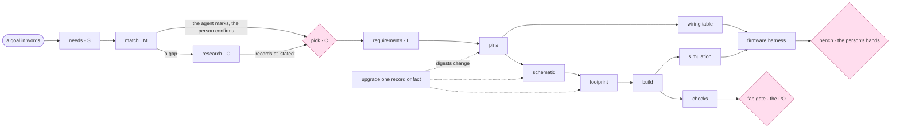

# P158 part 2 — approach A3 · Data first: the store and its records carry the design

Written 2026-10-10 by the data-first architect, against spark 0.8.1 at main `5acbe42` (E `git -C ~/Development/spark
rev-parse --short HEAD` → `5acbe42`). One of three angles drafted in parallel; this one makes the strongest case that
**the records, their schemas and a few tables of data are the design**, and code is the smallest set of functions that
read them. Nothing is built; nothing is decided here. Every decision this needs is listed for the PO in §10.4.

**Tags.** **E** a pointer (file:line at `5acbe42`, a command and what it printed, a card, a URL with the date read) ·
**H** a claim with its source · **D** a decision (who, when) · **—** unknown. Sizes S (under an hour), M (a day), L
(more) are **estimates, mine**, unless another source is named. "00" is
`design/00-system-as-is.md`; "part 1" is `proposal.md`; CH-n, K-n, Q-n, STORE-n, TECH-LEAD-n, USER-AI-AGENT-n,
EXISTING-FIRST-n are part 1's ids. New questions are **QA3-n**.

**What I ran, and where.** `git archive HEAD` of spark exported to `<scratch>/repo` (read-only for the source); an empty
scratch store; every command prefixed with `SPARK_HOME=<scratch>/store HOME=<scratch>/home TMPDIR=<scratch>/tmp` as three
separate words; the PO's real store was neither copied, read nor run against. Two scratch projects with a placeholder
board (§5.1). A copy-on-write clone (`cp -Rc`) of the bin's `node_modules` into `<scratch>` gave the second one a
`tsci`; nothing was written under `~/Development/smartbin-local`, `~/Development/irrigation`,
`~/Development/plant-alarm` or `~/Development/spark` except this file. `gh` read-only: `issue view` of the cards listed
in the brief, #85 and #94's last comment.

## 1. The idea in one paragraph

spark already tolerates placeholders — a part with no outline is laid out at a guessed size, a footprint can be marked a
placeholder, a board can be a Wokwi stand-in, a fact can be `verified: false` — but each in its own way, read by its
own code, and mostly silently: a board record I wrote as "any ESP32-S3 dev board", with an invented header geometry,
passes `boards.py --validate --for-fab` (exit 0) and runs the whole chain to "the chain runs end to end", exit 0, with
not one line saying the board is a placeholder (E §5.1). The data-first design makes that tolerance a property of the
data instead of the code: **every record — part, module, board, chip family, project — has a JSON Schema, and every
fact in it has a level of fidelity (owed · assumed · stated · checked · proven) read from the record itself; one table
of stages says which facts each stage reads and the level each target needs; and every answer spark gives carries the
same envelope with a ledger of every assumed fact any stage used.** A generic board ("any ESP32-C6, these GPIOs,
3V3") is a legitimate record of fidelity `placeholder`, made from a chip-family record; it flows through the chain as
far as the target allows and is named in every verdict. The store is three explicit places — **global** (git
repositories of records: spark's own library pinned by version, a shared one pinned by commit), **local** (the
person's store), **project** (what the project pinned, in a lockfile of digests) — with five verbs, *create, search,
update, copy, share*, over all record kinds through one thin CLI generated from one table of operations, which later
also serves an MCP face. Upgrading a placeholder is a data change (one record, or one fact); the project's state file
says which stages read it, so "stale" is a digest comparison, not a judgement. What goes: six ad-hoc placeholder
mechanisms, nine JSON shapes, three layer walks, seven spellings of the plugin folder, the stderr severity channel and
the substring classifiers — each replaced by a row of data that one function reads.

## 2. Module boundaries

### 2.0 What this rests on from the 2026-09-30 verdict

00 re-checked the verdict's premises (V1–V18): the size premise no longer holds (3,552 → 6,546 code lines, +84.3 %),
the budget is retired (D the PO, 2026-10-04, W15b), the net is 9.7× larger (1,281 anchor rows), and `parts.py` became
"a framework inside one script" (V14) (E 00 §"The 2026-09-30 verdict, re-checked"). What still holds and this design
keeps: the three outcomes defined once (`outcomes.py:19-43`), the one netlist walk, the CLI boundary as the only one a
move cannot disturb, and the stopping rule ("one command's behaviour has one home"). This design widens the stopping rule
to data: **a fact has one home — a schema, a table under `data/`, or a record — and code reads it; a script that
restates a vocabulary or a list from data is a finding.** The 2026-09-30 note's own postscript names the miss this
rule targets: "The duplication ledger above counted ideas and missed data. A ledger of literals would have found all
four in a minute" (E `docs/2026-09-30-refactoring-architecture.md`, last postscript). Code moves only when the fact it
encodes moves to data; there is no move for tidiness, and the `parts.py` split (Q12) happens only as a consequence of
I3 and I4 (§10), with its anchor cost said there.

### 2.1 Data units (no code)

Each is a file or folder of JSON in the plugin, versioned with it, with a schema, read by named functions only.

| unit | one purpose | shape and readers | today's statements it replaces |
| --- | --- | --- | --- |
| `schemas/` | the shape of every file spark reads or writes | JSON Schema draft-07, a subset (§3.7): `envelope`, `board`, `part`, `soc`, `drawer-entry`, `needs` (v2), `requirements`, `rules`, `lock`, `state`, `operation`, `stage`, `layer`. Read by `schema.py`; mapped in VS Code by `$schema` | `boards.REQUIRED_KEYS`, `REQUIRED_FOR_FAB`, `PIN_ROLES` (`boards.py:62-107`); `parts.REQUIRED_KEYS`, `CAPABILITIES`, `VERBS`, `KIND_FUNCTION`, `SELECTOR_SAFE` (`parts.py:50-70`, `:185`, `:221`); the converter's hand-kept board type (`tools/circuit-to-wokwi/lib/board.ts:27-68`, EXISTING-FIRST-24) |
| `data/stages.json` | the flow: each stage, what it reads (record kind + JSON Pointer), what it produces, who runs and who decides, and the fidelity floor per target | read by `fidelity.py`, `chain.py`, `project.py`; renders the flow diagram and the "owes" sentences | `parts.CHAIN_FACTS` (`parts.py:98`), `_about` (`:113-117`), `needs.LAYOUT_FACTS`; `check_spine.run`'s 19 early returns and 7 stage names as literals (E 00); the render header `check_spine.py:546`; `check_all.CHECKS`'s `needs` (`check_all.py:281-292`) |
| `data/layers.json` | the places records live: layer, place (global/local/project), path template, kinds, who may write, private, pin | read by `paths.py` and `records.py` | `store.layers()`'s `if kind == "parts"` rows (`store.py:71-81`); the "writable" column §6.1 asked for and nobody built (FEASIBILITY-14); `store.PRIVATE` (`:96`) |
| `data/operations.json` | every verb an agent or a person can run: name, arguments (as JSON Schema), effects, the stage it records, the `data` schema of its answer | generates argparse, `--describe`, the MCP tool list and the docs' command table | `parts.OPERATIONS`/`OPTIONS` (`parts.py:1472-1545`), `boards.py`'s argparse (`:488-512`), `tools.py`'s; the hand-written tables in `docs/guide/agents.md:244-256` |
| `socs/<id>.json` (a new record kind, `soc`) | one chip family's facts, once: spark's spelling, Wokwi's `mcu` spelling, the Wokwi boards with that `mcu` in order of preference, the image's chip id, the MicroPython port, the GPIO ranges that wake, read ADC2, strap | read by `rules.py` (stand-in check), `records.generic_board()`, `chain.py` (image chip), the harness | part 1's proposed `data/wokwi-boards.json` and chip-name table (CH-13, R5); the per-chip table in board C8 that TECH-LEAD flagged as "a third statement of chip facts"; `flash_image.py`'s chip blindness (`:28-29`) |
| `data/wokwi-parts.json` | Wokwi's built-in parts and their pin names, copied from `@wokwi/diagram-lint` with its version and licence notice, tested equal to the converter's | read by the stand-in pin rule and the "closest part" lookup | the registry read only at the last stage by the converter (STORE-10, K32; CH-31's "generated copy") |

### 2.2 Code units

Layered; a unit imports only from a lower layer (§2.3). For each: purpose · interface · depends on · the seam that tests
it alone · what today's code becomes.

**L0 · `outcomes`** — *the shape of every answer.* In: a tool name and an op. Out: an `Envelope` builder
(`problem(kind, where, why, fix)`, `unchecked(...)`, `assume(item)`, `data`, `next`), `finish() -> dict` (status
derived by `status_of`, never declared), `render_text(env)`, `exit_code(env)`; and `read_json(path, what) -> object`
raising `Unreadable(path, why)`. Errors: `Unreadable` only. Depends: stdlib. Seam: pure functions; every envelope a test
builds is validated against `schemas/envelope.schema.json`; `read_json` fed a non-UTF-8 file, a list where an object
belongs and a missing path. From: `outcomes.py:19-99` (kept: the codes, `status_of`, `step`, `page`; `answer` and
`envelope` merge into `Envelope`); the 37 raw `json.loads(…read_text…)` sites in 16 scripts (E 00, TECH-LEAD-1) and
the readers `boards._read_json` (`boards.py:170-176`), `tools._read`, `parts._parse`, `parts._read_json_input`,
`design.read`'s decode (`design.py:93-128`) — the 2026-09-30 note's unbuilt target 3.

**L0 · `schema`** — *validate a value against a schema and make a skeleton from one.* In: an instance and a schema id.
Out: `validate(...) -> [Violation(pointer, why, fix)]` (`why` and `fix` read from the schema's `description` and
`x-spark-refuse`), `skeleton(schema_id, fill="null"|"placeholder") -> dict`, `annotation(schema_id, pointer, key)`.
Errors: `SchemaProblem` for a schema using a keyword outside the subset. Depends: `schemas/`, stdlib. Seam: pure; one
test walks every schema and fails on an unsupported keyword; one test runs the subset validator and `jsonschema`
(skipped where it is not installed) over every shipped record and fixture and asserts the same verdicts. From: nothing —
new; it is where the structural half of `boards.validate` (`boards.py:281-446`) and of `parts.validate` lands.

**L1 · `paths`** — *where things are, and who may write there.* In: an environment, a path, an operation name. Out:
`plugin_root()`, `local_home()` (refuses a `SPARK_HOME` that is set but empty or names no folder, naming the folder it
would otherwise have used — CH-1), `project_of(path) -> Project | None` (by `samefile`, CH-10), `layer_of(path)`,
`may_write(path, op) -> None` raising `Refused(where, why, fix)`. Errors: `Refused`, `Unreadable`. Depends:
`data/layers.json`, `outcomes`. Seam: temp folders and an environment dict; the cases #125's refuter named — an unmarked
folder inside spark's tree (N25), a symlinked board file (N26) — plus `promote` from a project, a library chip compile,
a shipped header refresh, an empty and a missing `SPARK_HOME`. From: `store.home()` (`store.py:46-52`); the plugin
folder computed in seven places and aliased in one (E 00: `boards.py:38`, `:153`, `parts.py:45`, `store.py:33` — read by
nothing —, `tools.py:43`, `fab.py:27`, `check_spine.py:330`; `check_vendor_pins.py:108`); "which project" answered by
`boards.project_root` (`boards.py:135-147`) and two other rules (`check_physics.py:540`, `compare_design.py:281`); the
write rule stated once in prose at `boards.py:150-152` and enforced nowhere at run time; `tools.py:47-48`'s home read
at import. This is the one resolver P179's work asked for (#124).

**L1 · `store`** — *bytes: the door, the lock beside the data, the history, the network door, the checked keep.*
Interface unchanged except: the lock is `<local>/.lock` (CH-3), taken by every write through the door and never across
`fetch`; every write asks `paths.may_write` first; reads refuse what writes refuse (`PLAIN` on read, CH-9). Depends:
`paths`, `outcomes`. Seam: as today (`tests/test_store.py`, 71 tests, 72 anchors; E 00) plus the two-`TMPDIR` race
(#114). From: `store.py` minus `home()`, `PLUGIN`, `layers()`.

**L2 · `records`** — *what a record is, where it resolves, at what fidelity, with what digest.* In: a reference
`kind:id` and a project. Out: `load(ref, project) -> Record(kind, id, layer, path, data, digest)`, `find_all(kind,
project)` (the one walk, over `data/layers.json`), `check(record) -> [Violation]` (schema, then the kind's named rules
from `rules`), `level(record, pointer) -> Level` (§3.4), `digest(record, scope="values")`, `generic_board(soc_id,
pins=None) -> dict`. Errors: `RecordProblem(where, why, fix)` — one class for parts, boards, chips (TL M-G). Depends:
`schema`, `rules`, `paths`, `store`. Seam: fixture records; the shipped records and the three projects' records
(copied to scratch) all load. From: `store.records` (`store.py:84-92`), `boards.load`/`definition_path`/`records`
(`boards.py:212-257`), `parts.load`/`definition_path` (`parts.py:252-271`), `parts.digest`, `owes`, `broken_problems`,
`function_of` (`parts.py:72-130`), the `BoardError`/`PartError` pair.

**L2 · `rules`** — *the cross-field rules a schema cannot say, one registry per kind, each rule with an id and a
sentence.* In: a schema-valid record. Out: `[Violation]`. Depends: `schema`, `socs/`, `data/wokwi-parts.json`. Seam:
one fixture per rule id, red and green; the rule ids are the mutation anchors. From: the cross-field half of
`boards.validate` (id equals file stem, `wokwi_power_pins` covers `power_pads`, every pin on a pad or an alias,
forbidden decision keys at any depth, `document_problems`) and of `parts.validate`; new: the stand-in's `mcu` equals
the board's chip through its `soc` record (CH-13), the bare-number pad label (CH-12), the per-GPIO stand-in pin rule
(CH-31).

**L2 · `fidelity`** — *the ledger: which facts a stage used below the level the target needs.* In: a stage id, a
target, the records the stage reads. Out: `gate(stage, target, records) -> Gate(may_run: bool, blocked: [Item],
assumptions: [Assumption])`; `next_target_preview(...)`. Depends: `records`, `data/stages.json`. Seam: pure; the
property test of §5.2 (no stage drops an assumption it was given). From: `check_all.placeholder_components_in`
(`check_all.py:152-214`), `check_footprints.run(placeholders=…)` (`check_footprints.py:460-493`),
`emit_board.placeholders` (`emit_board.py:305-318`, `:979-980`), the `--assume-missing-sizes` branch
(`emit_board.py:1040`, `:1102`), `needs.requirements`' placeholder list (`needs.py:385-386`, `:592-605`),
`parts.unverified`'s `assumed` (`parts.py:823-834`), `sim_project.limits_of` (`sim_project.py:75-104`).

**L2 · `documents`** — *kept documents: keep, kept, read, fetch.* Interface as the `parts.py` operations have it.
Depends: `store`, `records`. Seam: as today. From: `parts.py:985-1283` (the move TECH-LEAD M-E named; done here only
because `verbs` needs `parts.py` gone, §10 I4).

**L3 · `project`** — *the project's own record: its id, what it pinned, what ran.* In: a project folder. Out:
`lock()`/`write_lock()` (`.spark/lock.json`), `state()`/`record_run(stage, inputs, outputs, envelope)`
(`.spark/state.json`), `status(target) -> [StagePlan(id, state: fresh|stale|never|blocked, why)]`. Errors:
`RecordProblem`, `Refused`. Depends: `records`, `fidelity`, `store`, `paths`. Seam: a scratch project; change one
record's value and assert the stale set. From: `store.add_project`/`project_name`/`projects` (`store.py:233-269`) for
the list; `init_project.py`'s writes of `.spark/` (`:324`, `:327`, `:473-474`); `boards.resolve` (`boards.py:260-278`),
which stays as the writer of `.spark/board.json`, the projection the bin and the converter read.

**L3 · `design`, `assign_pins`** — roles unchanged (E 00's table); `design` takes `component_name` (CH-6, #119) and
reads through `outcomes.read_json`; `assign_pins` returns its assignments and leaves the `unverified` list to the
ledger (it was 2,120 of 6,444 characters of the documented example's JSON, E 00).

**L4 · `emit_board`, `emit_footprint`** — `emit_board.render(design) -> (text, notes)`, each note an item with a
`kind` (TECH-LEAD M-A); `emit_footprint` unchanged in rule, its `--json` an envelope (CH-56). They read placeholder
geometry like any other: an assumed header is a header (§5.3).

**L5 · `drawer`, `needs`, `cost`** — roles unchanged; `needs`' matcher calls `verbs.search` for candidates and keeps the
agent's judgement of fit (§5.6 of the store design); the needs file goes to schema 2 with a `fit` field (CH-17, Q41).

**L5 · `verbs`** — *the five verbs and their companions over every record kind.* `create`, `search`, `update`, `copy`,
`share`, plus `show`, `validate`, `audit`, `status` (§6.2). In: parsed arguments. Out: an `Envelope`. Depends:
`records`, `documents`, `store`, `project`, `fidelity`. Seam: each verb in a scratch store and project; `--dry-run`
writes nothing (asserted by a file-tree digest before and after). From: the 28 `_op_*` handlers of `parts.py`
(`:1571-2159`) that touch records, `boards.py`'s `--list`/`--validate`/`--get`.

**L6 · `chain`** — *run the stages a target names, in the table's order, each through its gate.* In: a project, a
target, `until`. Out: an `Envelope` whose `data.stages` are the stage rows and whose `assumptions` are the union of the
gates'. Each stage is a function in a registry keyed by stage id (never a module path from a file — the store design's
§6.3 rule). Depends: everything below. Seam: each stage function alone on fixture inputs; the runner with fake stages.
From: `check_spine.run` (`check_spine.py:319-505`, 187 lines, 19 early returns, E 00), `check_all`'s `Check` loop
(`check_all.py:59-98`). `check_spine.py` and `check_all.py` stay as entry points (pages, the bin, `test_orphans`).

**L6 · `cli`** — *one runner for every entry point.* In: `argv` and an operation name. Out: an exit code. Builds the
parser from `data/operations.json`, calls the function, records the stage run in `.spark/state.json` when the row names
a stage, renders, exits by status; any exception becomes could-not-run, kind `crash`, `where` = the last frame inside
`scripts/` (file:line), `why` = type and message, and no traceback unless `SPARK_DEBUG=1`. Seam: the outcome
invariant (every `main` × three malformed inputs → exit 2, one sentence, no traceback; TL M-H). From: the 16 `main()`s'
scaffolding (E 00), `parts._Parser`/`BadArgument`/`_say`/`main` (`parts.py:1553-1569`, `:2171-2212`).

**L6 · `spark.py`** — the one record-and-store command: `spark.py <verb> …` (§6.2). Replaces `parts.py` as a command
(W16: in the same commit as the pages). `boards.py` stays only as the bin's pinned interface (`--path --id --paths --get
--validate --resolve`, held by `TheCommandLineTheSmartBinDependsOnTest`, `tests/test_boards.py:312-372`), each flag a
call into `records`/`project` (QA3-4).

**L7 · `mcp_server`** — *the same operations over MCP, when the setting is on* (§7). **`sync`** — global clones and
lock status (§6.3, I6). **`harness`** — the fake `machine` seeded from a board record (§5.4, I8). Each arrives in its
own iteration or not at all.

### 2.3 The import rule

L0 `outcomes`, `schema`, `fab`, `netlist`, `copper` · L1 `paths`, `store` · L2 `records`, `rules`, `fidelity`,
`documents` · L3 `project`, `design`, `assign_pins` · L4 `emit_board`, `emit_footprint` · L5 `drawer`, `needs`, `cost`,
`verbs` · L6 `chain`, `cli`, the entry scripts · L7 `mcp_server`, `sync`, `harness`. A function-local sibling import is a
finding (today 22 in `parts.py`, 3 in `boards.py`; E TECH-LEAD-5). The nine-module cycle component that only
function-local imports keep acyclic (E 00, "Dependency graph") dissolves because the contract (`records`, `rules`)
sits below everything that used to import `parts` for it.

### 2.4 The seams that hold for every future unit

1. **The outcome invariant** — `tests/test_cli.py::test_every_entry_point_answers_could_not_run_for_unreadable_input`
   (every `main` × {non-UTF-8, list-for-object, missing path} → exit 2, one sentence naming the path, no traceback).
2. **One envelope** — `tests/test_json_contracts.py::test_every_json_answer_validates_against_the_envelope_schema`
   replaces the nine per-script key sets (E `tests/test_json_contracts.py:84-195`).
3. **The write guard at run time** — `tests/test_paths.py::test_writes_refused_outside_a_writable_layer` with N25, N26
   and the promote case; part 1's reason for a run-time helper over a grep stands (§4 of part 1).
4. **The import direction** — `tests/test_layers.py::test_no_module_imports_a_higher_layer`, over §2.3's list.
5. **The home** — `tests/test_paths.py::test_no_module_reads_a_home_at_import` (import every module under one
   `SPARK_HOME`, change it, ask every path function again; TECH-LEAD-4).
6. **One home per fact** — `tests/test_data.py::test_no_schema_vocabulary_is_restated_in_scripts`: every `enum` and
   `pattern` in `schemas/` is searched for as a literal tuple or string in `scripts/*.py` and refused (P46's "ledger of
   literals", made a test).
7. **Data refers only to what exists** — `tests/test_data.py::test_stage_table_names_only_pointers_the_schemas_hold`;
   `::test_every_schema_property_is_read_by_a_stage_or_a_named_reader` (CH-22's "refuse an unread key", as a test of
   the data rather than of each record).
8. **The anchors at every push and a dated sweep per iteration** (CH-2), and **the siblings' command lines as spark
   tests** (CH-68).

## 3. Data contracts

### 3.1 The envelope — one shape, every answer

Every `--json` answer, every MCP tool result and every recorded eval step is one object (`schemas/envelope.schema.json`).
Text mode renders the same object, field for field, so a line cannot reach the text without reaching the envelope
(CH-16's mechanism, by construction). Version 2 of the shape `outcomes.envelope` prints today (`outcomes.py:65-74`).

```json
{
  "envelope": 2,
  "tool": "check_spine", "op": "chain.run",
  "status": "ok",
  "target": "sim",
  "verdict": "ok for target sim, on 3 assumptions — board:generic-esp32s3 is a placeholder; target pcb would stop at footprint",
  "store": {"local": "~/.local/share/spark", "global": [{"layer": "library", "version": "0.9.0"}], "project": "<project>"},
  "data": {"stages": [{"id": "footprint", "status": "ok", "detail": "GenericEsp32s3.tsx", "assumptions": 1}]},
  "problems": [],
  "unchecked": [],
  "assumptions": [
    {"record": "board:generic-esp32s3", "pointer": "/physical/header", "level": "assumed", "source": "record",
     "needed": {"run": "assumed", "ok": "stated"}, "stages": ["footprint", "build", "simulation"],
     "consequence": "the footprint is a generic two-row header; the copper is not this board's",
     "raise": {"say": "point the project at your board's record", "argv": ["spark.py", "use", "board:<id>", "--dry-run"]}}
  ],
  "next": [{"op": "use", "argv": ["board:<id>", "--dry-run"], "why": "raises 3 assumptions", "effects": ["writes"], "needs_yes": true}],
  "truncated": null
}
```

- **`problems[]` and `unchecked[]`** — each item `{kind, where, why, fix}`. `where` is structured: any of `file`,
  `pointer` (RFC 6901), `record` (`kind:id`), `stage`, `line`. `why` is the sentence. `fix` is `{say, argv?}`. Part 1's
  `{subject, sentence, fix}` maps to `where.record` / `why` / `fix.say` (envelope 1 → 2, one commit, W16).
- **`assumptions[]` — the ledger** — each item names the record, the JSON Pointer, its level, where it came from
  (`record` — a placeholder record or a provenance entry; `stage-default` — a default the stage table declares for an
  owed fact; `project` — an assumption the project wrote into its lock), the floors it was judged against, the stages
  that used it, its consequence in one sentence, and how to raise it.
- **`verdict`** — one generated sentence; when `assumptions` is non-empty it contains "on N assumption(s)" (a test
  asserts it), and it previews the next target's first stop (`fidelity.next_target_preview`). The text renderer prints
  it last, where "the chain runs end to end" stands today (`check_spine.py:544-556`).
- **`store`** — which local store answered and which global versions were read (CH-1's "name the store in every
  answer"). **`target`** — the target the floors were read for (§4.4).
- **`next`** — `step()`s (`outcomes.py:77-79`), filled from the problems' `fix.argv` and the ledger's `raise.argv`, in
  that order (USER-AI-AGENT-3: "filled by nothing" today). A test: every `next[].argv` parses against
  `data/operations.json`.
- **Small by default** — `truncated` as today (`outcomes.page`, the store design's §6.4.4); the ledger pages like any
  list.

### 3.2 Exit codes — one meaning each

| exit | status | means | kinds that may carry it |
| --- | --- | --- | --- |
| 0 | `ok` | it looked at everything the target needs and found nothing; every assumption it used is in the ledger and the target tolerates it | — (assumptions are not problems) |
| 1 | `problems` | it looked and found something about the thing it looked at | `design`, `fact` (a value present and wrong — "broken") |
| 2 | `could-not-run` | it could not look, or could not look at the level the target needs | `input`, `fact` (owed below the run floor), `placeholder` (assumed below the run floor), `tool`, `limit`, `store`, `crash` |

Removed meanings: `boards.py`'s "no selection" → 1 (`boards.py:537-539`; CH-21); `check_vendor_pins`' `mismatch`
word (`:230`) → `problems`; `check_all`'s fourth word `skipped` (`check_all.py:59`) → a check outside the target is
listed in `data.not_in_target`, a check whose input was not given is `unchecked` with kind `input` when the target needs
it and absent otherwise; a crash's exit 1 (Python's own) → 2 via `cli.run`. **One case this design moves and the PO
decided otherwise:** an id that names nothing (`--show nonesuch`) is `problems`, exit 1 by §6.4.1 (D the PO,
2026-10-04). Under a contract where `problems` means "found something about the thing looked at", a name that names
nothing is a thing that could not be looked at — could-not-run, kind `input`. Proposed, not taken (Q14). `init` run
twice (`EXIT_NOTHING_TO_DO`, sanctioned at `outcomes.py:9-13`) stays the PO's (Q25).

### 3.3 The `kind` vocabulary — closed, eight words

`design` (the circuit or the firmware is wrong) · `fact` (a record's value is owed or broken) · `placeholder` (a value is
assumed below what the target needs) · `input` (a file, an argument or a name the caller gave cannot be used) · `tool` (a
tool is missing or failed) · `limit` (a tool cannot do this by its nature — Wokwi does not wake from a GPIO, a stand-in
has no such pin) · `store` (the store refused, is unreadable, or the guard stopped a write) · `crash` (spark's own bug).
Part 1's M-A had six (`design, input, tool, limit, crash, store`; USER-AI-AGENT M-A); `fact` and `placeholder` are what
the ledger needs to tell "owed" from "assumed". A test asserts every emitted item's kind is in the set; the substring
classifiers go (`CONVERTER_HAS_NO_PART`, `check_spine.py:216`; the `Traceback` prefix `docs/guide/agents.md:317`
teaches).

### 3.4 Fidelity — five levels, and where each lives

| level | means | how a record says it | lives in | example (E unless marked) |
| --- | --- | --- | --- | --- |
| `owed` | no value | `null`, `[]`, `{}`, absent | the record | the XIAO's `physical.header` (`boards/xiao-esp32-c6.json`: `physical` has only `footprint_export, footprint_module, height_mm, width_mm, wokwi_size_px`, my read) |
| `assumed` | a value put in so the chain can go on; it claims nothing about the real thing | a record with `"fidelity": "placeholder"` (every value assumed unless its provenance says more); a provenance entry `{"origin": "assumed", "why": …}`; a stage default the table declares; a project overlay in `.spark/lock.json` | record · `data/stages.json` · lock | irrigation's three `footprint_placeholder` records (E `grep -l footprint_placeholder ~/Development/irrigation/parts/*.json` → `dc-barrel-jack-12v-inlet`, `dfr0831-buck-5v`, `sen0217-flow-meter`); the placeholder outline `--assume-missing-sizes` draws (`emit_board.py:597`, `:1102`) |
| `stated` | a value someone wrote from a source, not checked against its evidence | present with no provenance entry; or `verified: false` with a `source` | the record | 9 of the library's 43 part facts (E my read of `parts/*.json`: 43 facts, 34 `verified: true`, 9 `false`, 0 with `origin`) |
| `checked` | checked against its evidence — the PO's meaning of `verified: true` | `verified: true`, `origin` one of `maker`, `measured`, `computed`, and `evidence` (a kept document's sha256 and page, or a method) | the record | D the PO, 2026-10-06 (#17 comment T11:14:27Z, decision 2): "`verified: true` means checked against its evidence. A new `origin` says which kind: the maker's words, measured, computed, or proven by use" |
| `proven` | used by a build, a simulation or a bench run that passed, with this value | never written by hand: derived from a `built`, `simulated` or `ran` event whose digest covers the record | the history (`history.jsonl`, private) | `built` is written by `check_spine` only on an ok run of a listed project (`check_spine.py:625-629`) |

Three consequences, each a decision or a migration (§10.4): (1) `assumed` is a fifth `origin` value beside the PO's
four (QA3-1); (2) a fact that says `verified: true` today but cites no kept document — two in the L9110S record
(#85's body) — reads as `stated` until its evidence is attached, which is #85's value line; (3) `proven` is per machine,
because the history never leaves it (§5.8 of the store design). **A record's `fidelity`** is the record-level key:
`placeholder` (a stand-in for a class of thing; `stands_for` says which), or absent (a record of a real thing). The
**ledger** is never stored as truth: it is recomputed on every answer from the records, the lock and the stage table;
`.spark/state.json` keeps only its count per stage run, for the status listing.

### 3.5 Provenance in a record — values stay raw

Board files keep raw values (the bin's Makefile reads `boards.py --get chip` and `--get micropython_port`, E
`~/Development/smartbin-local/Makefile:52-53`; the converter reads the resolved file's raw keys), and part records keep
their `facts.<name>` objects as they are (`{value, verified, source}`, E `parts/l9110s-module.json`). Fidelity for any
other value comes from one optional sidecar map keyed by JSON Pointer, added **when a stage first needs the fact at a
higher level** (D the PO, 2026-10-06, decision 1: "Records grow by need … always with its origin"):

```json
{"schema": 1, "id": "firebeetle2-esp32s3",
 "pins": {"D2": 3, "D3": 38},
 "provenance": {
   "/pins": {"verified": true, "origin": "maker", "evidence": {"document": "sha256:…", "what": "pins_arduino.h"}},
   "/physical/header": {"verified": true, "origin": "measured", "evidence": {"method": "DFRobot dimension drawing, checked against the bin's hand-made footprint"}}
 }}
```

A pointer with no entry is `stated` when it holds a value; `facts/<name>` is its own entry. The schema defines
`provenance` once (`schemas/defs.schema.json#/definitions/provenance`) for every kind.

### 3.6 The project: `.spark/lock.json` and `.spark/state.json`

```json
{"schema": 1, "id": "prj-7f3a9c", "name": "plant-alarm", "target": "sim",
 "board": "board:xiao-esp32-c6",
 "pinned": {
   "board:xiao-esp32-c6": {"layer": "library", "version": "0.9.0", "digest": "sha256:…"},
   "part:sen0193-soil-moisture": {"layer": "shelf", "digest": "sha256:…"}},
 "assume": {"board:xiao-esp32-c6": {"/physical/header": {"why": "simulate before the castellated footprint is converted (Q21)"}}}}
```

- **`.spark/lock.json`** — *what the project pinned*: its **id** (the handle CH-29 and CH-10 need, "in a file of its
  own", never `.spark/project.json`, which is the person's brief, `init_project.py:24`; part 1 §4), its target, its
  one board (CH-55: the requirements file's `board` is copied here by `--requirements`; `boards/active.json` is read
  only when there is no lock — the bin's case — QA3-3), every record it builds with by layer and value digest (the
  lockfile pattern of STORE-15), and the assumptions the project chose. Written by `spark.py requirements`, `copy`,
  `use`, `init`. Committed with the project.
- **`.spark/state.json`** — *what ran*: per stage, the time, spark's version, the status, the inputs' digests (records by
  their pointer-scoped value digest, files by sha256), the outputs' digests, and the ledger's count. Written by
  `cli.run` after every operation whose row names a stage. Derived; safe to delete.

```json
{"schema": 1, "runs": {"pins": {"at": "2026-10-11T09:12:03Z", "spark": "0.9.0", "status": "ok",
  "inputs": {"requirements.json": "sha256:…", "board:xiao-esp32-c6#/pins": "sha256:…", "part:sen0193-soil-moisture#/needs": "sha256:…"},
  "outputs": {".spark/pins.json": "sha256:…"}, "assumptions": 0}}}
```

### 3.7 The schemas

- **Draft-07, a stated subset**: `type`, `properties`, `required`, `additionalProperties`, `propertyNames`, `enum`,
  `const`, `pattern`, `minimum`, `exclusiveMinimum`, `maximum`, `items`, `minItems`, `uniqueItems`, `$ref` (within
  `schemas/`), `oneOf` of objects distinguished by a `required` key, `description`, and two annotations, `x-spark-refuse`
  (the refusal sentence, with `{pointer}` and `{value}`) and `x-spark-read-by` (which stage or function reads the key).
  Draft-07 because the PO's installed `jsonschema` 4.2.1 was probed with `Draft7Validator` (E EXISTING-FIRST-23) and
  because editor support for it is the widest (H, not checked for VS Code's exact draft list — §13).
- **Who enforces** (Q15, three options in part 1): this design proposes **(c) spark's own subset validator** (`schema`,
  §2.2), stdlib only, with `jsonschema` as a cross-check in the suite where installed. Reason: the current
  `jsonschema` release, 4.26.0, requires `attrs`, `jsonschema-specifications`, `referencing` and `rpds-py` (E
  https://pypi.org/pypi/jsonschema/json, read 2026-10-10), and `rpds-py` is a compiled Rust extension (H, memory of the
  project) — against "users install nothing heavy" (D the PO, 2026-10-06).
- **Records point at their schema** with `"$schema": "<relative path>"` in spark's own records and a `json.schemas`
  mapping that `/spark:init` offers to write into a project's `.vscode/settings.json` (VS Code's mechanism, E
  EXISTING-FIRST-23), so the person gets validation, completion and hover in the editor they use.
- **Schema versions** follow the store design's §5.4: a mechanical upgrade on read (legacy `footprint_placeholder:
  true` reads as `provenance["/footprint"] = {origin: assumed, why: footprint_note}`; `wokwi_is_stand_in` stays, §6.4)
  and a higher version is could-not-run ("written by a newer spark").

### 3.8 The three tables, as data

**`data/stages.json`** (excerpt; §4.2 has every stage):

```json
{"schema": 1,
 "levels": ["owed", "assumed", "stated", "checked", "proven"],
 "targets": {"sim": ["board", "pins", "schematic", "footprint", "build", "simulation"],
             "breadboard": ["board", "pins", "wiring", "harness", "bench"],
             "pcb": ["board", "pins", "schematic", "footprint", "build", "simulation", "checks"],
             "fab": ["board", "pins", "schematic", "footprint", "build", "checks", "fab"]},
 "stages": [
   {"id": "footprint", "run": "emit_footprint", "decides": "script",
    "reads": [{"record": "board", "pointer": "/physical/header"}, {"record": "board", "pointer": "/physical/header_order"},
              {"record": "board", "pointer": "/physical/width_mm"}, {"record": "board", "pointer": "/physical/height_mm"}],
    "produces": ["<footprint_export>.tsx"],
    "floor": {"sim": {"run": "assumed", "ok": "assumed"}, "pcb": {"run": "assumed", "ok": "stated"}, "fab": {"run": "checked", "ok": "checked"}},
    "default_when_owed": {"sim": "generic_header"},
    "consequence": {"assumed": "the footprint is a generic two-row header; the copper is not this board's",
                    "owed": "no footprint can be drawn: {pointer} is not in the record"}}]}
```

`run`/`ok` floors: below `run` the stage is could-not-run (kind `fact` if owed, `placeholder` if assumed); between
`run` and `ok` it runs and the fact enters the ledger; at or above `ok` it is silent. Every assumed fact any stage reads
enters the ledger whatever the floor (§5.2, rule 1).

**`data/layers.json`**:

| layer | place | path | kinds | written by | private | pinned by |
| --- | --- | --- | --- | --- | --- | --- |
| `project` | project | `{project}/{kind}/` | parts, boards | the person; `spark.py create/update/copy` | no | the project's git, if any |
| `shelf` | local | `{local}/shelf/` (parts), `{local}/boards/` (boards, new, CH-27) | parts, boards | `spark.py copy --to local` | yes | — |
| `library` | global | `{plugin}/{kind}/` | parts, boards, socs | the maintainer, by pull request | no | spark's version |
| `catalog` | local | `{local}/catalog/` | parts, boards | `spark.py create --into catalog` (the research agents, through the door — CH-48, #23) | the PO's (Q29) | — |
| `shared:<name>` | global | `{local}/global/<name>/{kind}/` | parts, boards, socs, chips | nobody here; contributed upstream by pull request | no | a commit |

Read order (D the PO, 2026-10-04, "the layer order (library before catalog)"; the store design §5.5): project → shelf
→ library → catalog → shared. A row is the whole statement: `paths.may_write` reads "written by", `records.find_all`
reads the order, `--audit` and any sync read "private".

**`data/operations.json`** — one row per verb (name, summary, arguments as a JSON Schema, effects, `stage`, `data`
schema reference, the function's registry name). `test_describe_lists_exactly_what_the_parser_accepts`
(`tests/test_parts.py:1688`) generalises to every entry point and to the MCP tool list.

## 4. The flow

### 4.1 As a graph



Every edge carries the ledger: a stage's envelope holds the union of its inputs' assumptions and its own (§5.2). The
dashed edges are the upgrade loop: changing a record or one fact marks stale exactly the stages whose `reads` cover the
changed pointer, and the stages downstream of them.

### 4.2 As a table — who runs what, who decides, what each target needs

| stage | run by | reads | produces | decided by | floor (run / ok) sim · pcb · fab |
| --- | --- | --- | --- | --- | --- |
| needs (S) | the conversation, then `spark.py needs-set` | the goal | `.spark/needs.json` | the person and the agent | — |
| match (M) | `spark.py match` | needs, the drawer, every layer | candidates; the agent's marks | the agent proposes, the person confirms | — |
| research (G) | `/spark:research`'s agents → `spark.py create --into catalog` | the gap | catalog records, `stated` at best | the agent; network on the person's yes | — |
| pick (C) | `spark.py pick` | match | picks with `fit` (CH-17), holds | the person | — |
| requirements (L) | `spark.py requirements` | needs, picks, records | `requirements.json`, `.spark/lock.json`, the derived rules seed (CH-39) | script | — |
| board | `chain` | `board:/chip`, `/pins`, `/power_pads`, its `soc` | the resolved board | script | chip: stated/stated · stated/stated · checked/checked |
| pins | `assign_pins` | board `/pins /adc_gpio /wake_capable_gpio /pin_roles`, parts `*/needs` | `.spark/pins.json`, `pins.py` | script | assumed/stated · stated/stated · checked/checked |
| schematic | `emit_board.render` | pins, parts `*/pin_order */footprint */power */body_mm`, board `/power_pads /power/io_volts` | `board.tsx` | script | `body_mm`: assumed/assumed · assumed/stated · checked/checked (the PO's #102: a breadboard needs no outline) |
| footprint | `emit_footprint` | board `/physical/*` | `<Export>.tsx` | script | assumed/assumed · assumed/stated · checked/checked |
| build | the `board-engine` role (tscircuit) | `board.tsx` | `dist/board/circuit.json` | script | inherits |
| simulation | `sim_project` + the `diagram-converter` role | circuit connectivity, board `/wokwi_*`, parts `*/simulation`, the image's chip | `sim/` | script | stand-in: assumed/assumed, with a sentence |
| checks | `check_all`'s five rows | circuit, rules, boards, package | findings | script | per check |
| wiring | (P79's; not built) | pins, parts | a wiring table | script | — |
| harness | `harness` (I8; P59, P74) | `pins.json`, board record, the firmware | a harness report | script | — |
| bench | a protocol (P79, P73) | wiring, firmware | a bench log | the person | — |
| fab | the review skill's gate | everything | — | the PO | no `assumed` anywhere; geometry `checked` |

### 4.3 How a stage knows what ran before, and what "stale" means

A stage never reads a marker; it reads `.spark/state.json`, which `cli.run` writes after every operation whose row names
a stage (today nothing records that `init`, `emit_board`, `check_all` or `boards.py --resolve` ran — E 00 §"Where a
project's state lives"). **Stale** is computed, never set:

1. **never** — the stage has no run in the state file;
2. **stale** — an input's current digest differs from the one recorded (a record's digest is scoped to the pointers the
   stage reads, so a new `body_mm` does not stale `pins`), or spark's version or the stage's tool version differs, or an
   upstream stage re-ran after it;
3. **blocked** — an input is below the target's `run` floor; the item names the record, the pointer, the level and the
   `raise` command;
4. **fresh** — none of these.

`spark.py status [--target T]` prints one line per stage with its state and the reason; the chain's envelope carries the
same list in `data.plan`. Whether the chain **skips** fresh stages is a later choice, measured first (the whole
placeholder chain ran in 6.689 s wall, E §5.1, so a rerun is cheap on a small design; irrigation's time: —).

### 4.4 Targets — what "done" means is data

A target is a list of stages and their floors (`data/stages.json`): `sim` (default for a new project), `breadboard`
(P79's, a row with no footprint or build), `pcb`, `fab`. The project's lock names its target; a command may name
another (`--target fab`). The same facts can be fine for one target and blocking for the next, which is exactly the
PO's #102 words: *"if I dont want to make a pcb, only breadboard, or perf board, then I dont necesssarily need the
particular dimension … it also allows to go on even when needed in that step, but warns and makes sure its marked"*
(E #102 body, quoted verbatim).

## 5. Iterative fidelity

### 5.1 Today: a placeholder either stops the chain or passes in silence (two runs)

I wrote a board record "Any ESP32-S3 dev board (placeholder)" — chip `esp32s3`, the S3 devkit as Wokwi stand-in, six
GPIOs, two power pads — in a scratch project with two library parts (a button and an LED).

- **Run 1, `physical: {}`.** `boards.py --validate` → `active generic-esp32s3 (project): ok`, exit 0; `--validate
  --for-fab` → the two missing `footprint_*` keys, exit 1; `assign_pins.py --json` → six assignments and the parts'
  `unverified`, exit 0, no word about the board; `check_spine.py` → `[ok  ] board`, then `[????] schematic this board
  has no verified footprint, so a board file would reference nothing`, "the chain was NOT exercised", exit 2 (E my runs;
  the sentence is `emit_board.py:1064`). The simulation — which needs no footprint in principle — is unreachable,
  because the chain is linear and PCB-first.
- **Run 2, the same record with an invented two-row header** (`rows 2, pins [4, 4], pitch 2.54, row_spacing 22.86`,
  width and height 25.4 mm, `footprint_export GenericEsp32s3`, and `power.io_volts` 3.3 marked `verified: false`,
  source "assumed"). `boards.py --validate --for-fab` → `active generic-esp32s3 (project): ok`, **exit 0**. `check_spine
  --sim-dir` → `[ok] board`, `[ok] schematic 9 trace(s) written`, `[ok] footprint GenericEsp32s3.tsx`, `[ok] build 7
  trace(s), 0 errors, tsci 0.0.2621`, `[ok] simulation 7 wire(s) in the diagram`, **"the chain runs end to end", exit
  0**, 6.689 s wall. `sim/WHAT-THIS-CANNOT-SHOW.md` lists the button's and the LED's stand-in sentences and nothing of the
  board, although the staged `sim/board.json` carries `wokwi_is_stand_in: True` (E my runs and reads, `<scratch>/proj2`).

The only word "placeholder" anywhere in those outputs is the one I typed into the record's name. That is the
principle's failure case, measured: *"Tolerance without a ledger is just silence."* Both halves are the same defect —
the chain has no notion of how good a fact is — and both are fixed by the same data.

### 5.2 The ledger rule, mechanically

*"A placeholder may flow through the chain, but it can never disappear from the final verdict."* Seven rules, each with
the test that would catch its regression:

1. **Every assumed value a stage reads enters that stage's ledger**, whatever the floor —
   `tests/test_fidelity.py::test_an_assumed_value_read_by_a_stage_is_in_its_ledger`.
2. **No stage drops an assumption it was given**: a stage's ledger is the union of its inputs' ledgers (read from the
   state file's recorded inputs) and its own — a property test over every row of `data/stages.json` with a fixture
   that assumes one value per read pointer: `::test_no_stage_drops_an_assumption_it_was_given`. Mutating the union
   into an assignment turns it red (a mutation row).
3. **The final verdict is the union over the target's stages**, deduplicated by (record, pointer):
   `::test_the_chain_verdict_names_every_assumption_of_every_stage`.
4. **A non-empty ledger is in the verdict sentence** ("on N assumption(s)"), in text and JSON:
   `tests/test_outcomes.py::test_verdict_counts_assumptions`. The text never prints a bare "the chain runs end to end"
   over an assumption.
5. **The target's floors turn a below-floor value into could-not-run**, kind `placeholder` or `fact`, naming the raise:
   `::test_fab_refuses_an_assumed_header` (run 2's `--for-fab` ok becomes exit 2).
6. **The artefacts carry it physically**: `board.tsx` and the footprint module get a header comment naming every
   assumption; a placeholder footprint gets silkscreen text `PLACEHOLDER — NOT THIS BOARD` (so a Gerber exported outside
   spark still shows it); `WHAT-THIS-CANNOT-SHOW.md` gets one line per assumed record, the board included (CH-32);
   `pins.py`'s header lists the board's assumptions: `tests/test_emit_board.py::test_an_assumed_footprint_is_marked_on_the_silkscreen`.
7. **Nothing assumes silently in code**: a default for an owed fact exists only as `default_when_owed` in the stage
   table, and appears in the ledger with `source: stage-default`; `tests/test_data.py::test_no_stage_function_fills_an_owed_value`
   (the stage functions get records with owed values and must either refuse or call `fidelity.default_for`).

### 5.3 The generic board — a first-class placeholder

A placeholder board is **made from data**, not typed: `spark.py create board:generic-esp32c6 --generic esp32c6
[--gpio 0,1,2,…]` calls `records.generic_board("esp32c6")`, which reads `socs/esp32c6.json` and writes:

```json
{"$schema": "../schemas/board.schema.json", "schema": 1,
 "id": "generic-esp32c6", "name": "Any ESP32-C6 dev board",
 "fidelity": "placeholder", "stands_for": {"soc": "esp32c6", "class": "a dev board with 3V3 logic and a USB port"},
 "chip": "esp32c6",
 "wokwi_part_type": "board-esp32-c6-devkitc-1", "wokwi_pin_naming": "gpio", "wokwi_is_stand_in": true,
 "wokwi_stand_in": "Wokwi's ESP32-C6 devkit: every GPIO by number; no board of yours, so no silkscreen and no power facts",
 "pins": {"IO0": 0, "IO1": 1, "…": "every GPIO the soc record lists as broken out on a devkit"},
 "wake_capable_gpio": "from the soc record", "adc_gpio": "from the soc record",
 "power_pads": {"3V3": {"rail": "logic", "direction": "out"}, "GND": {"rail": "ground", "direction": "out"}},
 "power": {"io_volts": {"value": 3.3, "verified": true, "origin": "maker", "source": "socs/esp32c6.json"}},
 "physical": {"footprint_export": "GenericEsp32c6", "width_mm": 25.4, "height_mm": "from the pin count",
   "header": {"rows": 2, "pins": ["n/2", "n/2"], "pitch_mm": 2.54, "row_spacing_mm": 22.86, "first_pad_from_edge_mm": 1.27},
   "header_order": "the pins, then 3V3 and GND, split over two rows"}}
```

- **Chip facts are real, board facts are assumed.** What the soc record states (the GPIO ranges, wake, ADC2, the logic
  voltage) keeps its own provenance; everything the class template invents (the labels, the header geometry, the size)
  is `assumed` because the record says `fidelity: placeholder`.
- **It is a record like any other**: it lives in the project (default) or in the local store; `search` lists it with its
  level (`[placeholder]`); the chain reads it; the ledger names it at every stage; the fab target refuses it.
- **Where the generic geometry comes from** is one function, `records.generic_header(pins)`, called by `create
  --generic` and by the footprint stage's `default_when_owed` (§3.8) — so a real board whose header is owed (the XIAO)
  can still reach the simulation for target `sim`, ledgered, without editing its record.
- **The chip family is its own record** (`socs/`). It holds the facts both shipped boards repeat today and the two
  spellings part 1 found (`esp32s3` ↔ Wokwi's `esp32-s3`, STORE-10), the Wokwi boards of that `mcu` in order (devkit
  first), the image's chip id (S3 = 9, E EXISTING-FIRST-18; C6 = 13, H FB-M5), the MicroPython port
  (`ESP32_GENERIC_S3`, `ESP32_GENERIC_C6`, E the two board files). The two board files then stop restating chip-level
  facts; a test holds them equal until they move (`tests/test_data.py::test_board_chip_facts_agree_with_their_soc`).

### 5.4 The generic firmware harness — the other first-class placeholder

spark never emits behaviour (D the PO, 2026-10-01: "spark exports facts and ships a harness; the conversation writes
the firmware", E `docs/2026-10-01-firmware-and-tests.md:17`). The firmware's fidelity is therefore not a generated
placeholder program but a ladder of **proof**, each rung a stage with its own ledger:

| rung | what has run | what it proves | stage |
| --- | --- | --- | --- |
| none | the stock interpreter boots in the simulation (`wokwi.toml` names no image yet, E `<scratch>/proj2/sim/wokwi.toml`) | the diagram loads | simulation |
| imports | the project's firmware imported under the harness with no hardware | every `Pin(n)` it touches is on the pin map and the board can do it (ADC on an ADC pin, wake on a wake pin) | harness |
| simulated | a Wokwi scenario passed | what the scenario asserts, and its coverage of the pin map (CH-49) | simulation |
| bench | a bench log with a verdict | the hardware did it | bench |

**The harness is seeded from the board record** (P56's fake `machine`; spark ships none today — E
`docs/2026-10-01-firmware-and-tests.md`, "`grep -rl "import machine|fake_machine|FakePin"` … returns nothing"): the pins
that exist are the board's `pins`, ADC the board's `adc_gpio`, wake its `wake_capable_gpio`. **On a placeholder board it
is seeded from the soc record** — every GPIO of the family exists — and every pin use is ledgered (`assumed: GPIO5 is
broken out on your board`). Upgrading the board to the real record makes the same harness strict; firmware written
against the generic board then fails at the first pin the real board lacks, at import time, for free — the
upgrade-is-a-test property. irrigation's Valve4 (GPIO13 set to 0 at boot and never driven, E
`docs/2026-10-01-firmware-and-tests.md`, "The defect that settles the simulation question") is the harness's first
eval case. The harness belongs to slice 3 (#7 P59, #8 P74); this design gives it its inputs and its ledger, and
schedules it last (I8).

### 5.5 Upgrading one fact, and what reruns

Two worked examples on plant-alarm (`requirements.json`: board `xiao-esp32-c6`, parts `sen0193-soil-moisture`,
`max98357a-dfr0954`; E my read), computed from §4.2's `reads`, before any code exists — these are the pass lines of I5's
measurement:

| the upgrade | the command | changed pointers | stale | fresh |
| --- | --- | --- | --- | --- |
| the XIAO's header geometry is stated (Q21's converted footprint, or measured) | `spark.py update board:xiao-esp32-c6 header.json --dry-run`, then without `--dry-run` (writes the project's copy, never the library) | `/physical/header`, `/physical/header_order` (and the provenance entries) | footprint, build, simulation, checks | needs, match, pick, requirements, pins, schematic |
| the generic C6 board is replaced by the PO's FireBeetle 2 C6 (DFR1075, D8) | `spark.py create board --from-drawer dfrobot-dfr1075` (I4), then `spark.py use board:firebeetle2-esp32c6` | the lock's `board`; every pointer of the board | board, pins, schematic, footprint, build, simulation, checks, harness | needs, match, pick |

The second row reruns `pins` because the labels change (`IO5` → `D5`), and the harness turns strict (§5.4). An upgrade
of a **part** fact behaves the same way: the LED's `body_mm` from assumed to stated stales `schematic` and everything
after it, and leaves `pins` fresh, because `pins` does not read `/body_mm`.

### 5.6 How the checks consume fidelity

- **A finding names the level of every figure it used** (CH-44): `check_physics`' current-on-a-trace finding on an
  assumed supply figure is reported with the ledger item it rests on; at target `fab` that figure is below the floor
  and the finding is could-not-run, kind `placeholder`, naming the figure.
- **The placeholder-footprint rule generalises.** `check_footprints` already turns a placeholder component's findings
  into one could-not-run each, without dropping them (`check_footprints.py:460-493`): that becomes the rule for every
  check and every assumed input, read from `fidelity.gate`, not from a list `check_all` builds by importing the
  generator (`check_all.py:152-214`).
- **The fab gate** (`boards.py --validate --for-fab`; the review skill's last step) is the `fab` target: no `assumed`
  value anywhere, geometry and pin order `checked`. Run 2's exit 0 becomes exit 2 naming `/physical/header`. The bin's
  gerber recipe calls that command (E `~/Development/smartbin-local/Makefile:182`), so the library S3 gets its
  provenance entries in the same commit (§12, risk 2).

## 6. The store

### 6.1 Three places

| place | what it is | layers in it | how it is pinned | who writes | what never goes there |
| --- | --- | --- | --- | --- | --- |
| **global** | git repositories of records, read-only here | `library` (spark's own repository, installed as the plugin), `shared:<name>` (a public repository of records, P84 as decided, D the PO 2026-10-04) | the plugin's version; a commit | maintainers, by pull request; nobody from a person's run | the drawer, the history, the projects list, holds, document bytes, photos (§5.8 of the store design) |
| **local** | the person's store, `~/.local/share/spark` by default | `shelf` (parts and, new, boards — CH-27), `catalog` (drafts), plus the drawer, the history, the projects list, kept documents, downloads, tools list | — (it is the person's; spark survives a folder sync of it, §6.3) | spark's verbs, through the door | — |
| **project** | the project folder | `project` (its own records), `.spark/lock.json` (what it pinned), `.spark/state.json` (what ran) | the lock's digests and commits | the person; spark's verbs | owned counts, places, reasons (§5.8) |

**Library and shared are one kind of place.** spark's shipped `parts/`, `boards/` and `socs/` are a git repository of
records pinned by the plugin's version — exactly what a shared store is, pinned by a commit. Treating both as global
removes the special case "the plugin's folder" from every reader except `paths.may_write`, which refuses it for every
operation but a maintainer's (#125's rule, read from the layer table; CH-4).

### 6.2 Five verbs, one CLI, every kind

`spark.py <verb>`; every write takes `--dry-run`, answers in the envelope, and writes only a layer the table marks
writable for it. `kind:id` references (`board:firebeetle2-esp32s3`, `part:l9110s-module`, `soc:esp32s3`); a bare id is
looked up in every kind and refused when ambiguous.

| verb | signature | writes | answers (`data`) | replaces (removed in the same commit, W16) |
| --- | --- | --- | --- | --- |
| **create** | `create <kind:id> [--from <kind:id> \| --generic <soc> \| --from-drawer <entry>] [--into project\|local\|catalog]` | a skeleton generated from the kind's schema (every property, `null` or the class template's assumed value); `--from` copies with `based_on`; `--from-drawer` fills what the drawer entry and the vendor's `pins_arduino.h` give and names every owed fact with the document to read it from (D8) | `{path, record, owed: [{pointer, read_from}], level}` | `parts.py --skeleton` (and its board-shaped part, CH-14); the five-step hand route for a board (`docs/guide/how-it-works.md:160-171`); the research agents' literal catalog path (`agents/parts-researcher.md:57-58`, CH-48) |
| **search** | `search <words…> [--kind] [--at-least <level>] [--owned]` | — | `{looked_for: [words], searched: {layer: count, drawer: count}, found: [{ref, layer, level, owned, held_by, fit_words}], missed: [{word, why}]}` | `parts.py --need` (CH-18: words split, each a substring test, the missed word named; boards and the drawer searched, CH-21, CH-19); its "nothing matches — research it" over a store it never searched |
| **update** | `update <kind:id> <merge-patch.json\|-> [--dry-run]` | an RFC 7386 merge patch, applied in the record's own home (never a global layer), checked by schema and rules before the write; the shelf copy refreshed | `{path, was, now, level_before, level_after, stale: [stage]}` | `--fact-set`, `--function-set` (both become `update` with a patch); a hand edit of a board (CH-22's "edit and validate" stays possible, and `validate` is the check) |
| **copy** | `copy <kind:id> --to project\|local [--refresh] [--dry-run]` | a filtered copy (`SHELF_DROPS`, `parts.py:899`) with `based_on {layer, id, digest, version\|commit}`; the project's lock entry; `--refresh` shows the field diff and which side moved (CH-26) | `{path, based_on, diff?}` | `--promote` in both directions (catalog → project; project → plugin, removed, CH-4); a hand `cp` of a board (CH-63) |
| **share** | `share <kind:id> --into <shared-name> [--dry-run]` | the filtered record into the clone's working tree on a new branch; never commits or pushes: prints the `git` and `gh` commands for the person's yes | `{branch, path, commands: [argv]}` | nothing (new; P178's `--contribute`, CH-29) |

Companions on the same table: `show <kind:id>` (the record, its layer, each fact's level, its ledger and its CONFLICT
lines as items, CH-16), `validate [<ref>|--all]`, `audit` (every layer, every copy's drift, every hold, the catalog and
library counts from one walk, CH-59), `status [--target]` (§4.3), `use board:<id>` (the lock's board), and the drawer,
needs, pick, requirements, step and tally rows as they are in `parts.OPERATIONS` today, moved to the table. **The editor
is this CLI** plus the schemas in VS Code; P160 (#96) is the card it serves.

### 6.3 Sync — one mechanism per relation, judged

| candidate | for which relation | verdict | why |
| --- | --- | --- | --- |
| plain JSON records in a git repository | global (library, shared) ↔ local | **adopt** | git is already required (`gh` in `check_vendor_pins.py:66-68`, the gate's `git archive`); a clone is the local copy, a commit the version, a pull request the contribution and the review (STORE-14, EXISTING-FIRST-25); spark runs `git clone --depth 1`/`fetch` + `checkout <commit>` after a dry run that lists the records whose value digest changed and their levels |
| a lockfile of digests (`.spark/lock.json`) | project ↔ local and global | **adopt** | the npm/Cargo pattern (H, STORE-15); spark has half of it in the shelf's `based_on` (`parts.py:938-940`); per record, not per repository; works in a project with no git |
| git submodule / subtree | global ↔ project | **no** | a submodule pins a whole repository at a commit and needs the parent to be a git work tree — the store is refused inside one for its private places (`store.py:209-214`) and a project may have no git; a subtree copies the whole shared repository into the project's history. The lockfile pins one record (H, my reading of both mechanisms) |
| git-annex · DVC · git-lfs | — | **no** | they move large files; the large files here are kept documents, which are never shared (D the PO, 2026-10-04; STORE-14) |
| Dolt | — | **no** | SQL tables instead of files (contra D "no database", 2026-10-04) |
| SQLite (+ cr-sqlite) | — | **no** | SQLite warns of synced and network file systems (RISKS-17, FEASIBILITY-6); cr-sqlite is a loadable extension the PO's Python cannot load (E STORE-14: `sqlite3.Connection` has no `enable_load_extension`) |
| CouchDB / PouchDB | — | **no** | a server, or a JavaScript runtime (STORE-14) |
| Automerge · pycrdt | — | **no** | they merge concurrent edits of one document; a store with one writer per machine and pull-request review has none (STORE-14) |
| Syncthing · rclone · iCloud · Dropbox | local ↔ the person's other machines | **survive, do not ship** | every client's conflict copy fails `PLAIN` (`store.py:99`; STORE-16 for Syncthing, E; EXISTING-FIRST-30 for the others, H); spark refuses such a file on read (CH-9) and keeps its lock beside the data (CH-3) |
| a private git remote of the local store | local ↔ the person's other machines | **the person's choice** (Q28) | needs `inside_git` scoped to a project's tree (EF-MISSING-3); git's `merge=union` on `history.jsonl` only after CH-70's experiment (STORE-17) |
| JSON merge patch (RFC 7386) | the `update` verb | **adopt** | one rule ("null deletes, objects merge"), about twenty lines of stdlib code (H, my estimate); no dependency |

**What travels:** records (parts, boards, socs) and, with a licence and a pinned sha256, chips (D the PO, 2026-10-06,
decision 4). **What never travels:** holds, the drawer, the history, the projects list, document bytes, photos.
**Identity across places:** a record's `id` plus a natural key `(vendor, sku)` for boards and parts (CH-29), so a
local and a shared copy are seen as one and their drift is a field diff.

### 6.4 Replacing a board or a module in the simulation — the rule, as data

**What Wokwi allows** (the store-scenarios lens, read whole): a board is a Wokwi board part (`board-…`), and the boards
Wokwi ships each name their microcontroller as `mcu` (`esp32-s3`, `esp32-c6`, …) in `wokwi/wokwi-boards`; none of its 55
board folders is a DFRobot board (E STORE-10, `gh api`, 2026-10-10). A **custom board** (`board.json` + `board.svg`) is
loaded only in the wokwi.com browser editor ("F1 → Load custom board file"); Wokwi's VS Code/CLI project
configuration documents `[[chip]]` and no board key; whether `wokwi-cli` loads a local board is — (E STORE-11;
`boards/README.md:99-101` says the same; my search, §14, found nothing more). wokwi-boards declares no licence, so spark
copies its `mcu` facts with a citation and never its files (E STORE-11). A **custom chip** replaces a peripheral; it has
no CPU or flash, so it cannot stand in for a microcontroller (H, STORE-13).

**The rule** (written once in `boards/README.md`'s simulation section, CH-30, and enforced by `rules`):

| you replace | Wokwi has it | Wokwi has one of the same silicon | Wokwi has nothing that fits |
| --- | --- | --- | --- |
| a **board** | `wokwi_part_type` is its own; `wokwi_is_stand_in: false` | **the closest board** = the first of `soc.wokwi_boards` whose pins cover, per GPIO, every GPIO the design uses (some label of each GPIO is a pin of the stand-in — CH-31's rule, so the XIAO's nine silkscreen labels pass); `wokwi_is_stand_in: true` and a `wokwi_stand_in` sentence (CH-32); a GPIO no candidate has is `null` in `wokwi_power_pins` and a `limit` item | **create one**: `spark.py wokwi-board <board> --out <dir>` writes `board.json` + a plain `board.svg` from the record, for the web editor and a pull request to wokwi-boards (CH-33, Q10); the chain's simulation stage is could-not-run, kind `limit`, naming both routes — a stand-in of other silicon is never offered (CH-13) |
| a **module** | `simulation.wokwi.part`, its own | **the closest built-in part** = a part of `data/wokwi-parts.json` with the same `does` and the most `what` words of the record's function, whose pins cover the wired pads (CH-69); the `stand_in` sentence the contract already requires (`parts.py:502-504`) | a custom chip beside the record (`<chip>.chip.json`, `.c`, compiled by `wokwi-cli chip compile`, a `note`), an outside chip pinned by sha256 with its licence (D the PO, 2026-10-06), or `skip` with a reason |

In the data-first frame a stand-in is a fidelity statement: the facts the stand-in loses are `assumed` for the
simulation stage, its sentence is the ledger item's `consequence`, and it reaches `WHAT-THIS-CANNOT-SHOW.md` for boards
as for parts. `wokwi_is_stand_in` stays (part 1 §4: the one fact that says a stand-in is in use; the bin's `CLAUDE.md`
names it), and `wokwi_power_pins` keeps its name (the bin's converter copy reads it, `lib/mapping.ts:108` there).

### 6.5 Privacy

Unchanged from §5.8 of the store design, now enforced from the layer table: a layer marked `private` is refused inside a
git work tree (`store.py:209-214`) and by `share`; the projects list, holds and the history have no global layer at all.
`.spark/lock.json` holds ids, layers, digests and commits — no owned count, place or reason.

## 7. The MCP face

- **What it exposes.** `tools/list` is generated from `data/operations.json`: one tool per verb row (`search`, `show`,
  `create`, `update`, `copy`, `share`, `validate`, `audit`, `status`, `use`, the needs and pick rows, `chain.run`,
  `chain.plan`, `checks.run`, `pins.assign`, `describe`), `inputSchema` = the row's argument schema, `outputSchema` =
  `schemas/envelope.schema.json`. `resources/list`: `spark://schema/<kind>`, `spark://record/<kind>/<id>`,
  `spark://stages`. No prompts (spark's pages stay Claude Code's).
- **The same envelope.** A tool call runs the same registry function `cli.run` calls, in-process, and returns the
  envelope as structured content plus `render_text(env)` as text; `isError` is true only for kind `crash`, so the
  status keeps one home. Effects follow §6.4.5 of the store design: a row with `writes` requires `dry_run` first in the
  same session unless the client's own permission prompt answers (the harness's rule, E the store design §6.4.5).
- **A setting, not a dependency.** `data/tools.json` gains `spark-mcp` (`kind: mcp`, `on: false`), `/spark:setup add
  spark-mcp` registers it with `claude mcp add` (the path `tools.install` already has, `tools.py:360`), and the local CLI
  stays the default (D the PO, 2026-10-06, P154 #89: "spark uses the local CLI by default; a setting lets a person switch
  a tool to its MCP version"). The server is a stdio JSON-RPC loop in the standard library (`initialize`, `tools/list`,
  `tools/call`, `resources/list`, `resources/read`) — no SDK is added (whether the Python MCP SDK would add heavy
  dependencies: —, not checked).
- **Tests.** `tests/test_mcp.py::test_tools_list_equals_the_operations_table`; `::test_a_tool_call_and_the_cli_give_the_same_envelope`
  (byte-equal after normalising paths, on the eval fixtures); the `spark-mcp` row in `test_routes.py` like the two MCP
  servers already declared (`.mcp.json`).

## 8. Evals — the cold tests and the recorded documents as one measured suite

Two tiers, one runner (`tools/evals.py`), one record per result (`evals/results/<date>-<scenario>.json`, with the
digests of the pages and scripts it covered — so an eval goes stale exactly like a stage, §4.3).

- **Deterministic evals** (`evals/scenarios/*.json`): `{fixture: {store, projects}, steps: [argv…], expect: [{step,
  status, kinds, ledger ⊇ […], next parses, text equals recorded?}]}`. Fixtures are scratch copies built by the runner
  (an empty store; a store fixture made from the suite's data; the three sibling projects copied read-only, with a
  toolchain by `cp -Rc` of a `node_modules` where one exists — 2.9 s on this Mac for the bin's 690 MB, E my run; on a
  file system without clones the stage is could-not-run, kind `tool`). **The recorded blocks in the documents are eval
  steps**: each ` ```text ` block is bound by its output note to a scenario step, `tools/evals.py --record` rewrites it,
  `--check` diffs it after normalising paths, dates and durations. This is the recorder CH-40 asks for, promoted from
  the untracked one under `.superpowers/` (DR-M1), not a third one.
- **Agent evals** (`evals/agents/*.json`): `{page: commands/idea.md, prompt, fixture, model, n, rubric: [assertions on
  the artefacts left — files written, envelopes, door-only writes, ledger items said to the person]}` run by `claude -p`
  in a scratch folder with the three variables as separate words. Graded on artefacts, never on prose (the store
  design §6.2: "A seam an agent implements is tested by the artefact it leaves"). The precedent is P60's measurement: 10
  of 30 non-empty runs wrong, 7 of 7 fixed by short notes (E `docs/2026-10-01-firmware-skill.md`).
- **What a run proves.** A deterministic eval: the documented route, on that fixture, produces that envelope and that
  ledger — a regression test. An agent eval: k of n runs of one model on one page met the rubric on that date — a rate,
  a hypothesis until reproduced (W9, W20), never a pass.
- **How a skill change fails a test.** Deterministically: every `argv` a page shows parses against
  `data/operations.json` (`test_routes.py`, widened), every envelope field a page names exists in the schema, and a
  page's recorded blocks diff. For agents: a page whose digest changed since its eval's last run makes the eval
  **owed**; the pre-push gate prints `eval owed: commands/idea.md changed since 2026-10-…` (a report line, like the
  size line, not a failure — the token cost is the PO's), and the Review stage's council reads the rerun before "ready
  to merge". The cold tests on record (P100 round 0, irrigation's I1–I12, the P104 councils' walks) become the first
  agent evals, with their pass lines written before the first rerun.

## 9. What is removed

Each goes in the commit that adds its replacement (W16); the iteration is in brackets.

1. **Six placeholder mechanisms → the ledger** [I2, I3]: `footprint_placeholder`/`footprint_note` as a contract
   (`parts.py:325-327`, `:675-677`; read on as a legacy key, §3.7); `check_all.placeholder_components_in`
   (`check_all.py:152-214`) and `check_footprints.run`'s `placeholders` argument (`check_footprints.py:460-493`);
   `emit_board.placeholders`/`placeholder_components` (`emit_board.py:305-318`, `:979-980`); the
   `--assume-missing-sizes` flag (`emit_board.py:1040`, `:1102`; always passed by `check_spine.py:360`, so a silent
   default) → `default_when_owed` in the stage table; `needs.requirements`' placeholder list and the
   `placeholder_outline` key (`needs.py:385-386`, `:592-605`; `parts.py:1519`, `:2089`); `assign_pins --json`'s
   `unverified` list (`parts.unverified` stays as `show --level`).
2. **Nine JSON shapes → one envelope** [I2]: `check_all`'s `{tool, status, resolved, results}`, `check_physics`'
   `findings` and `{tool, status, reason}` (`:99-101`, `:540-546`), `check_footprints`' prose on stdout (`:547-555`),
   `compare_design`'s (`:64`), `check_vendor_pins`' bare list (`:206-235`), `check_spine`'s `check`-keyed dict
   (`:673-679`), `emit_footprint`'s (`:236`) and its TSX under `--json`, `assign_pins`' status-less dict (`:461-467`) and
   its prose before the JSON (`assign_pins.py:438`, E 00); `outcomes.answer` (`outcomes.py:46-61`) into `Envelope`;
   `tests/test_json_contracts.py`'s nine key sets into one schema test.
3. **Words with a second meaning** [I2]: `skipped` (`check_all.py:59`); `mismatch` (`check_vendor_pins.py:230`);
   `boards.py`'s "no selection" → 1 (`boards.py:537-539`); the exit 1 of an uncaught exception.
4. **Channels and substrings as contracts** [I2, I5]: the stderr → PROBLEMS rule (`check_spine.py:374-375`) and the
   `note:` prefix; `CONVERTER_HAS_NO_PART` (`check_spine.py:216`); the generator run as a subprocess beside its import
   (`check_spine.py:62`, `:358-361`).
5. **Restated facts → data** [I1, I3]: seven spellings of the plugin folder and the dead `store.PLUGIN` (`store.py:33`);
   three "which project" rules (`check_physics.py:540`, `compare_design.py:281`, `check_spine.py:330`); `store.layers()`'
   kind branches (`store.py:71-81`); `CHAIN_FACTS`, `_about`, `needs.LAYOUT_FACTS`, and every copy of "builds with it"
   (`parts.py:98`, `:113-117`, `:1631`, `:2088`; CH-37's list); `REQUIRED_KEYS`, `REQUIRED_FOR_FAB`, `PIN_ROLES`,
   `VERBS`, `KIND_FUNCTION`, `CAPABILITIES`, `SELECTOR_SAFE` as code literals (read from the schemas); the converter's
   hand-kept board type, held equal to the schema by a test until generated.
6. **Readers and writers around the door** [I1]: the 37 raw reads; `tools.py:47-48`'s import-time home; `tools.py:445`'s
   plain write; the temp-folder lock (`store.py:178-200`) and the lock a dry run takes (`parts.py:2198-2200`);
   `promote`'s project → plugin branch (`parts.py:1285-1305`).
7. **Commands replaced by verbs** [I4]: `parts.py` as a command (its operations move to the table and `spark.py`); `--need`,
   `--skeleton`, `--promote`, `--fact-set`, `--function-set`, `--catalog` (into `search`, `create`, `copy`, `update`,
   `audit`); the literal store paths in `agents/parts-researcher.md:57-58`, `commands/research.md:104-105`,
   `commands/identify.md:55` (CH-48, #23); the five-step hand route for a board in `how-it-works.md:160-171`;
   `boards/README.md`'s bin-specific steps 5–6 (#61).
8. **Prose that apologises for the code** [I2]: `docs/guide/agents.md:297-333` ("Not yet true everywhere"), row by row as
   its cause goes; `agents.md:244-256` (the per-script key table) → one envelope section.
9. **The chain as code order** [I5]: `check_spine.run`'s 19 early returns and literal stage names; the render header
   (`check_spine.py:546`); `check_all`'s `CONVENTIONS` globs duplicated in `init_project.main` (`check_all.py:301-343`,
   `init_project.py:422-445`; E 00) → one resolution in `project`.
10. **Board stated twice** [I5]: `boards/active.json` for a project that has a lock (QA3-3); `init_project.py:485`'s
    "run init again with --force" and its nine page copies (CH-39).

**Kept, against the grain of this angle:** `wokwi_is_stand_in` and `wokwi_power_pins` (§6.4); `BUILD_FACTS` as the
`built` digest (part 1 §4); the history file as the record of cost and proof events (it is not the state file); `boards.py`'s
six bin flags (QA3-4); `check_spine.py` and `check_all.py` as entry points.

## 10. Migration

Each iteration ends in **a whole that runs** — every documented command answers one of the three outcomes with its
expected verdict, no traceback — for the bin (its `make check` calls, held by spark tests: CH-68), irrigation and
plant-alarm (on scratch copies, their stores copied first; plant-alarm's soil probe resolves from the shelf of the PO's
store). Each has a hypothesis, its measurement and a pass line written before the run (W20). Sizes are my estimates.

### 10.1 The iterations

**I0 · The net and the instrument** — no product change. CH-2 (a mutant that does not compile, import or parse is
`refused`, then a dated full sweep), CH-68 (the bin's `check_vendor_pins`, `check_physics`, `check_bom` calls pinned
beside P41's `boards.py` test), `tools/evals.py` with the deterministic tier and the first scenarios — the documented
example, irrigation, plant-alarm, round 0's board, and my two placeholder runs (§5.1) — recording today's outputs as the
baseline; the docs' recorded blocks bound to scenario steps (CH-40's mechanism). *Hypothesis H0:* today's outputs of the
three projects and the two placeholder runs are reproducible from fixtures, so every later iteration's effect is a diff.
*Measure:* each scenario run twice; the sweep's caught / escaped / refused counts. *Pass:* 0 differences between two
runs after normalisation; the sweep dated and its counts recorded (a baseline, no target). *Bin · irrigation ·
plant-alarm:* nothing changes; their baselines exist. **M.**

**I1 · Paths, one reader, one runner** — `paths`, `outcomes.read_json`, `cli.run`, the lock beside the data, reads that
refuse what writes refuse. CH-1, CH-11 (after Q2), CH-4, CH-10, CH-3, CH-5, CH-9, CH-57, CH-58, CH-20's `--step` half,
P179's resolver (#124); cards #101, #114, #65, #53. *Hypothesis H1:* every write spark makes lands in a layer the table
marks writable for that operation, and no unreadable input ends in a traceback. *Measure:* the outcome invariant over
the 16 entry points × 3 malformed inputs (48 cases); the run-time guard in enforcing mode over the suite and the I0
scenarios; the five named bad cases (N25, N26, a project `promote`, an empty and a missing `SPARK_HOME`). *Pass:* 48 of
48 exit 2 with one sentence naming the path; 0 refusals on scenario paths; 5 of 5 bad cases refused by name; the bin's
pinned calls unchanged. *Bin:* unchanged (its calls are reads). **M.**

**I2 · One envelope, with the ledger** — envelope 2 everywhere `--json` exists, `--json` added to `boards.py`,
`tools.py`, `init_project.py`, `emit_board.py`, `check_bom.py`; the kind vocabulary; `next` filled; the text renders
every field; the ledger filled **only from what the code already assumes** (the six mechanisms of §9.1, the board
stand-in) — no new tolerance yet. CH-16, CH-21 (exit and envelope), CH-45, CH-46 (kinds and `next`), CH-48 (the
operations table and `--describe`), CH-56, CH-73, CH-38 (notes as items), CH-49 (coverage as a ledger item), CH-32 (the
board's stand-in reaches the ledger and `WHAT-THIS-CANNOT-SHOW.md`), CH-71, CH-41, CH-43, CH-64; K55, K56, K57; cards #11's
three unmet value lines, #52, #58, #23's JSON half. *Hypothesis H2:* the assumptions spark already makes are invisible in
today's verdicts; naming them adds ledger lines on irrigation and on run 2, none false. *Measure:* the envelope schema
over every `--json` answer of the I0 scenarios; per scenario, the ledger lines, each audited by hand against its record.
*Pass:* 100 % of answers validate; irrigation's ledger names its three `footprint_placeholder` records and run 2's names
the board's stand-in; 0 ledger lines point at a value that is not assumed; `assign_pins --json` on the documented
example under 4 KB (#11 (b)); irrigation's chain exits 0 over its declared STATUS_LED signal, with a `design` item
(CH-38). *Bin:* text unchanged except a `fix` line where a refusal had none — its Makefile reads exit codes (E
`Makefile:182-232`). **L.**

**I3 · Schemas and fidelity, boards first** — `schemas/` (board, part, soc, envelope, lock, state, needs v2, rules,
drawer entry), the subset validator, `rules`, `provenance`, the `fidelity` levels, `socs/esp32s3.json` and
`socs/esp32c6.json`, `data/wokwi-parts.json`, `data/stages.json` floors (the owed-facts table, CH-37), the library
records' provenance entries. CH-22, CH-28, CH-13 (stand-in silicon), CH-12, CH-14, CH-36, CH-37, CH-65, CH-54, CH-60,
CH-20's dimension half, CH-31's data half, CH-44, CH-59's count half; cards #85, #59, #19 (patterns make every record
string a name). *Hypothesis H3:* a schema with per-fact provenance refuses every board defect part 1 found and reads a
placeholder board as a placeholder, never as ready for fab. *Measure:* a fixture per defect — K22's bare-number label,
STORE-9's C6 chip on the S3 stand-in, STORE-2's board-shaped skeleton, BR-M3's five unread keys, CH-36's no geometry, run
2's invented geometry under `--for-fab`; and the shipped boards, irrigation's records and plant-alarm's records (copies).
*Pass:* every defect refused with a JSON Pointer and a sentence; every real record accepted (irrigation's legacy key read
as assumed); run 2's `--for-fab` exit 2 naming `/physical/header` (today exit 0). *Bin:* `--validate --for-fab` stays
green only because the library S3 gains provenance in the same commit — tested by CH-68's pinned call. **L.**

**I4 · Five verbs over one store, boards first** — `verbs`, `spark.py`, `documents`, boards in the local store, the
lock's `pinned` and `based_on`, `create --from-drawer` (D8), `parts.py` retired as a command with every page changed in
the same commit. CH-18, CH-21's search half, CH-26, CH-17, CH-19, CH-72, CH-25 (after Q1), CH-24, CH-63, CH-27, CH-15,
CH-8, CH-53, CH-52, CH-51, CH-50, CH-14's removal, CH-48's page half, CH-42, CH-47, CH-61; cards #22, #96 (the CLI half),
#23, #93's search half. *Hypothesis H4 (D8):* from a drawer entry, a board record the chain accepts comes from one command
plus the facts it names. *Measure:* round 0 replayed on a scratch copy of the PO's store with the FireBeetle 2 C6
(DFR1075): minutes, hand edits, which of round 0's ten gaps (G0.1–G0.10, E `diary-round-0-board.md`; round 0 took 14
minutes to a building record) recur; the new record found from a second scratch project by `search`; `search "soil
sensor"` quoted and unquoted. *Pass:* the hand edits are exactly the facts the command named, each named with the
document to read it from; 0 of the ten gaps recur, each listed with its outcome; the second project finds the board
`[local]`; both quotings find `sen0193-soil-moisture`. *Plant-alarm:* its picks still resolve; `.spark/lock.json`
appears (a new file in the project, said on the card). **L.**

**I5 · The flow from the stage table; placeholders flow** — `chain`, `project.status`, targets, `default_when_owed`,
`emit_board.render` in-process, the converter's JSON, the board stated once in the lock. CH-55, CH-6, CH-7, CH-35,
CH-39, CH-66, CH-23, CH-31's converter half, CH-30, CH-13's image half, CH-34 (the bench as a stage and a page), CH-67,
CH-38's in-process half, CH-46's converter half; cards #102, #118, #119. *Hypothesis H5 (the PO, 2026-10-10):* a
project on a placeholder board reaches the simulation with the placeholder named at every stage, and upgrading one record
marks stale exactly the stages that read it. *Measure:* plant-alarm, target `sim`, on scratch (today could-not-run at
`schematic` — the XIAO has no header, the same stop as run 1); then §5.5's two upgrades. *Pass:* plant-alarm reaches
`simulation`; the XIAO's `/physical/header` is in the ledger of footprint, build and simulation and in the verdict; the
stale sets equal §5.5's table, written today, with 0 extra and 0 missing; run 2's verdict reads "ok for target sim, on N
assumptions", never "the chain runs end to end". *Irrigation:* its file is `requirements.json` after Q7, or the refusal
names both files (CH-7). **L.**

**I6 · Global store by git** — gated: CH-70's no-code experiment first, then P178's council decides the concept; this
iteration is an input to #123, not a commitment. `sync`, the `shared:<name>` row, `share`, the natural key, CH-29, CH-33
(Q10), CH-69. *Hypothesis H6:* a board record travels from machine A through a git repository to machine B's project
with no hand-edited file, pinned by commit and digest. *Measure:* two scratch homes and a scratch bare repository; the
I4 board. *Pass:* B's chain accepts it; `status` shows `pinned @<commit>`; an edit on A shows as `behind` on B with the
changed fields. **L.**

**I7 · The MCP face, and agent evals** — `mcp_server`, the `spark-mcp` setting, the agent tier of `tools/evals.py`,
CH-40's re-recording of every block. *Hypothesis H7:* an agent reading spark through MCP gets the same envelopes and makes
no more wrong turns than through Bash. *Measure:* byte-equal envelopes on the scenarios; n = 5 agent runs per face on
the `/spark:idea` fixture, counting commands that answered `input` or `crash` kinds. *Pass:* equal envelopes; MCP's wrong
turns ≤ the CLI's. **M.**

**I8 · The generic firmware harness** — `harness` seeded from the board or soc record, its ledger (§5.4); slice 3's
#7 and #8; CH-67's held half (Q22). *Hypothesis H8:* firmware written against a generic board fails under the harness
the moment the board is upgraded to one that lacks a pin it uses. *Measure:* irrigation's firmware and its Valve4 case.
*Pass:* the harness reports GPIO13 never driven; a firmware using a GPIO the real board lacks fails at import after the
upgrade. **M.**

I0–I2 close cards already on the board (#11's unmet lines, #52, #53, #58, #65, #101, #114) and change no behaviour a
person relies on except the exit codes part 1 calls wrong; they are the "finish more" part (the PO, 2026-10-09). I3–I5
carry the PO's 2026-10-10 asks. I6–I8 belong to other epics (P178, P154, slice 3) and may leave this one.

### 10.2 The anchors a move costs

`parts.py` holds 266 anchor rows and `needs.py` 196 (E 00). I3 moves the contract half of `parts.py` into `records`,
`rules` and schemas; I4 moves its operations into `verbs` and the table and deletes it as a command. Each move re-anchors
its rows in the same commit; CH-2's sweep runs before I3 and after I4, dated, and the two counts are compared. This is
Q12's trade made by consequence, not by intent: if the PO answers Q12 (a), I3 and I4 keep the contract in `parts.py` and
the verbs call it — the data still moves, the module does not.

### 10.3 Cards reused (none duplicated)

| card | where it lands |
| --- | --- |
| #11 P43 (closed) | I2 meets its three unmet value lines (E 00: (a) `check_all` carries no `fix`, (b) 6,446 bytes, (c) nine shapes); reopening it or citing it on I2's story is the PO's call |
| #52 P118 · #53 P119 · #65 P131 | I2 · I1 · I1 |
| #101 P164 · #114 P174 | I1 (`paths.local_home`, the guard after Q2; the lock beside the data) |
| #96 P160 | I4 (the CLI over the schemas), I7 (MCP) |
| #99 P162 | not here: `search` says what it searched and hands a real gap to research; `create --from-drawer` is its board half (I4) |
| #102 P165 | I3 (floors per target), I5 (the targets run) |
| #93 P157 | I4: `search` lists every owned record with the same function and its level; "recommend the minimal one" stays #93's |
| #5 P76 | not here; the lock and state give "extend" its input (a project's free pins are `pins`' output) |
| #89 P154 | I7 (MCP as a setting); the engine adapter stays P154's — the stage table already names each tool by role |
| #70 P136 (parked) | not here; a new check joins as a stage row with a tool role |
| #16 P79 | the `breadboard` target, the `wiring` and `bench` rows are its slots; its design stays P79's |
| #17 P94 | this design amends the store design's §5.5 (layers as data), §6.1 (the writable column), §6.4.1 (envelope 2) |
| #19 P87 · #22 P91 · #23 P92 · #58 P124 · #59 P125 | I3 · I4 · I2 and I4 · I2 · I3 |
| #118 P175 · #119 P176 | I5 |
| #123 P178 | I6 is an input to its concept; its council decides |
| #94 P158 | this design |
| #6 P100 | its rounds A–C are the agent evals of I4 and I5 (Q5 first) |
| #7 P59 · #8 P74 | I8 |

### 10.4 What the PO must decide

From part 1, those this design depends on: **Q1** (holds stored or derived; I4's CH-25), **Q2** (the guard; I1), **Q7**
(irrigation's file name; I5), **Q10** (create a Wokwi board; I6), **Q12** (the `parts.py` split; §10.2), **Q14** (an
unknown id: problems or could-not-run; §3.2), **Q15** (schema enforcement; §3.7 proposes (c)), **Q21** (the XIAO's
footprint; I5), **Q22** (the firmware check; I8), **Q25** (`init` twice), **Q28** (own machines), **Q29** (catalog
mode), **Q41** (the fit field; I4), **Q44** (the stand-in flag). New:

| # | question | what it decides | options |
| --- | --- | --- | --- |
| QA3-1 | May `origin` take a fifth value, `assumed`, beside your four of 2026-10-06 (maker, measured, computed, proven by use)? | whether a placeholder is a fact's origin or only a record-level `fidelity` | (a) yes, `assumed`; (b) no — only whole records are placeholders, and stage defaults and project overlays carry their own `source` |
| QA3-2 | May a chain run on a placeholder **pass** (`ok`, exit 0) for target `sim`, with the ledger in the verdict? | the PO's "tolerates problems but informs" against W1's letter | (a) yes, `ok` + ledger, and `fab` refuses; (b) a placeholder is always could-not-run outside a `--allow-placeholders` flag |
| QA3-3 | The board stated once: the lock's `board`, copied from `requirements.json`; `boards/active.json` read only where there is no lock (the bin)? | CH-55's shape; part 1's split 3 | (a) yes; (b) keep `active.json` in step (part 1's CH-55) |
| QA3-4 | `parts.py` retired as a command for `spark.py`, `boards.py` kept only as the bin's six flags? | one CLI for records; the bin's interface | (a) yes; (b) the verbs as rows of `parts.py`, no new command; (c) the bin moves to `spark.py` too |
| QA3-5 | A new record kind, `soc`, for chip families, shipped in `socs/`? | one home for chip facts; the generic board | (a) yes; (b) a table under `data/` with no record contract |
| QA3-6 | Generic geometry drawn for an owed header when the target is `sim` (`default_when_owed`), silkscreened `PLACEHOLDER`? | whether "never a guessed footprint" (`emit_footprint`'s rule) becomes "never a guessed footprint without a ledger line" | (a) yes; (b) no — only a placeholder record or a project overlay may assume |
| QA3-7 | Agent evals: their token cost, who scores them, and whether an owed eval blocks Review | §8's second tier | (a) report line + council reads; (b) blocks Review; (c) only on the PO's word |

## 11. How this design fixes part 1's changes

Rank · CH · where in this design (unit, iteration) · how, or "not addressed" with the reason.

| rank | CH | where | how |
| --- | --- | --- | --- |
| 1 | CH-16 | `outcomes.Envelope`, I2 | one object rendered both ways; `show`'s CONFLICT lines and the pick's notes are items; `fix` always printed |
| 2 | CH-13 | `socs/`, `rules`, I3; `chain` simulation stage, I5 | the stand-in's `mcu` must equal the board's soc; the image's chip id read where board and image meet |
| 3 | CH-18 | `verbs.search`, I4 | words split, each a substring test, missed word and unsearched places named |
| 4 | CH-26 | `verbs.copy`, `project` lock, I4 | `based_on` with digest on every copy; `audit` and `status` read digests |
| 5 | CH-17 | `needs` schema v2, I4 | `fit` recorded on the need (Q41) |
| 6 | CH-21 | `cli`, I2; `verbs.search/show`, I4 | `boards.py --json`; no selection → 2; boards searchable |
| 7 | CH-19 | `verbs.search`, I4 | `searched` counts the drawer entries no need can reach; Q6's data pass is data work, not code |
| 8 | CH-1 | `paths.local_home`, I1; `store` field, I2 | refusal on every call; the store named in every answer |
| 9 | CH-6 | `design`, `outcomes.read_json`, I5 | the requirements writer reads through `design.read`; one `component_name` |
| 10 | CH-14 | `verbs.create` from the kind's schema, I3 (refusal), I4 (replacement) | a board skeleton is a board |
| 11 | CH-12 | board schema pattern + `rules`, I3 | a bare-number label refused with its pointer |
| 12 | CH-4 | `paths.may_write`, I1 | the plugin is a global layer, written by no person's operation |
| 13 | CH-11 | `paths.local_home`, I1 | the guard Q2 chooses, refusing with the rule and the store |
| 14 | CH-49 | `fidelity` ledger item of the simulation stage, I2 | a scenario's coverage of the pin map as an assumption |
| 15 | CH-36 | `fab` floors, I3 | geometry `checked` or could-not-run |
| 16 | CH-10 | `paths.project_of`, I1; the lock's id, I4 | `samefile`; identity by id |
| 17 | CH-3 | `store`, I1 | the lock beside the data, every writer, never across `fetch`; a dry run takes none |
| 18 | CH-15 | `documents`, I4 | each URL not kept named, status `problems`; a `.part` never listed |
| 19 | CH-20 | schema `exclusiveMinimum`, I3; `paths.project_of`, I1 | −3 × 0 refused; `--step` refuses a folder that is not there |
| 20 | CH-9 | `store` read side, I1 | `PLAIN` on read; NFC; two entries with one part number named |
| 21 | CH-54 | board schema `function`, I3; `search`, I4 | a board says what it does, with a source |
| 22 | CH-72 | `verbs.search`/`drawer`, I4 | `held_by` in every listing |
| 23 | CH-55 | `project` lock, I5 | the board stated once (QA3-3) |
| 24 | CH-64 | not a design question — a fix inside `cost.py`, scheduled in I2 because its answer is an envelope | close the window; count around an uncountable step |
| 25 | CH-2 | `tools/mutate.py`, I0 | a non-importing mutant is `refused`; sweeps dated |
| 26 | CH-22 | `schemas/board`, I3 | the schema where it is enforced; an unread key refused by seam 7 |
| 27 | CH-23 | `emit_footprint` reads `pad_aliases`; `chain` build stage reports errors before islands, I5 | MOSI/MISO build; tscircuit's own sentence printed |
| 28 | CH-24 | `verbs.create --from-drawer`, I4 | D8's board from an order entry, owed facts named with their documents |
| 29 | CH-25 | `verbs`, I4 (after Q1) | release a hold by command |
| 30 | CH-63 | `verbs.copy`, I4 | boards copied with `based_on` |
| 31 | CH-27 | `data/layers.json`, I4 | a `boards` place in the local store |
| 32 | CH-70 | I6's gate | the no-code experiment, before P178's council |
| 33 | CH-29 | `sync`, `share`, the `shared:<name>` row, I6 (P178) | a git repository of records, pinned by commit |
| 34 | CH-31 | `data/wokwi-parts.json` + `rules`, I3; converter picks a known name, I5 | per-GPIO coverage, documented table |
| 35 | CH-30 | `boards/README.md` simulation section, from §6.4's table | written once, read by `rules` |
| 36 | CH-32 | ledger and `WHAT-THIS-CANNOT-SHOW.md`, I2; `wokwi_stand_in` sentence required, I3 | the board's stand-in said like a part's |
| 37 | CH-33 | `spark.py wokwi-board`, I6 (Q10) | generated for the editor and upstream; the chain says it cannot load one |
| 38 | CH-69 | `data/wokwi-parts.json` with verbs, I6 | closest built-in part by function |
| 39 | CH-7 | `project`/`design`, I5 | one requirements file; another name refused |
| 40 | CH-5 | `outcomes.read_json`, `cli.run`, I1 | could-not-run naming the path; a cut history line named |
| 41 | CH-66 | `data/stages.json`, I5 | every stop computed from one table, one sentence each |
| 42 | CH-8 | `verbs`, I4 | ordered writes; what landed said on a stop |
| 43 | CH-35 | `chain`, I5 | build the kept `board.tsx`, in place, and say how it differs |
| 44 | CH-34 | the `bench` row and its page, I5 | two tools, two commands, on the page; a script is P79's (Q13) |
| 45 | CH-45 | §3.2, I2 | three status words only; `init` twice is Q25 |
| 46 | CH-41 | docs gate, I2 | reads command, skill and agent pages and the glossary; names pages by path |
| 47 | CH-68 | I0 | the bin's calls as spark tests |
| 48 | CH-37 | `data/stages.json`, I3 | one owed-facts table, every mouth reads it |
| 49 | CH-28 | `schemas/`, `schema`, I3 | a schema per kind, written as the source rather than generated (this angle's difference from part 1, which generated it from code tables) |
| 50 | CH-38 | items with `kind`, I2; in-process notes, I5 | severity from content |
| 51 | CH-39 | `requirements` stage, I5 | the derived rules seeded where the picks are |
| 52 | CH-46 | §3.3, I2; converter JSON, I5 | a closed kind; `next` filled |
| 53 | CH-48 | `data/operations.json`, I2; pages, I4 | `--describe` generated and tested; `tools.py --json`; no literal store path |
| 54 | CH-43 | I2 | README's block ends where a shell finishes, run by the gate |
| 55 | CH-47 | I4's eval | the own-board route recorded on the version that runs it |
| 56 | CH-57 | `data/layers.json` `private`, I1 | spec and code agree from one table; no-lock systems said |
| 57 | CH-65 | `provenance`, levels, I3 | the typed `origin` the PO decided |
| 58 | CH-67 | `pins.py` header from the board's facts, I5; the check, I8 (Q22) | facts out; the check waits on the PO |
| 59 | CH-44 | ledger refs on findings, I3 | every figure with its key and level |
| 60 | CH-73 | `where.file` in the envelope, I2; `paths`, I1 | the folder whose header answered, live and offline |
| 61 | CH-40 | `tools/evals.py`, I0 (mechanism), I7 (every block) | blocks are eval steps |
| 62 | CH-42 | I4 | one section on where store mistakes show |
| 63 | CH-50 | `verbs.update` over the needs record, I4 | drop and clear through the same door (Q20) |
| 64 | CH-56 | `emit_footprint` envelope, I2 | JSON or could-not-run |
| 65 | CH-53 | `verbs.search`, I4 | one word test for need and match, ranked |
| 66 | CH-58 | `outcomes.read_json`'s byte split for JSONL, I1 | the transcript reader cuts on `\n` only |
| 67 | CH-52 | `search` answer, I4 | the store's words shown, `[other words]` explained |
| 68 | CH-51 | `search` paging, I4 | the cut listed by words and ids |
| 69 | CH-71 | `check_spine` text, I2 | `<temp>`, not a deleted path |
| 70 | CH-59 | `records.find_all`, I3/I4 | one walk, the shadowed id named |
| 71 | CH-60 | schema patterns, I3 | three small contract fixes |
| 72 | CH-61 | I4 | one sentence per store on what spark has built |

### 11.1 The nine catalogue rows of area "other", read and placed

| row | what it is | placed |
| --- | --- | --- |
| K21 | the cost line is unreachable outside a Claude Code session; the window never closes | CH-64 in I2; the exit 2 outside a session stays (D the PO, 2026-10-08, part 1 §1) |
| K43 | no verb for the ways in beyond goal-first | refused here: P76 (#5) designs them; this design gives "extend" and "swap" their inputs (the lock, the state's `pins` output, `search` by function) |
| K53 | `mutate.py` scores a non-importing mutant as caught | CH-2, I0 |
| K55 | `parts.py --json` carries less than its text | CH-16, I2 |
| K56 | text-mode refusals lose the `fix` | CH-16, I2 (`render_text` prints every field) |
| K57 | `--describe` under-declares; `tools.py` has no `--json` | CH-48, I2 (generated from `data/operations.json` and tested) |
| K62 | the transcript reader cuts on `str.splitlines()` | CH-58, I1 |
| K64 | `parts.py` is 2,214 lines behind a string dispatch | I3 and I4 by consequence (§10.2), or not at all under Q12 (a) |
| K65 | `verified` means four things; a record links 5 of 12 forms | CH-65, I3 (levels and `origin`); the 12 forms grow by need (D the PO, 2026-10-06, decision 1) |

## 12. Risks, and what breaks for current users

1. **The bin's `make check`.** It calls `boards.py --path/--id/--paths/--get/--validate/--for-fab/--resolve`,
   `check_bom`, `check_vendor_pins --offline`, `check_physics` in text mode, by exit code (E `Makefile:49-53`, `:96`,
   `:182-232`). Envelope 2 touches `--json` only; text gains `fix` lines; exit codes change only where part 1 calls them
   wrong. Held by CH-68's tests from I0. The bin's own `CLAUDE.md` names `wokwi_is_stand_in` — kept.
2. **The fab floor turns the bin red** unless the library S3 carries provenance for `/physical/header` and `/pins` in
   the same commit that adds the floor (I3); a person's own board file without provenance then fails `--for-fab` with a
   sentence naming the pointer — a behaviour change for every hand-written board, said in the release note.
3. **Envelope 1 → 2** breaks any agent prompt or script that reads `problems[].subject`/`sentence` (pages, agents.md,
   other people's scripts — spark is public, D the PO 2026-10-03; how many outside readers: —). Changed in one commit
   with every page (W16); P181 (#127) edits `agents.md` first.
4. **A placeholder that passes** (QA3-2 (a)) may be read as a pass by a reader who skips the verdict. Mitigations:
   the verdict sentence, the silkscreen text, the `fab` floor; the residual risk is a Gerber exported by hand outside
   spark — the silkscreen is the only guard there.
5. **The subset validator drifts from the specification**, or a schema uses a keyword the subset ignores. Seam: the
   keyword test and the cross-check against `jsonschema` in the suite; on a machine without `jsonschema` the cross-check
   is skipped and says so.
6. **Staleness by digest** gives false positives if canonical JSON differs between writers (key order, floats).
   `outcomes`' one canonical dump is the only digest input; a test digests a record written by each writer.
7. **More files.** 25 scripts become about 37 modules plus data files (my count of §2.2's units); each smaller and
   one-purpose, but a reader meets more names. Net code lines: — (not estimated; the 2026-09-30 note's −45 estimate came
   in at −8, E its postscript, so I give none).
8. **Anchor churn** (§10.2): 266 + 196 rows; a silent re-anchor failure is the risk the 2026-09-30 note named. CH-2's
   sweeps before I3 and after I4 measure it.
9. **Projects gain files**: `.spark/lock.json` and `.spark/state.json` appear in irrigation, plant-alarm and any
   project a writing operation touches; the bin gains them only if it runs a writing operation.
10. **plant-alarm depends on the PO's store** (its soil probe is a shelf record): every measurement runs on a scratch
    copy, and the I1 guard must refuse an agent's unscoped run against the real one (#101's incident is the precedent).
11. **The P178 boundary.** I6 designs ahead of P178's council; if the council chooses otherwise, I6 is dropped, and
    I0–I5 stand alone (none depends on I6).
12. **Scope against "finish more"** (the PO, 2026-10-09): nine iterations are an epic. The cut points are after I2
    (cards already on the board closed, no new concept) and after I5 (the PO's 2026-10-10 asks).

## 13. Could not check

- Whether `wokwi-cli` or Wokwi for VS Code loads a local custom board: my search (§14) found nothing decisive, as the
  store lens's did (STORE-11); `wokwi-cli` was not run.
- Whether the converter can take connectivity from spark's own netlist instead of a tscircuit build (which would let
  target `sim` skip footprint and build entirely): —, not read.
- Whether `tsci build` can skip routing for target `sim`: —.
- VS Code's supported JSON Schema drafts: H (draft-07 assumed widest); not checked.
- Whether the Python MCP SDK adds heavy dependencies: —; this design uses none.
- Irrigation's and plant-alarm's chain times, and whether a placeholder's build routes on a larger design: run 2 is two
  parts and six GPIOs, 6.689 s; nothing larger was run.
- The PO's store was not read; every store claim is part 1's or its lenses' (theirs on their copies). The `--from-drawer`
  route (I4) rests on round 0's diary, not on a run of mine.
- `rpds-py` being a compiled Rust extension: H (memory); the dependency list itself is E.
- The bin's `make check` was not run (it writes inside the bin); its calls were read from the Makefile.
- The 9 "other" rows were read in the catalogue and 00's table; their code was read only at the pointers 00 gives.

## 14. Searches

| query or URL, verbatim | decision served | used |
| --- | --- | --- |
| search: `wokwi-cli custom board board.json local "wokwi.toml" VS Code custom board support` | whether "create one" can run in the chain's simulation stage or only in the web editor | nothing decisive; left — (§6.4, §13) |
| fetch: `https://pypi.org/pypi/jsonschema/json` (2026-10-10) | Q15: a run-time `jsonschema` dependency against "install nothing heavy" | used: 4.26.0 requires `attrs`, `jsonschema-specifications`, `referencing`, `rpds-py` (§3.7) |

`gh` read-only, not searches: `issue view` of #5, #6, #11, #16, #17 (and its comments of 2026-10-06), #19, #22, #23,
#52, #53, #58, #59, #65, #70, #85, #89, #93, #94 (last comment), #96, #99, #101, #102, #114, #118, #119, #123.

## Found on the way

- **`boards.py --validate --for-fab` answers ok, exit 0, for a board whose header geometry is invented** — no field
  says where geometry came from, so the fab gate cannot tell a measured header from a typed guess (E my run 2,
  `<scratch>/proj2`). Part 1's CH-36 covers only a board with no geometry; this case is not in part 1.
- **A placeholder board with invented geometry runs the chain to "the chain runs end to end", exit 0**, and
  `WHAT-THIS-CANNOT-SHOW.md` omits the board although the staged `board.json` says `wokwi_is_stand_in: True` (E run 2).
  The omission is part 1's CH-32; the silent pass of an invented board is not in part 1.
- **The chain is PCB-first: a board with no header geometry can never reach the simulation stage**, although the
  simulation needs no footprint in principle (E run 1, `emit_board.py:1064`). Part 1 files the XIAO's stop label
  (CH-66), not that the order of stages makes the simulation unreachable for every geometry-less board.
- **`assign_pins.py --json` assigns pins on a placeholder board with no word that the board is unspecified**, and
  answers with no `status` (E run 1; the missing `status` is 00's).
- **The bin's `Makefile:28-32` says "spark is a private repository … CI runs without it"**, while spark is public since
  2026-10-03 (E `scrum/STORY_MAP.md` scenario 1.1 "yes (2026-10-03)"). The bin's to correct (B7).
- **Library facts that say `verified: true` carry no `origin` anywhere**: 0 of 43 part facts (E my read of
  `parts/*.json`), although the PO decided a typed `origin` on 2026-10-06 (#17 comment T11:14:27Z) and #85 is open.
- **The library board files have no `facts` map**; their provenance is prose in `//<key>` comments, except `power`, whose
  entries are `{value, verified, source}` objects (E my read of `boards/firebeetle2-esp32s3.json`) — two provenance
  conventions in one file.
- **A copy-on-write clone of a project's `node_modules` (`cp -Rc`) gave a scratch run a working `tsci` in 2.9 s
  without writing into the source** (E my run, the bin's 690 MB by `du -sh`) — a cheap toolchain for evals on APFS;
  macOS-only (H).
- **The build stage line reports `tsci 0.0.2621`, "the documents were measured on core 0.0.2600"**, while
  `data/tools.json` pins `tscircuit` core `0.0.2600` and CLI `0.1.2113`: the chain used the project's own newer toolchain
  over the pinned one, by design (`check_spine.find_toolchain`'s docstring), and only the stage line says so (E run 2;
  `data/tools.json` read).
