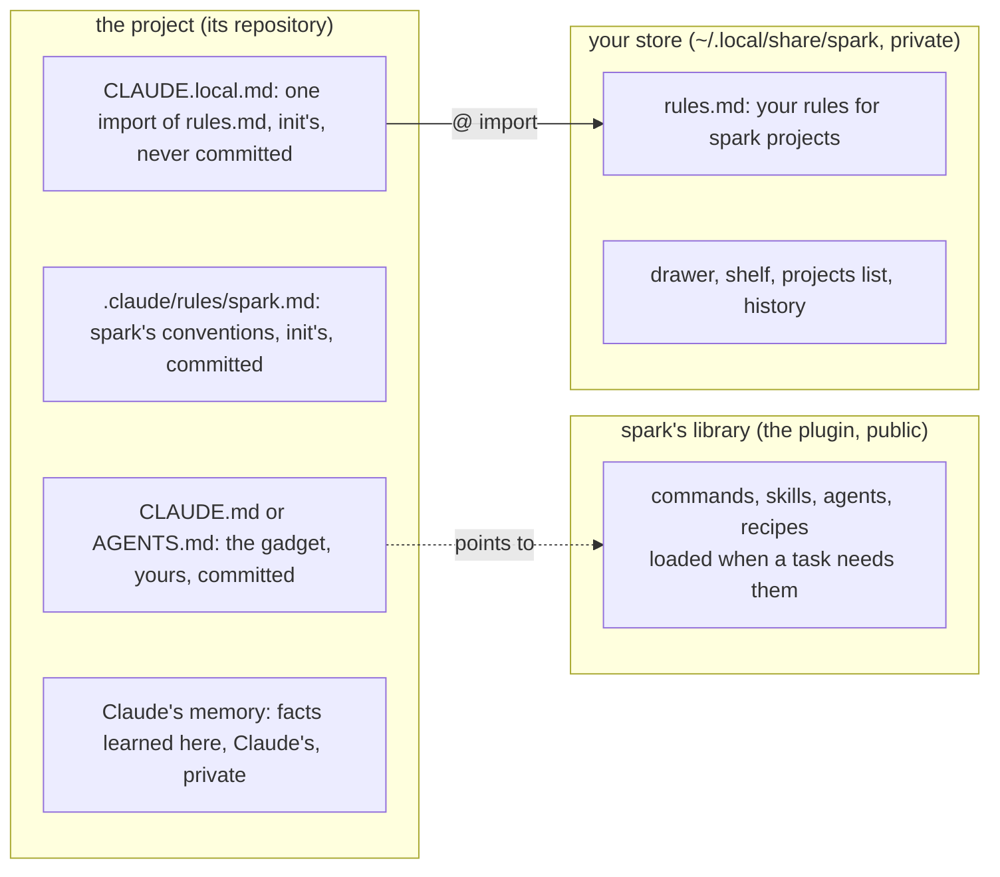

# P216 plan: spark's places in Claude Code's files

The card: [P216, #197](https://github.com/xmejkal/spark/issues/197). Written 2026-10-13, for the PO.

## The short version

Spark already has three places: its library (in the plugin), your store (yours, outside every repository) and the
project. Each Claude Code file gets one of those places. Your rules for spark projects move out of Claude's memory
into your store. `/spark:init` links a project to them and writes spark's conventions into the project. Then every
project you start with `/spark:init` gets the same rules, and a project that does not use spark gets none.

## Where each piece goes

| piece | place | who writes it | in git |
| --- | --- | --- | --- |
| commands, skills, agents, recipes | the library | spark | in the plugin |
| your rules for spark projects | your store, `rules.md` | you | never, it is outside every repository |
| what you own, your projects | your store | spark | never |
| the gadget and its decisions | the project, `CLAUDE.md` | you | yes |
| spark's conventions | the project, `.claude/rules/spark.md` | `/spark:init` | yes |
| the link to your rules | the project, `CLAUDE.local.md` | `/spark:init` | no, listed in `.git/info/exclude` |
| facts Claude learns in one project | Claude's memory for that project | Claude | no |
| what holds for all your projects | `~/.claude/` (plugins, output style, hooks) | you | no |

Three things stay out. No personal text goes into a committed file. No long page is imported, because each import
loads in full every session. No rule is kept in Claude's memory, because memory is for facts.

## What `/spark:init` says about what is here

Init reads before it writes, and it says what it found, in the way `tools.py` says "already here":

- `CLAUDE.local.md` with the import: already here. Without it: init adds the one line and keeps the rest.
- `.claude/rules/spark.md`: init owns it, says so on its first line, and rewrites it on every run.
- No `rules.md` in your store: init writes no link, and it says how to start one.
- The import names your store's real path, so a `SPARK_HOME` elsewhere works.

## The steps

Steps 1 to 3 are done by hand now, so that you can use the layout today. Steps 4 and 5 put it into spark.

1. Back up Claude's memory. Then write your store's `rules.md` from the 24 shared memories, as short commands under
   four headings: how you want work done, the board, agents and tokens, shell and tools. Its budget is 100 lines,
   because it loads in every spark session. It gets the store's private file mode, like the history.
2. Make memory hold facts only. Spark's memory keeps the open directions as pointers to their issues (the north star,
   the store as the next version, the full-circuit checks) and one short "where we stopped". Old state entries that
   the board shows as done are deleted. The bin's memory keeps the parts you own. The 24 copies go from both.
3. Link the six spark projects: spark, the bin, irrigation, plant-alarm, rc-car and spark-quickstart. Each gets a
   `CLAUDE.local.md` with the import, and an entry in `.git/info/exclude` where it is a git repository. First one
   project: a `claude -p` run there names a rule, and a run in a folder without spark does not. Then the other five.
4. A first PR: spark's own `CLAUDE.md`. It imports `@AGENTS.md` and points to `scrum/` and
   `docs/guide/developing.md`. It holds the principles for developing spark, and nothing personal. Spark is the product, with one
   core and thin interfaces. Its tools are free, few and local. The bar is a breadboard with working firmware.
   Findings go to `docs/observations/INDEX.md`, and no vendor file enters the history.
5. A second PR: `/spark:init` writes `.claude/rules/spark.md` and `CLAUDE.local.md` and reports what is here. A test
   runs it on a scratch project and runs it twice. Then init runs on the six projects and replaces the hand-made files.

## Suggested changes, for the PO to accept or strike

- The board-status hook stays in your user settings. It is for our team, not for the public plugin, and it already
  runs only in the spark and bin folders.
- The bin's `CLAUDE.md` has 175 lines and loads every session. Its tscircuit section repeats spark's recipes. A later
  card can cut it to the bin's own facts and point to the recipes.
- Spark's projects list can later drive one command that refreshes every project's spark files at once, after the
  conventions change. If you want it, a later card does it.
- A project that other AI tools also read can keep `AGENTS.md` with a one-line `CLAUDE.md` that imports it, as spark
  does. Init does not force it.

## What you do

Accept the plan by merging its PR, or comment what to change. After step 3, open a fresh session in irrigation and
ask it for one of your rules.
