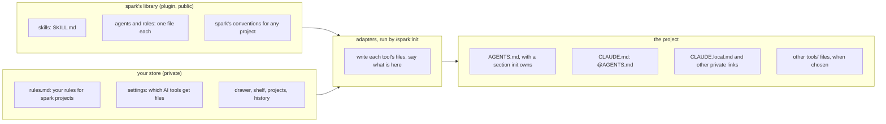

# P216 discovery: one source for what AI tools read in a spark project

The card: [P216, #197](https://github.com/xmejkal/spark/issues/197). Written 2026-10-13, for the PO.

## The vision, in the PO's words

*"so that it works not only for claude but any ai. Also, the agent and other rules and roles etc sshould also align
with the concept. I'd really want it to all work great together, seamlessly, while also alowing for great level of
control, works natively great with all kinds of aggentic systems and harnesses and plugins and ais.."*

## The short version

Every piece that an AI reads in a spark project is written once, in one of spark's three places: its library (the
plugin), your store (yours, outside every repository), or the project. Small adapters write each piece out in the
form that each AI tool reads natively. This is spark's own rule, one core with thin interfaces, applied to its
instructions, rules, skills and agents. You choose which tools get files, and a file that you edit by hand is never
overwritten. The first slice serves Claude Code and every tool that reads `AGENTS.md`.

## The open formats it builds on

As understood in mid-2026. Step 4 makes sure of each before any code depends on it.

| kind of piece | open format | who reads it |
| --- | --- | --- |
| instructions for a project | `AGENTS.md` | Codex, Cursor, Copilot, Gemini CLI and others. Claude Code reads `CLAUDE.md`, which can import `@AGENTS.md` |
| skills | `SKILL.md` folders (Agent Skills) | Claude Code and a growing set of tools. Spark's skills already use it |
| tools | MCP servers | most agent tools. Spark's v2 core plans an MCP interface (P158, #94) |
| agents and roles | no shared format yet | each tool has its own file. Spark keeps one source and writes each tool's form |
| private rules, per person | no shared format | each tool has its own place. Claude Code: `CLAUDE.local.md` |
| memory | no shared format | tool-owned. Spark keeps facts in the store or on the board instead |

## Where each piece lives

Personal text never goes into a committed file. Long pages are named, not imported, because an import loads in full
every session. Memory holds facts that Claude learns in one project, never rules.

## Roles and agents

`scrum/TEAM.md`'s roster stays the one list of who does what. Each agent has one source file in `agents/`, as today,
in neutral Markdown with frontmatter. An adapter writes it out as each chosen tool's agent file. A role that is not an
agent, such as the tech lead lens, is a prompt in the same place, so any tool can play it. Team-only agents, such as
the mutation tester, stay in spark's repository and never ship in the plugin.

## Control

- You choose: your store's settings name the AI tools that get files. A project's `.spark/` can change that choice.
- Every file an adapter writes says on its first line that spark wrote it, and how to stop it.
- In a file that you own, such as `AGENTS.md`, spark writes only between its two marker lines.
- A file that you edited by hand is left alone, and init says so, in the way `tools.py` says "already here".
- No rules file in your store means no link, and init says how to start one.

## The steps

Steps 1 to 3 are done by hand now, for Claude Code only, so that your six spark projects get your rules today.

1. Back up Claude's memory. Write your store's `rules.md` from the 24 shared memories, as short commands under four
   headings: how you want work done, the board, agents and tokens, shell and tools. Its budget is 100 lines.
2. Make memory hold facts only. Spark's memory keeps the open directions as pointers to their issues, and one short
   "where we stopped". The bin's memory keeps the parts you own. The 24 copies go from both.
3. Link the six projects (spark, the bin, irrigation, plant-alarm, rc-car, spark-quickstart) with a `CLAUDE.local.md`
   that imports `rules.md`, kept out of git by `.git/info/exclude`. A `claude -p` run makes sure on one project first.
4. One research agent (Sonnet) makes sure of the formats table: for each tool, where it reads project instructions,
   private rules, skills and agents. The result is a table in this folder, with sources.
5. A PR: spark's own `CLAUDE.md` becomes `@AGENTS.md`, and `AGENTS.md` gets the principles for developing spark.
6. A PR, the first slice in code: `/spark:init` writes its section of `AGENTS.md`, the `@AGENTS.md` line in
   `CLAUDE.md`, and the Claude Code link to your rules. It reports what is here. It replaces the hand-made links.
7. Later cards, one per tool or piece: adapters for other tools' private rules and agents, and one command that
   refreshes every project in your projects list.

## Suggested changes, for the PO to accept or strike

- The board-status hook stays in your user settings. It is for our team, not for the public plugin.
- The bin's 175-line `CLAUDE.md` repeats spark's tscircuit recipes. A later card cuts it to the bin's own facts.
- Spark's conventions for any project move from prose in several pages into the one section that init writes.

## What you do

Accept the plan by merging its PR, or comment what to change. After step 3, open a fresh session in irrigation and
ask it for one of your rules.
