# The user's journeys under D4: check first, ask, then write (P218, round 2)
<!-- Lens: the user. Proposals for the PO; nothing decided. Tags: E (pointer), H (source), D (who, when). — is unknown. Builds on council/user.md, po-assistant.md, tech-lead.md; their research is not repeated. Nothing was run on a board. -->

Marks. In the tables, the actor is **Person**, **Claude** or **spark** (the script answering). "Today" is read from code and pages, not from use (E `docs/guide/journey.md` Bench: "Nothing has run it on a board yet"). In the charts, `P:` is the person, `C:` is Claude and `S:` is what spark shows.

## 1. Use cases and journeys

### Findings that shape every journey

- USERJ-1 · One gate in front of every write: look, compare, say, ask, then write. The gate has six moves: (1) list the ports without touching a board; (2) read the connected board read-only; (3) compare each field with the project's board record and say `same`, `differs` or `unknown` per field; (4) show the person what the write will do (whole flash erased, which image, which build); (5) take the person's yes, named to the board; (6) read the board again just before the erase and stop if it is not the one that was shown. Today `deploy.py` does only the chip name, through `--chip`, and nothing else. · E `scripts/deploy.py` `chip_of`, `flash_commands`, `main` (no prompt, no read); D4 (the PO, 2026-10-13) · supports only: that the gate is new code; its shape is a proposal.
- USERJ-2 · "Match" must never be said for a field that was not read. A record holds `chip` and `micropython_port` as fields; flash and PSRAM are prose in `//sku`; the revision, the wiring and the maker cannot be read by software. So the honest verdict for the PO's own board today is "chip same, flash same (if read), PSRAM unknown, revision unknown, wiring unknown", and the word `right board` is only an overall line over the read fields with the unknown ones listed. · E `boards/firebeetle2-esp32s3.json:5,9`, `:298-318`; council/tech-lead.md TL-1, TL-7; council/po-assistant.md PO-22 · supports only: the wording rule, the repo's "a skipped is not a pass" rule (AGENTS.md pointer to `docs/guide/agents.md`).
- USERJ-3 · The yes has to be tied to the board it was given for. A yes to "erase the board on this port" is void if the cable moved. Proposed: the check shows the board's MAC and port, the yes names them, and the second read before the erase compares the MAC. The MAC is readable (E tech-lead TL-3). · H design; E that the MAC is readable · supports only: that a swapped board between check and erase is a real branch, not a guess.
- USERJ-4 · No code can tell a person's yes from Claude's flag. Any `--yes` flag Claude can pass. Three ways to bind the yes, none chosen: (a) an interactive typed confirmation on a terminal; Claude's shell has none, so Claude cannot erase alone and must hand the person the exact command to run themselves (H: shell without a terminal is model knowledge, not tested here); (b) a token the check prints (MAC plus image sha256 prefix) that the erase requires back, so a yes cannot be reused for another board or image, but Claude can copy it; (c) prose only, as today. · E (today (c)) `commands/build.md` "Ask the person before that run"; `scripts/deploy.py` `main` has no prompt; `docs/guide/agents.md:22` mentions "yes given in advance" and auto mode (read only in part) · supports only: that (c) is the only gate and it fails when an allow rule or auto mode is on.
- USERJ-5 · The look itself can restart a running gadget, so it needs its own sentence. esptool reads end in a hard reset by default (v3.3 option list), and on the S3's native USB a reset may not work at all: a search snippet says that on an ESP32-S3 no esptool command resets the board over USB-OTG and `--after no-reset` leaves it in the bootloader. So after a look the board may need the person to press RESET. · E tech-lead TL-5 (v3.3); H for the 5.5.0 and S3 behaviour: https://docs.espressif.com/projects/esptool/en/latest/esp32s3/esptool/advanced-options.html and the arduino-esp32 issue 6762 title in the search result (snippet only, read 2026-10-13) · supports only: that the look's output must end with "the board may be in download mode: press RESET".
- USERJ-6 · The firmware base is a choice the record cannot make today. `micropython_port` names `ESP32_GENERIC_S3`; the MicroPython page lists a `SPIRAM_OCT` build for boards with octal PSRAM, and the same page says the generic build auto-detects PSRAM. The two statements are not settled. A board that reads "PSRAM present" would point to the other build only if the record carried a variant fact; it does not. If the build changes, the image's sha256 changes, so the passed run no longer names it and the simulation must run again (paid minutes). · E council/tech-lead.md PHYS-5; `data/tools.json` `micropython-esp32s3`; `scripts/deploy.py` `untested` · supports only: that "offer to download the matching base" is a chain of four steps (read, name the build, fetch with a checked sha256, rebuild and re-simulate), each with a yes.
- USERJ-7 · Claude needs a structured answer and the person needs a sentence; both from one source. `outcomes.envelope` has `status`, `data`, `problems`, `unchecked`, `next_steps` and exit codes 0, 1, 2. `deploy.py` prints text and returns 0 or 2 only; it has no `--json` and no exit code for "differs". · E `scripts/outcomes.py:19,65-75`; `scripts/deploy.py` `main`; `docs/guide/agents.md:350-353` (which scripts take `--json`; `deploy.py` not listed in what I read) · supports only: that P213's `--json` and the gate's verdicts belong in one design.
- USERJ-8 · Nothing in the journeys below is observed on a board. Whether esptool 5.5.0 prints a PSRAM line for the PO's module, whether `ready` reaches the host at boot, what the port is called after the flash, and whether the 4 MiB image mounts on 16 MB are all bench questions (P215). The journeys put those moments in the tables as "unknown" so the bench has a list. · E council/user.md USER-3, USER-4; council/tech-lead.md TL-3, PHYS-1, PHYS-3 · supports only: the bench's checklist.

### Words for each actor (marked where they differ)

| moment | the person sees | Claude reads | why they differ |
| --- | --- | --- | --- |
| port list | "I found 2 boards: /dev/cu.usbmodem101 (Espressif, VID 303a), /dev/cu.usbserial-0001. Which one is the FireBeetle?" | each port with VID:PID and a stable id; a rule that Claude never picks | the person recognises a cable, Claude has no way to |
| field verdict | one sentence per field: "Chip: ESP32-S3, same. Flash: 16 MB, same. PSRAM: could not read. Revision: only you can tell." | `same`, `differs`, `unknown`, with the read value, the record value and the source of each | a list of unknowns is the part the person must act on; Claude must not collapse it |
| overall line | "No difference found in what could be read. 2 things are unknown." | a `status` that is not `ok` while any unknown is unconfirmed (as `unchecked` is for the other scripts) | Claude must not turn "no difference" into "right board" |
| the erase question | "This erases everything on the board at /dev/cu.usbmodem101 (MAC aa:bb:..), then writes the image that passed on 13 Oct. Type yes." | the same facts plus the exact command that waits for the person, never a command with the yes in it | the yes is the person's |
| a refusal | the refusal sentence ("differs: chip is ESP32-C6, the project is for ESP32-S3") and what to do | the sentence verbatim in `problems`, plus `next_steps` as choices, not commands to run | Claude relays it and does not act on a choice alone |
| after the flash | "Press RESET if nothing shows. I saw: ..." | the captured text, a flag `ready_seen` true, false or unknown | `unknown` is not `false`: a port that opened late proves nothing |

### UC0. Look at the connected board (read-only; the base of every other journey)

Why first: it is the one journey that writes nothing, it answers the PO's "is it the board it is meant for" (E #201), and it is the cheap precursor the PO-assistant lens proposed for the bench (E po-assistant PO-20).

| step | actor | what they do | what spark shows or answers | evidence | friction or harm removed | today |
| --- | --- | --- | --- | --- | --- | --- |
| 1 | Person | plugs the board in; says "look at the board" (or Claude offers it before any deploy) | — | H | — | works (they can say it) |
| 2 | spark | lists serial ports, reads nothing from them | each port with maker and VID:PID; none: says "no board found" (see B5) | E `mpremote devs` lists VID:PID (tech-lead TL-7) | the wrong-port guess; esptool's "try each port" | not yet |
| 3 | Person | names the port if there are two or more; spark never chooses | the choice echoed back | E `scripts/deploy.py` `--port` is optional | an erase on a board nobody named | not yet |
| 4 | spark | reads the board read-only: chip, flash size, MAC; PSRAM and revision where the chip reports them | the values, each with "read from the board" | E tech-lead TL-3 (what esptool can read) | — | not yet |
| 5 | spark | compares each value with the project's board record and the project's two board names (`requirements.json` and `boards/active.json`) | `same`, `differs` or `unknown` per field; if the two board names differ, says so | E tech-lead TL-1, TL-2 | a project that names two boards | not yet |
| 6 | spark | says what the board may now need | "may be in download mode: press RESET" (USERJ-5); "the look does not tell the revision: V1.1 or V1.2 is on the back silkscreen" | E boards file `hardware_revisions.how_to_tell` | a board left silent after a look | not yet |
| 7 | Person | answers what only they know (revision label, the module's printed "N16R8", the wiring) | the answer is kept in the log as "the person said", not as "read" | E user.md USER-7 | `unknown` standing in for ever | not yet |

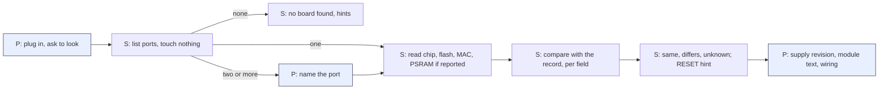

Claude's view of UC0: it may run the look (read-only) once the person has plugged a board in and said the port when more than one is present. It tells the person the look can restart the gadget before running it. It reads the per-field verdict, never `ok` as one word. It does not write anything. E for the read-only claim only as far as esptool's documented read commands; H that every one of them is side-effect free on the S3 (USERJ-5).

### UC1. First flash of the image that passed (the simplest write; the PO's bench, P215)

| step | actor | what they do | what spark shows or answers | evidence | friction or harm removed | today |
| --- | --- | --- | --- | --- | --- | --- |
| 1 | Claude | checks that a passed run names the image; runs the dry run | the two commands, the log that passed and its sha256, the date, the files changed since | E `scripts/deploy.py` `untested`, `newer_files`; user.md USER-5 | "passed" with no name | partly (no log name or sha shown) |
| 2 | spark | runs UC0 steps 2 to 6 on the named port | the per-field verdict | as UC0 | an erase of the wrong board | not yet |
| 3 | spark | if every read field is `same`: continues; if any `differs`: UC2 or UC3; if `unknown`: lists it | the list of unknowns, and which of them the person can fill | USERJ-2 | a false "match" | not yet |
| 4 | spark | checks the firmware base of the image against the board's reading (see UC4) | "image: ESP32_GENERIC_S3 v1.29.0; board reports PSRAM; this build may not use it" or "no concern found" | E tech-lead PHYS-5 | a build that wastes the PSRAM or does not boot | not yet |
| 5 | Person | gives the yes, naming the board | the question lists the port, the MAC, the image, the sha256, "erases the whole flash, nothing is saved" | USERJ-3, USERJ-4 | a yes to a different board | not yet |
| 6 | spark | reads the MAC again just before the erase | stops with "this is not the board you said yes to" if it differs | USERJ-3 | a board swapped in between | not yet |
| 7 | spark | erases, writes at `0x0`; stops after the first failed command, writes nothing after a failed erase | the failing command and the BOOT then RESET hint, shown before the failure as well when the look found the port silent | E `scripts/deploy.py` `BOOT_HINT`, `main` | the hint appearing only after a failure | works |
| 8 | Person | presses RESET if the board waits in download mode | what to look for | USERJ-5 | a board left in the bootloader | not yet |
| 9 | spark | re-lists ports (the name may have changed), reads the board's start for a fixed time, and says what it saw | the lines read; `ready` seen, not seen or could not tell (UC-B7) | E `commands/build.md:276-279`; `scripts/deploy.py` `WATCH` | `ready` claimed or denied without a read | not yet |
| 10 | Claude and person | keep the serial log with the run logs; record what was flashed, to which board (MAC), on what date, with the person's yes | the log path | E #196 "Value proven by" | a flash with no record | not yet |

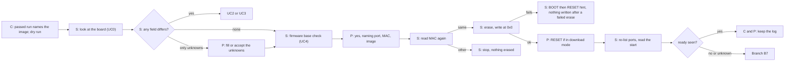

Claude's view of UC1: it may run steps 1 and 2 (dry run, look). It must stop at step 5 and ask in its own turn, naming port, MAC, image and "whole flash erased". It may not pass a yes flag in advance or from an allow rule (E `commands/build.md` says to ask even when permissions would allow; that sentence is about the Wokwi run, and the erase sentence is "Ask the person before that run"). It reads exit code and the per-field verdict, and it relays the refusal sentence without rewording the harm out of it.

### UC2. The same chip, a different board

Case examples: an N4 (DFR1145) where the project is for the N16R8 (same record, `//sku` covers both; flash size differs, readable); another ESP32-S3 board with no record (the PO owns a Romeo ESP32-S3, DFR0994, which has none: E tech-lead via P100 FEAS-3). Chip and flash can read `same` while the header, the pins and the power design differ, so a `same` is never proof of the pin map (E tech-lead TL-7 "the pins the pin map uses: no").

| step | actor | what they do | what spark shows or answers | evidence | friction or harm removed | today |
| --- | --- | --- | --- | --- | --- | --- |
| 1 | spark | finds the read fields equal on chip, differing or unknown elsewhere | "chip same; flash 4 MB, the project's board has 16 MB; PSRAM none" | E tech-lead TL-7 | silent acceptance | not yet |
| 2 | spark | looks in spark's own records for a board that fits what was read | the matching records, or "no record fits" (today `boards/` holds two) | E `ls boards`: firebeetle2-esp32s3.json, xiao-esp32-c6.json | a guess at which board this is | not yet |
| 3 | Person | tells spark which board it is (the maker's name and product code on the board or the box), since software cannot | their word, kept as "the person said" | E tech-lead TL-7 "maker and model: no" | — | not yet |
| 4 | spark | offers the choices, each with its cost | (a) migrate: change the project's board to a record that fits, rebuild pin map, diagram and sheet, run the simulation again; (b) use a general chip-level setup: no header names, so pins must be chosen again; (c) go ahead with the project's setup anyway, with the differences printed and written into the log; (d) stop | E tech-lead TL-8 (the four readings) | one big unlabelled "other board" | not yet |
| 5 | Person | chooses | the choice echoed | #201: "It should also however allow this to be ignored" (E) | — | not yet |
| 6 | spark | for (a) or (b): says the passed run no longer names the result and the simulation must run again; for (c): the rest of UC1 from step 4 | E `scripts/deploy.py` `untested` | a "migrate" that flashes the old image | not yet |
| 7 | Claude | never takes (a), (b) or (c) alone | — | H | the agent changing the project's board | n/a |

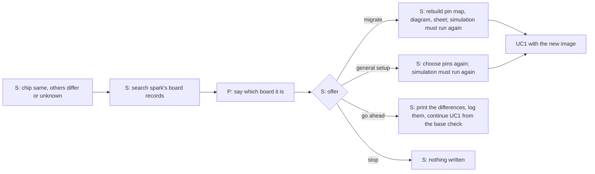

Claude's view: it may describe the choices and the costs. It must put all four to the person and wait. It must not set `boards/active.json` or the project's board itself. A go-ahead is the person's words in this conversation, and the log keeps the differences printed at that moment. Different words: the person gets the product-name question; Claude gets the list of records that fit as data, with a reason per record.

### UC3. A different chip (stop)

| step | actor | what they do | what spark shows or answers | evidence | friction or harm removed | today |
| --- | --- | --- | --- | --- | --- | --- |
| 1 | spark | reads the chip: ESP32-C6 where the project is for ESP32-S3 | "The board is an ESP32-C6. The project and its image are for ESP32-S3. Nothing was written." | E `scripts/deploy.py` docstring (esptool refuses another chip) is tested only against a fake `run` (tech-lead TL-7) | flashing an image the chip cannot boot (the image header holds the chip id: 0x09 in the kept .bin, E tech-lead TL-7) | partly (esptool may refuse; nothing in spark does) |
| 2 | spark | offers: choose a board record for this chip (if one exists); add this board as your own record (the documented route); stop | the route page and its cost | E `docs/guide/how-it-works.md` "Your own dev board" (named in P100 FEAS-3) | a dead end | not yet |
| 3 | Person | picks; for a record, the project is rebuilt and simulated again | UC2 step 4(a) | E | — | not yet |

There is no "go ahead" here in this sketch. Whether the PO's "ignore" covers a different chip is Q-J3. If esptool is 3.3 it does not know `esp32c6` as a chip name and fails before any check (E tech-lead TL-4): the look must say "cannot read: esptool 3.3 does not know this chip" and mark the chip `unknown`, not `same`.

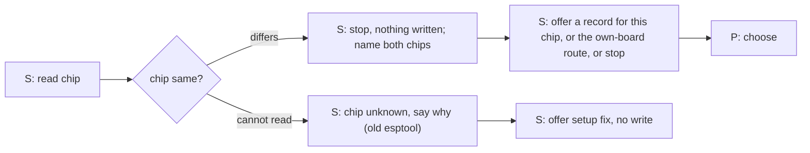

### UC4. The firmware base is not the one that fits (offer the matching MicroPython)

Two kinds. (i) The image's MicroPython build is not the best match for the board that was read (for example PSRAM present while the image is the generic build). (ii) The board already runs a MicroPython (read with `mpremote`, a software fact: version and build string) that differs from the image's, or runs something else (nothing to read).

| step | actor | what they do | what spark shows or answers | evidence | friction or harm removed | today |
| --- | --- | --- | --- | --- | --- | --- |
| 1 | spark | compares the board's reading with the record's build name and the image's build | "the image is ESP32_GENERIC_S3 v1.29.0; the board reports octal PSRAM; MicroPython lists a SPIRAM_OCT build" | E tech-lead PHYS-5 | a quiet mismatch | not yet |
| 2 | spark | says it cannot decide alone: the record has one `micropython_port`, no variant fact | "the record does not say which build this board needs" | E `boards/firebeetle2-esp32s3.json:7` | a guess | not yet |
| 3 | Person | chooses: keep the image, or fetch the other build | — | — | — | not yet |
| 4 | spark | if fetch: shows the URL and sha256 from the tools list, asks the person's yes for the download, and keeps it in the store (never in the repository) | the file name, size, sha256 | E `data/tools.json` (the pinned generic build); AGENTS.md "Never commit a vendor file" | an unchecked download | partly (`/spark:setup add` fetches the pinned one) |
| 5 | spark | rebuilds the image with it | the new sha256 | E `scripts/flash_image.py --micropython` | — | partly |
| 6 | spark | says: "The simulation passed on a different image. It must run again; a run spends Wokwi minutes." Asks | the cost | E `commands/build.md` (ask before each run) | flashing an untested image | works (the refusal exists) |
| 7 | Person | yes to the run (paid) | — | — | — | — |
| 8 | spark/Claude | after the run passes, UC1 from step 2 | — | — | — | — |

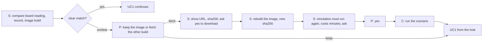

Claude's view: it may name the build and the cost. It must not fetch (a network write to the person's store, even a checked one) or run the paid scenario without a yes, and it must never choose a build because a reading "suggests" one: the chain from reading to build is H (PHYS-5 unsettled). If the board already runs MicroPython, the software read (version, build) is a fact; if it runs something else, spark says it cannot read the old firmware and the erase will remove it. Offer a backup of the flash before an erase (esptool can read a flash to a file: E po-assistant PO-9 names read-flash; time for 16 MB — unknown).

### UC5. Change the code and put it on again (full flash)

| step | actor | what they do | what spark shows or answers | evidence | friction or harm removed | today |
| --- | --- | --- | --- | --- | --- | --- |
| 1 | Claude | edits `firmware/` as the person asked | — | H | — | works |
| 2 | Claude | asks, then runs the scenario (paid) | verdict, new sha256 | E `commands/build.md` | untested flash | works |
| 3 | spark | refuses until a passed log names the new image; names stale logs | the sentence | E `scripts/deploy.py` `untested`, `tested_another` | flashing old code | works |
| 4 | all | UC1 from step 2 (look and yes again; the old yes does not carry over) | the board's MAC against the earlier flash log: "last flashed here on 13 Oct" or "a board never flashed by this project" | USERJ-3 | a yes reused for another board | not yet |

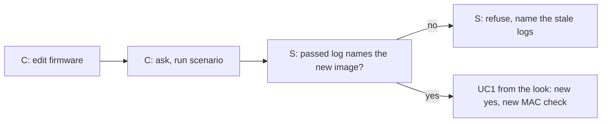

### UC6. Update files without a full flash (needs a D)

| step | actor | what they do | what spark shows or answers | evidence | friction or harm removed | today |
| --- | --- | --- | --- | --- | --- | --- |
| 1 | spark | looks at the board (UC0) and reads that MicroPython is running, with version and build | "this board runs MicroPython v1.29.0 ESP32_GENERIC_S3" | H (software read, not tried) | copying files onto a board with other firmware | not yet |
| 2 | spark | lists which files differ between `firmware/` and the board | the names and sizes | H | — | not yet |
| 3 | spark | states the gate: the changed files must be covered by a passed run, or the person says "untested" | one of the two | E tech-lead TL-13; po-assistant PO-7, PO-21 | the sim guard silently dropped | not yet |
| 4 | Person | yes, naming the board and the files | — | USERJ-3 | — | not yet |
| 5 | spark | copies the files, resets, reads the start | the lines read; `ready` seen or unknown | H | — | not yet |

An update does not erase; the person's yes still names the files and the board, because the copy overwrites files on the board. Whether a copy of untested files is allowed is Q-J6. `mpremote run` leaves `main.py` alone and does not run it (E po-assistant PO-5), so a live try of a changed file is a different journey (UC7).

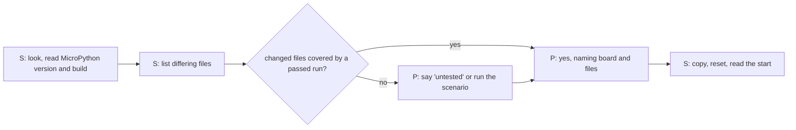

### UC7. Read pins live and let Claude debug on a running board

| step | actor | what they do | what spark shows or answers | evidence | friction or harm removed | today |
| --- | --- | --- | --- | --- | --- | --- |
| 1 | spark | looks at the board; reads the revision from the person (V1.1 or V1.2) | the revision shapes what an I2C scan means (V1.1 shows the PMIC on the bus) | E boards file `:298-318`; tech-lead PHYS-9 | a false "device found" | not yet |
| 2 | Person | says what to read, in the pin map's names (BUTTON, LED), not GPIO numbers | spark maps names to pins from `firmware/pins.py` | E INDEX RP1 (`--keep` writes `firmware/pins.py`) | a wrong pin | not yet |
| 3 | spark | classes each action as read, read that drives, or write (a scan drives SCL and SDA; setting a pull changes a pin) | the class of each action, before running | E tech-lead TL-11 (H classification) | a "read" that moves an output | not yet |
| 4 | Claude | runs reads; asks before a read that drives and before any write | the values with the time and the pin names | H | the agent writing behaviour live | not yet |
| 5 | Person | presses the button, moves the sensor | — | — | — | — |
| 6 | Claude | proposes a fact (a pin that does not match the record) or a firmware edit; the edit goes back through UC5 | — | E AGENTS.md "Spark exports facts, never behaviour" | live behaviour outside the simulator | not yet |

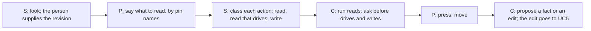

### UC8. Another platform (Arduino, PlatformIO)

Same gate, different pieces: the artefact is an app binary that Wokwi runs at 4 MB, not a whole-flash image (E tech-lead TL-16); the flasher is the platform's own or esptool; the `ready` contract and the image sha256 are MicroPython's today (E tech-lead TL-15). The gate (look, compare, say, ask) does not change; the base check (UC4) becomes "the board's bootloader and partition layout fit this build" and is — for what it reads. Held for P221 (#203). Open: whether the look is allowed to be platform-neutral (it only reads a chip).

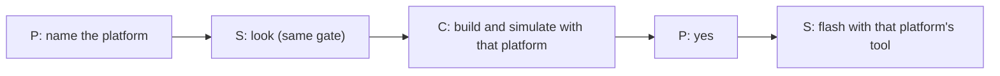

### Branches every safe design must handle

Each is its own small journey. They hang off UC0 and UC1.

**B1. The right board.** Every read field `same`, unknowns listed. The flow continues to the yes; the unknowns are in the yes question ("PSRAM and revision could not be read"). Today: not yet.

**B2. Same chip, different board.** UC2.

**B3. Different chip.** UC3 (stop).

**B4. A field that cannot be read.** Said as `unknown`, with why: the chip does not report it (PSRAM line only when the PSRAM fields are programmed: E tech-lead TL-3, "—" for the N16R8 module); the tool is too old (esptool 3.3 here: E tech-lead TL-4); only the person can know it (revision, maker, wiring). The person may fill it; it is kept as "the person said". A skipped read is never turned into `same`. Today: not yet.

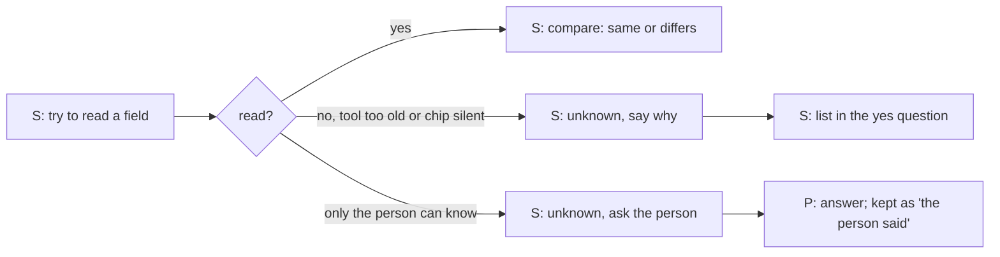

**B5. No port, or two boards.**

| step | actor | what they do | what spark shows or answers | evidence | friction or harm removed | today |
| --- | --- | --- | --- | --- | --- | --- |
| 1 | spark | lists ports | zero boards: "no board found"; one: shown; two or more: all shown | E `commands/build.md` `mpremote devs` | esptool trying each port | not yet |
| 2 (none) | Person | checks the cable (data, not charge-only), tries another port; if the board is silent, BOOT then RESET | the order of presses as DFRobot gives it and as Espressif gives it differ (E tech-lead PHYS-2) | cable and presses | a stall with no hint before a failure | partly (hint after failure only) |
| 2 (two) | Person | names the port; spark never chooses | the chosen port echoed with its VID:PID | E `scripts/deploy.py` `--port` | the first-found board erased | not yet |
| 3 | spark | from then on always passes `--port` | — | — | the port-less erase | not yet |

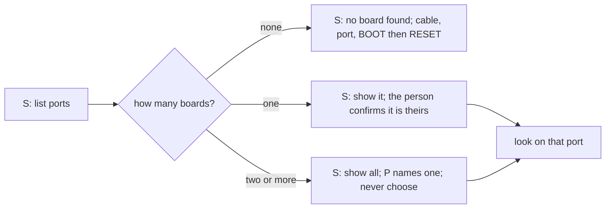

**B6. The firmware base does not match.** UC4.

**B7. The board does not print `ready` after the flash.**

| step | actor | what they do | what spark shows or answers | evidence | friction or harm removed | today |
| --- | --- | --- | --- | --- | --- | --- |
| 1 | spark | re-lists ports (the name may have changed) | the new port or "none" | E `commands/build.md:277-278` | reading the old port | not yet |
| 2 | spark | opens it and reads for a fixed time after a reset | the text received | H | the boot-time `ready` lost before the port opened (E user.md USER-3) | not yet |
| 3 | spark | classes the result: `ready` seen; text seen but no `ready`; silence; the port in download mode; no port | one of five, never "failed" for silence alone | H | a wrong "failed" or a wrong "passed" | not yet |
| 4 | Person | presses RESET once; says what the LED does | their words, kept as "the person said" | — | — | — |
| 5 | spark | on text without `ready`: shows it as printed (a traceback names the file); on silence or a download-mode port: offers the look (UC0), not a reflash | next choices | — | an automatic second erase | not yet |
| 6 | all | any new flash is a new UC1 with a new yes. The log says "flashed, ready not seen" until it is seen | — | — | a flash recorded as working | not yet |

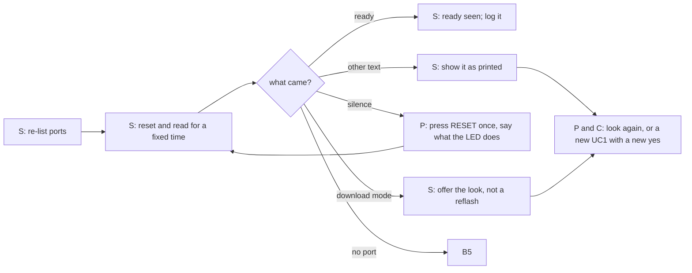

**B8. The board changed between the look and the erase.** UC1 steps 5 and 6. Stops with nothing erased.

**B9. The 4 MiB image on the 16 MB board does not mount.** If the board prints text but the filesystem is missing (an error in `main.py`'s file read), spark cannot tell this from a code error without a read. Proposed look-after-flash read: the size of the filesystem the board reports. Whether 16 MB mounts a 4 MiB layout is a bench question. · E tech-lead PHYS-3; po-assistant PO-12 · today: not yet.

### The journeys for Claude as the actor

What Claude reads. For each look and each write: the exit code (0 done, 1 differs or problems, 2 could not run; today deploy.py uses 0 and 2 only: E `scripts/deploy.py`), the per-field verdict, the `unchecked` list (every unknown), the refusal sentence verbatim, and `next_steps` as choices. It treats `unknown` as a thing to say, not to fill (AGENTS.md "what never to assume": `null` is not a value to fill in; E `docs/guide/agents.md` pointer in AGENTS.md).

What Claude must ask the person, and when:

1. Which port, when two or more are listed.
2. For the look: "this may restart the gadget" before it runs.
3. For anything unknown that only the person knows (revision, module text, wiring).
4. The yes before the erase, naming port, MAC, image, and "whole flash erased". In its own turn, after the check, not before it.
5. A choice among migrate, general setup, go ahead, stop (UC2).
6. The download of another firmware base and the paid scenario run (UC4).
7. The yes before a file copy that overwrites files (UC6) and before any read that drives a pin or any write (UC7).

What Claude must never do alone: erase; write the flash; choose among two ports; choose another board; pass or reuse a yes; set the project's board; download a firmware file; run a paid scenario; treat an allow rule or auto mode as the yes; call `unknown` a pass.

Where the person and Claude need different output (marked above): the port list, the field verdict, the overall line, the erase question, the refusal, the after-flash result. In each case one source, two renderings: a sentence for the person and structured fields for Claude. The risk is in the middle: Claude paraphrasing a refusal so that the harm disappears. So the refusal sentence is a field Claude relays verbatim. H, proposal.

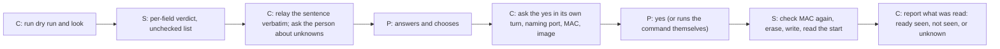

### Candidate account questions for the PO (each would change a journey)

1. When you last flashed an ESP32 board, had you ever erased something you wanted to keep? (changes whether a backup is offered before every erase)
2. When you last had two boards on USB at once, which one did the tool pick, and did you notice before it wrote? (changes whether `--port` is required)
3. When you last used a tool that asked "are you sure" before an erase, did you read it or press yes? (changes whether the question carries the MAC, a typed word, or a command the person runs themselves)
4. When you last put firmware on a board that was a different model from the one the code was written for, what happened to the pins? (changes whether "go ahead" is ever the default offer)
5. When you last had a board of the same chip but another make, did you change the code, the board setting, or nothing? (changes UC2's first offer: migrate or go ahead)
6. When you last read a board's revision, where did you find it and how long did it take? (changes whether UC0 asks for the revision before the first write or only for debugging)
7. When you last chose a MicroPython file for an S3 board with PSRAM, which one did you take and why? (changes UC4: whether spark offers the other build at all)
8. When you last downloaded firmware from the web for a board, did you check anything about it? (changes how the download yes and the sha256 are shown)
9. When you last saw a board print nothing after a flash, what did you do first? (changes B7's order of choices)
10. When you last pressed RESET or BOOT to get a board to connect, did the tool tell you in advance or after it failed? (changes when the hint appears)
11. When you last changed one line of firmware on a board that already ran, did you want the simulator to run first? (changes UC6's gate)
12. When you last let an AI tool run a command that wrote to a device, did it ask you first? (changes whether an allow rule counts as a yes)
13. When you last used your Mac's serial port list, how did you know which port was the board? (changes B5's wording)
14. When you last restarted a running gadget by connecting to it, was that a problem? (changes the sentence in front of the look)
15. When you last wanted a gadget's pins read on the board, which values did you want first? (changes UC7's first reads)
16. When you last kept a record of which board got which firmware, where did you put it? (changes where UC1 step 10 writes)
17. When you last had two boards of the same model plugged in, how did you tell them apart, and did you ever write to the wrong one? (changes UC-T: naming, the unplug test, or a label)
18. When you last updated a board without a cable, what did you use and what happened when it failed? (changes UC9: which failure paths, and whether the cable sentence is needed)
19. When you last came back to a board you had flashed a week before, how did you find out what was on it? (changes the contract: whether a marker on the board is wanted)
20. When you last re-deployed to a board you trusted, which question would you have been happy to skip, and which one would you have missed after a mistake? (changes the choice among H1, H2 and H3)
21. When you last lost something saved on a board by an erase, what was it? (changes UC-K step 5: the manifest and the data-loss line)
23. When you last tried something live on a board through a REPL, what did you try first and what did it leave behind? (changes UC10's first reads and the leftover sentence)
24. When you last had a REPL open and another tool wanted the port, what happened? (changes UC10 step 3)
22. When you last gave a board a name or a label, where did you write it? (changes UC-T step 4)

### Additions from D5 and D6 (the PO, 2026-10-13, in brief.md)

Findings for this block.

- USERJ-9 · "Known" can be made of three things, from weakest to strongest. (1) A record on the person's machine: spark deployed to this MAC before, for this project, with this image sha256, on this date, with the person's yes. (2) The board reads back the same: its MAC, chip and flash equal the record. (3) The board's own marker: a small file spark put on it at the last deploy (project, image sha256, date, a name the person gave it), read back now. A board is known when (1) and (2) hold; (3) makes it known beyond doubt and lets it be recognised on another machine. Today spark keeps none of the three: `deploy.py` writes no log and no marker. · E `scripts/deploy.py` `main` (prints, keeps nothing); D6 (the PO, 2026-10-13) for the aim; H for the three-part definition (Claude's proposal) · supports only: that "known" has to be built; nothing makes it today.
- USERJ-10 · A marker written inside the image would make the image's sha256 depend on its own content (the marker names the sha). So the marker is written after the flash, as a file copied to the board, and the tested image stays byte-identical to the one that passed. Writing it needs MicroPython running, so it comes after the first start. · H design, from E `scripts/deploy.py` `untested` (the sha256 of the image is the pass key) and `scripts/flash_image.py` (files go into the image) · supports only: the order; the mechanics are the tech lead's.
- USERJ-11 · Reading the marker back with `mpremote` interrupts a running program (the gadget stops for the read), and reading flash with esptool resets the board. Either read touches a running gadget, so even the seamless path has a one-line cost the person should see once: "the gadget restarts for about a second". · E tech-lead TL-5, TL-9 · supports only: that no read of a running gadget is invisible.
- USERJ-12 · The marker is a fact spark exports (what it wrote, when, for which project), not behaviour. It fits the rule "spark exports facts, never behaviour". A stub on the board that listens for updates (what OTA needs) is behaviour that runs on the board, and the line between the two is a decision for the PO. · E AGENTS.md "Spark exports facts, never behaviour"; H for where the line falls · supports only: Q-J11.
- USERJ-13 · Two almost identical boards cannot be told apart by chip, flash, PSRAM or the board record. Only the MAC (unique, readable) and the port (changes at replug and after a flash) differ, and the person's own knowledge of which one is on the breadboard. So spark asks the person to name each board once, binds the name to the MAC, and from then on shows the name. · E tech-lead TL-7 ("maker and model: no"; MAC readable, TL-3); user.md USER-12 (port name changes after a flash) · supports only: that naming is the one thing the person must supply.
- USERJ-14 · OTA is two different things, with different failure paths. File OTA moves the project's Python files over Wi-Fi to a board already running MicroPython; it needs board-side code to receive them (WebREPL or a small stub). Firmware OTA replaces the interpreter and needs OTA partitions, which the kept MicroPython table does not have (only `nvs`, `phy_init`, `factory`). The first is UC6 over Wi-Fi. The second is a new base build and a rollback rule. · E tech-lead TL-14 for the table; H for the split · supports only: that "OTA" in the PO's question needs one word each for the two.
- USERJ-15 · In OTA the only recovery from a board that does not come back is the cable and the person's hands (BOOT, RESET). So the first sentence of every OTA question is "if this fails you need to reach the board with a cable". A design that hides this makes OTA look safer than the wired path. · H design · supports only: the wording of the OTA yes.

#### UC-K. The known board: deploy and update, seamless but sure (D6)

This is the main journey once a board has been through UC1 once. What the person does: asks for the deploy. What they see: a short receipt. Everything below the line runs without a question while it passes, and stops with a per-field sentence when it does not.

| step | actor | what they do | what spark shows or answers | evidence | friction or harm removed | today |
| --- | --- | --- | --- | --- | --- | --- |
| 1 | Person | says "put it on the board" (or Claude offers after a passed run) | — | H | — | works (the words) |
| 2 | spark (silent when it passes) | lists ports; finds exactly one board whose MAC is in the project's deploy record | nothing on a pass; "no known board here" or "two boards" (see K-B1, K-B2) | USERJ-9, USERJ-13 | an erase on a board nobody named | not yet |
| 3 | spark (silent) | reads chip, flash, MAC; compares with the record and the board file; esptool version can read them | nothing on a pass | E tech-lead TL-3 | a swapped board | not yet |
| 4 | spark (silent) | reads the marker back: project, image sha256, date, name | nothing on a pass; on a difference: "this board says it holds project X, image Y; the record says Z" | USERJ-10 | a board reflashed by another tool, or another project's board | not yet |
| 5 | spark (silent) | lists the board's files and compares them with the manifest of the last deploy; files that the manifest does not hold are data that a full erase would lose | nothing if there are none; else the list and "a full erase would lose these; an update will not" | H; MicroPython file listing read from the board (not tried) | data loss in the board's own files (calibration, logs) | not yet |
| 6 | spark (silent) | checks the image passed, no stale logs, tools in order, the base build matches (UC4) | nothing on a pass | E `scripts/deploy.py` `untested`, `newer_files` | a flash of untested code | works |
| 7 | spark | chooses the least that does the job: update the changed files (no erase) when only `firmware/` changed and the base is the same; a full erase and write only when the base or the layout changed | one line: "2 files changed; updating, not erasing" | H; E tech-lead TL-13 | an erase where a copy would do | not yet |
| 8 | Person | the yes, by whichever way is chosen (H1, H2, H3 below) | the question only when the way requires it | D4, D6 | — | not yet |
| 9 | spark | writes; writes the new marker and manifest; resets; reads the start; checks the marker reads back equal to what was written | one line: "'breadboard' (aa:bb) updated: 2 files, 6 s. Started, ready seen. Marker reads back." | E `commands/build.md:276-279` for the ready line | "done" without a read | not yet |
| 10 | spark | appends to the deploy record: board, project, image sha256, files, date, what was read, whose yes | the record's path on request | USERJ-9 | a deploy nobody can trace | not yet |

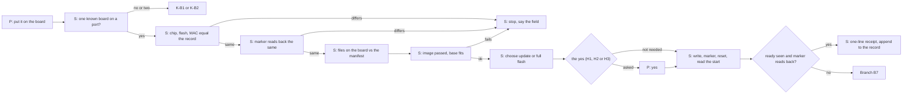

What stays silent while it passes: steps 2 to 6. What the person always sees: the one-line receipt and, if the gadget restarted, that it did. What stops it: any `differs` or `unknown` in steps 2 to 6, which goes back to the per-field sentence and the full yes of UC1.

K-B1. A board that is not known (first time, or its MAC is not in the record): UC1 in full, with the naming question added ("what do you call this board?"). K-B2. Two boards, one known and one not: spark proceeds with the known one only if the person named it or unplugged the other; it never infers from "the known one is the likelier".

##### Three ways D6 and D4 can hold together

Common to all three: the first deploy to any board (unknown) always takes the full yes of UC1. They differ for the known board. None is chosen here.

| way | what the person gives | what spark does | risk | for a person | for Claude |
| --- | --- | --- | --- | --- | --- |
| H1. A yes per board that spark remembers | one yes at the first deploy, naming board, project and scope ("update files" or "erase and write"); kept in the record | later deploys to the same MAC, same project, inside the scope, with all silent checks passing, run with no question | the yes outlives its reasons: the board is rewired, lent, or reused for another project; a yes for "update" is read as "erase"; the record is a file Claude could write | a short stop whenever the project, the scope or anything read changes; a command to forget a board | Claude cannot create or widen the yes; the record is written only by the person's interactive answer; Claude runs the deploy when the record covers it, then reports the receipt; on any stop it asks |
| H2. The deploy command is the yes | the person's request ("deploy", "put it on the board") in this turn | for a known board whose checks pass and where no data on it would be lost, the request is the yes; the output shows the plan and the receipt | the request was about the code, not the erase; in auto mode or with an allow rule an agent may issue the request itself; no record of the yes beyond the log | the least friction; they see what was done after | Claude counts a request as the yes only when the person made it in this turn and named the board or has one known board; a deploy that Claude decided on its own after a test is not a yes |
| H3. A yes only when something differs or data would be lost | nothing for a clean known board; a yes when any read differs, an unknown appears, files not in the manifest would be lost, or the scope is a full erase | silent on a clean known board; a stop with the sentence otherwise | the set of differences spark can read is smaller than the set that matters (wiring, revision, parts unplugged, a different sensor on the header); "silent" there is silence about what spark cannot see; a manifest listing needs MicroPython running | clean and fast, with the stops where they matter | Claude reads the receipt's `unchecked` list; if it is not empty, Claude asks as if the board were unknown |

A pairing the PO may want to consider: H1 for who is allowed (the board and project), H3 for when to stop (differences and data), and H2 as the weakest, since it rests only on the wording of a request. Not decided.

Claude's view of UC-K: it may run UC-K when the record covers the board and project; it reads the per-field verdict and the receipt; it may not create, widen or renew the yes; it states in its answer what was written, to which named board, and what was read back. If a check is `unknown`, it says that and asks, because `unknown` is not a pass.

#### UC-T. Two almost identical boards connected at once (D5a)

| step | actor | what they do | what spark shows or answers | evidence | friction or harm removed | today |
| --- | --- | --- | --- | --- | --- | --- |
| 1 | spark | lists ports; finds two boards with the same maker and the same chip | both, each with port, VID:PID, MAC, and "known as 'breadboard'", "known as 'spare'" or "not known" | USERJ-13; E tech-lead TL-7 | the first-found board erased | not yet |
| 2 | spark | says why it cannot tell: "these two read the same except for the MAC" | the one sentence | — | a guess | not yet |
| 3 | Person | names the target: picks a name, or, for an unnamed board, does the unplug test: "unplug the board you do not want to write to; I will list the ports again" | spark lists again and shows the one still there | H (port-list difference; not tried) | a wrong-port pick by a port name that changes | not yet |
| 4 | spark | binds a name to the MAC the person confirmed; remembers it in the record | "this is 'breadboard' (MAC aa:bb)" | USERJ-13 | asking again every time | not yet |
| 5 | spark | works only on that port and MAC; reads the MAC again just before the erase | stops if it differs | USERJ-3 | a replug swapping the port names | not yet |
| 6 | spark | after a flash, re-lists and finds the board by MAC, not by the old port name | the new port | E `commands/build.md:277` (the port name may change) | reading the other board | not yet |

What spark refuses: to choose by port order; to erase when two boards match the project's board record and none is named; to use a port from an earlier turn without reading its MAC again; to carry a yes for one board over to the other. What spark may offer: a blink test later, but that writes to a pin, so it is a UC7-class action with its own yes (H).

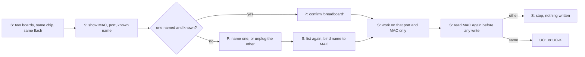

For Claude: it receives the list with MAC, port, name and known/unknown, and a flag that the target is not set. It does not set the target: it asks the person in a sentence they can answer ("Which one is on the breadboard: 'aa:bb' on usbmodem101 or 'cc:dd' on usbmodem1101?") and suggests the unplug test. Different words: the person gets "unplug the other one"; Claude gets the MACs and the instruction that the port names are not stable.

#### UC9. Update over Wi-Fi (OTA), an advanced rung (D5b)

Precondition (H): the board is known, it has been through a wired UC1 with a base that can receive an update (USERJ-14), and the Wi-Fi name and password are stored where the person keeps secrets, not in the repository, not on the screen. Two variants: UC9a files over Wi-Fi (a board already running MicroPython), UC9b a new base over Wi-Fi (OTA partitions).

| step | actor | what they do | what spark shows or answers | evidence | friction or harm removed | today |
| --- | --- | --- | --- | --- | --- | --- |
| 1 | Person | says "update it over Wi-Fi" | — | H | — | not yet |
| 2 | spark | looks for the board on the network and asks it who it is | name, MAC, project, image sha256, date, from the board's marker; "not found" otherwise | USERJ-9 and the contract in D5c | an update sent to the wrong board | not yet |
| 3 | spark | with two boards on the network, shows both by name and MAC; refuses to choose | as UC-T | USERJ-13 | an update to a board with the same hostname | not yet |
| 4 | spark | checks the same list as UC-K (image passed, files, base) | silent on a pass | UC-K | an untested update | not yet |
| 5 | Person | the yes, whose first sentence is: "if this fails, you will need the cable to reach the board" | what changes, how big, how long; rollback present or not | USERJ-15 | the surprise that OTA has no BOOT button | not yet |
| 6 | spark | sends; the board checks the file hash before it applies | progress; "the board accepted it" or "the board refused it: hash differs" | H | a half file applied | not yet |
| 7 | spark | waits for the board to come back and report; compares the reported sha256 with the one sent | "back, running the new image" / "back, running the OLD image: the update did not take" / "not back" | H | "done" without proof | not yet |
| 8 | spark | appends to the record | the receipt | UC-K | — | not yet |

Failure paths:

| failure | what the board does | what spark says | what the person does |
| --- | --- | --- | --- |
| F1 board not found on the network | nothing changed | "I could not reach it; nothing was sent" | check power and Wi-Fi; or the cable (UC1) |
| F2 transfer breaks | keeps the old image; the part is dropped (needs the receiving side to verify; H) | "the update did not complete; the board still reports the old image" after a read; or "I cannot reach it" | wait, try again, or the cable |
| F3 the new image fails to start | with rollback and OTA partitions: the bootloader returns to the old slot (UC9b only; H); without: stays broken | "back on the old image; the new one did not start" or "not back" | read the board's output at the cable; fix the code; run the scenario again |
| F4 the board does not come back | no Wi-Fi, no marker: dead to the network | "not back after N seconds" | the cable, BOOT and RESET, UC1 with a full yes |
| F5 wrong board updated | the one that answered | prevented by step 3 and by sending to a MAC, not a hostname | — |
| F6 someone else pushes an update | depends on the receiving side having no authentication (H) | not visible from spark's side | the PO's question on how the board checks who sends |

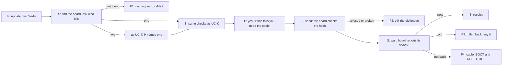

Claude's view of UC9: it may run the search for the board and the read. It must not start the send without the person's yes that carries the cable sentence. It reports the three outcomes (new, old, not back) as such and never as "updated" before the board reports the new sha256. It never prints or stores the Wi-Fi password in a file it writes. Different words: the person gets the cable sentence and the outcome; Claude gets the three outcomes as a field and the sha256 pair.

#### D5c. Where a contract between spark and the board's firmware changes a step

The contract, in one line (H, a proposal): at each deploy spark writes a small file of facts on the board (project, image sha256, date, a name, a manifest of files with hashes) and the firmware only has to leave it alone. Reading it back is spark's side.

| step it changes | without the contract | with the contract |
| --- | --- | --- |
| UC0 step 4: who is this board | chip, flash, MAC only | also: which project, which image, since when, the name the person gave it |
| UC-K step 4: known by readback | known only by spark's record on this machine | known on any machine and after the record is lost; a mismatch means someone changed the board with another tool |
| UC1 step 9 and UC-K step 9: did the write take | `ready` or silence | the marker reads back equal, so the files are those spark wrote |
| UC-K step 5 and UC6 step 2: which files differ | list and compare by name and size | compare by hash against the manifest; files not in the manifest are the board's own data |
| UC-T: which board is which | MAC and the person's naming | the name travels with the board |
| UC2 and B2: a board of another project | not seen | "this board holds project X" before anything is written |
| UC9 steps 2 and 7: who answered, did it take | no way over the network | the board reports who it is and which sha256 it runs |
| B7: no `ready` | silence, no cause | marker present and old = it ran the old image; absent = not reflashed by spark |

Risks in the contract (H): a stale or hand-edited marker is a claim, not proof; a board flashed by another tool has no marker, which means "not spark's", not "wrong"; the marker must hold no secrets; reading it interrupts a running gadget (USERJ-11); and it is another thing the firmware must not overwrite. Whether the firmware (written by the conversation) may read the marker itself, for example to print it with `ready`, is behaviour on the board and is for the PO (Q-J11).

#### UC10. Claude tries things on a live board, with the person watching (D7)

Findings for this block.

- USERJ-16 · A live session stops the gadget. An action command through `mpremote` "will interrupt a running program, but the Python heap is left alone"; `run` executes after a soft reset and does not run the board's own `main.py`; `resume` skips the soft reset. So the first try of a session already changes the board: the firmware no longer runs. The words before the session must say so, and the session must end with the board put back (a reset that runs `main.py` again) or with a sentence that it was not. · E tech-lead TL-9 (mpremote docs read 2026-10-13); po-assistant PO-5 · supports only: the opening and closing sentences.
- USERJ-17 · What a try leaves behind differs by kind. A read of an input with no pull leaves nothing. A pin set as an output, a pull, a PWM, a started I2C bus all stay as set until a reset, and a pin driven on the breadboard keeps driving whatever is wired to it. A file written to the board stays after a reset. So each try needs its own "how I will leave it" sentence, and the end of the session names what is still changed. · H, from MicroPython behaviour (model knowledge; not tried); E tech-lead TL-11 for the classes · supports only: the per-try sentence.
- USERJ-18 · The pins Claude may touch need a short list that comes from the record, not from Claude. The record names the strap pins (D9 = GPIO0 BOOT, D2 = JTAG select), the console pins (TX, RX), and the user button; the USB pins (GPIO19, GPIO20) carry the board's own port. A try that drives the USB pins can drop the very connection Claude is using. · E `boards/firebeetle2-esp32s3.json:220,247,263`; tech-lead PHYS-1 (GPIO19 D-, GPIO20 D+) · supports only: that spark can name pins to refuse or to ask about before any try, from facts it already holds.
- USERJ-19 · An I2C scan on the PO's board depends on the revision: V1.1 and earlier has a PMIC on the bus and 5.1 k pull-ups; V1.2 and later has none, so a scan with nothing wired can return an address on one and nothing on the other. The person's revision (UC0 step 7) must be known before Claude reports "a device found". · E `boards/firebeetle2-esp32s3.json:298-318`; tech-lead PHYS-9 · supports only: that the scan's result is stated with the revision it was read under, or as unknown.
- USERJ-20 · A person and Claude cannot hold the port at once. If the person has a REPL open (the line `deploy.py` prints), Claude's connection fails or takes the port; and the S3's native USB port may rename after a soft reset (E user.md USER-12). So a session begins with "close your own REPL" and ends by saying the port is free. · E `scripts/deploy.py` `WATCH`; `commands/build.md:277-278`; H for the two-client conflict (serial ports are single-client; model knowledge) · supports only: the opening sentence.
- USERJ-21 · Over Wi-Fi the session needs a receiver on the board (WebREPL or a stub) and a password, which UC9 also needs; `mpremote` can connect to an `rfc2217://` address (a serial port shared over the network, a different thing from the board's own Wi-Fi) per its docs. Which of these is a board-side listener, and what protects it, is the tech lead's. For the journey the difference is: over USB the person's hand holds the cable (the board cannot be reached by anyone else), over Wi-Fi anyone on the network can reach the same port. The words before a Wi-Fi session therefore carry one more sentence. · E tech-lead TL-9 (`connect rfc2217://`); H for the rest · supports only: that a Wi-Fi session is a distinct rung from a USB session.
- USERJ-22 · A live try is not a pass. What works on the bench in a try is a fact about the board at that moment; it does not make an image "passed", and an edit that a try suggests goes to UC5 (edit, simulate, deploy). Spark exports facts, never behaviour: what Claude learns (a pin read high, an address found) can become a fact in a record or in the person's notes; code written live does not become firmware by being run. · E AGENTS.md "Spark exports facts, never behaviour"; E `scripts/deploy.py` `untested` (the sim gate) · supports only: that UC10 ends in UC5 or in a fact, never in an unsimulated flash.

The ladder of tries, by class. Class names are the tech lead's (TL-11); the words are mine.

| try | class | what Claude says before | what the person sees | must Claude ask? | how the board is left |
| --- | --- | --- | --- | --- | --- |
| read an input pin (BUTTON) with no pull | read | "I will read BUTTON (GPIO…) as an input, no pull. It does not change anything. Press the button when I say." | the line sent, the value, the time | no, once the session scope covers reads | unchanged; the gadget's firmware is stopped by the session itself |
| read a sensor voltage (ADC) | read | "I will read the analog value on …; this changes nothing." | the value with units | no, in scope | unchanged |
| read a pin that has a pull set | read that drives | "Setting a pull changes the pin. I will set it for the read and clear it after." | the set and the clear lines | yes, once per kind, named | pull cleared if the clear succeeded; stated either way |
| scan I2C | read that drives | "A scan drives SDA (GPIO…) and SCL (GPIO…). On your revision … [V1.1: the power chip shows on the bus]. Parts on the bus will see traffic." | the addresses, with the revision they were read under | yes, once per session | bus closed; pins left as inputs (H); stated |
| call one function from the firmware | behaviour | "This runs the firmware's own function `…`, which can drive outputs. I read it first: it sets … and waits …" | the function's source lines it ran and its output | yes, every time | whatever the function drove stays driven until reset; a reset is offered |
| set an output (LED on) | write | "I will drive LED (GPIO…) high. It stays high until I clear it or the board resets." | the line sent; asked to look at the LED | yes, every time | cleared by Claude and said; or "still on" |
| PWM or another running peripheral | write | "This keeps running after I stop." | the lines | yes, every time | stopped and stated, or still running |
| write or delete a file on the board | persistent write | "This changes the board's file `…`; it stays after a reset. The record's manifest does not hold it." | the file name and size | yes, every time | the file stays; it is named in the end summary |
| drive a strap, console or USB pin | refused or asked | "GPIO… is the BOOT strap (or USB data). Driving it can stop the board or cut this connection." | the sentence | spark refuses unless the person says so in words, per pin | — |
| end the session | restore | "I will reset the board so it runs `main.py` again, and free the port." | the reset and the first lines after it | no, it is the closing step; if a reset is not wanted, the person says | firmware running again, or stated as not |

The steps, as one journey.

| step | actor | what they do | what spark shows or answers | evidence | friction or harm removed | today |
| --- | --- | --- | --- | --- | --- | --- |
| 1 | Person | says what they want tried ("is the button wired?", "does the I2C sensor answer?") | — | H | — | works (the words) |
| 2 | spark | runs the look (UC0) and the known-board checks (UC-K 2 to 4), read-only | the board's name, MAC, revision (asked if unknown), what firmware it holds | UC-K | a session on the wrong board | not yet |
| 3 | Claude | opens the session: says the gadget will stop, the port is needed, what the scope is (reads only, or these pins), how it will end; asks the person to close any REPL of their own | one block of text | USERJ-16, USERJ-20 | a surprise stop | not yet |
| 4 | Person | says yes to the scope (not to each read) | — | D7 (the PO, 2026-10-13) | — | not yet |
| 5 | Claude | before each try: what, which pin by name and number, its class, what it changes, how it leaves the board | the sentence, then the command, then the output, in order, in the window the person is watching | table above | a silent change | not yet |
| 6 | Person | watches; does the physical part (press, move, touch a probe); can say "stop" | — | H | — | — |
| 7 | spark | refuses or asks per the table: a pin outside the allowed list, a class beyond the scope | the sentence naming the pin and the reason | USERJ-18 | a try that cuts the connection | not yet |
| 8 | Claude | after each try, one line: "Read: BUTTON = 1. The board is unchanged." / "Left: LED high." | the line | USERJ-17 | a leftover nobody knows of | not yet |
| 9 | Claude | at the end: resets the board, frees the port, lists what remains changed (files, nothing else), and says what it learned as facts | the summary; and the next step (a record of the fact; or UC5 for a code change) | USERJ-22 | a gadget left stopped, a file left behind | not yet |

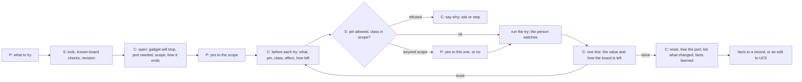

Over Wi-Fi (UC10w): the same steps, with three changes. Step 2 finds the board by MAC on the network through its marker (D5c), and refuses to choose between two (UC-T). Step 3 adds: "anyone on this network may be able to reach the same connection; I will end it when we stop". The end step says whether the connection is closed. If the board is not found, UC10w stops there and offers the cable (UC10). Over Wi-Fi the board's own USB is free, so the person may keep a cable-side REPL open: still one client at a time on the board's REPL (H).

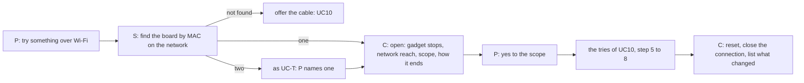

For Claude: it may open a session only after the person's yes to the scope; it may do reads in scope without asking again; it must ask before every try of class behaviour, write or persistent write, and for anything beyond the scope; it never chooses a pin outside the allowed list; it never deploys or writes the flash from a session; it never carries a session's yes to a later session; it ends the session itself. Different words: the person gets the sentence in plain terms and sees the transcript; Claude gets the class and the allowed-pin list as fields, and the refusal sentence verbatim.

Claude's session scope has a time. A session left open is a gadget left stopped; I propose that the closing sentence is part of the opening one ("I will reset when you say we are done, or after N minutes without a try"). N is the PO's (Q-J17).

## 2. What you could not check, and why

- Nothing ran on a board: none is on USB, and writes and Wokwi runs are out of scope for this lens. Every "today: not yet" and "partly" is from reading `scripts/deploy.py`, `scripts/outcomes.py`, `commands/build.md` and the other lens reports, not from use.
- What esptool 5.5.0 prints for the PO's module (the PSRAM line, the revision line, the flash size) and whether a read leaves the board running or in the bootloader on the S3's native USB. My only source is a search snippet (the Espressif advanced-options page title and a summarised issue), not the page text.
- Whether the generic or the SPIRAM_OCT build is right for the N16R8: the MicroPython page says both things (tech-lead PHYS-5); I did not resolve it.
- Whether a terminal-less shell makes an interactive typed confirmation impossible for Claude in this setup: model knowledge, untested.
- Whether `mpremote` reads (`exec`, `devs`) are free of side effects on the S3 and what they print at a boot-loop or an empty flash: not read at source.
- How long a 16 MB flash backup takes over the S3's USB: —.
- `docs/guide/agents.md` only in the parts a grep showed; I did not read it whole, so the line numbers cited there are for greps, not for a full read.
- Whether `boards/active.json` and `requirements.json` can disagree in a real project (TL-2): not tested.
- The OTA mechanics (WebREPL, a receiving stub, OTA partitions, rollback, authentication) and the marker's mechanics (where it lives, how it is read without stopping the gadget): the tech lead's; I did not research them, and every OTA and marker row is H.
- Whether a USB serial number on the S3's native USB equals or derives from the MAC (it would give a second, stable id per board without opening it): —.
- Whether the unplug test lists a replugged board on the same port name: not tried.
- What each live try leaves on the S3 (a pin's direction after a bus close, a PWM after the session) and whether the port renames at a soft reset: model knowledge, untried. The UC10 table's last column is H.
- Whether `mpremote` over `rfc2217://` or WebREPL is the board's own Wi-Fi path, and how either is protected: the tech lead's.
- The PO's D5, D6 and D7 text was read from the coordinator's message; I did not re-read brief.md for them.

## 3. Questions for the decider

| question | what it decides |
| --- | --- |
| Q-J1 · Is the look (UC0) a command of its own that the person can run with no write, and does it come before the first flash on the bench? | whether UC0 ships first, and P215's first step |
| Q-J2 · How is the yes bound: a typed confirmation the person gives in a terminal (Claude cannot), a token the check prints and the erase requires back, or the question in Claude's turn as today? | USERJ-4; whether Claude can ever erase without the person running the final command |
| Q-J3 · Does "ignore" (#201) cover a different chip, or only a same-chip difference? | UC3: stop with no override, or stop with a loud override |
| Q-J4 · When the board differs but has the same chip, which is offered first: migrate to a fitting record, a general setup, or go ahead? And may a go-ahead be recorded in the project so the question is not asked again for that board? | UC2's order and the log |
| Q-J5 · May spark offer to download a MicroPython build, and who picks it: the record (needs a variant fact) or the person? | UC4 and the record's new field |
| Q-J6 · May files be copied to a board without a passed run covering them, with a warning? | UC6's gate (po-assistant PO-7) |
| Q-J7 · Should a backup of the board's flash be offered before every erase, or only when the board holds something other than the project's own firmware? | UC1 step 5 and the time cost |
| Q-J8 · What counts as "ready seen" for a pass: text read by a command after a reset, or the person saying so? | B7 and J1's pass line |
| Q-J9 · Is an unreadable field (PSRAM, revision) allowed to stand as `unknown` in a yes question, or must the person fill it before a first write? | USERJ-2 and UC1 step 3 |
| Q-J10 · Does the person want Claude to run the look on its own whenever a board is plugged in, or only when asked? | UC0's trigger |
| Q-J11 · Where is the line between a fact spark writes on the board (a marker) and behaviour on the board (a receiver for updates, a firmware that reads the marker)? | whether the contract and OTA fit "facts, never behaviour" |
| Q-J12 · Which of H1 (a yes per board that spark remembers), H2 (the deploy request is the yes) or H3 (a yes only when something differs or data would be lost) holds D4 and D6 together, or which pairing? | UC-K's step 8 and what Claude may do alone |
| Q-J13 · What makes a board known for you: spark's record on this machine, the board's own marker, or both? Is a marker on the board acceptable? | USERJ-9, USERJ-10, the contract |
| Q-J14 · Which kind of OTA do you mean: Python files over Wi-Fi, or a new interpreter over Wi-Fi? And is "you will need the cable if it fails" acceptable? | UC9a or UC9b and the rung's place |
| Q-J16 · Is a live session allowed to run the firmware's own functions, or only reads and single pin writes? And does a session's yes cover all reads in scope, or each read? | UC10's classes and where Claude asks |
| Q-J17 · How long may a session sit open, and does it reset the board on its own at the end? | UC10's closing step |
| Q-J15 · May spark name your boards and keep the names (and the MACs) in the project or in your store? | UC-T step 4 and where the record lives |

## 4. Searches

| query, verbatim | the decision it served | used or not |
| --- | --- | --- |
| esptool --after no-reset flash-id read-only chip-id esp32-s3 does not reset board | whether a read-only look leaves the S3 running, which sets the sentence in front of the look (USERJ-5) | used, as H: the snippet only, not the pages |

(One of two searches used. None for D5 and D6: their mechanics are the tech lead's.)
