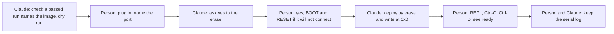
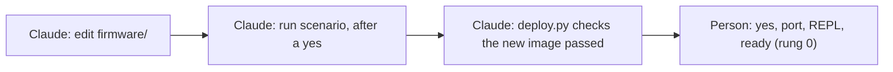
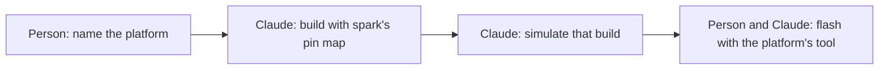

# The user's journey: P218 deploy and the physical board
<!-- Lens: the user (n = 1: the PO, a FireBeetle 2 ESP32-S3 N16R8, DFR0975, breadboard, Claude Code). Read only; nothing flashed. Tags: E pointer, H source, D who and when. — is unknown. -->

## Findings

| id | claim | tag | pointer | supports only |
| --- | --- | --- | --- | --- |
| USER-1 | `deploy.py` takes the chip from `requirements.json`'s board and checks nothing about the connected board. With no `--port`, esptool tries every serial port and erases the first board it reaches. Only the esptool chip name guards a wrong-board erase, and it does not tell two ESP32-S3 boards apart. | E | `scripts/deploy.py` `chip_of`, `flash_commands` (`--port` optional), `--help`: "Omitted, esptool tries each port"; `commands/build.md` "Put it on the board" | that the board identity check (J3, #201) has no code behind it today; not how often a second board is plugged in |
| USER-2 | The erase runs first and takes the whole flash. A failed erase writes nothing, with the BOOT and RESET hint. Nothing reads or keeps the old contents of the board before the erase. The only gate before the erase is `commands/build.md`'s sentence telling Claude to ask the person. The script has no `--yes`, no prompt and no `--json`. | E | `scripts/deploy.py` `main` (loop: commands, no prompt), `BOOT_HINT`; `commands/build.md` "Ask the person before that run" | that a person who runs `deploy.py` by hand gets no confirmation; that the consent for Claude is prose, not code |
| USER-3 | `ready` is printed once at boot. On the S3's native USB the port closes and reopens at reset (the port name can change after the flash). A reader that opens the port after boot sees nothing. The instruction is: open mpremote's REPL, press Ctrl-C, then Ctrl-D. `deploy.py` does not watch the port. The REPL line is interactive, so Claude cannot do that step. Whether the board prints `ready` at all is not yet seen. | E | `scripts/deploy.py` `WATCH`, `watch_command`; `commands/build.md` lines 276-279; `docs/2026-10-12-p192-deploy-plan.md` decision 6 ("a bench question"); `docs/guide/journey.md` Bench: "Nothing has run it on a board yet" | that J1's pass line (`ready` seen) cannot be checked by a command; not that the board fails |
| USER-4 | The image is made for the simulator: a 4 MB layout (`FLASH_SIZE = 4 MiB`, filesystem at `0x200000`) and the generic S3 build `ESP32_GENERIC_S3-20260824-v1.29.0.bin`. The PO's board has 16 MB flash and 8 MB octal PSRAM. The MicroPython page for this chip offers a separate "Support for Octal-SPIRAM" build; one search snippet says to use it for N16R8. Whether the generic build boots, and uses the 16 MB or the PSRAM, is unchecked. The earlier council (RP4) rejected the 4 MB worry only for "the image fits"; that is a different question from "the right build". | E (files) / H (search snippet, read 2026-10-13, https://www.micropython.org/download/ESP32_GENERIC_S3, snippet only, page not opened) | `scripts/flash_image.py:28-30`; `data/tools.json` `micropython-esp32s3`; `docs/observations/INDEX.md` RP4; `boards/firebeetle2-esp32s3.json` `//sku` (DFR0975 = 16 MB flash, 8 MB octal PSRAM) | that P215 may be the first place the build choice shows; not that the generic build fails |
| USER-5 | A "passed run" is named by an image sha256 in `sim/runs/*.log`, but the person sees only a verdict line. `deploy.py` refuses an image no passed log names, and notes other logs that tested another image. It does not print which log and which sha256 it relied on. A log from an older spark names no image, so the person must run the scenario again, and that run spends Wokwi minutes. A change in `firmware/` after the run gives a note, not a refusal: the board gets the older image. | E | `scripts/deploy.py` `untested`, `newer_files`, `tested_another`; `commands/build.md` "deploy.py flashes only an image that passed" | that J1 gives the person no evidence line that names the image sha256 they flashed; the refusal itself works |
| USER-6 | No update path exists. Any change to `firmware/` means: re-run the scenario (Wokwi minutes), then erase and write the whole flash. A file-level copy (`mpremote fs cp`) is documented generally, but spark has no command for it and `deploy.py` offers only the full erase. | E | `scripts/deploy.py` (no other mode); `gh issue view 204` ("updates"); search snippet on mpremote `cp` (https://forum.micropython.org/viewtopic.php?p=70708, read 2026-10-13, snippet only) | that J2 is "not yet"; not how the PO would want to be asked about tests before a quick update |
| USER-7 | The PO can supply the board in hand, a USB cable, the BOOT and RESET presses, a yes before the erase, and the board's revision by looking at the chip between BOOT and USB-C (a QFN marked AXP313A is V1.1 or earlier; a small SOT-563 is V1.2 or later) or at the back silkscreen. He cannot supply the serial port name reliably, because it changes after the flash. A multimeter would help only with the revision-dependent items (the user button reads about 0.7 V pressed on V1.1 and earlier). Whether the revision matters to a flash is not shown: it matters to I2C pull-ups and the user button, not to esptool. | E | `boards/firebeetle2-esp32s3.json` `hardware_revisions.how_to_tell`, `v1_1_and_earlier.user_button`; `commands/build.md` line 277; #196 "Suggested for the same bench session" | that the revision label is cheap for the PO to supply; not that deploy needs it |
| USER-8 | No ready check works from the REPL for Claude. The REPL line can be run interactively, so Claude has no step that reads the board. `mpremote` has non-interactive forms (`exec`, `fs`, `devs`) that spark does not use. J4 (live pin reading, debugging) rests on the tool being used in a way no page documents. | E (page, script) / H (mpremote forms: model knowledge, not read) | `scripts/deploy.py` `watch_command`; `commands/build.md` lines 276-279; `gh issue view 204` | that the REPL spike (#204) starts from "nothing documented", not from a partial design |
| USER-9 | Flash-and-boot hazards that touch the PO's wiring, not the flash: GPIO0 (D9) is the BOOT strap and must not be held low at power-up; D2 is the JTAG strap; TX and RX (GPIO43 and 44) are the console and twitch at boot. The sheet may put a button or an LED on one of these. Entering download mode with BOOT while a button on D9 is wired in is a possible confusion. | E | `boards/firebeetle2-esp32s3.json:220` (D9, D2 note), `:263` (TX/RX) | that a wired pin can interfere with a flash; not that the button-and-LED project does so (its pins unchecked) |
| USER-10 | The PO's own earlier walk (P100) never reached a board. Round 0 ended at the simulation stage for a C6 board; the refuter's list shows that no document mentioned esptool or mpremote then. So all of J1 to J5 has no record of use by the PO. The only dated account is "Nothing has run this on a board yet". | E | `docs/discovery/2026-10-09-p100-real-use/diary-round-0-board.md`; `docs/discovery/2026-10-09-p100-real-use/council/refuter.md:157`; `docs/observations/INDEX.md` K66, `commands/build.md` last paragraph of "Put it on the board" | that every "today" cell below is derived from reading, none from use |
| USER-11 | The guide pages mention deploy in one place each: `how-it-works.md:119` (a bullet), `journey.md` "Bench" (partly), `commands/build.md` (the steps). `docs/guide/agents.md` has no deploy line. Claude finds deploy by reading `/spark:build`; there is no `/spark:deploy` (P213, #192, Idea). | E | `/usr/bin/grep` over `docs/guide`: `agents.md` hits only 71, 124, 352, 519 (none are deploy steps); `gh issue view 192` | that a Claude working from `agents.md` alone has no deploy step |
| USER-12 | The port on macOS: the repository's own hint is `/dev/cu.usbmodem…`. At the time of this lens no board was plugged in (`ls /dev/cu.*` showed no `usbmodem`). The PO has two ports to tell apart: the ROM bootloader's port and MicroPython's port. After the flash the board comes back as a new port, and `--port` given earlier points at nothing. | E | `commands/build.md` line 264-265, 277; `ls /dev/cu.*` 2026-10-13 | that the port name is a stall point; not which names the PO's Mac gives |
| USER-13 | If the PO flashes a second board of another family (a XIAO ESP32-C6, a C6 FireBeetle he owns) the project's board decides the chip. A mismatch is refused by esptool only when the chips differ. An S3 with 4 MB flash (DFR1145, the N4) passes the check and gets the same image. The board file for it is the same (one definition covers both SKUs). | E | `boards/firebeetle2-esp32s3.json` `//sku`; `scripts/deploy.py` `chip_of`; `docs/discovery/2026-10-09-p100-real-use/council/tech-lead.md` FEAS-3 (other owned boards have no record) | that "the different board" case (J3) is mostly a same-chip, other-SKU case for the PO, and a no-record case for his other boards |

### The five jobs, walked as the PO does them today

- **J1, the image onto the board.** He has the project, a passed scenario log, esptool and mpremote from `/spark:setup`. He runs `deploy.py --dry-run`, reads two esptool lines, plugs the board in, finds the port (USER-12), says yes to the erase (USER-2), the erase runs, the write runs, he opens the REPL, presses Ctrl-C and Ctrl-D, and looks for `ready` (USER-3). Stalls: which port, BOOT and RESET if esptool cannot connect, a changed port after the flash, and no machine-read `ready`. Harm: an erase of any board esptool reaches (USER-1); an image built for a 4 MB layout and a non-PSRAM build (USER-4).
- **J2, update.** He edits `firmware/`, must re-run the scenario (Wokwi minutes), then erases and writes again (USER-6). Guess: whether a quicker path exists.
- **J3, a different board.** Nothing checks. Today he finds out when the pins do nothing (H) or when esptool refuses a chip (E, USER-13).
- **J4, debug live.** No page documents it. The REPL line is a human tool (USER-8).
- **J5, Arduino or PlatformIO.** Every stage assumes MicroPython: `flash_image.py` builds a MicroPython and littlefs image; the scenario waits for `ready`; `deploy.py` writes at `0x0`. E `scripts/flash_image.py`, `scripts/deploy.py`. A PlatformIO project would flash a firmware whose build is not in the chain. What it needs is #203's question; — for the rest.

## Journeys ladder

Marks: **Claude** steps are bold-labelled "Claude"; the person's steps "Person". Today: works, partly, not yet, —. Every "today" is from reading; none from use (USER-10).

### Rung 0, the passed image onto the board, and it prints `ready`

| step | what they do | evidence | friction or harm | today | open question |
| --- | --- | --- | --- | --- | --- |
| 1 | Claude: checks a passed run names the image, runs `deploy.py --dry-run` and shows the two commands | E `scripts/deploy.py` `plan`, `untested` | the person never sees the sha256 or the log that is relied on | works | Should the dry run print the log name and sha256? |
| 2 | Person: plugs the board in over USB; says which port | E `commands/build.md:264` | which port; ROM-bootloader port and MicroPython port differ; a changed name after the flash | partly | Which tool did the PO use to find the port last time? |
| 3 | Claude: asks "this erases the whole flash of the board on this port: yes?" | E `commands/build.md:263` | prose rule only; no code gate; with no `--port`, any board | partly | Does the PO want the port to be required? |
| 4 | Person: says yes; presses BOOT and RESET if the connection fails | E `scripts/deploy.py` `BOOT_HINT` | the hint comes after a failure, not before; where BOOT and RESET sit on the board is not on the page | partly | Which button did he press first last time? |
| 5 | Claude: runs `deploy.py --port <port>` (erase, then write at `0x0`) | E `scripts/deploy.py` `main` | wrong-board erase (USER-1); 4 MB image and generic build on a 16 MB / PSRAM board (USER-4); output is text only | partly | Is the generic S3 build the right one for the N16R8? |
| 6 | Person: opens the REPL, presses Ctrl-C then Ctrl-D, sees `ready` | E `scripts/deploy.py` `WATCH`, `commands/build.md:276` | `ready` printed before the port opens (USER-3); interactive, so Claude cannot do it | not yet (never run) | When you last opened a serial monitor after a flash, did you miss the first lines? |
| 7 | Person and Claude: keep the serial log of the run beside the run logs | E #196 "Value proven by" | no command writes it; a bench log by hand | not yet | Where should the log of this run be kept? |

### Rung 1, change the code and put it on again (full flash)

| step | what they do | evidence | friction or harm | today | open question |
| --- | --- | --- | --- | --- | --- |
| 1 | Person: asks Claude for a change; Claude edits `firmware/` | H | none | works | — |
| 2 | Claude: re-runs the scenario (spends Wokwi minutes) after asking | E `commands/build.md` ("Ask the person before each run") | cost and wait for a one-line change | works | How often did you wait for a test before a small change? |
| 3 | Claude: `deploy.py` refuses until a passed log names the new image; notes the stale logs | E `scripts/deploy.py` `untested`, `newer_files` | forgotten re-run gives a refusal or a note, not a flash of the new code | works | — |
| 4 | Person and Claude: steps 2-7 of rung 0 again | E as rung 0 | a full erase again | partly | — |

### Rung 2, update the files without a full flash

| step | what they do | evidence | friction or harm | today | open question |
| --- | --- | --- | --- | --- | --- |
| 1 | Claude: copies the changed files to the board's filesystem (for example `mpremote fs cp`) | H, search snippet (https://forum.micropython.org/viewtopic.php?p=70708, 2026-10-13) | no spark command; no erase; the file on the board and the image that passed differ, so the "image passed" rule has no meaning | not yet | Does an update need a passed simulation first, and what does it name? |
| 2 | Claude: resets the board; reads the start | H | the port reopens; Claude cannot run the interactive REPL | not yet | — |
| 3 | Person: confirms the board does the new thing | H | — | — | What would you accept as proof, without the full flash? |

### Rung 3, check the connected board is the right one

| step | what they do | evidence | friction or harm | today | open question |
| --- | --- | --- | --- | --- | --- |
| 1 | Claude: reads the chip, flash size, PSRAM and MAC from the connected board (read-only) | H (esptool has read-only info commands: model knowledge, not read) | none known; nothing in spark does it | not yet | — |
| 2 | Claude: compares them with the project's board file (`chip`, SKU, flash, PSRAM) | E `boards/firebeetle2-esp32s3.json` (`chip`, `//sku`) | the file does not store the board's MAC or revision; the revision is only visible on the board | not yet | Which facts must match to go on: chip only, flash size, PSRAM? |
| 3 | Person: supplies what a command cannot read (revision label, a multimeter reading) | E USER-7 | the revision does not change a flash | partly | When did you last read the revision, and from what? |
| 4 | Claude: reports match, same-chip other SKU, other chip, unknown | H | policy: stop, warn, migrate or go ahead | not yet | For a different board, should it stop, warn, migrate the pin map or go ahead? |
| 5 | Person: decides; says "go ahead" if it differs | E #201 ("It should also however allow this to be ignored") | wrong choice puts firmware with wrong pins on a board; low harm on the breadboard, a pin map on a driven load is higher | not yet | Which wrong flash has cost you something? |

### Rung 4, read pins live through the REPL

| step | what they do | evidence | friction or harm | today | open question |
| --- | --- | --- | --- | --- | --- |
| 1 | Claude: opens a non-interactive link to the board (not the human REPL line) | H | no page documents it; the board's port may be held by another program | not yet | — |
| 2 | Claude: reads a pin or a sensor value, and sets it down in the pin map's names | E `firmware/pins.py` written by `--keep` (INDEX RP1) | reading an output pin or a driven line may change what the board does | not yet | Which reading would you ask for first? |
| 3 | Person: presses the button, moves the sensor; confirms the reading | H | the person is the actuator | not yet | — |

### Rung 5, Claude debugs on a running board

| step | what they do | evidence | friction or harm | today | open question |
| --- | --- | --- | --- | --- | --- |
| 1 | Person: says what the board does against the simulator | H | the person describes, Claude guesses | not yet | What did you see last time the gadget did not do what the simulator did? |
| 2 | Claude: reads pins and the serial output; compares with the scenario's steps | H | live reads can disturb timing; the console is shared with TX and RX (E `boards/firebeetle2-esp32s3.json:263`) | not yet | — |
| 3 | Claude: proposes a fact (a wiring or pin fault) or a firmware edit; spark writes no behaviour | E AGENTS.md "Spark exports facts, never behaviour" | the line between a fact and a fix | not yet | — |
| 4 | Claude and person: go to rung 1 or rung 2 | E as above | — | — | — |

### Rung 6, another platform (Arduino, PlatformIO)

| step | what they do | evidence | friction or harm | today | open question |
| --- | --- | --- | --- | --- | --- |
| 1 | Person: says the platform | E #203 | every stage assumes MicroPython | not yet | Which platform did you last use on an ESP32? |
| 2 | Claude: builds firmware for it, with the pin map spark writes | H | `firmware/pins.py` is Python; a C header would be a second output | not yet | — |
| 3 | Claude: tests it in the simulator (needs an ELF or a flash image, not a MicroPython littlefs image) | E `scripts/flash_image.py` | the `ready` contract and the image sha256 are MicroPython's | not yet | — |
| 4 | Person and Claude: flash it with the platform's own tool or esptool | H | one more flasher, or the same one | not yet | — |

### Candidate account questions (one per friction moment, for the PO)

Each is an account question: a past-tense question about his own use. The answer would be E, an account, n = 1.

1. When you last flashed an ESP32 board, which tool did you use and what went wrong?
2. When you last needed the board's serial port, how did you find it, and did its name change after the flash?
3. When you last held BOOT and pressed RESET, how did you know it had worked?
4. When you last erased a board, had it held anything you wanted to keep?
5. When you last had more than one board on USB, did you flash the wrong one?
6. When you last opened a serial monitor after a reset, did you miss the first lines, such as `ready`?
7. When you last changed one line of firmware, how did you put it on the board, and how long did that take?
8. When you last used MicroPython on a board, did you copy files with a tool or flash the whole image?
9. When you last waited for a Wokwi run before a small change, what did you do while waiting?
10. When you last used a board that was not the one a project was written for, what happened to the pins?
11. When you last read a board's revision, where did you read it and how long did it take?
12. When you last chose a MicroPython build for an N16R8 or another S3 board, which build did you pick and why?
13. When you last saw a gadget do on the bench what it did not do in a simulator, how did you find the cause?
14. When you last read a pin or a sensor live from a board, which tool did you use?
15. When you last used Arduino or PlatformIO on an ESP32, which one and what did you flash with?
16. When you last used a deploy command that asked a yes before an erase, did you read the question?

## What you could not check, and why

- No board is plugged in (`ls /dev/cu.*` showed no `usbmodem`), and flashing, erasing and Wokwi runs were forbidden. So USER-3, USER-4 and all "today" cells are read, not run. `deploy.py --dry-run` needs a project with a passed log and installed tools; I did not make one, so I read the code and did not run it. `--help` ran.
- Whether the generic S3 build boots on an N16R8, and what it does with 16 MB flash and the octal PSRAM: not read at source (search snippet only, page not opened).
- esptool and mpremote behaviour (read-only info commands, non-interactive `exec` and `fs`, port re-enumeration): not read at source; model knowledge, H. I did not open esptool 5.5.0 or mpremote 1.29.0 docs.
- The PO's board revision: unknown, —. The buttons' exact place on the board: not read.
- The sisuo-brain-transplant bench plan named in `docs/guide/journey.md`: not opened.
- scrum/VISION.md personas: not read; no other maker is represented here.

## Questions for the decider

| question | what it decides |
| --- | --- |
| Which of the sixteen account questions above will you answer, in your own words? | which friction moments become E and which stay H |
| For a different board, should deploy stop, warn, migrate the pin map or go ahead, and may the answer differ for the same chip (another SKU) and another chip? | the rung 3 policy and P219's first story |
| Must `deploy.py` require `--port`, so that it never erases a board it picked itself? | whether the wrong-board erase (USER-1) is closed in rung 0 or in rung 3 |
| Is a REPL line the person runs enough for `ready` in rung 0, or does `ready` have to be read by a command? | rung 0's pass line and the first REPL spike question |
| Does an update that skips the simulator count as a pass? | rung 2's pass line (the "image that passed" rule has no meaning there) |
| Is the generic S3 build acceptable for the N16R8, or does the bench decide? | whether P215's bench carries a build choice as its first item |
| Which comes first: Arduino or PlatformIO? | the P221 spike's order |

## Searches

| query, verbatim | the decision it served | used or not |
| --- | --- | --- |
| MicroPython ESP32-S3 N16R8 flash firmware esptool download mode BOOT RESET mpremote fs cp update files without reflashing | which build an N16R8 uses, how makers enter the bootloader, and whether a file-level update exists (rungs 0, 2) | used: USER-4 (snippet only), USER-6 (snippet only) |
