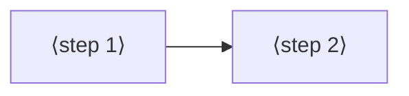

# Jobs and journeys
<!-- Tags as in the brief: E with a pointer, H with its source, D with who and when; an unknown is —. -->

## Who
<!-- One line per persona: who · evidence status (E pointer | H source).
e.g. `- Team leads who assign work · H Lena's belief, no interview yet` -->
- The PO, a maker with one ESP32 dev board on a breadboard (a FireBeetle 2 ESP32-S3 N16R8, DFR0975, headers soldered) · E #144 body, item (c) · n = 1
- Claude, working in a project with the person, using the same commands · E #192 body (the PO: "Both the AI and humans should be able to use it well")
- Other makers, the personas in scrum/VISION.md · H, read by the lenses <!-- REQUIRED:who -->

## Jobs
<!-- One job story per line, each clause tagged: When …, I want to …, so I can ….
e.g. `- When I assign a task in a meeting [E tickets.csv:6], I want the assignee to see it that day [H Lena], so I can stop chasing people [E tickets.csv:7]` -->
- J1 · When the firmware passed in the simulator [E #144 body], I want one command to put it on my board [E #144 "Value proven by"], so I can see the gadget work on the breadboard [E #144, the PO: "at least to breadboard including working firmware is important"]
- J2 · When I change the firmware after it runs on the board [H Claude], I want to update the board without a full erase and flash [E #204, the PO: "updates"], so I can try changes quickly [H Claude]
- J3 · When the connected board is not the one the project is for [E #201], I want spark to say what differs, whether the pin setup still fits, and to let me go ahead anyway [E #201, the PO verbatim], so I do not put the wrong firmware on a board [H Claude]
- J4 · When the firmware does not do on the board what it did in the simulator [H Claude], I want Claude to read pins and sensors live and debug on the board [E #204, the PO: "debugging, connection with agents"], so I can find the cause without guessing [H Claude]
- J5 · When I want Arduino or PlatformIO instead of MicroPython [E #203, the PO: "mostly arduino probably and platform IO"], I want spark's chain to serve that platform [E #203], so I can use the platform I know [H Claude] <!-- REQUIRED:jobs -->

## Today they…
<!-- Per job: what they do instead today (a competitor, a workaround or nothing), tagged.
e.g. `- Job 1 · paste each task into Slack by hand · E tickets.csv:7` -->
- ⟨fill⟩ <!-- REQUIRED:today -->

## Journeys
<!-- One ### per actor and scenario: the table, then a Mermaid flowchart of the same steps. Never a Mermaid
journey block: it forces a score on every task. "n/a — a one-step job" may replace both.
e.g. `| 2 | opens the app | E analytics, 90 days | never sees the task | not yet | Do they read email? |` -->
### ⟨actor⟩ — ⟨scenario⟩ <!-- REQUIRED:journey -->
| step | what they do | evidence | friction or harm | today | open question |
| --- | --- | --- | --- | --- | --- |
| 1 | ⟨fill⟩ | ⟨tag and pointer⟩ | ⟨fill⟩ | ⟨works, partly, not yet or —⟩ | ⟨fill or —⟩ |

