# Jobs and journeys
<!-- Tags as in the brief: E with a pointer, H with its source, D with who and when; an unknown is —. -->

Pointers to the council. USER-n is `council/user.md`. USERJ-n and the UC numbers are `council/user-journeys.md`. PO-n is
`council/po-assistant.md`, and POJ-n is `council/po-assistant-journeys.md`. TL-n and PHYS-n are `council/tech-lead.md`,
and TLJ-n is `council/tech-lead-journeys.md`. Each report holds the detail that this file points to.

## Who
<!-- One line per persona: who · evidence status (E pointer | H source).
e.g. `- Team leads who assign work · H Lena's belief, no interview yet` -->
- The PO, a maker with one ESP32 dev board on a breadboard (a FireBeetle 2 ESP32-S3 N16R8, DFR0975, headers soldered) · E #144 body, item (c) · n = 1
- Claude, working in a project with the person, using the same commands · E #192 body (the PO: "Both the AI and humans should be able to use it well")
- Other makers, the personas in scrum/VISION.md · H, read by the lenses <!-- REQUIRED:who -->

## Jobs
<!-- One job story per line, each clause tagged: When …, I want to …, so I can ….
e.g. `- When I assign a task in a meeting [E tickets.csv:6], I want the assignee to see it that day [H Lena], so I can stop chasing people [E tickets.csv:7]` -->
- J1 · When the firmware passed in the simulator [E #144 body], I want one command to put it on my board [E #144 "Value proven by"], so I can see the gadget work on the breadboard [E #144, the PO: "at least to breadboard including working firmware is important"]
- J2 · When I change the firmware after it runs on the board [H Claude], I want to update the board without a full erase and flash [E #204, the PO: "updates"], so I can try changes quickly [H Claude]
- J3 · When the connected board is not the one the project is for [E #201], I want spark to say what differs, whether the pin setup still fits, and to let me go ahead anyway [E #201, the PO verbatim], so I do not put the wrong firmware on a board [H Claude]
- J4 · When the firmware does not do on the board what it did in the simulator [H Claude], I want Claude to read pins and sensors live and debug on the board [E #204, the PO: "debugging, connection with agents"], so I can find the cause without guessing [H Claude]
- J5 · When I want Arduino or PlatformIO instead of MicroPython [E #203, the PO: "mostly arduino probably and platform IO"], I want spark's chain to serve that platform [E #203], so I can use the platform I know [H Claude] <!-- REQUIRED:jobs -->
- J6 · When the board is connected by USB or is on the same Wi-Fi [D7, the PO, 2026-10-13], I want Claude to reach its REPL and try things live on the board [D7, the PO: "maybe we/claude can try things live on the board"], so I can learn what the real board does before I change the firmware [H Claude, from USERJ-22]
- J7 · When two almost identical boards are connected to the computer at once [D5, the PO, 2026-10-13, and E #205, the rc-car's car and remote], I want spark to tell them apart and write only to the one I named [H Claude, from D4 and USERJ-13], so I do not erase the board that runs my other gadget [H POJ-19]

## Today they…
<!-- Per job: what they do instead today (a competitor, a workaround or nothing), tagged.
e.g. `- Job 1 · paste each task into Slack by hand · E tickets.csv:7` -->
- J1 · run `deploy.py` from the one section of `/spark:build` that names it, and find the port by hand. Say yes in prose, and read `ready` in an interactive REPL. Nothing has run on a board yet. The maker's usual tool, Thonny, asks for a port and an erase tick and checks nothing else · E USER-2, USER-10, USER-11, POJ-4
- J2 · edit `firmware/`, run the scenario again (metered Wokwi minutes), then erase and write the whole flash. No update path exists · E USER-6, PO-6
- J3 · nothing checks. esptool refuses only another chip, and that claim is tested only with a fake `run`. An N4 board passes as an N16R8 · E USER-1, USER-13, TL-7
- J4 · no page documents it. The REPL line is a tool for a person, so Claude cannot use it · E USER-8, PO-13
- J5 · nothing. Every stage assumes MicroPython (the pin map, the harness, the image, the watch) · E TL-15
- J6 · nothing in spark. mpremote's non-interactive commands are installed and unused. WebREPL needs code on the board that spark does not write · E TLJ-33, TLJ-34, POJ-35
- J7 · with no `--port`, esptool tries each port and erases the first board it reaches. A chip name does not tell two S3 boards apart · E USER-1, POJ-10 <!-- REQUIRED:today -->

## Journeys
<!-- One ### per actor and scenario: the table, then a Mermaid flowchart of the same steps. Never a Mermaid
journey block: it forces a score on every task. "n/a — a one-step job" may replace both.
e.g. `| 2 | opens the app | E analytics, 90 days | never sees the task | not yet | Do they read email? |` -->

The ladder, from the simplest use case to the most advanced. The backbone is the user lens's UC0 to UC10, UC-K and
UC-T. The known board (UC-K, D6) is the main journey: a person's ordinary day once a board went through UC1 once. The
gate (D4) is one shared journey that every write passes. Its steps sit in the core, never only in an interface, a
command page or an agent prompt (D8, the PO, 2026-10-13). "spark" in the tables is the core answering. Every "today"
cell is read from code and pages, none from use (USER-10).

| rung | use case | job | what it adds | card |
| --- | --- | --- | --- | --- |
| 0 | UC0, look at the connected board, read-only | J1, J3 | the facts the gate stands on | P219 #201, P215 #196 |
| 1 | UC1, first flash of the image that passed | J1 | the first write, through the gate | P215 #196, P213 #192 |
| 2 | UC-K, the known board, the main journey | J1, J2 | silent checks and a one-line receipt | new, P213 #192 |
| 3 | UC5, change the code and flash again | J2 | the loop with a new simulated run | works today, gate added |
| 4 | UC2, the same chip on another board | J3 | differences per field and the offers | P219 #201 |
| 5 | UC3, another chip | J3 | a stop | P219 #201 |
| 6 | UC4, the firmware base does not fit | J1 | the matching MicroPython build | new |
| 7 | UC-T, two near-identical boards | J7 | a board named by its MAC | new |
| 8 | UC6, update files without a full flash | J2 | a file copy behind the simulation gate | P222 #204, then new |
| 9 | UC7 and UC10, read and try live over USB | J4, J6 | classed tries in a session | P222 #204 |
| 10 | UC9 and UC10w, over Wi-Fi | J2, J6 | code on the board that listens | new |
| 11 | UC8, another platform | J5 | a second firmware chain | P221 #203 |

### The gate (D4): look, compare, say, ask, then write <!-- REQUIRED:journey -->
| step | what they do | evidence | friction or harm | today | open question |
| --- | --- | --- | --- | --- | --- |
| G1 | spark: lists the ports with VID:PID and USB serial, and sends no byte to a board | E TLJ-2 step 0 (`mpremote devs`, run locally) | esptool tries each port when none is named | not yet | Q8: must the person always name the port? |
| G2 | Person: names the port when two or more are listed. spark and Claude never choose | E USER-1, `scripts/deploy.py` (`--port` optional) | the first board found is erased | not yet | — |
| G3 | spark: says the read can restart the gadget, then reads chip, flash size and MAC (esptool), and the build and files when MicroPython answers (mpremote) | E TLJ-2, TLJ-5, TL-3 | esptool's reset restarts the gadget, and `mpremote exec` stops `main.py` | not yet | A6: does a read leave the S3 in download mode? |
| G4 | spark: compares each field with the board record and says same, differs or unknown, with the source of each value. Revision, maker and wiring are always unknown to software | E USERJ-2, TLJ-4, TL-7 | "match" said for a field nobody read | not yet | Q7: is unknown a stop or a warning? |
| G5 | spark: shows what the write does: port, MAC, image sha256, the run that passed, "the whole flash is erased" | E USER-5 | the person never sees which log the refusal rule relied on | partly | — |
| G6 | Person: gives the yes, bound to that port, MAC and image | D4, H USERJ-3, USERJ-4 | a yes reused for another board, or an allow rule taken as the yes | not yet (prose only) | Q3: typed, a token, or prose? |
| G7 | spark: reads the MAC again just before the erase and stops if it differs | H USERJ-3, TLJ-21 | a board swapped between the look and the erase | not yet | — |

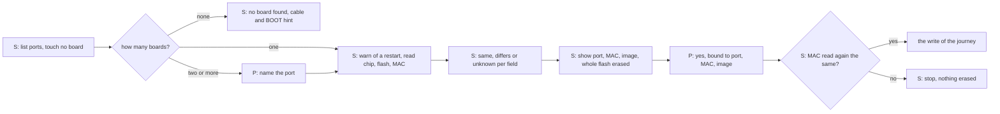

### UC0. Person or Claude: look at the connected board, read-only
| step | what they do | evidence | friction or harm | today | open question |
| --- | --- | --- | --- | --- | --- |
| 1 | Person: plugs the board in and asks to look. Claude can offer the look before any deploy | H USERJ, UC0 | — | works (the words) | Does Claude look on its own when a board appears? (USERJ Q-J10) |
| 2 | spark: G1 to G4 of the gate, in the order least contact first: port list, then mpremote, then esptool | E TLJ-2, TLJ-3 | the read restarts or stops the gadget | not yet | — |
| 3 | spark: says what the board needs now: "press RESET if it waits in download mode", "the revision is on the back silkscreen" | E USERJ-5, `boards/firebeetle2-esp32s3.json` `how_to_tell` | a board left silent after a look | not yet | — |
| 4 | Person: supplies what only a person knows (revision, the module's printed "N16R8", the wiring), kept as "the person said" | E USER-7, PHYS-7 | an unknown that stays unknown | not yet | Q18: which file names the project's board? |

Existing tools: ESP Web Tools reads the chip family and picks a build from a table (POJ-5). Thonny checks nothing (POJ-4).

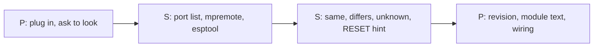

### UC1. Person and Claude: first flash of the image that passed (P215's bench)
| step | what they do | evidence | friction or harm | today | open question |
| --- | --- | --- | --- | --- | --- |
| 1 | Claude: checks that a passed run names the image, runs the dry run, shows the log and its sha256 | E USER-5, `scripts/deploy.py` `untested` | "passed" with no name | partly | — |
| 2 | spark: the gate, G1 to G7 | as the gate | an erase of a board nobody checked | not yet | Q3, Q7, Q8 |
| 3 | spark: erases, writes at `0x0`, and stops after a failed command with the BOOT and RESET hint | E `scripts/deploy.py` `BOOT_HINT`, PHYS-2 | the hint's press order differs from DFRobot's | works (no board run) | — |
| 4 | Person: presses RESET if the board waits in download mode | H USERJ-5 | a board left in the bootloader | not yet | — |
| 5 | spark: lists the ports again (the name can change), reads the start for a fixed time, says `ready` seen, not seen or unknown | E USER-3, PHYS-1 | a boot-time `ready` lost before the port opens | not yet | A1: can a command see `ready`? A2: does `os.statvfs('/')` show 512 blocks? |
| 6 | spark: records the MAC, project, image sha256, date and whose yes, and keeps the serial log | E #196 "Value proven by", USERJ-9 | a flash nobody can trace | not yet | Q6: where does the record live? |

Mechanics, by reading: MicroPython v1.29.0 sets the flash size from the chip, so on a 16 MiB board the `vfs` partition
has 3584 blocks, where the image's filesystem has 512 (★C5, refuted, the refuter's read of `main.c:251-273`). Whether
it mounts the image's filesystem is H. Only the bench shows it. Detail of the five outcomes after a flash: B7 below.

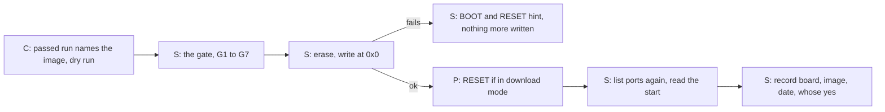

### UC-K. Person: put it on the known board, seamless and sure (D6, the main journey)
| step | what they do | evidence | friction or harm | today | open question |
| --- | --- | --- | --- | --- | --- |
| 1 | Person: "put it on the board", or Claude offers it after a passed run | H UC-K | — | works (the words) | — |
| 2 | spark, silent on a pass: finds exactly one board on a port whose MAC is in the record | H USERJ-9, TLJ-29 | an identical board swapped in | not yet | Q6 |
| 3 | spark, silent: chip, flash and MAC equal the record, the image passed, no firmware file is newer, the tools are at their pins | E TLJ-30, POJ-33 | silence about what spark cannot read (wiring, revision) | partly (the image checks work) | Q16: which checks make it "really sure"? |
| 4 | spark, silent: compares the board's files with the last deploy's manifest and names the files that an erase loses | H UC-K step 5, TL-13 | data the firmware wrote is lost | not yet | Q5: a marker on the board? |
| 5 | spark: chooses the least write: copy the changed files, or erase and write when the base or the layout changed | H TLJ-13, UC-K step 7 | an erase where a copy is enough | not yet | Q4 |
| 6 | Person: the yes, as Q2 decides (H1 a yes per board, H2 the request, H3 a yes only on a difference) | D4, D6 | — | not yet | Q2 |
| 7 | spark: writes, resets, reads the start, prints one receipt line, appends to the record | H USERJ-9 | "done" with nothing read | not yet | — |

Any differs or unknown in steps 2 to 4 stops, says the field, and returns to the full gate. Existing: ESPHome sets up a name, a shared key and a safe mode once (POJ-31).
After that, its updates ask nothing, and its checks are silent while they pass.
spark's recovery is the ROM bootloader by cable (POJ-32).

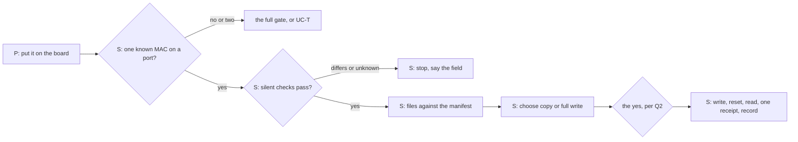

### UC5. Claude: change the code and put it on again, full flash
| step | what they do | evidence | friction or harm | today | open question |
| --- | --- | --- | --- | --- | --- |
| 1 | Claude: edits `firmware/` as the person asked | H | — | works | — |
| 2 | Claude: asks, then runs the scenario (metered minutes) | E `commands/build.md` "Ask the person before each run" | cost and wait for a one-line change | works | A9: is that cost accepted? |
| 3 | spark: refuses until a passed log names the new image, and names stale logs | E `scripts/deploy.py` `untested`, `tested_another` | flashing old code | works | — |
| 4 | spark: UC-K for a known board, UC1 for any other | H UC5 | a yes reused for another board | not yet | Q2 |

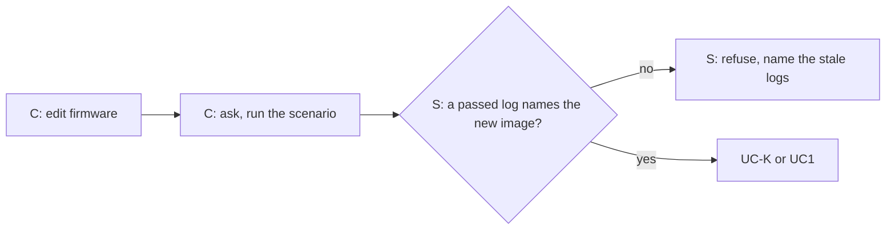

### UC2. Person: the same chip on another board
| step | what they do | evidence | friction or harm | today | open question |
| --- | --- | --- | --- | --- | --- |
| 1 | spark: chip same, flash or PSRAM differs or unknown (an N4 where the project is for the N16R8, or an S3 board with no record) | E TLJ-6, TLJ-8, USER-13 | silent acceptance | not yet | Q19: which boards must P219 handle? |
| 2 | spark: ranks the board records that fit what it read, and never says "this is the board" | H TLJ-8 | a guess | not yet | — |
| 3 | Person: says which board it is, from the product code on the board or the box | E TL-7 ("maker and model: no") | — | not yet | — |
| 4 | spark: offers four choices. Stop. Migrate: rebuild the pin map, diagram and sheet, then a new metered run. A general chip record: pins chosen again, with no pad names. Go ahead, with the differences logged | E TL-8, TLJ-9, TLJ-10 | one unlabelled "other board" | not yet | Q10 |
| 5 | Person: chooses. Claude never takes an offer alone | E #201: "It should also however allow this to be ignored" | the agent changing the project's board | not yet | Q7: is Claude allowed to pass ignore? |

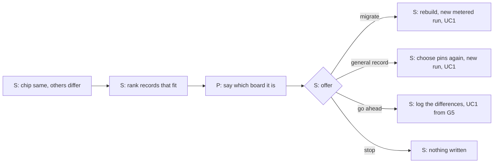

### UC3. Person: another chip, so spark stops
| step | what they do | evidence | friction or harm | today | open question |
| --- | --- | --- | --- | --- | --- |
| 1 | spark: reads ESP32-C6 where the project is for ESP32-S3, writes nothing, names both chips | E TL-7, TLJ-16 | an image the chip cannot boot | partly (esptool refuses in a test with a fake run only) | A4, Q7: does ignore reach another chip? |
| 2 | spark: an esptool too old to know the chip (3.3 here) gives unknown, never same | E TL-4 | — | not yet | — |
| 3 | spark: offers a record for this chip, the own-board route, or stop | E `docs/guide/how-it-works.md` "Your own dev board" | a dead end | not yet | — |

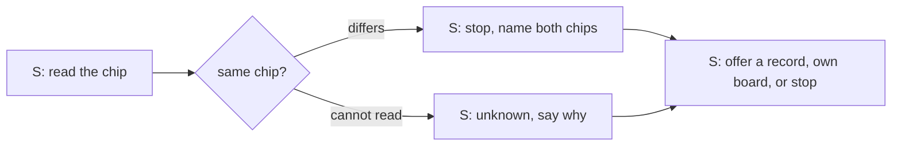

### UC4. Person: the firmware base does not fit, so spark offers the matching MicroPython
| step | what they do | evidence | friction or harm | today | open question |
| --- | --- | --- | --- | --- | --- |
| 1 | spark: compares the board's reading, the record's build and the image's build | E PHYS-5, TLJ-15 | a quiet mismatch | not yet | Q11: Standard or SPIRAM_OCT? |
| 2 | spark: says it cannot choose, because the record holds one `micropython_port` and no variant | E `boards/firebeetle2-esp32s3.json:7` | a guess | not yet | — |
| 3 | Person: keeps the image, or asks for the other build | — | — | not yet | — |
| 4 | spark: shows the URL and sha256, downloads into the person's store on a yes, never into the repository | E TLJ-13, AGENTS.md "Never commit a vendor file" | an unchecked download | partly (`/spark:setup` fetches the pinned build) | — |
| 5 | spark: rebuilds the image, says the simulation must run again (metered), and asks | E TLJ-15, `scripts/deploy.py` `untested` | an untested image flashed | works (the refusal) | — |

Existing: ESP Web Tools keys its builds by chip family only. Such a table calls an N4 and an N16R8 the same board (POJ-5, POJ-8).

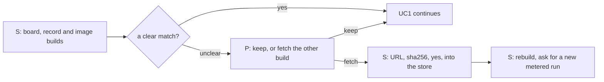

### UC-T. Person: two near-identical boards connected at once (D5)
| step | what they do | evidence | friction or harm | today | open question |
| --- | --- | --- | --- | --- | --- |
| 1 | spark: lists both with port, MAC (the USB serial in the ROM) and a remembered name, or "not known" | E TLJ-19, TLJ-29 | the first board found is erased | not yet | A5: is the serial the MAC under MicroPython too? |
| 2 | spark: says why it cannot tell them apart: they read the same except for the MAC | E USERJ-13 | a guess | not yet | — |
| 3 | Person: names the target, or unplugs the other one and spark lists again | H USERJ-13, POJ-28 item 7 | a pick by a port name that changes | not yet | Q6: does spark keep names? |
| 4 | spark: binds the name to the MAC and works on that port only. It reads the MAC again before any write, and finds the board by MAC after the flash | H TLJ-21 | a replug that swaps port names | not yet | — |

Existing: arduino-cli and PlatformIO match a port by VID:PID and can pick one (POJ-2, POJ-3). mpremote selects by
serial with `connect id:<serial>` (POJ-1).

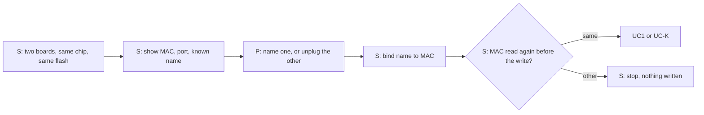

### UC6. Claude: update files without a full flash (waits on Q4)
| step | what they do | evidence | friction or harm | today | open question |
| --- | --- | --- | --- | --- | --- |
| 1 | spark: the gate, and a read that MicroPython runs with the image's build | H UC6, TLJ-15 | files copied onto other firmware | not yet | — |
| 2 | spark: lists the files that differ between `firmware/` and the board | H UC6 | — | not yet | — |
| 3 | spark: states the gate: a passed run names the changed files (per-file hashes), or the person says "untested" | E TL-13, PO-21 | the simulation guard dropped in silence | not yet | Q4 |
| 4 | Person: the yes, naming the board and the files | H USERJ-3 | — | not yet | — |
| 5 | spark: copies (`mpremote fs cp`), resets, reads the start | E PO-4 | — | not yet | — |

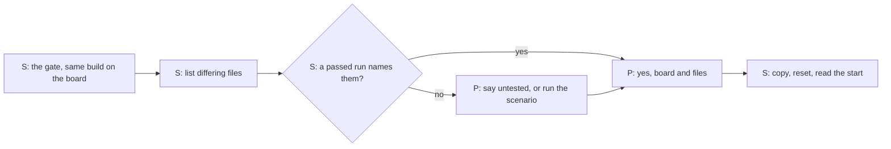

### UC7 and UC10. Claude: read and try things live on the board over USB (D7)
| step | what they do | evidence | friction or harm | today | open question |
| --- | --- | --- | --- | --- | --- |
| 1 | Person: says what to try ("is the button wired?", "does the sensor answer?") | D7 | — | works (the words) | — |
| 2 | spark: the look and the known-board checks, and asks the revision when unknown, because it changes what an I2C scan means | E PHYS-9, USERJ-19 | a false "device found" | not yet | — |
| 3 | Claude: opens the session: the gadget stops, close your own REPL, the scope, how the session ends | E USERJ-16, USERJ-20, TLJ-33 | a surprise stop, two clients on one port | not yet | Q12 |
| 4 | Person: yes to the scope, not to each read | D7 | — | not yet | Q12 |
| 5 | Claude: before each try, its class (read, read that drives, write), the pin by name and number, and how it leaves the board. spark refuses strap, console and USB pins unless the person names them | E TL-11, TLJ-36, TLJ-37, USERJ-18 | a "read" that drives an output, a try that cuts the connection | not yet | Q12: is a signal's direction exported? |
| 6 | Person: presses, moves, watches, and can say stop | H | — | — | — |
| 7 | Claude: ends: resets so `main.py` runs again, frees the port, lists what stays changed, writes facts learned. A code change goes to UC5, never straight to the board | E USERJ-22, AGENTS.md "Spark exports facts, never behaviour" | a gadget left stopped, live code taken as firmware | not yet | — |

Existing: mpremote is installed and pinned. A third-party MicroPython MCP plugin offers `write_file` and `delete_file`
(POJ-36), and belay sends host functions to the board (POJ-37). None checks identity or classes a try (POJ-39).

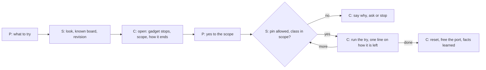

### UC9 and UC10w. Person: update or try over Wi-Fi (D5 and D7)
| step | what they do | evidence | friction or harm | today | open question |
| --- | --- | --- | --- | --- | --- |
| 1 | Person: "update it over Wi-Fi", or "try it over Wi-Fi" | D5, D7 | — | not yet | Q14 |
| 2 | spark: finds the board on the network, asks it who it is (marker and MAC), and refuses to choose between two | H UC9, TLJ-25 | an update sent to the wrong board | not yet | Q5 |
| 3 | spark: the silent checks of UC-K | H UC9 | an untested update | not yet | — |
| 4 | Person: the yes, whose first sentence is "if this fails, you will need the cable" | H USERJ-15 | OTA that looks safer than the cable | not yet | — |
| 5 | spark: sends, waits, and reports new, old or not back, from the sha256 the board reports | H UC9 F1 to F6 | "updated" before the board says so | not yet | — |

Preconditions: code on the board that joins Wi-Fi and listens (WebREPL or a stub), and a stored password. A new
interpreter also needs an OTA partition layout, which the kept table lacks (TL-14, TLJ-22, TLJ-34). That code is behaviour, which
spark does not write (TLJ-35). Existing: WebREPL (one password on all interfaces), `webrepl_cli.py` (get and put file
only), ArduinoOTA and ESPHome (POJ-11 to POJ-13, POJ-38).

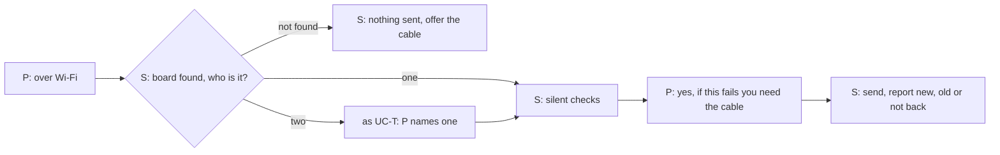

### UC8. Person: another platform (Arduino, PlatformIO)
| step | what they do | evidence | friction or harm | today | open question |
| --- | --- | --- | --- | --- | --- |
| 1 | Person: names the platform | E #203 | every stage assumes MicroPython | not yet | Q15: does the not-goal stand? |
| 2 | Claude: builds with a pin header that spark writes from the same assignments | H TL-17 | a second writer beside `pins.py` | not yet | — |
| 3 | Claude: simulates the app-only binary that Wokwi takes | E TL-16 | not the whole-flash image that deploy writes at `0x0` | not yet | — |
| 4 | spark: the same gate, then a merged image or per-file offsets | H TL-17 | — | not yet | — |

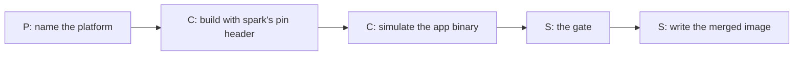

### Branches every write journey handles
| step | what they do | evidence | friction or harm | today | open question |
| --- | --- | --- | --- | --- | --- |
| B1 | spark: every read field same: the unknowns go into the yes question | H USERJ, B1 | "right board" said over unknowns | not yet | — |
| B4 | spark: a field it cannot read is unknown, with why: the chip does not report it, the tool is too old, or only a person knows | E TLJ-1, TLJ-4, TL-4 | a skipped read turned into same | not yet | Q7 |
| B5 | spark: no port: the cable (data, not charge-only), another socket, BOOT then RESET | E PHYS-2 | a stall with a hint only after a failure | partly | — |
| B7 | spark: no `ready` after the flash: lists ports again, reads after a reset, and says one of `ready`, other text, silence, download mode, no port. It never erases a second time on its own | H USERJ, B7 | a wrong "failed" or "passed" | not yet | Q16 |
| B8 | spark: the board changed between the look and the erase: stop, nothing erased | H USERJ-3 | a swapped board erased | not yet | — |
| B9 | spark: text but no filesystem after the flash: reads the filesystem size the board reports | E TLJ-12, PHYS-3 | a missing filesystem taken for a code error | not yet | A2 |

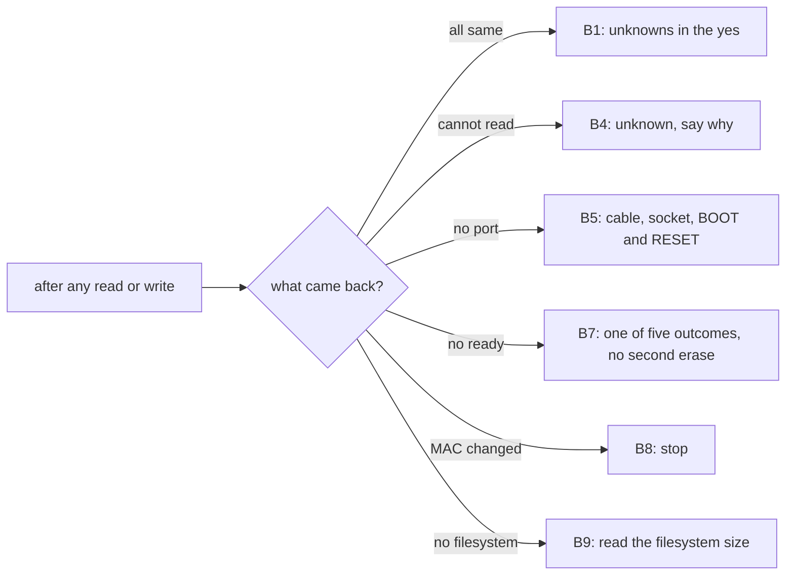
