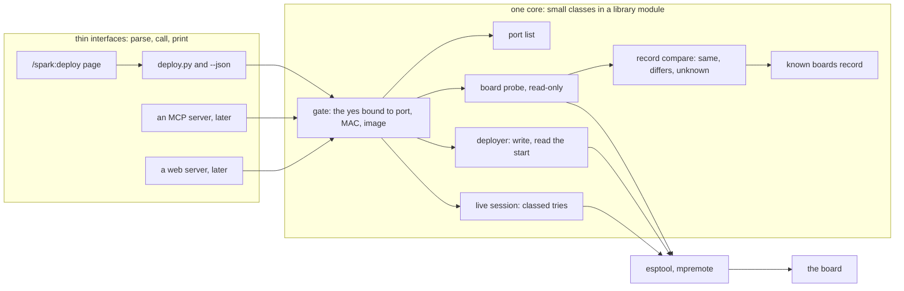

# Story map
<!-- Proposed, not applied: this map stays here until the decider confirms it; nothing changes the product's own
map file. -->
**Status:** proposed, not applied <!-- REQUIRED:map-status -->

## Backbone
<!-- The activities, left to right, as the user does them. e.g. `Assign → Notice → Act → Close` -->
Find the board → Look at it → Choose what goes on it → Say yes → Put it on → See it run → Change it and put it on again → Try things live → Reach it without a cable <!-- REQUIRED:backbone -->

The backbone is the PO assistant's (POJ, story map), with "Try things live" added for D7. Each write activity passes
the gate of `jobs-and-journeys.md`. The gate sits in the core (D8).

## Slices
<!-- Walking skeleton first: the thinnest slice that runs end to end. One row per story. job: a job in
jobs-and-journeys.md. tag: as in the brief. proof: something the decider can read.
e.g. `| 0 | Notice | the assignee gets one daily digest | job 1 | H ★C2 | the digest log for one team |` -->
The walking skeleton is slice 0. It is the thinnest slice that is safe under D4 and still puts the image that passed
on the PO's board. It reads the board, says what it read, takes a yes bound to that board, writes, and reads the
start. It leaves out the offers for another board, the build download, the two-board list, updates, live tries and
OTA (POJ-25, TLJ-18 steps 1 and 2).

| slice | activity | story | job | tag | proof | card |
| --- | --- | --- | --- | --- | --- | --- |
| 0 walking skeleton <!-- REQUIRED:slices --> | Look at it | the read-only bench: esptool 5.5.0's lines for chip, flash, MAC and security, `mpremote devs`, a read with `--chip esp32c6`, the revision by eye. Nothing is erased | J1, J3 | H ★C3, ★C19 | the bench log with each output kept as a test fixture | P228 #215 (D12) |
| 0 walking skeleton | Find the board | the core lists the ports and needs a named port before any write. It never takes the first port found | J1, J7 | E ★C1 | `deploy.py` with no port refuses and lists the ports. A fake-run test | P219 #201, first story |
| 0 walking skeleton | Look at it | the core's board probe reads chip, flash size and MAC, and compares them with the record. Each field reads same, differs or unknown. Flash size per SKU enters the record because this check needs it | J1, J3 | E ★C3, ★C4 | a run against a scratch record changed to the N4 says "flash differs" and writes nothing | P219 #201, first story |
| 0 walking skeleton | Say yes | the core takes a yes bound to the port, the MAC and the image sha256 read in this run. It reads the MAC again before the erase. No interface can skip it | J1 | H ★C10, ★C2 | fake-run tests: no yes refuses, and a yes for another MAC refuses | P219 #201, first story (Q3 and Q9 decide where it lands) |
| 0 walking skeleton | Put it on | erase and write the image that passed, through the gate | J1 | E ★C11 | the PO's board, flashed once through the gate | P215 #196, the flash half |
| 0 walking skeleton | See it run | the core reads the start after a reset and says `ready` seen, not seen or unknown. It keeps the serial log and a record of board, image, date and whose yes | J1 | H ★C7 | the kept log shows `ready`, and `main.py` is listed and `os.statvfs('/')`'s block count is written down (★C5 refuted: 512 or 3584 on a 16 MiB board) | P215 #196, the flash half |
| 0 walking skeleton | Say yes | `/spark:deploy` and `deploy.py --json` call the core and print its answer: the field states, the refusal sentence and the next steps | J1 | E #192 | Claude relays a refusal word for word from the JSON | P213 #192 |
| 1 the main journey | Change it and put it on again | the known board: the MAC is in the record, the silent checks pass, and one receipt line is printed. Any differs or unknown stops and returns to the full gate | J1, J2 | D6 · H ★C9 | the PO changes one line, gives one command, and sees one receipt line with the image sha256 | new (Q2, Q5, Q6) |
| 2 another board | Look at it | the same chip on another board, and another chip: say what differs, rank the records that fit, offer stop, migrate, a general record or go ahead. Another chip stops | J3 | E ★C4, ★C20 | a run against a wrong record names the difference, and nothing is written | P219 #201, second story (Q10, Q7) |
| 2 another board | Find the board | two near-identical boards: list them by MAC, ask for a named choice, bind a name to the MAC, find the board by MAC after the flash | J7 | D5 · E ★C9 | with two boards plugged in, the core refuses until one is named | new |
| 3 the matching base | Choose what goes on it | the matching MicroPython build: a variant fact in the record, a second tools entry downloaded on a yes into the store, then a new metered run | J1 | E ★C6 | the record names the build, and a passed log names the new image | new (Q11, after A3) |
| 4 the spike | Change it and put it on again | update the files without a full flash, with per-file hashes in the passed log or a labelled untested path | J2 | E ★C11 | the spike's finding with sources | P222 #204 (Q4) |
| 4 the spike | Try things live | live reads and tries over USB: classed tries, a pin list from the record, a session that ends with a reset | J4, J6 | E ★C14, ★C16 | the spike's finding with sources | P222 #204 (Q12, Q13) |
| 5 the contract | Look at it | a facts file on the board that the core reads back: project, board id, per-file hashes, spark's version | J1, J3 | H ★C22 | `deploy.py --check` prints the project found on the board | new (Q5) |
| 6 later | Reach it without a cable | OTA and a Wi-Fi REPL: code on the board that listens, an OTA layout, a secret, a rollback rule | J2, J6 | E ★C12, ★C13 | a discovery or spike of its own | new (Q14) |
| spike | Choose what goes on it | other platforms: what the chain needs from Arduino and PlatformIO | J5 | E ★C23 | the spike's finding with sources | P221 #203 (Q15) |

Order: slice 0 first. It is the only slice that depends on nothing else. Slice 1 comes next in value, because most of
the PO's deploys go to his one known board (n = 1, PO-18, POJ, story map). Slices 2 and 3 matter once a second board
or another build appears. The tech lead orders the build steps by what each needs from the bench (TLJ-18). That order
puts the known-board memory before `--json`. The PO assistant puts `--json` in slice 0. That split is part of Q9.

## Delta to the product's map <!-- REQUIRED:spark-process:map-delta -->
<!-- The rows to add or change in the repository's own story map file, in that file's table shape, with its journey
step numbers; proposed, not applied. "n/a — no map file" is allowed. -->
Proposed for `scrum/STORY_MAP.md`, not applied:

- The journey table, step 10 Breadboard, gap cell. Today: "flashing the board (P192) and the first walk to a lit LED
  (P100, round A)". Proposed: "the safe deploy: the read-only bench (P228), the check and the gate in the core (P219),
  the flash through it (P215), `/spark:deploy` and `--json` (P213). Then the first walk to a lit LED (P100, round A)".
- The slices table, row v1 The basic journey, items cell: add P228 (#215), P219 (#201) and P213 (#192) beside P192.
- If the PO adds a Slice option to the board (Q22), a new slices row for the later deploy rows (the known board,
  another board, the base, the spike, the contract, OTA):
  `| ? | Deploy and the board | hobbyist | a known board updates with one receipt line, and another board is refused with the field that differs | P218 (#200): the later rows of this map |`
<!-- EXTEND:map -->

## One core, many interfaces (D8)

The PO's D8 restates AGENTS.md's "One core, many interfaces". Each job below is a small class with one job in a library
module. The class names are the synthesis's proposal, not a design. Every interface only parses, calls the core and
prints. The gate runs in the core, so no interface, command page or agent prompt can skip it. A story that puts
logic in an interface is a risk under D8: the prose gate in `commands/build.md` today is one (★C2), and a third-party
MCP plugin that writes files is another (★C15).

