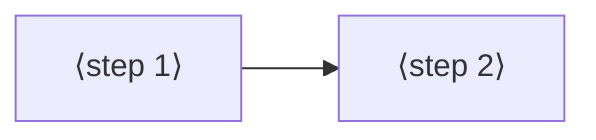

# Jobs and journeys
<!-- Tags as in the brief: E with a pointer, H with its source, D with who and when; an unknown is —. -->

## Who
<!-- One line per persona: who · evidence status (E pointer | H source).
e.g. `- Team leads who assign work · H Lena's belief, no interview yet` -->
- The PO, a maker who builds gadgets from an ESP32 board and modules, with Claude in the chat · E the bench logs docs/observations/2026-10-14-p236-bench.md, 2026-10-15-p215-bench-rerun.md · n = 1
- An AI agent that works with a running board while the PO watches · H the PO's words on P222 #204 ("connection with agents") <!-- REQUIRED:who -->

## Jobs
<!-- One job story per line, each clause tagged: When …, I want to …, so I can ….
e.g. `- When I assign a task in a meeting [E tickets.csv:6], I want the assignee to see it that day [H Lena], so I can stop chasing people [E tickets.csv:7]` -->
- Job 1, try a change live: When my firmware runs on the board [E p236-bench.md:24-25], I want to send it a value or a line of code and see its answer at once [E p236-bench.md:25, Claude sent `200`, the firmware answered], so I can tune it without a new flash [H the PO, #204 "updates"]
- Job 2, see what the board says: When the board runs or fails [E p215-bench-rerun.md:28-35], I want to read what it prints [H the PO, #224 "Seral monitor"], so I can tell whether it works [E p236-bench.md:4-6, `waiting for download` read only by Claude's own port listen]
- Job 3, find a fault on the board: When a part does not answer [E p215-bench-rerun.md:34-35, the jumper test not run], I want to read pins and sensors live [H the PO, #204 "debugging"], so I can find whether the wire, the part or the code is wrong [H]
- Job 4, let the agent test the real board: When Claude writes firmware for me [E AGENTS.md, the conversation writes the firmware], I want it to run small tries on the board itself [H the PO, #204 "connection with agents"], so I can trust the result past the simulation [H] <!-- REQUIRED:jobs -->

## Today they…
<!-- Per job: what they do instead today (a competitor, a workaround or nothing), tagged.
e.g. `- Job 1 · paste each task into Slack by hand · E tickets.csv:7` -->
- Job 1 · Claude opens the port by hand and writes a line, or the PO runs `mpremote repl` · E p236-bench.md:24-25; memory 2026-10-14 "PO trying live REPL now (mpremote repl)"
- Job 2 · Claude listens on the port with a one-off script; spark has no monitor command · E p236-bench.md:4-6; — for a spark command (the tech lead checks)
- Job 3 · nothing: the jumper test was not run · E p215-bench-rerun.md:35
- Job 4 · nothing in spark; deploy's ReadyCheck reads one word, `ready` · E p215-bench-rerun.md:33-34 <!-- REQUIRED:today -->

## Journeys
<!-- One ### per actor and scenario: the table, then a Mermaid flowchart of the same steps. Never a Mermaid
journey block: it forces a score on every task. "n/a — a one-step job" may replace both.
e.g. `| 2 | opens the app | E analytics, 90 days | never sees the task | not yet | Do they read email? |` -->
### ⟨actor⟩ — ⟨scenario⟩ <!-- REQUIRED:journey -->
| step | what they do | evidence | friction or harm | today | open question |
| --- | --- | --- | --- | --- | --- |
| 1 | ⟨fill⟩ | ⟨tag and pointer⟩ | ⟨fill⟩ | ⟨works, partly, not yet or —⟩ | ⟨fill or —⟩ |

