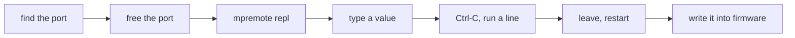
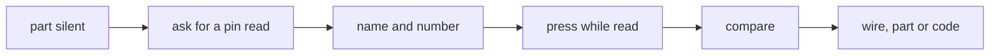
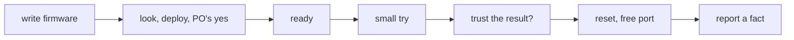

# Jobs and journeys
<!-- Tags as in the brief: E with a pointer, H with its source, D with who and when; an unknown is —. -->

## Who
<!-- One line per persona: who · evidence status (E pointer | H source).
e.g. `- Team leads who assign work · H Lena's belief, no interview yet` -->
- The PO, a maker who builds gadgets from an ESP32 board and modules, with Claude in the chat · E the bench logs docs/observations/2026-10-14-p236-bench.md, 2026-10-15-p215-bench-rerun.md · n = 1
- An AI agent that works with a running board while the PO watches · H the PO's words on P222 #204 ("connection with agents") <!-- REQUIRED:who -->

## Jobs
<!-- One job story per line, each clause tagged: When …, I want to …, so I can ….
e.g. `- When I assign a task in a meeting [E tickets.csv:6], I want the assignee to see it that day [H Lena], so I can stop chasing people [E tickets.csv:7]` -->
- Job 1, try a change live: When my firmware runs on the board [E p236-bench.md:24-25], I want to send it a value or a line of code and see its answer at once [E p236-bench.md:25, Claude sent `200`, the firmware answered], so I can tune it without a new flash [H the PO, #204 "updates"]
- Job 2, see what the board says: When the board runs or fails [E p215-bench-rerun.md:28-35], I want to read what it prints [H the PO, #224 "Seral monitor"], so I can tell whether it works [E p236-bench.md:4-6, `waiting for download` read only by Claude's own port listen]
- Job 3, find a fault on the board: When a part does not answer [E p215-bench-rerun.md:34-35, the jumper test not run], I want to read pins and sensors live [H the PO, #204 "debugging"], so I can find whether the wire, the part or the code is wrong [H]
- Job 4, let the agent test the real board: When Claude writes firmware for me [E AGENTS.md, the conversation writes the firmware], I want it to run small tries on the board itself [H the PO, #204 "connection with agents"], so I can trust the result past the simulation [H] <!-- REQUIRED:jobs -->

## Today they…
<!-- Per job: what they do instead today (a competitor, a workaround or nothing), tagged.
e.g. `- Job 1 · paste each task into Slack by hand · E tickets.csv:7` -->
- Job 1 · Claude opens the port by hand and writes a line, or the PO runs `mpremote repl` · E p236-bench.md:24-25; memory 2026-10-14 "PO trying live REPL now (mpremote repl)"
- Job 2 · Claude listens on the port with a one-off script; spark has no monitor command · E p236-bench.md:4-6; — for a spark command (the tech lead checks)
- Job 3 · nothing: the jumper test was not run · E p215-bench-rerun.md:35
- Job 4 · nothing in spark; deploy's ReadyCheck reads one word, `ready` · E p215-bench-rerun.md:33-34 <!-- REQUIRED:today -->

## Journeys
<!-- One ### per actor and scenario: the table, then a Mermaid flowchart of the same steps. Never a Mermaid
journey block: it forces a score on every task. "n/a — a one-step job" may replace both.
e.g. `| 2 | opens the app | E analytics, 90 days | never sees the task | not yet | Do they read email? |` -->
The journeys come from the user lens (council/user.md, journey tables). OBS is docs/observations/. All evidence is
n = 1: the PO, one XIAO ESP32-C6, one Mac. Start state: the firmware is flashed and `ready seen`.

### The PO — Job 1, try a change live <!-- REQUIRED:journey -->
| step | what they do | evidence | friction or harm | today | open question |
| --- | --- | --- | --- | --- | --- |
| 1 | finds the port name | E OBS/2026-10-14-p215-bench.md:5, OBS/2026-10-15-p215-bench-rerun.md:3 (USR-16) | the name changed between days (`usbmodem101`, then `usbmodem1101`) | works, by hand | Q19 |
| 2 | makes sure that no other program holds the port | E OBS/2026-10-14-p238-spike/finding.md round 2 item 5 (USR-6) | a held port freezes esptool or mpremote, and no tool names the holder | partly | Q16 |
| 3 | runs `mpremote connect <port> repl` in his own terminal | E docs/guide/journey.md:1102 (USR-1) | he types the path, the module form and the port name | works | Q14 |
| 4 | types `200` and Enter | E OBS/2026-10-14-p236-bench.md:24-25 (USR-4) | works only because blink-c6 reads its console. button-light drops each byte | works for blink-c6 only | — |
| 5 | wants to run a line of Python, not feed the firmware | E journey.md:1102-1104 (USR-2) | Ctrl-C stops the gadget first, and gets through only if the firmware reads its console | partly | Q15 |
| 6 | leaves with Ctrl-] and restarts with Ctrl-D or a reset | E journey.md:1103-1104 | a tuned value is lost at the restart | works | Q23 |
| 7 | turns what he learned into firmware | D AGENTS.md, "spark exports facts, never behaviour" | nothing carries the tried value into a file | not yet | — |

### The PO — Job 2, see what the board says
| step | what they do | evidence | friction or harm | today | open question |
| --- | --- | --- | --- | --- | --- |
| 1 | wants to see the console after a flash or a fault | E OBS/2026-10-14-p236-bench.md:4-6 (USR-7) | `waiting for download` came only from Claude's own port listen | partly | Q17 |
| 2 | opens a monitor (`mpremote repl`, `screen`, Thonny) | H none for his choice · E finding.md round 2 item 4, INDEX AT161, AT178 (USR-5) | opening the port can restart the C6 and can drop the macOS device | partly | Q18 |
| 3 | reads the boot text and `ready` | E finding.md "Proven" (USR-14) | MicroPython drops output that no reader takes within 200 ms, so a late monitor misses the boot | partly | — |
| 4 | the board is silent | E OBS/2026-10-14-p236-bench.md:4, INDEX AT157 | silence can be download mode, a stuck firmware or a held port. Only deploy.py tells them apart | partly (deploy only) | Q17 |
| 5 | presses R | E OBS/2026-10-14-p243-bench.md:9, INDEX AT165 | he must know where R is. The board record lacks it (AT158) | works | — |
| 6 | replugs the cable | E OBS/2026-10-14-p215-bench.md:19-21 | the console did not come back at once. The cause is unknown (AT133) | partly | — |
| 7 | decides pass or fail from the text | E INDEX AT179 | a bare board shows nothing when the firmware drives only external parts | partly | Q22 |

### The PO — Job 3, find a fault on the board
| step | what they do | evidence | friction or harm | today | open question |
| --- | --- | --- | --- | --- | --- |
| 1 | a part does not answer (button-light with no wires) | E OBS/2026-10-15-p215-bench-rerun.md:34-35 (USR-20) | he has no wires, so he cannot test the signal | not yet | — |
| 2 | asks Claude what the pin reads | H P218 jobs-and-journeys.md UC7 step 1 | Claude stops the firmware to read. A read in a new mode can change a pin the firmware set | not yet | Q21 |
| 3 | Claude names the pin by name and number | E INDEX AT150, P218 ★C16 (USR-13) | pins.py holds no direction. Strap and USB pins can be hit | not yet | — |
| 4 | presses the button or moves a wire while Claude reads | H P218 UC7 step 6 | Claude cannot see his hand, so it must say when | not yet | — |
| 5 | compares the read with the diagram | E OBS/2026-10-15-p215-bench-rerun.md:34 | the bare XIAO has one LED and no wired parts, so the check is weak | not yet | — |
| 6 | learns whether the wire, the part or the code is wrong | — | no run exists | — | Q22 |

### Claude, the agent — Job 4, test the real board
| step | what they do | evidence | friction or harm | today | open question |
| --- | --- | --- | --- | --- | --- |
| 1 | writes firmware in the conversation | E AGENTS.md | the firmware must read its console, or nothing later gets in (AT177, USR-3) | works | Q4 |
| 2 | looks, then deploys with the PO's yes in his terminal | E scripts/deploy_gate.py:42, INDEX AT172 (USR-9) | Claude has no tty and cannot type the yes. A faked-terminal probe was refused | works with the PO's hands | Q24 |
| 3 | gets one word, `ready` | E OBS/2026-10-15-p215-bench-rerun.md:33 | it says the loop started, nothing of pins or timing | works, thin | — |
| 4 | wants to run a small try | E OBS/2026-10-14-p236-bench.md:19-25 (USR-11) | no command. Claude writes pyserial by hand and guesses DTR, RTS and timings. docs/guide/agents.md:580 forbids mpremote by hand to turn an unknown into a pass | not yet | Q20 |
| 5 | gets a result and decides whether to trust it | H P218 UC7 | only Claude reads the answer, and no log keeps it | not yet | Q20 |
| 6 | resets and frees the port | D D29 (the PO, 2026-10-13) | the PO can have his own REPL open. A freed port is not announced | not yet | Q5 |
| 7 | reports, and never turns a try into firmware by itself | E AGENTS.md, P218 jobs-and-journeys.md:277 (TL-11) | the line between a learned fact and behaviour is a rule, not a check | partly | — |

