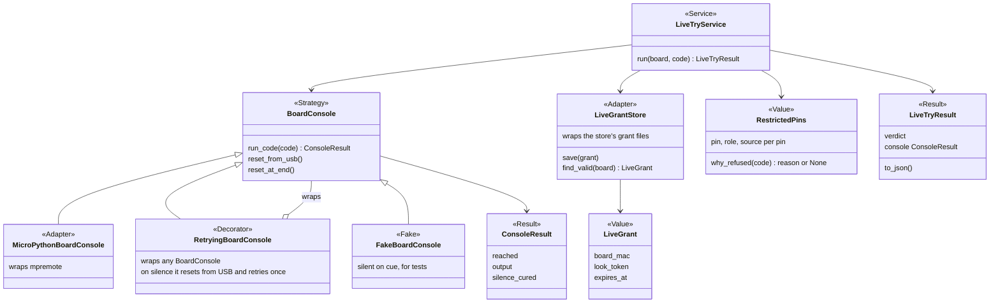
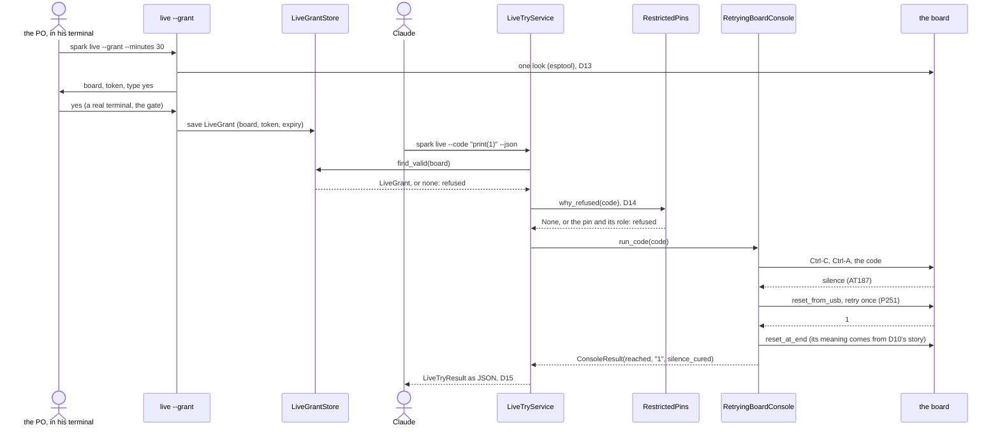

# P235: shape for design (sketch, not a design)

A sketch of D7, D9, D12 to D15 and P251 for the design step. The design picks the real names. Each box names its role
from the table in docs/guide/developing.md ("Patterns and names in spark's core"), plus Decorator (D8) and Fake.
No name in the core says MicroPython (D7): the platform shows only in its adapter's name.

The design step settles what this sketch leaves open: the meaning of `reset_at_end` (D10's story), the grant's file
and its expiry check (D12, P242 reuses it), whether `LiveTryService` takes the gate's `ConsentStrategy` for the grant
step, and how `BoardConnection` today becomes `MicroPythonBoardConsole` without breaking deploy's ReadyCheck · H the
facilitator's sketch · caveat: no class here exists yet, except BoardConnection and ConsentStrategy
