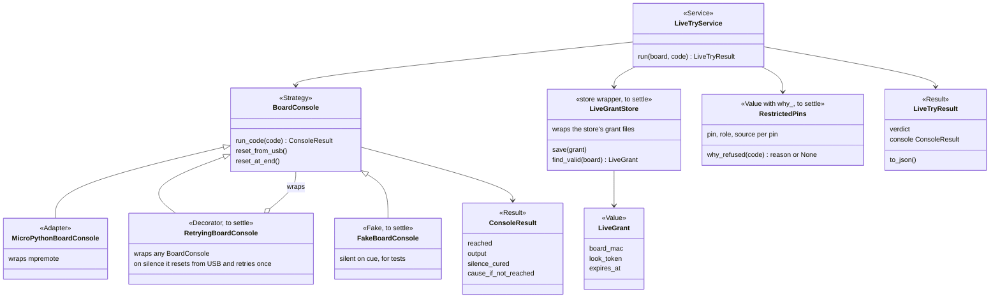
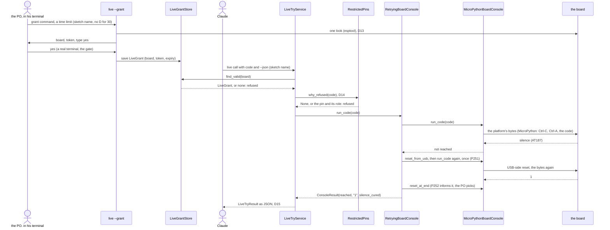

# P235: shape for design (sketch, not a design)

A sketch of D7, D9, D12 to D15 and P251 for the design step. The design picks the real names. Each box names its role
from the table in docs/guide/developing.md ("Patterns and names in spark's core"). Four roles here are not in that
table yet, so they are marked "to settle in design and in P255's table change": Decorator (D8 adds the row), Fake (no D
yet), a wrapper of the store's own files (the table's Adapter wraps an outside program), and a value with a `why_`
function (the table's Value has no actions).
No name in the core says MicroPython (D7): the platform shows only in its adapter's name.

The design step settles what this sketch leaves open: the meaning of `reset_at_end` (D10's story), the grant's file
and its expiry check (D12, P242 reuses it), whether `LiveTryService` takes the gate's `ConsentStrategy` for the grant
step, how `BoardConnection` today becomes `MicroPythonBoardConsole` without breaking deploy's ReadyCheck, whether
`reset_from_usb` belongs to a transport object rather than the platform-neutral base (a USB reset is a fact of the
port, not of the platform), and how `cause_if_not_reached` can tell a silent console from a firmware that does not read
its console (D11): from mpremote's one error the two look the same, and the bench told them apart only with a separate
probe and the PO's eyes · H the
facilitator's sketch · caveat: no class here exists yet, except BoardConnection and ConsentStrategy
