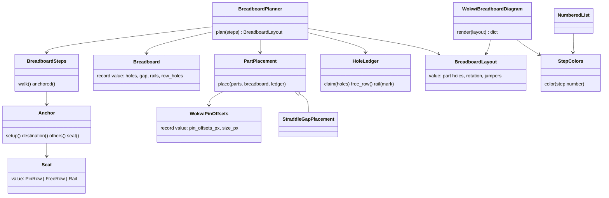

# P267: a drawn breadboard in Wokwi, from the sheet's steps

> Spark writes `breadboard.json`, a second Wokwi diagram. It puts the XIAO ESP32-C6 and the button-light parts
> into a half breadboard, with each step's wire in its own color. A pure planner turns the P202 steps into holes,
> and a Wokwi renderer turns the holes into pixels. The geometry comes from cited records: Wokwi's own pin offsets,
> and a breadboard record measured once in Wokwi.

Council: round 1 (an architecture and names lens on Sonnet, the refuter on Opus) and round 2 (the PO-assistant
and a senior on Sonnet, the tech lead on Opus) ran on 2026-10-16. Their findings are folded in below, and they
become observation rows in the PR.

## Context

The PO asked on 2026-10-16 (#300): "a really nicely graphical version in Miro for example? Where it would show it
on the breadboard wired". He chose the Wokwi breadboard view in place of Miro, cited facts, and a measurement in
Wokwi first, because Wokwi publishes no hole positions.

The person: at the build stage, with a real half breadboard and the sheet in front of them. They paste
`breadboard.json` into a new wokwi.com project. They compare the picture with their real breadboard, then follow
the sheet's numbered steps, and each wire's color matches its step. The build prints the file's path, and the sheet
says "An example layout is in breadboard.json".

Done when: for button-light on the XIAO C6, the build writes `breadboard.json`. It opens in Wokwi with every leg in
a hole, and the PO signs off on the screenshot.

## Design

- The anchors keep the wiring. `Anchor.seat()` returns a plain value: `PinRow(end)`, `FreeRow(end)` or `Rail(mark)`.
  `BreadboardSteps.anchored()` yields each step with its seat, in the order of `walk()`. The anchors do not know the
  holes.
- `Breadboard` (a record value): `parts/breadboard-half.json`, because a breadboard is a part the person owns. It
  holds the measured hole origin, pitch, gap, rails, 30 columns and 5 holes per row, with the measurement's URL, date
  and sha256. `breadboard.py`'s `ROW_HOLES` reads it, so the row-or-rail rule stays in one place (`_wiring`).
- `WokwiPinOffsets` (a record value): pin offsets and size in px, under each record's `simulation.wokwi` (the
  board's size from Wokwi's board.json replaces `wokwi_size_px`). A pure `rotate(offsets, degrees)` turns it.
- `PartPlacement` (strategy): `StraddleGapPlacement` puts the board, then each part, across the center gap in the
  next free columns, and chooses each part's rotation.
- `HoleLedger` (one job: the taken holes): `claim` refuses a hole that is taken and names it. It reserves every
  pin, wired or not. `free_row()` refuses past the last column. `rail(mark)` gives one rail per mark and refuses a
  fifth.
- `BreadboardPlanner` (pure): steps, a breadboard and the offsets in, a `BreadboardLayout` out: each pin's hole, each
  part's rotation, and each jumper's two holes with its step number.
- `WokwiBreadboardDiagram` (renderer): takes its inputs in the constructor and keeps `render(layout)`. It sits in a
  file-views table beside `WIRING_VIEWS`. An SVG or Miro drawing later is a second renderer of the same layout.
- `StepColors`: one palette, a function of the step number. Placing steps take no color. Adjacent steps differ, and
  the wrap is written down. `NumberedList` takes it as an option.

## Steps

0. Fixture: `tests/data/breadboard/button-light-xiao/` (requirements and the built circuit.json), from the P215
   bench project if it exists, else built with `build.py --keep`. Its sheet test passes first.
1. Measure (a bench note, no code). In Chrome on wokwi.com, put a half breadboard, then an LED and a resistor in
   known holes, and a XIAO C6 and a button turned 90 degrees. Work back from each part's top and left plus its pin
   offset to the holes, the gap and the rails, and find the rotation's pivot. Run the simulator once to learn whether
   a leg over a hole connects without a connection entry. If it does not, legs get connections with an empty color.
   Keep the diagram text in `docs/discovery/2026-10-16-p267-wokwi-holes.md` with the URL, the date and the sha256.
   If a number cannot be measured, stop: the card goes back to Ready with the finding, and no number is guessed.
2. PR 1, the first slice end to end: the board, the LED and one jumper. It adds the records' facts, `Seat`, the
   planner, the ledger, the placement, the renderer, the build writing the file, and the sheet's line. Open it in
   Wokwi and attach the screenshot.
3. PR 2, the rest of button-light: the button and the resistor, the rails, and `StepColors` in the sheet. The
   failure path: a board without the facts, such as the FireBeetle, still gets its sheet, which says
   "breadboard.json not written" and names the missing fact.
4. Docs in each PR: `--help`, `docs/guide/agents.md`, the build command page, the journey guide, the roles in
   `docs/guide/developing.md`, and in PR 2 the README's "What works today" and `tools/journey.py`. They say that
   only the XIAO C6 draws yet, and that `breadboard.json` is written fresh each build, so `merge.ts` does not apply.
5. Later cards under P199 (#152), filed with the PR: a Miro copy of the drawing (the PO's first words), the
   FireBeetle drawing, a full-size breadboard, and the converter's `geometry.ts` reading the records' offsets.

## Tests

- Geometry: `rotate` for 0, 90, 180 and 270 against the measured diagram, with `pytest.approx`, and one rounding
  only, at the end. Each pin lies within 1.5 px of a hole center.
- Ledger: a repeat claim raises and names the hole. 31 parts raise, and no hole lies off the half board's 30
  columns. A fifth rail mark raises. Several GND pads give one GND rail.
- Layout: no row holds pins of two points, counting the button's internally joined pins. A resistor's two legs get
  two rows. The board straddles the gap. A point too big for a row goes to a rail by the one `_wiring` rule.
- One source: `anchored()` follows `walk()`. Each jumper step has exactly one wire between the same two ends, and
  its color equals its step's color in the sheet. A supply step draws no wire and the legend says "off the board".
- Output: the same input gives byte-identical JSON. Each hole name exists on a half board, beyond what the lint
  checks. A stale build still raises `NotBuilt`, and no drawing is written without its sheet.
- The mutation tester runs on the changed logic.

## Names

"Row" stays the word for five joined holes, as the code says. "Hole" is one hole, "rail" a supply rail, "seat"
where a point's ends meet. "Footprint" is not used, because it means the KiCad footprint in spark.

## Out of scope

The later cards in step 5, and wire routes that bend around parts.

## Verification

`python3 -m pytest tests/test_breadboard_steps.py tests/test_breadboard_layout.py tests/test_breadboard.py`, the
push hook's own run, the Wokwi screenshot for each PR, and the review sized to a logic change: Sonnet lenses, an
Opus refuter and the mutation tester.
