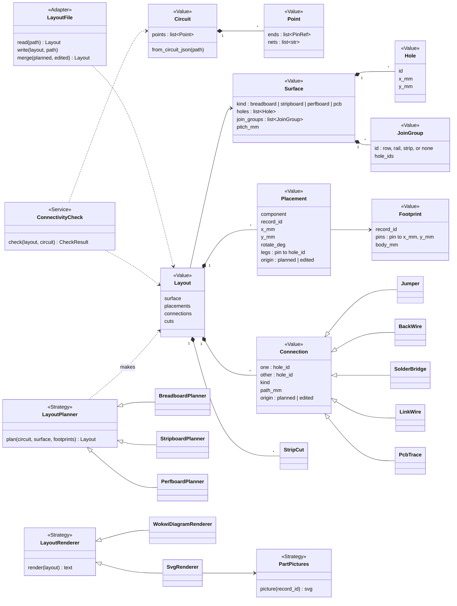
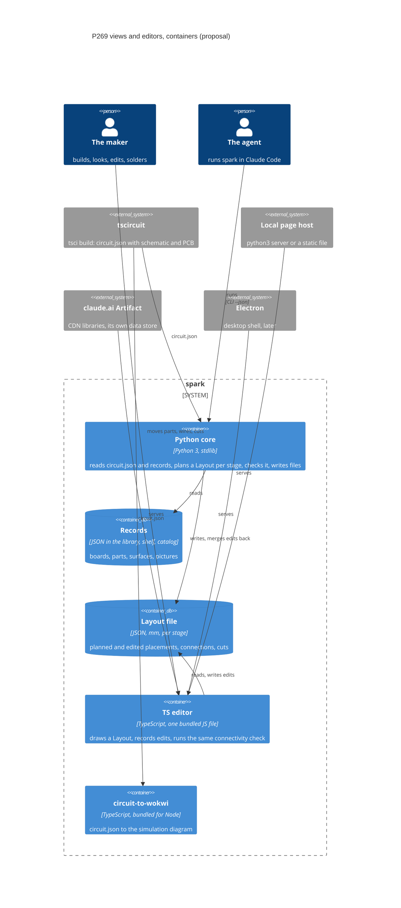

# P269 council: the tech lead (Opus), 2026-10-16

Read-only. Tags: E (with a pointer), H (with its source), D (who, when), — for an unknown. Line numbers are as read on
branch `p269-discovery` at 95bf5e5.

## 1. Findings

### The model (open question 1)

- TL-1 · Every stage fits one model: a surface of holes (or pads) whose built-in joins form groups, parts whose legs
  sit in holes, and connections that join two holes. A breadboard row is a group of 5 holes, a rail is a group of 25,
  a stripboard strip is a group of N holes that a cut splits, a plain perfboard hole is a group of 1, and a PCB has
  no grid and no groups, only pads at free mm positions. The same circuit is right in a stage when a union-find over
  (groups, minus cuts) plus legs plus connections gives exactly the circuit's points. · H (the tech lead, from the
  code below and the brief's D-b) · supports Q1 and J7: one checker for every stage.
- TL-2 · The breadboard code already holds this model, under Wokwi names. `Hole` has a `row` (its join group),
  `HoleLedger` claims holes and asks `row_is_free`, and `PartPlacement` is a strategy. Only the fields are
  Wokwi-shaped: hole names `12t.a`, positions in px, parts by Wokwi type. · E scripts/breadboard_drawing.py:22-37,
  97-129, 132-136 · supports Q1: the base is a rename and a unit change of existing classes, not new code.
- TL-3 · The P267 architecture lens said the same thing as a defect: "the layout is Wokwi-shaped (type, attrs, px), so
  P268's own pictures need more than a second renderer", and asked for a `DRAWING_VIEWS` table that `write()` loops
  over. It also asked for a `WokwiPartCatalog` out of the sheet module and one `BOARD_COMPONENT` constant ("Mcu" and
  "board" are both used). · E docs/discovery/2026-10-16-p267-drawn-breadboard/review/architecture.md:7-11,
  scripts/breadboard.py:59, scripts/breadboard_steps.py:21 · supports Q1 and Q8: these are slice 0's work.
- TL-4 · Issue #302's refinement asked for pictures keyed by Wokwi type, a `PartPictures` strategy in its own module,
  measured sizes, one drawing pass in `write()`, and ElementTree for the SVG. The PO asked that the picture source be
  swappable so an online source drops in later. · E `gh issue view 302 --comments`, read 2026-10-16 · supports Q1 and
  Q6. Caveat: keying pictures by Wokwi type ties the picture to Wokwi. A stage-neutral key is the record id (the part,
  the board), with the Wokwi type as one picture source.
- TL-5 · mm is a safe base unit. Wokwi's px are a fixed scale of mm: 96 px per inch, so 9.6 px is 2.54 mm. The
  converter already uses `MM_TO_PX` = 96/25.4. · E data/wokwi-geometry.json:2, :29, tools/circuit-to-wokwi/ARCHITECTURE.md:84-86
  · supports Q1: the Wokwi renderer converts mm to px at its edge, and nothing inside needs px.
- TL-6 · The breadboard's hole grid is not a pure 2.54 mm grid. The gap between e and f is 28.8 px (7.62 mm), and the
  rails skip one pitch every 5 holes. A surface must hold hole positions as data, or as a grid plus its exceptions. ·
  E data/wokwi-geometry.json:33-39, scripts/breadboard_drawing.py:53-61 · supports Q1.

Class diagram of the proposed base. Names follow the role table in docs/guide/developing.md:220-245. Every name is a
proposal.

C4 container diagram (proposal).

### One circuit in every stage (open question 4)

- TL-7 · spark derives the circuit's points twice, two ways. `breadboard.py points()` runs its own union-find over
  `source_trace` elements. The converter's architecture says connectivity "is read exactly one way", by
  `circuit-json-to-connectivity-map`, and "re-deriving nets from traces by hand would be a second implementation that
  can disagree with the first. It is never done here." · E scripts/breadboard.py:90-119,
  tools/circuit-to-wokwi/ARCHITECTURE.md:50-53 · supports Q4: a stage-neutral `Circuit` must have one source of
  points. Today it has two.
- TL-8 · The kept build already holds a schematic and a PCB with positions in mm. In
  ~/Development/button-light/dist/board/circuit.json: 4 `schematic_component`, 7 `schematic_trace`, 4
  `pcb_component`, 20 `pcb_plated_hole` (each with x, y in mm, a `pcb_port_id` and `port_hints` such as "D6"), 5
  `pcb_trace`, 1 `pcb_board` (47 x 33 mm). · E command: a Python Counter over that file, run 2026-10-16 · supports Q4:
  schematic and PCB views need no new planning in spark.
- TL-9 · The test fixtures' circuit.json files are trimmed to source elements only (no pcb, no schematic). A
  test for a PCB or schematic view needs a new fixture. · E tests/data/breadboard/button-light-xiao/dist/board/circuit.json:
  Counter gave source_port 22, source_trace 7, source_component 4, source_net 2 · supports Q8.
- TL-10 · tscircuit's `circuit-to-svg` exports `convertCircuitJsonToSchematicSvg`, `convertCircuitJsonToPcbSvg`,
  `convertCircuitJsonToAssemblySvg` and `convertCircuitJsonToPinoutSvg`. · E https://github.com/tscircuit/circuit-to-svg,
  read 2026-10-16 · supports Q4: schematic and PCB views are a call, read-only. Its license and whether it runs in a
  browser bundle were not on the page: —. The converter's own docs already say "`circuit-to-svg` already does that,
  and `tsci export` calls it." (ARCHITECTURE.md:129).
- TL-11 · The PCB is not the perfboard. In the button-light build the resistor is an SMD part (`pcb_smtpad`, 0.8 x
  0.95 mm), while the sheet tells the person a through-hole resistor. A perfboard view cannot take the resistor's
  legs from the PCB. It needs its own footprint per stage (an axial resistor's lead spacing). · E the same command,
  `pcb_smtpad` with `port_hints` ["1","left"], scripts/breadboard.py:224 ("resistor, through-hole") · supports Q1 and
  Q3: `Footprint` is per stage, not per part.
- TL-12 · Where the perfboard gets a module's pin positions. For a through-hole board or module, the build's
  `pcb_plated_hole` rows give pin x, y in mm relative to the part (from the record's tscircuit `footprint` string, for
  example "pinrow2", "headermodule6"). The FireBeetle record also holds a full header block (rows, pitch 2.54, row
  spacing 22.86, first pad from edge 5.2). The XIAO record does not: it holds only width, height and the footprint
  name, and says it "has no header_order yet". · E boards/firebeetle2-esp32s3.json `physical.header`,
  boards/xiao-esp32-c6.json:20-28, :125, parts/*.json `footprint` fields · supports Q3.
- TL-13 · Two sources disagree on the XIAO's size. The board record says 21.0 x 17.8 mm. The Wokwi geometry says
  Wokwi draws it 18.1 x 23.4 mm (68 x 88 px), and the record's own `wokwi_size_px` says 70 x 90. A perfboard view
  must use the record's physical size, never Wokwi's drawing. · E boards/xiao-esp32-c6.json:23-27,
  data/wokwi-geometry.json:8-10 · supports Q3. Which is the real board: — (no caliper reading cited in the record).

### How routes are made per stage (open question 2)

- TL-13a · Breadboard today: spark plans everything. `BreadboardSteps.anchored()` picks each point's anchor (a part's
  pin row, else a resistor end, else a free row for a board pad, or a rail), and `BreadboardPlanner` places parts
  first-fit left to right and turns them, then draws one jumper per step. Rails and off-board supplies stop the
  drawing with `NotDrawn`. · E scripts/breadboard_steps.py:109-159, scripts/breadboard_drawing.py:200-240, :221-224 ·
  supports Q2: the breadboard planner is the first `LayoutPlanner`.
- TL-14 · Stripboard: the known tool is VeroRoute. The person places parts and gives connections (a netlist import or
  by hand), and the tool "automatically prevents short-circuits and checks for open-circuits", with "interactive
  auto-routing". It is GPLv3. Its page gives no algorithm. · E https://sourceforge.net/projects/veroroute/, read
  2026-10-16 · supports Q2: spark can learn the split (person places, tool cuts and checks) but cannot copy its code
  into an MIT repository.
- TL-15 · A stripboard planner that fits the base, smallest version: parts in holes with each pin on its own strip
  (the same "each pin in its own row" rule the breadboard uses), a cut between pins of a part that straddle one strip
  (under a DIP or a header module), one link wire per extra join, and a cut wherever two points share a strip. The
  checker of TL-1 proves it. · H (the tech lead, from scripts/breadboard_drawing.py:139-189, whose first-fit with
  "pin in a free row" maps to "pin on a free strip segment") · supports Q2. Cost: a cut changes the join groups, so
  `JoinGroup` must be split at run time, which the breadboard never needed.
- TL-16 · Plain perfboard: each hole is its own group, so every join is a route. Lee's maze search (a breadth-first
  wave over the hole grid) finds a shortest route between two holes around taken holes, one point at a time. Routes
  on the back can be a bare or insulated wire, or a row of solder bridges between neighbour holes. A route that
  crosses another needs a wire on the front. · H (textbook Lee 1961, model knowledge, not searched) · supports Q2.
  Cost: order of routing decides success, so a first version should route the fewest-ends points last and report
  `could not route` per point, never a partial board as a pass.
- TL-17 · Who decides what, as a proposal. Breadboard: spark plans all, the person moves parts and jumpers. Stripboard:
  spark plans placement, cuts and links, the person moves parts and adds or removes cuts, the checker says short or
  open at once. Perfboard: spark places and routes, the person redraws a route. PCB: tscircuit places and routes, the
  person edits in tscircuit's own tools, outside this item (brief scope). · H (the tech lead) · supports Q2. It needs
  the PO's yes (Questions, Q-A).
- TL-18 · The converter already solves "the person edits, the build regenerates". `merge.ts` keeps positions,
  rotations and wire routes by part id and by wire ends, keeps parts marked `handAdded`, and lets the build own what
  is connected. "The generator owns *what is connected*; you own *what it looks like*." · E
  tools/circuit-to-wokwi/lib/merge.ts:1-79, ARCHITECTURE.md:89-92 · supports Q5: the round-trip rule exists and is
  tested. The layout file can reuse it.

### The editor and its hosts (open question 5)

- TL-19 · An Artifact page loads scripts only from cdnjs.cloudflare.com, cdn.jsdelivr.net/npm/, unpkg.com,
  cdn.tailwindcss.com or code.jquery.com, and puts everything else inline. A page is at most 16 MB. Browser storage
  is per viewer and may come back empty. Shared, durable state goes in the Artifact's own database, which Claude reads
  and writes with `ArtifactData`. Supporting files (a layout JSON) can be published beside the page. · E the Artifact
  tool's description in this session, read 2026-10-16 · supports Q5 and Q7: the editor must be one bundled JS file
  (or CDN libraries), it cannot read the person's disk, and an edit made in an Artifact comes back to spark through
  `ArtifactData`, not through a file.
- TL-20 · spark already bundles TypeScript into one file that runs with no node_modules: `bundle.sh` runs
  `bun build ... --outfile=dist/converter.mjs`, and a test fails when the sources' sha256 does not match. Bun is a
  developer tool here, and the person needs only Node. · E tools/circuit-to-wokwi/bundle.sh:1-13 · supports Q5: the
  editor can ship the same way, as `dist/editor.js`, inline in the Artifact and in a local page.
- TL-21 · Stack options for a board of under about 50 parts and about 400 to 2000 holes. SVG DOM: each hole and wire
  is an element with an id, hit testing and CSS come free, and it exports as SVG with no extra code. A canvas library
  (Konva, PixiJS): faster at many thousands of shapes and smooth zoom, but SVG export is extra work. Vue: a shell for
  panels and the catalogue editor's forms, and its templates can draw SVG directly. three.js: 3D only, so it serves
  the enclosure of the north star, not these 2D views. · H (the tech lead, model knowledge, no benchmark run or
  searched) · supports Q5. Whether each library is on cdnjs or jsdelivr: H (they are npm packages, and jsdelivr serves
  npm), not checked.
- TL-22 · A second renderer in TS beside P268's Python SVG means two drawings of one layout. Options. (a) Python
  writes the SVG with stable ids per hole, part and wire, and the editor loads that SVG and only adds dragging. One
  drawing, but the editor redraws nothing new without Python. (b) The TS editor draws from the layout file, and the
  sheet's SVG is a second renderer. Two drawings, each small. (c) Pyodide runs the Python core in the browser, so
  the Artifact and Electron run the same planner and checker. One core, but about 10 MB or more to load and a new
  runtime. · H (the tech lead, Pyodide size is model knowledge) · supports Q5 and the "one core" principle.
- TL-23 · The connectivity check must run in the editor too, or a person sees a short only after saving. That is
  logic in two languages. It is small: a union-find over hole ids and join groups, about 30 lines (breadboard.py's
  own is 15, scripts/breadboard.py:96-110). Shared JSON fixtures (a layout and its expected points) run by both test
  suites keep them equal. · E scripts/breadboard.py:96-110, H (the tech lead, for the fixture rule) · supports Q5.
- TL-24 · Local page hosts. (a) A static HTML file with the layout inlined at write time: opens from disk with no
  server, but saving needs a download or the File System Access API, which only Chromium has. (b) A tiny Python
  stdlib server (`http.server` plus one POST route that writes the layout file): no new tool, same language as the
  core. (c) A Bun or Node server: Node is already needed for the converter, Bun only for developers. · H (the tech
  lead, the Chromium-only API is model knowledge) · supports Q5. "Free, few and local" (AGENTS.md) favours (a) or (b).
- TL-25 · Electron is heavy: it ships a whole Chromium per app. AGENTS.md says "A user installs nothing heavy, so
  KiCad stays optional." Electron would need the same "optional" status. · E AGENTS.md, "Free, few and local", H for
  Electron's size · supports Q5 and Q8: Electron goes last, and may never be needed if the local page does the job.
- TL-26 · Round-trip options when the person edited the layout and the build runs again. (a) One layout file, each
  placement and connection marked `origin: planned | edited`. The build replaces planned items and keeps edited ones,
  like merge.ts. (b) Two files: `<stage>.layout.json` written by the build each time, and `<stage>.edits.json`
  written only by the editor, applied on top. Easier to diff, and a rebuild never touches the person's file. In
  both, an edit that no longer fits (its part was removed, a new point now shorts) is reported by the checker, never
  dropped in silence. · H (the tech lead, from TL-18) · supports Q5 and Q7. Today the build removes an old drawing
  ("an old drawing describes another build: never leave it beside a new sheet"), so keeping edits is a change of
  rule. · E scripts/breadboard.py:427-432.
- TL-27 · The store already has layers for records (project, shelf, library, catalog, nearest first). A new kind of
  record, a `surface` (a breadboard, a stripboard size, a perfboard size), fits that walk. A layout belongs to a
  project, so it stays in the project folder, not the store. · E scripts/store.py:72-94 · supports Q3 and Q7.

### Fit with spark's direction

- TL-28 · The base fits "spark exports facts, never behaviour": a layout is where things are and what joins what. It
  fits "one core, many interfaces" only if the planner and the checker live in the Python core and the TS editor
  holds no planning. The editor's union-find (TL-23) is the one exception, and it must be named as such. · E AGENTS.md
  principles 2 and 3 · supports the decision.
- TL-29 · The TS side has a precedent and a pattern. The converter is a pipeline of pure functions with a thin
  intermediate representation (`Netlist`: components and nets, no geometry), and a new output is "one file" under
  `lib/emitters/`. The editor's layout type can be the next layer on that representation. · E
  tools/circuit-to-wokwi/lib/types.ts:1-43, ARCHITECTURE.md:114-121 · supports Q1 and Q5.
- TL-30 · v0.13 (#94) is "a real object oriented system, a package or module, that then MCP or AI or human through CLI
  can be accessed and its calling the same code". The editor is one more interface. If the base is built now, under
  `scripts/`, it should be the small classes of the role table, so v0.13 moves it without a rewrite. · E
  `gh issue view 94`, read 2026-10-16, docs/guide/developing.md:220-245 · supports Q8.
- TL-31 · Records lack most perfboard facts. What a perfboard view needs and where it stands today: pin positions in
  mm (in the build's PCB for through-hole parts, TL-12, not for SMD stand-ins, TL-11), body outline (`body_mm` exists
  in every part record, for example l9110s 29 x 23 mm "measured with calipers"), lead spacing for axial parts (not
  recorded), which pins are joined inside a part (a pushbutton's legs: in prose only, `legs`), the surface's own
  facts (hole count, strip direction, pitch: not recorded anywhere). · E parts/tactile-button.json `legs`,
  parts/l9110s-module.json `body_mm`, `ls data` (no surface file) · supports Q3.

### The physics lens, briefly

- TL-32 · Stripboard strip current has no single number. A vendor-style line says "no more than 24V DC or AC and no
  more than 250mA per strip". A forum says "good to an amp or 2". BusBoard gives 3 A for 85 mil tracks and 2 A for
  40 mil necks at a 10 °C rise. · E WebSearch "stripboard copper strip current rating amps 0.1 inch veroboard track
  width", 2026-10-16: https://wikipedia2007.classicistranieri.com/s/t/r/Stripboard.html,
  https://forum.arduino.cc/t/heavy-duty-stripboards/70011, https://busboardcom.busboard.us/node/170 · supports Q3: the
  current limit belongs to the surface record, cited per product, and is `null` until a vendor sheet is kept.
- TL-33 · Current per point is mostly not recorded. 5 current fields exist across 9 records (idle, quiescent, an LED's
  `max_continuous_current_ma`), and none for the L9110S motor channel. So a check "this strip or wire carries too
  much" has no input today. · E `grep -o '"[a-z_]*_m[aA]"' parts/*.json boards/*.json`, 5 hits · supports Q3: a
  perfboard current check waits for a `peak_current_ma` per power pin, entered by need.
- TL-34 · Heat on a perfboard: a hand-soldered board of 3.3 V logic and an LED has nothing hot. A motor driver or a
  regulator does. The needed fact is each part's dissipation at its load, which no record holds. Wire gauge for a
  back wire: a 0.6 mm (about 22 AWG) solid wire carries far more than a gadget's signal currents. · H (the tech lead,
  model knowledge) · supports Q3: physics enters only with a motor, as a later check, not in the first slices.

### Slice order (open question 8)

- TL-35 · Proposed slices, each ending in a file the person opens. Each stands on the one before.
  - S0 · The base in Python: `Surface`, `Hole`, `JoinGroup`, `Placement`, `Connection`, `Layout` in mm, with the
    breadboard as the first surface. `BreadboardPlanner` writes it, `WokwiDiagramRenderer` converts to px.
    `breadboard.json` must stay byte-equal (a test). P267's A2 and A3 fixes go here. Proof: the existing tests pass,
    no new output.
  - S1 · P268 on the base: `SvgRenderer` plus `PartPictures` (spark's own basic pictures, keyed by record id). Proof:
    `breadboard.svg` beside `breadboard.md` for button-light (the brief's first observable proof).
  - S2 · `ConnectivityCheck`: the layout's points equal the circuit's points, one `Circuit` source (TL-7 settled).
    Proof: a mutated fixture with a wrong jumper fails.
  - S3 · The layout file and a read-only TS viewer, one bundled JS file, opened as a local page and published as an
    Artifact. Schematic and PCB tabs via `circuit-to-svg` (read-only). Proof: the same file opens in both hosts.
  - S4 · Editing on the breadboard: drag a part or a jumper, the checker runs in the page, the edit is saved, and the
    next build keeps it (TL-26). Proof: edit, rebuild, the edit survives, and a breaking edit is reported.
  - S5 · Stripboard: the surface, cuts, links, a planner. S6 · Plain perfboard: Lee routing, back wires, bridges.
  - S7 · The catalogue editor (records, pictures). S8 · Electron, only if the local page falls short.
  · H (the tech lead) · supports Q8. Caveat: S3 adds a second language's build to the push hook. Its cost is
  measured by the converter today, not estimated here.

## 2. What I could not check, and why

- Whether `circuit-to-svg` runs in a browser bundle and under which license: the GitHub page read did not say. A read
  of its package.json and LICENSE settles it.
- Whether `wokwi-elements` (Wokwi's own part drawings as web components) may be used for pictures: not searched, to
  stay in budget. Its license decides whether the editor can draw Wokwi-like parts for free. H that it is MIT, from
  model knowledge.
- The real XIAO size (TL-13): no caliper reading in the record.
- How VeroRoute routes: its page gives no algorithm, and its source is GPLv3, so I did not read it.
- Load time and size of Pyodide in an Artifact (TL-22 c): not measured.
- How many holes a real stripboard layout for the bin needs, and whether SVG DOM stays smooth at that count: no
  benchmark.
- Whether the Artifact database can hold a layout's size and how Claude reads it back in a spark command: not tried.

## 3. Questions for the decider

- Q-A · Who decides routes per stage: spark plans and the person edits (TL-17), or the person routes and spark only
  checks? · decides the planner's size per stage, and whether S5 and S6 need a router at all.
- Q-B · Where edits live: marked inside one layout file, or a separate edits file the build never writes (TL-26)? ·
  decides the round-trip and the rule that a rebuild removes an old drawing.
- Q-C · One core in the browser: a small TS checker beside the Python core with shared fixtures, or Pyodide running
  the Python core in the page (TL-22, TL-23)? · decides whether logic exists in two languages.
- Q-D · The editor's drawing: SVG DOM (with or without Vue) or a canvas library (TL-21)? · decides export, hit testing
  and the library list an Artifact must load.
- Q-E · The local page: a static file, a Python stdlib server, or a Node server (TL-24)? · decides how a local edit
  is saved and what the person installs.
- Q-F · Key pictures by record id with Wokwi as one source, or by Wokwi type as #302 said (TL-4)? · decides whether a
  part with no Wokwi type can have a picture.
- Q-G · Start with S0 to S2 inside P268, or as their own stories before it (TL-35)? · decides the board order.

## 4. Searches

- "VeroRoute stripboard layout algorithm track cuts links" · Q2, how stripboard routes are made · used (TL-14, via
  the SourceForge page it pointed to).
- "tscircuit circuit-to-svg schematic pcb assembly svg browser" · Q4, what tscircuit gives for schematic and PCB views ·
  used (TL-10, via the GitHub page).
- "stripboard copper strip current rating amps 0.1 inch veroboard track width" · the physics lens, where a strip's
  current limit would come from · used (TL-32).

Three of five searches. Two page reads (WebFetch) followed the first two searches.
