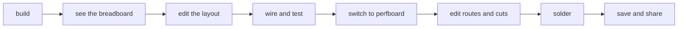
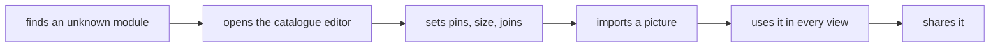

# Jobs and journeys
<!-- Tags as in the brief: E with a pointer, H with its source, D with who and when; an unknown is —. -->

## Who
- The maker, Petr, the PO: builds gadgets from an ESP32 board and the modules in his drawer. He directs Claude and buys from Czech shops · E scrum/VISION.md:44 ("The test bench"), the request in brief.md · n = 1, the decider as a user
- The hobbyist, spark's primary persona: no EDA, at home in a terminal · H scrum/VISION.md:43, the PO's choice. No person outside the project used spark yet
- The agent at the keyboard: reads spark's files and answers, never the source · E scrum/VISION.md:45 · it counts only through the two above

## Jobs
- J1: When my circuit is built [E PR #303], I want to see it on my real board [D-b], so I can wire it from a picture [H the request: "a really nice editor"]
- J2: When I move from the breadboard to a perfboard [D-b], I want the same circuit laid out and routed for that board [E the request: "how making routes works there"], so I can solder it once, right [H]
- J3: When a layout is not how I want it [H], I want to move parts and wires in an editor like Wokwi's [E the request: "wokwi is actually quite a good inspiration"], so I can make it fit my board and my taste [H]
- J4: When a part, module, board or battery is missing or wrong in the catalogue [E the request: "the catalogue editing app"], I want to edit its record with its pins, size and picture [E the request: "what other data"], so I can use it in every view [H]
- J5: When I see a part in a view [H], I want a real picture of it, imported from the web [E the request: "import images from web, sooner or later"], so I can recognise it in my drawer [H]
- J6: When a layout or a catalogue entry is ready [H], I want to save it, load it later and share it [E the request: "saving and loading, sharing"], so I can go on another day or show a friend [H]
- J7: When I look at one circuit [H], I want the same circuit as a schematic, a breadboard, a perfboard and a PCB [E the request: "displaying the schema in different stages"], so I can trust that each stage is the same circuit [H]

## Today they…
- J1 · the sheet's steps and diagram. Since P267, also `breadboard.json`, pasted into wokwi.com by hand, XIAO C6 only · E PR #303
- J2 · nothing in spark. A perfboard layout is made by hand or in another tool · H no perfboard code known, to check in the lenses
- J3 · Wokwi's own editor on the pasted diagram. spark never reads its changes back · E docs/guide/journey.md, "The drawn breadboard"
- J4 · records written by hand in JSON, or by `/spark:research` and `/spark:identify` · E the skills list
- J5 · nothing. spark keeps no part pictures · E the P268 plan council
- J6 · git for the project folder and the person's store for records. No sharing · E P178's open questions
- J7 · the build writes a PCB, a Wokwi diagram and the sheet from one built circuit, each in its own way · E scripts/check_spine.py, scripts/breadboard.py

## Journeys

### The maker — from a built circuit to a soldered perfboard
| step | what they do | evidence | friction or harm | today | open question |
| --- | --- | --- | --- | --- | --- |
| 1 | builds the circuit with `/spark:build` | E PR #303 | — | works | — |
| 2 | looks at the breadboard view | E PR #303 (Wokwi, by pasting) | must paste into a website; XIAO only | partly | P268's SVG in the sheet |
| 3 | moves a part or a wire he does not like | H the request | changes are lost at the next build | not yet | where an edit is saved, and how the build keeps it |
| 4 | wires the breadboard and tests it | E P215 bench (the board flashed) | — | partly | — |
| 5 | switches the view to a perfboard or stripboard | D-b | no perfboard model | not yet | how routes are made (Q2) |
| 6 | edits the routes and cuts | H | — | not yet | — |
| 7 | solders from the perfboard view | H | — | not yet | — |
| 8 | saves and shares the layout | H the request | — | not yet | Q7, with P178 |

### The maker — a part that is not in the catalogue yet
| step | what they do | evidence | friction or harm | today | open question |
| --- | --- | --- | --- | --- | --- |
| 1 | finds a module in his drawer that spark does not know | E scrum/VISION.md:44 | — | partly (`/spark:identify` from a photo) | — |
| 2 | opens it in the catalogue editor | E the request | no editor | not yet | which fields are needed for every view (Q3) |
| 3 | sets its pins, size and joined pins | H | measured by hand | not yet | what can come from a datasheet or Wokwi |
| 4 | imports a picture from the web | E the request | license, kept where | not yet | Q6 |
| 5 | uses it in the breadboard and perfboard views | H | — | not yet | — |
| 6 | shares the record | E the request | — | not yet | Q7, with P178 |

