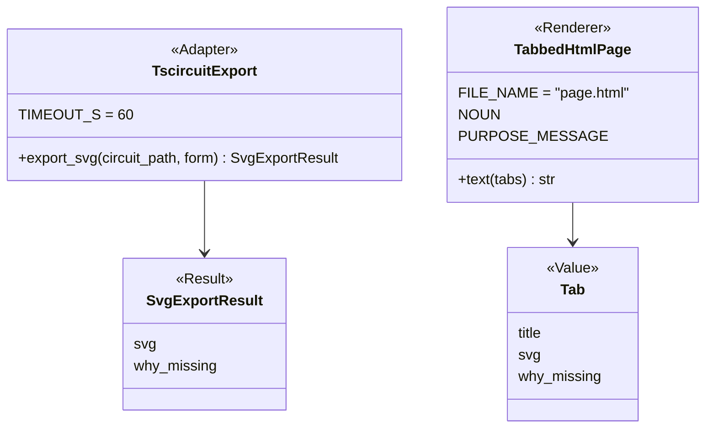
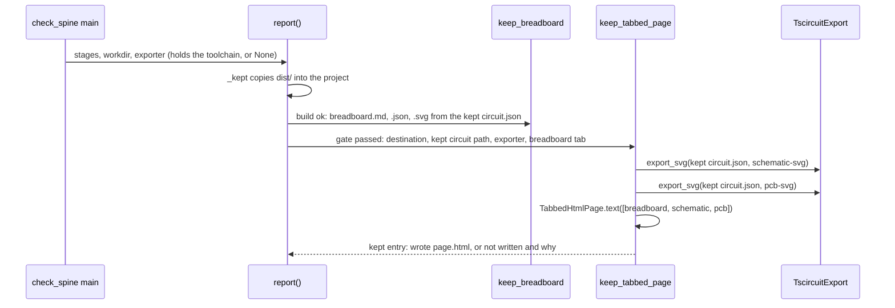

# P269 step 3 (#307): a page on the Mac with the breadboard, schematic and PCB tabs

> TL;DR: after a build that finished, `check_spine.py … --keep .` also writes `page.html` beside `breadboard.md`.
> It is one plain HTML file with three tabs: the breadboard picture (P268's `breadboard.svg`), and tscircuit's
> schematic and PCB from `tsci export` on the same kept `circuit.json`. Each picture sits in its own ``, so
> their styles cannot mix. No framework, no Node build. Two council rounds changed the plan.

## Council

This version is the plan after both council rounds and their fixes. Round 2 found no high gap in round 1's fixes.

- Round 1 (the tech lead and the PO assistant on Sonnet, the refuter on Opus) changed four things:
  - inline SVGs became `` data URIs, because their styles mixed (reproduced in Chrome);
  - step 1 measures a full build, because the fixture exports blank pictures (reproduced);
  - the exporter is injected into `report()`;
  - the stale discovery records are rewritten.
- Round 2 (the PO assistant, the tech lead and a senior engineer, all on Sonnet):
  - the layout check was not feasible as planned, so it became its own card (your D17);
  - one kept `circuit.json` serves all three tabs, behind one gate;
  - it added a mutation table, the temporary-file rule, `SPARK_HOME` inline, the real button-light path,
    "Waits on the PO" and the file name `page.html`.

## Context

P269's discovery set the order (D8): 1 a base, 2 the breadboard picture, 3 a page on the Mac with the breadboard,
schematic and PCB tabs, 4 the same page as an Artifact, 5 editing. Steps 1 and 2 merged (#315, #316). Seeing one
circuit in every stage is the most important job (D9), and the PO said the picture helps him wire (D4).

The done line of #307: "The page opens button-light's layout with all three tabs." Its body and items.md:27 add "One
circuit source checks the layout." The PO's choices, 2026-10-16, AskUserQuestion in this session:

- "Plain HTML now" (offered: plain HTML, TS with Vue, TS without a framework).
- "One source now, check later": all three tabs come from the one kept `circuit.json`. The check that each jumper
  joins the same pins as `circuit.json` needs a new planner field, so it becomes its own card under P269 (round 2,
  the tech lead: the layout holds Wokwi pins and anonymous holes, not circuit pins).

## Design

One word for one thing: the "page" is the file `page.html`, and a "tab" is one picture on it. "View" is not used,
because `WIRING_VIEWS` already means the step renderers (developing.md's role table).

- New module `scripts/tabbed_page.py`, about 110 lines. It imports nothing from `check_spine`.
  - `TscircuitExport` (Adapter) wraps `tsci export <absolute circuit path> -f <form> -o <file>`. The path is always
    absolute, because tsci 0.0.2600 fails on a bare `circuit.json` (round 1, the refuter, reproduced). The output
    goes to a file in a `tempfile.TemporaryDirectory()`, read before the block ends. An empty or missing file is a
    failure, even with exit 0. It has its own `TIMEOUT_S = 60`, not the build's 300. `export_svg` returns
    `SvgExportResult(svg, why_missing)`: no tsci, a timeout, or the exit code and the last stderr line. It never
    raises for a failed export.
  - `Tab` (Value): a namedtuple of the title, the SVG text or None, and why it is missing.
  - `TabbedHtmlPage` (Renderer): `text(tabs)` returns one self-contained page with `<meta charset="utf-8">`. Each
    SVG is an ``, so one SVG's `<style>` and ids cannot reach
    another (round 1: inline, the schematic's `.boundary` rule turned the PCB's black background beige). The tabs
    are CSS only: the radio inputs come before the panels as siblings (`#tab1:checked ~ .panel1`). There is no
    script and nothing loads from the web. A missing tab shows its sentence, escaped. The same tabs give the same
    bytes. It is not in `DRAWING_RENDERERS`, because those render a layout and this renders tabs. It keeps `NOUN`
    and `PURPOSE_MESSAGE` for its kept entry's lines, and its docstring says both.
- `scripts/check_spine.py`, about 30 lines:
  - `keep_tabbed_page(destination, circuit_path, exporter, breadboard_tab)` beside `keep_breadboard`, because both
    are keep steps. It returns one kept entry `{file, did, why, line}`.
  - `report(…, exporter=None)`: the default keeps the second `report()` call (:652) as it is. Under the same guard as
    `keep_breadboard` (:859), `report()` decides the gate. The page is written only when the build finished in this
    run and `_kept` copied `dist/` in this run. Otherwise `_left_from_earlier` removes a `page.html` from an earlier
    build, and the entry says why. So the three tabs read the one kept `circuit.json` that the sheet read.
  - The breadboard tab comes from the kept entry whose `file` is the project's `breadboard.svg` and whose `did` is
    `"wrote"`, matched on those two fields, never on the line text. Otherwise the tab carries that entry's why.
  - `main` builds `TscircuitExport(find_toolchain(…))` and passes it to `report()`.

## Records this PR changes, dated 2026-10-16

- brief.md: D16, in D12's form: "Plain HTML now" · the PO · 2026-10-16 · AskUserQuestion in this session · options:
  plain HTML now, TS and Vue now, TS without a framework. D17: "One source now, check later", with its two options.
  The status of Q5 and Q6 becomes "moved to step 5's plan (D16): step 3 only shows pictures, and step 4 needs no
  library". The status of Q9 becomes "moved to step 5's plan (D16): P199 has no code yet".
- story-map.md S3: "one plain HTML page, each picture in its own ``, no script, as a local page and an
  Artifact, the schematic and PCB from `tsci export`". S2's layout check moves to the new card.
- risks-and-tests.md: A6 gets its result from step 0, with the date and the PO's words. A7 stays open, now "the same
  `page.html` opens as an Artifact", tested in step 4. A10 is measured after the merge, as its row says, counting
  logic and tests apart from docs.
- items.md: step 3's proof as built, step 4's "the same `page.html` opens as an Artifact", and the new card.

## Steps

0. File the card for the layout check first, in Idea, a sub-issue of P269 (#304), with the PO's words (D17). Move
   #307 to Build and comment on it.
1. Measure on a full build, before any code. The test fixture's `circuit.json` keeps only `source_*` elements, so it
   exports blank pictures (round 1). Copy `/Users/petr/Development/button-light` into the scratchpad. In the copy,
   with `SPARK_HOME=~/.local/share/spark` inline on every command, run `tsci export` with an absolute path to
   `dist/board/circuit.json` for `schematic-svg` and `pcb-svg`. Record the seconds per export, the SVG sizes, and
   whether two exports give the same bytes. Show both pictures to the PO. This settles A6. If he finds either
   unreadable, stop and bring him the pictures.
2. `tabbed_page.py`, `tests/test_tabbed_page.py`, and `FakeTscircuitExport` in `tests/fakes.py`. Tests: three tabs
   give one page; no `<svg` is pasted inline; each data URI holds an SVG with `xmlns`; no `http` and no
   `<script>`; a missing tab shows its escaped why; the same tabs give the same bytes; no tsci, a timeout, an empty
   output file and a failed export each give a why. One test runs the real tsci on a small full `circuit.json`
   (copied from button-light into `tests/data/`, if it is under 30 KB, else trimmed), skipped when tsci is missing.
   Nothing calls the module yet, so the build is unchanged after this commit.
3. The wiring in `check_spine.py`, with tests: a build that finished writes `page.html`; a failed build and a
   board-only build remove an earlier one; a `dist/` that `_kept` could not copy removes an earlier one; a sheet
   that was not written gives a breadboard tab with its why.
4. A mutation table `tests/mutations/tabbed_page.json` (round 2): `TIMEOUT_S`, the data-URI prefix, the escape
   call, the empty-output check, and the two gates in `report()`. The fake-based tests must catch each row.
5. Docs: `check_spine.py --help`, `docs/guide/agents.md` (the kept files, 134-145), `commands/build.md` (76-90), the
   README's sheet paragraph (49-52) and the Build row of "What works today", `docs/guide/journey.md#build`, and
   `tools/journey.py`'s picture with `tests/test_journey.py`. Also the records above, and `scrum/STORY_MAP.md` if it
   names S3.
6. Observation rows for both plan rounds and the PR review in `docs/observations/INDEX.md`. After the merge: Miro's
   P269 frame step 3 goes green, the Miro journey board's Build note changes, and #307 moves to Done.

## Waits on the PO

- At step 1: his look at the schematic and PCB (A6). Work stops there if he finds them unreadable.
- The order of the new layout-check card in P269.
- At the end: the PR (a draft while the review runs), then "Ready to merge" and his merge. The lead sets #307's
  "Waiting on" and "Waiting since" fields at each wait.

## Verification

- `python3 -m pytest tests/test_tabbed_page.py tests/test_check_spine.py -q`, then the whole suite through the push
  hook.
- End to end: in the scratchpad copy of button-light, run `SPARK_HOME=~/.local/share/spark python3
  /Users/petr/Development/spark/scripts/check_spine.py requirements.json --keep .`. Open `page.html` in Chrome, click
  the three tabs, and put a screenshot of each in the PR. Done when all three tabs show (#307). A6 is already
  settled at step 1.
- Review sized to the change (logic, about 300 lines with tests): the lenses on the everyday model, the refuter on
  the strongest, and the mutation tester on the table from step 4.
