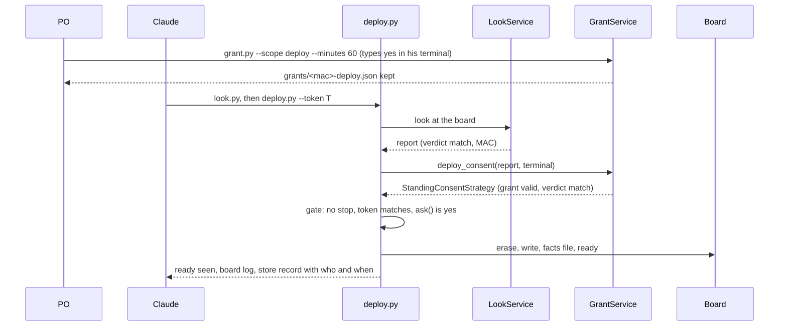

# P218 (#200): finish deploy and the physical board, the council's brief

> TL;DR: six small steps finish P218, after P239 PR 5 (in Build). First P242: Claude deploys to a board the PO
> allowed once, through a deploy-scoped grant that reuses the live grant's record. Then P239 PRs 6 to 8, shrunk to what
> `--json` needs, with the flasher seam that a second platform plugs into. Last P213: `--json` for look and deploy,
> and `/spark:deploy`, proven at the bench by a change and a redeploy that Claude runs. Arduino and the others wait in P286.

## Council

Round 1 (2026-10-17): a PO assistant lens on the journeys, an architecture lens and a platform lens (Sonnet), and a tech
lead's card text checked by the refuter (Opus). Their files are in [council/](council/). This synthesis (Opus) settled
their conflicts below and checked each code claim it uses against origin/main 7554792.

Round 2: to run.

## The use cases

| Case | Today on main | Pain at the bench | Card |
| --- | --- | --- | --- |
| First flash of a passed image | `look.py` gives a token, `deploy.py --token` asks yes, erases, writes, waits for `ready` | Two commands and a copied token | P213 |
| Claude finds deploy | Only a section of `commands/build.md` names it; no `commands/deploy.md`; no `--json` | Claude reads prose | P213 |
| Claude deploys | Every erase waits for a yes typed in the PO's terminal; Claude's shell has none, so it exits 2 | The PO at the bench: "can you run it yourself without the yes?" | P242 |
| Change one line, flash again | Works, but each flash is a look, a token, a yes and a full erase | Slow loop | P242 removes the yes; a faster form is a new card (A) |
| Which board is connected | Works: the look reads chip, flash and MAC, no erase | The port name changes after a flash | Done (P219) |
| Claude tries code live | Works inside a live grant (`live.py`) | One bench run so far | Done (P247, P283) |
| Wrong board | The look stops; the gate refuses | No next step beyond "stop" | P286 |
| Board in download mode | deploy.py asks for R and waits 60 s | The hint text is wrong for some cases (AT313) | New card (C) |
| Arduino, PlatformIO, ESP-IDF | No | Not hit | P221 in P286 |

## The stories, in order

0. **P239 PR 5, `ProjectImage`** (in Build, another agent). Unchanged.
1. **P242 (#249), Claude deploys to a board the PO allowed once.** The PO: *"can't we change it swo that you can run it
   yourself without the yes? to have a ai version ?"* One PR. Done when:
   - the PO types `grant.py --scope deploy --minutes N` once, and then Claude runs `deploy.py --token T` with no yes
     typed for that run;
   - the store's deploy record says `yes: standing yes typed by <login> at <time>, until <time>`;
   - with no deploy grant, an ended one, only a live grant, or a look with a warning or an unknown field, deploy.py
     asks in the terminal as today (exit 2 in Claude's shell);
   - the AT116 re-check and the token still hold; an old grant file with no scope reads as a live grant;
   - one bench run on the XIAO ESP32-C6, and the docs that say the yes is only the person's now name the deploy grant.
2. **P239 PR 6, shrunk: `LookReport`.** `Report` becomes `LookReport` with `to_dict()`, `Look` becomes `LookService`,
   `Reading` becomes `BoardReading`, and `look.lines` moves to `board_look.report_lines`. Done when the suite is green,
   `--help`, exit codes and store records are unchanged, and `deploy.py` imports no script module.
3. **P239 PR 7, the flasher seam.** A `Flasher` base (a Strategy) and `EsptoolFlasher` hold `ERASE`, `WRITE`,
   `IMAGE_OFFSET`, the command build and `BOOT_HINT`. Done when deploy.py holds no esptool text and the suite is green.
4. **P239 PR 8, `DeployService`.** `plan()`, `deploy(token, consent, on_press_reset)` returning `DeployResult`, and
   `verify(port)`. It takes a `FirmwarePlatform` (a Value: flasher, connection factory, ready check), built by
   `FirmwarePlatform.micropython(project)`. Done when `DeployService` has no print and no `sys.exit`, `main` only
   parses, prints and maps the exit code, and the deploy tests give the same lines before and after.
5. **P213 (#192) PR a, `--json`.** `look.py --json` and `deploy.py --json` print `outcomes.envelope`, with the token,
   the verdict, the stops, the board log, the store record and the `yes` in `data`. A step that waits for the person's
   yes carries `needs_yes`. Done when exit codes match the text runs and agents.md lists both as JSON scripts.
6. **P213 PR b, `/spark:deploy` and the bench walk.** The PO: *"Both the AI and humans should be able to use it well,
   find help, have json cli for ai"*. Done when a person or Claude finds deploy under `/spark:`, build.md points to it,
   and at the bench Claude deploys a passed image with a standing yes, the PO changes one line, the scenario passes,
   Claude deploys again, and both board logs show it. This is P192 (c).

P218 is done after step 6.

## The architecture

Today, `deploy.main` runs the whole flow and prints in between (deploy.py:182-270). The grant side does not touch
deploy.

```mermaid
classDiagram
  class deploy_main["deploy.py main()"]
  <<abstract>> ConsentStrategy
  <<Value>> Grant
  Grant : mac board_token granted_by granted_at expires_at
  deploy_main --> Look : look, then Report
  deploy_main --> ConsentStrategy
  deploy_main --> BoardConnection : facts, ready, recovery
  ConsentStrategy <|-- TerminalConsentStrategy
  GrantService --> Grant : GrantStore
  GrantService --> ConsentStrategy
```

Target after step 4. The CLI, `/spark:deploy` and a later MCP tool build `DeployService` and print `DeployResult`.

```mermaid
classDiagram
  DeployService : plan()
  DeployService : deploy(token, consent, on_press_reset) DeployResult
  DeployService : verify(port)
  <<Value>> LookReport
  LookReport : to_dict()
  <<abstract>> ConsentStrategy
  GrantService : check(port)
  GrantService : deploy_consent(report, fallback)
  <<Value>> Grant
  Grant : scope
  <<Value>> FirmwarePlatform
  <<Strategy>> Flasher
  <<Adapter>> BoardConnection
  DeployService --> ProjectImage
  DeployService --> LookService
  LookService --> LookReport
  DeployService --> ConsentStrategy
  DeployService --> FirmwarePlatform
  FirmwarePlatform --> Flasher
  FirmwarePlatform --> BoardConnection
  FirmwarePlatform --> ReadyCheck
  Flasher <|-- EsptoolFlasher
  ConsentStrategy <|-- TerminalConsentStrategy
  ConsentStrategy <|-- StandingConsentStrategy
  GrantService --> StandingConsentStrategy : builds
  GrantService --> Grant
```

An AI deploy with a standing yes (step 1; after step 4 the same calls sit inside `DeployService`):



P242 in code. `Grant` gets `scope`, default `"live"`, because `Grant(**json)` (board_grant.py:98) refuses an unknown
key. A deploy grant is its own file, `grants/<mac>-deploy.json`, so the two yeses do not replace each other. `Grant`
stays a Value with no method (P253's round 2); the expiry check (:147-158) becomes one private `GrantService` method
that `check(port)` and `deploy_consent` share. `deploy_consent` returns a `StandingConsentStrategy` (in board_grant.py,
which imports deploy_gate) only for `report.verdict == "match"` and a valid deploy grant for `report.reading.mac`, else
the terminal one. Deploy finds the grant by the look's MAC, so the USB-serial rule (:125) stays for live grants only.

## Choices the tech lead made (the PO can overrule each)

1. **One grant record, not two.** A deploy grant and a live grant hold the same facts (board, who, when, until), so one
   `Grant` with a `scope` field reuses the store, the check and the tests.
2. **A deploy yes ends, as a live grant does: 1 to 1440 minutes.** An erase is the riskiest act on the board, one rule
   serves every grant, and a bench day fits. A longer yes is a later card if the PO asks.
3. **A standing yes covers only a look with verdict `match`.** A warning or an unknown field was not known when the PO
   said yes, so deploy asks in his terminal for those.
4. **P242 adds `deploy.py` to build.md's `allowed-tools`.** With no grant, Claude's shell has no terminal, so deploy.py
   exits 2 and erases nothing. The grant, not Claude Code's prompt, is the yes.

## The conflicts, settled

- **P239 PRs 6 to 8: keep, shrink PR 6.** The journeys lens wanted them cut to need; the architecture lens kept them.
  PR 8 is what `--json` needs (`main` mixes flow and printing), and PR 7 is the flasher seam the PO asked for. PR 6 keeps
  `LookReport.to_dict()` and the renames on the same lines, which developing.md's table already names. `DeployToken`
  is dropped: the token is parsed in one place (deploy_gate.py:87), and no second caller needs a class.
- **P242 before PRs 6 to 8.** It uses only `ConsentStrategy` from PR 3 and the look's `verdict` and `reading.mac`.
- **Recovery in PR 8: move, do not merge.** The architecture lens built `verify` on `RetryingBoardConnection`. That
  decorator cures a refused raw REPL (board_connection.py:106-125); deploy's recovery waits for the person's R press.
  Two faults, so PR 8 moves the code unchanged, and one recovery path is a new card (D).
- **`FirmwarePlatform` lands in PR 8, as one constructor argument.** It costs one small Value and gives a second
  platform one place to plug in. No abstract connection base until a second adapter exists.
- **`granted_by` stays the login name.** The tech lead wanted `ConsentStrategy.who` there. The standing `who` already
  says "typed by <login>", so the record and the log agree with no change to live grants.
- **The bench walk is P213's done-when**, not a separate story. The re-flash receipt and the no-erase update are cards.

## The platform seam and P221 (#203)

The full change map is [platforms.md](platforms.md). In short: the board facts, the pin numbers, diagram.json, the
scenario YAML, the esptool look, the grant and the `ready` proof stay. The pin map's language (`firmware/pins.py`), the
firmware tree, the image build, the REPL tools and the "import it on the Mac" check assume MicroPython and change.

What P218 builds now: `Flasher` (step 3) and `FirmwarePlatform` (step 4). What waits for P221, named by role:

| Seam | Today | Arduino or PlatformIO |
| --- | --- | --- |
| `Flasher` | esptool erase and write at 0x0 | the same, with a merged image |
| `BoardConnection` | mpremote, raw REPL | serial read only; no live code |
| `ReadyCheck` | file hashes on the board, then `ready` | `ready` on serial only |
| pin map renderer | Python module | `pins.h` |
| firmware layout and build | `main.py`, MicroPython image | `.ino` or `src/main.cpp`, then compile |
| firmware check on the Mac | import with a stand-in `machine` | compile, or a native test |

The rule from now on: no new `mpremote` or `Pin(` text outside the adapter classes and the pin map writer. P221 stays a
spike with three pass lines (Wokwi runs an arduino-cli build; one assign result renders `pins.py` and `pins.h`; esptool
plus serial `ready` proves an Arduino flash). Cost: Arduino medium, PlatformIO medium to large, ESP-IDF large.

## Dropped, and why

`DeployToken` has one caller. A deployer agent adds a layer: `/spark:deploy` and `--json` serve Claude, and deploy
needs the person's hands. Names and blinks for two boards, MicroPython variants and migrate offers are P286; OTA is P235.

## Proposed cards (not filed)

- **A. Known-board re-flash receipt.** Done when one command re-flashes a board the store knows and prints one receipt
  line with the image sha256; any differing field returns to the full gate. Epic: P286.
- **B. Spike: update the files with no erase** (old D20, P222). Done when a finding with sources says whether
  `mpremote cp` plus the facts file keeps the gate's guarantees. Epic: P235.
- **C. Bench hints from the board record.** The BOOT and RESET place in the record (AT158), and the "hold BOOT" hint
  the bench contradicted (AT313). Done when the hint reads the record and the bench run agrees.
- **D. One recovery path.** Done when deploy's download-mode wait and `RetryingBoardConnection` share one cure step.
- **E. `grant.py` and `live.py` in the envelope.** They print their own JSON today (grant.py:49, live.py:64).
