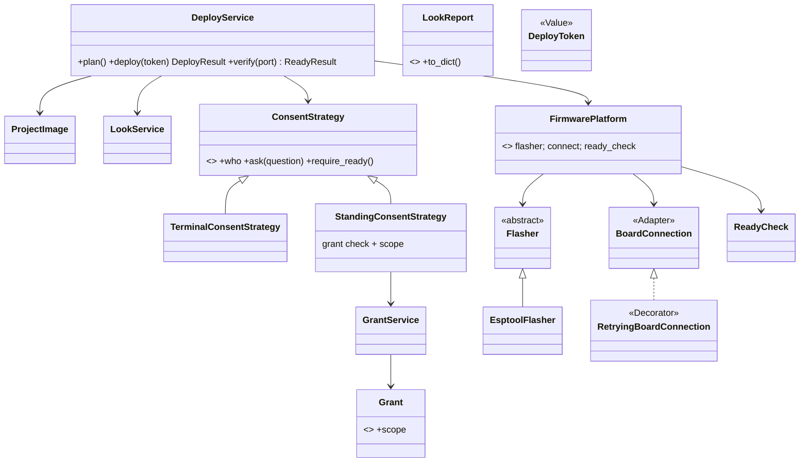

# Architecture lens: P218 deploy area, PRs 5-8, P242, P213 (2026-10-17, main + PR 5 plan)

## 1. Verdict
Synthesis (d)/(e) is still the right target for the deploy flow, with three gaps. (d) was drawn before the grant work, so
it lacks the grant side, the recovery side (probe, download mode, retry) and a platform seam. PRs 6-8 stay, PR 6 shrinks.
P242 needs no PR from 6-8 and can land right after PR 5.

## 2. Class structure today (main)
```
deploy.py main() :182-270  -- 90 lines of flow: plan, look, gate, flash loop, facts, ready, recovery, log, record
  |-- plan() :147 -> DeployPlan --uses--> image_check functions (image_of, untested, tested_another, passed_log)  [PR 5 -> ProjectImage]
  |-- flash_commands() :107 + ERASE/WRITE/IMAGE_OFFSET :50-53  (esptool, inline in deploy.py)
  |-- board_look.looker() -> Look(PortFinder[mpremote devs], EsptoolReader[esptool flash_id]) -> Report (+ token(), exit_code(), status)
  |-- look.lines(report)  (rendering lives in the look.py script)
  |-- deploy_gate: require_open_gate(report, token, consent, image)  ->  ConsentStrategy <- TerminalConsentStrategy
  |-- AT116 token re-check inline deploy.py:220
  |-- BoardConnection[mpremote Adapter] :238  <- FactsFile(connection) / ReadyCheck(connection)
  |-- recovery inline :242-258: ConsoleProbe + download_mode, hand-rolled re-reads (P243-P245)
  |-- write_board_log, board_facts.record_deploy(facts, verdict, consent.who) :263

grant side (separate tree, no link to deploy):
  grant.py main -> GrantService(PortFinder, EsptoolReader, GrantStore) -> Grant record (mac, board_token, granted_by, expires_at)
  live.py main  -> LiveTryService(GrantService.check, BoardConnection, ConsoleProbe, BoardDoctorService)
  GrantService.issue(consent: ConsentStrategy) is the ONLY other user of ConsentStrategy (board_grant.py:113-135)

reach.py / board_reach.py -> RetryingBoardConnection(BoardConnection, ConsoleProbe)   (Decorator, used by reach and live only)
```
Observation: deploy.py:238 uses a bare BoardConnection and re-implements "cure and retry" by hand (:242-258), while
RetryingBoardConnection (board_connection.py:106) already does that for reach. Two recovery paths for one fault.

## 3. Target after PR 8 + P242 + P213

Thin interfaces: deploy.py main, the future /spark:deploy command and an MCP tool all build DeployService and print
DeployResult.to_dict() (P213 `--json`). None repeats flow logic.

## 4. What (d)/(e) miss
1. Recovery (deploy.py:242-258, ConsoleProbe, download_mode) has no box. Put it inside `DeployService.verify(port)` and
   build `verify` on RetryingBoardConnection plus one download-mode step. This removes the duplicate path in section 2
   and is the largest simplification left in deploy.py.
2. Grant side missing (GrantService, Grant, LiveTryService). board_grant imports deploy_gate (board_grant.py:28), so the
   dependency runs grant -> gate. Keep it so.
3. `look.lines` stays in look.py (look.py:37) though (d) moves it to board_look.py. Move it in PR 6, or `deploy.py`
   imports a script module (deploy.py:35) which breaks "main only parses and prints".
4. `put_facts` and `read_board` (deploy.py:137,176) are flow code in module functions. They become `DeployService`
   private steps in PR 8.

## 5. Live grant and P242's standing yes: one record class, two roles
The Grant is the record of a past yes (what, whom, until). ConsentStrategy is the way a yes is given now. They meet in
ONE new subclass, `StandingConsentStrategy(grants: GrantService, port)`, in board_grant.py (not deploy_gate.py, which
board_grant imports; the reverse import is a cycle).
- `ask(question)`: True when `grants.check(port)` is granted for the deploy scope; else GateClosedError.
- `require_ready()`: runs the same check, so deploy stops before it touches the board (the hook the base already has,
  deploy_gate.py:50, used by grant issue at board_grant.py:119).
- `who`: "standing grant by <granted_by> until <expires_at>". record_deploy already writes `who` (board_facts.py:55).
Do not make a second record class. Two gaps need a field, not a class:
- Scope. A live grant says "run code" (board_grant.py:127). It must not allow an erase. Add `scope` to Grant with a
  default ("run"), and issue a deploy grant with scope "deploy". Grant(**json) raises TypeError on an unknown key
  (board_grant.py:98), so a new field needs a default, or old files read as WHY_NOT_A_GRANT.
- Warnings. The gate asks one question that lists warnings (deploy_gate.py:90). A standing yes was given before the
  warnings were known. `ask` takes only the question string today. Pass the accepted warnings as a second argument, and
  StandingConsentStrategy answers False for any, so the person is asked in a terminal for those.
The token and the look stay mandatory with a standing yes. Only the typed yes is replaced.

## 6. The platform seam (MicroPython now)
Where MicroPython knowledge lives today:
| Class or code | MicroPython-specific part |
|---|---|
| BoardConnection (board_connection.py:50-104) | mpremote exec, fs cp, fs cat, reset, repl; raw REPL text (:19); traceback marker (:17) |
| ReadyCheck (ready_check.py:21,61) | HASH_FILES is MicroPython code run on the board; `import main` is the MicroPython boot path |
| FactsFile (board_facts.py:19,48) | writes spark.json to the board's filesystem through the connection |
| deploy.py:50-53,107 | whole-flash image at 0x0 (MicroPython plus firmware in one image), esptool erase and write |
| PortFinder (board_look.py:62) | lists boards with `mpremote devs` |
| LiveTryService, live.py:`--code` | the code string is Python |
| image_of / ProjectImage | sim/wokwi.toml and run_scenario's image build, MicroPython image |
Not platform: EsptoolReader (chip, flash size, MAC are chip facts; Arduino uses esptool too), Grant, ConsentStrategy,
DeployToken, LookReport, ConsoleProbe (a serial read).

The seam: a `FirmwarePlatform` bundle (Value) that hands DeployService three collaborators it already needs:
`flasher` (a Flasher: commands for a chip, image, port), `connect(port)` (a BoardConnection-shaped object) and
`ready_check(connection)` (the ReadyCheck-shaped object). `MicroPythonPlatform` builds today's three. An Arduino adapter
is then a new bundle: a Flasher with its own offsets, a connection that reads serial instead of the REPL, and a
ready check that reads the console. Name it per developing.md:233-241: plain noun `FirmwarePlatform`, docstring
"Value"; the swappable parts are the plain bases `Flasher` and the connection's interface.
Also required, small: name the connection's interface. Today the duck type is implied by tests/fakes.py:4
(`run_code`, `copy_to_board`, `read_file`, `reset`, `repl_command`). `run_code` leaks Python; keep the method list, and
document it as "run MicroPython code" in the MicroPython adapter only when a second platform needs another meaning.
Do not add methods now.

Cut it in PR 7 and PR 8, smallest form:
- PR 7: `Flasher` base plus `EsptoolFlasher`. IMAGE_OFFSET, ERASE and WRITE (deploy.py:50-53) move inside it. This is
  the first real seam and it is already planned.
- PR 8: `DeployService.__init__(self, platform, ...)` takes the bundle, instead of calling tools.find("flasher") and
  BoardConnection(...) itself (deploy.py:162, :238). One constructor argument, one `MicroPythonPlatform.for_project()`
  factory. No new behaviour.
The bundle is not worth a PR of its own, and the abstract connection base is not worth writing before a second adapter.

## 7. PRs 6-8: what stays
- PR 5 (ProjectImage): unchanged. `BOOT_HINT` moving next to the flasher is right (it is esptool's hint), but
  board_look.py:75,126 also uses it; keep one constant, import it from the flasher module.
- PR 6: shrink. Keep `DeployToken` and the AT116 check (deploy.py:220) and `LookReport` as a Value with `to_dict()`
  (P213 needs it). The pure renames (Look to LookService, Reading to BoardReading, Report) alone are not worth a PR:
  fold them into the PR that touches the same lines.
- PR 7: keep, it is the seam. Share one esptool command helper with EsptoolReader (board_look.py:118).
- PR 8: keep, and widen as in section 4 (recovery, put_facts, read_board inside the service). It is the prerequisite for
  P213: `--json` is `DeployResult.to_dict()` and /spark:deploy calls the same service.
- No PR is dropped. If the PO wants one cut, cut PR 6's rename half.
## 8. Order
PR 5 now. P242 (StandingConsentStrategy plus Grant.scope) is independent of 6-8 and uses only ConsentStrategy as built
in PR 3-4, so it can go next. Then PR 6 (shrunk), PR 7, PR 8, then P213. Each step keeps the CLI and exit codes.
