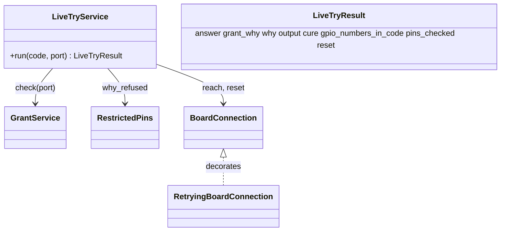

# P247 (#267): the live try, one gated call runs a line on the running board

## Council

Round 1 ran: a tech-lead and architecture lens (Sonnet) and the refuter (Opus, 5 confirmed, 3 plausible). It changed:
one port for the grant check, the run and the cure; the reset after any code that was sent, so a hung loop is reset
too; one `outcome` code per answer with its exit code, in place of three meanings of "reached"; the could-not-run paths
(`LookStop`, `ToolProblem`, `BoardError`, `ValueError`) to exit 2; `pins_checked` as its own field; the service named
`LiveTryService`; the "P247 will" lines in five docs. Round 2 ran: one Sonnet agent as the PO-assistant, tech lead
and senior, no blocker. It changed: `ReachResult` gains `entered`, so the reset rule reads a field and no sentence;
the field is named `answer`, because outcomes.py already owns "outcome" and `COULD_NOT_RUN`; the grant check names
`live.py` in its stop; a reset counts as done when `mpremote reset` exits 0, as all P252 bench resets did; five tests
added; `RESET_NOT_RUN` cut (null). Miro moves to the story's wrap-up, outside the build.

## Context

The PO asked for "just running code live on the device when connected" (#224). P235's discovery picked slice 0,
"Reach and read" (D9): one gated spark command runs a short line on the running board, says reached or not, and resets
at the end. Its parts are merged: the USB cure (P251, `board_reach.reach`), the hard reset pick (P252), the grant
(P253, `GrantService.check`) and the refused pins (P254, `RestrictedPins.why_refused`). P247 joins them into one command
that Claude may call. Done when, on the XIAO C6 with blink-c6, inside a grant, Claude's call runs `print(1)`, says
reached, ends with a hard reset, and answers in `--json` (D15). Fake-run tests cover each answer.

## Shape (one core, a thin CLI)

```
live.py main(): parse, find ONE port (PortFinder.require_one_port, as reach.py:73), print
  LiveTryService.run(code, port)                      scripts/board_live.py
    1 GrantService.check(port, script="live.py")  no contact (mpremote devs)     -> REFUSED_NO_GRANT
    2 RestrictedPins.why_refused      the project's board record                   -> REFUSED_PIN / REFUSED_NO_PARSE
    3 board_reach.reach(conn, probe)  conn and probe built on that same port       -> RAN / RAISED / NOT_REACHED
    4 conn.reset()                    after any code that was sent                 -> reset code
  -> LiveTryResult
```



## Steps

1. `scripts/board_connection.py`: add `BoardConnection.reset()`, which runs `mpremote reset` through `_mpremote`
   with no cure. The USB device can drop during the reset, so the test fakes both a clean exit and a dropped port.
   `RetryingBoardConnection.reset` passes through.
2. `scripts/board_reach.py`: `ReachResult` gains `entered`, False when mpremote never entered the raw REPL (the
   check on `RAW_REPL_REFUSED` that `board_reach` already makes). `reach.py`'s JSON gains the field.
3. `scripts/board_live.py` (new library):
   - `answer` codes, each with its exit from `outcomes.py`: `RAN` (`EXIT_OK`); `RAISED`, `REFUSED_NO_GRANT`,
     `REFUSED_PIN`, `REFUSED_NO_PARSE` (`EXIT_PROBLEMS`, as `grant.py`'s refusals); `NOT_REACHED`
     (`EXIT_COULD_NOT_RUN`). `grant_why` carries the grant's own `WHY_` code. `why` is the sentence, never compared.
   - `reset`: `RESET_DONE` when `mpremote reset` exits 0, `RESET_FAILED` otherwise, null when no reset ran. A failed or
     skipped reset after code was sent adds to `why` that the firmware may be stopped. `RESET_FAILED` makes the exit
     `EXIT_COULD_NOT_RUN`.
   - `LiveTryService(grants, connection, probe, board)`: `run` stops at the first refusal, and a test's fake
     connection fails if it is called then. It passes the bare connection to `reach`, which wraps it, and keeps it for
     `reset`. The reset runs when `entered` is true, so after `RAN`, `RAISED` and a timeout (a `while True`).
   - `pins_checked` is false when `RestrictedPins.has_none()`. `gpio_numbers_in_code` lists the whole numbers in the
     code (`restricted_pins.whole_numbers_in`) that are a GPIO in the record's `pins` or `pin_roles`. It over-claims:
     `print(1)` lists GPIO1, and `--help` says so.
   - `reached` means the board ran the code. An empty answer to `print(1)` still counts, as `board_reach` does. The
     docs say so. Both causes (D11) appear only after a cure whose retry still could not enter the raw REPL, as
     `board_reach.py:43-46` does. A test covers each `NOT_REACHED` wording.
4. `scripts/live.py` (new CLI): `--code` (required), `--project` (default `.`), `--port`, `--json`. The record is
   `boards.load(project)`, the project's board. A known limit, in `--help`: it is not matched against the board on USB.
   The CLI maps `LookStop`, `ToolProblem`, `BoardError` and the record's `ValueError` to `EXIT_COULD_NOT_RUN` with the
   reason on the last line, as `grant.py` does.
5. Tests, fake runs only: `tests/test_board_live.py` (each answer and reset code; the order grant, pins, run; the
   reset after `RAISED` and after a timeout; no reset after a raw-REPL refusal, with a fake that fails if `reset` is
   called; `RESET_FAILED` exits 2 although the code ran; `print(1)` passes on the C6 record while `Pin(12)` is
   refused) and `tests/test_live.py` (the port reaches `connect <port>`; a two-board stop names `live.py`;
   `REFUSED_NO_PARSE` exits 1; a broken record exits 2; the JSON on a refusal and on a run). Then the mutation tester.
6. Docs in the same PR: `live.py` `--help`; `docs/guide/agents.md` (lines 125-129 and the `restricted_pins.py` line:
   Claude may run `live.py` while `grant.py --check` says granted, and the JSON fields); `docs/guide/commands.md`;
   the "P247" lines in `grant.py`'s EPILOG, `board_grant.py:5`, `restricted_pins.py:5` and `reach.py`'s EPILOG;
   the README's Bench row and `tools/journey.py` if the note changes. The Miro journey board and the P235 frame
   follow at the wrap-up.
7. Bench (the PO at the board, which is also the grant's hand check): in `~/Development/blink-c6`, the PO runs
   `grant.py --minutes 30`. Claude runs `live.py --code 'print(1)' --json` (RAN, RESET_DONE, the LED pattern back),
   `live.py --code 'Pin(12)'` (REFUSED_PIN), and one try after the PO deletes the grant (REFUSED_NO_GRANT). The log
   goes to `docs/observations/2026-10-17-p247-live-try-bench.md`.

## Verification

`python3 -m pytest tests/test_board_live.py tests/test_live.py tests/test_journey.py`, the full suite by the push
hook, the mutation tester's count, then the bench log above.

## Delivery

Branch `p247-live-try`, a draft PR, review sized to logic: Sonnet lenses, an Opus refuter, the mutation tester.
Council and review findings become rows in `docs/observations/INDEX.md`. Then ready, the card to Review, the merge is
the PO's.
