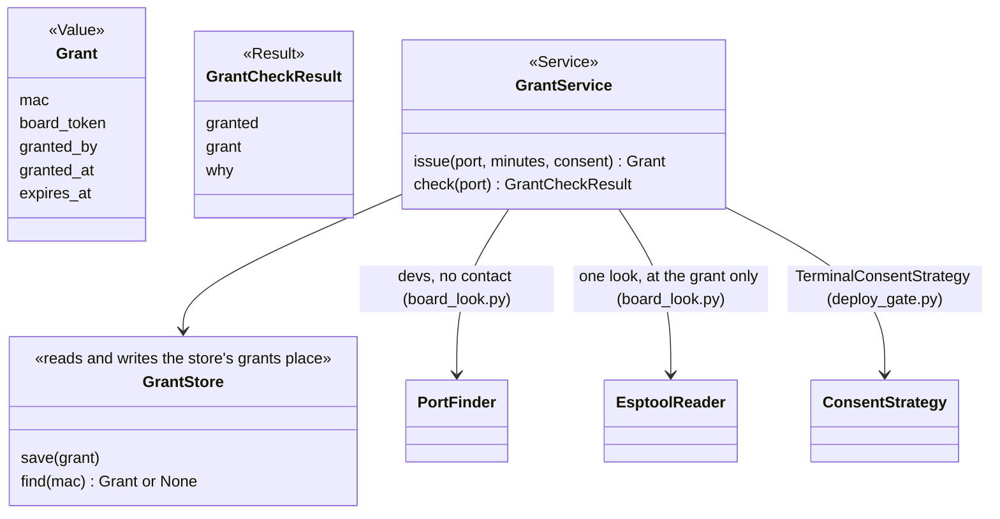
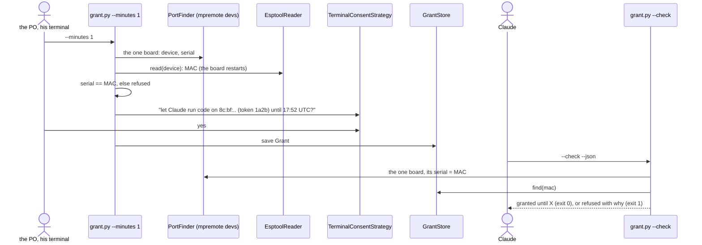

# P253 (#265): the live grant — plan

> TL;DR: a new `grant.py`. `grant.py --minutes N` runs one esptool look, and the PO types yes in his own terminal.
> `grant.py --check` is a later call that finds the grant for the board on USB without touching the board. The grant is
> one small file per board in the store, `grants/<mac>.json`. The logic lives in one library module, `board_grant.py`.
> No code runs on the board yet: P247 (#267) adds the live try behind this grant.

## Council

Two rounds ran before this plan was shown. Every finding below is folded into the steps.

Round 1 (2026-10-16): a tech lead and a PO assistant on Sonnet, the refuter on Opus. What it changed:

- The grant gets its own file, not a list inside the board record. This drops the `BoardRecordFile` refactor, and a
  record made by a grant can no longer break the next deploy (refuter 3, PO assistant 2 and 3).
- At the grant, the USB serial from `mpremote devs` must equal the MAC that esptool read, or the grant is refused. This
  re-checks "the serial is the MAC" on every grant, and it stops a grant that `--check` could never match: a bridge-chip
  board, or esptool's 8-byte `MAC:` fallback line (refuter 1 and 2).
- Exit codes follow outcomes.py: 1 refused, 2 could not run (refuter 4).
- The script is `grant.py`, not `live.py`, because P242 reuses the grant. The `kind` field, `--end` and the
  `board_token` refactor are out. Records grow by need (PO assistant 4 and 5).
- The times are UTC with a zone. A stored time with no zone is refused, never compared (tech lead 5, refuter 8).
- `--check` finds the one board as a `Port` row (device and serial), and `--port` picks one row of two (tech lead 2).
- Written down as a risk the PO accepts: Claude can write the store file, as with every store record (refuter 5).
- Rejected: "the serial has no colons" (tech lead 1). The bench (p228/01-host.txt:12) and the store record both show
  `8c:bf:ea:..` in lower case with colons. The compare still lowers the case.

Round 2 (2026-10-16): a tech lead, a PO assistant and a senior developer, all on Sonnet. What it changed:

- Roles fixed per developing.md: `Grant` is a plain Value with no method, and the expiry check moves into
  `GrantService`. `GrantStore`'s docstring says it reads and writes the store's grants place. The role table names no
  role for this yet, the same gap the discovery's sketch marked "to settle" (tech lead 1).
- One name for the refusal: `WHY_*` constants, one `why` field, and a `MESSAGE_FOR` map, as in needs.py (tech lead 2).
- `grant.py` catches `GateClosedError`, `LookStop` and `tools.ToolProblem` and maps them to exit codes. It passes its
  own command line to `TerminalConsentStrategy` (tech lead 3).
- One `board_token(mac)` function in board_look.py, used by `Report.token` and the grant, so the two cannot drift
  (tech lead 4).
- `require_one_board` filters `devs` rows by device when `--port` is given, and keeps `require_one_port`'s pinned
  messages (tech lead 6, senior 3).
- Docs pinned: `grant.py` in docs/guide/agents.md and docs/guide/how-it-works.md (test_orphans needs a mention).
  There is no command page, because commands/ holds only the `/spark:*` commands (senior 2, PO assistant 4).
- The tests write the codes and sentences as literals and read no `board_grant` constant (test_self_confirmation), and
  compare codes, not sentences (test_no_magic_strings) (senior 1).
- To end a grant early, the PO deletes `grants/<mac>.json`. The help text and agents.md say so, with no new code
  (PO assistant 3).
- `--project` stays, with its reason: like reach.py, a project's tools list can name its own mpremote or esptool
  (PO assistant 2).

## Context

The PO's decisions in P235's discovery (docs/discovery/2026-10-15-p235-live-on-board/brief.md): D12 "One grant, P242
reuses it": he types one yes in his terminal for a board and a time limit, the store keeps a grant record, and Claude's
tries check it. D13 "Once, at the grant": one look at the grant, the yes binds to that board, and tries do no new look.
Today Claude cannot run a live try, because the only yes is the deploy gate's terminal question
(scripts/deploy_gate.py). The card's proof: the PO types the grant command, one look runs, he types yes, and the store
keeps the grant. A later call inside the time limit finds it, and one after it is refused. Fake-run tests cover
expired, other board and no grant.

## Design

How a later call knows the board without a look: `mpremote devs` lists each board with its USB serial. On the
ESP32-C6's built-in USB-Serial/JTAG (303a:1001), the serial is the base MAC (bench P228,
docs/discovery/2026-10-13-p218-deploy-and-board/bench/p228-xiao-read.md:20). `devs` never opens the port, so the
gadget keeps running. The grant command checks this fact on each grant. A board whose serial is not its MAC gets no
grant, and the sentence says why. This makes the grant C6-native-USB only for now, and the docs say so.

The board token is the board half of look's token (4 hex of sha256 of the MAC). The question shows it and the grant
keeps it as a fact. `--check` compares only the MAC, because D13 allows no new look and the token comes from the MAC.

## Steps (one PR, branch p253-live-grant)

1. `scripts/store.py`: a new place `"grants": "grants"`, private (in `PRIVATE`). One file per board, named by
   `store.slug(mac.lower())`, written with `store.write_json` under `store.locked()`. A new grant replaces the old
   one. One `tests/test_store.py` case: the file is 0600.
2. `scripts/board_look.py`: `board_token(mac)` (4 hex of sha256), which `Report.token` now calls.
   `PortFinder.require_one_board(script, port=None)` returns the `Port` row. With `port`, it picks that row from
   `boards()`, or raises `LookStop` when the port is not listed. `require_one_port` becomes
   `return self.require_one_board(script).device`, so its pinned messages stay.
3. `scripts/board_grant.py`, library: `Grant` (a namedtuple), `GrantStore`, `GrantCheckResult`, `GrantService` (an
   injected `now` callable that returns an aware UTC time, plus `PortFinder` and `EsptoolReader`). The refusals are
   `WHY_*` constants with a `MESSAGE_FOR` map (P260): no board, two boards without `--port`, port not listed, serial
   not the MAC, no MAC read, no grant, expired, time with no zone, minutes not 1 or more, answered no. A stored time
   with no zone is refused before any compare. A grant ends when `now >= expires_at`.
4. `scripts/grant.py`, CLI only, shaped like reach.py: `main(argv, run, consent=None, now=None)`. `--minutes N`
   issues a grant, `--check` reads it. Also `--port`, `--project` (a project's tools list can name its own mpremote or
   esptool, as in reach.py) and `--json` (for `--check` only). It prints "the board restarts while it is read" before
   the look, and passes its own command line to `TerminalConsentStrategy`. It catches `GateClosedError`, `LookStop`
   and `tools.ToolProblem`. Exit 0 granted, 1 refused, 2 could not run.
5. Tests, all fake runs (`FakeConsent` from tests/fakes.py, the `done` and `found` helpers of tests/test_board_look.py,
   an injected `now`), in `tests/test_board_grant.py`, with codes and sentences written as literals: grant saved with
   the right UTC expiry, check inside the limit, expiry exactly at now, expired, other board, no grant, serial not the
   MAC, no MAC read (nothing saved), no terminal, answered no, `--minutes 0` refused, two boards with and without
   `--port`, port not listed, a stored time with no zone refused. `tests/test_json_contracts.py` gains the
   `--check --json` shape.
6. Docs in the same PR: the `--help` epilog; docs/guide/agents.md, beside `look.py` (Claude may run `--check`, never
   the grant itself; the grant is C6-native-USB only; deleting `grants/<mac>.json` ends a grant; Claude can write the
   store file, and the PO accepts this; D24's rule on `reach.py` is untouched, because P247 adds the gating);
   docs/guide/how-it-works.md, beside `look.py`; the journey guide's live step says "grant only, no try yet". No
   command page, because commands/ holds only the `/spark:*` commands. README "What works today" and
   `tools/journey.py` stay as they are, because no step changes status. `tests/test_journey.py`, `test_orphans.py` and
   `test_docs.py` must stay green. Observation rows for both council rounds and the review in
   docs/observations/INDEX.md.
7. Review sized to the change (logic, about 300 lines): lenses on Sonnet, the refuter on Opus, the mutation tester.
   Then the PR is ready, #265 moves to Review, and it waits on the PO.

## Open for the PO, on the PR (defaults taken so the work goes on)

- No cap on `--minutes` (no D names one). Default: required, a whole number of 1 or more, no cap.
- No `--end` to stop a grant early. Default: out, because the card does not name it. Deleting the grant file ends
  it. A command for it can be a small card.

## Verification

- `python3 -m pytest tests/test_board_grant.py tests/test_board_look.py tests/test_json_contracts.py tests/test_store.py`,
  then the push hook runs the whole suite.
- By hand, with the XIAO C6 on its own USB: Claude runs `SPARK_HOME=~/.local/share/spark scripts/grant.py --check
  --json` (no grant: exit 1). The PO runs `SPARK_HOME=~/.local/share/spark scripts/grant.py --minutes 1` in his own
  terminal and types yes. Claude runs the check again with the same `SPARK_HOME` (granted, exit 0), and once more
  after the minute (expired, exit 1). This step waits on the PO and is noted on the PR.
