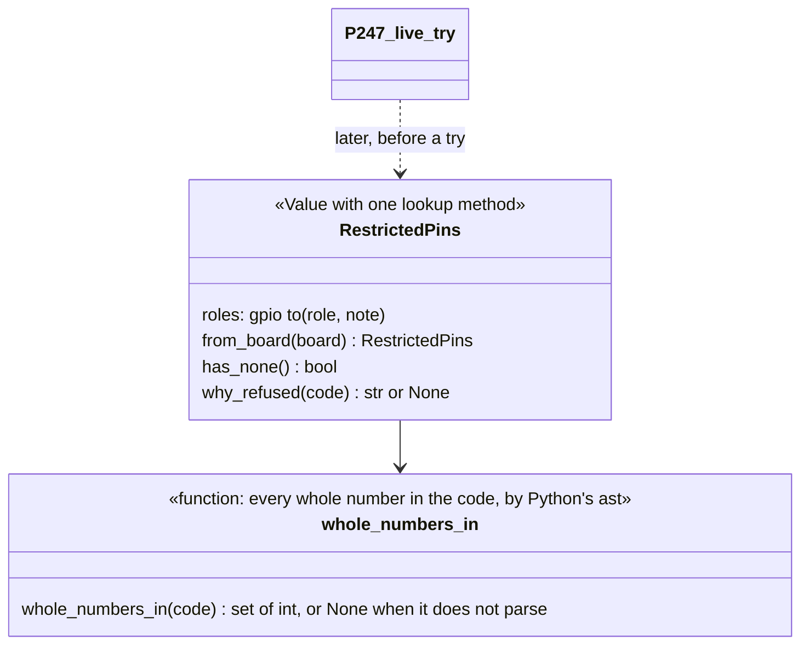

# P254 (#266): the C6's USB and flash pins, and code that names one is refused — plan

> TL;DR: the XIAO C6 record gains two pin roles, `usb` (GPIO12, GPIO13) and `flash` (GPIO24 to GPIO30), each with a
> note that cites Espressif by URL, version and page. A small library class, `RestrictedPins`, reads them from a board
> record and refuses code that writes one of those numbers anywhere, read with Python's own parser. P247 (#267) calls
> it before a live try. No try runs yet, so no command changes.

## Council

Two rounds ran before this plan was shown. Every finding below is folded into the steps.

Round 1 (2026-10-17): a tech lead and a PO assistant on Sonnet, the refuter on Opus. What it changed:

- The name is `RestrictedPins` in `restricted_pins.py`, the discovery sketch's name that P247's card uses. The draft's
  `ProtectedPins` was a second word for the same thing (tech lead 1).
- The check reads the code with Python's `ast` parser and refuses any whole number in it that is a restricted pin:
  `Pin(12)`, `USB = 12; Pin(USB)`, `P(12)` after an alias, `Pin(0x0C)` and `UART(1, tx=12)` are all refused. Code that
  does not parse is refused too. A text match on `Pin(` missed all of these (refuter 4, tech lead 2).
- It refuses too much on purpose: `time.sleep(12)` is refused, and the sentence says which number and why. Refusing
  too much is the safe direction. This is a default for the PO on the PR (PO assistant 3).
- The draft wrongly called the run-time limit "accepted by D20". It is open (the card's H). This plan decides it, as a
  default for the PO: a number computed at run time, such as `Pin(6 * 2)`, passes, and a test pins that limit
  (refuter 5).
- The notes set the source standard instead of copying the `strapping` note, which has no page: URL, printed version,
  page and sha256 for the kept datasheet, and the URL with the read date for the ESP-IDF page. A test makes sure the
  refusal sentence holds "v1.5" and "page 23" (PO assistant 2, refuter 7).
- The card's proof is half met here: code is refused, and the refused try comes with P247. P247's card gets a comment
  that its proof includes this refusal (PO assistant 1, refuter 6).
- Out of scope, named: the FireBeetle S3 record gets no `usb` or `flash` roles, so it refuses nothing. `RestrictedPins`
  says when a record names no restricted pin, so P247 can tell the person the check had nothing to check against. A
  card is proposed for the S3 roles (tech lead 3, refuter 8).
- Rejected: "the datasheet citations are wrong", "the bench board is not QFN32", "the new roles change assignments"
  (all checked by the refuter: the sha256, the version, the pages and the 99 tests hold).

Round 2 (2026-10-17): a tech lead with a senior developer's lens, and a PO assistant, both on Sonnet. What it changed:

- Names: `whole_numbers_in(code)`, because CPython's `ast` reads it and nothing in it knows MicroPython. "Restricted" is
  for the pins and "refused" for the verdict. `names_none()` becomes `has_none()`. The docstring says
  `RestrictedPins` is a Value with one lookup method (tech lead 3; the role row itself is P255's job, the next card).
- The cost of refusing too much is written down: I2C addresses 0x18 to 0x1E (24 to 30), `range(24)` and
  `sleep_ms(25)` are refused too. The sentence says "any number, not only a pin", and the narrower option (only
  numbers given to a call) is named for the PO (tech lead 2, PO assistant 2).
- The run-time limit is a stated limit, not a choice, so it leaves "Open for the PO" (PO assistant 3).
- The tests write `("usb", "flash")` as a literal, and the sentences are constants that the tests match by substring
  (tech lead 1 and 5). Parser cases added: `const(12)`, a viper annotation, `Pin(-12)` refused, `"GPIO12"` in a string
  passes (tech lead 6).
- how-it-works.md calls it a library that P247 will call, so the docs do not claim it runs today (tech lead 4).

## Context

D14, the PO, 2026-10-15: "Record them, refuse them". Free `exec` in a live try (D29) could drive GPIO12 and GPIO13,
the USB D- and D+ that carry the session's own port, or GPIO24 to GPIO30, the flash (brief.md ★C7). The record has no
role for them today. The card's proof: boards/xiao-esp32-c6.json gains the pins with role and Espressif source; a try
whose code names one is refused with the pin, its role and its source.

## The facts (read 2026-10-17, checked by round 1's refuter)

- The bench XIAO is an ESP32-C6FH4 (QFN32) with 4 MB flash inside (bench p228/03-esptool.txt:9-10).
- ESP32-C6 Series Datasheet v1.5, kept in the store, sha256 372a5b42b2900c83ef4309149c8835e9ae2d1be19244995bf2fb83af4dc5edf1,
  https://documentation.espressif.com/esp32-c6_datasheet_en.pdf. Page 23, Table 2-9: GPIO12 is USB_D-, GPIO13 is
  USB_D+. Page 24, section 2.3.4: USB_D+/- are "by default, connected to the USB Serial/JTAG Controller". Page 32,
  section 2.6: on chips with in-package flash, the flash pins "are not routed out", and "Do not use the pins connected
  to flash for any other purposes".
- ESP-IDF GPIO page for the C6, read 2026-10-17 (https://docs.espressif.com/projects/esp-idf/en/latest/esp32c6/api-reference/peripherals/gpio.html):
  GPIO12 and GPIO13 are used by USB-JTAG, which is disabled if they become normal GPIOs. GPIO24 to GPIO30 are "usually
  used for SPI flash and not recommended for other uses".

## Design

- `scripts/boards.py`: `PIN_ROLES` gains `"usb"` ("the chip's own USB D- and D+: driving one drops the USB port that
  the session talks through") and `"flash"` ("wired to the flash that holds the firmware: driving one can stop the
  chip"). The comment says they are read by restricted_pins.py.
- `boards/xiao-esp32-c6.json`: `pin_roles.usb` `{gpio: [12, 13], note}` and `pin_roles.flash`
  `{gpio: [24, 25, 26, 27, 28, 29, 30], note}`. Each note starts with the warning, then the sources. Neither range is
  on the XIAO's header, so `assign_pins` is unchanged.
- `scripts/restricted_pins.py`, library: `REFUSED_ROLES = ("usb", "flash")`. `whole_numbers_in(code)` walks
  `ast.parse(code)` and returns every int constant (not a bool; `-12` counts as 12), or None on a SyntaxError. `why_refused(code)` returns
  None, or one sentence: for a parse failure, "the code does not parse as Python, so spark cannot tell which pins it
  names"; else for the lowest restricted number, "it writes the number 12 (any number, not only a pin), and GPIO12 is
  this board's usb pin: <note>". Both sentences are named constants.
- No CLI. P247 calls `RestrictedPins.from_board(record).why_refused(code)` before it runs anything.

## Steps (one PR, branch p254-restricted-pins, from main)

1. The two roles in `PIN_ROLES` and the record's two `pin_roles` entries. `tests/test_self_confirmation.py`'s
   `boards.PIN_ROLES` entry and `tests/test_boards.py` stay green, with one new case: every name in `REFUSED_ROLES` is
   in `boards.PIN_ROLES`.
2. `scripts/restricted_pins.py` and `tests/test_restricted_pins.py`, expectations written as literals (the roles as
   `("usb", "flash")`, the sentences matched by substring): GPIO12, 13, 24
   and 30 refused; the alias, the named constant, hex and `tx=12` forms refused; `Pin(15)` and `Pin(2)` pass; `Pin(1)`
   and `Pin(120)` pass; `time.sleep(12)` refused (pinned over-refusal); `Pin(6 * 2)` passes (pinned run-time limit);
   code that does not parse is refused; `const(12)` and `Pin(-12)` refused, a viper annotation parses, `"GPIO12"` in
   a string passes; the sentence holds "v1.5" and "page 23"; a board with no such roles says `has_none()` and refuses
   nothing.
3. Docs: docs/guide/how-it-works.md (restricted_pins.py beside board_grant.py, a library P247 will call), docs/guide/agents.md (the live try
   will refuse code that writes a USB or flash pin number; P247 wires it; the S3 record has none yet). README and
   `tools/journey.py` stay as they are, because no step changes status. A comment on P247 (#267) and a proposed card
   for the S3 roles.
4. Review sized to the change: one lens on Sonnet, the refuter on Opus, the mutation tester. Rows in INDEX.md.

## Open for the PO, on the PR (defaults taken so the work goes on)

- Over-refusal: any restricted number anywhere in the code is refused: `time.sleep(12)`, `range(24)` and an I2C
  address such as 0x1C (28) too. The narrower option: refuse only numbers given to a call (`Pin(12)`, `tx=12`), which
  still refuses `sleep(12)` but not `USB = 12`.

A stated limit, not a choice: a number computed at run time, such as `Pin(6 * 2)`, passes. agents.md says so.

## Verification

- `python3 -m unittest tests.test_restricted_pins tests.test_boards tests.test_assign_pins tests.test_self_confirmation`,
  then the push hook runs the whole suite.
- `python3 scripts/boards.py --validate` (or the record check the tests use) passes with the new roles.
