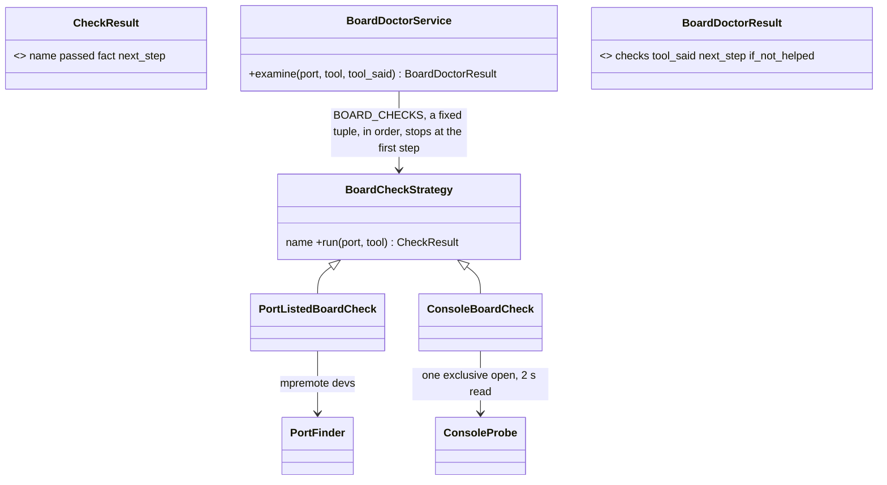

# P282 (#326): the scripts troubleshoot a board that does not answer

## Council

Replanned after research (the PO, 2026-10-17: "research what the options and the best way to go is ... do the
architecture well", "the various scripts and tools should be configurable"). The earlier draft's two rounds still
hold here: no cure or retry on esptool's path, one step per code, the doctor only when mpremote never got in, Service
and Value names, no decision on English text. Round 1 on this plan ran: an architecture lens (Sonnet) and the refuter
(Opus: 3 CONFIRMED, 4 PLAUSIBLE). It changed: one console check with an exclusive open (the plain open passed while
mpremote held the port, CONFIRMED); a boot heard after the open is said as "the open restarted it, run again",
because the open itself can restart the C6 (P251, P238); the next steps cite their source, and the guessed links
(BOOT then a replug with BOOT held, a reflash) are cut; the silent step sits on each tool's own entry in
`data/tools.json`, so the three layers configure it with no new key; the check order is a fixed tuple, and
`doctor.py` waits for a need; two research sentences corrected. Round 2 ran: the PO assistant, tech lead and senior in one agent (Sonnet), no blocker. It changed: the download-mode
row cites P236's bench (AT157); `hold-boot` cites p238 finding.md:52 (n = 1); the research file is written first;
`BoardCheckStrategy`, and both results are namedtuples with a Result docstring; step 1 lists every caller of the
console read and the fake; `silent_step` stays configurable (the PO's ask) but takes only a named code, validated;
the probe's exit codes are named constants.

## Context

At P247's bench (2026-10-17, blink-c6, XIAO C6 on `/dev/cu.usbmodem1101`), `grant.py --minutes 30` said only "could
not read the board ... hold BOOT ...". Claude troubleshot by hand: `mpremote devs` listed the board with its MAC,
esptool's hidden reason was "No serial data received", and `reach.py`'s cure heard nothing. The PO: "this should be
the scripts job", one class for both tools, the scripts give facts and one next step, the agent orchestrates, the
person does hands. Done when the scripts say what Claude found by hand and one next step, proven at P247's bench on
the same board and by fake-run tests.

## What the research found (sources in docs/discovery/2026-10-17-p282-troubleshoot/research.md)

- esptool 5.5.0 picks its USB-JTAG reset on PID 0x1001 (loader.py:850), and P238's bench (15 of 15) backs that a
  spark cure before esptool adds nothing. esptool has no machine-readable error kind (a fatal error exits 2, a pyserial
  error exits 1). So spark shows esptool's first `ERROR: ` line as a fact and never decides on it.
- Espressif's pages tie manual download mode (hold BOOT, press RESET) to a board that disappears; for a listed board
  with "No serial data received" they name wiring, power and reset. So "hold BOOT" here is a bench step (P238 round
  2, n = 1), cited as one. In light sleep a listed C6 is unresponsive, and a replug cures it (esp-idf guide).
- mpremote documents no failure modes. "Press R" and the replug come from the bench (P235: 7 of 10 replugs reached).
- mpremote and esptool open the port with an exclusive lock (mpremote transport_serial.py:52); spark's console read
  does not, so it cannot see a held port today.
- Doctor tools (`flutter doctor`, `brew doctor`): named checks, each with a status and one fix line.
- spark configures tools in three layers (`data/tools.json`, the person's store, `.spark/tools.json`); a tool entry
  merges field by field, so a new field on esptool's or mpremote's entry is configurable with no new code.

## Who does what (the PO picked this split)

```
person ── hands and the yes                           ▲ one next step, in words
agent (Claude) ── runs a script, reads `next_step`, tells the person, waits, runs again; when the same
                  code comes back after the step was done, it gives the code's `if_not_helped` step
skill ── later: the written order of a journey
scripts ── the doctor: named checks in order, facts, ONE next-step code and its if_not_helped code; never waits
```

## Architecture



```mermaid
sequenceDiagram
  participant S as grant.py / look.py / reach.py / live.py
  participant D as BoardDoctorService
  S->>S: esptool failed, or mpremote never got in (RAW_REPL_REFUSED)
  S->>D: examine(port, the tool, its own ERROR line)
  D->>D: PortListedBoardCheck, then ConsoleBoardCheck
  D-->>S: facts, next_step, if_not_helped (codes)
  S-->>S: prints them; reach and live --json carry them
```

The console check's outcomes, decided on codes from the probe (a new exit code each), never on pyserial's words:

| what the open saw | next step | source |
| --- | --- | --- |
| the port is not listed | `NEXT_PLUG_IN` | board_look's own stop (P218) |
| the exclusive open failed | `NEXT_CLOSE_OTHER` | mpremote and esptool lock the port |
| `waiting for download` | `NEXT_PRESS_RESET` | P236 bench (AT157) |
| a boot heard (the open restarted it) | `NEXT_RUN_AGAIN` | P251 cure, AT187 |
| nothing | the tool's `silent_step`: esptool `NEXT_HOLD_BOOT`, mpremote `NEXT_PRESS_RESET` | p238 finding.md:52 (n = 1); P251/P252 bench |

`IF_NOT_HELPED`, only where a source backs it: `NEXT_PRESS_RESET` → `NEXT_REPLUG` (P235: 7 of 10 replugs reached;
the esp-idf guide's light-sleep cure). Every other code has none, and the sentence says so. No step erases or
reflashes. Each code has one sentence in `MESSAGE_FOR`, with its source in a comment.

Configuration: `data/tools.json`'s esptool and mpremote entries gain `"silent_step"`, one of the named step codes
(`hold_boot`, `press_reset`), validated against `board_doctor.STEP_CODES`. A person or a project changes it in its own layer, or gives it to a tool of their own with
`tools.py --new`. An unknown value is a could-not-run that names it. The check order is a fixed tuple until a case
needs another.

## Steps

0. `docs/discovery/2026-10-17-p282-troubleshoot/research.md`: the research with its URLs, versions and the refuter's
   corrections, before any code.
1. `board_console.py`: the console read opens the port with `exclusive=True` (the cure's open too) and exits with
   named codes (`EXIT_PORT_BUSY`, `EXIT_PORT_UNOPENED`) when the lock or the open fails. `ConsoleProbe.console()`
   returns a `ConsoleReadResult` (a namedtuple: kind `read`, `busy` or `unopened`, what it printed, why) in place of
   `(printed, why)`. Its callers follow: `waits_in_download_mode` (board_console.py:118), `cure()` (it keeps its own
   Cure), deploy.py; `tests/fakes.py`'s `FakeConsoleProbe` gains a console kind. `board_look.py`:
   `LookStop` gains `port` and `tool_said` constructor arguments (default None); `EsptoolReader`'s carries both (the first stderr line that starts with `ERROR: `).
2. `scripts/board_doctor.py` (new library): `BoardCheckStrategy`, the two checks, `BOARD_CHECKS`, `CheckResult`,
   `BoardDoctorService`, `BoardDoctorResult`, the codes, `STEP_CODES`, `MESSAGE_FOR`, `IF_NOT_HELPED` (one entry), each source in a comment.
3. `data/tools.json`: `silent_step` on esptool and mpremote; `BoardDoctorService` reads it from `tools.find`'s entry.
4. Callers: look.py and grant.py on a `LookStop` with `tool_said`; reach.py and live.py when `entered` is False. One
   call each, then print. `ReachResult` and `LiveTryResult` gain `doctor` (its dict or null). deploy.py stays.
5. Tests, fake runs: each row of the table; the exclusive open (a held port is busy); no step from a timeout after
   the code started; a project layer that changes `silent_step`; an unknown `silent_step`; esptool's real stderr shape;
   a doctor result is never a pass; each caller prints it; the JSON field. The mutation tester.
6. Docs: each `--help`; `docs/guide/agents.md` (the codes, `if_not_helped`, the agent's loop, that the console check
   may restart the board, and that a doctor result is never a pass); one line each in the journey
   guide and how-it-works.
7. Bench: blink-c6 as it is (silent): `grant.py --minutes 30` prints the doctor's facts and step; the PO follows it
   until the grant is given; then P247's three tries. Log: `docs/observations/2026-10-17-p282-p247-bench.md`.

## Verification

`python3 -m unittest` on the touched tests, the push hook's full suite, the mutation count, the bench log.

## Delivery

Branch `p282-troubleshoot` from `p247-live-try`, its own PR (a draft while reviewed), retargeted to main after #325
merges. Review: Sonnet lenses, an Opus refuter, the mutation tester. Rows in `docs/observations/INDEX.md`.
