# One ordered backlog: spark's whole loop, first working, then nice

Council synthesis, 2026-10-18. The PO's words are on [P100, #6](https://github.com/xmejkal/spark/issues/6): "I just say
something like, 'Well, I want an RC car,' and together we put it together nicely ... I plug it in. It also builds. If
the simulation works, then it builds the real board, deploys it, and/or the serial works. We can also go back and edit
the schema, and then everything rebuilds."

> **TL;DR.** The MVP is one walk of **button + LED on the XIAO ESP32-C6**: words, parts, build, firmware, simulation,
> wiring, deploy, a lit LED, then "add a second LED" and a second deploy. **Five items** stand before the MVP line:
> the shipped XIAO record builds, steps name their holes, a rebuild says what to change on the bench, the first deploy
> connect retries, and walk 1 itself with plain `deploy.py`. After the line come `/spark:deploy` and Claude's missing
> `--json` calls, change by words, the buzzer through research, the page (its shape is set by spike P297), the live
> view, the RC car and project variants.

## Council

- **Round 1** (all Opus): PO assistant, architecture, UX and AI-UX lenses, then the refuter. Files: `council/`.
- **The refuter changed:** the XIAO item copies five facts, not one (each removal fails the build). Its done-when no
  longer asks to clear the "no serial monitor" warning, which comes from the converter's own Wokwi pin list
  (`converter.mjs:6797`). A XIAO scenario passed on 2026-10-14, so the warning does not block. The buzzer by words is
  L, not S. It settled the disputes: LED, an added part (no swap), holes before the walk, walk with plain `deploy.py`.
- **Round 2** (Opus): tech lead and PO assistant. They changed: walk 1 no longer waits for `/spark:deploy` (it was
  item 6, now split into 5 and 7). Walk 1 now names `/spark:init`, the firmware, the scenario and the journey update.
  Item 1 uses the real command, and its scenario moved to the walk. Item 3 is M. Item 2 is holes only. The records'
  disagreements folded into item 1. Dependencies loosened: change by words (14) runs on today's core, without P297;
  the jumper check (8) and the live view (19) need no drag. Added: a page style Claude changes by words (17), Czech
  shop buy lines (21), the Artifact republish in item 16, a test for every `--json` (11). Terms fixed (below). Titles
  say the problem, then the fix. The choices became bench questions.
- **The PO's inputs during the council:** AI-first for the whole application; one TypeScript front end; the
  interaction architecture is spike P297 (#360), so the page items are stated by outcome only.

Terms: **sheet** is `breadboard.md`, **page** is `page.html`, **board log** is the file under `sim/runs/board/`,
**console read** is item 9's live read, **look token** is look's one-time token, **Wokwi token** is the simulator
account key, **envelope** is the JSON form `parts.py` already prints (agents.md), **stand-in simulator** is P295's
offline runner on spark's `machine` stand-in.

## The loop today

```mermaid
flowchart LR
  A[0 set up: init, setup, Wokwi token]:::partly --> B[1 goal in words: /spark:idea]:::partly
  B --> C[2 parts: drawer, match, research]:::partly
  C --> D[3 requirements file]:::works
  D --> E[4 build --keep, sheet, page]:::partly
  E --> F[5 firmware + checks]:::partly
  F --> G[6 simulate: wokwi-cli]:::works
  G --> H[7a wire the breadboard]:::missing
  H --> I[7b look + deploy]:::works
  I --> J[7c console, live]:::partly
  J --> K[8 change by words, rebuild]:::partly
  K --> E
  classDef works fill:#cfe8cf,stroke:#2e7d32
  classDef partly fill:#fff1c2,stroke:#b8860b
  classDef missing fill:#f6c9c9,stroke:#b71c1c
```

Green works, yellow partly, red missing; steps as in `journey-gaps/gaps.md` (PR #359). Step 4 is yellow because the
shipped XIAO record stops at the schematic stage ("the board states no power.io_volts"). Step 7a is red because the
loop has never been walked from words to a wired, lit breadboard.

## The ordered backlog

| # | id | title (problem → fix) | why now | done when (testable) | interface | size | depends on |
|---|---|---|---|---|---|---|---|
| 1 | P278 #314, widened | The shipped XIAO record stops the build → ship the checked fixture's facts | blocker 1 | Claude builds button + LED on the XIAO with no stop: `check_spine.py req.json --keep DIR` with `"board": "xiao-esp32-c6"` exits 0 and writes `breadboard.json`. `power`, `power_pads`, `wokwi_power_pins`, `documents`, `physical` come from `xiao-esp32-c6-fresh` with cites; `deep_sleep`, `adc_gpio` and `flash_mb` agree in both records | both | S | none |
| 2 | NEW | Steps say "a free row" → each step names its holes | he wires at walk 1 | each sheet step names its holes ("D8 to 15j"); a fixture test pins it | person | S | none |
| 3 | NEW (+ P292 #351) | A rebuild renumbers steps and moves a jumper without a word → it lists what to change on the bench | the change half of walk 1 | after adding a part, the build prints and writes add, move and remove lines, one hand action each; no false "move not kept" line for a jumper spark drew; the lost jumper of #351 is named | both | M | none |
| 4 | P290 #347 | The first deploy after a look fails to connect → it retries once | it failed at the PO's bench | as on the card: 3 of 3 first calls go through; tests for one and two failures | both | S | none |
| 5 | P100 #6 | The loop was never walked → walk 1, button + LED, with plain `deploy.py` | blocker 3 | in one session, in a new folder: `/spark:init`, "a button that lights an LED" through `/spark:idea`, the build, Claude writes `firmware/main.py` and the scenario, `import_firmware.py` and `check_all.py` pass, a `ready` scenario passes. The PO wires from the sheet, Claude deploys, a press lights the LED. Then "add a second LED" in words: rebuild, item 3's list, new firmware and scenario, deploy again; each board log shows its press. Each stall is a card; the README table and `tools/journey.py` change | both | M | 1-4 |
| | **MVP line** | | | | | | |
| 6 | P213a #192 (+ P291 #348) | Claude parses deploy text → `look.py` and `deploy.py --json` | AI-first | the envelope holds the look token, the stops, `needs_yes`, `ready` and the board log as `data.console`; every time in the record has its zone | Claude | S | none |
| 7 | P213b #192 | deploy hides in `/spark:build` → `/spark:deploy`, redeploy at the bench | closes P218 #200 | as on the card: Claude deploys, the PO changes one line, Claude deploys again | both | S | 5, 6 |
| 8 | P279 #317 | A drawn jumper may join the wrong pins → a build check against circuit.json | he wires from that picture | as on the card | both | S | none |
| 9 | P248 #270 | Claude cannot read the board after a deploy → a bounded console read | "and/or the serial works" | a CLI over `ConsoleProbe` reads N seconds with `--json`; a test with a fake port; on the XIAO, Claude sees the press print | Claude | S | 6 |
| 10 | NEW | Claude parses the simulation verdict from text → `run_scenario.py --json` | AI-first | the verdict, the log path and a missing Wokwi token are codes in the envelope | Claude | S | none |
| 11 | NEW | Three loop scripts answer only in text → every loop script has `--json` | AI-first, all steps | `breadboard.py`, `init_project.py` and `tools.py` print the envelope; a test runs each loop script with `--json` and parses one envelope | Claude | S | none |
| 12 | NEW | The Wokwi token is met only at the first simulation → `/spark:setup` sets it once | step 0 | setup asks in the person's terminal (never in chat) and keeps it in the store, file mode 600; `run_scenario` reads it when the variable is unset | both | S | none |
| 13 | NEW | Claude chains 5 pages and 11 scripts with no map → `loop_status.py` says where the project is and what is next | AI-first | `--json` gives each stage as done, stale or missing from the project's files, and `next` names the command; a fixture test runs it after each change | both | M | 6, 10 |
| 14 | P293 #352 story 1 | A part can be added but not removed → Claude changes the circuit by words | "go back and edit the schema" | "this LED out, a second button on D9" in one turn: the part leaves `requirements.json` (no "kept, not from a pick"), the rebuild keeps the moves, item 3's list tells the person | Claude | M | 3 |
| 15 | NEW + P209 #178 | The library has no buzzer, and research never ran → walk 2, a small thing that beeps | blocker 2 | the research route writes a buzzer record and `parts.py --need buzzer` finds it; then the LED is swapped for it by words, the scenario passes, it deploys | both | L | research: none; swap: 14 |
| 16 | NEW | He opens three files to wire → one page to wire from, republished as an Artifact | "I basically just watch it" | the page holds the picture, the parts with "you have", the steps, the changes and the "before power" lines; Claude republishes it after each build; the PO says it reads well | person | S | 2, 3 |
| 17 | NEW | The page looks plain and has one theme → a style Claude changes by words | "rebuild it now, but with the dark colors" | "make it dark" changes the page's style in one turn, with no rebuild of the circuit | both | S | 16 |
| 18 | P293 #352 story 2 | Moving a part means pasting into wokwi.com → the person moves it on a page, and Claude sees it | "maybe then drag and drop things myself" | a moved part survives the next rebuild with no paste, and Claude names the move. Shape decided by P297 | both | L | 16, P297 |
| 19 | P295 #356, option B | The live look needs Wokwi's cloud → a live page on the stand-in simulator | offline, no CI minutes | button + LED runs on the page with no Wokwi token: a press lights the LED, a pane shows the output, a label says "stand-in simulator, not Wokwi". Its tool role is not `bench` (sigrok has it) | both | L | 16, P297 |
| 20 | NEW | Deploy needs a Wokwi pass → the gate names the simulator's grade | blocker 4, for a person with no token | the log header names its simulator; a stand-in pass opens deploy only when the project says so, and deploy says "tested on the stand-in simulator only" | both | S | 19 |
| 21 | NEW | Buy lines name no shop → Czech and EU shops first | the PO buys in Czechia | a part to buy names GME, Hadex, LaskaKit, Botland or TME with a price and a link | both | S | 15 |
| 22 | NEW epic | RC car, first slice | the PO's example | the car's circuit (driver, two motors, battery rail) builds and is drawn; needs P223 #205, rail drawing and motor research | both | L | 15 |
| 23 | NEW, later | No project variants → a variant of a project | "instead of the DC motors, we have the stepper motors" | Claude makes a named copy of walk 1's project with one change (a buzzer for the LED), it builds and deploys, and the first project still builds | both | L | 14, 15 |

**Why the line falls after 5.** After walk 1 the PO's sentence has run once on his bench: he talks, Claude uses spark,
it builds, it simulates, he wires it, it deploys, and "we go back and edit the schema, and then everything rebuilds".
Items 2 and 3 come first because the sheet says only "in a free row", and a rebuild renumbers steps and moves a jumper
without a word (UX lens, confirmed by the refuter). Walking with known faults would spend the bench session.

## Claude's calls, step by step (AI-UX lens)

| step | Claude calls | `--json` today | missing call (item) |
|---|---|---|---|
| set up | `init_project.py`, `tools.py` | no | 11, 12 |
| goal, parts, requirements | `parts.py` (12 operations) | yes, `next` never filled | 13 |
| build, drawing | `check_spine.py --keep`, `breadboard.py` | build yes, drawing no | 11 |
| firmware checks | `import_firmware.py`, `check_all.py` | yes | none |
| simulate | `run_scenario.py` | no | 10 |
| look, deploy | `look.py`, `deploy.py` | no | 6, 7 |
| console | `live.py --code`; no console read | partly | 9 |
| change | edit `requirements.json` by hand | no | 14 |
| "where am I" | none | no | 13 |

The person still pastes the deploy grant line and the live grant line, or types the erase yes. The wiring, the USB
cable and the R press stay manual by nature.

## Dropped or parked

- **Parked, off the loop:** P275 #311 perfboard, P276 #312 catalogue editor, P277 #313 Fusion export, P286 #336 unknown
  boards and other firmware. They come back after item 18 or with the RC car.
- **Parked until walk 1's diary asks:** P76 #5 (vague idea to blocks), P74 #8 (firmware against the pin map), picture
  labels and crossings (UX lens). P223 #205 goes with item 22.
- **Beside the order:** P296 #358 (S; saves a merge conflict on every item), P288 #344 (its analysis set one pass per
  story) and P284 #331. They take a free slot and never hold the loop.
- **Dropped:** a `/spark:loop` command page (it would repeat logic in a prompt, which AGENTS.md forbids; item 13 gives
  the facts), a deployer agent (#192 decided), the Wokwi paste once item 18 ships, one grant line per session (an
  AI-UX idea; it weakens the erase yes, so no card unless the PO asks).
- **Folded:** P292 #351 into 3, P291 #348 into 6, the records' disagreements into 1. P218 #200 closes with 4, 6 and 7.

## Vision after the MVP

The PO: "really AI-first, so I basically just watch it and maybe then drag and drop things myself", and for the whole
application: "Hey Claude, rebuild it now, but with the dark colors", a stepper version "all the way, the whole full
end-to-end", and Claude with "a good interface to all the functionality".

- **AI-first:** Claude does the work at every step; the person watches it land and drags only to correct. So each step
  gets a clean Claude-facing call first (items 6 and 9-13), then a button on a page.
- **One front end:** one TypeScript web front end, reused as the local page, the Artifact and later an Electron app.
- **What the MVP decides now, so it blocks nothing:** every action is a core call with `--json`; a page holds no rules
  and only shows spark's files. The rest waits for P297.
- **Options, not decisions (P297 decides):** one layout file that Claude and the page both change; a page that calls
  the core through a small local server; Claude acting through a tool server (as with a Fusion MCP); Artifact shared state.
- **Is the Artifact the AI-first surface?** Partly. Known: a private Artifact renders spark's page; the PO saw it on
  2026-10-17 and said "it shows well" (#308, PR #341), and Claude can republish it after each build, so he watches each
  change land (item 16). Not known: whether a drag on an Artifact reaches Claude through shared state (unverified on
  this account). An Artifact cannot reach USB or the project folder, so deploy and the console stay with Claude Code.
- **Items this changed:** 11 and 17 were added, 14 and 18 are stated by outcome, 23 was added. No order changed.

## Choices Petr can overrule

1. **The test project.** Walk 1 lights an LED, and the buzzer waits for walk 2 because the library has none. Or do you
   want to hear a beep in walk 1, with the research route (item 15) before the line?
2. **Fix the sheet first?** Items 2 and 3 come before walk 1. Or wire from today's "in a free row" steps and let the
   diary file what trips you?
3. **Walk without `/spark:deploy`.** Walk 1 uses plain `deploy.py`, and item 7 repeats the redeploy later. Or wait for
   item 7 and walk once?
4. **The Wokwi token in your store** (item 12): file mode 600, so only your user reads it, but any agent you run can,
   as with grants. Or keep it in your shell profile?
5. **A stand-in pass opens deploy?** (item 20) A button test passes offline, and deploy says "stand-in only". Or Wokwi
   stays the only gate?
