# One ordered backlog: spark's whole loop, first working, then nice

Council synthesis, 2026-10-18. The PO's words are on [P100, #6](https://github.com/xmejkal/spark/issues/6): "I just say
something like, 'Well, I want an RC car,' and together we put it together nicely ... I plug it in. It also builds. If
the simulation works, then it builds the real board, deploys it, and/or the serial works. We can also go back and edit
the schema, and then everything rebuilds."

> **TL;DR.** The MVP is one walk of **button + LED on the XIAO ESP32-C6**: words, parts, build, simulation, wiring,
> deploy, a lit LED, then "add a second LED" and a second deploy. **Six items** stand before the MVP line, all S except
> the walk: the shipped XIAO record builds (five facts copied from a checked fixture), steps name their holes, a rebuild
> says what to change on the bench, the first deploy connect retries, `look`/`deploy --json`, and the walk with
> `/spark:deploy`. After the line come Claude's missing calls, the change-by-words and the page stories (their shape
> is set by spike P297), the buzzer through research, the live view, and the RC car.

## Council

- **Round 1** (all Opus): PO assistant, architecture, UX and AI-UX lenses, then the refuter. Files: `council/`.
- **What the refuter changed:** the XIAO slice copies five facts, not one (confirmed by removing each one in turn).
  Its done-when no longer asks to remove the "no serial monitor" warning: the warning comes from the converter's own
  Wokwi pin list (`converter.mjs:6797`), so TX/RX in the record cannot clear it. A XIAO scenario passed on 2026-10-14,
  so the warning does not block the MVP. The buzzer change by words is M or L (it needs research), not S. The order
  disputes were settled as below: LED, an added part (no swap), and hole numbers before the walk.
- **Round 2:** see the end of this section after the fix.
- **Inputs from the PO during the council:** AI-first for the whole application; one TypeScript front end; the
  interaction architecture is spike P297 (#360), so this backlog states the page items by outcome only.

## The loop today

```mermaid
flowchart LR
  A[0 set up: init, setup, Wokwi token]:::partly --> B[1 goal in words: /spark:idea]:::partly
  B --> C[2 parts: drawer, match, research]:::partly
  C --> D[3 requirements file]:::works
  D --> E[4 build --keep, sheet, page]:::partly
  E --> F[5 firmware + checks]:::partly
  F --> G[6 simulate: wokwi-cli]:::works
  G --> H[7a wire the breadboard]:::missing
  H --> I[7b look + deploy]:::works
  I --> J[7c serial, live]:::partly
  J --> K[8 change by words, rebuild]:::partly
  K --> E
  classDef works fill:#cfe8cf,stroke:#2e7d32
  classDef partly fill:#fff1c2,stroke:#b8860b
  classDef missing fill:#f6c9c9,stroke:#b71c1c
```

Green works, yellow partly, red missing. The step numbers follow `journey-gaps/gaps.md` (PR #359). Step 4 is yellow
because the shipped XIAO record stops at the schematic stage ("the board states no power.io_volts"). Step 7a is red
because the loop has never been walked from words to a wired, lit breadboard.

## The ordered backlog

| # | id | title | why now | done when (testable) | interface | size | depends on |
|---|---|---|---|---|---|---|---|
| 1 | P278 #314, widened | The shipped XIAO record builds the loop | blocker 1 | `check_spine.py --keep` on tactile-button + led-red-5mm with `"board": "xiao-esp32-c6"` exits 0 and writes `breadboard.json`. `power`, `power_pads`, `wokwi_power_pins`, `documents` and `physical` are copied from `xiao-esp32-c6-fresh` with their cites. A `ready` scenario passes once | both | S | none |
| 2 | NEW | Each step names its holes | wiring at the walk | each `breadboard.md` step names its holes ("D8 to 15j"), and the picture labels rows, columns and board pins. A fixture test pins it | person | S | 1 |
| 3 | NEW | A rebuild says what to change on the bench | the change half of the walk | after adding a part, the build prints and writes add, move and remove lines, one hand action each. No line names a jumper spark drew itself. It absorbs P292 #351 | both | S | 1 |
| 4 | P290 #347 | The first deploy connect retries once | the first call failed at the PO's bench | as on the card: 3 of 3 first calls go through, and tests cover one failure and two | both | S | none |
| 5 | P213a #192 (+ P291 #348) | `look.py` and `deploy.py --json` | Claude parses deploy text today | the envelope holds the token, the stops, `needs_yes`, `ready` and the board log as `data.console`. Every time in the record has its zone. agents.md lists both | Claude | S | none |
| 6 | P213b #192 + P100 #6 | `/spark:deploy` and walk 1 | blocker 3: never walked | in one session: "a button that lights an LED" goes through `/spark:idea`, the build and a passed scenario. The PO wires from the sheet, Claude deploys, and a press lights the LED. Then "add a second LED" in words: rebuild `--keep`, item 3's list, scenario, deploy again. Both board logs show it, and each stall is a card | both | M | 1-5 |
| | **MVP line** | | | | | | |
| 7 | P248 #270 | Claude reads the console after a deploy | "and/or the serial works" | a CLI over `ConsoleProbe` reads N seconds with `--json`. On the XIAO, Claude sees the press print | Claude | S | 5 |
| 8 | NEW | `run_scenario.py --json` | Claude parses the verdict from text | the verdict, the log path and a missing token are codes in the envelope | Claude | S | none |
| 9 | NEW | Claude's last text-only calls get `--json` | AI-first: every step has a clean call | `breadboard.py`, `init_project.py` and `tools.py` print the envelope, and agents.md lists no text-only script in the loop | Claude | S | none |
| 10 | NEW | The Wokwi token, set once | step 0: met only at step 6 | `/spark:setup` asks for the token in the person's terminal (never in chat) and keeps it in the store, readable only by him. `run_scenario` reads it when the variable is unset | both | S | 8 |
| 11 | NEW | Where is my project, and what next | Claude chains 5 pages and 11 scripts | `loop_status.py --json` gives each stage as done, stale or missing from the project's files, and `next` names the command. A fixture test runs it after each change | both | M | 5, 8 |
| 12 | P293 #352 story 1 | Claude changes the circuit by words | "go back and edit the schema" | "this LED out, a second button on D9" changes the circuit in one turn, the rebuild keeps the moves, and item 3's list tells the person. Removing a part works (no "kept, not from a pick"). Shape decided by P297 | Claude | M | 3, P297 |
| 13 | NEW + P209 #178 | Walk 2: a small thing that beeps | blocker 2: research never ran | the research route writes a buzzer record, `parts.py --need buzzer` finds it, the LED is swapped for it by words, the scenario passes, and it deploys | both | L | 12 |
| 14 | NEW | One page to wire from | three files to open today | `page.html` holds the picture, the parts with "you have", the steps, the changes and the "before power" lines | person | S | 2, 3 |
| 15 | P293 #352 story 2 | The person moves a part on a page, and Claude sees it | "maybe then drag and drop things myself" | the person moves a part on a page, and the next rebuild keeps it with no paste. Claude names the move. Shape decided by P297 | both | L | 14, P297 |
| 16 | P295 #356, option B | A live view on the stand-in simulator | the look, offline, no CI minutes | the button + LED project runs on the page with no token: a press lights the LED, and a serial pane shows output. A label says "stand-in, not Wokwi". The tool role is not named `bench` (sigrok has it) | both | L | 15 |
| 17 | NEW | The simulator grade in the deploy gate | blocker 4 for a person with no token | the log header names its simulator. A stand-in pass opens deploy only when the project says so, and deploy says "tested on the stand-in only" | both | S | 16 |
| 18 | NEW | The two XIAO records agree | found by the refuter | `deep_sleep.single_polarity_for_all_pins`, `adc_gpio` and `flash_mb` are cited once and the fixture matches the shipped record | Claude | S | 1 |
| 19 | P279 #317 | Each jumper joins the pins that circuit.json says | a nice page can hide a wrong picture | as on the card | both | S | 15 |
| 20 | NEW epic | RC car, first slice | the PO's example | the car's circuit (driver, two motors, battery rail) builds and is drawn. Needs P223 #205, rail drawing and motor research | both | L | 13 |
| 21 | NEW, later use case | A variant of a project | the PO: "instead of the DC motors, we have the stepper motors" | Claude makes a named copy with one change, it builds and deploys, and the first project still builds | both | L | 12, 20 |

**Why the line falls after 6.** After item 6 the PO's sentence runs once on his bench: he talks, Claude uses spark, it
builds, it simulates, he wires it, it deploys, and "we go back and edit the schema, and then everything rebuilds".
Items 2 and 3 come before the walk because the sheet says only "in a free row", and a rebuild renumbers the steps and
moves a jumper without a word (UX lens, confirmed by the refuter). Walking with known faults would spend the bench.

## Claude's calls, step by step (AI-UX lens)

| step | Claude calls | clean `--json` today | missing call (item) |
|---|---|---|---|
| set up | `init_project.py`, `tools.py` | no | 9 |
| goal, parts, requirements | `parts.py` (12 operations) | yes, `next` never filled | 11 |
| build | `check_spine.py --keep` | yes | none |
| drawing | `breadboard.py` | no | 9 |
| firmware checks | `import_firmware.py`, `check_all.py` | yes | none |
| simulate | `run_scenario.py` | no | 8, then 10 for the token |
| look, deploy | `look.py`, `deploy.py` | no | 5, 6 |
| serial | `live.py --code`; no console read | partly | 7 |
| change | edit `requirements.json` by hand | no | 12 |
| "where am I" | none | no | 11 |

The person still types or copies by hand: the deploy grant line, the live grant line, and the erase yes when there is
no grant. The R press and the wiring stay manual by nature.

## Dropped or parked

- **Parked, off the loop:** P275 #311 perfboard, P276 #312 catalogue editor, P277 #313 Fusion export, P286 #336 unknown
  boards and other firmware. They come back after item 15 or with the RC car.
- **Parked until walk 1's diary asks:** P76 #5 (vague idea to blocks) and P74 #8 (firmware against the pin map). P223
  #205 goes with item 20.
- **Beside the order, not in it:** P296 #358 (S, saves a merge conflict on every item), P288 #344 (the plan; the
  analysis already set one pass per story) and P284 #331. They take a free slot and never hold the loop.
- **Dropped:** a `/spark:loop` command page (it would repeat logic in a prompt; AGENTS.md forbids it; item 11 gives the
  facts instead), a deployer agent (#192 decided), and the Wokwi paste once item 15 ships.
- **Folded:** P292 #351 into item 3, P291 #348 into item 5, P100 #6 into item 6, P218 #200 closes with items 4-6.

## Vision after the MVP

The PO: "really AI-first, so I basically just watch it and maybe then drag and drop things myself", and for the whole
application: "Hey Claude, rebuild it now, but with the dark colors", a stepper version of the car "all the way, the
whole full end-to-end", and Claude with "a good interface to all the functionality".

- **AI-first:** Claude does the work at every step, and the person watches it land and drags only to correct. So every
  step needs a clean Claude-facing call first (the table above, items 5 and 7-11), then a button on a page.
- **One front end:** one TypeScript web front end, reused as the local page, the Artifact and later an Electron app.
- **Choices the MVP makes now so it blocks nothing:** every action is a core call with `--json` (no logic in a page or
  a prompt). Item 14's page stays a renderer over spark's files and holds no rules. The rest waits for P297.
- **Options, not decisions (P297 decides):** one layout file that both Claude and the page change; a page that talks to
  the core through a small local server; Claude acting through a tool server (as with a Fusion MCP); the Artifact's
  shared state.
- **Is the Artifact the AI-first surface?** Partly. Known: a private Artifact renders spark's page; the PO saw it on
  2026-10-17 and said "it shows well" (#308, PR #341). Claude can republish after each build, so he watches each change
  land. Not known: whether a drag on an Artifact can reach Claude through Artifact shared state (unverified on this
  account). An Artifact cannot reach USB or the project folder, so deploy and serial stay with Claude Code.
- **Items this changes:** item 9 joins the backlog (every step gets a call), items 12 and 15 are stated by outcome, and
  item 21 is added. No order changes.

## Choices Petr can overrule

1. **The test project:** button + LED (no buzzer record exists; the buzzer is walk 2), or a buzzer at once (adds item 13 before the line).
2. **Items 2 and 3 before the walk,** or walk on today's sheet and let the diary file them.
3. **Walk 1 waits for `/spark:deploy`** (items 5 and 6 together), or walks with plain `deploy.py` if P213b is late.
4. **The Wokwi token kept in the store** (item 10), readable by any agent with store access, as for grants.
5. **A stand-in pass may open deploy** (item 17), or Wokwi stays the only gate.
6. **One grant line per session** that covers deploy and live: not in the table, his call.
