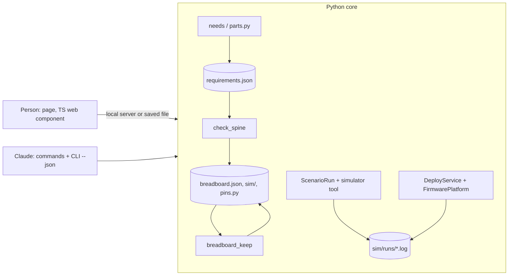

# Architecture lens: one core, thin interfaces, for the whole loop

Council of 2026-10-18, model Opus. Runs in a scratch store (`SPARK_HOME` inline), no USB.

> **TL;DR.** Every loop step already has a core class; what is missing is small: facts in one board record, a "drop"
> branch in one merge function, `--json` on three scripts, and a grade line in one log header. A page and Claude
> must write the same two files (`requirements.json` for the circuit, `breadboard.json` for the layout) through the same core calls.

## Claims, each reproduced

1. **The XIAO record lacks five facts, not one.** `check_spine.py` on `tactile-button` + `led-red-5mm`, board
   `xiao-esp32-c6`, `--keep --json`: `schematic could-not-run ... the board states no power.io_volts`. I copied the test
   record's facts (`tests/data/breadboard/button-light-xiao/boards/xiao-esp32-c6-fresh.json`) into the shipped record
   one by one. `power` alone fails the contract (`power pad '3V3' has no entry in wokwi_power_pins`: the shipped pads are
   `V33`/`V5`, the SMD footprint). `documents` is needed next (`power.module_peak_a cites ... which documents does not
   hold`). With `power`, `power_pads`, `wokwi_power_pins`, `documents` and `physical` (the DIP header, `footprint_module`
   null): `status ok`, every stage ok, `breadboard.json`, `.svg`, `.md`, `page.html` and `sim/` written. The build also
   warns `no serial monitor is wired`: the shipped `pins` lack `TX`/`RX`, which the test record has. So #314 must become
   "ship the checked test record's facts", with `TX`/`RX`.
2. **Remove or swap fits in one function.** `needs._merge_parts` (`scripts/needs.py:486`) already computes `kept`, the
   entries no pick explains, and returns `list(existing) + added`. A drop is `[e for i, e in enumerate(existing) if i in
   explained] + added`, behind one flag on `parts.py --requirements`. The message at `parts.py:2250` already names them.
3. **Deploy reads the gate in one place.** `DeployService.plan` calls `ProjectImage.why_untested`
   (`scripts/project_image.py:57`), which wants a log in `sim/runs/` whose header says `verdict: passed` for this image's
   sha256. `verify` then reads the file hashes from that log (`find_passed_log`). The log header (`run_scenario.py:194`)
   does not say which simulator wrote it.
4. **The simulator is already a swappable tool.** `run_scenario.main` runs `tools.find("simulator")`; `data/tools.json`
   maps the role `simulator` to `wokwi-cli` with contract `wokwi-project`, and a project overrides it in
   `.spark/tools.json`. A stand-in runner that takes the same arguments (`sim dir --scenario --timeout
   --serial-log-file`) needs no change in `ScenarioRun`.
5. **Name clash.** The tools role `bench` is already `sigrok`, the logic analyser (`data/tools.json` `roles`). P295's
   "bench" must take another name.
6. **`--json` is missing where the loop ends.** Has it: `check_spine`, `parts`, `live`, `grant`, `reach`, `check_all`.
   Lacks it: `deploy.py`, `look.py`, `run_scenario.py`, `breadboard.py`. `DeployService` already returns `DeployResult`
   and never prints, so `--json` is only a `to_dict` and a print in `main`.
7. **A layout edit already has a path.** `breadboard_keep.py` reads the earlier `breadboard.json` (a Wokwi diagram the
   person may edit in Wokwi) before the rebuild and keeps each move that still fits. A page that saves the same file in
   the same format gets this for free. A new wire is not a layout edit: it changes the circuit, so it goes to
   `requirements.json` through the parts core, never into `breadboard.json` alone.

## Ordered slices

| # | card | slice | done when | interface | size |
|---|---|---|---|---|---|
| 1 | P278 #314, widened | ship the test record's `power`, `power_pads`, `wokwi_power_pins`, `documents`, `physical`, `TX`/`RX` in `boards/xiao-esp32-c6.json` | the claim-1 command exits 0 with `breadboard.json` written and no serial warning | both | S |
| 2 | P100 #6 | bench walk, round A, on the XIAO | the PO wires the sheet, the LED lights, each stall is a card | person | M |
| 3 | NEW | drop unpicked parts: `parts.py --requirements --drop-unpicked`, and `--pick PROJECT NEED=` clears a pick | a swapped pick leaves one part; a `--keep` rebuild keeps moved parts | both | S |
| 4 | P293 #352 story 1 | Claude edits by words: needs-set, pick, slice 3, `--keep` | "this LED out, a buzzer on D9" rebuilds in one turn (needs a buzzer record, #178) | Claude | S |
| 5 | P213 #192 + NEW | `--json` on `look.py`, `deploy.py`, `run_scenario.py` (`LookReport.to_dict`, `DeployResult.to_dict`); `/spark:deploy` | each prints one JSON object with `status` from `outcomes` | both | M |
| 6 | P290 #347 | retry the first connect once: a `RetryingFlasher`-style Decorator, per the role table | a fake that fails once deploys | both | S |
| 7 | P248 #270 | bounded console read, `--json` | Claude reads 5 s after a deploy | Claude | S |
| 8 | P295 B, steps 1-2 | stand-in simulator as a `simulator` tool entry (name e.g. `stand-in-simulator`, not "bench"); writes the same log header | `run_scenario.py` passes the button scenario offline with the project's `.spark/tools.json` pointing at it | both | L |
| 9 | NEW, Petr's choice | a `simulator:` line in the log header; `ProjectImage.why_untested` accepts a stand-in pass only when the project says so, and the deploy question says "tested on the stand-in only" | deploy with no Wokwi token flashes after a stand-in pass, and says its grade | both | S |
| 10 | P293 #352 story 2 | a local page that saves `breadboard.json` through a small local server calling the core | a drag on the page survives a `--keep` rebuild, and Claude reads the move | person | M |

Order rules: 1 before 2 and 10 (no XIAO layout without it). 3 before 4. 5 before the page (the server calls the same
`--json` calls). 8 before 9. Slice 4 is the cheapest proof of "go back and edit the schema, and everything rebuilds".

## Park or drop

P275 #311 perfboard, P276 #312 catalogue editor, P277 #313 Fusion export, P286 #336 unknown boards: off the loop.
P279 #317 and P292 #351: after slice 10, when the page moves jumpers. P291 #348, P284 #331, P288 #344, P296 #358:
process chores, run beside the loop, not in its order. P295 step 3 (page on the stand-in) waits for slice 10.

## Vision after the MVP: what the MVP must not block

Petr: "really AI-first, so I basically just watch it and maybe then drag and drop things myself ... Electron or probably
TypeScript, and then just reuse it for the artifact, a web page, or even this application." Choices to make now:
- **The page is one TypeScript web component from slice 10 on**, reading only files (`breadboard.json`, `page.html`
  data). Electron, an Artifact and a Mac app then wrap the same component. No logic is written twice in JS.
- **Two files, two owners of meaning.** Layout lives in `breadboard.json` (Wokwi format, P294); the circuit lives in
  `requirements.json`. Claude and the page change the same files through the same core calls.
- **Every action is a core call with `--json`** first, then a command page, then a page button. Slice 5 makes this true
  for deploy. A future local server is a thin wrapper over these calls, not a second core.
- **"Claude does it on the board while I watch"** needs the page to reload when a file changes. That is a file watch
  in the page's server, not a new protocol. An Artifact cannot reach localhost (unknown, P294), so there the page
  shows the saved files and Claude pulls edits from shared state.
No slice changes order; slice 10's done-when adds "the component builds as one TS file the Artifact can load".

## Risks

- Slice 1 replaces the SMD footprint with the DIP header; a test that pins `XiaoRealFootprint` may break.
- A stand-in pass is logic only. If slice 9 makes it a gate, a wrong pin level on the real chip reaches the board.
- `--drop-unpicked` removes entries a person added by hand. It must list them first and need the flag each time.
