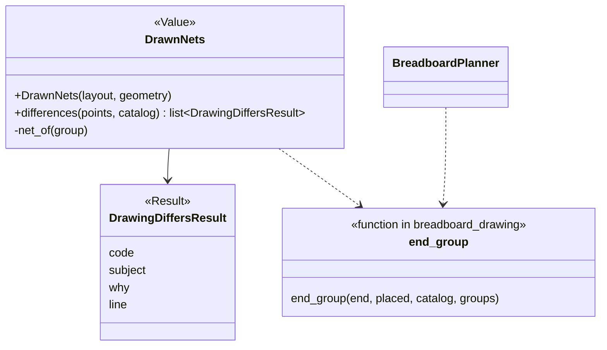
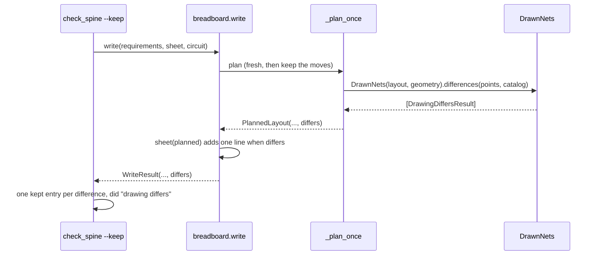

# P279 (#317): the build says which pin differs when the drawn breadboard does not join circuit.json's points

## Council

Round 1 ran on 2026-10-18: the tech lead with the architecture lens (Sonnet) and the refuter (Opus). The refuter
prototyped the check on the button-light-xiao fixture: the clean layout gave no difference, and each planted defect
gave the predicted code. What round 1 changed:

- The result lives on `PlannedLayout` and is computed in `_plan_once`, on the layout that is drawn. This removes an
  ordering trap: `write()` renders the sheet before it could compute anything new (refuter 8, tech lead 2).
- A part's inside joins count. The pushbutton's `1.l`/`1.r` and `2.l`/`2.r` are one contact each, and today that
  fact is only a comment. A wire into the other side of the contact was a short the check would not see (refuter 6).
- `NOT_DRAWN` is gone. Once a layout exists, each end has a hole, and the shared lookup raises `NotDrawn` as the
  planner does (tech lead 4). Two codes are left.
- The refactor is named: the planner's end-to-group lookup moves to one shared function (tech lead 6).
- Names follow the table in `docs/guide/developing.md`: `DrawnNets` (Value), `DrawingDiffersResult` (Result).
- The sheet gets one line, not one per difference. Step 3 of the old verification (a hand edit) is gone, because
  P273 refuses such a move. Tests plant the defect instead.
- New tests: a SETUP point (only board pads, through a free row), and the button's other side.

Round 2 ran next: the PO's assistant, the tech lead and a senior, in one Sonnet agent. What it changed:

- The check covers the pins that the points name. A pin in no point (a lone board pad, for example) is not checked,
  so the old row test stays as it is, beside the new tests, and the plan says so.
- `_plan_once` builds the geometry and the catalog once, before its first return with a layout, and one local helper
  computes `differs`. `PlannedLayout` gets `defaults=(None, ())`.
- The sheet line names the first difference and a count ("and 2 more"). The stderr lines and kept entries list all.
- New tests: a moved SETUP jumper gives `NOT_JOINED` for the later ends; `write()` with a planted layout still writes
  the files and keeps exit 0; the mutation run must remove the `joined_pins` union and fail the `1.r` test.

## Context

The PO, 2026-10-16: "One source now, check later". The drawn breadboard (`breadboard.json`, `breadboard.svg`) comes
from the planner in `scripts/breadboard_drawing.py`, and since P273 it can keep the parts and jumpers that a person
moved. Nothing in the product makes sure that the holes it joins are the points of `circuit.json`. Only a test does
that, for one fixture (`tests/test_breadboard_layout.py`, `test_no_row_holds_the_ends_of_two_points`).

Done when: the build says which pin differs when a layout's joined holes do not join the pins of `circuit.json`'s
points, and says nothing when they match.

## The design

How it decides:

1. A net is a set of breadboard groups that the drawing joins. `DrawnNets` starts with each group alone (union-find).
   It joins the two groups of each jumper. It also joins the groups of a part's pins that are one inside the part.
   That fact is a new field `joined_pins` on a part in `data/wokwi-geometry.json`. Its first use is the pushbutton,
   `[["1.l", "1.r"], ["2.l", "2.r"]]`, with its origin in the entry's comment: measured in the editor, as the
   comment already says, and Wokwi's part page, https://docs.wokwi.com/parts/wokwi-pushbutton.
2. Each end of each point gets its group from `end_group`. This is today's `BreadboardPlanner._group_of` and `_pin`,
   moved to one module function that the planner and `DrawnNets` both call. The planner's `groups` (the free row a
   board pad's SETUP jumper took) is not needed by `DrawnNets`, because it reads the pad's own hole and the jumper
   joins it to the free row.
3. Two codes, as constants that decide, with the words in `MESSAGES` ([[no-magic-strings]]):
   - `NOT_JOINED`: an end is not in the net of its point's first end. It catches a jumper that ends in the wrong row
     and a part leg that moved. Example: "R1 end 1 is not joined to board D8 in the drawing".
   - `JOINED_TO_OTHER`: two points share one net. It catches a short. Example: "LED1 A is joined to board D3 in the
     drawing, and they are two points".
4. Each end and each pair of points is reported once, in the order of the points, so the same layout gives the same
   lines.
5. Its limit: only the pins that the points name are checked. A wire into the row of a pin in no point is not seen.

Where it is called: `_plan_once` builds the geometry and the catalog once, and one local helper computes the result
on the layout it returns (the kept one when the moves were kept). `PlannedLayout` gets one field, `differs`, with the default `()`. `WriteResult` gets the same field from it.
The files are still written, because the sheet's steps are the source and the drawing is an example.

What a person and an agent see:

- `check_spine --keep`: one kept entry per difference, `{"file": breadboard.json, "did": "drawing differs", "code",
  "subject": the end's name, "why", "line": "drawing differs: <why>"}`. The constant `DRAWING_DIFFERS` sits beside
  `MOVE_NOT_KEPT` and `CHANGED`. The exit code does not change, the same as for a move that is not kept.
- `breadboard.py`: one stderr line per difference, `drawing differs: <why>`.
- The sheet, under the drawing's line, only when it differs: "The drawing does not join the points the same way:
  <first why>, and N more." The person who opens `breadboard.md` later sees it without the build output.

## Files

- New: `scripts/breadboard_match.py`: `DrawnNets`, `DrawingDiffersResult`, the codes and `MESSAGES`.
- `scripts/breadboard_drawing.py`: `end_group` as a module function. The planner calls it. Read `joined_pins` in
  `WokwiGeometry.part`'s data, nothing else changes.
- `data/wokwi-geometry.json`: `joined_pins` on the pushbutton, and its origin in the comment.
- `scripts/breadboard.py`: `_plan_once` computes `differs`, `PlannedLayout` and `WriteResult` carry it, `sheet()` adds
  the line, `main()` prints the stderr lines.
- `scripts/check_spine.py`: `DRAWING_DIFFERS` and the kept entries.
- New: `tests/test_breadboard_match.py`, on hand-built `BreadboardLayout` values plus the fixture:
  the fixture layout gives nothing; a jumper end moved to another row gives `NOT_JOINED`; a jumper between two
  points' rows gives `JOINED_TO_OTHER`; a wire on the button's other side (`1.r`) gives `JOINED_TO_OTHER`; a point of
  board pads only, through a SETUP free row, gives nothing; the same point with its SETUP jumper moved gives
  `NOT_JOINED` for the later ends. One test runs `write()` with `breadboard._plan_layout`
  patched to return a planted layout. It reads the sheet line, the stderr line and the kept entry, and makes sure
  that the files are written and the exit code is 0.
- `tests/test_breadboard_layout.py`: no change. Its row test also covers pins in no point, which `DrawnNets` does not.
- Docs: `docs/guide/agents.md` is the single source for the new `did` and its two codes. `commands/build.md` and the
  `--help` text of `check_spine.py` name it in one line and point there. The README's "What works today" row for
  the drawing gets a short note. Its status does not change, so `tools/journey.py` does not change.
- Rows: `docs/observations/rows/p279-drawing-check.md`, with round 1's findings.

## Verification

1. `python3 -m pytest tests/test_breadboard_match.py tests/test_breadboard_layout.py tests/test_breadboard.py
   tests/test_check_spine.py -q`, then the whole suite through the push hook.
2. Build the XIAO fixture with `check_spine.py <fixture requirements> --keep <scratch>` and read the JSON: no
   `drawing differs` entry, and the sheet has no new line.
3. The mutation-tester on the changed logic, before the PR. One planted defect removes the `joined_pins` union, and
   the `1.r` test must catch it.
