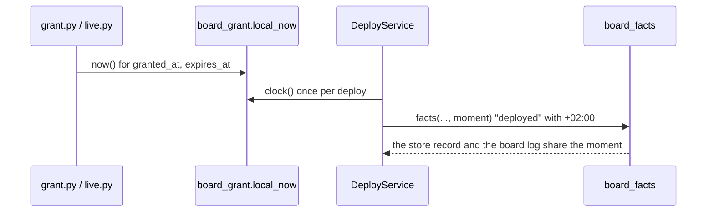

# P291 #348 and P315 #393: every time spark writes says its zone, the machine's zone

## Council

Round 1 and round 2 go here, with what they changed.

## Context

The PO's bench run (2026-10-18) found two forms of time in one store record: `"deployed": "2026-10-18T06:32:10"` has
no zone, and the grant's `"yes": "... at 2026-10-18T04:30:19+00:00, until ..."` is UTC. A reader cannot compare them,
and the PO lives in Prague. His rule (~/.claude/CLAUDE.md, 2026-10-18): a time is said in the local zone, and a time a
program stores carries its zone. Spark uses the machine's zone, with no setting.

## Design

One clock for both, in `scripts/board_grant.py`:

```python
def local_now():
    """Now, in the machine's zone, with the zone."""
    return datetime.datetime.now().astimezone()
```



## Steps

1. Tests first: a grant written now has the machine's offset in `granted_at` and `expires_at`; a deploy with no
   clock given writes `"deployed"` with an offset; the board log file name stays `YYYY-MM-DDTHH-MM-SS.log` (no
   offset in a file name); a grant stored in UTC before this change still reads and still expires on time.
2. `board_grant.utc_now` becomes `local_now` (callers: `board_grant`, `grant.py`, `live.py`, one test).
3. `DeployService`'s default clock is `board_grant.local_now` (`deploy_service.py:158`).
4. Docs: `deploy.py --help` and `grant.py --help` if they say UTC; `docs/guide/agents.md` where the record's fields
   are listed; rows `docs/observations/rows/p291-time-zones.md`.

Out of scope: rewriting old records; times in other scripts (`cost.py` reads the Claude log's own UTC stamps).

## Verification

The touched tests, then the whole suite through the push hook. One real `grant.py` run with a fake board is not
possible without the bench, so the unit tests pin the offset.
