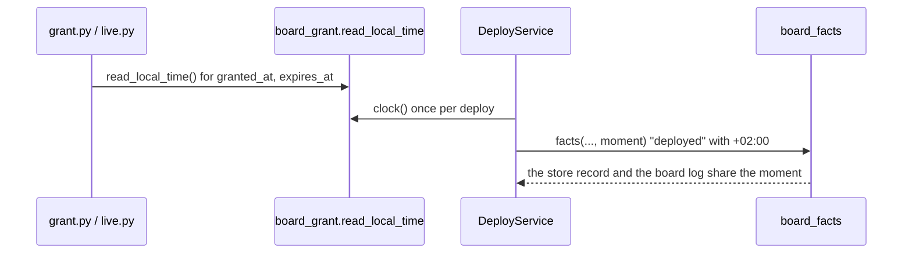

# P291 #348 and P315 #393: every time spark writes says its zone, the machine's zone

## Council

Round 1 ran (Sonnet). It changed:
- A grant stored in UTC before this change printed `+00:00` on the `yes:` line and in the record's "yes" text. One
  helper, `say_in_local_zone(iso)`, now says a stored time in the machine's zone wherever it is printed or copied
  into the record. The stored grant JSON is unchanged.
- A naive test clock stayed naive. The service calls `.astimezone()` on the moment, so naive means local.
- `expires_at` across a DST change kept the old offset: `(now + delta).astimezone()`.
- Names: a function starts with a verb, so `read_local_time()` (it replaces `utc_now`), and `FakeUtcClock` becomes
  `FakeLocalClock`. Every default `now=utc_now` and the docstrings that say UTC or `datetime.datetime.now` change.
- Accepted, not fixed: two deploys in the same second inside a DST fall-back hour share a log file name. It needs a
  deploy in a repeated hour twice in one second.

Round 2 ran (the refuter, Opus, reproduced under TZ=Europe/Prague and TZ=UTC). It changed:
- No `.astimezone()` on the deploy moment: the default clock is already aware, and the call only served naive test
  clocks, which made the tests depend on the machine's zone. The tests give an aware moment with a fixed offset.
- `say_in_local_zone` reads only times with a zone: a grant with no zone is refused before it is printed.
- Three anchors in `tests/mutations/p242-deploy-grant.json` (the `utc_now()` replacement, the `who` line, the
  `expires_at` line) change with the code.
- Step 4 shrinks: no guide lists `"deployed"` or says UTC. Rejected as a doubt: an old UTC grant still validates and
  expires on time (aware times compare by instant).

## Context

The PO's bench run (2026-10-18) found two forms of time in one store record: `"deployed": "2026-10-18T06:32:10"` has
no zone, and the grant's `"yes": "... at 2026-10-18T04:30:19+00:00, until ..."` is UTC. A reader cannot compare them,
and the PO lives in Prague. His rule (~/.claude/CLAUDE.md, 2026-10-18): a time is said in the local zone, and a time a
program stores carries its zone. Spark uses the machine's zone, with no setting.

## Design

One clock for both, in `scripts/board_grant.py`:

```python
def read_local_time():
    """Now, in the machine's zone, with the zone."""
    return datetime.datetime.now().astimezone()


def say_in_local_zone(iso):
    """A stored time with its zone, said in the machine's zone."""
    return datetime.datetime.fromisoformat(iso).astimezone().isoformat(timespec="seconds")
```



## Steps

1. Tests first: a grant written now has the machine's offset in `granted_at` and `expires_at`; a deploy with no
   clock given writes `"deployed"` with an offset; the board log file name stays `YYYY-MM-DDTHH-MM-SS.log` (no
   offset in a file name); a grant stored in UTC before this change still reads and still expires on time.
2. `board_grant.utc_now` becomes `read_local_time` (callers: `board_grant`, `grant.py`, `live.py`, the tests and
   `tests/fakes.py`). `issue` writes `expires_at` as `(now + delta).astimezone()`.
3. `DeployService`'s default clock is `board_grant.read_local_time` (`deploy_service.py:158`). The deploy tests
   give an aware moment with a fixed offset.
3b. `say_in_local_zone` where a grant's times are printed or copied: `StandingConsentStrategy.who`, `describe`,
   `grant.py`'s two "until" lines. A test with a grant stored in UTC.
4. The docstrings that say UTC or `datetime.datetime.now` (`board_grant.py`, `deploy_service.py:70`,
   `deploy.py:127`, `tests/fakes.py`), the three mutation anchors, and rows `docs/observations/rows/p291-time-zones.md`.

Out of scope: rewriting old records; times in other scripts (`cost.py` reads the Claude log's own UTC stamps).

## Verification

The touched tests, then the whole suite through the push hook. One real `grant.py` run with a fake board is not
possible without the bench, so the unit tests pin the offset.
