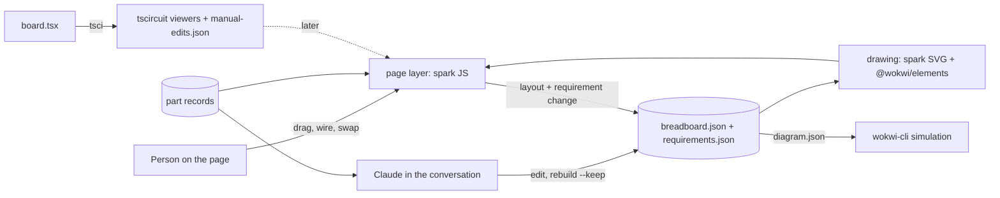

# P294 finding: reimplementing Wokwi or reusing it?

Spike for [#353](https://github.com/xmejkal/spark/issues/353), epic P293 [#352](https://github.com/xmejkal/spark/issues/352). Date: 2026-10-18.

> **TL;DR.** Today spark reuses Wokwi's file format (`diagram.json`), its part names and its simulator (`wokwi-cli`).
> It reimplements the picture: it measured the breadboard's holes once and draws its own SVG. Wokwi's editor and its
> ESP32 simulator are closed, and the official embed is an unsupported prototype, so a person cannot get Wokwi's
> editor inside a page. Recommendation: **wrap** `@wokwi/elements` (MIT, about 50 part pictures) for part pictures,
> **build** a small drag, drop and wire layer on `breadboard.json`, **reuse** `diagram.json` as the one data file and
> `wokwi-cli` as the simulation, and keep the part catalogue as spark's records. The schematic and the PCB can be
> edited the same way later, through tscircuit's MIT viewers and its `manual-edits.json`.

Sources: Wokwi's docs and repos, npm, a fetch of the CDN. Nothing was installed. Not checked: Wokwi's terms of
service, an embed inside a real Artifact, and this account's Artifact capabilities. Each is marked unknown below.

## 1. What spark takes from Wokwi, and what it draws itself

| Piece | Taken from Wokwi | Drawn by spark | Where |
|---|---|---|---|
| File format | `diagram.json`: parts, connections, `editor: "wokwi"` | the writer, for the breadboard and for the simulation | `scripts/breadboard_drawing.py:352`, `scripts/check_spine.py:549-552` |
| Part names | `wokwi-led`, `wokwi-resistor`, `wokwi-breadboard-half`, board type | the map from a record to a type | `scripts/breadboard.py:365-380`, `scripts/parts.py:416` |
| Hole and pin positions | measured once inside Wokwi | stored in `data/wokwi-geometry.json`, 4 types only | `scripts/breadboard_drawing.py:2-10`, `:76-93` |
| Breadboard picture | nothing | an SVG from the same layout, in Wokwi's px | `scripts/breadboard_drawing.py:367-400` |
| Part pictures | nothing | 5 plain pictograms in `data/pictograms/` | `scripts/part_pictures.py:7`, `:36-46` |
| Page | nothing | one HTML file, no script, nothing from the web | `scripts/tabbed_page.py:1-12` |
| Editing | the person pastes `breadboard.json` into wokwi.com by hand | a rebuild keeps the person's moves | `scripts/breadboard_drawing.py:334-337`, `scripts/breadboard_keep.py:3` |
| Simulation | `wokwi-cli`, a token, CI minutes | the scenario wrapper and the log | `scripts/run_scenario.py:60`, `docs/guide/agents.md:589` |

Answer: spark reuses the format, the names and the simulator. It reimplements the drawing, with its own pictograms
(`scripts/part_pictures.py:36`).

## 2. Open and closed Wokwi pieces

| Piece | License / status | Reuse by spark (public, MIT, no vendor file committed) | Source |
|---|---|---|---|
| `@wokwi/elements` 1.9.2 | MIT, last push 2026-10-12 | Yes. Load from a CDN at run time, commit nothing. | [repo](https://github.com/wokwi/wokwi-elements), [npm](https://www.npmjs.com/package/@wokwi/elements) |
| avr8js 0.21.1, rp2040js 1.4.0 | MIT | Not needed: spark targets ESP32 | [avr8js](https://github.com/wokwi/avr8js), [rp2040js](https://github.com/wokwi/rp2040js) |
| `wokwi-cli` | repo is MIT; the service it calls is closed and metered | Already used. Free plan: 50 CI minutes a month, 5 minutes a session. | [repo](https://github.com/wokwi/wokwi-cli), [docs](https://docs.wokwi.com/wokwi-ci/getting-started) |
| wokwi.com editor and simulator | closed, no source repo in the org | No code reuse. Link only. | [org repos](https://github.com/wokwi) |
| ESP32 simulator (C6 and XIAO C6 listed) | closed; the docs give no license | None. `wokwi-cli` is the only door. | [ESP32 guide](https://docs.wokwi.com/guides/esp32) |
| Wokwi for VS Code, diagram editor | closed extension; free license by account; editing needs Hobby+ or Pro | No. It runs in VS Code, not on a page. | [docs](https://docs.wokwi.com/vscode/diagram-editor) |
| `diagram.json` format | documented, no license text found | Yes. Spark already writes it. | [docs](https://docs.wokwi.com/diagram-format) |
| `wokwi-boards` | no license set | No. Do not copy files. | [repo](https://github.com/wokwi/wokwi-boards) |

What `@wokwi/elements` 1.9.2 holds (checked in its `+esm` bundle, 422 KB, 50 `wokwi-*` names): LED, RGB LED,
resistor, pushbuttons, buzzer, potentiometer, servo, displays, sensors, NeoPixel, Arduino boards and the ESP32 DevKit
V1. It holds **no breadboard, no diode, no XIAO ESP32-C6 board and no generic module**. Those stay spark's own pictures.

CDN: `https://cdn.jsdelivr.net/npm/@wokwi/elements@1.9.2/+esm` answers 200 and bundles its imports. jsdelivr is an
allowed Artifact origin. The `dist/cjs/index.min.js` file is a thin wrapper, not a bundle. Unknown: whether an
Artifact page runs this module (needs a test page).

## 3. Embedding Wokwi's interactive editor

- The only official route is `wokwi-embed-example` ("a prototype ... Not officially supported at this time", no
  license) and `wokwi-embed-bridge-example` (a 2022 PlatformIO prototype whose README warns of "limits and
  restrictions" later). [embed](https://github.com/wokwi/wokwi-embed-example), [bridge](https://github.com/wokwi/wokwi-embed-bridge-example).
- Third-party tools make an iframe from a saved project link ([Microlink](https://microlink.io/tools/embed-url/wokwi)),
  so it is online only. The iframe's account rules and cost are not in the sources read: unknown.
- Edits do not come back: no source read gives a message API that returns `diagram.json`. Unknown whether one exists.
- Artifact rules name three script CDNs and say nothing of iframes. Unknown whether the frame allows `wokwi.com`.
- Result: do not build on the embed. It is unsupported, online, and one-way.

## 4. One layout for Claude and a person

The kept `breadboard.json` (a Wokwi `diagram.json`) is the one data file. Both sides use it:

- Claude reads and edits the file, then rebuilds with `--keep`. `breadboard_keep.py` keeps each moved part and jumper
  whose rows still join, and names the rest as `not kept` (`docs/guide/agents.md:172-186`).
- A person's edit reaches Claude in one of three ways. All are options, none is chosen. (a) The page offers the edited
  JSON as a file to save, and the person hands it over. (b) The Artifact runtime keeps shared state that Claude reads
  with `ArtifactData`. (c) A local page talks to a small local server that writes the file. Whether (b) is on for this
  account is unknown.
- Claude's edit shows by republishing the same Artifact URL, or by writing the shared state the page reads.
- One rule keeps both honest: `breadboard.json` holds the layout only. A kept part must have its id and Wokwi type in
  the circuit (`scripts/breadboard_keep.py:160-162`). So a page edit that adds or swaps a part must also change
  `requirements.json`, or the next rebuild drops it. The page writes both, or hands Claude a change request.

## 5. Per piece: reuse, wrap or build

| Piece | Choice | Cost | Why |
|---|---|---|---|
| Part pictures | wrap `@wokwi/elements`; spark's pictograms where it has none | small | MIT, about 50 parts, from the CDN; breadboard, diode and XIAO stay spark's SVG |
| Drag and drop | build | medium | the elements have no editor; spark knows the holes (`wokwi-geometry.json`) and the keep rules |
| Wiring (jumpers) | build | medium | click two holes, write a connection; routes and colors already exist in `breadboard_drawing.py` |
| Part catalogue | reuse spark's records | small | `simulation.wokwi.part` maps a record to a Wokwi type (`scripts/parts.py:416`); the page lists records, not Wokwi's catalogue |
| Simulation | reuse `wokwi-cli` | small | closed ESP32 simulator, no other door; costs CI minutes, so ask first |
| Format and data file | reuse `diagram.json` | small | already written and kept |
| Geometry for new types | build, one per type | small each | measured in Wokwi, not published; 4 types exist today |
| wokwi.com embed | skip | n/a | unsupported, online, one-way |

## 6. Schematic and PCB: can they be edited the same way?

Spark builds both from `board.tsx` with tscircuit (`tsci build`, `scripts/check_spine.py:428-432`) and draws them as
static SVG from `tsci export` (`scripts/tabbed_page.py:34`, one tab each).

- tscircuit is open: `tscircuit` 0.0.2940, `@tscircuit/pcb-viewer` 1.11.429, `@tscircuit/schematic-viewer` 2.0.105,
  `@tscircuit/runframe` 0.0.3012, all MIT ([pcb-viewer](https://github.com/tscircuit/pcb-viewer),
  [runframe](https://github.com/tscircuit/runframe)).
- Its viewers raise edit events when a person drags a part. RunFrame applies them to a file named
  `manual-edits.json` that the board imports (runframe README, "File-Server Interaction with Edit Events"). That file
  is the same idea as spark's kept `breadboard.json`.
- Spark has no `manual-edits` code today (no match in `scripts/`). A kept edit needs: the file kept beside
  `board.tsx`; the generated `board.tsx` importing it; a keep rule for a part that left the circuit; a `not kept`
  line. The never-overwrite rule for `board.tsx` (`docs/guide/agents.md`, rule 5) fits: edits sit in their own file.
- Unknown: whether the viewers run as a script from an allowed CDN (they need React and a bundle); whether the
  autorouter keeps a hand-placed trace on a rebuild.

| View | Edit by a person | Edit by Claude | Choice | Cost |
|---|---|---|---|---|
| Breadboard | drag, wire, swap on spark's SVG | `breadboard.json` + `--keep` | wrap elements, build the layer | medium |
| Schematic | drag symbols in tscircuit's viewer | placement in `manual-edits.json` | reuse the viewer, build the keep | medium |
| PCB | drag footprints in pcb-viewer | placement in `manual-edits.json` | reuse the viewer, build the keep | large (traces, DRC) |

Order: breadboard first, then schematic (symbol placement only), then PCB.

## The PO's example: "this diode, add a buzzer, pin 20 and the ground"

**Claude.** (1) Reads `breadboard.json` and `requirements.json`, finds the diode's id. (2) Searches the store for a
buzzer record (`parts.py`); the Wokwi side has `wokwi-buzzer`, so it simulates. A diode has no Wokwi element, which
only matters for the picture. (3) Asks one question: is "pin 20" a GPIO number or a printed label? On the XIAO
ESP32-C6 the labels are D0 to D10, so the answer decides the wire. (4) Changes the requirements (diode out, buzzer
in, its signal pin and GND), runs the build with `--keep`, and reads `not kept` for the diode's jumpers. (5) Republishes
or writes the shared state, and says what moved.

**Person.** Clicks the diode, presses delete. Opens the catalogue, types "buzzer", picks the record, drops it on the
free holes, and the page snaps its legs to rows. Clicks the board's pin 20, then the buzzer's signal leg, and the
board's GND to the other leg. The page writes the layout and the requirement change. Claude reads both at the next turn.

Both paths end at the same two files and the same rebuild. "A part like that" is a catalogue search (same kind, same
footprint): Claude does it in conversation, the page as a filtered list.

## Recommended pieces

## Open questions for the PO

1. Does a person's edit need to reach Claude without a hand-off? That decides option (b), shared state, or (a), a saved file.
2. Is a page that needs a network (CDN for the part pictures) acceptable, or must `page.html` stay offline?
3. Order after the breadboard: schematic before PCB, or PCB first?
4. Is a test page allowed to try `@wokwi/elements` and a `wokwi.com` iframe inside an Artifact? It is the one test that closes the unknowns.

## Checked by

(filled after the refuter run)
