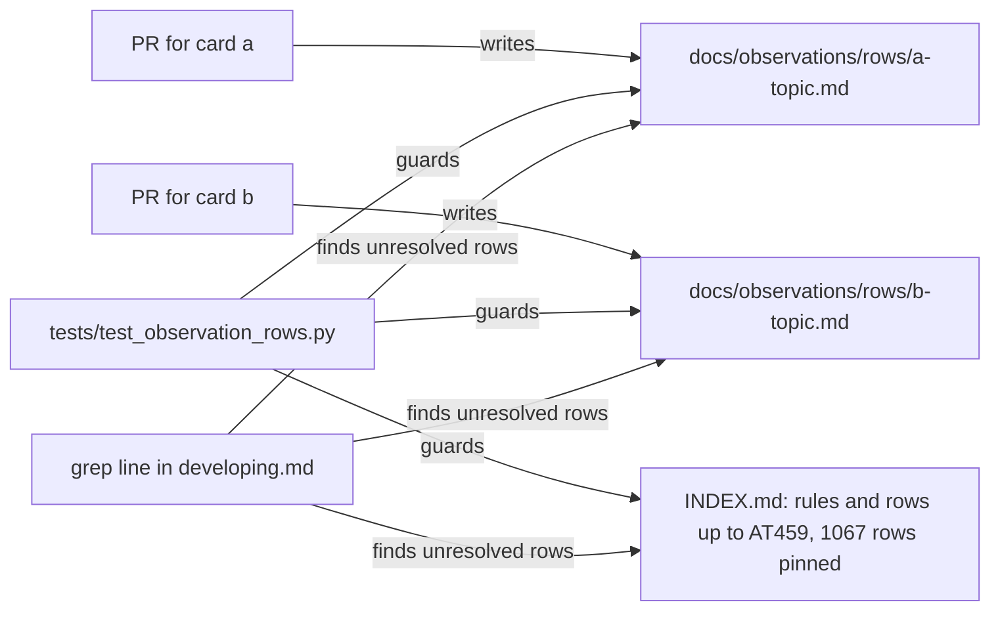

# P296 (#358): findings rows out of one shared INDEX.md

## Council

Round 1 ran: a tech lead on Sonnet and the refuter on Opus. It changed the plan in five ways.

- The refuter showed in a scratch repo that one `rows.md` per discovery folder still conflicts. The cause is that two
  PRs can share a folder, for example P213 PR a and PR b, or P278's plan and PR #382. Each PR now writes its own
  file in one folder (named by its branch in round 1, by card and topic after round 2).
- The tool `tools/rows.py` is gone. Both lenses called it bloat, and INDEX.md's rows come in three widths with stray
  status words, so a parser would be a job of its own. One `grep` line in `developing.md` finds the unresolved rows.
- The columns reuse INDEX.md's names, so one word means one thing.
- The guard pins INDEX.md's row count. A check on AT numbers alone would miss a new row with another prefix.
- The docs sweep gained `GLOSSARY.md:516`, `DECISIONS.md:5` and `:49`, `docs/README.md:7` and the sentence in
  `keep-current/rows.md:3` that sends rows to INDEX.md.

Rejected: "freezing INDEX.md breaks code". The refuter confirmed that no code reads it. Tools only cite AT numbers in
comments. Accepted with no fix: an edit to an old row's status can still conflict with another edit to a nearby row.

Round 2 ran: one Sonnet agent with three lenses, the PO assistant, the tech lead and a senior. It found that the
done-when, the typed sub-issues and the docs are met. It changed the plan in four ways.

- The grep line missed the bold status cells (`**raised**`), which most INDEX.md rows use. The fixed line matches 274
  unresolved rows in INDEX.md today. New rows use the plain word.
- The row count is now defined. The test counts the lines that start with `| ` under `## The table`, without the
  header and separator lines. Today that count is 1067.
- The status-word check reads only the new rows files, because INDEX.md's rows use `**acted**`, `acted:` and other
  forms.
- A file is named by card and topic, not by branch. Branch names can hold `/`, and auto-named agent branches say
  nothing about the card. If two PRs pick the same name, git shows a conflict. That case is rare and visible.

## Context

Every PR adds rows at the end of `docs/observations/INDEX.md` (1114 lines, up to AT459) and picks the next AT
numbers by hand. Parallel PRs always conflict there. Twice two PRs took the same numbers (#341 and #342). Petr,
2026-10-18: *"isn't there some strategic way we could redesign the system so that they wouldn't happen?"*

Done when (the card): two parallel PRs with findings merge in either order with no conflict and no renumbering, the
rows stay as easy to find, and a test guards the new form. The scope is the findings rows only. The README and the
journey files that many PRs also change are outside this card.

## The design



- One file per PR: `docs/observations/rows/<card>-<topic>.md`, for example `p296-rows-per-pr.md`. No two PRs
  write the same file, and no global counter exists. A row's id is its number inside the file, cited as
  `<file>#<n>`.
- The header is INDEX.md's own: `| # | claim | source | status | evidence / where it went |`. The status cell
  starts with one of INDEX.md's five words: `raised`, `verified`, `acted`, `rejected`, `closed`. A row that waits on
  the PO is `raised`, and its last cell says so.
- INDEX.md keeps its rules and its rows as history, and their status cells can still change. A new paragraph at its
  top says that it takes no new rows, where new rows go, and the grep line.
- The rows files already in `docs/discovery/` stay where they are, as history. The test does not read them, so PR
  #382 can merge before or after this one.

## Steps (typed task sub-issues under #358, R9 theme 6)

1. Test, sub-issue "P296 test". Write `tests/test_observation_rows.py` first and see it fail.
   - INDEX.md holds exactly 1067 rows: the lines that start with `| ` under `## The table`, without the header and
     separator lines.
   - Every file in `docs/observations/rows/` is named `[a-z0-9-]+\.md`, has the one header, numbers
     its rows 1, 2, 3 with no gap, and starts each status cell with one of the five words.
   - The five words are one constant in the test, read from INDEX.md's status table, not typed twice.
2. Implementation, sub-issue "P296 implementation". Make the folder with this PR's own findings in
   `docs/observations/rows/p296-rows-per-pr.md`, the first file in the new form.
3. Docs, sub-issue "P296 docs". Change the top of INDEX.md, `scrum/README.md:61`, `GLOSSARY.md:516`, `DECISIONS.md:5`
   and `:49`, `docs/README.md:7`, and the sentence in `docs/discovery/2026-10-18-keep-current/rows.md:3`. Add a short
   section to `docs/guide/developing.md` with the grep line. Grep `agents/`, `.claude/agents/` and `skills/` for the
   rule and change any hit. Change the rule in Petr's store, `~/.local/share/spark/rules.md:69`, and say so in the
   PR, because that file is outside the repository.

The grep line, for the docs:

```
/usr/bin/grep -nE '\| \**(raised|verified)' docs/observations/rows/*.md docs/observations/INDEX.md
```

Names: "row" is one finding line, "rows file" is one PR's file, "unresolved" is `raised` or `verified`. One word for
each.

## Verification

- `python3 -m unittest tests.test_observation_rows` fails before step 2 and passes after it.
- Proof of the done-when: make two scratch branches from main. Each adds its own rows file and changes nothing else.
  Merge both into a third branch in each order with `git merge`. Neither order conflicts.
- The grep line prints the unresolved rows.
- The push hook runs the whole suite.
