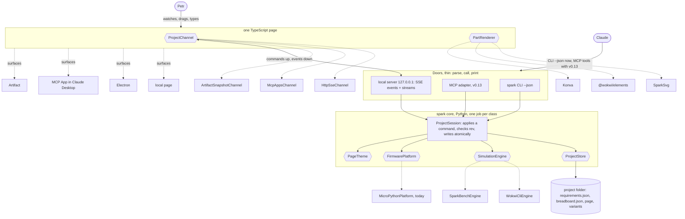
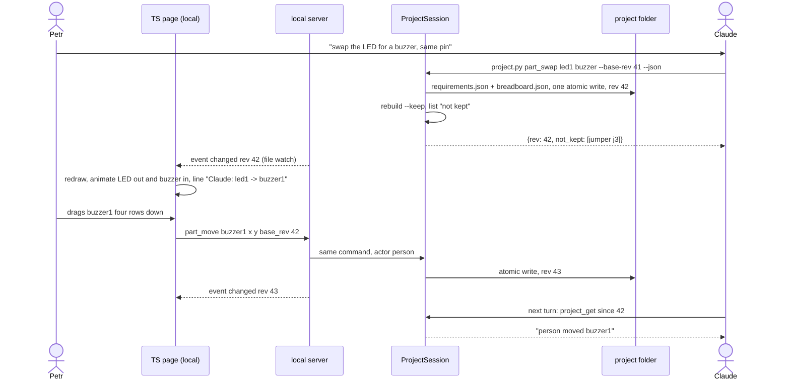

# P297 finding: how Claude and a person share and change one project

Spike for [#360](https://github.com/xmejkal/spark/issues/360), epic P293 [#352](https://github.com/xmejkal/spark/issues/352).
Date: 2026-10-18. Council: three architects (Opus) and the refuter (Opus), papers in [`council/`](council/).

> **TL;DR.** Target: **one spark core with one command vocabulary for every step, files as the truth, and thin doors
> over it**. Claude calls the CLI with `--json` now and the same commands as MCP tools with v0.13 ([#94](https://github.com/xmejkal/spark/issues/94)).
> One small local server pushes "changed" events and live streams to one TypeScript page, which runs as a local page,
> in Electron, and later as an MCP App or an Artifact. **Our interface or the Artifact: both, in different roles.** The
> interface Claude uses is spark's command set, like the Fusion 360 MCP. The Artifact is one place to show the page, not the
> place the design lives. **First step:** a `ProjectSession` core class with three commands (`part_swap`, `part_move`,
> `project_get`), atomic hash-checked writes, and a CLI `project.py --json`. No server and no page change yet.

Summary: every design tool in the survey (Fusion 360, Figma, KiCad) keeps the document in the tool and gives the agent
a thin door. For spark the tool is the project folder plus spark's core. The shared file is not the problem. A file
edited behind the core's back is the problem, so each change goes through one command in the core. The MCP server and
the Artifact are doors and surfaces over that core. Neither one is the core.

## The target (C4 container view, with the swap points)

Hexagons are strategy interfaces, each with a fake for tests. Only `FirmwarePlatform` exists today (`scripts/firmware_platform.py`).

## Claude swaps the LED for a buzzer while Petr watches, then Petr drags it

A stale command (an old `base_rev`) gets `conflict` and the newest state. Claude learns of a drag at its next turn,
the same gap the Fusion 360 MCP has.

## Options

| Option | What Petr sees | What Claude calls | Offline | Cost | Fit with principles | Main risk |
|---|---|---|---|---|---|---|
| A. MCP server + page on it | live redraw over SSE; MCP App in Claude Desktop | MCP tools | yes, except the App | medium (core, adapter, SSE) | brings the MCP server before the CLI rule allows; v0.13 slice | a long-running process; a second core if #94 changes shape |
| B. Artifact `db` is the truth | live redraw via `onSnapshot` | `ArtifactData` rows, then files for each rebuild | no | small page, medium sync | free and few, **not local**; online account for a public MIT tool | two truths (a drag lives only in `db`); `db`, `host:` unproven here |
| C. Files + CLI, page watches | a redraw per script call, animated as a diff | scripts as today | yes | small | best fit today | raw writes behind the core's back; half-written files |
| **Hybrid (recommended)**: C's files + A's command vocabulary | as C, with each change named and attributed | one command set: CLI now, MCP later | yes | small now, medium later | one core, many interfaces; local CLI first | vocabulary grows by need, not by plan |
| Hybrid + Artifact surface | a snapshot today; live only if `host:` or `db` proves out | the same | no for that surface | small | a surface, not a store | owner-only `host:`; unproven account features |

Sources: [Fusion 360 MCP](https://github.com/faust-machines/fusion360-mcp-server) (MIT, beta, TCP to an add-in, `undo`
tool), [Figma MCP](https://help.figma.com/hc/en-us/articles/32132100833559-Guide-to-the-Figma-MCP-server) (writes the
live canvas, beta), [KiCAD Buddy](https://pypi.org/project/kicad-buddy/) (edits the file, then asks KiCad to reload),
[MCP Apps](https://github.com/modelcontextprotocol/ext-apps) (stable 2026-01-26, `ui://`, hosts Claude Desktop and
claude.ai; no source names the Claude Code terminal), [MCP transports](https://modelcontextprotocol.io/specification/2025-06-18/basic/transports)
(Streamable HTTP, SSE, bind to 127.0.0.1, check `Origin`), Artifact runtime contract 0.2.85 `.d.ts` files (`db`,
`room`, `mcp`; read, not run), [Yjs](https://github.com/yjs/yjs), [Automerge](https://automerge.org/docs/hello/),
[event sourcing](https://martinfowler.com/eaaDev/EventSourcing.html). More in [`council/research.md`](council/research.md).

## Our interface or the Artifact?

Both, and the question mixes two layers. **The Claude-facing interface** is the command set: Claude drives spark the
way it drives Fusion 360 through its MCP. Today that is the CLI with `--json`, later the same commands as MCP tools.
**The person-facing surface** is one TypeScript page. The Artifact is one host for that page. It is good for a shared
snapshot and for claude.ai, but it is online, needs an account, and reaches Petr's Mac (USB, wokwi-cli, the console)
only through `host:` MCP, which works in the Claude app only and only for the Artifact's owner (`mcp.d.ts:122`). So the
Artifact cannot hold the design for a public, local tool. A CRDT (Yjs, Automerge) solves many people editing one
text at once. Spark has one person and one Claude taking turns, so a revision number and a conflict answer are enough.

## The whole journey: which steps Claude drives well today

Petr widened the scope: "rebuild it now, but with the dark colors", "a version with stepper motors instead of DC
motors", all the way to firmware. Checked on main, 2026-10-18 (`--json` in each script's argument parser):

| Step | Clean call today | Gap |
|---|---|---|
| Parts, needs, pick | `parts.py --json` | `drawer.py` has no `--json` |
| Requirements | `parts.py --requirements` | no remove or swap command (gaps.md, step 3) |
| Build, keep moves | `check_spine.py --keep --json` | none for the MVP |
| Page look | none | colors are fixed tokens (`scripts/tabbed_page.py:81-85`); "dark colors" needs a `PageTheme` setting |
| Simulation | `run_scenario.py` | no `--json`; costs Wokwi CI minutes |
| Firmware | Claude writes it; `import_firmware.py --json`, `check_all.py --json` | none; spark exports facts, not behaviour |
| Deploy | `deploy.py` | text output only, no `--json` |
| Console | `live.py --json` | none |
| Variants of a project | none | no command; no `variants/` rule in the folder |

**Variants as a use case.** "DC motors vs steppers" is a copy of the requirements under a name, rebuilt on its own.
With files as the truth, a variant is a folder or a git branch, and a command (`variant_create`, `variant_switch`) wraps it. In
an Artifact `db` or a command log, a variant is a fork of the store, which is harder. This favours files as the truth.

## What the MVP must decide now

1. **Every change goes through a core command**, never a raw file write by the page or a hand edit by Claude. The page
   sends `part_move`, not a whole `breadboard.json`.
2. **One command vocabulary** (names, stable part ids, one JSON schema), shared by the CLI, the page and the later MCP.
3. **Every change carries `rev`, `base_rev` and `actor`.** The core writes by temp file and rename and checks the hash it
   read. Spark writes with `write_text` today (`scripts/breadboard.py:490,497`), so a watcher can read half a file.
4. **A part add or swap changes `requirements.json` and `breadboard.json` in one step**, so a page add is not dropped.
5. **The page talks only through `ProjectChannel`**, so the local server, an MCP App and the Artifact are swaps.
6. **Undo is a `.bak` or a git commit per rebuild.** No event log in the MVP.

Not decided now, by design: the MCP adapter (its trigger is a host that cannot run a shell, such as Claude Desktop, or
v0.13); a CRDT; the Artifact as a live surface.

## Proposed architecture standard for `docs/guide/developing.md`

Every plan and every council checks these lines (a proposal for Petr; this spike edits no guide):

1. One core: each job is one small class in a library module; `main()` only parses and prints.
2. Thin doors: the CLI, the MCP adapter, the local server and the page call the core and hold no logic of its own.
3. One command vocabulary: every change a person or Claude makes is a named command with `rev`, `base_rev`, `actor`.
4. Each engine sits behind a named strategy interface (store, simulation, firmware platform, theme, channel, renderer).
5. Each strategy interface has a fake in `tests/fakes.py` or the page's test kit, and one contract test for all its versions.
6. Files in the project folder are the truth; a door never keeps state of its own.
7. Each name says its role, per the role table in this guide.
8. Each story ends with one refactor step toward these lines, named in its PR.

## Open questions for Petr

1. Is a local browser tab beside Claude Code fine as the first live view, with Electron and the MCP App later?
2. Can Claude publish a one-part test Artifact to check `db`, `room`'s agent peer and `host:` on your account?
3. Variants: a folder per variant inside the project, or a git branch each?
4. "Rebuild with dark colors": the page only, or also the breadboard picture and the printed sheet?

## Checked by

The refuter (Opus) confirmed the cited lines and `.d.ts` limits. Rejected: A's token worry (tool search), A's "a CLI
cannot give a live view", an undo log in the MVP, C's server lock (Claude writes directly). Rows: [`council/rows.md`](council/rows.md).
