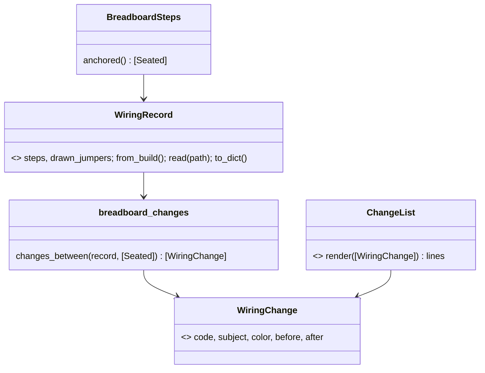
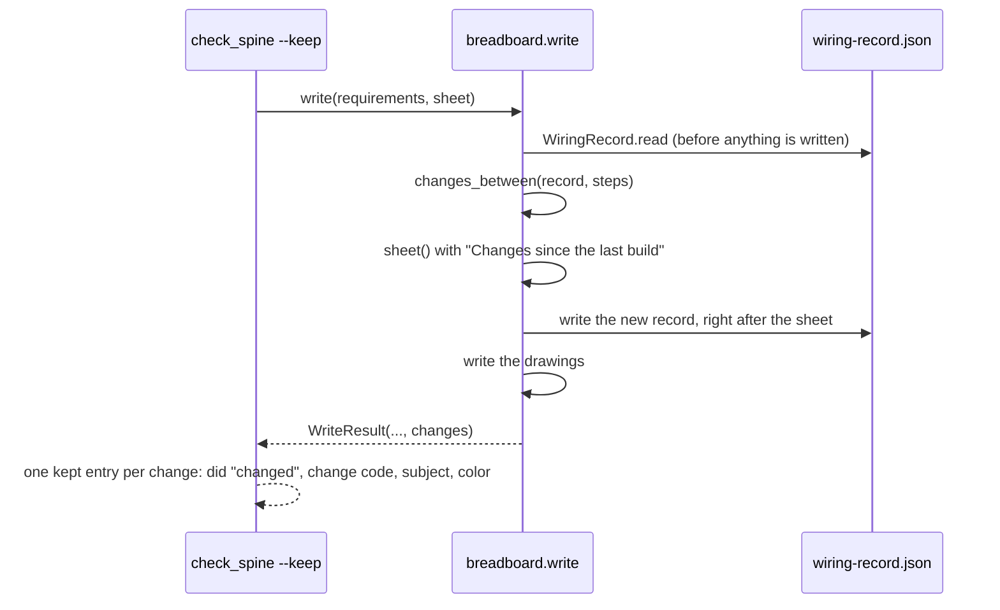

# P300 #366: a rebuild lists what to change on the bench

## Council

Round 1 ran: a lens reviewer (architecture, names, UX, AI-UX; Sonnet) and the refuter (Opus), who ran the repo's
planner on a real button + LED → second LED rebuild. It changed:
- The example: the first draft's four lines were invented. The real run gives 7 lines and no rail (GND anchors on
  LedGreen5mm K, which sorts first). Expected lines now come from a real run, then the test pins them.
- Colors: a new part shifts step numbers, so a kept jumper gets another color on the new sheet with no line (see
  round 2 for what this card does about it).
- Keys: a resistor end is keyed by what it does (purpose and end), not its tag, which renumbers with circuit order. A
  board jumper keeps one key whether it is a set-up or a join, so a changed row is a move, not remove + add.
- `WiringChange` holds codes and fields, and `ChangeList` writes the words. No step class duplicates `Seated`.
- Codes `ADDED`, `REMOVED`, `REROUTED` (not `MOVE`, which reads like `MOVE_NOT_KEPT`); kept entry `did: "changed"`.
- `--json`: `check_spine.main()` keeps only `file, did, why`, so the change fields are added there.
- Step 4: only jumpers spark placed itself go in `drawn_jumpers`, so a kept person's jumper is never taken for
  spark's; the record is never removed on a failed build, so the old guess cannot come back.
- Rejected: two jumpers sharing a color after the palette wraps. A line names both ends, so they are told apart.

Round 2 ran (one Opus reviewer as PO assistant, tech lead and senior). It changed:
- Stable colors are split to a later Idea card: the bench needs no hand action when a kept jumper gets another color on
  the new sheet. The record carries the bench color forward for a kept connection, so a later line still names the
  color the person wired.
- The record is written right after the sheet, with `drawn_jumpers` from the planned layout, so a failed drawing
  write cannot leave an old record beside a new sheet.
- A line names a color only when the earlier sheet showed one (no drawing, no colors).
- The diff is a function, `changes_between`, not a class one letter from `WiringChange`. Codes are lower-case words,
  as in `breadboard_keep`. A bench line says "Move the … jumper", never a bare "move".
- `--json` keeps every field of a kept entry except `line`, which also fixes the dropped `part` and `code` of today's
  move-not-kept entries.
- No section on a first build. The old guess (`_is_explained_by_edit`, `_rows_held`) is deleted: with no record, a
  rows-not-joined jumper is not named.

After round 2, the PO added (2026-10-18): "or also a part can be changed or edited, jumper can also be moved so that
they're not on themselves", then "no, i mean so they dont overlap on the bradboard picture and in general, maybe not in
the mvp, but i'd like the jumper wire editing and other editor like behavior". So this card gains a `changed` line
for a part that stays but changes (a resistor's value), and the overlap and editor wish becomes an Idea card in his
words (step 7), not part of this card.

## Context

When a person adds a part and rebuilds, spark writes a fresh sheet (`breadboard.md`). Step numbers change, jumpers
change color and place, and nothing says so. The PO said yes to a change list on 2026-10-18 and chose its form: "lets
use colors and description". The person picks their own free rows (his words on P299), so the list names connections
and jumper colors, never holes.

The card also absorbs P292 #351. An agent reproduced both of its hole-level cases in a scratch copy:
- false lines: nothing edited, yet `move not kept: jumper 8b.j-17b.g: no jumper of the new layout is left to join rows
  8b and 17b` and the same for `12t.a-17b.h`;
- #351: a jumper moved into empty row 16b, which the new R2 takes, is dropped with no line.
Both come from one guess, `_is_explained_by_edit` (`scripts/breadboard_keep.py:360-364`).

Out of scope: hole names (P299 closed), removing a part by words (P293), stable colors on the sheet (a new Idea
card, filed after approval).

## Design

One file, `wiring-record.json` beside the sheet: what the last sheet told the person to wire (each step's keys,
words and color) and the jumpers spark drew in `breadboard.json` itself.

## Steps

0. Miro, first, as the PO asked on 2026-10-18: the story map frame "Loop backlog" (moveToWidget=3458764687594290362)
   on https://miro.com/app/board/uXjVEavQ4JQ=/. The title says the order is approved (PR #364). The gray sticky says
   "order approved by Petr, 2026-10-18". Items 1 (#314) and 4 (#347) are marked Done (green). Item 2 reads "closed by
   Petr: free rows are fine". Item 3 reads "#366 in Build". Rewords only, no deletes. Again at the PR and at the merge.
1. New `scripts/breadboard_changes.py`, one job, the diff: `changes_between(record, seated)`. A step's subject key:
   the component for a place step; the supply name for a supply; else the end's key (a resistor end: its words
   without the tag; other ends: their words). Its anchor key: the seat's end key, or the rail mark. A resistor end's key leaves out its value, so a new value on the same job
   is `changed` ("Swap R1, 330Ω, for a 1kΩ resistor in the same rows."). Same subject, other anchor: `rerouted`. Only in the record: `removed`; only now: `added`. A renamed resistor tag with the same
   job is no change. Order (changed after review to what the code does): removes, then swaps (the code is `swapped`), then adds and
   reroutes together, adds first, each in step order; a line that marks a rail comes before all the other lines of
   that last group. A removed resistor is one line. `ChangeList` writes one hand action per line ("Put", "Take out", "Move the … jumper"), and a
   color only for a jumper on a sheet that showed colors: the record's color for a removed or rerouted jumper, the new
   step's color for an added one.
2. `WiringRecord` (Value, same module) reads and writes `wiring-record.json`: per step its keys, words, jumper flag
   and bench color (the earlier record's color for a kept or rerouted connection, else the step's color), whether
   colors were shown, and `drawn_jumpers`, the hole pairs spark placed itself plus kept ones that were already
   spark's.
3. `scripts/breadboard.py`: `write()` reads the record before it writes anything, writes the sheet, then the record
   (`drawn_jumpers` from the planned layout), then the drawings. `sheet()` adds "Changes since the last build" before
   "Steps" when a record exists: "Nothing to change on the bench." when equal; one line with why when it cannot be
   read. `WriteResult` gains `changes`; `main()` prints each line on stderr.
4. `scripts/check_spine.py`: `CHANGED = "changed"` beside `MOVE_NOT_KEPT`. `keep_breadboard` adds one entry per
   change, `{file, did, change, subject, color, why, line}`. `main()`'s `--json` keeps every field but `line`. A
   failed build never removes the record.
5. `scripts/breadboard_keep.py`: `name_jumpers_not_kept` takes `drawn_jumpers`. An earlier jumper in it is spark's
   and never named; one not in it is the person's and is always named when not kept. With no record, a
   rows-not-joined jumper is not named. `_is_explained_by_edit` and `_rows_held` are deleted.
6. Tests first. `tests/test_breadboard_changes.py`: nothing changed; the second LED (lines from the real run); a
   removed part; a new resistor value is one `changed` line; a renumbered resistor is no change; a board jumper from a free row to a part's row is one reroute;
   the bench color carried over two rebuilds; no color without a drawing. `tests/test_breadboard_keep_jumpers.py`: both false lines gone; #351's jumper
   named; a three-build run where a kept person's jumper is lost in build 3 is named. `tests/test_breadboard.py` and
   check_spine: the record's write order, a renderer that fails, `--json` fields of both entry kinds, a failed build
   keeps the record.
7. Docs in the same PR: `breadboard.py --help` and docstrings, `docs/guide/agents.md` (the `changed` entries and
   codes), `docs/guide/journey.md` (the change half of walk 1, with the real example), README "What works today" and
   `tools/journey.py` if a note changes, the `/spark:build` page. Rows file
   `docs/observations/rows/P300-change-list.md` with this council's rows. P292 #351 closes with the PR. The PR holds
   a mermaid sequence diagram of the rebuild. File the Idea card "a kept jumper keeps its color on the new sheet",
   a sub-issue of the same epic, from round 2's split. File the Idea card for jumpers that do not overlap in the
   drawn breadboard and for editor-like jumper editing, with the PO's words above, under P293 #352 beside P297.

## Verification

The new and touched test files, then the whole suite. A real rebuild in a scratch copy (button + LED, then a second
LED): read the printed lines and the sheet section, and check the colors in the lines against the earlier `breadboard.json`.
The mutation tester on `breadboard_changes.py` and the keep change. The push hook's own output.
